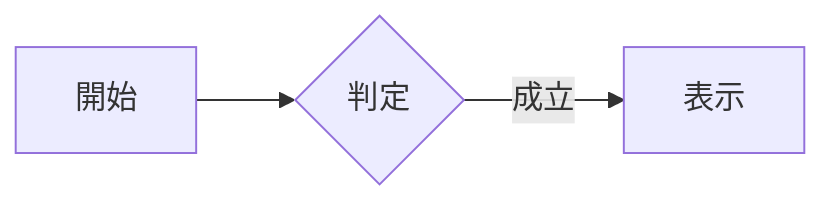
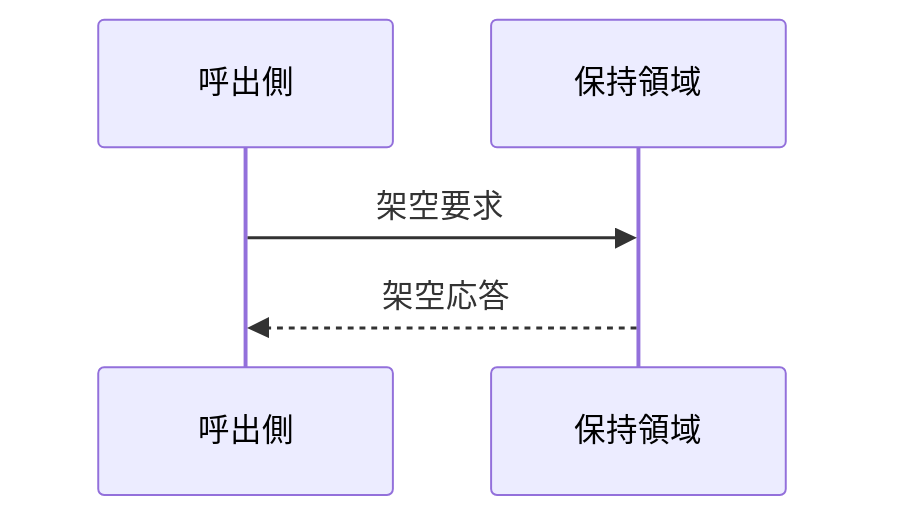
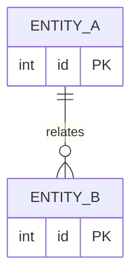

<!-- spec-meta: {"schema": "spec-md/1.0", "documentId": "SYNTHETIC", "version": "1.0", "path": "fixture.md", "sheets": [{"heading": "自由な章", "kind": "GRID", "sheet": "自由な章"}]} -->
# 人工fixture

## 自由な章

<section class="random-container"><form><label>架空項目<input value="TEST-RENDER-0001" readonly></label><table><tr><th>架空列</th></tr><tr><td>表示のみ</td></tr></table></form></section>

