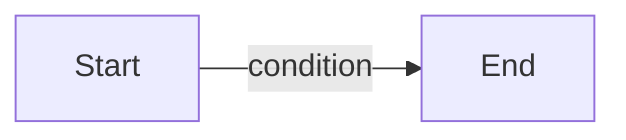

<!-- spec-meta: {"schema": "spec-md/1.0", "documentId": "SYNTHETIC", "version": "1.0", "path": "label-directive.md", "sheets": [{"heading": "自由な章", "kind": "GRID", "sheet": "自由な章"}]} -->
# 人工fixture

## 自由な章

