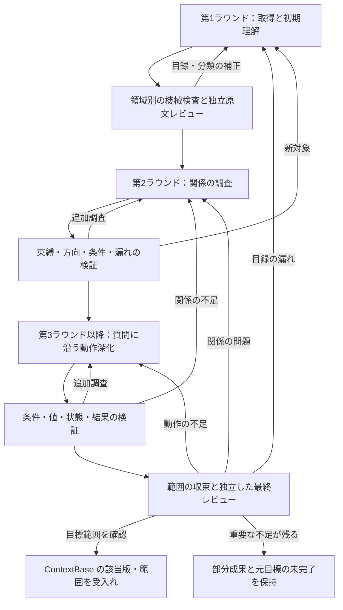

# ContextBase の段階的抽出・検証フロー

版：設計案 v0.4／2026-10-23。12項目の決定を維持し、reverse-agent の統一入口と内部3役割を定義する。

対象：読取り専用のソースから ContextBase を構築し、調査目標に応じて理解を深め、独立に検証する。成果は追跡・修訂可能な解析情報までとし、仕様書の計画、執筆、形式変換、公開は扱わない。本書は設計であり、新しい抽出処理の実装や既存 ContextBase の正確性を証明するものではない。

実装作業の順序と完了条件は、[ContextBase 実装計画](ContextBase実装計画.md)に分離する。既存リンクを維持するため、本書のファイル名は変更しない。

## 1. 確定した設計判断

以下はユーザーが選択した決定である。未選択の実装方式、言語、プロジェクトは確定事項に含めない。

| ID | 決定 | 設計上の意味 |
| --- | --- | --- |
| D01 | 後続調査から言語アダプターを随時呼び出す | 第1ラウンドで全情報を抽出し切る必要はない。共通の調査フローから不足する構造・関係を追加調査する |
| D02 | 固定ツールの構造抽出と AI の業務候補作成を組み合わせる | 構文・位置等の再現可能な情報と、機能の帰属・責務等の解釈を区別する |
| D03 | 第1ラウンドは領域ごとに独立した原文レビューを行い、その後に深化する | 目録・分類・根拠を確認する。全リポジトリの同期完了は待たず、確認済み領域から進める |
| D04 | 必要に応じて抽出・深化する | 要求に必要な調査を実行し、有効な既存結果を活用する |
| D05 | 調査目標を中心にし、よく使う依頼を任意のテンプレートにする | 「索引・概要・詳細」という固定3段階は採用しない。対象・質問・完了条件を明示する |
| D06 | 異なる2言語の小規模試行で共通フローを検証する | 具体的な言語、ProjID、対象機能は未決定。C# と Java は例示にすぎない |
| D07 | 機能は業務タスクを主軸にする | 画面、API、バッチ等の技術的入口は別オブジェクトとして保持し、業務機能から参照する |
| D08 | 確認済みの部分成果を返せる | 元の調査目標は未完了のまま保持し、部分結果を全体完了と表示しない |
| D09 | 人手で原文照合した小さな基準、機械検査、独立 AI レビューを併用する | 抽出側とレビュー側の共通の見落としも検出する。基準の対象外へ正確性を外挿しない |
| D10 | 最小共通プロトコルを先に定め、2実装の共通性を確認後に必要なら基底クラスを抽出する | 継承を必須にしない。フレームワーク、SQL、解析バックエンドは組合せで扱う |
| D11 | 検証済みの構造・業務事実を再利用する | 適用条件と依存関係を確認し、変更時は失効させる。新規範囲は別途審査し、新規分析と再利用を区別する |
| D12 | 固定の総予算を既定にせず、実質的な進捗があれば継続する | 取消し、実故障、入力失効、無進捗では保存して停止する。外部制限による中断を完了扱いしない |

## 2. 目的と進め方

最初にシステムが何をするか、どのような機能、データ、共通処理があるかを把握する。次に実装間の関係を結び、具体的な質問に沿って業務動作を深掘りする。ContextBase は確認済み内容だけでなく、候補、矛盾、未知、未調査範囲も保持する。

ラウンドは理解の段階を示す。固定回数の全件走査ではなく、対象ごとに前進・追加調査する。第1ラウンドには入力固定、ファイル一覧、アダプターの能力の選択、索引取得、4種類の候補作成を含め、利用者向けの準備ラウンドは別に設けない。後続で新たな入口や共通処理が見つかれば、第1ラウンドの目録へ戻して更新する。

調査ラウンド、求める情報、検証状態は別の軸とする。「2回調べた」ことは関係の確認済みを意味せず、狭い範囲の一覧でも十分に検証できる。全体の詳細情報を一度に作成してから表示を絞る方式にはしない。

- 版管理した一つの ContextBase を理解情報の正本とし、索引・目録・グラフはその論理ビューとする。
- 固定ツールはファイル一覧、構文、再現可能なシンボル束縛、根拠管理、機械検査を担当する。AI は調査選択、業務上の帰属、責務と動作の解釈を担当する。
- 独立レビューは原文を直接読み、誤りと漏れを確認する。構造検査の合格を業務理解の合格へ読み替えない。
- 共通動作は共有できるが、各呼出元のパラメーター、権限、条件、状態、副作用は個別に確認する。
- 取得済みソースと明示的に許可された補足材料だけを扱う。入力プログラム、DB、ビルドスクリプト、入力内プラグインを実行しない。

## 3. 第1ラウンドで得る4種類の候補

| 対象 | 識別する内容 | 分類上の注意 |
| --- | --- | --- |
| システム概要 | 境界、主要業務候補、サブシステム、技術構成、入口の形態、保存先・外部連携、重要な未知項目 | ディレクトリ名、README、依存ライブラリーだけで実際の業務や配置状態を断定しない。後続の証拠で修訂する |
| 機能 | 利用者や外部システムが目的を持って行う業務タスク | 1メソッドや1画面を自動的に1機能としない。複数の入口・ファイルで一つの機能を実装する場合がある |
| テーブル・データ対象 | DDL、ビュー、ORM、SQL から得る対象。DTO、メモリー、セッション、ファイルも区分して記録する | DTO を物理テーブルと同一視しない。DB、スキーマ、環境、移行版を保持し、JOIN から外部キーを捏造しない |
| 共通処理 | 共有責務を持つ業務規則、基盤処理、UI 部品、ユーティリティー等 | common ディレクトリ、公開メソッド、呼出回数は候補の手掛かり。外部ライブラリーは外部依存として区別する |

技術的入口は、画面、API、イベント、バッチ、ジョブ、帳票、メッセージ、ファイル処理等の別オブジェクトとして残す。機能と入口は多対多になり得る。同一画面の検索・登録・削除を業務上分けるかは根拠と目的で判断し、分割・統合をレビューする。

物理名が確認できても、論理名、業務帰属、属性、動作や適用範囲まで確認できたことにはならない。暫定名や候補分類を許容する。

## 4. ContextBase が保持する論理情報

以下は論理的な内容であり、直ちに同名ファイル、スキーマ、グラフDBを追加する指示ではない。

| 情報 | 必要な内容 |
| --- | --- |
| 入力・能力台帳 | プロジェクト、許可範囲、ソーススナップショット、内容ハッシュ、ファイル一覧、取得・解析状態、ツール・規則版、設定、制約 |
| ソース構造 | ファイル、シンボル、シグネチャ、スコープ、宣言・出現位置、インポート、呼出点、SQL・設定候補、解析診断 |
| 概要・対象目録 | 安定した対象ID、分類、候補名、責務、入口参照、原文の根拠 |
| 関係 | 始点、終点または候補集合、種類、向き、条件、原文位置、導出方法、未解決理由 |
| 業務事実 | 対象、論点、結論、前提・結果、適用する呼出元、根拠、依存する関係・事実、未確認部分 |
| 調査目標・作業 | 元の要求と範囲、完了義務、具体的質問、前提、担当、進捗、発見、処置 |
| レビュー・版 | 候補版、各検査の対象範囲と結果、独立した指摘、処置根拠、失効関係、受入記録 |

永続IDは改名、並び替え、ファイル増減によって採番し直さない。分割・統合・移行には履歴対応を残す。ソースシンボルIDと業務機能IDは分離し、表示名を識別子の代用にしない。根拠は少なくともスナップショット、内容ハッシュ、原文範囲、抽出版に結び付ける。

### 状態は軸を分ける

| 軸 | 意味 |
| --- | --- |
| 内容の根拠 | 既存契約の declared / inferred / unknown / conflicting / not_applicable / example 等を属性単位で維持する |
| 人手の採用 | approved の採用者、範囲、版、由来を残す。採用だけでソース観測事実へ変換しない |
| 関係の解決 | 構文上の呼出点、束縛済みシンボル、規則による合成、候補、未解決を区別する |
| 検証の有効性 | 未審査、該当版・範囲で合格、指摘あり、失効を区別する |
| 作業進捗 | 未着手、調査中、具体的前提待ち、統合待ち、処置済みを区別する |
| 目標達成 | 元の目標に対する達成・未達成と、部分範囲の確認結果を分ける |

これらは設計上の意味であり、現行 AI スキーマにすべて実装済みとはしない。コンパイル時の束縛だけで実行時の唯一の対象が確定するとは限らない。仮想呼出し、DI、動的分派等の条件を残す。ツール間の信頼度スコアも共通の正確率とは扱わない。

## 5. 全体フロー

各ループは具体的な対象と質問に戻る。通常は全件調査をやり直さない。入力、能力、依存範囲が実質的に変化した場合は、理由を残して調査・検証範囲を拡大する。

## 6. 第1ラウンド：取得と初期理解

**入力：** 明確なプロジェクト、対象ソース、調査目標、許可済みの補足材料。ProjID 未指定時に既存の全ケースを再解析しない。

**目的：** 安定した読取り基盤と構造情報を取得し、概要・機能・テーブル・共通候補と調査地図を作る。内部には前提順序があるが、全動作の解決を要求しない。

### 6.1 入力の固定とファイル一覧

1. 実際の対象に含めた未コミット・未追跡ファイルも含め、内容を固定する。処理中に異なる版を混在させない。
2. ソース、設定、ルート・メニュー・タスク登録、DDL・移行、マッピング、リソース、依存関係の材料を列挙し、取得できないものを明示する。
3. 構文、束縛、フレームワーク、SQL、データフロー等の能力を操作ごとに記録する。未対応、失敗、上限による切詰め、未調査を区別する。
4. 読取り専用の検索と根拠取得を用意し、ページング・切詰め・未解決を報告する。検索結果だけを根拠にせず、結論を実際の原文に結び付ける。

ファイル一覧、証拠、入力固定は共通機構とし、言語子クラスへ一括して移さない。

### 6.2 アダプターの能力による構造取得

ファイル、埋込み断片、プロジェクト境界に応じてアダプターを選ぶ。シンボル、スコープ、インポート、呼出点、確認可能な束縛を取得する。フレームワーク規則で入口、SQL・ORM でデータ候補を補い、共通記録へ正規化する。導出方法、原文位置、診断、必要な固有情報は保持する。

混在システムには複数の能力を適用する。Vue やテンプレート内の断片は元ファイルへの位置対応を残す。シンボルの同一性には所属プロジェクト、対象、設定、生成元も考慮する。異言語間を同名だけで結ばない。主言語が決まっても SQL、JavaScript、設定を省略しない。

第1ラウンドで動的目標やデータフローをすべて解決する必要はない。能力が結果を返さなかったときは、該当なし、部分対応、利用不可、解析失敗、上限到達を区別し、未知を空集合へ変換しない。

### 6.3 AI による候補の整理

- 構成・設定・主要登録から、根拠付きの暫定システム概要を作る。
- 技術的入口を列挙し、実装を調べて業務タスクへ帰属させる。画面とAPIを自動的に別機能へ分断しない。
- データ対象は定義取得済みと参照のみを区別する。
- 共通候補の種類、責務、呼出元、適用性の未確認部分を記録する。
- 領域、入口、既調査・未調査、重要な未知、次の具体的質問を整理する。

4種類の調査は独立可能な範囲で並行できるが、発見を交換して重複と矛盾を整理する。長い概要文だけで目録を代替しない。

### 6.4 当ラウンドの検証と次段階への条件

ファイル一覧を独立した列挙と照合し、位置・ハッシュを確認する。未取得・除外には理由と影響を残す。ID、分類、引用範囲を機械検査し、定義未取得のデータを完全な定義と表示しない。

独立レビュー者は、原ファイル一覧、登録点、DDL・マッピング等から入口の漏れ、機能の重複、補助画面の誤分類、DTO の混同、共通候補の妥当性を確認する。全ファイルを必ず読む規則にはしないが、調査の選択・除外理由を残す。正常な空結果だけで機能なしと断定しない。

**次段階への条件：** 領域の入力が安定し、対象の入口・責務が調査可能で、目録が該当範囲の独立原文レビューを受け、不足と能力制約が明示されていること。全リポジトリ一括の通過待ちは設けない。局所的制約があっても別領域は進められるが、入力不一致等は先に解消する。この通過は詳細な業務動作の受入れを意味しない。

## 7. 共通フローとアダプターの能力の境界

| 責務 | 共通側 | アダプター等の側 |
| --- | --- | --- |
| 入力・根拠 | 範囲、スナップショット、ファイル一覧、安定ID、読取り、参照、版と完全性 | 対応形式、断片位置、能力診断 |
| 構造・束縛 | 共通記録、照会契約、正規化、能力状態 | 構文、作用域、導入、型・受信者、オーバーロード等 |
| フレームワーク・データ | 入口、関係、データ対象の共通意味 | 登録規則、SQL 方言、ORM 等の組合せ能力 |
| 業務理解 | AI の調査、帰属、責務、動作の解釈 | 原文への手掛かり。言語テンプレートで業務結論を捏造しない |
| 検証・保存 | 原文レビュー、範囲受入れ、失効、永続化 | 固有の限界や未解決原因を正確に返す |

共通フローは必要に応じてアダプターの能力を呼び、原文を再読できる。統一モデルを情報の遮断層にしない。独立レビューも第1ラウンドの要約だけには依存しない。言語非依存なのはフローと契約であり、個々の結論には言語・設定・フレームワークに合う根拠が必要である。

最初は最小共通プロトコルを定め、異なる2言語の小規模実装で確かめる。安定した共有実装が見つかった場合のみ、浅い BaseLanguageAdapter 等を抽出する。具体的なクラス名やメソッド一覧は未決定であり、全実装の継承を強制しない。

フレームワーク、SQL 方言、ORM、解析バックエンドは組合せで接続する。言語×フレームワーク×DBごとの子クラスを増殖させない。プロジェクト固有クラスも原則とせず、設定や不足能力で表現可能か先に確認する。ID、根拠検査、受入れを子クラスで上書きして省略できる設計にしない。

能力未対応は明示する。型推論やデータフローを擬装せず、共通フローが未知の保持、利用可能な別能力、待ち事項を選べるようにする。2言語を切り替えても、関係調査、問題管理、受入規則が変わらないかを確認する。

### 7.1 統一入口と内部3役割

reverse-agent を一つの入口として維持し、内部に取得・調査・独立検証の役割を定める。共通の入力、候補提出、採用、範囲受入れの正本は [Agent 共通契約](../AGENT.md) とし、各役割の手順は次の契約を参照する。

| 役割 | 担当する理解・検証 | 提出物 |
| --- | --- | --- |
| [discovery-agent](../roles/discovery/AGENT.md) | 第1ラウンドの取得・索引・システム概要／機能／データ／共通候補 | 根拠付き目録候補、被覆、未知、新対象の追加差分 |
| [investigation-agent](../roles/investigation/AGENT.md) | 第2ラウンドの関係と第3ラウンド以降の動作を往復して調べる | 関係・条件・値・状態・異常・呼出差の候補差分と追加調査要求 |
| [review-agent](../roles/review/AGENT.md) | 各ラウンドと最終範囲の独立原文確認 | 指摘、確認・未確認範囲、根拠、処置要求、検証結果 |

三つの理解段階と三つの役割を一対一にしない。関係の理解によって条件・値を追う必要が生じ、条件・値の理解によって追跡先が変わるため、関係調査と動作深化は investigation-agent の二つの作業モードとする。独立検証は最後だけの工程ではなく全段階に適用する。作者と検証者を別の文脈に分け、検証者は原文から漏れも探す。

共通制御は元目標、作業の振分け、版・競合・依存の照合、候補採用、範囲受入れ、取消・再開を管理する。3役割は承認済み作業領域へ候補または指摘を提出し、正本や合格状態を直接上書きしない。候補を統合する際も、根拠と独立検証が有効な版を確認する。

snapshot、SourceAccess、安定ID、store、adapter は共有の機械基盤とし、各 Agent へ複製しない。共通制御を第4の常駐 AI とする必要はなく、中継、待機、同じ指示の再包装のためのモデル呼出しを増やさない。役割の個別依頼は可能な契約とするが、専用 CLI と自動制御は未実装である。

初期目録だけの要求は discovery と review で返せる。有効な既存目録がある要求は investigation と review から進める。新対象が見つかれば discovery、関係・動作の不足なら investigation に戻し、指摘を修正した内容版で再検証する。初期目録の領域別検証は維持し、毎回全対象を3役割に直列投入しない。

## 8. 第2ラウンド：関係の調査

**目的：** 一つの業務機能を実現する処理、データ、共通処理、外部能力を結ぶ。

具体的な入口・質問から関連部分を取得し、原文と照合する。追加の型束縛や動的SQL調査が必要なら、該当能力を呼び出す。共通調査側へ Tree-sitter のノード操作や言語別の同一フローを複製しない。

- 入口と処理、ルートとハンドラー、タスクと実行部、購読と消費部。
- 定義と参照、導入、受信者、インターフェースと実装、オーバーロード、条件付き設定。
- 要求・コントロール・引数と、モデル、サービス、保存操作、外部要求。
- SQL とデータ対象、読書き方向、共通処理と呼出元、業務上の引継ぎ。

画面→API→サービス→SQL は一例である。ファイル、外部サービス、メッセージ、セッション、メモリーだけの処理もそれぞれ扱う。

**検証：** 同名・別スコープ、オーバーロード、条件登録、環境違いの誤結合を探す。引数・結果の方向と条件、引用の支持範囲を確認する。逆参照、データ利用元、登録点から漏れを調べ、既存グラフの走査だけで済ませない。動的目標は候補と未確認理由を残し、線を閉じるために一つへ決めない。

**成果：** 根拠付き関係、共通呼出元索引、確認済み部分と深化すべき質問。重要な曖昧さを既知の前提へ変換せず、明確な部分から深化する。

## 9. 第3ラウンド以降：調査目標に沿う動作深化

**目的：** 「関係がある」から「どの条件で、どの値を使い、どの結果になるか」へ進む。

調査目標は対象、質問、範囲、完了義務を持つ。例えば「全機能を列挙する」「このテーブルの構造を確認する」「登録機能の更新と失敗状態を追う」は異なる要求である。定型依頼は目標設定を補助するが、固定の深度階段や別々の正本を作らない。

| 論点 | 確認内容 |
| --- | --- |
| 条件・権限 | 正常、異常、取消し、NULL、境界。画面上の可視・編集可否とサーバー許可を区別する |
| 引数・項目 | 入力、既定、変換、検査、引渡し、SQL束縛、戻り対応。表示値・内部状態・送信値を区別する |
| データ操作 | 対象、列、検索・更新条件、値の由来、影響範囲、ORM・動的SQLの未知 |
| 状態・順序 | 初期・編集中・成功・失敗の状態、保持・消去、実行順、段階間引継ぎ |
| 副作用・境界 | セッション、ファイル、外部連携、トランザクション、再試行、例外伝播 |
| 呼出変種 | 共通契約と、呼出元ごとの引数、省略、既定、権限、状態、副作用の違い |

すべての対象に全項目を埋めない。非該当には根拠を残し、不明は不明とする。後続の質問は、新しい不足や反証を具体的に指す。同じ要約を再生成するだけでは深化としない。

独立レビューは質問に沿って原文と呼出元を確認し、反例も探す。事実誤りは正本を修正して依存検査を失効させる。分類・名称の変更にも根拠を残す。発見した新対象は目録に、関係不足は第2ラウンドに戻す。

## 10. 範囲収束と独立した最終レビュー

**目的：** 元の目標範囲が、約束した静的分析の要件を満たしたか判断する。実行回数やラウンド通過だけで完了にしない。

検証義務は許可された目標、原ファイル一覧、入口・データ登録、独立発見から定める。作者の作業一覧だけで検査範囲を決めない。アダプターの「解析済み」も業務受入れの代用にしない。

| 検証軸 | 確認すること | 代用できないもの |
| --- | --- | --- |
| 根拠の完全性 | 現版、原文、参照、設定、実取得材料が一致するか | JSON合法、存在、ハッシュ一致だけ |
| 内容の正しさ | 分類、関係、条件、値、動作に根拠があり反証がないか | 自己評価、信頼度、未接続辺の不在 |
| 範囲の充足 | 重要な入口、変種、利用、責務が漏れていないか。未解決の影響は何か | 作業終了数、ノード数、読取り率 |
| 対象間の整合 | 共通・データ・状態の解釈が整合し、変更影響を再検証したか | 各対象の過去の個別合格 |

レビューは既知対象からの照合と、登録点・逆利用・未調査領域からの独立発見を併用する。作者のグラフ・要約だけを根拠にしない。指摘には安定ID、問題、影響、根拠、処置を残す。作者の修正・追加調査・根拠付き反論をレビュー者が確認し、閉鎖操作だけで受入れとしない。

### 結果と版固定

| 結果 | 意味 |
| --- | --- |
| 目標範囲を受入れ | 必要な義務を確認し、重要な誤り・矛盾・阻害不足がなく、根拠とレビューが現版に結び付く。静的な限定範囲の判定であり、実行等価や絶対正確を意味しない |
| 部分成果 | 確認済み内容や子範囲の結果を提供するが、元目標は未完了。対象範囲を勝手に縮めて完了を作らない |
| 追加調査継続 | 実行可能な質問・前提を持ち、該当ラウンドへ戻る |
| 中断・無進捗 | 取消し、実故障、入力失効、無進捗、外部制限等で停止し、状態と理由を保存する。自動的に合格しない |

候補数の安定、連続して追加がないこと、回数の到達だけでは完了しない。未把握の期待件数をゼロで埋めない。

受入れ前に制御側で候補内容と有効な根拠を再確認する。元目標、実際の受入範囲、入力、ContextBase版・内容、スキーマ・規則版、能力条件、検査・独立レビュー、未解決・未被覆範囲を固定する。独立レビューは別の文脈で行い、作者が自身の合格を発行しない。

候補と受入済み版を分ける。内容と受入記録を整合した単位で保存し、中断時に新版内容と旧版合格が混在しないようにする。部分範囲の合格があっても元目標の未完了を維持する。

## 11. 調査の実行、継続、再利用

### 11.1 質問単位で調査する

独立した業務タスク、データ対象、共通問題を並行調査できる。各作業は対象、質問、手掛かり、検証義務、前提、結果を保持する。統合者が引継ぎ、矛盾、呼出変種を確認して正本へ反映する。

ソース関係図には再帰や循環がある。作業依存は今回の必要前提に限定し、ソース図全体を複写して永久待ちにしない。循環は有界の質問と明示した仮定・未知に分けて調査し、後で修正する。並行提案は採用前の事実としない。

関連断片はまとめて検索できる。文脈選択の大きさや追跡深さ等の操作上限はファイル一覧の削除を意味しない。切詰めは報告し、残りを待ち事項として保持する。ソース図、業務関係図、作業依存図は区別する。

### 11.2 固定総予算を設けず、実質的進捗で継続する

既定の総実行時間や総トークン上限は設けない。目標が未達で、実質的な進捗があり、実行可能な次の調査がある限り継続する。具体的な運用値を本書では確定しない。

実質的進捗には、有効な新根拠、関係・事実の確認や修正、重要な未知範囲の縮小、根拠を持つ指摘処置等を含む。読取り回数、ジョブID、版番号、同文候補の再生成、作業の再開閉だけでは進捗としない。記録量の増加と目標への前進を区別する。

取消し、実故障、入力の失効、同一問題の無進捗では、正本、候補、待ち事項、根拠、停止理由、再開条件を保存して停止する。外部サービスの用量制限等で中断した場合も元目標は未完了とする。安全な再開には入力・依存・レビューの有効性を再確認する。

単独ツールの応答タイムアウト、メモリー保護等は故障検出・資源保護であり、目標全体の固定総予算とは別である。これらを品質検証の省略や暗黙の完了に使わない。無進捗の具体的な判定方法は試行で定め、同条件・同候補の審査を無限反復しない。

### 11.3 有効性を確認して再利用する

- 単一ファイルの構文結果は内容、パーサー、規則版に依存する。
- 名前・型・フレームワーク関係はパス、設定、導入、対象定義、言語サービスの条件等にも依存する。
- 業務事実は原文、使用した関係、採用内容、適用範囲に依存する。
- レビューは候補内容、入力、目標範囲、規則、根拠、実際の確認範囲に依存する。

検証済みの構造・事実を、条件と依存が有効な範囲で再利用する。新たな呼出元の差異、新目標の被覆は別に検査する。変更時は旧記録を追跡用に残し、影響する検査を失効させる。影響不明なら保守的に範囲を拡大する。対象ファイルが不変でも意味上の依存が不変とは限らない。

同条件の同一候補では既存の指摘を再利用し、具体的問題の追加調査へ戻る。重複判定には内容、根拠・実読範囲、入力、目標、規則、補足材料を含める。新根拠や実質的修訂は再審査できる。

新規分析と再利用を別に記録する。旧文書経路の fresh-analysis 契約は [旧経路の契約](legacy/README.md) に保持し、新経路の設計で旧 CLI を変更しない。新経路の運用契約は分離するが、自動再利用の有効化は実装計画 P6 の依存照合・失効・互換試験を通過してからとする。文書改訂だけで再利用機構を実装済みとしない。

## 12. 2言語試行と検証基準

異なる2言語それぞれから、小さく境界の明確な業務機能を選ぶ。同一の共通フロー、目標表現、根拠、レビュー、受入規則を適用できるか確かめる。具体的な言語、ProjID、入力、対象は今後選ぶ。全件移行や新しい題材プロジェクトの自動作成は行わない。

人が原文から独立して小型の基準を作る。必要対象、正しい関係、誤結合してはいけない組合せ、重要分岐、値・状態変化、根拠位置、未知として残す例を含む。生成結果をそのまま期待値に複写しない。

| 検証領域 | 必要な正例・負例 |
| --- | --- |
| ファイル一覧・被覆 | 実入口を候補または待ち事項へ含め、除外・解析失敗を静かに被覆済みにしない |
| 構造・関係 | ファイル間参照、別スコープ、同名・オーバーロード、動的対象の誤結合を確認する |
| データ | DTO と物理表、別名、JOIN、ORMの制約を正しく扱う |
| 動作・変種 | 正常・異常、呼出差、共有規則変更の失効を確認する |
| 根拠・受入れ | 範囲・ハッシュ改変、重要事実削除、完了偽装で合格を維持しない |
| 増分・再開 | 中断復旧、入力・設定変更、部分成果、人が記入した QA保護を確認する |
| 共通契約 | 2言語で同じ調査・検証ルールを使え、固有制約が失われないことを確認する |

誤結合、漏れ、未解決、技術失敗を分けて記録する。索引、調査、統合、レビューの時間とモデル呼出・用量も測定する。小標本の合格を全言語・全プロジェクトの保証とせず、高速化の有無も実測で判断する。

## 13. 既存資産との関係と未決事項

[骨子 JSON と独立評価の契約](骨子JSONと独立評価の契約.md)の安定ID、属性単位の根拠、未知、独立範囲を維持する。[ソーススキャン最適化設計](ソーススキャン最適化設計.md)のファイル一覧、段階キャッシュ、依存失効を引き継ぐ。下流仕様書の既存規定は旧資料に保持し、仕様書生成を新しい内部3役割へ含めない。下流の担当 Agent、配置、旧コードの移管は未決定とする。

既存 ContextBase/01-foundation、02-detailed、identities.json、人が記入した QAを保護する。resolved や verified_structure_only を本設計の業務範囲受入れへ読み替えない。現在の AI facts は documentId ごとの構造であり、共有対象、調査目標、範囲受入れ等は今後の実装である。

実装計画で具体化する未決事項は次のとおり。

- 2言語試行の言語、ProjID、機能、必要材料、要求範囲と人手基準。
- 最小共通契約、現行ナビゲーションとの接続、既存 ContextBase への対応、スキーマと明示的互換性。
- 解析バックエンドと取得可能な静的プロジェクト情報。入力のビルドや原プログラム実行は許可しない。
- 新旧経路の契約分離に従った再利用記帳、失効と安全な再開の実装具体化。
- 実質的進捗・無進捗の判定、品質と性能の測定方法。

人手補足は typed adoption と由来・版の一致を維持する。自由文回答や過去の合格報告を、現在の確認済み事実や検査結果へ自動変換しない。

設計参考は[開発プロジェクト調査](research/code-analysis-projects-20261023.md)を参照する。CodeGraph の関係・根拠、SCIP/Roslyn のシンボル束縛、Joern のプログラム流、SQLGlot、Aider の文脈選択等を参考にするが、外部プロジェクトの機能声明を本実装の能力保証にはしない。

## 14. 今回の入力・出力と確認範囲

**入力版・材料：** 本書 v0.3、2026-10-23 までの分輪設計と公開プロジェクト調査、既存契約、ユーザーが選択した D01～D12、および承認した統一入口・内部3役割の方針。D12 は固定総予算を設けない案で確定した。

**出力：** 本書 v0.4／2026-10-23。12決定を維持し、統一入口・内部3役割、候補提出と共通制御の採用、旧仕様書生成経路との分離を追加した。実装順序は別紙の実装計画 v0.2 へ分離する。

**今回の確認範囲：** 文書内の決定整合、既存制約との対照、見出し・リンク・文字形式等の文書確認。過去の検査合格を新設計や現行 ContextBase の合格に流用しない。

**未実施：** 解析器、共通契約、スケジューラー、スキーマの実装、ソース抽出、モデル呼出し、入力・DB・ビルド実行、現行 ContextBase の正確性検証、2言語試行、性能・品質比較、仕様書作成。
