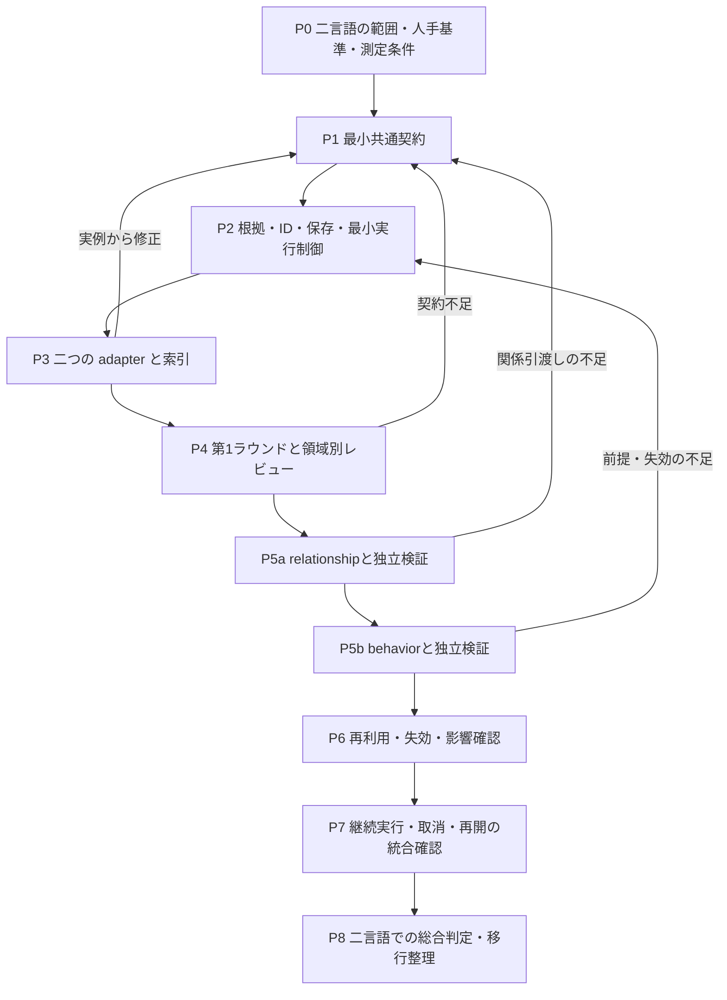

# ContextBase 段階的抽出・検証の実装計画

版：計画 v0.6／2026-10-26。

状態：取得・目録化→関係構築→動作深化をv2実行契約へ分離し、独立verify、host採用、ready queue、明示reviseを実装した。個別の試行資産は清掃済みで、P0～P8の全体完了や正式受入れを示さない。現CLIは [初期実装ガイド](ContextBase初期実装.md)を参照する。

## 1. 目的と対象

[ContextBase 段階的抽出・検証設計 v0.8](ContextBase分轮提取与验证流程.md)のD01～D12と、利用者が確定した3子Agentの段階的分担を実装作業へ分解する。対象は、読取り専用ソースからシステム概要・機能・テーブル／データ・共通処理を抽出し、関係構築、動作深化へ進めるContextBaseである。

仕様書の計画・本文・描画・Office 変換、原プログラムや DB の実行、全案件への一括再解析は対象外。現在の `ContextBase`、人手 QA、既存案件ソース、旧出力は本計画の作成では変更しない。

実装時も、固定ツールがソース構造と根拠を管理し、AI が業務候補・調査・意味の整理を担う。独立レビューは原文を直接確認する。共通手順は言語に依存させず、必要時に言語・フレームワーク・SQL 等の adapter を呼ぶ。

## 2. 確定事項と未確定事項

| 決定 | 確定内容 | 主な実装先の工程 |
| --- | --- | --- |
| D01 | 後続調査から言語 adapter を必要時に呼べる | P1、P3、P5 |
| D02 | 固定ツールが構造を抽出し、AI が業務候補をまとめる | P3、P4 |
| D03 | 第1ラウンドは領域ごとに独立レビューしてから深化する | P4、P5 |
| D04 | 全詳細を先取りせず、必要に応じて深化する | P1、P4、P5 |
| D05 | 調査目標を中心とし、よく使う依頼だけテンプレート化する | P1、P5 |
| D06 | 異なる二言語の小範囲で共通手順を検証する | P0、P3～P8 |
| D07 | 業務タスクを機能の主体とし、技術入口は別に関連付ける | P1、P4、P5 |
| D08 | 確認済み部分を返せるが、原目標の未完了を明示する | P1、P2、P4～P8 |
| D09 | 人手照合した小規模基準、機械検査、独立 AI レビューを併用する | P0、P3～P8 |
| D10 | 最小共通契約を先に検証し、基底実装は二 adapter の実例から抽出する | P1、P3、P8 |
| D11 | 構造と検証済み業務事実を、適用条件・依存・失効を確認して再利用する | P1、P2、P6、P8 |
| D12 | 既定の固定総時間・総 token 上限を置かず、実質的進展がある間は継続する | P2、P5、P7、P8 |

異なる2言語の小規模試行で共通フローを確認する方針は維持する。個別の業務試行資産は清掃済みで、次の対象・request・人手基準は改めて選定する。意味解析backend、包括的な互換・失効モデル、実質的進捗の観測と自律制御は残作業。「索引／概要／詳細」の固定三段階は採用していない。

追加決定：3子Agentはdiscovery／relationship／behaviorの順に成果を引き渡す。独立検証は各層共通の実行能力とし、作者と異なるtask・文脈、候補版の束縛、ホストによる採用を維持する。D01～D12の決定内容は変えず、旧investigationに同居した関係・動作の責務を分ける。

## 3. 現行実装との対応

パスは agents/reverse-agent からの相対位置。

| 領域 | 初期実装 | 残る境界 |
| --- | --- | --- |
| 契約 | analysis/contracts.py の request・候補・review・領域前提 | 論理状態の全実装、旧データの移行・互換 |
| 入力・根拠 | analysis/sources.py の封印・manifest・hash・原位置検査 | 静的範囲外の材料は取得済みとしない |
| 版・保存 | analysis/storage.py と controller.py の候補・review・revision | ホスト管理前提。hashは認証ではなく新入力・cross-session P6再利用は未完了 |
| 構文adapter | analysis/adapters.py の C#／Java と隔離worker | 全callは未解決。型束縛・データフロー・framework／SQL専用解析なし |
| AI実行 | analysis/controller.py が既存 ai/provider.py を使って1役割ずつ実行 | 定義済みグラフのrunは実装済み。任意の自動補査修復は未完了。既定workspace、明示inlineは1MiB上限 |
| CLI | analysis/__main__.py と統一extract入口 | step／review／adopt／cancel／resumeはホストが明示 |
| 旧経路 | ai の文書単位処理、foundation／detail／specification、docsite | 旧契約を維持し、新経路へ自動移行しない |
| 検証 | 新3スイートの契約・構文・ホスト制御試験 | 人手照合基準の受入れ、実モデル全経路と性能比較は未完了 |

### 3.1 3子Agentと共通制御の実装責務

reverse-agentは総合入口・共通制御として残す。新設計では次の3子Agentが理解の層を担当する。共通条件は [共通契約](../AGENT.md) を参照する。

| 担当 | 入力と主責務 | 引渡し条件 | 主な工程 |
| --- | --- | --- | --- |
| [discovery-agent](../roles/discovery/AGENT.md) | 許可原文を固定し、構造索引、概要・機能・入口・データ・共通候補を作る | 該当領域の目録義務を独立検証・採用する | P3、P4 |
| [relationship-agent](../roles/relationship/AGENT.md) | 検証済み目録と原文から接続、方向、条件、主要経路を構築する | 今回の動作質問が必要とする関係義務を独立検証・採用する | P5a |
| [behavior-agent](../roles/behavior/AGENT.md) | 検証済み関係と原文から条件、値、状態、異常、副作用、呼出差を深化する | 要求された動作義務を独立検証し、元目標を判定できる | P5b |
| 共通検証 | 各層と最終範囲を作者とは別task・文脈で原文照合する | 内容・根拠版に束縛した指摘と検証結果をホストへ返す | P1、P2、P4、P5a、P5b、P8 |
| 共通制御・基盤 | snapshot、SourceAccess、ID、store、adapter、目標、版・競合・依存、採用・受入、取消・再開を扱う | 検証の有効性と前提を確認して次の層・補査先を決める | P1、P2、P6、P7 |

relationshipは関係を判断するための条件や引数も読める。behaviorは関係の誤りをrelationship、新対象をdiscoveryへ戻す。前層変更が影響する下流事実・検証を失効させ、修訂版で再検証する。分割するのは交付責務であり、原文・adapterの利用を前層だけに閉じない。

目標が目録や関係で満たされればその層で返す。有効な前層成果から始める場合も適用性と依存を確認する。前提は同じ領域・対象・内容版に限定し、全倉同期や毎回全件3層の直列実行を要求しない。同sessionの版固定成果は前提に使えるが、新入力・cross-session P6再利用は未完了とする。

### 3.2 v2の実装と互換性

requestはschema=contextbase-analysis/2を必須とし、各義務にid／question／stage／scope／requiresを持つ。同scope内でrelationship→discovery、behavior→relationshipの採用済み前提を検証する。抽出executeと独立verifyは別task・文脈で、hostのadoptが候補と保持成果のview hashを再検査して採用する。

| 項目 | 現実装 | 残る境界 |
| --- | --- | --- |
| stage・operation | 3抽出層とextract／verifyを分離 | 実モデル業務品質は未受入れ |
| 自動進行 | runのready queue、局所高層優先、阻害保存、同basis重複呼出し抑止 | 未定義の補査・scope拡大・無制限修復は行わない |
| 修訂 | reviseで義務と版固定record依存の推移下流を撤回、feedbackで再調査 | 新ソース範囲・別sessionの再利用とは別 |
| record | ownerRequirement、host固定のdependencies key／version、過時記録を現正本から除外 | 履歴と安定IDは保持 |
| 未知 | relatedRequirementsとblocksRequirementsを分離、unknownChecksでid／hash／影響確認 | 作者の非阻害自己評価では採用しない |
| 旧版 | v1 request／session、旧 --role を明示拒否 | 自動変換せず新v2要求を作る |

未知のライフサイクルはrecordのowner失効と分離する。上流候補の置換や明示reviseでも既存unknownのid・内容・hashを保持し、作者が省略しても消さない。影響を受けた旧検証decisionは失効させ、後続verifyが各未知を独立に再判定する。

followupが採用予定viewで有効な上流義務を指す場合、当候補のcoverageがsupportedでverifyがpassでもadoptを阻止する。runも補査要求を保存して停止し、明示reviseと再調査を待つ。現在候補のrequirementsだけを調べて上流への補査を見逃さない。まだ採用していない将来義務への質問はhandoffQuestionsとして後続層のcontextへ渡し、現在の前層採用を一律には妨げない。

### 3.3 工程別の部分実装状態

P0～P8全体の完了を意味しない。P5は関係構築P5aと動作深化P5bを含む。

| 工程 | 現状 | 残る主な確認 |
| --- | --- | --- |
| P0 | 旧業務試行資産は清掃済み | 新たな2言語対象・scope・request、人手基準、比較条件 |
| P1 | v2 schema、stage／scope／requires、未知・所有義務を実装 | 実案件適用と包括的互換運用 |
| P2 | 封印、版・根拠、独立verify、原子的host採用を実装 | 新対象の実モデル受入れ |
| P3 | C#／Java構文adapterと隔離workerを保持 | 型束縛、意味解析、framework／SQL専用能力 |
| P4 | discoveryと共通verify、領域別前提を実装 | 人手基準と実対象での品質受入れ |
| P5a | relationshipを分離し同scope目録前提を実装 | 関係解釈の実モデル品質、追加補査運用 |
| P5b | behaviorを分離し同scope関係前提を実装 | 業務動作の実モデル品質と人手照合 |
| P6 | 同sessionのrecord版束縛・依存撤回を実装 | 新入力範囲・cross-sessionの増分事実再利用 |
| P7 | ready queue、同basis停止、cancel／resume、reviseを実装 | 自動補査修復、即時kill、長期運用 |
| P8 | 合成ソース・synthetic providerでv2回帰を確認 | 実モデル、人手正解表、総合品質・性能比較 |

manual／injectedは採用不可。storeはホスト管理前提で、hashは認証ではない。固定総予算を設けず、単操作timeoutと外部制限を区別する。阻害されたrunは未完了の非0終了とし、既存pendingと補査要求を残す。

## 4. 工程と依存関係

P0～P8 は開発・検証の順序であり、運用時の三つの理解段階と、横断的な独立検証・最終受入れとは別である。

### P0：試行範囲、基準と比較条件を固定する

**作業**

- 異なる二言語について、小さなファイル間機能を一つずつ選ぶ。業務タスク、入口、共通処理、データまたは状態変更を追える範囲を候補とする。同じ業務の実装であることは必須ではないが、比較する調査目標の種類と深さを対応させる。
- projectId、実際の取得ソース、内容 hash、設定、外部依存の取得可否、対象と対象外を保存する。案件選定前に既存 input を一括で再解析しない。
- ソースから独立に期待事項を作り、人手で照合する。正しい定義・引用・関係、重要分岐、データ／状態変化、誤ってつないではいけない関係、未解析のまま残す事例を含める。生成結果をそのまま正解にしない。
- 解析器の小さな正常／負例 fixture と、実ソースの業務照合基準を分ける。
- 品質項目、計測範囲、環境・モデル条件、冷間／再利用時の条件を固定する。過去の四時間の文書 batch は異なる仕事量なので直接の速度基準にしない。

**完了条件**：二つの試行範囲が固定され、合否判定に使う期待事項は人手による原文照合を完了している。未照合の事項は未確認の基準候補として分離し、合否の根拠に使わない。言語、プロジェクトまたは必要材料が未確定なら、その選定を未完了として保持する。

既存方式の比較計測は解析範囲を揃えられる場合に実施する。文書生成まで進む既存 CLI をそのまま起動して比較せず、分離できない範囲は参考記録または未計測とする。

### P1：最小共通契約を定める

**作業**

- 調査目標の対象、質問、期待する情報、範囲、必要な検証を記録する。自然言語依頼から明確な部分を具体化し、実質的な曖昧さを未知として保持する。定型依頼はこの契約を作る補助とする。
- 共通契約の request、役割ごとの候補差分・finding・追加調査要求を物理 schema にする。基準版、作業ID、根拠、依存、作者・検証者、出力権限を表し、正本更新を各役割の権限に含めない。
- 抽出を担当する3層と、抽出／独立検証の実行種別を別軸にする。検証対象層、候補内容版、根拠版、元義務を束縛し、同じ作者の同一文脈を独立検証へ転用しない。
- relationshipの目録前提とbehaviorの関係前提を、同領域・対象・適用条件の義務で表す。非該当にも根拠を付け、他領域の通過を代用できない契約にする。
- 業務機能と技術入口を別の安定 ID で扱い、関係付ける。テーブル／ビュー／ORM 実体／DTO／メモリ／外部対象の区分を保持する。
- 根拠、構造、関係、業務事実、能力、調査項目、レビューと結果状態の最小レコードを決める。宣言／推定／未知、関係の解決方法、レビュー有効性を一つの完了フラグに畳み込まない。
- adapter の操作ごとの対応・部分対応・不可用・失敗を区別する。範囲、原位置、診断、候補を返し、未知を正常な空結果に置換しない。
- 部分結果には原目標、達成済みの範囲、未達事項、根拠版、レビュー範囲を含める。原目標の完了状態を結果一覧の有無と分離する。
- 既存 schema と新 schema の識別、明示変換、互換エラーを定める。全言語の詳細項目や全メソッドを先に固定しない。
- 旧investigationの義務は質問と成果を確認して新しい担当層へ明示割当てする。旧reviewの検査範囲を保持し、新たな関係前提やbehavior義務の合格へ自動昇格させない。

**完了条件**：P0 の二言語の例を同じ契約で表せる。未解決候補、混在言語、異なる呼出条件、部分返却を表現できる。P3／P4 の実例で改訂する前提が明確である。

### P2：根拠・保存基盤と最小の実行制御を用意する

**作業**

- snapshot と source-view の整合性、構造索引から原文への位置対応、根拠の発行／参照を接続する。入力プログラム、ビルド task、案件別 plugin を実行しない。
- 共通 ID、内容版、調査目標と項目、未解決、候補事実、独立レビューを保存し、候補と受入済み版を区別する。
- 役割の個別依頼と目標からの振分けを接続する。作業領域へ提出した候補を、版・競合・依存・根拠の照合後に共通制御だけが採用する。採用と範囲受入れを別の操作・記録として扱う。
- 新3層の前提判定をホストへ集約し、候補だけ存在する状態と検証・採用済み状態を区別する。上流の修訂が依存する下流成果と検証を失効させ、前提不足の層を再開しない。
- v2 schema・CLI・保存版を接続する。旧request／sessionや --role は明示拒否とし、新v2要求を作る。旧investigationの推測分割はしない。
- AI の最初の試行前から取消、技術障害、checkpoint 保存、再開時の入力／目標／規則照合を扱う。失敗前の有効な成果を保持する。
- 取得、解析、モデル、統合、検査の工程別イベントと時間を記録する。単なる活動回数と、根拠付き理解・調査義務の進展を区別する。
- 最小の継続 controller に固定総時間／総 token の既定上限を入れない。P7 で長期継続、待機、取消、無進展の統合挙動を仕上げる。

**完了条件**：入力不変、根拠改ざん拒否、部分状態の保存、取消／故障後の回復、異なる入力・目標への誤再開拒否が契約試験で確認できる。完了を自己申告しただけでは受入記録を作れない。

### P3：二言語の adapter を小さく実装して契約を検証する

**作業**

- 二つの対象言語について、P0 の範囲に必要な語法・定義・作用域・導入・呼出し候補と診断を提供する。任意のシンボル／範囲を後から追加調査できるようにする。
- Tree-sitter 等の構文 backend と、利用可能な意味解析 backend の役割を区別する。SDK／プロジェクト依存が取得できない場合の能力低下を明示する。原入力の build や任意 task を実行して補完しない。
- framework、SQL 方言、ORM、解析 backend を組合せ可能にする。言語×framework×DB の子クラスを増やさない。
- 言語間の接続、埋込み script、SQL 等がある場合は元ファイル位置と接続理由を保持する。名称一致だけで同一 ID にしない。
- 二 adapter の実例から契約を調整し、安定した共通実装だけを必要に応じて base に抽出する。共通 protocol だけで足りる場合は継承を強制しない。

**完了条件**：同じ共通 interface の試験が両 adapter を通り、P0 の位置・定義・誤連結防止・未知の基準を満たす。意味解析の `resolved` が唯一の実行時 target を証明するとは扱わない。

### P4：第1ラウンドの取得・業務候補・領域別レビューを接続する

**作業**

- 入力固定、棚卸し、アダプターによる解析・索引取得、概要／機能／データ／共通候補を一つのラウンドとして動かす。
- discovery-agentに共有の取得・adapter能力を接続し、共通の独立検証を作者とは別task・文脈で実行する。snapshotやID管理を役割ごとに複製しない。
- 固定ツールの構造と原文を AI に提供し、業務タスクの候補と入口の対応を作る。内部メソッド数を機能数に置換しない。
- 共通 module が領域別の独立原文レビューを実行し、入口漏れ、誤分類、重複、DTO と表の混同等を検査する。レビュー対象は作者の候補一覧だけに閉じない。
- 通過した領域・対象は次の調査に渡せるが、他領域や重要未知を完了扱いにしない。全倉一括完了の同期障壁を作らない。

**完了条件**：二言語で四種の一覧、根拠、領域 coverage、未解決と独立レビューが得られる。対象が見つからない場合は、根拠付きの対象なしと未確認を区別し、存在しない表や共通処理を補わない。候補漏れを仕込んだ試験で、作者が待ち行列を閉じてもレビューが不足を検出する。

### P5a：relationship-agentと関係層の検証を実装する

**作業**

- 該当領域の検証済み目録と原文から、機能・入口・処理・呼出し・データ・共通依存を結ぶ。関係判断に必要な条件・引数・設定も調べる。
- 始点・終点または候補集合、方向、条件、適用範囲、導出方法、根拠、未解決を保存する。同名やAST呼出点だけで意味的束縛を確定しない。
- 共通adapterへ必要な定義・参照・framework・SQL等を追加照会し、新対象はdiscoveryへ返す。必要関係が非該当の範囲も根拠付きで扱う。
- 共通検証が原文・登録点・逆利用・未調査領域から誤結合と漏れを確認する。作者が修訂した内容版で再検証し、ホストが該当関係を採用する。
- behaviorへ、当該質問に必要な関係義務と採用版、根拠、能力制約、阻害する未知を渡す。全倉の関係完了を同期条件にしない。

**完了条件**：二言語の対象に同じ関係契約を適用でき、必要な関係だけを根拠付きで引き渡せる。前提不足、別領域の合格、未解決の動的対象、同名誤結合を確認済みへ変換しない。関係までの要求はbehaviorを起動せずに返せる。

### P5b：behavior-agentと動作層の検証を実装する

**作業**

- 今回必要なrelationship義務の有効な採用版を前提にする。値、条件、分岐、状態、順序、異常、副作用、トランザクションを目標に必要な範囲で追う。
- 共通処理の動作と、呼出元ごとの実引数、省略・既定値、権限、状態、結果の違いを区別する。後続層からもadapterと原文を追加取得する。
- 新対象はdiscovery、未確認・誤った関係はrelationshipへ戻す。関係修訂で影響する動作候補と旧検証を失効させ、根拠・内容版を再照合する。
- 共通検証が原文と元の質問から反例・重要分岐・値や状態の欠落を確認する。findingと処置を結び、指摘の閉鎖だけで受入れを作らない。
- 部分返却と限定範囲の受入れを扱い、必要な義務・阻害する未知が残れば元目標を未完了として返す。全対象を一定の情報量まで一律深化しない。

**完了条件**：同一手順で二言語の動作義務を検証し、当該関係の未検証状態からの実行、他領域の通過の代用、上流修訂後の旧レビュー利用、義務削除による完了を拒否できる。確認できる結論と未達義務を同時に返せる。

### P6：再利用・失効と契約変更を接続する

**前提**：今回、[共通契約](../AGENT.md)・運用規則と [旧文書経路の契約](legacy/README.md) を分離する。旧 CLI の fresh-analysis と checkpoint の挙動は維持する。新経路の D11 は、以下の依存照合・失効・再開と契約試験を実装してから有効化する。契約分離の文書化だけで P6 を完了としない。

**作業**

- 構文の再利用 key と、解決済み関係／業務事実／レビューの再利用条件を分ける。根拠 source、範囲、規則・設定、人手による採用、依存と適用条件を照合する。
- 新しい呼出し元、追加ファイル、依存定義や設定の変更、対象範囲の変更による影響を扱う。直接読んだファイルが不変という理由だけで意味の再利用を許可しない。
- 新規分析／再利用を別々に記録し、再利用した旧レビューを新目標の全体受入に流用しない。
- 影響した事実とレビューを失効させ、関連する調査へ戻す。依存範囲が証明できなければ再検査を広げる。
- 旧 checkpoint の復元と、新しい調査への内容再利用を区別する。復元によって以前の権限や完了状態を無条件に復活させない。

**完了条件**：有効な再利用、適用条件不一致の拒否、新規呼出し元／設定変更の再調査、QA 保持、旧 ID／alias 保持の試験を通る。受入済み事実でも新たな反証で再調査できる。

### P7：継続実行、無進展停止、取消と再開を統合検証する

**作業**

- 固定総予算を持たず、目標が未達で実質的進展がある間、調査を継続する。関連する新根拠、事実・関係の修正、候補や重要未知の絞込み、finding の実質的処置を進展として記録する。
- 読取り数、モデル呼出し数、revision／job ID の増加、待ち行列の開閉だけで継続しない。同条件の同一候補には既存レビューを戻し、変化のない反復を検出する。
- 子調査の待機は実際の結果イベントを待ち、モデルによる空の polling を進展に数えない。長いが正当な調査と停止状態を区別し、判定の根拠を残す。
- 取消、実際のツール障害、入力束縛失効、無進展では保存して停止する。実行環境の制約に到達した場合も未完了として保持する。
- 個別モデル／ツール応答 timeout、memory 等の資源保護を総時間予算と区別する。外部から明示された期限がある場合は別の実行条件として伝播し、子処理で毎回延長しない。
- 再開時に原目標、source、契約、権限と根拠を確認する。待機・中断の記録は業務正本と分け、失敗を合格に変換しない。

**完了条件**：進展する長いシナリオが固定ラウンド数や既定総予算だけで終了しない。反復だけのシナリオは停止し、取消／timeout／再開の主原因と成果が保持される。現行の単文書 `max_rounds` や既定 deadline を新経路へそのまま継承しない。

### P8：二言語の総合判定、計測と互換整理を行う

**作業**

- P0 の基準に対して、各言語で同じ種類の目標を処理する。対応の差は能力表に残し、二言語を一つの精度値へ無条件に合算しない。
- 正確性、必要事項の被覆、未解析、技術故障を別々に判定する。既存の期待値や過去レポートの合格を新実装の結果として流用しない。
- 冷間取得、関係調査、深化、統合、レビュー、再利用時の工程時間、実際のモデル呼出し／用量を記録する。待機や並列作業の合計と壁時計時間を区別する。
- 既存の文書経路と新 ContextBase 経路の入口を明示する。旧データは明示移行で扱い、既存成果物を自動で置換しない。
- 共通契約と base の妥当性を再点検する。言語変更で共通調査・検証を複製する必要があれば、その原因を修正する。

**完了条件**：対象範囲の必須基準・負例・独立レビューを通過し、未実施・未対応を明示した受入記録がある。重要な義務が欠ける場合は部分成果とし、元目標は未完了。速度改善は同条件の実測がある範囲だけ述べる。

## 5. 検証項目と判定

| ID | 主な試験 | 期待する挙動 |
| --- | --- | --- |
| T01 | 根拠／入力の hash・範囲・版の改変 | 受入・再利用・復元を拒否し、失効理由を保持する |
| T02 | 同名、オーバーロード、別 scope、動的 target | 正しい候補を区別し、確定できないものを未知として返す |
| T03 | 新入口や対象ファイルを候補から脱落させる | 独立した範囲確認で不足を検出する |
| T04 | DTO、SQL alias、ORM と物理表の混同 | 証拠の種類と対象を区別し、存在しない定義や制約を確定しない |
| T05 | 業務タスクと画面／API の多対多対応 | 技術入口の件数を機能数とせず、安定した別 ID で対応する |
| T06 | 条件・異常分岐・呼出元の差分の削除 | 基準または独立レビューで意味上の不足を検出する |
| T07 | 非対応、解析失敗、超限、正常な無一致 | 結果の状態を区別し、不存在／全範囲完了にしない |
| T08 | 一部だけ確認済みの結果返却 | 既知の内容と未達義務、原目標未完了を同時に取得できる |
| T09 | 既知事実の再利用、新規呼出し元、設定・範囲変更 | 適用性を再確認し、必要な事実・レビューを失効させる |
| T10 | 取消・故障・外部制限・入力変化後の再開 | 有効成果を保存し、無効な束縛のまま継続しない |
| T11 | 長い実質的進展と、同候補・同読取りの反復 | 前者は継続し、後者は無進展として停止する |
| T12 | 人手 QA、旧 ID、旧経路と旧結果 | 内容を保護し、再利用・移行・新分析を混同しない |
| T13 | 役割からの正本更新、受入状態の自己変更 | 作業領域への候補・指摘提出に限定し、共通制御以外の採用を拒否する |
| T14 | 同じ基準版に対する競合候補、関係と動作の往復 | 競合を黙って上書きせず、不足する調査へ戻して根拠と版を再確認する |
| T15 | 初期目録だけの要求、有効な既存目録を持つ要求 | 必要な層と調査だけを選び、毎回全件3層へ直列投入しない |
| T16 | 同一稿の作者による合格、候補修訂後の旧レビュー | 独立性と内容・根拠版を照合し、新版を未検証のまま受入れない |
| T17 | 目録のみ検証済みで、必要関係が未検証のbehavior依頼 | 関係層の前提不足として拒否し、具体的な補査義務を返す |
| T18 | 領域Aの関係合格を領域Bのbehavior前提へ使用 | 対象・範囲・内容版が一致しなければ解禁しない |
| T19 | behaviorで誤関係を発見し、relationship成果を修訂 | 影響する動作・旧検証を失効させ、修訂版で再検証する |
| T20 | 抽出層の名前だけ変えて作者の同一文脈を検証へ流用 | 共通検証の別task・文脈・作者/対象束縛を満たさなければ採用しない |
| T21 | 目録だけ・関係だけの要求、適用可能な既存前層成果 | 不要な下層や全倉同期を要求せず、確認済み範囲と依存を記録する |
| T22 | 旧v1候補・session・旧 --role の利用 | 自動変換を拒否し、明示したv2要求で新規作成する |
| T23 | 上流置換・reviseでrecord所有者を失効し、作者が旧unknownを省略 | 未知のid・内容・hashを保持し、影響する旧decisionを失効して独立再判定する |
| T24 | supported候補から有効な上流義務／未採用の将来義務へfollowup | 前者はpassでも採用を阻止して明示reviseを待ち、後者はhandoffQuestionsで後続へ渡す |

T17～T22の前提拒否、scope不一致、下流失効、独立文脈、局所進行、旧契約拒否は合成回帰の対象とする。三層runのCLI統合では6つの独立contextと3回の採用を確認した。これを実案件の業務品質や全工程完了へ外挿しない。

必須とした正例・負例は個別に判定する。適用する重要基準の欠落や誤った確定を速度の得点で相殺しない。未知は万能な免責ではなく、原目標の必要事項なら未完了の理由となる。仕様書生成や実アプリ試験の結果はこの静的検証に含めない。

## 6. 成果物と配置

実装段階の論理成果物は、試行範囲・人手照合基準、最小 schema と adapter 契約、入力／証拠台帳、構造・関係索引、業務候補、調査項目・事実、独立レビュー、再利用／失効記録、部分／受入結果、性能計測である。

正式な設計・契約と回帰fixtureは本Agent内の文書・ソース／testsに置く。中間候補・試行は対象方式の.tmp/、採用後の最終検査記録はbuild/の固定先へ更新する。方式を持たない共通作業だけAgentまたはprojectの.tmp/・build/を使う。人手QAや正式なContextBase正本は中間キャッシュとして削除しない。

初期配置は `src/contextbase/analysis/` の contracts、sources、storage、adapters、controller と CLI。schema は `contextbase-analysis/1`、構文backendは tree-sitter 0.25.2 固定。Graph DB、型の意味束縛、フレームワーク／SQLの専用能力、深い継承は導入していない。

## 7. 今回の更新範囲と未実施

入力：設計v0.7、計画v0.5、D01～D12、3子Agentの分担、実装許可とv2のコード・合成回帰結果。

出力：設計v0.8、本計画v0.6、共通・役割契約、[実装ガイド v2.0](ContextBase初期実装.md)。v2 schema、3層実行、共通verify、host採用、run、revise、未知の影響判定を実装状態へ同期した。新5スイート116件実行・失敗なし・2件skip、旧AI関連392件実行・失敗なし・7件skip（renderingはChromium／lxml環境制約で対象外）。

2026-10-26に指定された2プロジェクトの試行複製・設定・結果は清掃済み。元工程、汎用実装、合成テストは保持し、旧workspaceはresumeしない。次の業務試行は新scope／request／workspaceを定める。

未完了：実モデルの業務品質、人手P0／P8受入れ、新入力範囲・cross-session P6再利用、自動補査修復、長期P7運用、即時子プロセスkill、性能比較。原アプリ・SQL・DB・ビルドや仕様書生成は実行していない。

### 未知の関連先と阻害先の分離

v2ではunknownのid／question／relatedRequirements／blocksRequirements／scopeReasonを分けた。verifyのunknownChecksが対象idとhashを固定し、非阻害・解決済みにも原文根拠を要求する。候補の作者が未知を削除・自動null変換して放行する方式にはしない。実案件での範囲理由の妥当性と人手基準は引き続き検証する。
