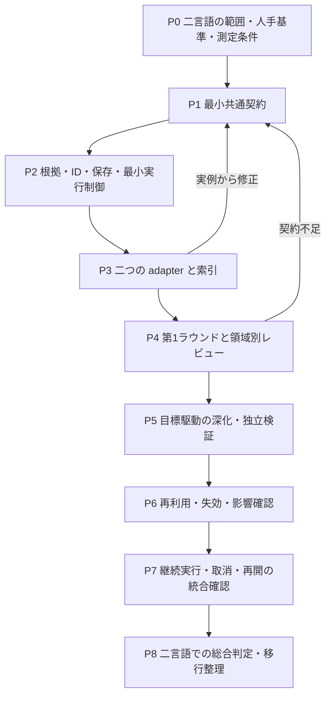

# ContextBase 段階的抽出・検証の実装計画

版：計画 v0.2／2026-10-23。

状態：設計と作業計画の文書化。実装、解析、モデル呼出し、案件試験は未着手。本書は実行指示や実施済み証跡ではない。

## 1. 目的と対象

[ContextBase 段階的抽出・検証設計 v0.4](ContextBase分轮提取与验证流程.md)の D01～D12 と内部3役割を実装可能な作業へ分解する。対象は、読取り専用ソースからシステム概要・機能・テーブル／データ・共通処理を抽出し、調査目標に応じて関係と振る舞いを深化・検証する ContextBase である。

仕様書の計画・本文・描画・Office 変換、原プログラムや DB の実行、全案件への一括再解析は対象外。現在の `ContextBase`、人手 QA、既存案件ソース、旧出力は本計画の作成では変更しない。

実装時も、固定ツールがソース構造と根拠を管理し、AI が業務候補・調査・意味の整理を担う。独立レビューは原文を直接確認する。共通手順は言語に依存させず、必要時に言語・フレームワーク・SQL 等の adapter を呼ぶ。

## 2. 確定事項と未確定事項

| 決定 | 確定内容 | 主な実装先の工程 |
| --- | --- | --- |
| D01 | 後続調査から言語 adapter を必要時に呼べる | P1、P3、P5 |
| D02 | 固定ツールが構造を抽出し、AI が業務候補をまとめる | P3、P4 |
| D03 | 第1ラウンドは領域ごとに独立レビューしてから深化する | P4、P5 |
| D04 | 全詳細を先取りせず、必要に応じて深化する | P1、P4、P5 |
| D05 | 調査目標を中心とし、よく使う依頼だけテンプレート化する | P1、P5 |
| D06 | 異なる二言語の小範囲で共通手順を検証する | P0、P3～P8 |
| D07 | 業務タスクを機能の主体とし、技術入口は別に関連付ける | P1、P4、P5 |
| D08 | 確認済み部分を返せるが、原目標の未完了を明示する | P1、P2、P4～P8 |
| D09 | 人手照合した小規模基準、機械検査、独立 AI レビューを併用する | P0、P3～P8 |
| D10 | 最小共通契約を先に検証し、基底実装は二 adapter の実例から抽出する | P1、P3、P8 |
| D11 | 構造と検証済み業務事実を、適用条件・依存・失効を確認して再利用する | P1、P2、P6、P8 |
| D12 | 既定の固定総時間・総 token 上限を置かず、実質的進展がある間は継続する | P2、P5、P7、P8 |

未確定なのは、具体的な二言語・projectId・試行ソース版・対象機能、採用する parser／意味解析 backend、最終的な schema と配置、進捗判定の観測単位である。C#／Java は候補例であり、選定済みではない。「索引／概覧／詳細」の固定三段階も採用決定ではない。

これらを本書の作成中に推測で確定しない。P0 と各工程の小規模検証で具体化する。今回は作業計画までを作成し、実装着手や人手基準の承認が済んだとは扱わない。

## 3. 現行実装との対応

パスは `agents/reverse-agent/` からの相対位置。次の「候補」は責務の配置案であり、その名前のファイルを必ず増やす決定ではない。

| 領域 | 現在あるもの | 変更・追加する責務と注意点 |
| --- | --- | --- |
| 入力と根拠 | `src/contextbase/ai/capsule.py` の snapshot、manifest、hash、原文位置 | 根拠基盤として再利用。`indexed` は行番号付き原文であり、構文索引や解決済みグラフとは区別する |
| 世代・安定 ID | `src/contextbase/shared/store.py`、`shared/identities.py` | 世代管理と既存 SCR／COM ID を保護。業務機能、技術入口、データ、事実等の ID 拡張は移行契約を定める |
| AI 契約 | `src/contextbase/ai/schemas.py` の文書単位 plan／analysis／draft／review | 目標・エンティティ中心の最小契約を追加。現行 `documentId` の facts を新しい全体理解として読み替えない |
| AI 実行 | `ai/provider.py`、`workflow.py` の単独ジョブ、入力照合、根拠検査 | 呼出し機構を評価して利用。文書分析から自動的に draft へ進む処理を新経路の起点にしない |
| 既存調整 | `ai/batch.py`、`iteration.py`、`__main__.py` | 現在は文書単位の並列化・修訂。目標単位の調査、部分結果、再利用、取消・再開を別の明示的な経路で組み込む |
| 検証 | `ai/validation.py`、`validation/core.py`、`quality.py` | 文書検証と新しい ContextBase の範囲・意味検証を分ける。旧 `resolved`／`verified_structure_only` を新しい受入に昇格させない |
| adapter | 現行 `specgen/analyze.py` と既存言語別処理 | 再利用可能な事実と限界を調べる。新 AI 経路に Tree-sitter の共有索引が既に接続済みとは仮定しない |
| 回帰試験 | `src/contextbase/tests/` の provenance、resume、iteration 等 | 既存の入力束縛・改ざん拒否・互換動作を維持し、新契約を使った公開 interface 上の挙動試験を加える |

新しい調査 controller、目標／事実の store、adapter 群、検証記録の責務は分けて検討する。単に `workflow.py` に全機能を追加することや、責務のない転送専用クラスを大量に作ることは避ける。

### 3.1 内部3役割と共通制御の実装責務

reverse-agent は統一入口として残す。[共通契約](../AGENT.md)と内部役割の文書は今回定義するが、自動 dispatch、候補採用、範囲受入れ、復元の新しい実行機構は今後実装する。役割定義済みを実装済みと数えない。

| 担当 | 実装する責務 | 主な工程 |
| --- | --- | --- |
| [discovery-agent](../roles/discovery/AGENT.md) | 取得・構造索引・4種類の候補、被覆、新対象の追加 | P3、P4 |
| [investigation-agent](../roles/investigation/AGENT.md) | 関係調査と動作深化を往復し、不足する構造も必要に応じて取得する | P5 |
| [review-agent](../roles/review/AGENT.md) | 独立原文確認、漏れ・反例の発見、指摘処置の再確認 | P4、P5、P8 |
| 共通制御・基盤 | request、目標、振分け、snapshot、SourceAccess、ID、store、adapter、版・競合・依存、採用、受入、取消・再開 | P1、P2、P6、P7 |

第2と第3の理解段階を別 Agent へ固定分割せず、investigation-agent の作業モードとして開始する。独立検証は各段階を横断する。共通制御は制御プログラムの責務であり、追加の常駐 AI を必須にしない。個別役割の実行入口と全体実行を同じ論理 request で扱い、3役割の常時全件直列実行を避ける。

## 4. 工程と依存関係

P0～P8 は開発・検証の順序であり、運用時の三つの理解段階と、横断的な独立検証・最終受入れとは別である。

### P0：試行範囲、基準と比較条件を固定する

**作業**

- 異なる二言語について、小さなファイル間機能を一つずつ選ぶ。業務タスク、入口、共通処理、データまたは状態変更を追える範囲を候補とする。同じ業務の実装であることは必須ではないが、比較する調査目標の種類と深さを対応させる。
- projectId、実際の取得ソース、内容 hash、設定、外部依存の取得可否、対象と対象外を保存する。案件選定前に既存 input を一括で再解析しない。
- ソースから独立に期待事項を作り、人手で照合する。正しい定義・引用・関係、重要分岐、データ／状態変化、誤ってつないではいけない関係、未解析のまま残す事例を含める。生成結果をそのまま正解にしない。
- 解析器の小さな正常／負例 fixture と、実ソースの業務照合基準を分ける。
- 品質項目、計測範囲、環境・モデル条件、冷間／再利用時の条件を固定する。過去の四時間の文書 batch は異なる仕事量なので直接の速度基準にしない。

**完了条件**：二つの試行範囲が固定され、合否判定に使う期待事項は人手による原文照合を完了している。未照合の事項は未確認の基準候補として分離し、合否の根拠に使わない。言語、プロジェクトまたは必要材料が未確定なら、その選定を未完了として保持する。

既存方式の比較計測は解析範囲を揃えられる場合に実施する。文書生成まで進む既存 CLI をそのまま起動して比較せず、分離できない範囲は参考記録または未計測とする。

### P1：最小共通契約を定める

**作業**

- 調査目標の対象、質問、期待する情報、範囲、必要な検証を記録する。自然言語依頼から明確な部分を具体化し、実質的な曖昧さを未知として保持する。定型依頼はこの契約を作る補助とする。
- 共通契約の request、役割ごとの候補差分・finding・追加調査要求を物理 schema にする。基準版、作業ID、根拠、依存、作者・検証者、出力権限を表し、正本更新を各役割の権限に含めない。
- 業務機能と技術入口を別の安定 ID で扱い、関係付ける。テーブル／ビュー／ORM 実体／DTO／メモリ／外部対象の区分を保持する。
- 根拠、構造、関係、業務事実、能力、調査項目、レビューと結果状態の最小レコードを決める。宣言／推定／未知、関係の解決方法、レビュー有効性を一つの完了フラグに畳み込まない。
- adapter の操作ごとの対応・部分対応・不可用・失敗を区別する。範囲、原位置、診断、候補を返し、未知を正常な空結果に置換しない。
- 部分結果には原目標、達成済みの範囲、未達事項、根拠版、レビュー範囲を含める。原目標の完了状態を結果一覧の有無と分離する。
- 既存 schema と新 schema の識別、明示変換、互換エラーを定める。全言語の詳細項目や全メソッドを先に固定しない。

**完了条件**：P0 の二言語の例を同じ契約で表せる。未解決候補、混在言語、異なる呼出条件、部分返却を表現できる。P3／P4 の実例で改訂する前提が明確である。

### P2：根拠・保存基盤と最小の実行制御を用意する

**作業**

- snapshot と source-view の整合性、構造索引から原文への位置対応、根拠の発行／参照を接続する。入力プログラム、ビルド task、案件別 plugin を実行しない。
- 共通 ID、内容版、調査目標と項目、未解決、候補事実、独立レビューを保存し、候補と受入済み版を区別する。
- 役割の個別依頼と目標からの振分けを接続する。作業領域へ提出した候補を、版・競合・依存・根拠の照合後に共通制御だけが採用する。採用と範囲受入れを別の操作・記録として扱う。
- AI の最初の試行前から取消、技術障害、checkpoint 保存、再開時の入力／目標／規則照合を扱う。失敗前の有効な成果を保持する。
- 取得、解析、モデル、統合、検査の工程別イベントと時間を記録する。単なる活動回数と、根拠付き理解・調査義務の進展を区別する。
- 最小の継続 controller に固定総時間／総 token の既定上限を入れない。P7 で長期継続、待機、取消、無進展の統合挙動を仕上げる。

**完了条件**：入力不変、根拠改ざん拒否、部分状態の保存、取消／故障後の回復、異なる入力・目標への誤再開拒否が契約試験で確認できる。完了を自己申告しただけでは受入記録を作れない。

### P3：二言語の adapter を小さく実装して契約を検証する

**作業**

- 二つの対象言語について、P0 の範囲に必要な語法・定義・作用域・導入・呼出し候補と診断を提供する。任意のシンボル／範囲を後から追加調査できるようにする。
- Tree-sitter 等の構文 backend と、利用可能な意味解析 backend の役割を区別する。SDK／プロジェクト依存が取得できない場合の能力低下を明示する。原入力の build や任意 task を実行して補完しない。
- framework、SQL 方言、ORM、解析 backend を組合せ可能にする。言語×framework×DB の子クラスを増やさない。
- 言語間の接続、埋込み script、SQL 等がある場合は元ファイル位置と接続理由を保持する。名称一致だけで同一 ID にしない。
- 二 adapter の実例から契約を調整し、安定した共通実装だけを必要に応じて base に抽出する。共通 protocol だけで足りる場合は継承を強制しない。

**完了条件**：同じ共通 interface の試験が両 adapter を通り、P0 の位置・定義・誤連結防止・未知の基準を満たす。意味解析の `resolved` が唯一の実行時 target を証明するとは扱わない。

### P4：第1ラウンドの取得・業務候補・領域別レビューを接続する

**作業**

- 入力固定、棚卸し、アダプターによる解析・索引取得、概要／機能／データ／共通候補を一つのラウンドとして動かす。
- discovery-agent に共有の取得・adapter 能力を接続し、review-agent を別文脈で呼び出す。snapshot や ID 管理を役割ごとに複製しない。
- 固定ツールの構造と原文を AI に提供し、業務タスクの候補と入口の対応を作る。内部メソッド数を機能数に置換しない。
- 共通 module が領域別の独立原文レビューを実行し、入口漏れ、誤分類、重複、DTO と表の混同等を検査する。レビュー対象は作者の候補一覧だけに閉じない。
- 通過した領域・対象は次の調査に渡せるが、他領域や重要未知を完了扱いにしない。全倉一括完了の同期障壁を作らない。

**完了条件**：二言語で四種の一覧、根拠、領域 coverage、未解決と独立レビューが得られる。対象が見つからない場合は、根拠付きの対象なしと未確認を区別し、存在しない表や共通処理を補わない。候補漏れを仕込んだ試験で、作者が待ち行列を閉じてもレビューが不足を検出する。

### P5：目標駆動の関係調査・深化・独立検証を実装する

**作業**

- 調査目標から不足事項を選び、既存索引と原文を用いて調査する。後から adapter に追加の定義・参照・framework・SQL 等を問い合わせる。
- investigation-agent 内で関係調査と動作深化を往復する。新対象は discovery、検証指摘は対応する調査へ戻し、修訂後の版を review-agent が確認する。初期目録だけの要求や有効な既存目録を持つ要求で、不要な役割を起動しない。
- 関係、条件、入力／出力、値の変換、状態、異常、副作用、必要なデータ操作を、該当する対象だけ深化する。全対象を固定三段階に一律昇格させない。
- 共通処理の事実と各呼出元の実引数、既定値、権限、状態の差分を分けて調べる。
- 独立レビューが原文と元の調査範囲から反証・漏れ・矛盾を調べる。finding と処置を結び、同じ回答を再掲しただけで新しい進展にしない。
- 部分返却、要追加調査、限定範囲の受入を扱う。索引検索で候補が見つからない場合も、解析不可や未調査を不存在と誤認しない。

**完了条件**：同一の共通手順が二言語の業務タスクを扱い、必要なときだけ追加取得する。元の義務を削除して完了させる、範囲外へ勝手に拡大する、根拠のない業務説明を確定する、といった負例を拒否できる。

### P6：再利用・失効と契約変更を接続する

**前提**：今回、[共通契約](../AGENT.md)・運用規則と [旧文書経路の契約](legacy/README.md) を分離する。旧 CLI の fresh-analysis と checkpoint の挙動は維持する。新経路の D11 は、以下の依存照合・失効・再開と契約試験を実装してから有効化する。契約分離の文書化だけで P6 を完了としない。

**作業**

- 構文の再利用 key と、解決済み関係／業務事実／レビューの再利用条件を分ける。根拠 source、範囲、規則・設定、人手による採用、依存と適用条件を照合する。
- 新しい呼出し元、追加ファイル、依存定義や設定の変更、対象範囲の変更による影響を扱う。直接読んだファイルが不変という理由だけで意味の再利用を許可しない。
- 新規分析／再利用を別々に記録し、再利用した旧レビューを新目標の全体受入に流用しない。
- 影響した事実とレビューを失効させ、関連する調査へ戻す。依存範囲が証明できなければ再検査を広げる。
- 旧 checkpoint の復元と、新しい調査への内容再利用を区別する。復元によって以前の権限や完了状態を無条件に復活させない。

**完了条件**：有効な再利用、適用条件不一致の拒否、新規呼出し元／設定変更の再調査、QA 保持、旧 ID／alias 保持の試験を通る。受入済み事実でも新たな反証で再調査できる。

### P7：継続実行、無進展停止、取消と再開を統合検証する

**作業**

- 固定総予算を持たず、目標が未達で実質的進展がある間、調査を継続する。関連する新根拠、事実・関係の修正、候補や重要未知の絞込み、finding の実質的処置を進展として記録する。
- 読取り数、モデル呼出し数、revision／job ID の増加、待ち行列の開閉だけで継続しない。同条件の同一候補には既存レビューを戻し、変化のない反復を検出する。
- 子調査の待機は実際の結果イベントを待ち、モデルによる空の polling を進展に数えない。長いが正当な調査と停止状態を区別し、判定の根拠を残す。
- 取消、実際のツール障害、入力束縛失効、無進展では保存して停止する。実行環境の制約に到達した場合も未完了として保持する。
- 個別モデル／ツール応答 timeout、memory 等の資源保護を総時間予算と区別する。外部から明示された期限がある場合は別の実行条件として伝播し、子処理で毎回延長しない。
- 再開時に原目標、source、契約、権限と根拠を確認する。待機・中断の記録は業務正本と分け、失敗を合格に変換しない。

**完了条件**：進展する長いシナリオが固定ラウンド数や既定総予算だけで終了しない。反復だけのシナリオは停止し、取消／timeout／再開の主原因と成果が保持される。現行の単文書 `max_rounds` や既定 deadline を新経路へそのまま継承しない。

### P8：二言語の総合判定、計測と互換整理を行う

**作業**

- P0 の基準に対して、各言語で同じ種類の目標を処理する。対応の差は能力表に残し、二言語を一つの精度値へ無条件に合算しない。
- 正確性、必要事項の被覆、未解析、技術故障を別々に判定する。既存の期待値や過去レポートの合格を新実装の結果として流用しない。
- 冷間取得、関係調査、深化、統合、レビュー、再利用時の工程時間、実際のモデル呼出し／用量を記録する。待機や並列作業の合計と壁時計時間を区別する。
- 既存の文書経路と新 ContextBase 経路の入口を明示する。旧データは明示移行で扱い、既存成果物を自動で置換しない。
- 共通契約と base の妥当性を再点検する。言語変更で共通調査・検証を複製する必要があれば、その原因を修正する。

**完了条件**：対象範囲の必須基準・負例・独立レビューを通過し、未実施・未対応を明示した受入記録がある。重要な義務が欠ける場合は部分成果とし、元目標は未完了。速度改善は同条件の実測がある範囲だけ述べる。

## 5. 検証項目と判定

| ID | 主な試験 | 期待する挙動 |
| --- | --- | --- |
| T01 | 根拠／入力の hash・範囲・版の改変 | 受入・再利用・復元を拒否し、失効理由を保持する |
| T02 | 同名、オーバーロード、別 scope、動的 target | 正しい候補を区別し、確定できないものを未知として返す |
| T03 | 新入口や対象ファイルを候補から脱落させる | 独立した範囲確認で不足を検出する |
| T04 | DTO、SQL alias、ORM と物理表の混同 | 証拠の種類と対象を区別し、存在しない定義や制約を確定しない |
| T05 | 業務タスクと画面／API の多対多対応 | 技術入口の件数を機能数とせず、安定した別 ID で対応する |
| T06 | 条件・異常分岐・呼出元の差分の削除 | 基準または独立レビューで意味上の不足を検出する |
| T07 | 非対応、解析失敗、超限、正常な無一致 | 結果の状態を区別し、不存在／全範囲完了にしない |
| T08 | 一部だけ確認済みの結果返却 | 既知の内容と未達義務、原目標未完了を同時に取得できる |
| T09 | 既知事実の再利用、新規呼出し元、設定・範囲変更 | 適用性を再確認し、必要な事実・レビューを失効させる |
| T10 | 取消・故障・外部制限・入力変化後の再開 | 有効成果を保存し、無効な束縛のまま継続しない |
| T11 | 長い実質的進展と、同候補・同読取りの反復 | 前者は継続し、後者は無進展として停止する |
| T12 | 人手 QA、旧 ID、旧経路と旧結果 | 内容を保護し、再利用・移行・新分析を混同しない |
| T13 | 役割からの正本更新、受入状態の自己変更 | 作業領域への候補・指摘提出に限定し、共通制御以外の採用を拒否する |
| T14 | 同じ基準版に対する競合候補、関係と動作の往復 | 競合を黙って上書きせず、不足する調査へ戻して根拠と版を再確認する |
| T15 | 初期目録だけの要求、有効な既存目録を持つ要求 | 必要な役割と調査だけを選び、毎回全件3役割へ直列投入しない |
| T16 | 同一稿の作者による合格、候補修訂後の旧レビュー | 独立性と内容・根拠版を照合し、新版を未検証のまま受入れない |

必須とした正例・負例は個別に判定する。適用する重要基準の欠落や誤った確定を速度の得点で相殺しない。未知は万能な免責ではなく、原目標の必要事項なら未完了の理由となる。仕様書生成や実アプリ試験の結果はこの静的検証に含めない。

## 6. 成果物と配置

実装段階の論理成果物は、試行範囲・人手照合基準、最小 schema と adapter 契約、入力／証拠台帳、構造・関係索引、業務候補、調査項目・事実、独立レビュー、再利用／失効記録、部分／受入結果、性能計測である。

正式な設計・契約と回帰 fixture は本 Agent 内の文書・ソース／tests に置く。実行中間物と試験記録は既存方針に従い `.tmp/` または `test-report/` 等へ置き、コードと同列に Git 登録しない。人手 QA や正式な ContextBase 正本は中間キャッシュとして削除しない。

物理ファイル名、DB、具体的な新 module 名は P1～P3 で責務と既存コードに合わせて決める。本計画だけで Graph DB、特定 parser、外部サービス、深い継承構造を必須化しない。

## 7. 今回の更新範囲と未実施

入力：利用者が確認した D01～D12、統一入口・内部3役割の承認、設計 v0.3、実装計画 v0.1、現行コードの読取り確認、[開発方式の調査ノート](research/code-analysis-projects-20261023.md)。

出力：設計 v0.4、本実装計画 v0.2、Agent 共通契約・実行指示・運用案内・規則、内部3役割の契約、および旧契約・運用資料の保存。[全体 Agent 一覧](../../README.md)も ContextBase までの責務と内部3役割に同期する。

今回の確認は、決定との対応、文書間の整合、工程依存、相対リンク、Markdown 形式、変更範囲に限定する。P0～P8、T01～T16 は今後の作業であり、今回実行した試験ではない。

コード、QA、入力、ContextBase の実体は変更せず、抽出のモデル・解析器・プロジェクト・DB は実行しない。利用者の指示に従い、文書確認後に今回の文書一式をコミットする。push は今回の対象に含めない。具体的な試行 projectId と二言語の選定、下流の仕様書生成担当と旧コード移管は未完了作業として残す。
