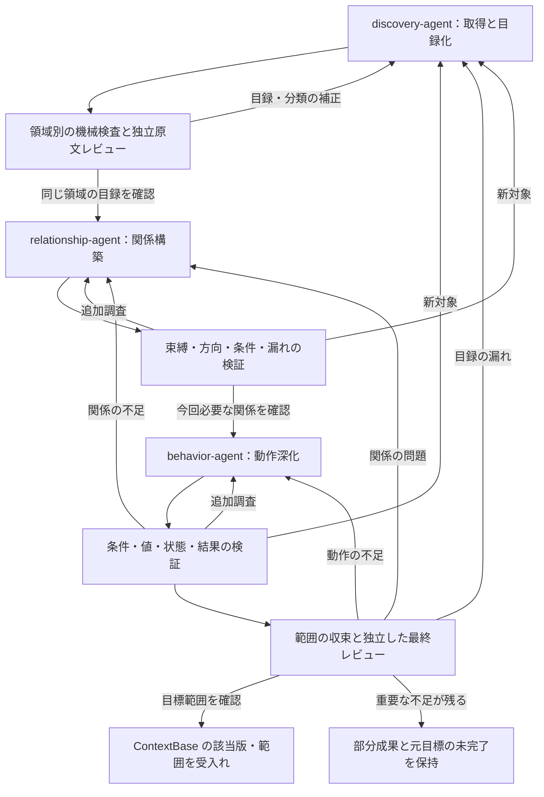

# ContextBase の段階的抽出・検証フロー

版：設計案 v0.13／2026-10-26。3Agentを平級の独立プロジェクトへ分け、portable成果を受け渡す。D01～D12は維持する。本版は証拠検査のoperation内共有と明示compact伝送を具体化する。全原文は保持し、原文のオンデマンド調査ループは未実装。repair追加後の回帰は確認済みで実repairは独立検証完了・catalog未解決で未採用で、前改訂220件と69候補未採用を流用しない。

対象：読取り専用のソースから ContextBase を構築し、調査目標に応じて理解を深め、独立に検証する。成果は追跡・修訂可能な解析情報までとし、仕様書の計画、執筆、形式変換、公開は扱わない。本書は設計の正本であり、実装状態は [初期実装ガイド](ContextBase初期実装.md)と実装計画で確認する。初期の単一役割CLIが存在することは既存 ContextBase の正確性を証明しない。

実装作業の順序と完了条件は、[ContextBase 実装計画](ContextBase実装計画.md)に分離する。既存リンクを維持するため、本書のファイル名は変更しない。

## 1. 確定した設計判断

以下はユーザーが選択した決定である。未選択の実装方式、言語、プロジェクトは確定事項に含めない。

| ID | 決定 | 設計上の意味 |
| --- | --- | --- |
| D01 | 後続調査から言語アダプターを随時呼び出す | 第1ラウンドで全情報を抽出し切る必要はない。共通の調査フローから不足する構造・関係を追加調査する |
| D02 | 固定ツールの構造抽出と AI の業務候補作成を組み合わせる | 構文・位置等の再現可能な情報と、機能の帰属・責務等の解釈を区別する |
| D03 | 第1ラウンドは領域ごとに独立した原文レビューを行い、その後に深化する | 目録・分類・根拠を確認する。全リポジトリの同期完了は待たず、確認済み領域から進める |
| D04 | 必要に応じて抽出・深化する | 要求に必要な調査を実行し、有効な既存結果を活用する |
| D05 | 調査目標を中心にし、よく使う依頼を任意のテンプレートにする | 「索引・概要・詳細」という固定3段階は採用しない。対象・質問・完了条件を明示する |
| D06 | 異なる2言語の小規模試行で共通フローを検証する | 旧業務試行資産は清掃済み。次の対象と人手基準は再試行時に選定し、2言語での検証方針は維持する |
| D07 | 機能は業務タスクを主軸にする | 画面、API、バッチ等の技術的入口は別オブジェクトとして保持し、業務機能から参照する。[分類境界](../../shared/contextbase-runtime/docs/機能分類境界.md)で粒度を確認する |
| D08 | 確認済みの部分成果を返せる | 元の調査目標は未完了のまま保持し、部分結果を全体完了と表示しない |
| D09 | 人手で原文照合した小さな基準、機械検査、独立 AI レビューを併用する | 抽出側とレビュー側の共通の見落としも検出する。基準の対象外へ正確性を外挿しない |
| D10 | 最小共通プロトコルを先に定め、2実装の共通性を確認後に必要なら基底クラスを抽出する | 継承を必須にしない。フレームワーク、SQL、解析バックエンドは組合せで扱う |
| D11 | 検証済みの構造・業務事実を再利用する | 適用条件と依存関係を確認し、変更時は失効させる。新規範囲は別途審査し、新規分析と再利用を区別する |
| D12 | 固定の総予算を既定にせず、実質的な進捗があれば継続する | 取消し、実故障、入力失効、無進捗では保存して停止する。外部制限による中断を完了扱いしない |

2026-10-26の追加決定として、理解の3段階をdiscovery-agent、relationship-agent、behavior-agentに対応付ける。独立検証は各段階に共通する実行能力とする。これは処理責務と引渡しの分割であり、D05で採用しなかった「索引・概要・詳細」という固定情報量の全件生成を導入するものではない。

## 2. 目的と進め方

最初にシステムが何をするか、どのような機能、データ、共通処理があるかを把握する。次に実装間の関係を結び、具体的な質問に沿って業務動作を深掘りする。ContextBase は確認済み内容だけでなく、候補、矛盾、未知、未調査範囲も保持する。

ラウンドは理解の段階を示す。固定回数の全件走査ではなく、対象ごとに前進・追加調査する。第1ラウンドには入力固定、ファイル一覧、アダプターの能力の選択、索引取得、4種類の候補作成を含め、利用者向けの準備ラウンドは別に設けない。後続で新たな入口や共通処理が見つかれば、第1ラウンドの目録へ戻して更新する。

調査ラウンド、求める情報、検証状態は別の軸とする。「2回調べた」ことは関係の確認済みを意味せず、狭い範囲の一覧でも十分に検証できる。全体の詳細情報を一度に作成してから表示を絞る方式にはしない。

- 版管理した一つの ContextBase を理解情報の正本とし、索引・目録・グラフはその論理ビューとする。
- 固定ツールはファイル一覧、構文、再現可能なシンボル束縛、根拠管理、機械検査を担当する。AI は調査選択、業務上の帰属、責務と動作の解釈を担当する。
- 独立レビューは原文を直接読み、誤りと漏れを確認する。構造検査の合格を業務理解の合格へ読み替えない。
- 共通動作は共有できるが、各呼出元のパラメーター、権限、条件、状態、副作用は個別に確認する。
- 取得済みソースと明示的に許可された補足材料だけを扱う。入力プログラム、DB、ビルドスクリプト、入力内プラグインを実行しない。

## 3. 第1ラウンドで得る4種類の候補

| 対象 | 識別する内容 | 分類上の注意 |
| --- | --- | --- |
| システム概要 | 境界、主要業務候補、サブシステム、技術構成、入口の形態、保存先・外部連携、重要な未知項目 | ディレクトリ名、README、依存ライブラリーだけで実際の業務や配置状態を断定しない。後続の証拠で修訂する |
| 主機能・子操作 | 指定actorの目的と完了成果を持つ閉じた業務タスク、およびその利用文脈に属するステップ・モード・補助操作 | 入口件数を主機能数にせず、子操作は利用文脈ごとに主帰属を示す。同じ実装の再利用と意味上の帰属を分ける |
| テーブル・データ対象 | DDL、ビュー、ORM、SQL から得る対象。DTO、メモリー、セッション、ファイルも区分して記録する | DTO を物理テーブルと同一視しない。DB、スキーマ、環境、移行版を保持し、JOIN から外部キーを捏造しない |
| 共通処理 | 集中して担う、または再利用する共有責務 | 使用関係と共有責務の根拠を要し、呼出回数やcommon名だけで決めない。主機能へ混算せず、資料・第三者依存・配置ツール等の別分類も保持する |

技術的入口は、画面、API、イベント、バッチ、ジョブ、帳票、メッセージ、ファイル処理等の別オブジェクトとして残す。機能と入口は多対多になり得る。同一画面の検索・登録・削除を業務上分けるかは根拠と目的で判断し、分割・統合をレビューする。

物理名が確認できても、論理名、業務帰属、属性、動作や適用範囲まで確認できたことにはならない。暫定名や候補分類を許容する。

### 3.1 機能境界と件数の扱い

[用語集](../../GLOSSARY.md)と [機能分類境界](../../shared/contextbase-runtime/docs/機能分類境界.md)を分類・分割統合・集計の正本とする。技術的入口、プロジェクト内の業務領域、意味上の主／子／共通は別軸で、actorのroleは証拠の一つである。前提があることは主機能の独立目的を否定しない。

取得するsource範囲と、主機能を数える対象scopeを分ける。全source取得からWeb限定の集計を暗黙に導かず、指定scopeの主階層だけを数え、分類未確認は別掲する。分割した候補が単なる手順・モード差でないか、統合候補が複数目的なしに説明できないかを点検し、理由と反例を残す。具体例と文脈による主／子の差は正本を参照し、2件・4件等へ合わせない。

新discoveryモードはホスト固定のcatalogPolicy=contextbase-catalog/1を用いる。record.kindのfunction／operation／common／unclassifiedを主機能／子操作／共通／保留に対応させ、typed classificationの必須項目と参照条件を[機能分類境界](../../shared/contextbase-runtime/docs/機能分類境界.md)の§8へ集約する。その他の分類はclassification=nullとし、旧成果へnullを自動追加してhashを変えない。 task.operation=extract／verifyは実行種別であり、子操作operationとは別軸である。

裸Sessionの旧v2タスク互換は維持するが、新分類規則を通過した証明とはしない。新独立Agentは合法なcatalogPolicyのあるhandoffだけを受信し、旧handoffはD再抽出が必要である。意味参照は同scope・存在・適切なkindを検査し、入口共有を許す。参照先変更は跨owner失効へ反映する一方、意味参照を無条件に版依存DAGへ追加して循環を作らない。

## 4. ContextBase が保持する論理情報

以下は論理的な内容であり、直ちに同名ファイル、スキーマ、グラフDBを追加する指示ではない。

| 情報 | 必要な内容 |
| --- | --- |
| 入力・能力台帳 | プロジェクト、許可範囲、ソーススナップショット、内容ハッシュ、ファイル一覧、取得・解析状態、ツール・規則版、設定、制約 |
| ソース構造 | ファイル、シンボル、シグネチャ、スコープ、宣言・出現位置、インポート、呼出点、SQL・設定候補、解析診断 |
| 概要・対象目録 | 安定した対象ID、分類、候補名、責務、入口参照、原文の根拠 |
| 関係 | 始点、終点または候補集合、種類、向き、条件、原文位置、導出方法、未解決理由 |
| 業務事実 | 対象、論点、結論、前提・結果、適用する呼出元、根拠、依存する関係・事実、未確認部分 |
| 調査目標・作業 | 元の要求と範囲、完了義務、具体的質問、前提、担当、進捗、発見、処置 |
| レビュー・版 | 候補版、各検査の対象範囲と結果、独立した指摘、処置根拠、失効関係、受入記録 |

永続IDは改名、並び替え、ファイル増減によって採番し直さない。分割・統合・移行には履歴対応を残す。原文は改行を保持したsourceTextとする。表示用numberedTextと重複structureは新モデル投影へ含めず、全原文・位置・索引を保持する。SourceAccessとadapterの行位置はLF基準で揃え、CRLF・末尾改行・Unicode区切り文字の内容を保持する。ソースシンボルIDと業務機能IDは分離し、表示名を識別子の代用にしない。根拠は少なくともスナップショット、内容ハッシュ、原文範囲、抽出版に結び付ける。

### 状態は軸を分ける

| 軸 | 意味 |
| --- | --- |
| 内容の根拠 | 既存契約の declared / inferred / unknown / conflicting / not_applicable / example 等を属性単位で維持する |
| 人手の採用 | approved の採用者、範囲、版、由来を残す。採用だけでソース観測事実へ変換しない |
| 関係の解決 | 構文上の呼出点、束縛済みシンボル、規則による合成、候補、未解決を区別する |
| 検証の有効性 | 未審査、該当版・範囲で合格、指摘あり、失効を区別する |
| 作業進捗 | 未着手、調査中、具体的前提待ち、統合待ち、処置済みを区別する |
| 目標達成 | 元の目標に対する達成・未達成と、部分範囲の確認結果を分ける |

これらは設計上の意味であり、現行 AI スキーマにすべて実装済みとはしない。コンパイル時の束縛だけで実行時の唯一の対象が確定するとは限らない。仮想呼出し、DI、動的分派等の条件を残す。ツール間の信頼度スコアも共通の正確率とは扱わない。

## 5. 全体フロー

各ループは具体的な対象と質問に戻る。通常は全件調査をやり直さない。入力、能力、依存範囲が実質的に変化した場合は、理由を残して調査・検証範囲を拡大する。

各検証ノードは共通の検証機構が、作者とは別の呼出し・文脈で原文を確認する実行である。reverse-agentの共通制御が候補の採用と次層への引渡しを判定する。目録だけが目標ならV1、関係までならV2で対象範囲を返せる。有効な前層成果がある場合は、その適用条件を確認して必要な層から再開する。

## 6. 第1ラウンド：取得と初期理解

**担当：** [discovery-agent](../../discovery-agent/AGENT.md)。取得と目録化を一つの層で扱う。

**入力：** 明確なプロジェクト、対象ソース、調査目標、許可済みの補足材料。ProjID 未指定時に既存の全ケースを再解析しない。

**目的：** 安定した読取り基盤と構造情報を取得し、概要・機能・テーブル・共通候補と調査地図を作る。内部には前提順序があるが、全動作の解決を要求しない。

### 6.1 入力の固定とファイル一覧

1. 実際の対象に含めた未コミット・未追跡ファイルも含め、内容を固定する。処理中に異なる版を混在させない。
2. ソース、設定、ルート・メニュー・タスク登録、DDL・移行、マッピング、リソース、依存関係の材料を列挙し、取得できないものを明示する。
3. 構文、束縛、フレームワーク、SQL、データフロー等の能力を操作ごとに記録する。未対応、失敗、上限による切詰め、未調査を区別する。
4. 読取り専用の検索と根拠取得を用意し、ページング・切詰め・未解決を報告する。検索結果だけを根拠にせず、結論を実際の原文に結び付ける。

ファイル一覧、証拠、入力固定は共通機構とし、言語子クラスへ一括して移さない。

### 6.2 アダプターの能力による構造取得

ファイル、埋込み断片、プロジェクト境界に応じてアダプターを選ぶ。シンボル、スコープ、インポート、呼出点、確認可能な束縛を取得する。フレームワーク規則で入口、SQL・ORM でデータ候補を補い、共通記録へ正規化する。導出方法、原文位置、診断、必要な固有情報は保持する。

混在システムには複数の能力を適用する。Vue やテンプレート内の断片は元ファイルへの位置対応を残す。シンボルの同一性には所属プロジェクト、対象、設定、生成元も考慮する。異言語間を同名だけで結ばない。主言語が決まっても SQL、JavaScript、設定を省略しない。

第1ラウンドで動的目標やデータフローをすべて解決する必要はない。能力が結果を返さなかったときは、該当なし、部分対応、利用不可、解析失敗、上限到達を区別し、未知を空集合へ変換しない。

### 6.3 AI による候補の整理

- 構成・設定・主要登録から、根拠付きの暫定システム概要を作る。
- 技術的入口を列挙し、実装を調べて業務タスクへ帰属させる。画面とAPIを自動的に別機能へ分断しない。
- データ対象は定義取得済みと参照のみを区別する。
- 共通候補の種類、責務、呼出元、適用性の未確認部分を記録する。
- 領域、入口、既調査・未調査、重要な未知、次の具体的質問を整理する。

4種類の調査は独立可能な範囲で並行できるが、発見を交換して重複と矛盾を整理する。長い概要文だけで目録を代替しない。

### 6.4 当ラウンドの検証と次段階への条件

主／子／共通の粒度レビューは上記正本を使い、過分割と過統合、利用文脈の帰属、共有責務、集計scopeの理由・反例を確認する。新discoveryでは型・参照と独立検査の版・scope束縛を採用gateへ接続するが、業務上の意味正確性をschemaだけで証明したとは扱わない。

ファイル一覧を独立した列挙と照合し、位置・ハッシュを確認する。未取得・除外には理由と影響を残す。ID、分類、引用範囲を機械検査し、定義未取得のデータを完全な定義と表示しない。

独立レビュー者は、原ファイル一覧、登録点、DDL・マッピング等から入口の漏れ、機能の重複、補助画面の誤分類、DTO の混同、共通候補の妥当性を確認する。全ファイルを必ず読む規則にはしないが、調査の選択・除外理由を残す。正常な空結果だけで機能なしと断定しない。

**次段階への条件：** 領域の入力が安定し、対象の入口・責務が調査可能で、目録が該当範囲の独立原文レビューを受け、不足と能力制約が明示されていること。全リポジトリ一括の通過待ちは設けない。局所的制約があっても別領域は進められるが、入力不一致等は先に解消する。この通過は詳細な業務動作の受入れを意味しない。

## 7. 共通フローとアダプターの能力の境界

| 責務 | 共通側 | アダプター等の側 |
| --- | --- | --- |
| 入力・根拠 | 範囲、スナップショット、ファイル一覧、安定ID、読取り、参照、版と完全性 | 対応形式、断片位置、能力診断 |
| 構造・束縛 | 共通記録、照会契約、正規化、能力状態 | 構文、作用域、導入、型・受信者、オーバーロード等 |
| フレームワーク・データ | 入口、関係、データ対象の共通意味 | 登録規則、SQL 方言、ORM 等の組合せ能力 |
| 業務理解 | AI の調査、帰属、責務、動作の解釈 | 原文への手掛かり。言語テンプレートで業務結論を捏造しない |
| 検証・保存 | 原文レビュー、範囲受入れ、失効、永続化 | 固有の限界や未解決原因を正確に返す |

共通フローは必要に応じてアダプターの能力を呼び、原文を再読できる。統一モデルを情報の遮断層にしない。独立レビューも第1ラウンドの要約だけには依存しない。言語非依存なのはフローと契約であり、個々の結論には言語・設定・フレームワークに合う根拠が必要である。

最初は最小共通プロトコルを定め、異なる2言語の小規模実装で確かめる。安定した共有実装が見つかった場合のみ、浅い BaseLanguageAdapter 等を抽出する。初期実装は独立した CSharpAdapter／JavaAdapter と共通の index_source 契約を持ち、全実装の継承は強制しない。型束縛・データフローは未実装である。

フレームワーク、SQL 方言、ORM、解析バックエンドは組合せで接続する。言語×フレームワーク×DBごとの子クラスを増殖させない。プロジェクト固有クラスも原則とせず、設定や不足能力で表現可能か先に確認する。ID、根拠検査、受入れを子クラスで上書きして省略できる設計にしない。

能力未対応は明示する。型推論やデータフローを擬装せず、共通フローが未知の保持、利用可能な別能力、待ち事項を選べるようにする。2言語を切り替えても、関係調査、問題管理、受入規則が変わらないかを確認する。

### 7.1 独立プロジェクトと共通runtime

平級のagents/discovery-agent、relationship-agent、behavior-agentは各自のpackage／CLI、source、request、workを持つ。共通runtimeはagents/shared/contextbase-runtime（Python package contextbase_runtime）に配置する。3Agentのinstall・import・実行はreverse-agentに依存しない。reverse-agentは希望時だけ使う互換連続実行入口として残す。

各プロジェクトの契約を責務の正本とし、reverse配下rolesの文書は旧URLの互換参照だけにする。

| 子Agent | 引き継ぐ入力 | 提出する成果 | 担当する完了義務 |
| --- | --- | --- | --- |
| [discovery-agent](../../discovery-agent/AGENT.md) | 固定したソース範囲、目標、解析能力 | 構造索引、概要・機能・入口・データ・共通の目録候補、被覆、未知 | 対象領域の目録と根拠を独立検証できる |
| [relationship-agent](../../relationship-agent/AGENT.md) | 同領域の検証済み目録、許可原文、関係の質問 | 入口・処理・呼出し・データ・共通依存の関係、方向、条件、主要経路、未解決 | 今回必要な関係と経路が根拠付きで確認される |
| [behavior-agent](../../behavior-agent/AGENT.md) | 当該質問に必要な検証済み関係・経路、許可原文 | 項目・値、条件・分岐、状態、異常、トランザクション、呼出差の事実 | 元目標が要求する動作義務を独立検証できる |

relationshipは関係を判断するために必要な条件・引数・設定も読む。behaviorはその関係を使って、値・条件・結果の追跡を深める。分割するのは交付責務であり、各層で読める原文の種類を人工的に制限しない。全層が必要時に共通adapterへ補足取得を依頼できる。

snapshot、SourceAccess、ID、store、adapter、検証・host採用は共通runtimeで共有する。各Agentのホストが自層だけを抽出し、別task・文脈で原文検証してローカル採用する。reverse-agentからの配車は必須ではなく、独立検証を第4のAgentにしない。

### 7.2 Portable受渡しと前提の独立再検証

1. 3Agentは同じ元requestと全前提グラフを保持し、自層義務だけを実行する。後続層は前層を自動起動せず、前提不足ならneeds-prerequisitesを返す。
2. portable exportは現時点の全有効記録・全unknown・未閉鎖followup（raw履歴は監査用）を含み、前層workへのアクセスを要求しない。
3. 受信側は自身のsourceを封印し、同一request・ソースmanifest／内容を照合する。外部passは監査情報として保持し、原文を別task・文脈で再検証してから前提を有効化する。
4. 同scopeの確認済み部分と未達を区別する。目録・関係だけで要求を満たせばそこで止め、全倉同期や全対象の3層実行を要求しない。
5. relationshipは接続の判断に条件・引数を読める。behaviorは不明関係を確定扱いせず補査質問へ返し、後続もadapterと原文を利用できる。

handoffのrequestは同一内容を必須とし、異なる要求・新ソース範囲への一般的P6再利用に広げない。上流変更時は依存・旧判定の失効を確認し、再度受渡し・受信検証する。

可搬ソース束縛では絶対sourceRootを除き、それ以外のmanifest、相対パス、内容指紋、許可・除外材料を照合する。ソースの絶対配置が違っても、同一request・相対scope・材料の一致が必要である。

明示followupは安定ID followup:<digest> のunknownとして質問・対象義務・内容hashに束縛する。後続の独立検証はunknownChecksで各項目を判定し、原文根拠付きresolvedだけが閉鎖を意味する。acceptedやnon-blockingだけでは閉鎖しない。raw followupは監査履歴に残し、portableな活動中一覧には未閉鎖項目だけを含める。受信側の独立検証でresolvedを確認してから前提を有効化できる。引き継いだfollowupの対象義務が今回の採用予定集合へ入る場合、原文根拠付きresolvedを必須とする。この条件はローカルadoptと外部前提の有効化へ同じgateで適用し、最終behaviorも未閉鎖の本層質問を残したままcompleteにしない。未解決の有効上流と、現在候補が要求する有効上流への補査は採用を阻害する。

### 7.3 共有するv2契約と独立起動

requestはschema=contextbase-analysis/2を必須とし、義務はid／question／stage／scope／requiresを持つ。同scopeのrelationshipはdiscovery、behaviorはrelationshipを前提とする。抽出operation=extractと独立検証operation=verifyを分離し、異なるtask・文脈で呼び出す。旧v1 request／sessionと --role は自動移行せず、新v2要求を作る。

recordには唯一のownerRequirementを持たせ、作者のdependsOnキーをホストがdependenciesのkey／versionへ束縛する。未知は関連先と阻害先・範囲理由を分け、verifyのunknownChecksがid／hashごとに影響を検査する。非阻害にも根拠を必要とし、作者だけで判定しない。

各Agentのhost採用は候補と保持する未失効成果のviewSha256、検証と依存を確認して原子的に採用する。reviseは既採用義務とrequirement／record版依存の下流を撤回し、過時記録を現正本から外して履歴とIDを残す。独立CLIのinit／run／status／index／exportと任意互換操作は [実装ガイド](ContextBase初期実装.md)を参照する。

## 8. 第2ラウンド：関係の調査

**担当・入力：** [relationship-agent](../../relationship-agent/AGENT.md)。同領域の検証済み目録、当該版の許可原文、元目標と今回の関係義務を受け取る。

**目的：** 一つの業務機能を実現する処理、データ、共通処理、外部能力を結ぶ。

具体的な入口・質問から関連部分を取得し、原文と照合する。追加の型束縛や動的SQL調査が必要なら、該当能力を呼び出す。共通調査側へ Tree-sitter のノード操作や言語別の同一フローを複製しない。

- 入口と処理、ルートとハンドラー、タスクと実行部、購読と消費部。
- 定義と参照、導入、受信者、インターフェースと実装、オーバーロード、条件付き設定。
- 要求・コントロール・引数と、モデル、サービス、保存操作、外部要求。
- SQL とデータ対象、読書き方向、共通処理と呼出元、業務上の引継ぎ。

画面→API→サービス→SQL は一例である。ファイル、外部サービス、メッセージ、セッション、メモリーだけの処理もそれぞれ扱う。

**検証：** 同名・別スコープ、オーバーロード、条件登録、環境違いの誤結合を探す。引数・結果の方向と条件、引用の支持範囲を確認する。逆参照、データ利用元、登録点から漏れを調べ、既存グラフの走査だけで済ませない。動的目標は候補と未確認理由を残し、線を閉じるために一つへ決めない。

**成果：** 根拠付き関係、共通呼出元索引、確認済み部分と深化すべき質問。重要な曖昧さを既知の前提へ変換せず、明確な部分から深化する。

**behaviorへの条件：** 次の質問が依存する対象・経路について、関係の方向・適用条件・根拠・未解決の影響が独立検証され、共通制御に採用されていること。動的な呼出先等を確認できなければ、候補と制約を明示してその結論に依存する動作義務を保留する。呼出関係が非該当なら原文根拠付きで確認し、空の関係を作るための往復を要求しない。

## 9. 第3ラウンド以降：調査目標に沿う動作深化

**担当・入力：** [behavior-agent](../../behavior-agent/AGENT.md)。今回必要なrelationship成果の検証済み版、許可原文、対象の動作義務を受け取る。

**目的：** 「関係がある」から「どの条件で、どの値を使い、どの結果になるか」へ進む。

調査目標は対象、質問、範囲、完了義務を持つ。例えば「全機能を列挙する」「このテーブルの構造を確認する」「登録機能の更新と失敗状態を追う」は異なる要求である。定型依頼は目標設定を補助するが、固定の深度階段や別々の正本を作らない。

| 論点 | 確認内容 |
| --- | --- |
| 条件・権限 | 正常、異常、取消し、NULL、境界。画面上の可視・編集可否とサーバー許可を区別する |
| 引数・項目 | 入力、既定、変換、検査、引渡し、SQL束縛、戻り対応。表示値・内部状態・送信値を区別する |
| データ操作 | 対象、列、検索・更新条件、値の由来、影響範囲、ORM・動的SQLの未知 |
| 状態・順序 | 初期・編集中・成功・失敗の状態、保持・消去、実行順、段階間引継ぎ |
| 副作用・境界 | セッション、ファイル、外部連携、トランザクション、再試行、例外伝播 |
| 呼出変種 | 共通契約と、呼出元ごとの引数、省略、既定、権限、状態、副作用の違い |

すべての対象に全項目を埋めない。非該当には根拠を残し、不明は不明とする。後続の質問は、新しい不足や反証を具体的に指す。同じ要約を再生成するだけでは深化としない。

独立レビューは質問に沿って原文と呼出元を確認し、反例も探す。事実誤りは候補修訂として提出し、共通制御が正本の更新と依存検証の失効を扱う。分類・名称の変更にも根拠を残す。発見した新対象はdiscovery、関係不足はrelationshipへ戻す。動作事実の独立検証・採用が済み、要求した義務を満たせば当該範囲を返す。

## 10. 範囲収束と独立した最終レビュー

この確認も共通の検証機構が担当する。3独立Agentの成果と元目標を横断して確認し、追加の理解段階を新設しない。

**目的：** 元の目標範囲が、約束した静的分析の要件を満たしたか判断する。実行回数やラウンド通過だけで完了にしない。

検証義務は許可された目標、原ファイル一覧、入口・データ登録、独立発見から定める。作者の作業一覧だけで検査範囲を決めない。アダプターの「解析済み」も業務受入れの代用にしない。

| 検証軸 | 確認すること | 代用できないもの |
| --- | --- | --- |
| 根拠の完全性 | 現版、原文、参照、設定、実取得材料が一致するか | JSON合法、存在、ハッシュ一致だけ |
| 内容の正しさ | 分類、関係、条件、値、動作に根拠があり反証がないか | 自己評価、信頼度、未接続辺の不在 |
| 範囲の充足 | 重要な入口、変種、利用、責務が漏れていないか。未解決の影響は何か | 作業終了数、ノード数、読取り率 |
| 対象間の整合 | 共通・データ・状態の解釈が整合し、変更影響を再検証したか | 各対象の過去の個別合格 |

レビューは既知対象からの照合と、登録点・逆利用・未調査領域からの独立発見を併用する。作者のグラフ・要約だけを根拠にしない。指摘には安定ID、問題、影響、根拠、処置を残す。作者の修正・追加調査・根拠付き反論をレビュー者が確認し、閉鎖操作だけで受入れとしない。

未知のライフサイクルはrecordのowner失効と分離する。上流候補の置換や明示reviseでも既存unknownのid・内容・hashを保持し、作者が省略しても消さない。影響を受けた旧検証decisionは失効させ、後続verifyが各未知を独立に再判定する。

followupが採用予定viewで有効な上流義務を指す場合、当候補のcoverageがsupportedでverifyがpassでもadoptを阻止する。runも補査要求を保存して停止し、明示reviseと再調査を待つ。現在候補のrequirementsだけを調べて上流への補査を見逃さない。まだ採用していない将来義務への質問はhandoffQuestionsとして後続層のcontextへ渡し、現在の前層採用を一律には妨げない。

### 結果と版固定

| 結果 | 意味 |
| --- | --- |
| 目標範囲を受入れ | 必要な義務を確認し、重要な誤り・矛盾・阻害不足がなく、根拠とレビューが現版に結び付く。静的な限定範囲の判定であり、実行等価や絶対正確を意味しない |
| 部分成果 | 確認済み内容や子範囲の結果を提供するが、元目標は未完了。対象範囲を勝手に縮めて完了を作らない |
| 追加調査継続 | 実行可能な質問・前提を持ち、該当ラウンドへ戻る |
| 中断・無進捗 | 取消し、実故障、入力失効、無進捗、外部制限等で停止し、状態と理由を保存する。自動的に合格しない |

候補数の安定、連続して追加がないこと、回数の到達だけでは完了しない。未把握の期待件数をゼロで埋めない。

受入れ前に制御側で候補内容と有効な根拠を再確認する。元目標、実際の受入範囲、入力、ContextBase版・内容、スキーマ・規則版、能力条件、検査・独立レビュー、未解決・未被覆範囲を固定する。独立レビューは別の文脈で行い、作者が自身の合格を発行しない。現実装の手動submit／injected結果は採用不可。storeはホスト管理前提で、hashは版・内容整合の検査であり認証ではない。

候補と受入済み版を分ける。内容と受入記録を整合した単位で保存し、中断時に新版内容と旧版合格が混在しないようにする。部分範囲の合格があっても元目標の未完了を維持する。

## 11. 調査の実行、継続、再利用

### 11.1 質問単位で調査する

独立した業務タスク、データ対象、共通問題を並行調査できる。各作業は対象、質問、手掛かり、検証義務、前提、結果を保持する。統合者が引継ぎ、矛盾、呼出変種を確認して正本へ反映する。

ソース関係図には再帰や循環がある。作業依存は今回の必要前提に限定し、ソース図全体を複写して永久待ちにしない。循環は有界の質問と明示した仮定・未知に分けて調査し、後で修正する。並行提案は採用前の事実としない。

関連断片はまとめて検索できる。文脈選択の大きさや追跡深さ等の操作上限はファイル一覧の削除を意味しない。切詰めは報告し、残りを待ち事項として保持する。ソース図、業務関係図、作業依存図は区別する。

### 11.2 固定総予算を設けず、実質的進捗で継続する

既定の総実行時間や総トークン上限は設けない。目標が未達で、実質的な進捗があり、実行可能な次の調査がある限り継続する。具体的な運用値を本書では確定しない。

実質的進捗には、有効な新根拠、関係・事実の確認や修正、重要な未知範囲の縮小、根拠を持つ指摘処置等を含む。読取り回数、ジョブID、版番号、同文候補の再生成、作業の再開閉だけでは進捗としない。記録量の増加と目標への前進を区別する。

取消し、実故障、入力の失効、同一問題の無進捗では、正本、候補、待ち事項、根拠、停止理由、再開条件を保存して停止する。外部サービスの用量制限等で中断した場合も元目標は未完了とする。安全な再開には入力・依存・レビューの有効性を再確認する。

単独ツールの応答タイムアウト、メモリー保護等は故障検出・資源保護であり、目標全体の固定総予算とは別である。これらを品質検証の省略や暗黙の完了に使わない。無進捗の具体的な判定方法は試行で定め、同条件・同候補の審査を無限反復しない。独立CLIのrunは自層の義務だけを進め、前層は自動実行しない。互換連続実行経路では複数層のready義務を扱える。阻害・グラフ外補査は保存停止する。同basisでは既存pendingを返し新モデルを呼ばない。任意のscope拡大・義務追加・無限修復は行わない。cancelで実行世代を進め旧返却を失効させるが、モデル子プロセスの即時killは保証しない。

### 11.3 有効性を確認して再利用する

- 単一ファイルの構文結果は内容、パーサー、規則版に依存する。
- 名前・型・フレームワーク関係はパス、設定、導入、対象定義、言語サービスの条件等にも依存する。
- 業務事実は原文、使用した関係、採用内容、適用範囲に依存する。
- レビューは候補内容、入力、目標範囲、規則、根拠、実際の確認範囲に依存する。

検証済みの構造・事実を、条件と依存が有効な範囲で再利用する。新たな呼出元の差異、新目標の被覆は別に検査する。変更時は旧記録を追跡用に残し、影響する検査を失効させる。影響不明なら保守的に範囲を拡大する。対象ファイルが不変でも意味上の依存が不変とは限らない。

同条件の同一候補では既存の指摘を再利用し、具体的問題の追加調査へ戻る。重複判定には内容、根拠・実読範囲、入力、目標、規則、補足材料を含める。新根拠や実質的修訂は再審査できる。

新規分析と再利用を別に記録する。旧文書経路の fresh-analysis 契約は [旧経路の契約](legacy/README.md) に保持し、新経路の設計で旧 CLI を変更しない。新経路の運用契約は分離するが、自動再利用の有効化は実装計画 P6 の依存照合・失効・互換試験を通過してからとする。同sessionの版固定依存と撤回を実装したが、新ソース範囲・cross-sessionのP6増分再利用は未完了。同一セッションの再開をP6全体の完成と扱わない。文書改訂だけで再利用機構を実装済みとしない。

## 12. 2言語試行と検証基準

異なる2言語それぞれから、小さく境界の明確な業務機能を選ぶ。同一の共通フロー、目標表現、根拠、レビュー、受入規則を適用できるか確かめる。旧業務試行の複製・設定・結果は利用者の指定で清掃済み。次の対象、許可範囲、封印版、人手照合基準は再試行時に定める。全件移行や新しい題材プロジェクトの自動作成は行わない。

人が原文から独立して小型の基準を作る。必要対象、正しい関係、誤結合してはいけない組合せ、重要分岐、値・状態変化、根拠位置、未知として残す例を含む。生成結果をそのまま期待値に複写しない。

| 検証領域 | 必要な正例・負例 |
| --- | --- |
| ファイル一覧・被覆 | 実入口を候補または待ち事項へ含め、除外・解析失敗を静かに被覆済みにしない |
| 構造・関係 | ファイル間参照、別スコープ、同名・オーバーロード、動的対象の誤結合を確認する |
| データ | DTO と物理表、別名、JOIN、ORMの制約を正しく扱う |
| 動作・変種 | 正常・異常、呼出差、共有規則変更の失効を確認する |
| 根拠・受入れ | 範囲・ハッシュ改変、重要事実削除、完了偽装で合格を維持しない |
| 増分・再開 | 中断復旧、入力・設定変更、部分成果、人が記入した QA保護を確認する |
| 共通契約 | 2言語で同じ調査・検証ルールを使え、固有制約が失われないことを確認する |

誤結合、漏れ、未解決、技術失敗を分けて記録する。索引、調査、統合、レビューの時間とモデル呼出・用量も測定する。小標本の合格を全言語・全プロジェクトの保証とせず、高速化の有無も実測で判断する。

## 13. 既存資産との関係と未決事項

[骨子 JSON と独立評価の契約](骨子JSONと独立評価の契約.md)の安定ID、属性単位の根拠、未知、独立範囲を維持する。[ソーススキャン最適化設計](ソーススキャン最適化設計.md)のファイル一覧、段階キャッシュ、依存失効を引き継ぐ。下流仕様書の既存規定は旧資料に保持し、仕様書生成を平級3独立Agentへ含めない。下流の担当Agent、配置、旧コードの移管は未決定とする。

既存 ContextBase/01-foundation、02-detailed、identities.json、人が記入した QAを保護する。resolved や verified_structure_only を本設計の業務範囲受入れへ読み替えない。旧 AI facts は documentId ごとの構造を維持する。新しい analysis は目標義務・対象候補・独立レビュー・版を扱うが、既存正本の移行と新ソース・cross-session P6再利用は未完了である。

実装計画で具体化する未決事項は次のとおり。

- 次の2言語対象の選定、人手照合基準の受入れ、実モデルのレビュー・採用、品質比較。
- 初期共通契約の拡充、既存 ContextBase への対応、包括的な移行・互換性。
- 解析バックエンドと取得可能な静的プロジェクト情報。入力のビルドや原プログラム実行は許可しない。
- 新旧経路の契約分離に従った再利用記帳、失効と安全な再開の実装具体化。
- 実質的進捗・無進捗の判定、品質と性能の測定方法。

人手補足は typed adoption と由来・版の一致を維持する。自由文回答や過去の合格報告を、現在の確認済み事実や検査結果へ自動変換しない。

設計参考は[開発プロジェクト調査](research/code-analysis-projects-20261023.md)を参照する。CodeGraph の関係・根拠、SCIP/Roslyn のシンボル束縛、Joern のプログラム流、SQLGlot、Aider の文脈選択等を参考にするが、外部プロジェクトの機能声明を本実装の能力保証にはしない。

## 14. 前改訂の入力・出力と確認範囲

**入力：** 設計v0.10、D01～D12、主機能・子操作・共通の境界を明確にする利用者の確認、用語集と分類境界の定義。

**出力：** 本設計v0.13／2026-10-26。D07に分類正本への参照を補い、主／子／共通、入口・業務領域・意味粒度、取得範囲と集計scopeを区別した。[実装ガイド v3.5](ContextBase初期実装.md)、[実装計画 v0.11](ContextBase実装計画.md)と同期する。D01～D12の決定内容は変更しない。

前改訂までに独立導入・受渡しの構造・合成検証を行った。その実績を今回の意味粒度の品質合格へ読み替えない。実モデル業務品質、人手P0／P8、汎用P6増分再利用、長期運用、即時kill、性能比較は未完了。

2026-10-26に指定された2プロジェクトの試行複製・設定・結果は清掃済み。元工程と汎用実装・合成テストを保持し、旧workは再開しない。次の業務試行は新scope／request／workを定める。原アプリ・SQL・DB・build実行、仕様書生成は本更新の成果に含めない。

独立導入・原文束縛・受渡し・再検証・retry・採用gateの構造／合成経路は以前の検証範囲である。実施範囲と環境除外は [実装ガイド](ContextBase初期実装.md)を正本とし、実モデル業務品質は未確認のままとする。

独立検証は主・子・共通・保留の全対象recordのkey・内容版に一致するclassificationChecksと、元要求の全scopeに対するscopeChecksを返す。scopeChecksはentry／data等の非意味分類を含む全viewを確認し、レコード0件のscopeやsupport／material／dependencyへ誤って除外した業務候補も調べ、過分割・過統合の双方を確認する。全検査passに加え、件数または今回必要な被覆へ影響する保留がないことをホスト採用条件とする。保留は実在unknownへ結び付け、作者の自評だけで通過させない。

今回の実行対象はdiscoveryだけとし、新work .tmp/contextbase/csharp_aspnet-classified-v2で原文を再調査する。新候補が実際に採用されるまでは旧結果を保持し、採用後に固定成果を原子的に更新する。relationship／behaviorや原アプリ・SQLは実行しない。伝送修正後の構造・合成回帰は確認済みだが、新workの70レコードは独立検証を実施したが未解決事項により未採用で、人手レビュー指摘を文書改訂だけで解決済みにしない。

## 15. 構文事実を用いた取得と検証

[ソース事実索引契約](../../shared/contextbase-runtime/docs/ソース事実索引.md)を、封印・抽出器版キャッシュ、全inventoryの機械検査、query、call／entry候補の限界、factUsageと独立factUsageCheckの正本とする。D01～D12は変更しない。

作者と検証者へ完全な構文事実表を渡し、sourceFactsSha256へ束縛する。原文sourceTextを保持し、numberedTextとassignmentの重複structureを送信対象から外す。全recordの利用証跡はcandidate監査に保持し、portable record形状は維持する。factUsageCheckのpassを他の分類・未解決gateに追加し、構文参照の存在だけで業務的妥当性を認めない。

今回の新workは.tmp/contextbase/csharp_aspnet-source-facts-v2で、実行対象はDだけ。source・request・固定outputを保持し、R／B、アプリ・SQL・DBは実行しない。新規回帰・実Dの結果は実装ガイドに記録した。fact利用はpassだがcatalogは要追加調査で未採用である。

## 16. 証拠一括検査と可逆な短縮伝送

[短縮伝送と証拠一括検査](../../shared/contextbase-runtime/docs/短縮伝送と証拠一括検査.md)をA：operation内の重複検査除去、B：contextbase-wire/1の正本とする。C：必要原文だけを反復取得する原文のオンデマンド調査は未実装である。D01～D12は維持する。

開始・終了時の完全snapshot検査と、各evidenceのpath／hash／整数範囲検査を保ち、参照ファイルread／hashを一括化する。compactではtask／context／snapshot／index／candidate／viewへ束縛したaliasだけを展開し、保存hash・provenanceと採用時再実行で整合を確認する。モデルの業務内容・未解決を推測補完せず、portableの形状と通常採用gateを維持する。

当初のcompact試行は.tmp/contextbase/csharp_aspnet-compact、--inline-sources --compactを明示してDだけを実行する。全原文・全索引を渡し、新回帰・実D結果は実装ガイドに記録した。候補化とfact利用の支持、catalog未採用を区別する。局所replayを実業務速度改善へ外挿しない。

拒否草稿の限定回復は[短縮伝送契約§7](../../shared/contextbase-runtime/docs/短縮伝送と証拠一括検査.md)に従う。fresh D workへ未信頼seedを固定し、指定recordのモデル作成全置換だけを合成して、全体の機械・独立検証と採用時再生へ進める。旧合格やホストの推測修正で受入れを得ず、追加削除・scope変更は未解決とする。
