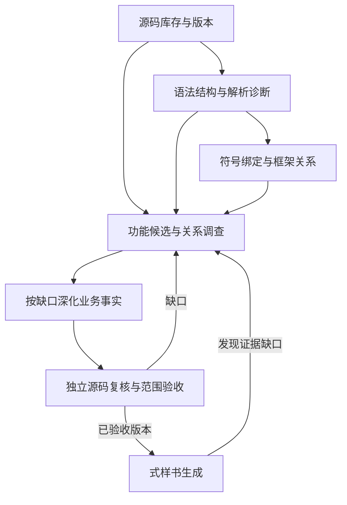

# 代码解析项目对 ContextBase 分轮提取的启发

调查日期：2026-10-23

状态：静态调研；未安装、运行或对任何项目进行准确率/速度对测。

## 目的与选取范围

为 ContextBase 的设想流程提供工程参照：先提取系统概要、功能、表、共通处理，再关联结构，按缺口深化，最后生成式样书。本次查阅多个同名 CodeGraph、GitNexus、Code-Graph-RAG、Understand-Anything，以及 Joern/CPG、Sourcegraph SCIP 与 .NET indexer、Roslyn、Aider Repo Map、GitHub Stack Graphs，并补查 Semgrep 的规则与数据流边界。重点看这些项目各自解决哪类问题，以及它们对只读源码、异构语言和本地工具链有什么要求。选取依据是实现路线的代表性，不是热度或准确率排名。

下述项目文档和代码是当前可访问版本；它们不是 reverse-agent 声明的依赖版本。项目级支持和要求以链接页面为准。本调研没有在目标样本上检验准确率、完整性、运行耗时，也没有运行目标源码。

正文多数链接指向可变化的 `main` 或官网，日期表示本轮查阅时间，不是所有文件的固定版本。GitHub 代码检索另外返回了以下可定位快照：CodeGraph `5b47bc4963433507957b1112dc58ea26f0978c56`、GitNexus `bbbc1b49e3427c467b8ac83a112f7793109e279b`、Code-Graph-RAG `c63a0a1631cb5d42c348418f031ec654c0a8545e`；不能据此断言所有 `main` 页面都来自同一快照。若后续实际试用，应另固定所用 tag/commit 和依赖。

## 对比

| 项目/层次 | 能提取或提供什么 | 能力边界与输入条件 | 对 ContextBase 的启发 |
|---|---|---|---|
| Tree-sitter（语法基础） | 语法树、节点、语法查询可定位声明、调用语法、条件等结构 | 结构节点不等同于已解析的类型、调用目标、框架路由或业务含义 | 把它作为稳定的源位置与语法事实层；输出解析覆盖和错误，不把语法节点直接标记成业务结论 |
| colbymchenry/codegraph（跨文件及框架关系） | Tree-sitter 提取之后另有导入、名称、接收者及框架解析；跨层合成覆盖部分 HTTP、队列和事件连接；查询可报告动态边界 | `ResolvedRef` 有 `confidence` 和 `resolvedBy`；部分跨层边明确标记 `provenance: heuristic`。有目标边不等于编译器证明或业务验收，动态边界查询本身也有数量/长度预算 | 优先借鉴结构提取之后的关系解析，以及“关系怎么得来”的元数据；区分直接证据、规则合成、候选和未解析，不照搬其速度宣传 |
| lzehrung/codegraph（另一个同名项目） | 统一的定义、作用域、导入绑定和依赖图支持导航、影响分析与任务上下文 | 文档明确不是编译器；需要表达式类型推断、更复杂重载/泛型或构建成员信息时可返回 `not_found` / `partial`；Vue/Svelte 和 SQL 列级能力有明确边界 | 借鉴按语言/操作声明能力、输出覆盖与遗漏原因的做法；`complete` 仅覆盖索引已知候选，不代表所有动态行为 |
| GitNexus（图到社区及流程） | 显式依赖的多阶段管线：结构、解析、关系解析、社区聚类、入口调用链和搜索 | 社区是功能候选，调用链不自动等于完整控制流。流程检测有入口候选、分支和深度预算，需读取截断诊断。当前 LICENSE 为 PolyForm Noncommercial 1.0.0，不能按宽松开源依赖处理 | 与分轮思路相近：先结构与关系，再聚合功能及入口流程；必须保留预算导致的缺失与不确定性。此处是设计参考，不是直接引入许可结论 |
| vitali87/code-graph-rag（分层增强） | Tree-sitter 基础图，可用时叠加编译器语义前端；统一 schema 提供调用、类型及可选 I/O/值流关系；另有运行轨迹入口 | 各语言能力不等；结构支持层明确不提供 CALLS 解析。`io` capture group 默认关闭；Python deep walk 与其他语言 lean walk 的精度不同，不能由 schema 推断所有边已生成。运行轨迹只覆盖执行过的路径，本次不运行 | 借鉴“一套图、不同来源的增强层”和按语言披露解析深度；对特定语言有充分项目上下文时再补强类型/绑定，保留 source-only 降级 |
| Understand-Anything（结构到语义地图） | 导入图分组、`importMap` / `neighborMap` 邻居上下文、固定结构提取后 AI 补摘要与语义；业务领域/流程另有分析 | 新符号有重要性过滤；domain analyzer 的一种入口可以仅从已有摘要图推导，不重读源码。因此业务地图不能直接作为精细式样书的完整性证据 | 借鉴相关文件成组、跨组邻居上下文及结构/语义分层；规格需要的短函数、异常分支和字段规则不能因导航裁剪而从正本消失 |
| Joern CPG（程序关系分析） | 将 AST、控制流、调用、变量/数据依赖等多种关系纳入同一属性图，并允许跨层查询；语言前端成熟度有差异 | CPG schema 是表达/查询框架，不自动保证每个前端都解析完整；官方 schema 明说配置文件只有原文内容的基础承载、无通用结构化配置模型。当前官方文档列出 C/C++、Java、JavaScript、Python、x86/x64、JVM bytecode 等，成熟度不同；另有 C# 前端 | 适合作为后续关系深化的参考：关系类型分开、保留源位置和前端/overlay 来源；按功能或数据路径查询相关子图。不要把“图上有边”当作业务语义已验收 |
| SCIP（符号索引交换协议） | 文件、定义符号、源码位置上的 occurrence、符号引用和诊断；可支持定义跳转、查引用、实现关系等 | SCIP 是索引格式/协议，不是完整分析器。索引质量取决于各语言 indexer；Sourcegraph 建议先运行编译语义阶段再遍历 AST，并以 snapshot/golden 对照验证。indexer 可能需要真实项目依赖、SDK、编译参数 | 为 ContextBase 增加一种可选、可复查的符号关系输入，并保留 indexer、版本、配置和诊断。可用小型 snapshot 验证“调用点绑定到谁”，比重复让模型猜调用关系更可控 |
| Roslyn（编译器语法和语义 API） | C# / VB.NET 语法树保留完整源语法；Compilation 与 SemanticModel 可解析标识符对应的符号、类型、诊断，以及局部数据流信息 | 语义解析依赖 Compilation 所含源文件、引用程序集、编译器选项；离开正确项目配置或缺引用时，语义结论会降级/缺失。编译器 API 本身不理解业务用途 | 对 C#、VB.NET 适合用作高置信度符号/类型证据来源，尤其解决同名重载、接口实现和变量/成员解析；保存诊断和未解析状态，避免无项目上下文时静默输出确定边 |
| Aider Repo Map（上下文检索） | 从符号定义/引用构造文件依赖图，以图排序挑选 token 预算内与当前任务相关的符号和签名；使用 Tree-sitter tags 查询 | 目标是给代码编辑 LLM 提供导航地图，不是验证完整调用图、业务流程或规格；map 会主动省略符号以适配上下文预算 | 借鉴“全局索引与按任务裁剪”两层：保存全量库存、已提取事实及未知项，再按功能/未决问题取相关片段；不能把裁剪后的 map 当作完整 ContextBase，更不能将高连接度直接解释为共通业务 |
| Stack Graphs（名字绑定） | 通过逐文件局部图和路径搜索解析跨文件的名字绑定，设计支持增量复用；用语法规则描述语言名称解析 | 主要解决定义—引用绑定，不提供控制流、数据流或业务含义。GitHub 原仓库已于 2025-09-09 归档、不再维护；当前 docs.rs 仍可读其 crate 文档 | 对只读、无完整编译工具链的代码库，说明“部分语言语义可由 Tree-sitter + 明确名称解析规则补足”；可先按语言/框架选取边界明确的规则，不应以单一通用解析器承诺全面语义 |
| Semgrep（规则驱动调查） | 结构模式、source / sink / sanitizer 等规则，以及有位置的匹配/taint trace | 规则命中范围取决于模式与模型；官方将跨函数/跨文件 taint 列为 Pro 能力，不能归入社区版承诺；一条报告 trace 也不枚举所有路径 | 对路由注册、校验入口、SQL/保存调用等已知模式提供调查线索或独立漏项检查；不会自动形成系统业务模型 |
| SQLGlot（SQL 专项解析） | SQL 方言解析、表达式树遍历、表/列节点及带 schema/来源查询的列血缘分析 | 需要选择实际方言，列绑定/血缘需要相应 schema 与查询上下文；它接收 SQL，不负责从宿主代码恢复所有动态 SQL，也不证明生产数据库结构或业务含义 | 对表、查询、字段映射引入专项解析证据，避免只匹配 SQL 文本或把查询别名当成物理列；与 UI/参数/ORM 的连接仍另行核对 |

表中前五项主要核查的是仓库 README、实现和能力说明；后面的语义/分析路线补充了官方协议及文档。不能由“声明支持某语言”推断该语言每类关系都有同等精度。

### CodeGraph 同名项目的范围

- 本次重点阅读 [colbymchenry/codegraph](https://github.com/colbymchenry/codegraph) 与 [lzehrung/codegraph](https://github.com/lzehrung/codegraph)，两者是不同仓库。
- 另查 [Cirilcetra/codegraph](https://github.com/Cirilcetra/codegraph)：README 的主要范围为 JS/TS/Python，Tree-sitter、Kuzu 与 embeddings/MCP。它是较窄语言范围的另一种本地图实现，不能把它的能力或测试归给前两个项目。
- 没有给这些同名项目排准确率名次；本轮没有统一输入、版本和查询的对照测试。

## 对分轮 ContextBase 的建议

1. **分开存储几种不同的证据。** 文件/行号、语法节点、绑定后的符号关系、控制/数据流、AI 提炼的业务事实，应使用不同字段或记录类型。每条关系至少保留源位置、解析器/indexer、版本、依据和状态。这样既能从全貌推进到关系，也能在不确定时按目标补查。
2. **让第一轮产物成为可修订候选。** 系统概要、功能、表、共通处理先标记候选和证据覆盖。后续关系追踪发现遗漏的新入口、新表或共通处理，应回写并触发相关项复核；不能把初轮目录当作闭合集合。
3. **将“关系索引”与“业务事实”分开。** 确定 `A.Save()` 绑定到某个方法，可由编译器/indexer 给出较强的符号证据；该方法是否保存学生数据、失败时如何处理，还需沿控制/数据路径调查并由源码证据验证。调用次数多只能提示优先级，不能证明共通职责。

   编译期符号绑定也不必然确定运行时调用目标；虚调用、依赖注入和动态分派需要保留额外条件及候选集合，不能把一个声明绑定直接解释为唯一执行路径。
4. **采用分层、按需加深的语言策略。** 先对所有输入做不执行代码的文件清点、语法解析和诊断；只对优先试点语言启用额外语义工具；对缺工具链或无法解析的语言保留部分结果并明确降级。Tree-sitter 覆盖面并不自动等于同等语义深度。
5. **用小而可审阅的事实样本验证解析器。** 对一个跨文件功能链，手工指定期望的定义、引用、关键控制分支和数据读写，使用 snapshot/golden 比较节点、行号和关系；记录不支持语法、配置缺失和误连。该测试验证解析层，不替代独立业务审查。
6. **在规格生成时按任务选择子图，而不是重新调查全仓。** 每份式样书消费已验收 ContextBase 中相关事实；发现缺口后回到定向源码调查，再更新受影响文档。检索预算应影响“给模型看哪些材料”，不应删除或弱化 ContextBase 原始证据。

上述建议是针对本项目的推断，不是所列项目对 ContextBase 的兼容性承诺。推荐的逻辑层次为：

图表示知识层次和反馈关系，不是要求全仓完成某层后才能开始下一层的屏障。粗提取可以先用库存、入口和已有语法证据建立候选；关系与业务理解按目标渐进补全。这些层可以保存在同一套版本化 ContextBase 中，不要求建立多个互相竞争的业务正本。每轮新增的是结构、关系或事实；第一轮概要仍可被后续证据修订。不同来源的置信度数值也不能直接合并为一个通用准确率。

## 与当前代码的连接情况

- 当前 reverse-agent 旧规则路径的 `src/specgen/analyze.py` 使用 Python AST 与 brace 语言 token 规则；新 AI 路径的 `src/contextbase/ai/workflow.py` 按文档建立分析 facts，再交给写作。此次源码检查未见它显式调用 Tree-sitter 导航或共享语义索引。`ai/capsule.py` 中的 `indexed` 是带行号的原文副本。
- 邻近 `source-to-doc-v2/spec-pipeline/code_navigation.py` 已有 Tree-sitter host/CLI 连接和可用语言服务导航，并经作者会话提供查询；工具明确把语法结果标为调查候选，需要再读源码取得证据。用户确实接过 Tree-sitter，不能据 reverse-agent 的缺口推断其他工程没有使用。
- “工具已安装”“管线提供了工具”“某次任务调用过工具”“工具返回的关系正确”是四种不同证据。本轮只核对代码接入，未证明某次真实运行的实际使用情况。

## 建议先做的可审阅对照

选择一个已明确入口的真实跨文件功能，预先人工核对必要的定义/引用、重载或同名干扰、关键分支、数据或状态变化及源位置。至少包括一类不应连接的负例，以及一个应保持未解析的动态情形。

按同一源码版本比较当前路径和候选实现：材料清点是否漏项、符号位置是否正确、关系目标/依据是否正确、重要路径是否遗漏、AI 是否实际使用索引、业务结论是否得到源码支持。分别记录误连、漏连、未解析和工具故障；在同一查询范围内测量索引耗时、调查耗时和模型用量。局部样本通过只能证明该样本及条件，不能外推全语言或整项目完整性。

初期优先深看 CodeGraph 的关系/框架解析、SCIP/Roslyn 的符号绑定、Joern 的程序流表示，以及 Aider 的上下文裁剪。它们解决不同问题，暂不据本轮资料决定替换整个底层或引入图数据库。

## 对 source-only 与工具链的适用性

本仓库的 reverse-agent 约束要求输入源码按只读材料处理、不可执行程序。静态解析器可以读取文本；但“编译语义索引”仍可能需要 SDK、依赖、生成文件、编译选项和项目评估。任何构建/索引步骤都应先审查其构建目标是否会执行项目自定义任务，且把索引环境隔离；本研究没有运行构建、恢复依赖或 indexer。

具体的 `scip-dotnet` indexer 提供 C# / Visual Basic 的 Roslyn 实现，README 指出需要 .NET 8，并支持 snapshot 测试；这些是该实现的能力，不是 SCIP 协议的通用保证，也不表示它能无条件索引旧版 .NET Framework、缺失依赖或非标准项目。Joern 前端列表含 C#，但成熟度和对具体版本/框架的适配仍应单独核验。当前材料不足以推荐将任何完整工具链直接加进默认 reverse-agent 路径。

因此较稳妥的工程边界是：默认路径产出带诊断的 source-only 结构索引；对允许且可复现的项目可启用编译器或 SCIP 索引；构建上下文不可得时保留“不确定/候选”，交由后续定向调查，不把文本搜索匹配升级成已确认绑定。

## 一手来源

- [Joern: Code Property Graph](https://docs.joern.io/code-property-graph/)；[CPG 1.1 schema](https://cpg.joern.io/)；[Joern frontends](https://docs.joern.io/frontends/)
- [Sourcegraph: Writing an indexer](https://sourcegraph.com/docs/code-navigation/writing-an-indexer)；[SCIP protocol](https://scip-code.org/)；[SCIP schema](https://github.com/scip-code/scip/blob/main/scip.proto)；[scip-dotnet](https://github.com/sourcegraph/scip-dotnet)
- [Microsoft: Roslyn syntax analysis](https://learn.microsoft.com/en-us/dotnet/csharp/roslyn-sdk/get-started/syntax-analysis)；[Roslyn semantic model](https://learn.microsoft.com/en-us/dotnet/csharp/roslyn-sdk/work-with-semantics)；[SemanticModel API](https://learn.microsoft.com/en-us/dotnet/api/microsoft.codeanalysis.semanticmodel?view=roslyn-dotnet-4.14.0)
- [Aider: Repository map](https://aider.chat/docs/repomap.html)；[Aider map implementation](https://github.com/Aider-AI/aider/blob/main/aider/repomap.py)
- [GitHub Stack Graphs repository and archive notice](https://github.com/github/stack-graphs)；[Stack Graphs crate documentation](https://docs.rs/stack-graphs/latest/stack_graphs/)
- [Tree-sitter overview](https://tree-sitter.github.io/tree-sitter/)
- [CodeGraph 主仓库说明](https://github.com/colbymchenry/codegraph/blob/main/README.md)；[关系类型与解析方式](https://github.com/colbymchenry/codegraph/blob/main/src/resolution/types.ts)；[跨层关系合成](https://github.com/colbymchenry/codegraph/blob/main/src/resolution/tier-synthesizer.ts)；[动态边界报告](https://github.com/colbymchenry/codegraph/blob/main/src/graph/dynamic-boundary-report.ts)
- [lzehrung/codegraph 解析流程](https://github.com/lzehrung/codegraph/blob/main/docs/how-it-works.md)；[语言与操作能力边界](https://github.com/lzehrung/codegraph/blob/main/docs/language-parity.md)；[Cirilcetra/codegraph](https://github.com/Cirilcetra/codegraph/blob/main/README.md)
- [GitNexus 管线](https://github.com/abhigyanpatwari/GitNexus/blob/main/gitnexus/src/core/ingestion/pipeline.ts)；[流程预算](https://github.com/abhigyanpatwari/GitNexus/blob/main/gitnexus/src/core/ingestion/process-detection-budget.ts)；[README 参数与截断说明](https://github.com/abhigyanpatwari/GitNexus/blob/main/README.md)；[LICENSE](https://github.com/abhigyanpatwari/GitNexus/blob/main/LICENSE)
- [Code-Graph-RAG 总览](https://github.com/vitali87/code-graph-rag/blob/main/README.md)；[语言支持](https://github.com/vitali87/code-graph-rag/blob/main/docs/architecture/language-support.md)；[图 schema](https://github.com/vitali87/code-graph-rag/blob/main/docs/architecture/graph-schema.md)；[I/O 与值流边及限制](https://github.com/vitali87/code-graph-rag/blob/main/docs/architecture/data-flow-edges.md)
- [Understand-Anything 文件分析](https://github.com/Egonex-AI/Understand-Anything/blob/main/understand-anything-plugin/agents/file-analyzer.md)；[分组与邻居上下文](https://github.com/Egonex-AI/Understand-Anything/blob/main/understand-anything-plugin/skills/understand/compute-batches.mjs)；[业务图分析](https://github.com/Egonex-AI/Understand-Anything/blob/main/understand-anything-plugin/agents/domain-analyzer.md)
- [Semgrep taint 分析与 Pro 边界](https://docs.semgrep.dev/writing-rules/data-flow/taint-mode/overview)
- [SQLGlot 概述与表/列遍历](https://github.com/tobymao/sqlglot/blob/main/README.md)；[列血缘接口与 schema 输入](https://github.com/tobymao/sqlglot/blob/main/sqlglot/lineage.py)

## 验证范围与限制

本轮只核对了所列第一方官方文档、官方仓库说明和实现入口，并针对 ContextBase 的分轮工作提出结构性建议；没有执行任何解析项目、安装依赖、运行模型、读取 test-project1/spec-eval 或改动客户源码。本文件属于背景研究，不能作为解析准确率、性能或业务规格正确性的实测结论。
