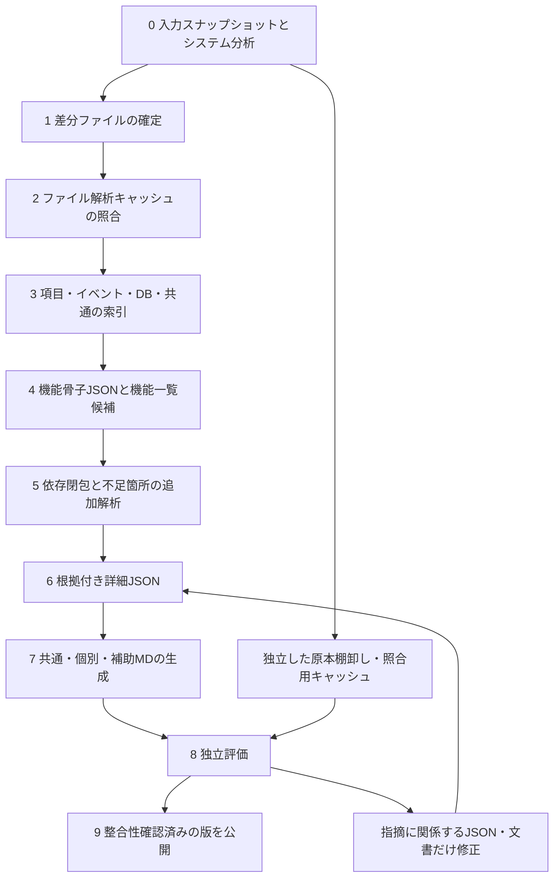

# ソーススキャン最適化設計

版：1.0／2026-10-02。対象：異なる言語・ディレクトリ構造の業務システムから、顧客向け概要仕様書を生成する工程。

**本書は方式設計である。汎用スキャナーの実装完了、39機能の新書式への再生成完了、独立評価の合格、処理時間の短縮実績を示すものではない。** 最適化の目標は「読む範囲を省いて速くする」ではなく、「必要な情報を一度取り出し、変更と影響範囲だけを更新する」ことである。

## 1. 現状調査と改善の優先順位

調査基準コミット：`d1b3b984201313ca74ea4f0fbc278eebd4fb1e16`。

| 現状の実装 | 確認した内容 | 改善方針 |
| --- | --- | --- |
| `.work/tkl-basic-design/collect.py` のcollect | 実行ごとに対象を再帰走査し、各ファイルをハッシュ化して対象VB・XAMLを再解析する。保存済み抽出結果の一致判定はこのループにない | ファイル単位の解析結果を内容・解析器の版で再利用する |
| 同ファイルの機能採番 | ソート後の列挙番号からTKL-001等を割り当てる | 永続的なID台帳へ移行し、追加・名称変更で既存IDを振り直さない |
| `specgen/engine.py` の_run | ファイルキャッシュはあるが、設定全体・specgen内の全Pythonファイル・Python版を解析キーに含める | 構文解析、参照解決、機能集約、文章化、評価ごとにキーを分ける。文書テンプレートの変更で構文解析を失効させない |
| TKL専用の収集・編集 | TKLの配置と対応付けに依存する | システム分析、言語・画面・DB等のアダプター、共通骨子、文書生成を分離する |

根拠：上記コミットの [collect.py](../.work/tkl-basic-design/collect.py) と [engine.py](../specgen/engine.py)。本設計の保存ではこれらを変更しない。

導入順は、①基準測定と固定ID、②入力スナップショット・ファイルキャッシュ、③索引と骨子JSON、④依存関係による部分更新、⑤章単位の文章化再利用、⑥計測結果に基づく並列化・構文内差分解析とする。高度な索引や並列化を先に入れて、正確性の比較基準を失わない。

## 2. 全体工程



各工程の入力・出力を不変の成果物として保存し、次の工程はその成果物IDを参照する。途中で失敗しても完了済みの工程を再利用する。文書の作成中状態と顧客向け公開版は区別する。

## 3. システム分析を最初に行う

解析対象はinput配下とし、生成器自身・過去のoutput・examplesを業務ソースに混ぜない。最初にプロジェクト定義、起動設定、依存宣言、主要ディレクトリ、画面・帳票・DB資料の所在を軽量に調べる。

`system-profile.json` に、システム名、製品名、開発言語と宣言版、画面方式、DBとSQL方言の候補、帳票製品、バッチ方式、外部接続方式、プロジェクト境界、業務分類、顧客・作成者・開発会社の記載、文字コードの観測結果を保存する。値ごとに `declared / inferred / unknown / conflicting` と根拠を保持する。Gitの所有者・コミット者から顧客や原開発者を確定しない。

分析結果から、言語構文、画面、DBアクセス、帳票、バッチ、共通処理のモジュールを組み合わせる。未対応の言語や構造に対しては能力不足を記録し、必要なモジュールを別途実装・検証してから有効化する。ビルドツール、プラグイン、入力コードを自動実行して能力を補わない。

ファイル内構文の解析と、他のファイルやライブラリを含む参照先の解決は分離する。Roslynの公式説明でも、構文情報だけでは参照先の特定に不足し、意味モデルが別の役割を持つ。[R05]

## 4. 入力の確定と差分スキャン

### 4.1 Git上の確定ソース

実行開始時のコミットとinputツリーを固定する。処理中にmainが進んでも途中で読取対象を切り替えない。Gitのツリー一覧とツリー間差分を使って追加・変更・削除・移動候補を検出する。[R01][R02]

ファイルの取得は原則として変更されたblobだけとする。同じ内容のblobを複数の場所で参照する場合、パス非依存の構文結果は再利用できるが、相対参照・ファイル配置・出典リンクの解決は別に行う。Gitのobject IDは識別子として保存し、キャッシュ成果物の完全性には別途内容ハッシュを使用する。

GitHub APIのツリー・比較結果に省略やページ分割がある場合は、サブツリーやページを読み切る。上限を超えた結果を全ファイル一覧として扱わない。LFSポインター、サブモジュール、アクセス不能ファイルは未取得の依存として報告する。

### 4.2 未コミットの作業ツリー

未追跡ファイル、追加、削除も含める。更新日時とサイズは変更候補の絞込用に使い、それだけで内容同一とは断定しない。最終公開前は対象内容のハッシュを確認する。読み取り中の変更を検出した場合は再取得し、同じ実行で異なる世代のファイルを混ぜない。

### 4.3 初回読み取り

対象ファイルのバイト列を一度取得し、そのバイト列からハッシュ、文字コード判定、改行位置、構文情報を作る。ハッシュ取得、解析、項目抽出、メッセージ抽出のために同じファイルを何度も読み直さない。長大なファイルはストリーム処理を検討し、安全上限超過を黙って切り捨てない。

除外ディレクトリは降下前に判定する。ただし名前だけで共通ソースを除外しない。生成コードも唯一の画面・帳票・DB定義なら必要であり、重複かどうかを確認してから除外する。設定に秘密情報がある可能性は、設定全体を存在しないものとして扱う理由ではない。接続方式など必要なメタデータだけを抽出し、実値は保存しない。

## 5. 多層キャッシュ

キャッシュは最終MDだけではなく、以下の層に分ける。入力と実行条件から再利用する考え方は、BazelのAction CacheとContent Addressable Storeを参考にする。ただし本システムでBazelの導入を必須にするわけではない。[R03]

| 層 | 保存内容 | 主な失効要因 |
| --- | --- | --- |
| L0：入力台帳 | パス、blob、内容ハッシュ、文字コード、除外理由、スナップショット | 入力の追加・削除・内容・配置・対象設定 |
| L1：構文抽出 | 宣言、構文範囲、UI要素、SQL断片、メッセージ、初期の参照候補 | 当該内容、解析器・文法・解析オプション |
| L2：参照解決 | 呼出・継承・共通Style・DB・帳票・設定の依存関係 | 関連シンボル、依存定義、名前空間・構成条件 |
| L3：機能仕様 | 項目、イベント、条件、CRUD、IO、メッセージ、共通参照の骨子・詳細 | 依存閉包、機能境界、業務説明・承認情報 |
| L4：文章・図 | 章単位の本文、表、Mermaid、データ例 | 関連仕様JSON、テンプレート、用語、編集指示、生成条件 |
| L5：独立評価 | 項目照合、図表整合性、実装可能性、指摘の再検査 | 評価対象MD、原本・共通仕様、評価ルール・モデル・入力条件 |

L5は生成側のキャッシュと分ける。独立評価が生成側の抽出漏れをそのまま正解として再利用してはならない。

### 5.1 キー設計

```text
parse_key = H(project_security_scope, content_hash, encoding_policy,
              adapter_id, adapter_version, grammar_version,
              parser_options, relevant_runtime_version)

resolve_key = H(parse_result_hashes, compilation_or_resolution_context,
                symbol_registry_fingerprint, resolver_version)

feature_key = H(stable_feature_id, dependency_closure_digest,
                boundary_profile, approved_business_overrides, schema_version)

chapter_key = H(chapter_input_digest, template_version, terminology_version,
                editorial_instructions, generator_configuration)

evaluation_key = H(candidate_md_digest, independent_source_baseline_digest,
                   referenced_common_spec_digests, evaluation_rules,
                   evaluator_configuration, scope)
```

Hは区切りと型を定めた決定的なシリアライズ結果に対するハッシュとする。公開日時や実行IDは業務内容と分離し、無関係なタイムスタンプで毎回すべてを失効させない。一方、コメント・ラベル・メッセージ・空白に業務上の意味がある場合、意味が変わらないとして不用意に除外しない。

実行環境、解析設定、依存ライブラリが結果へ影響するならキーに含める。入力が同じでも未宣言の環境差で結果が変わる状態は避ける。これはBazelのhermeticityの考え方を本工程へ適用した方針である。[R04]

生成AIを利用する場合、同じ条件でも文言が一致する保証を前提にしない。モデル・プロンプト・取得根拠集合・編集条件を記録し、レビュー済み成果物を再利用する。再生成時の比較では文章の一致だけでなく、項目と条件の意味が一致するかを評価する。

### 5.2 失敗と部分結果

`ok / partial / error / stale / unsupported` を区別する。partialは有用な抽出結果として再利用できるが、未解決一覧も一緒に保持し、再利用によってokに変えない。同一内容・同一解析器による決定的な構文エラーは診断を再利用できる。一時的な通信失敗・資源不足は期限や再試行回数を決めて再実行する。

キャッシュが壊れている、必要なオブジェクトがない、ハッシュが合わない場合は該当層を再構築する。キャッシュファイルはコードとして評価せず、構造とサイズを検査する。ハッシュ一致は完全性の確認であって、作成者の信頼性の証明ではない。書込権限と案件ごとの分離を行う。

## 6. 索引（Index）

### 6.1 構造索引を主役にする

| 索引 | キー・主な内容 | 用途 |
| --- | --- | --- |
| file_index | スナップショット、パス、内容ID、種別、対象状態 | 同じファイルの重複取得を避ける |
| symbol_index | スコープ付き識別子、定義位置、参照位置、候補 | 関数・項目・共通部品の対応を辿る |
| feature_index | 固定機能ID、入口、主画面、帳票・バッチ、状態 | ファイル名やディレクトリ名に依存せず機能を管理 |
| field_index | 安定項目ID、役割、配置領域、順番、状態条件 | 項目漏れ・役割誤り・順番の検査 |
| event_index | 契機、処理、入力、出力、分岐、後続依存 | 保存・検索・取消等を末端処理まで辿る |
| db_index | オブジェクト、列、操作、条件、呼出イベント、根拠 | CRUD図・DB定義書・DBオブジェクト一覧 |
| message_index | 定義ID、文面、置換値、表示箇所、回答後の処理 | メッセージ一覧とイベント仕様の整合 |
| dependency_index | 起点、終点、関係種別、条件、根拠、解決状態 | 変更の影響先と逆参照の検索 |
| evidence_index | 原本位置、内容ハッシュ、仕様ID、文書位置 | 根拠と仕様を双方向に照合 |

シンボル名だけで一意にしない。同名関数、別名前空間、別テナント、別スキーマ、別バージョンを区別する。DB列名の曖昧な対応、動的テーブル名、外部関数等は候補集合として残す。

### 6.2 物理構成

小規模案件ではJSONLとメモリ上の逆引きから開始してよい。スキャン量・検索回数が増える場合は、ローカルのSQLiteを再構築可能な構造索引として利用する。選定は測定後に行い、最初からベクトルDB・分散DBを必須にしない。

全文検索は説明や用語の補助検索に使う。SQLite FTS5のtrigramは部分文字列検索に使えるが、3文字未満の問い合わせ等に制約がある。「DB」「税」など短い語は完全一致索引や別の探索方法で補う。日本語の単語分割が常に正しく行われるとも仮定しない。[R06]

ベクトル検索・上位k件検索は、候補を並べる補助に限る。上位検索結果だけで項目・DB参照の完全性を証明しない。仕様を構成する正規集合は構造索引と原本棚卸しから取得する。

SQLiteを用いる場合、解析ワーカーは複数でも索引更新は書込キューにまとめる。WALにも同時writerの制約があり、ネットワークファイルシステムの共有DBとしては扱わない。チェックポイントとコミット済みの状態を管理し、動作中のDBファイルをそのままGitへ保存しない。[R07]

## 7. 骨子JSONを先に作る

最初から長いMDを作らず、次の順で保存する。

```text
system-profile.json       システム分析結果と必要アダプター
source-manifest.json      原本・除外・未取得・ハッシュ
feature-registry.json     固定IDと機能境界の台帳
feature-index.json        全機能の入口・種類・担当範囲
feature-skeleton/<ID>.json 項目・イベント・DB・共通依存の枠と未解決
feature-detail/<ID>.json   条件・式・更新範囲・例外・根拠の詳細
common-spec/*.json        共通仕様の本体。機能からID参照
messages/*.json            文面と表示箇所
objects/*.json             DB定義・参照・推定属性
review/*.json              独立評価の指摘と判定
```

骨子は単なる要約ではない。全候補の安定ID、件数を数える単位、状態、原本位置、未対応要素、未解決参照を持ち、不足情報を後から埋められる契約とする。空配列は「対象なし」「未解析」「未取得」を区別する状態情報なしでは受け入れない。

JSONの構造は版付きの契約とし、JSON Schema等で検証する。[R08] 構造検証を通っても、項目数、参照先の存在、上下限の関係、文書内容の妥当性までは別検査が必要である。詳細契約は [骨子JSONと独立評価の契約](%E9%AA%A8%E5%AD%90JSON%E3%81%A8%E7%8B%AC%E7%AB%8B%E8%A9%95%E4%BE%A1%E3%81%AE%E5%A5%91%E7%B4%84.md) に記載する。

### 7.1 共通仕様の重複を減らす

共通の必須検証、入力長、検索条件、認証、保存・取消、トランザクション、採番、帳票、ファイル、バッチ再開を一度整理し、各機能には適用ID・適用条件・例外だけを持たせる。共通仕様を参照するだけで、どの規則が適用されるか不明な文書にはしない。

共通変更がすべての機能へ影響する場合、再評価も全適用機能が対象となる。効率化を理由に影響範囲を狭めない。文章本文を再生成しなくても参照先との整合評価が必要な場合がある。

### 7.2 DB資料がない場合

属性単位で「DDL等で確認」「ソース上の使用を確認」「推定」「未確認」「矛盾」を分ける。SQLに登場した列は、物理型・NULL・主キー・索引まで確定したことを意味しない。結合条件から外部キー制約や1対多を断定しない。DB関数・トリガーの本体がない場合、内部の更新先を空欄で確定しない。

CRUDは参照、登録、更新、削除に加え、全件消去・一括取込・外部関数呼出等を別属性として扱う。ビュー越しや共通処理越しのアクセスは直接アクセスと区別する。保存の履歴追加、検索用の参照表、エラー文生成の共通呼出を省かない。

## 8. 変更の影響範囲と追加解析

差分ファイルだけで終わらず、依存関係を逆向きに辿り、影響する機能・共通仕様・集約文書・評価を再処理する。

| 変更 | 再解析・再生成の基本範囲 |
| --- | --- |
| 1画面の入力上限 | 当該画面の抽出、対応項目、入力イベント、該当仕様書、項目評価 |
| 共通入力長・丸め処理 | 共通仕様と、直接／間接に適用するすべての機能 |
| 共通メッセージ文面 | メッセージ一覧、引用している章、表示箇所の整合評価 |
| DB列・制約 | DB定義・オブジェクト一覧・CRUD・参照／更新する機能 |
| 文書テンプレート | 文章・図の生成と文書評価。原本の構文解析は再利用 |
| 評価ルール | 評価のみ。判定変更がある場合は公開台帳も更新 |
| 顧客名・業務用語 | システム情報、影響する説明文、表記評価 |
| ファイル移動・名称変更 | パス依存の参照解決、出典、文書リンク。機能IDは維持 |
| ファイル削除 | 対応ノード・依存辺・集約一覧・所有生成物・参照リンク |
| 新しい定義・オーバーロード・ルート | 未解決参照と定義集合を見直す。必要ならプロジェクト単位で再解決 |
| 解析器・文法・言語設定変更 | 当該能力を使用する解析層とその下流 |

既存グラフに存在しない新しい参照先は逆引きだけでは検出できない。未解決シンボル索引、定義集合の版、globの検索範囲、構成設定の指紋もキーに含める。依存関係が不完全なら、保守的に対象プロジェクト全体へ広げる。

細かい構文内差分解析は、ファイルキャッシュと依存更新で効果が不足したときに追加する。Tree-sitterは編集に応じた構文木更新の仕組みを提供するが、その利用だけで業務意味やDB参照の完全解決ができるわけではない。[R09]

## 9. 実行・保存・再開

各作業に `pending / running / completed / failed / blocked` を持たせ、入力キー、成果物ハッシュ、試行回数、所有ワーカー、リース、エラー種別を記録する。完了マークは成果物の原子的な保存と検証後に付ける。異常終了したrunningは、他の実行が継続していないことを確認して再試行する。

ローカルではファイルまたは工程完了ごとにチェックポイントを残す。GitHubへの保存は毎ファイルのcommitではなく、工程終了またはまとまった完了分を単位として行う。これによりAPI通信と大量の微小commitを抑える。保存粒度は測定して決め、失敗時の再処理量との交換条件を明示する。

Git管理するのは、マニフェスト、ID台帳、骨子・詳細JSON、確認事項、評価結果、公開MDを基本とする。構文木キャッシュや検索DBなど容量の大きい再構築可能な物はローカル／Artifact等へ分ける。Artifactの保存期限・アクセス権・サイズが適切か別途確認する。保存先が消えても原本と台帳から再構築できるようにする。

成果物は途中候補を作業領域へ生成し、リンク、原本の世代、独立評価結果を確認してから公開する。途中状態をGitへ保存する場合はdraftであることを明示する。既存の手修正文書は所有ハッシュで検出し、勝手に上書きしない。削除は自分が生成して未編集であることを確認できたものに限る。

## 10. 独立評価を維持したまま速くする

生成器と評価器は、原本バイトやスナップショットを共有できるが、生成器の抽出結果を独立評価の正解台帳にしない。評価結果も変更対象だけ再利用判定できるが、文書・原本・共通依存・評価条件のどれかが変われば再評価する。

| 検査 | 合格条件の例 |
| --- | --- |
| 項目の正確性 | 名称・型・必須・長さ単位・DB対応・説明が原本と一致 |
| 役割 | 表示専用は入力必須を要求しない。ボタンは操作であり値入力やDB列ではない。表示値の取得元DBは別に必要 |
| 数と順 | 項目ID集合、役割別・領域別件数、画面順／一覧列順／ファイル順を照合。件数一致だけでは合格にしない |
| イベント | すべての起動契機と状態分岐が文書に対応。保存と確定を混同しない |
| データ | 保存の本体・明細・履歴、検索の取得元、キー・条件・更新境界が図表と一致 |
| 実装可能性 | 原本を見ない別の評価者が、個別＋共通仕様だけから判定表・入出力・更新・異常処理を再構成できる |
| メッセージ・例 | 置換値、表示条件、回答後の処理、正常・境界・異常の例が本文と矛盾しない |
| 推定・未確認 | 推定DB属性、未知の動的参照、未対応要素を確定情報としていない |

未確認は合格ではない。重大な入力条件誤り、保存先の漏れ、誤った金額・件数・更新範囲、隠れた未解析は公開停止条件とする。軽微な表記の得点で重大欠陥を相殺しない。

## 11. 精度と時間の測定計画

### 11.1 比較する実行

同じ原本・同じ設定で「キャッシュなしの全量実行」と「最適化した実行」を比較する。全量実行も自動的に正解ではないため、別に代表機能の正解標本と意図的に欠陥を入れた文書を用意する。

| ケース | 検証する期待 |
| --- | --- |
| 初回、キャッシュなし | 全対象を取りこぼさず解析し、骨子と索引を構築 |
| 同一入力の再実行 | 原本再解析・文章再生成を不要にする。入力確認等の時間は残る |
| 個別画面1ファイル変更 | 当該機能と依存文書だけ更新 |
| 共通仕様変更 | 適用するすべての機能へ影響が伝播 |
| DB定義・メッセージ変更 | 定義書・CRUD・使用機能・一覧の整合性を更新 |
| テンプレートだけ変更 | 構文解析を再実行しない |
| 追加・削除・移動・同名追加 | ID維持、消えた参照の除去、未知の候補の再解決 |
| 途中停止・キャッシュ破損 | 完了分を再利用し、不整合成果物を公開しない |
| 別言語・混在・DB資料なし | 未対応と推定を明示し、対応範囲だけで全体合格にしない |
| 未コミット変更・未追跡入力 | 変更を見落とさず一つの世代として扱う |

計測値：工程別実時間、CPU時間、ピークメモリ、読み取りバイト、取得API回数、解析済み／再利用数、逆参照で失効した機能数、JSON・キャッシュ容量、索引検索回数、AIを使う場合の入力／出力トークン数と再試行数、手動確認時間、独立評価の欠陥数。

短縮率 = 1 − 改善後の総所要時間 ÷ 基準の総所要時間。

再利用率は構文解析、参照解決、機能集約、文書生成、評価を別々に集計する。索引構築・キャッシュ転送・評価・修正の時間を総時間から除かない。試行数を記載し、少数試行では中央値と範囲を示す。p95等の裾の指標は十分な回数を得てから使う。

### 11.2 正確性の受入条件

- 同一スナップショットの全量と差分で、正規化した仕様事実と未解決集合が一致する。意図しない差は0件。
- 正解標本の必須項目・イベント・データ操作・メッセージに漏れがない。単なるJSON件数ではなくIDと属性で照合する。
- 「項目を1件削除」「IDを別項目へ交換」「文字数をバイト数へ誤記」「履歴登録を削除」「図から検索対象を削除」「列順を逆転」「ボタンへDB列を付与」等の既知欠陥を評価器が検出する。
- 対応範囲・未対応数・未確認数を隠さず報告する。未知の母集団を分母0や100％として扱わない。
- 改善により処理時間が短くなっても、重大欠陥・見逃し・未説明の範囲拡大があれば採用しない。

速度と精度を混ぜた単一スコアではなく、まず品質条件を満たす候補を残し、その中で時間・資源・再作業を比較する。短縮率の目標値は基準測定後に設定する。未測定の「○倍高速」「○％削減」は提示しない。

## 12. 最終MDと中間結果の区別

顧客向けの文書はoutput直下へ置き、ファイル名で識別する。以下は生成先の契約であり、この文書でそれぞれを生成済みと主張するものではない。

```text
output/機能一覧.md
output/概要仕様書SYS-000_システム概要.md
output/概要仕様書COM-001_共通仕様.md
output/概要仕様書TKL-001_ログイン.md
output/概要仕様書MSG-001_メッセージ一覧.md
output/概要仕様書CRUD-001_CRUD図.md
output/概要仕様書DB-001_DBオブジェクト一覧.md
output/概要仕様書DBD-001_DB定義書.md
```

複数案件が同じoutputを使う場合は、案件IDを含むIDで名前の衝突を防ぐ。内部のキャッシュやJSONは種類別のサブディレクトリに分けてよい。機能IDを表示順と分離することで、名称変更や表示順変更で出典・評価・文書間リンクが崩れないようにする。

## 13. 参照資料と適用範囲

公開資料は方式の根拠として参照し、対象システムの現行業務仕様の代わりにしない。参照日：2026-10-02。本文は本案件への設計上の適用であり、各製品の導入や規格への全面準拠を宣言しない。

- [R01 Git: git-ls-tree](https://git-scm.com/docs/git-ls-tree)：固定したツリー内容の列挙。
- [R02 Git: git-diff-tree](https://git-scm.com/docs/git-diff-tree)：ツリー間の変更検出。
- [R03 Bazel: Remote Caching](https://bazel.build/remote/caching)：実行結果索引と内容ベースの成果物保存。
- [R04 Bazel: Hermeticity](https://bazel.build/basics/hermeticity)：結果に影響する入力・環境の明示。
- [R05 Microsoft: Work with semantics](https://learn.microsoft.com/en-us/dotnet/csharp/roslyn-sdk/work-with-semantics)：構文と参照解決の責務の違い。
- [R06 SQLite: FTS5](https://www.sqlite.org/fts5.html)：全文・部分文字列検索とtrigramの制約。
- [R07 SQLite: Write-Ahead Logging](https://sqlite.org/wal.html)：同時読取・書込、単一writer、WAL運用の制約。
- [R08 JSON Schema Draft 2020-12](https://json-schema.org/draft/2020-12)：版付きのJSON構造検証。
- [R09 Tree-sitter: Advanced Parsing](https://tree-sitter.github.io/tree-sitter/using-parsers/3-advanced-parsing.html)：構文木の編集と再利用。
