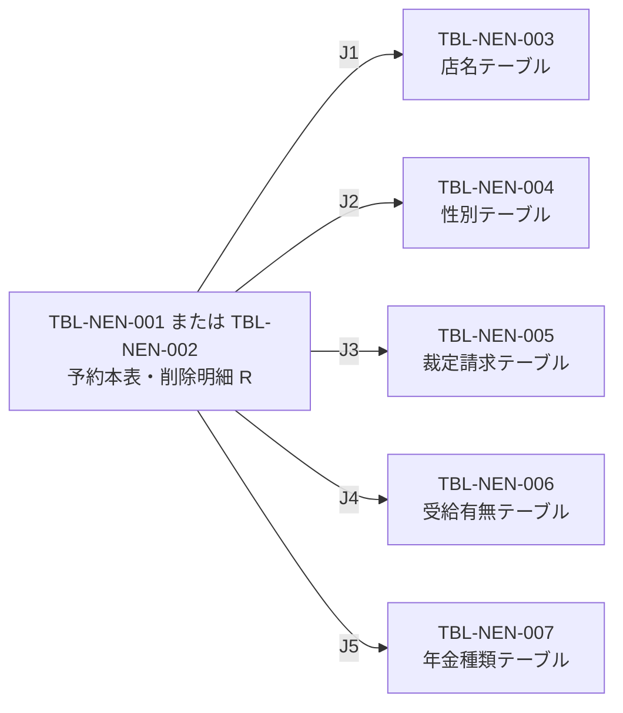
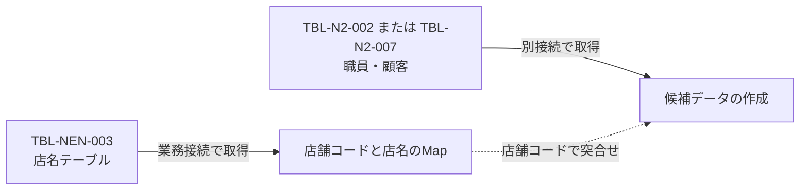

<!-- spec-meta: {"schema":"spec-md/1.0","documentId":"DB-INDEX","version":"2.0","path":"共通/DBオブジェクト一覧.md","sheets":[{"heading":"概要","kind":"GRID","sheet":"概要"},{"heading":"DBオブジェクト一覧","kind":"LIST","sheet":"DBオブジェクト一覧","key":["安定ID"]},{"heading":"定義書対応","kind":"GRID","sheet":"定義書対応"},{"heading":"接続とDDLの適用範囲","kind":"GRID","sheet":"接続とDDL"},{"heading":"索引一覧","kind":"LIST","sheet":"索引一覧","key":["No"]},{"heading":"データ関連","kind":"GRID","sheet":"データ関連"},{"heading":"利用処理と更新境界","kind":"GRID","sheet":"利用処理と更新境界"},{"heading":"補足説明","kind":"GRID","sheet":"補足説明"}]} -->
# DBオブジェクト一覧

| 項目 | 内容 |
| --- | --- |
| 文書種別 | DBオブジェクト一覧 |
| システム名 | 年金自動受取予約管理システム |
| 共通/文書ID | DB-INDEX |
| 版 | 2.0 |
| 解析対象 | 年金業務表、接続する共通・外部表、対応DDLおよびデータアクセス実装 |
| 基準日 | 2026-10-15 |

## 概要

本書は、予約の現行内容・削除明細・表示名称を扱う業務7表と、共通認証・職員確認・顧客参照・アクセス記録・運用判定に関係する8表を整理する。安定IDは論理データ仕様書とテーブル定義書でも共通に使用し、同じ表の用途と物理定義を対応付ける。

業務7表には、ローカルH2用とSQL Server用のDDLがある。共通・外部8表について収録されているDDLはローカルH2の互換定義であり、その型・容量・主キー等を本番外部表の属性として適用しない。

一覧の接続系統は、業務が`jdbc/RAROA_DB`、共通が`jdbc/Oracle_SP2NM`、DWHが`jdbc/Oracle_DWH`を表す。これは実装が要求するJNDI識別子の区分である。表名のスキーマ部分と接続先の区分は別に扱い、例えば`N2_SIGHT.Ｂ顧客基本表`はDWH系統から参照する。

操作欄は、対象の年金処理と接続する共通処理で確認できる読書きを示す。外部システムによる更新やマスター保守の権限まで定義するものではない。

## DBオブジェクト一覧

| 安定ID | オブジェクト名・SQL参照名 | 接続系統 | 区分 | 主な用途 | 年金・接続共通処理の操作 |
| --- | --- | --- | --- | --- | --- |
| TBL-NEN-001 | 年金1_LK | 業務 | 予約の現行表 | 予約の読込み、登録・変更・削除、登録内容印刷、店舗別Excel、新規・変更区分の抽出。顧客情報、予約内容、確認・変更フラグ、更新情報を保持する。 | SELECT、INSERT、UPDATE、DELETE |
| TBL-NEN-002 | 年金＿削除明細 | 業務 | 削除明細表 | 予約削除時の内容と削除時点の更新情報を保持する。日次・月次の削除区分を抽出し、指定基準日以前の明細を整理する。 | SELECT、INSERT、DELETE |
| TBL-NEN-003 | 店名テーブル | 業務 | 店舗名称マスター | 店舗コードと店名を対応付ける。店番参照、店名取得、予約・削除明細への名称付加、職員・顧客候補の店舗名補完に使用する。 | SELECT |
| TBL-NEN-004 | 性別テーブル | 業務 | コード・名称マスター | 性別候補、予約・削除明細の性別表示、顧客基本情報の性別表示に使用する。保存時は選択名称から性別コードを逆引きする。 | SELECT |
| TBL-NEN-005 | 裁定請求テーブル | 業務 | コード・名称マスター | 予約画面の裁定請求書徴収の候補と表示名称を提供する。保存時は選択名称から裁請コードを逆引きする。 | SELECT |
| TBL-NEN-006 | 受給有無テーブル | 業務 | コード・名称マスター | 受給有無の候補と表示名称を提供する。保存時は選択名称から受給コードを逆引きする。 | SELECT |
| TBL-NEN-007 | 年金種類テーブル | 業務 | コード・名称マスター | 年金種類の各チェック項目と組合せの名称を提供する。保存時はチェック状態から合成したコードの存在を確認する。 | SELECT |
| TBL-N2-001 | DB2.ＵＷＥＢログイン情報表 | 共通 | 外部認証参照先 | アプリケーション名、ユーザーID、認証列の一致条件で共通ログインを照会する。検索結果が0件なら認証を拒否する。 | SELECT |
| TBL-N2-002 | DB2.Ｕ職員名簿表 | 共通 | 外部職員参照先 | 共通ログインの職員属性取得、年金側の追加職員確認、担当者参照に使用する。年金側は職員番号、氏名、所属店番、役職コードを取得する。 | SELECT |
| TBL-N2-003 | DB2.Ｕ職員所属課係一覧表 | 共通 | 外部所属参照先 | 共通ログイン時に職員番号で照会し、取得できた場合は先頭行の所属課係コードをログイン情報へ設定する。 | SELECT |
| TBL-N2-004 | DB2.ＵＪＶ役職コード表 | 共通 | 外部役職参照先 | 共通ログイン時に名簿の役職コードから役職名を取得する。条件を満たさない場合や該当行がない場合は役職名を「該当なし」とする。 | SELECT |
| TBL-N2-005 | N2_DWH.Ｊ事業所コード表２ | DWH | 外部事業所参照先 | 共通ログイン時に店舗コードと枝番で事業所名を取得し、所属店名へ設定する。業務DBの店名テーブルとは別の名称取得先である。 | SELECT |
| TBL-N2-006 | DB2.Ｕカウンターシフト | 共通 | 共通アクセス記録先 | アクセス日時、機能・画面・コマンド・アクションの識別情報、記録JSP名、ユーザーIDを登録する。 | INSERT |
| TBL-N2-007 | N2_SIGHT.Ｂ顧客基本表 | DWH | 外部顧客参照先 | 顧客参照と予約入力への基本情報取込みに使用する。個別取込みは店舗コードと顧客番号で照会し、住所・性別も取得する。 | SELECT |
| TBL-N2-008 | DB2.ＵＤＢ管理ＤＢ | 共通 | 共通運用状態表 | 共通処理がDB名ごとの処理中フラグを照会する対象。年金の業務種別は状態照会の対象分岐に含まれない。 | 共通SQLにはSELECTがあるが、nenkinの分岐では到達しない |

## 定義書対応

論理定義は各列の業務上の意味と使用操作を、物理定義は環境別の型・容量・NULL・既定値・制約・索引を扱う。両文書で本書と同じ安定IDの見出しを使用する。

| 文書ID | 計画上の文書パス | 本書からの相対パス | 対応状態 |
| --- | --- | --- | --- |
| DB-LOGICAL | 共通/DB仕様書/論理データ仕様書.md | `DB仕様書/論理データ仕様書.md` | 計画先。生成状態・見出しアンカーは未確認 |
| DB-PHYSICAL | 共通/DB仕様書/テーブル定義書.md | `DB仕様書/テーブル定義書.md` | 計画先。生成状態・見出しアンカーは未確認 |

各表の参照予定先を次に示す。相対パスに続く「見出し」は対応する安定IDを示し、存在確認済みのリンクやアンカーを表すものではない。

| 安定ID | DB-LOGICALの参照予定先 | DB-PHYSICALの参照予定先 |
| --- | --- | --- |
| TBL-NEN-001 | `DB仕様書/論理データ仕様書.md` 見出し：TBL-NEN-001 | `DB仕様書/テーブル定義書.md` 見出し：TBL-NEN-001 |
| TBL-NEN-002 | `DB仕様書/論理データ仕様書.md` 見出し：TBL-NEN-002 | `DB仕様書/テーブル定義書.md` 見出し：TBL-NEN-002 |
| TBL-NEN-003 | `DB仕様書/論理データ仕様書.md` 見出し：TBL-NEN-003 | `DB仕様書/テーブル定義書.md` 見出し：TBL-NEN-003 |
| TBL-NEN-004 | `DB仕様書/論理データ仕様書.md` 見出し：TBL-NEN-004 | `DB仕様書/テーブル定義書.md` 見出し：TBL-NEN-004 |
| TBL-NEN-005 | `DB仕様書/論理データ仕様書.md` 見出し：TBL-NEN-005 | `DB仕様書/テーブル定義書.md` 見出し：TBL-NEN-005 |
| TBL-NEN-006 | `DB仕様書/論理データ仕様書.md` 見出し：TBL-NEN-006 | `DB仕様書/テーブル定義書.md` 見出し：TBL-NEN-006 |
| TBL-NEN-007 | `DB仕様書/論理データ仕様書.md` 見出し：TBL-NEN-007 | `DB仕様書/テーブル定義書.md` 見出し：TBL-NEN-007 |
| TBL-N2-001 | `DB仕様書/論理データ仕様書.md` 見出し：TBL-N2-001 | `DB仕様書/テーブル定義書.md` 見出し：TBL-N2-001 |
| TBL-N2-002 | `DB仕様書/論理データ仕様書.md` 見出し：TBL-N2-002 | `DB仕様書/テーブル定義書.md` 見出し：TBL-N2-002 |
| TBL-N2-003 | `DB仕様書/論理データ仕様書.md` 見出し：TBL-N2-003 | `DB仕様書/テーブル定義書.md` 見出し：TBL-N2-003 |
| TBL-N2-004 | `DB仕様書/論理データ仕様書.md` 見出し：TBL-N2-004 | `DB仕様書/テーブル定義書.md` 見出し：TBL-N2-004 |
| TBL-N2-005 | `DB仕様書/論理データ仕様書.md` 見出し：TBL-N2-005 | `DB仕様書/テーブル定義書.md` 見出し：TBL-N2-005 |
| TBL-N2-006 | `DB仕様書/論理データ仕様書.md` 見出し：TBL-N2-006 | `DB仕様書/テーブル定義書.md` 見出し：TBL-N2-006 |
| TBL-N2-007 | `DB仕様書/論理データ仕様書.md` 見出し：TBL-N2-007 | `DB仕様書/テーブル定義書.md` 見出し：TBL-N2-007 |
| TBL-N2-008 | `DB仕様書/論理データ仕様書.md` 見出し：TBL-N2-008 | `DB仕様書/テーブル定義書.md` 見出し：TBL-N2-008 |

## 接続とDDLの適用範囲

### 接続系統

年金のRepositoryと参照サービスは、業務・職員・顧客の三系統でDataSourceを保持する。各系統は通常のJNDI名、`java:comp/env/`を付けた名前の順で探索し、取得したDataSourceを系統別にキャッシュする。取得する接続そのものを全要求で共有するという意味ではない。

| 系統 | 年金側の探索順 | 主な対象 |
| --- | --- | --- |
| 業務 | `jdbc/RAROA_DB` → `java:comp/env/jdbc/RAROA_DB` | TBL-NEN-001～007 |
| 職員・共通 | `jdbc/Oracle_SP2NM` → `java:comp/env/jdbc/Oracle_SP2NM` | 年金側はTBL-N2-002。共通処理はTBL-N2-001～004、006、008の接続に同系統の通常名を使用する |
| 顧客・DWH | `jdbc/Oracle_DWH` → `java:comp/env/jdbc/Oracle_DWH` | 年金側はTBL-N2-007。共通ログインのTBL-N2-005照会も同系統の通常名を使用する |

上表の二段階探索は年金側の`NenkinDataSource`の契約である。共通基盤の接続取得へ、そのまま同じ探索・キャッシュ契約を適用しない。

### 業務表と互換定義

`schema-raroa-sqlserver.sql`は、業務7表を`dbo`配下に作成するDDLである。一覧の業務表名に対するSQL Server上の宣言名は、それぞれ`dbo.[表名]`となる。一方、Repositoryと参照サービスのSQLは業務表をスキーマ未修飾名で参照する。SQL参照名とDDLの宣言名は区別して扱う。

`schema.sql`は業務7表と共通・外部8表のH2互換定義を持つ。ローカルDBは`n2nenkin.localDb`の既定値`false`では初期化しない。有効時の初期化処理は`schema.sql`、`data.sql`の順で処理し、`jdbc/Oracle_SP2NM`、`jdbc/Oracle_DWH`、`jdbc/RAROA_DB`、`jdbc/RAROA_SHARE`を同じDataSourceへ登録する。この構成ではJNDI名が異なっても接続実体は共通となるため、通常構成の接続系統の分離と区別する。

### 型・制約の扱い

業務7表は両DDLで同じ表名・列名を使用するが、物理型には差がある。文字列はH2の`VARCHAR`に対してSQL Serverは`NVARCHAR`、真偽列は`BOOLEAN`に対して`BIT`、更新時間は`TIME`に対して`TIME(0)`である。環境別の宣言を同じ安定IDに対応付け、一方の型を他方へ置き換えない。

予約本表と削除明細は、それぞれ28列すべてがNULL可能で、DDLに主キー・一意制約・列のDEFAULTはない。5つの名称・コード表はコード列を主キーとし、名称列をNOT NULLとするが、名称の一意制約はない。画面やサービスの必須検査と、これらのDB制約は別の条件である。

名称列のDB宣言容量は、性別・裁定請求・受給有無が10、店名が80、年金種類が120である。これらはそれぞれのDB型に付く容量宣言であり、名称の業務上限を定めた値としては扱わない。通常の年金経路には、この5表を登録・更新・削除する保守入口がない。

H2は`CREATE TABLE IF NOT EXISTS`、SQL Serverは`OBJECT_ID`による存在検査で新規作成を条件付ける。SQL Serverの索引作成も対象表と索引名の存在検査を行う。既存表や既存索引の全属性をDDLの記述どおりに修正する移行処理ではない。

## 索引一覧

| No | 対象安定ID・表 | 列順 | H2の索引名 | SQL Serverの索引名 | 一意性・用途 |
| --- | --- | --- | --- | --- | --- |
| 1 | TBL-NEN-001 年金1_LK | ふりがな、電話番号 | `IX_NENKIN1_KEY` | `IX_年金1_LK_検索キー` | 非一意。予約キーによる照会・更新・削除に使用する列の索引 |
| 2 | TBL-NEN-001 年金1_LK | 店番、顧客番号 | `IX_NENKIN1_CUSTOMER` | `IX_年金1_LK_顧客` | 非一意。店舗・顧客の組合せに対する索引 |
| 3 | TBL-NEN-001 年金1_LK | 変更FLG、データ更新日、更新者 | `IX_NENKIN1_UPDATE` | `IX_年金1_LK_更新区分` | 非一意。新規・変更区分、期間、更新者による抽出に対応する索引 |
| 4 | TBL-NEN-002 年金＿削除明細 | データ更新日、更新者 | `IX_NENKIN_DELETE_UPDATE` | `IX_年金削除明細_更新日` | 非一意。削除区分の抽出と基準日による整理に関係する索引 |

## データ関連

### 業務DB内の名称取得

予約本表または削除明細を別名`R`として取得するとき、Repositoryは5つの名称表をLEFT JOINする。次の図はSQL上の照会関係を示し、FKや多重度を表すER制約図ではない。辺番号は直後の条件表に対応する。

| 関連 | LEFT JOINの一致条件 | 取得する名称 |
| --- | --- | --- |
| J1 | `R.店番 = B.店舗ｺｰﾄﾞ` | 店名 |
| J2 | `R.性別 = G.性別ｺｰﾄﾞ` | 性別 |
| J3 | `R.裁定請求 = C.裁請ｺｰﾄﾞ` | 裁定請求 |
| J4 | `R.受給有無 = H.受給ｺｰﾄﾞ` | 受給有無 |
| J5 | `R.年金種類 = P.種類ｺｰﾄﾞ` | 年金種類 |

名称表の名称列がNOT NULLでも、一致するコードがなければLEFT JOINの結果名称はNULLになり得る。収録されたH2の15表定義とSQL Serverの業務7表定義には、FOREIGN KEYまたはREFERENCESの宣言がない。SQLの関連とDBによる参照整合性の強制は分けて扱う。

性別・裁定請求・受給有無は、画面・モデルで保持する名称を保存時に逆引きし、予約の対応列へコードを設定する。trim後の名称が空ならNULLコードとなり、非空名称が表に見つからなければSQLExceptionになる。逆引きSQLにORDER BYはなく、複数のコードが同じ名称を持つ場合は最初の検索結果を使用する。

年金種類は、国民年金1、厚生年金2、共済年金4、厚生年金基金8、国民年金基金16をチェック状態に応じて加算する。合計0はNULL、0以外は年金種類テーブルでコードの存在を確認して保存する。個々のチェック状態を保持する5列と、組合せを表す年金種類列は別の保存項目である。

### 別接続データの名称補完

職員・顧客候補の店舗名は、外部表とのSQL JOINでは取得しない。参照サービスは業務DBの店名テーブルを全件読み、店舗コードをキーとするMapを作成する。その後、別接続で職員または顧客を取得し、各行の店舗コードから名称を付加する。対応する名称がMapになければ空文字を設定する。

顧客基本情報の個別取込みでも接続を分ける。顧客基本表を店舗コード・顧客番号で照会し、その接続を閉じた後、業務接続で店名と性別名称を取得する。これはDB間のFKや一つのSELECTによるJOINではない。

### 共通ログインの逐次照会

共通ログインは認証表の照会に続き、職員名簿の情報を使って事業所・役職・所属課係を取得する。事業所名の照会では、所属店番を4桁へゼロ埋めした文字列の前2桁と後2桁を店舗コード・枝番に使用する。この事業所名と、年金の店舗候補等に使う店名テーブルの店名は取得元が異なる。

所属課係は職員番号による検索結果の先頭行を使用する。ローカル互換DDLの主キーは職員番号と所属課係コードの組合せであり、職員番号単独の一意性を定義していない。SQLにもORDER BYがないため、複数行時の選択順は定められていない。

## 利用処理と更新境界

### 通常操作からの到達先

| 操作・入口 | 主な取得・更新先 | 処理上の役割 |
| --- | --- | --- |
| 予約読込み：`PensionLoadAction` | 年金1_LK、条件付きでＢ顧客基本表、名称表 | 予約キー検索を優先する。予約が見つからず、店番と顧客番号を数値化できた場合に顧客基本情報を取り込む |
| 予約保存：`PensionSaveAction` | 年金1_LK、名称・コード表 | 現在のキーと元キーの確認等を経て保存を呼び、Repository内でも存在を再確認して登録・変更を選ぶ |
| 予約削除：`PensionDeleteAction` | 年金1_LK、年金＿削除明細、名称・コード表 | 対象の再取得、削除明細追加、本表削除を同じ業務接続内で処理する |
| 参照：`LookupViewAction` | 店名テーブル、Ｕ職員名簿表、Ｂ顧客基本表 | TARGETに応じて店舗・担当者・顧客を検索する。職員・顧客の店舗名はMapで補完する |
| 印刷プレビュー：`ReportPreviewAction` | 年金1_LK、名称表 | 条件に合う予約を検索し、表示名称を付けた印刷用データを取得する |
| 店舗別Excel：`PensionExcelExportService` | 年金1_LK、名称表 | 店番条件で予約を検索し、Excelへ移送する |
| 日次・月次：`PensionBatchExportService` | 年金1_LK、年金＿削除明細、名称表 | 更新区分・期間・任意の更新者条件で抽出する。削除基準日の指定があれば抽出前に削除明細を整理する |
| 共通要求処理：`ControlServlet` | Ｕカウンターシフト | 戻り先の決定後、forward前に共通アクセス記録を呼ぶ |

### 予約キーと保存・削除

Repositoryの予約キーは、正規化したふりがなと数値化した電話番号である。ふりがなにはNFKC、trim、空白の集約、大文字化を行い、電話番号は数字を抽出して`BigDecimal`へ変換する。SQLにはそれぞれ`setString`と`setBigDecimal`で渡す。店番・顧客番号の組合せとは別の検索キーであり、どちらの索引も一意性を保証しない。

保存では、入力の前処理とキー変換を接続取得前に行う。その後の業務接続はautoCommitをfalseとし、同じ接続で存在を再確認する。未存在なら変更FLGを0としてINSERTし、存在すれば変更FLGを1として、ふりがな・電話番号をWHEREにしてUPDATEする。更新件数が1件であることを検査し、commit後にNEWまたはCHANGEDを返す。接続内のcatchに到達した失敗ではrollbackを試みるが、前処理中の例外はこのcatchの対象外である。

削除では、正規化後のふりがなが空、または電話番号を数値化できない場合に、DB接続前にfalseを返す。接続後に対象を再取得して不在だった場合もfalseを返すが、この経路ではrollbackを行う。存在する場合は、削除時の更新日・時刻・更新者を設定して削除明細を追加し、本表を予約キーで削除する。削除明細の追加件数と本表の削除件数をそれぞれ1件と確認してからcommitし、trueを返す。

保存・削除の`synchronized`は同じRepositoryインスタンスの呼出しを同期する。比較版をWHEREに含める処理や明示的な行ロック取得はなく、DB全体の重複防止・楽観ロックの保証にはならない。業務DBのcommitと、その後の画面応答やファイル受領の成立も別の確定境界である。

### 更新区分と削除明細整理

新規・変更区分の抽出元は予約本表であり、変更FLGの0・1と、指定されたデータ更新日範囲・更新者で絞り込む。削除区分の抽出元は削除明細で、変更FLG条件を付けない。本表への変更は現在行を更新するため、新規・変更の抽出結果は過去の変更前後をすべて残した監査履歴ではない。`PensionAuditRecord.auditId`も検索結果に1から付けるメモリ上の連番であり、永続監査IDではない。

削除明細は本表と同じ28列を持つが、削除時には取得内容を再バインドし、変更FLGへNULLを設定する。削除済み行を無期限に保持する契約ではなく、データ更新日が基準日以下の行を削除する整理処理がある。

日次・月次サービスは期間・職員条件を処理した後、削除基準日が空でなければ区分別抽出前に整理を呼ぶ。整理は専用接続でDELETEとcommitを完了するため、その後の抽出・Workbook生成・応答送信に失敗しても一体では巻き戻らない。Repositoryの整理処理は、基準日が空ならDELETEを行わず0を返す。

### 共通アクセス記録と運用判定

アクセス記録は共通DBの別接続でINSERT・commitする。失敗時はrollbackを試みてログへ記録し、例外を呼出元へ再送出しない。予約更新の成否とアクセス記録の成否は独立している。

`MESSAGE`属性が存在する場合、記録JSP名には`./JSP/COMMON/SubMessage.jsp`を設定する。一方、実際のforward先は決定済みの`strUrl`を使用する。記録JSP名だけから、利用者が実際に表示した画面を確定することはできない。

運用判定は、業務種別の分岐前に共通DB接続を取得する。状態表の照会対象は`ing`、`credit`、`crd`、`rate`、`saiken`であり、`nenkin`は状態表SELECTへ進まず運用可能を返す。ただし、先行する接続取得に失敗した場合はfalseを返し、共通Servletは運用不可のエラーへ進む。状態表を照会しないことと、共通DB接続への依存がないことは異なる。

## 補足説明

### SQL実行契約

年金Repositoryと参照サービスは、検索条件・更新値をPreparedStatementへバインドする。共通ログイン、事業所名、運用状態の検索は引数をSQL文字列へ連結し、共通実行基底のStatementで実行する。アクセス記録もSQL文字列を組み立ててStatementで更新する。全15表のアクセスを、同じパラメータ化契約として説明しない。

### 一覧へ追加しない資源

`searchCandidates`と`findLatestAuditType`はRepositoryに宣言があるが、収録された年金Java・JSPからの呼出元は確認されていない。予約画面の候補ボタンは顧客参照を開き、通常の取得元はＢ顧客基本表である。これらのhelperを独立した稼働機能や追加のDBオブジェクトとして扱わない。

H2 DDL末尾の`NENKIN_AUDIT`、`NENKIN_RESERVATION`、`NENKIN_BRANCH`、`NENKIN_STAFF`は旧代替表のDROP対象であり、現行15表には含めない。`NAVI`もスキーマ作成の宣言だけで、本書の対象表定義はない。出力処理で使用するQ番号も、保存クエリーやDBオブジェクトの存在を示す識別子としては扱わない。

### 関連する処理仕様

次の文書は計画上の関連先である。SQL全文、パラメータ順・JDBC型、結果変換、接続と配置、認証・共通応答の詳細は、それぞれの責務へ対応付ける。

| 文書ID | 本書からの相対パス | 対応する責務 |
| --- | --- | --- |
| DB-OPS | `DB仕様書/DB操作仕様書.md` | 操作別のSELECT・WHERE・JOIN・ORDER BY、JDBCバインド、件数検査、トランザクションと例外 |
| ENV-NENKIN | `設定・配置・依存仕様書.md` | JNDI接続、ローカル互換DB、DDLの適用条件、配置・依存 |
| COM-015 | `共通仕様書_COM-015_ログイン処理.md` | 認証、職員属性、事業所・役職・所属課係の逐次取得 |
| COM-012 | `共通仕様書_COM-012_共通コントロールサーブレット.md` | 運用判定、Action実行、独立したアクセス記録、forwardの境界 |
