<!-- spec-meta: {"schema":"spec-md/1.0","documentId":"DB-OPS","version":"2.0","path":"共通/DB仕様書/DB操作仕様書.md","sheets":[{"heading":"概要","kind":"GRID","sheet":"概要"},{"heading":"項目一覧","kind":"LIST","sheet":"項目一覧"},{"heading":"イベント仕様","kind":"GRID","sheet":"イベント仕様"},{"heading":"補足説明","kind":"GRID","sheet":"補足説明"}]} -->
# DB操作仕様書

| 文書属性 | 内容 |
| --- | --- |
| 文書種別 | DB操作仕様書 |
| システム名 | 年金自動受取予約管理システム |
| 共通/文書ID | DB-OPS |
| 版 | 2.0 |
| 解析対象 | 年金の予約・参照・出力用DB処理、および接続するn2frameworkの認証・所属情報照会・アクセス記録 |
| 基準日 | 2026-10-15 |

## 概要

本書は、要求値が検索条件・保存値へ変換され、各接続先でSQLを実行し、結果または例外として呼出元へ戻る契約を定義する。予約の登録・変更・削除、参照候補、印刷・Excel・日次・月次の抽出に加え、年金の入口で使用する共通認証とアクセス記録を対象とする。

予約の検索キーは、正規化したふりがなと数値化した電話番号の組合せである。店番と顧客番号は顧客基本情報を取得する識別値であり、予約本表の更新・削除のWHERE条件には使用しない。

新規・変更分の出力元は予約本表の現在行であり、変更の都度履歴を追加する構造ではない。削除時には削除明細を追加するが、表示モデルを経由してコードやフラグを再構成するため、元の物理行をそのまま複写する処理ではない。

### 接続先と保持範囲

| 区分 | 年金側の接続取得入口 | JNDI探索順 | 主な対象 |
| --- | --- | --- | --- |
| 業務接続 | `NenkinDataSource.openConnection()` | `jdbc/RAROA_DB`、`java:comp/env/jdbc/RAROA_DB` | 予約本表、削除明細、店名・コード表 |
| 職員接続 | `NenkinDataSource.openStaffConnection()` | `jdbc/Oracle_SP2NM`、`java:comp/env/jdbc/Oracle_SP2NM` | 職員名簿 |
| 顧客接続 | `NenkinDataSource.openCustomerConnection()` | `jdbc/Oracle_DWH`、`java:comp/env/jdbc/Oracle_DWH` | 顧客基本表 |

年金側は三つのDataSourceを別々のstatic volatile変数へ保持する。未取得時は`NenkinDataSource.class`で同期し、再確認後に探索する。探索結果がDataSource型なら採用する。Connectionはキャッシュせず、各操作でDataSourceの`getConnection()`を呼ぶ。探索が成立しなければSQLExceptionを送出し、NamingExceptionが記録されていれば最後の例外を原因に付ける。

年金側の接続取得自体はautoCommit、分離レベル、readOnlyを変更しない。保存・削除・削除明細整理が、取得した接続に`setAutoCommit(false)`を設定する。参照接続の初期状態とclose時の処理は、DataSourceおよび接続実装に従う。

n2frameworkの`CommonUtil.getConnection`は、指定されたJNDI名を直接lookupし、取得した接続を直ちにautoCommit=falseにする。年金側の二段階探索・DataSourceキャッシュとは別実装である。共通認証・所属情報の読取りには明示的なcommit・rollbackがなく、アクセス記録には独立したcommit・rollbackがある。

### 予約共通SELECTと検索上の関連

以下の26列と五つのLEFT JOINを、本書では「予約共通SELECT」と呼ぶ。通常は`年金1_LK`をRとし、削除分抽出ではRの表を`年金＿削除明細`へ置き換える。各イベントには追加する全条件・順序・バインドを記載する。

```sql
SELECT
  R.店番 AS BRANCH_NO,
  B.店名 AS BRANCH_NAME,
  R.顧客番号 AS CUSTOMER_NO,
  R.担当者コード AS STAFF_CODE,
  R.顧客氏名 AS CUSTOMER_NAME,
  R.ふりがな AS KANA_NAME,
  G.性別 AS GENDER,
  R.住所 AS ADDRESS,
  R.電話番号 AS PHONE_NUMBER,
  R.生年月日 AS BIRTH_DATE,
  C.裁定請求 AS CLAIM_STATUS,
  R.請求予定日 AS CLAIM_SCHEDULED_DATE,
  R.予定年齢 AS PLANNED_AGE,
  R.予約徴求日 AS RESERVATION_REQUEST_DATE,
  R.データ更新日 AS DATA_UPDATE_DATE,
  R.備考 AS NOTES,
  R.配偶者名 AS SPOUSE_NAME,
  H.受給有無 AS HAS_BENEFIT,
  R.配偶者生年月日 AS SPOUSE_BIRTH_DATE,
  P.年金種類 AS PENSION_TYPE,
  R."種類：国民年金" AS NATIONAL_PENSION,
  R."種類：厚生年金" AS EMPLOYEE_PENSION,
  R."種類：共済年金" AS MUTUAL_AID_PENSION,
  R."種類：厚生年金基金" AS EMPLOYEE_PENSION_FUND,
  R."種類：国民年金基金" AS NATIONAL_PENSION_FUND,
  R."６ヶ月先確認" AS SIX_MONTH_CHECK
FROM 年金1_LK R
LEFT JOIN 店名テーブル B ON R.店番 = B.店舗ｺｰﾄﾞ
LEFT JOIN 性別テーブル G ON R.性別 = G.性別ｺｰﾄﾞ
LEFT JOIN 裁定請求テーブル C ON R.裁定請求 = C.裁請ｺｰﾄﾞ
LEFT JOIN 受給有無テーブル H ON R.受給有無 = H.受給ｺｰﾄﾞ
LEFT JOIN 年金種類テーブル P ON R.年金種類 = P.種類ｺｰﾄﾞ
```

名称が結合できなくてもRの行は残る。結合結果の名称NULLはモデルのsetterで空文字になる。名称表の保存列がNOT NULLであることと、LEFT JOIN結果がNULLになり得ることは別の属性である。

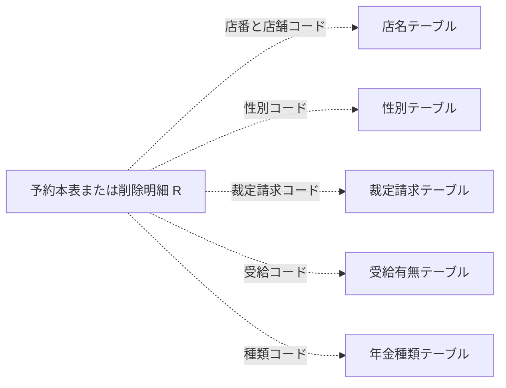

図はSQL上の参照条件を示し、FKや多重度を定義しない。通常の予約共通SELECTには更新時間・更新者・変更FLGが含まれず、日次・月次抽出が必要な列を追加する。

### 共通の変換・結果契約

| 対象 | 変換と意味 |
| --- | --- |
| 検索・保存用ふりがな | NULLを空文字にし、NFKC、trim、全角空白の半角化、連続半角空白の一個化、`Locale.JAPAN`による大文字化を行う。 |
| 予約キー・保存用電話 | Javaのchar単位で数字を抽出してASCII数字へ変換し、BigDecimalにする。数字なしはnull、数字0だけなら数値0。区切りと先頭ゼロは数値に保持しない。 |
| 参照検索用電話 | 数字抽出後に先頭ゼロを除く。全部ゼロなら最後の一桁を残し、この文字列を部分一致条件にする。 |
| 電話の表示 | 数字列の正規形が9桁または10桁で先頭0でなければ、0を一つ補う。それ以外は正規形を返す。元の入力表記の復元ではない。 |
| LIKEパターン | バックスラッシュ、%、_、[、]をエスケープし、前後へ%を付ける。各LIKEにはバックスラッシュを指定するESCAPE句を付ける。入力した%等をワイルドカードとして使う契約ではない。 |
| 予約の整数読取り | 店番・顧客番号・担当者コード・予定年齢は`getInt`と`wasNull`でIntegerまたはnullにする。 |
| 予約の文字列読取り | `getString`からモデルへ設定し、SQL NULLを空文字にする。通常の文字列を一律にtrimする処理ではない。 |
| 予約のフラグ読取り | 五種類と６ヶ月先確認は`getInt(...) != 0`。`wasNull`を調べず、SQL NULLと0はいずれもfalseになる。 |
| 顧客生年月日の表示変換 | 空文字と文字列0を空表示にし、小数点以降を除いた後、DateUtilでISO日付へ変換する。変換不能なら例外となる。 |

顧客番号は収録SQL Server DDLでBIGINTだが、予約モデルはInteger、読取り・検索バインドはJava intである。DB容量全体をこの実装が扱えるとは定義しない。

年金側の通常一覧参照は全結果をListへ読み、0件なら空Listを返す。単件取得は先頭行またはnullを返し、重複を検査しない。通常参照にはDBページング、fetch size、query timeout、取消呼出し、取得件数上限の明示設定がない。E09の`findLatestAuditType`だけは`setMaxRows(1)`を設定する。SQLの`VARCHAR(20)`・`VARCHAR(40)`は検索用CASTの幅であり、要求値上限やJDBCパラメータサイズではない。

## 項目一覧

| No | グループ | 項目名 | 種類 | 入出力 | DB連携項目 | 候補取得元 | 必須 | 形式・桁 | 説明 |
| --- | --- | --- | --- | --- | --- | --- | --- | --- | --- |
| 1 | E01 | 参照条件・候補取得 | DB参照 | I／O | 店名、職員名簿、顧客基本表、各コード表 | 店名テーブル、職員名簿、顧客基本表、各コード表 | 参照モードごとの条件による | String、Integer、List、Map | 空条件は対応するWHEREを付けない。候補取得と保存は別操作。 |
| 2 | E02 | 予約キー・顧客識別 | 単件取得 | I／O | 予約のふりがな・電話番号、顧客基本表の店舗コード・顧客番号 | ‐ | 予約検索は正規化後のキー両方。顧客取得は店番・顧客番号両方 | Stringから正規化文字列・BigDecimal、正数Integer | 予約優先で読み、未取得時だけ顧客基本情報へ進む。 |
| 3 | E03 | 予約保存値 | INSERT・UPDATE | I／O | 年金1_LKの28列 | 性別・裁定請求・受給有無の名称逆引き、年金種類コード照合 | 画面保存は店番・ふりがな・電話。その他は個別条件による | 保存バインド表の型と変換による | 現在キーで存在を再確認し、INSERTまたはUPDATEを選ぶ。 |
| 4 | E04 | 削除キー・削除実行者 | INSERT・DELETE | I／O | 年金＿削除明細の28列、本表のふりがな・電話番号 | 削除対象の表示名称からコードを再解決 | 画面は店番とキー、元キー照合、権限制限を確認 | キーはString・BigDecimal、実行者はInteger | 削除明細追加と本表削除を同一接続で確定する。 |
| 5 | E05 | 印刷条件・店舗別出力条件 | 一覧取得 | I／O | 年金1_LKの店番、各並び順列 | 表示用店舗名は店名テーブル | 印刷の店舗範囲有効時は店番自。店舗別Excelは店番 | 正数Integer、sortTypeはint | 範囲・順序を検索制御に使い、条件値自体は保存しない。 |
| 6 | E06 | 区分・期間・更新者・整理基準日 | 整理・抽出 | I／O | 変更FLG、データ更新日、更新者、削除明細 | ‐ | 出力区分はいずれか一つ以上。日次日付または月次両日付を検査 | boolean、ISO日付String、Integer | 職員空欄は全更新者。整理基準日は抽出期間とは独立する。 |
| 7 | E07 | 共通認証・所属情報 | Statement参照 | I／O | 共通認証表、職員名簿、所属課係、役職、事業所 | 各共通参照表 | 共通ログインの分岐と照会段階による | 文字列連結SQL、結果はList内のMap | 年金側の追加職員確認とは別段階。 |
| 8 | E08 | アクセス記録 | Statement追加 | I | カウンターシフトの8列 | ‐ | 記録準備とNULL表現はE08による | 日付・時刻と識別値の文字列連結 | 業務更新とは別接続でcommitし、失敗はログへ記録する。 |
| 9 | E09 | 通常導線未接続・他業務境界のSQL | 宣言・利用境界 | I／O | 予約候補、最終区分、予約全件、共通表 | 操作ごとに異なる | 各メソッドの条件による | 各SQL契約による | 宣言の存在を年金通常画面の稼働機能へ置き換えない。 |

## イベント仕様

### E01 参照候補・職員確認・コード表示の取得

#### 処理概要

参照画面は店舗・担当者・顧客を検索して選択候補を表示する。年金職員セッションの生成では職員単件取得を使う。予約画面は表示時に性別・裁定請求・受給有無・年金種類の候補を取り直す。いずれも参照処理であり、候補の選択だけではDBを更新しない。

#### 処理手順

**1. 呼出目的と検索条件を確定する。**

　**1.1.** `LookupViewAction`は職員確認後、TARGETがbranchなら店舗、staffなら担当者、それ以外なら顧客を対象にする。KEYWORD、BRANCH_NO、NAME_KEYWORD、PHONE_KEYWORDをtrimしてBeanへ保持し、PAGEは正数intでなければ1にする。

　**1.2.** BRANCH_NOは空欄、不正数値、0以下、int範囲外ならnullとなる。担当者・顧客検索ではnullを全店舗として扱い、店舗条件を付けない。

　**1.3.** 名称系キーワードは概要の文字列正規化、電話条件は数字抽出と先頭ゼロ除去を行う。正規化後が空なら対応する条件をSQLへ追加しない。

**2. 接続先ごとに候補を取得する。**

　**2.1.** 店舗参照は業務接続を使う。担当者・顧客参照は、先に業務接続で全店舗名をMapへ読み、その接続を閉じてから職員接続または顧客接続で本体を取得する。

　**2.2.** 担当者・顧客の店番でMapを引いて店名を付ける。SQL JOINや分散トランザクションではなく、店舗名と本体の取得時点は別である。対応名がなければ空文字にする。

　**2.3.** 職員確認は`verifyStaff`から`getStaff`を呼ぶ。StaffContextがセッションにあれば再利用し、毎要求で照会するわけではない。未保持時は共通ログイン情報の職員番号をtrimし、1～8桁の数字として確認してから照会する。

　**2.4.** 予約画面は四系統のコード候補を取得する。性別・裁定請求・受給有無には空選択があり、フォームが送る値は表示名称である。五つの年金種類チェックの名称は、コード1・2・4・8・16に対応するMap値を使う。

**3. 全件取得後に画面用の範囲を切り出す。**

　**3.1.** 参照検索はSQLの全結果をListへ格納し、総件数をBeanへ設定する。その後、20件単位でメモリ切出しする。開始位置はint演算の`Math.max(0, (page - 1) * size)`、終了位置は`Math.min(source.size(), start + size)`である。

　**3.2.** 開始位置が総件数以上なら空List、それ以外は`subList(start, end)`のコピーを作る。演算がオーバーフローしない範囲では、上限超過ページは空Listになる。

　**3.3.** PAGEは正数intとして受理されても、開始位置の乗算がオーバーフローし得る。例えばPAGE=214748365、size=20では積が負へ折り返し、開始位置は0になる。結果があれば先頭20件相当を切り出すため、上限超過ページが必ず空になる契約ではない。

　**3.4.** 切出し後に、ページ番号が総ページ数を超えていれば番号だけを上限へ補正する。補正後の再切出しは行わない。この順序により、表示ページ番号と取得行が対応しない経路がある。総ページ数は`Math.max(1, (totalCount + pageSize - 1) / pageSize)`で算出する。

#### 処理フロー

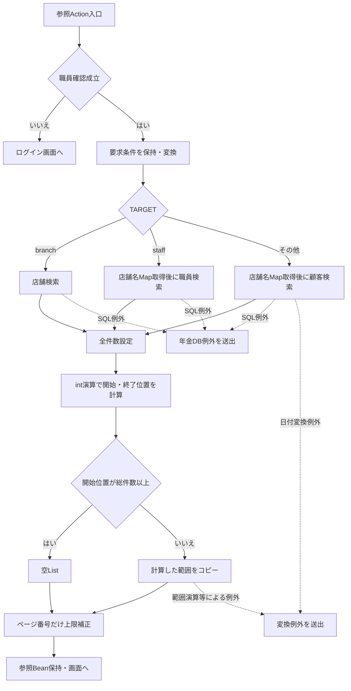

開始・終了位置は手順3の式に従い、オーバーフロー前の数学的な積へ補正する処理はない。職員単件取得とコード候補取得はページングを通らず、その結果を呼出元へ返す。

#### SQL・テーブル関連（ER図）

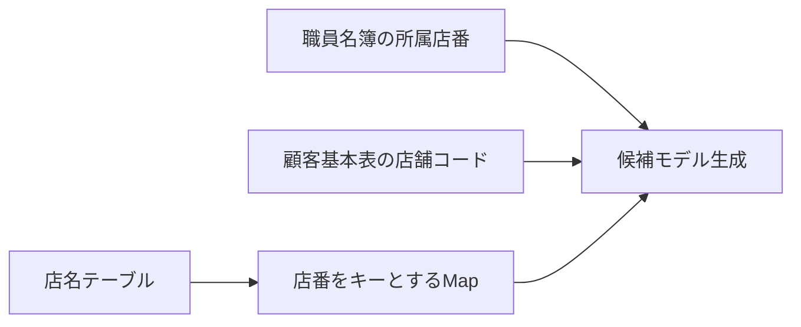

線は別接続の結果をメモリで突き合わせる関係である。コード候補は各表の単独読取りであり、表間JOINは行わない。

#### DB操作の詳細

店舗取得の基本SELECTは次の2列である。

```sql
SELECT 店舗ｺｰﾄﾞ AS BRANCH_NO, 店名 AS BRANCH_NAME
FROM 店名テーブル
```

| 操作 | 追加WHERE | ORDER BY | パラメータ順・JDBC呼出し | 結果 |
| --- | --- | --- | --- | --- |
| `searchBranches` | キーワード非空時だけ`CAST(店舗ｺｰﾄﾞ AS VARCHAR(20)) LIKE ? ESCAPE '\' OR UPPER(店名) LIKE UPPER(?) ESCAPE '\'` | `店舗ｺｰﾄﾞ` | 1・2へ同じ部分一致パターンを`setString`。空条件はバインドなし | 全件の`List<BranchLookupItem>` |
| `getBranch` | `店舗ｺｰﾄﾞ = ?` | なし | 1へ店番を`setInt` | 先頭候補またはnull |
| `loadBranchNames` | なし | なし | なし | `Map<Integer,String>` |

店舗コードは`getInt`、店名は`getString`で取得する。Mapは同じキーへ後から読み込んだ値を設定し、対応名のない候補には空文字を付ける。

担当者検索と職員単件取得は、次の5列を取得する。

```sql
SELECT S.職員番号 AS STAFF_NO,
       S.漢字氏名 AS STAFF_NAME,
       S.カナ氏名 AS STAFF_KANA_NAME,
       S.所属店番 AS BRANCH_NO,
       S.役職コード AS ROLE_CODE
FROM DB2.Ｕ職員名簿表 S
```

| 操作 | WHEREの組立て順 | ORDER BY | パラメータ順・JDBC呼出し |
| --- | --- | --- | --- |
| `searchStaff` | `1 = 1`に、店番非nullなら`AND S.所属店番 = ?`、名称非空なら`AND (UPPER(S.カナ氏名) LIKE UPPER(?) ESCAPE '\' OR UPPER(S.漢字氏名) LIKE UPPER(?) ESCAPE '\')` | `S.職員番号` | 存在する条件だけを1から詰め、店番`setInt`、同一名称パターン`setString`を2回 |
| `getStaff` | `S.職員番号 = ?` | なし | 1へ職員番号を`setInt` |

職員番号・所属店番は`getInt`で読み、SQL NULLをJava nullとして保持しない。氏名・カナ氏名・役職コードのNULLはDTOで空文字になる。`getStaff`は先頭行またはnull、`verifyStaff`は取得した職員番号・氏名・所属店番・役職コードからStaffContextを生成する。先行する店舗名Map取得に失敗すれば名簿照会へ進まない。

顧客参照は次の7列を取得する。

```sql
SELECT C.店舗コード AS BRANCH_NO,
       C.顧客番号 AS CUSTOMER_NO,
       C.カナ氏名 AS KANA_NAME,
       C.漢字氏名 AS CUSTOMER_NAME,
       C.電話番号 AS PHONE_NUMBER,
       C.生年月日 AS BIRTH_DATE,
       C.担当者コード AS STAFF_CODE
FROM N2_SIGHT.Ｂ顧客基本表 C
WHERE 1 = 1
```

条件は、店番非nullの`AND C.店舗コード = ?`、正規化名称非空の`AND (UPPER(C.漢字氏名) LIKE UPPER(?) ESCAPE '\' OR UPPER(C.カナ氏名) LIKE UPPER(?) ESCAPE '\')`、正規化電話非空の`AND TO_CHAR(C.電話番号) LIKE ? ESCAPE '\'`の順に追加する。ORDER BYは`C.店舗コード, C.顧客番号, C.カナ氏名`である。

バインドは存在する店番の`setInt`、漢字・カナの順に同一名称パターンの`setString`、電話パターンの`setString`を1から詰める。省略条件の位置へNULLを設定しない。結果は全件の`List<CustomerLookupItem>`である。店番・顧客番号は`getInt`、担当者コードのSQL NULLは0とする。文字列NULLはDTOで空文字となり、電話・生年月日は概要の表示変換を通す。名称・電話の要求値はWHEREに使う検索条件であり、この操作から保存しない。

コード候補のSQLは次のとおりである。全操作ともWHERE、パラメータ、有効停止判定はなく、コード順で全件を取得する。

| 取得入口 | SELECT列 | FROM | ORDER BY | 結果形 |
| --- | --- | --- | --- | --- |
| `listGenders` | `性別ｺｰﾄﾞ AS CODE_VALUE, 性別 AS LABEL_VALUE` | 性別テーブル | `性別ｺｰﾄﾞ` | コード・名称のList |
| `listClaimStatuses` | `裁請ｺｰﾄﾞ AS CODE_VALUE, 裁定請求 AS LABEL_VALUE` | 裁定請求テーブル | `裁請ｺｰﾄﾞ` | コード・名称のList |
| `listBenefitStatuses` | `受給ｺｰﾄﾞ AS CODE_VALUE, 受給有無 AS LABEL_VALUE` | 受給有無テーブル | `受給ｺｰﾄﾞ` | コード・名称のList |
| `getPensionTypeLabels` | `種類ｺｰﾄﾞ AS CODE_VALUE, 年金種類 AS LABEL_VALUE` | 年金種類テーブル | `種類ｺｰﾄﾞ` | ListをコードキーのMapへ変換 |

#### 結果・例外時の扱い

検索0件は空List、単件0件はnullであり、DB失敗とは区別する。SQLExceptionは操作名付きのNenkinDataAccessExceptionへ変換する。finallyでResultSet、PreparedStatement、Connectionを閉じ、年金側のclose例外は抑制する。

顧客生年月日の表示変換で生じるIllegalArgumentExceptionはSQLException用catchの対象ではない。Action内から伝播した例外は共通ServletのAction用catchへ進む。一方、`Pension.jsp`の候補再取得はforward先の描画中であり、同じAction用catchには戻らない。入力拒否後の画面も、候補取得と描画が完了する前に応答成功とは扱わない。

### E02 予約キー読込み・顧客基本情報取得

#### 処理概要

予約読込みはふりがな・電話番号で既存予約を優先する。予約が見つからず、店番・顧客番号が共に正数Integerへ変換できた場合に顧客基本表を照会する。顧客基本情報は新規入力用のモデルであり、取得だけで予約を登録しない。

#### 処理手順

**1. 予約検索に使う値を選ぶ。**

　**1.1.** `PensionLoadAction`は職員確認後、フォームをPensionReservationへ取り込む。LOOKUP_KANA・LOOKUP_PHONEをそれぞれtrimし、空なら対応するフォームのKANA_NAME・PHONE_NUMBERを使う。

　**1.2.** `findByKanaAndPhone`がふりがなを正規化し、電話をBigDecimalへ変換する。ふりがなが空または電話がnullならSQLを実行せずnullを返す。

**2. 予約と顧客を順に調べる。**

　**2.1.** 予約があれば取得モデルをexisting=trueとして表示する。

　**2.2.** 予約がなければ店番・顧客番号を正数Integerへ変換し、両方が得られた場合だけ`findByCustomer`を呼ぶ。

　**2.3.** 顧客の先頭行を読み、顧客接続を閉じる。その後に業務接続を別途取得し、店名と性別名称を解決する。

　**2.4.** 後半の照会まで成功して顧客が得られれば顧客モデル、0件または顧客照会条件が不足すれば受信モデルをexisting=falseとして表示する。

#### 処理フロー

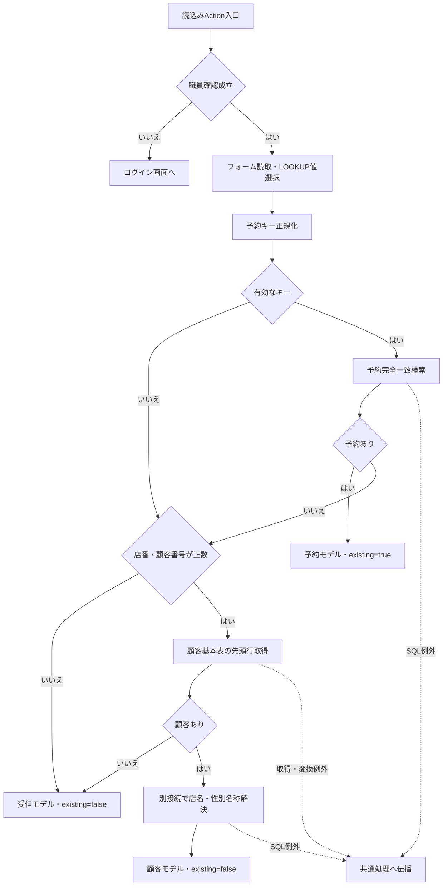

#### SQL・テーブル関連（ER図）

予約検索は概要の五つのLEFT JOINを使う。顧客取得は顧客基本表を単独で読み、その後に別接続で名称を取得する。

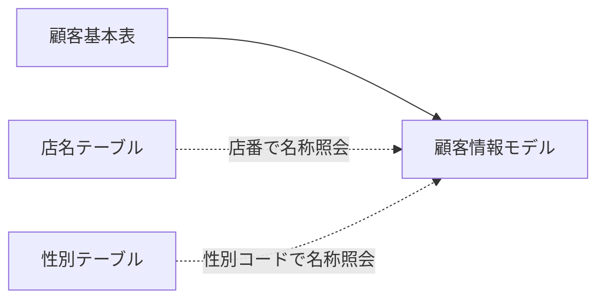

#### DB操作の詳細

予約取得は予約共通SELECTへ`WHERE R.ふりがな = ? AND R.電話番号 = ?`を追加する。1へ正規化ふりがなを`setString`、2へ電話を`setBigDecimal`で設定する。ORDER BY、取得件数上限、重複検査はなく、先頭行またはnullを返す。

顧客取得SQLは次のとおりである。

```sql
SELECT C.店舗コード AS BRANCH_NO,
       C.顧客番号 AS CUSTOMER_NO,
       C.担当者コード AS STAFF_CODE,
       C.漢字氏名 AS CUSTOMER_NAME,
       C.カナ氏名 AS KANA_NAME,
       C.性別コード AS GENDER_CODE,
       C.漢字住所 AS ADDRESS,
       C.電話番号 AS PHONE_NUMBER,
       C.生年月日 AS BIRTH_DATE
FROM N2_SIGHT.Ｂ顧客基本表 C
WHERE C.店舗コード = ? AND C.顧客番号 = ?
```

1は店番、2は顧客番号の`setInt`である。JOIN・ORDER BY・重複検査はなく、先頭行またはnullを返す。店番・顧客番号・担当者コードはSQL NULLを保持するInteger変換を使う。電話と生年月日は概要の表示変換を通す。

後続の名称解決は次の2操作である。

| 操作 | SQL | バインド・照会省略条件 | 結果 |
| --- | --- | --- | --- |
| 店名解決 | `SELECT 店名 FROM 店名テーブル WHERE 店舗ｺｰﾄﾞ = ?` | 店番を`setInt(1)`。店番nullなら照会しない | 先頭名称。0件はfallback。本イベントでは空文字 |
| 性別名称解決 | `SELECT 性別 FROM 性別テーブル WHERE 性別ｺｰﾄﾞ = ?` | 性別コード文字列をtrimしてInteger化し`setInt(1)`。空・変換不能なら照会しない | 先頭名称。省略・0件は空文字 |

両操作ともORDER BY・重複検査はない。

#### 結果・例外時の扱い

予約・顧客の0件は通常分岐である。顧客行の読取り後でも店名・性別照会に失敗すれば、モデルを返さず表示値解決のNenkinDataAccessExceptionを送出する。顧客日付の変換例外はSQLException用catchでは包まれない。

同じ取得メソッドを使う`PensionLookupAction`も存在する。職員確認後にPOST以外を405で拒否し、LOOKUP_MODE=keyなら予約キー、それ以外なら店番・顧客番号で取得する。結果はfoundと予約データのJSONで、戻り値CSVはforward抑止用である。付属予約画面の読込みはLoadへのフォーム送信であり、このJSON入口へ接続する通常画面の呼出元は確認できない。

### E03 予約の登録・更新

#### 処理概要

保存Actionは職員・要求認可・入力・現在キーと元キー・更新権限を順に確認する。Repositoryはその後、同じキーの存在を再確認してINSERTまたはUPDATEを選ぶ。Actionの事前判定とRepository内の選択は別時点である。

#### 処理手順

**1. 要求とフォームを確認する。**

　**1.1.** `PensionSaveAction`は職員確認を先に行い、不成立ならログイン画面へ戻る。成立後にフォームを読み、POSTかつセッション内CSRF文字列と要求値が一致することを確認する。不成立時は受信モデルをexisting=falseで再表示する。

　**1.2.** 整数入力はtrim後に`Integer.parseInt`し、空欄・変換失敗・0以下をnullにする。文字列はNULLを空文字にしてtrimする。チェック値は1、大小文字を区別しないtrueまたはonだけをtrueにする。

　**1.3.** 店番非null、ふりがな非空、電話非空を順に確認する。その後、生年月日、配偶者生年月日、請求予定日、予約徴求日の順に日付を正規化し、最後に備考を検査する。任意日付の空欄は空文字となる。備考はWindows-31Jへ変換可能で56バイト以内とする。

　**1.4.** 入力エラー時も現在キーを検索し、その有無でexistingを決める。検査途中まで変換した受信モデルとエラーを再表示する。この検索自体が失敗すれば入力エラー画面の設定へ到達しない。

**2. 保存対象と更新権限を確認する。**

　**2.1.** 現在のふりがな・電話と、ORIGINAL_KANA・ORIGINAL_PHONEを独立した予約検索で照会する。

　**2.2.** 現在キーに予約があり、元キーの取得結果と同一キーでなければ現在の既存予約をexisting=trueで表示し、保存を中止する。現在キーに予約がなく元キーに予約があれば、元の予約を表示してキー変更を拒否する。

　**2.3.** 現在キーに予約がある更新では、ログイン職員の所属店番が75かつ役職コードを整数化した値が3000未満なら拒否する。同店番で役職コードを整数化できない場合も拒否する。他店番へこの制限を適用する処理はない。

　**2.4.** 通過したモデルと、ログイン職員番号をInteger化したupdatedByをRepositoryへ渡す。予約の担当者コードとは別の値である。

**3. Repository内で保存値を準備する。**

　**3.1.** 入力モデルがnullならIllegalArgumentExceptionとする。それ以外はcopyを作り、ふりがなの正規化と非空確認、電話に数字があること、備考を再確認する。

　**3.2.** 生年月日、請求予定日、予約徴求日、配偶者生年月日を順に任意ISO日付へ変換し、データ更新日を処理当日に置き換える。要求のDATA_UPDATE_DATEを保存日として採用しない。

　**3.3.** この準備とキー生成は接続取得を囲むtryより前にある。Actionの非空確認を通った全角空白だけのふりがなや数字のない電話も、この段階へ到達すれば拒否される。ここでの失敗にはDB接続・rollbackはない。

**4. 存在を再確認して保存する。**

　**4.1.** 業務接続を取得してautoCommit=falseにし、店名を解決する。店番nullまたは店名0件ならモデルの店名をfallbackにする。店名は保存対象28列に含まれない。

　**4.2.** 同じ接続で正規化キーの存在を確認する。1行以上あればUPDATEとAuditType.CHANGED、0件ならINSERTとAuditType.NEWを選ぶ。

　**4.3.** 保存バインド表の順に値を設定する。その途中で表示名称を保存コードへ逆引きし、年金種類の合成コードを照合する。

　**4.4.** INSERT・UPDATEとも処理件数が厳密に1であることを確認する。1以外ならSQLExceptionにする。正常時にcommitし、選択したAuditTypeを返す。

**5. 画面用状態を設定する。**

　**5.1.** Actionは返されたAuditTypeを分岐に使わず、空モデル、登録終了メッセージ、existing=falseを設定して予約画面へ戻る。画面の候補再取得とHTTP応答完了は後続処理である。

#### 処理フロー

**サブフロー1：Actionの事前確認。正常出口はモデルとupdatedByをサブフロー2へ渡す。**

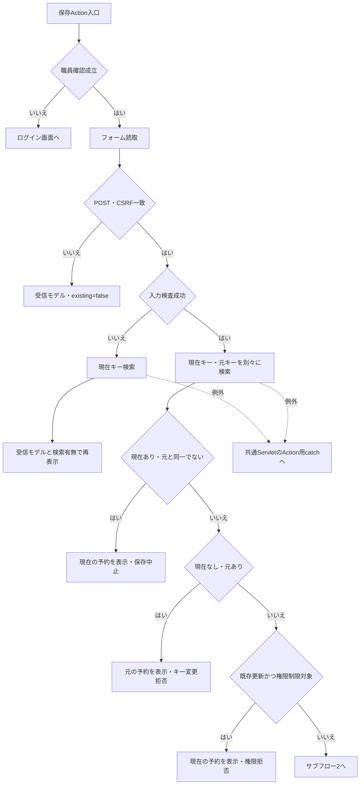

**サブフロー2：Repositoryの保存。準備段階とtry内の失敗を分ける。**

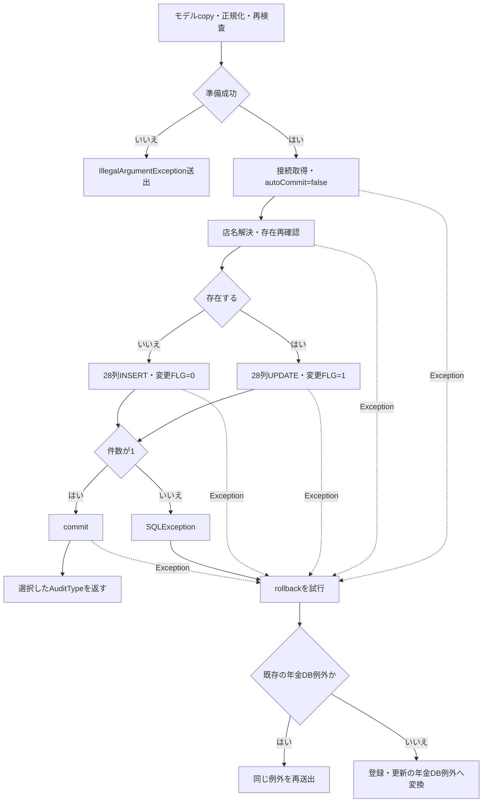

tryへ入った経路はfinallyで接続を閉じる。正常戻り後の画面状態は手順5.1による。

#### SQL・テーブル関連（ER図）

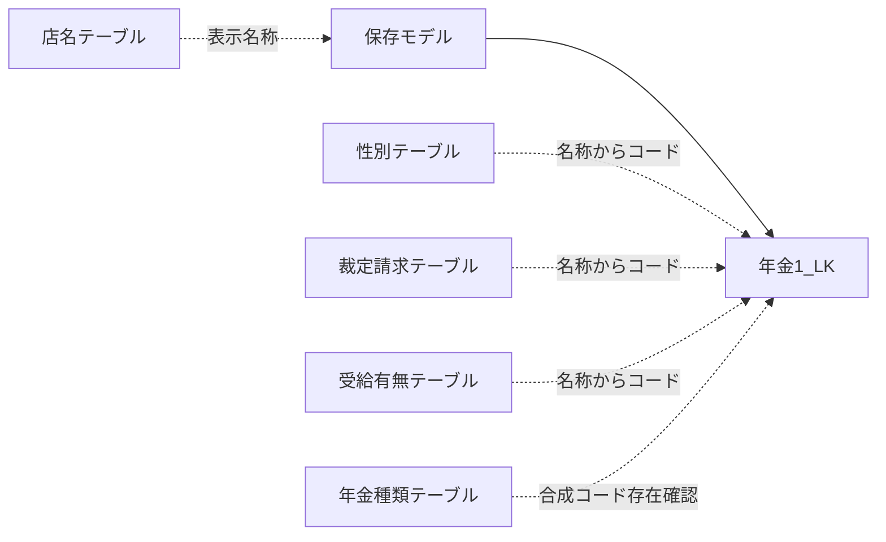

保存と名称・コード解決は同じ業務接続を使用する。店名は表示モデルへ設定する値であり、名称を予約本表へ保存しない。図の線は処理上の参照・設定を示し、FKではない。

#### DB操作の詳細

存在確認は次のSQLであり、先頭行の有無だけを見る。ORDER BY、明示的行ロック、重複件数検査はない。

```sql
SELECT 1 FROM 年金1_LK
WHERE ふりがな = ? AND 電話番号 = ?
```

1は正規化ふりがなの`setString`、2は電話BigDecimalの`setBigDecimal`である。

INSERT・UPDATE・削除明細INSERTが共用する28列の順序とバインドを次に示す。DB型は収録SQL Server用DDLの宣言であり、両保存表の28列は全てNULL許容である。JDBC型とDB型は別の契約である。

| No | フォーム名または設定元 | モデル・内部値と加工 | 保存列 | JDBC呼出し | SQL Server宣言型・容量 |
| --- | --- | --- | --- | --- | --- |
| 1 | BRANCH_NO | `Integer branchNo` | 店番 | `setInt`またはINTEGER NULL | INT |
| 2 | CUSTOMER_NO | `Integer customerNo` | 顧客番号 | `setInt`またはINTEGER NULL | BIGINT |
| 3 | STAFF_CODE | `Integer staffCode` | 担当者コード | `setInt`またはINTEGER NULL | INT |
| 4 | CUSTOMER_NAME | `String customerName` | 顧客氏名 | `setString` | NVARCHAR(100) |
| 5 | KANA_NAME | 正規化した`String kanaName` | ふりがな | `setString` | NVARCHAR(100) |
| 6 | GENDER | 表示名称`String gender`の逆引き結果Integer | 性別 | `setInt`またはINTEGER NULL | TINYINT |
| 7 | ADDRESS | `String address` | 住所 | `setString` | NVARCHAR(300) |
| 8 | PHONE_NUMBER | `String phoneNumber`から数字抽出したBigDecimal | 電話番号 | `setBigDecimal`、数字なしはDECIMAL NULL | DECIMAL(15,0) |
| 9 | BIRTH_DATE | ISO日付の`String birthDate` | 生年月日 | `setDate`またはDATE NULL | DATE |
| 10 | NATIONAL_PENSION | `boolean nationalPension`を1・0化 | 種類：国民年金 | `setInt` | BIT |
| 11 | EMPLOYEE_PENSION | `boolean employeePension`を1・0化 | 種類：厚生年金 | `setInt` | BIT |
| 12 | MUTUAL_AID_PENSION | `boolean mutualAidPension`を1・0化 | 種類：共済年金 | `setInt` | BIT |
| 13 | EMPLOYEE_PENSION_FUND | `boolean employeePensionFund`を1・0化 | 種類：厚生年金基金 | `setInt` | BIT |
| 14 | NATIONAL_PENSION_FUND | `boolean nationalPensionFund`を1・0化 | 種類：国民年金基金 | `setInt` | BIT |
| 15 | 五種類の選択 | 1・2・4・8・16の加算結果。0はnull | 年金種類 | `setInt`またはINTEGER NULL | INT |
| 16 | CLAIM_STATUS | 表示名称`String claimStatus`の逆引き結果Integer | 裁定請求 | `setInt`またはINTEGER NULL | TINYINT |
| 17 | CLAIM_SCHEDULED_DATE | ISO日付の`String claimScheduledDate` | 請求予定日 | `setDate`またはDATE NULL | DATE |
| 18 | PLANNED_AGE | `Integer plannedAge` | 予定年齢 | `setInt`またはINTEGER NULL | INT |
| 19 | SPOUSE_NAME | `String spouseName` | 配偶者名 | `setString` | NVARCHAR(100) |
| 20 | SPOUSE_BIRTH_DATE | ISO日付の`String spouseBirthDate` | 配偶者生年月日 | `setDate`またはDATE NULL | DATE |
| 21 | HAS_BENEFIT | 表示名称`String hasBenefit`の逆引き結果Integer | 受給有無 | `setInt`またはINTEGER NULL | TINYINT |
| 22 | RESERVATION_REQUEST_DATE | ISO日付の`String reservationRequestDate` | 予約徴求日 | `setDate`またはDATE NULL | DATE |
| 23 | NOTES | `String notes`。変換可否と56バイトを検査 | 備考 | `setString` | NVARCHAR(400) |
| 24 | Repositoryの処理当日 | `String dataUpdateDate` | データ更新日 | `setDate` | DATE |
| 25 | Repositoryの処理時刻 | 時刻文字列の先頭8文字 | 更新時間 | `setTime` | TIME(0) |
| 26 | Actionのログイン職員番号 | `Integer updatedBy` | 更新者 | `setInt`またはINTEGER NULL | INT |
| 27 | SIX_MONTH_CHECK | `boolean sixMonthCheck`を1・0化 | ６ヶ月先確認 | `setInt` | BIT |
| 28 | 操作区分 | 新規0、変更1、削除明細null | 変更FLG | `setInt`またはINTEGER NULL | TINYINT |

INSERTはこの列順で28個の位置パラメータを設定する。

```sql
INSERT INTO 年金1_LK (
  店番, 顧客番号, 担当者コード, 顧客氏名, ふりがな, 性別, 住所, 電話番号,
  生年月日, "種類：国民年金", "種類：厚生年金", "種類：共済年金",
  "種類：厚生年金基金", "種類：国民年金基金", 年金種類, 裁定請求,
  請求予定日, 予定年齢, 配偶者名, 配偶者生年月日, 受給有無, 予約徴求日,
  備考, データ更新日, 更新時間, 更新者, "６ヶ月先確認", 変更FLG
) VALUES (
  ?, ?, ?, ?, ?, ?, ?, ?, ?, ?, ?, ?, ?, ?,
  ?, ?, ?, ?, ?, ?, ?, ?, ?, ?, ?, ?, ?, ?
)
```

UPDATEも全28列を設定し、29・30をWHERE用キーにする。

```sql
UPDATE 年金1_LK SET
  店番 = ?, 顧客番号 = ?, 担当者コード = ?, 顧客氏名 = ?, ふりがな = ?,
  性別 = ?, 住所 = ?, 電話番号 = ?, 生年月日 = ?,
  "種類：国民年金" = ?, "種類：厚生年金" = ?, "種類：共済年金" = ?,
  "種類：厚生年金基金" = ?, "種類：国民年金基金" = ?,
  年金種類 = ?, 裁定請求 = ?, 請求予定日 = ?, 予定年齢 = ?, 配偶者名 = ?,
  配偶者生年月日 = ?, 受給有無 = ?, 予約徴求日 = ?, 備考 = ?,
  データ更新日 = ?, 更新時間 = ?, 更新者 = ?, "６ヶ月先確認" = ?, 変更FLG = ?
WHERE ふりがな = ? AND 電話番号 = ?
```

29はキーふりがなの`setString`、30はキー電話の`setBigDecimal`である。店番、顧客番号、更新日、比較版はWHEREにない。

名称からコードへの逆引きは次のSQLを使う。入力名称をtrimし、空なら照会せずコードnullを返す。非空なら`setString(1)`で照会し、先頭行の`getInt(1)`を採用する。0件はSQLExceptionであり、ORDER BY、同名重複検査、名称のNFKC変換はない。

| 対象 | 逆引きSQL |
| --- | --- |
| 性別 | `SELECT 性別ｺｰﾄﾞ FROM 性別テーブル WHERE 性別 = ?` |
| 裁定請求 | `SELECT 裁請ｺｰﾄﾞ FROM 裁定請求テーブル WHERE 裁定請求 = ?` |
| 受給有無 | `SELECT 受給ｺｰﾄﾞ FROM 受給有無テーブル WHERE 受給有無 = ?` |

年金種類は五種類へ順に1・2・4・8・16を割り当て、選択値を合算する。合計0はnull、非0は`SELECT 年金種類 FROM 年金種類テーブル WHERE 種類ｺｰﾄﾞ = ?`へ`setInt(1)`で照合する。0件ならSQLException、存在すれば算出したコードを保存する。取得名称やモデルのpensionType文字列は保存コードの決定に使わない。

Integerのnullは`setNull(..., Types.INTEGER)`、日付のNULL・trim後空文字はDATE NULLとし、それ以外は`java.sql.Date.valueOf`から`setDate`する。電話の共通設定処理は数字を得られなければDECIMAL NULLにするが、通常保存はその前に数字ありを検査する。時刻は8文字未満ならTIME NULL、8文字以上なら先頭8文字を`java.sql.Time.valueOf`へ渡す。通常生成時刻のミリ秒部分は保存時に除かれる。

文字列はモデルのNULL→空文字変換後に`setString`する。空整数・空日付と同じNULL保存にはならない。JDBC呼出しにパラメータサイズの指定はない。

#### 結果・例外時の扱い

try内のExceptionはrollbackを試み、既存のNenkinDataAccessExceptionならそのまま、それ以外なら登録・更新のNenkinDataAccessExceptionへ包んで送出する。rollback helperはSQLExceptionを抑制し、close helperも例外を抑制する。rollback失敗を呼出元が戻り値で識別する仕組みはない。

commit例外も同じcatchに入る。rollbackを試みたことだけから、実DBで未反映だったか、commitが成立していたかは確定できない。保存Actionには専用catchがなく、try前のIllegalArgumentExceptionもDB操作例外も共通Servletへ伝播する。Actionの入力拒否による再表示と、Repository再検査の例外は別経路である。

### E04 削除明細の追加と予約削除

#### 処理概要

削除Actionは読込み対象とのキー一致と削除権限を確認し、Repositoryはその後に対象を再取得する。削除明細追加と本表削除を同一接続で実行し、両方が1件の場合にcommitする。

#### 処理手順

**1. 削除要求を確認する。**

　**1.1.** `PensionDeleteAction`は職員確認、フォーム読取り、POST・CSRF確認の順に処理する。要求認可不成立時は受信モデルをexisting=falseで再表示する。

　**1.2.** 店番nullなら受信モデルをexisting=trueで再表示する。続いてふりがな・電話の非空を確認し、不成立なら対象なしとしてexisting=falseで再表示する。店番は必須検査に使うが削除WHEREには使わない。

　**1.3.** 現在キーと元キーをそれぞれ検索する。現在対象なし、または同一キーでなければ削除しない。現在対象があればそのモデル、なければ受信モデルを表示し、existingは現在対象の有無にする。

　**1.4.** 店番75の職員へE03と同じ役職制限を適用する。拒否時は取得済み予約をexisting=trueで表示する。通過時は現在のキーとログイン職員番号をRepositoryへ渡す。

**2. Repositoryで削除対象を再取得する。**

　**2.1.** キーを正規化し、ふりがな空または電話に数字がなければ、接続せずfalseを返す。

　**2.2.** 業務接続を取得してautoCommit=falseにし、同じ接続で予約共通SELECTにより対象を再取得する。0件なら直接rollbackし、正常に戻った場合にfalseを返す。

**3. 削除明細と本表を更新する。**

　**3.1.** 取得モデルのデータ更新日を当日にし、現在時刻、削除職員番号、変更FLG=nullを使って削除明細へ追加する。

　**3.2.** 明細追加はE03の28列バインドを使う。性別・裁定請求・受給有無を表示名称から再逆引きし、年金種類を五種類から再算出する。追加件数が1以外ならSQLExceptionにする。

　**3.3.** 本表をふりがな・電話で削除する。件数が1以外ならSQLExceptionにし、両更新が正常ならcommitしてtrueを返す。

**4. 戻り値で再表示状態を決める。**

　**4.1.** trueなら空モデル、削除終了メッセージ、existing=falseとする。falseなら受信モデル、対象なしメッセージ、existing=trueとする。後者にはRepository再取得時に対象が消えていた場合も含む。

#### 処理フロー

**サブフロー1：画面要求と対象照合。正常出口は現在キーと削除職員番号をサブフロー2へ渡す。**

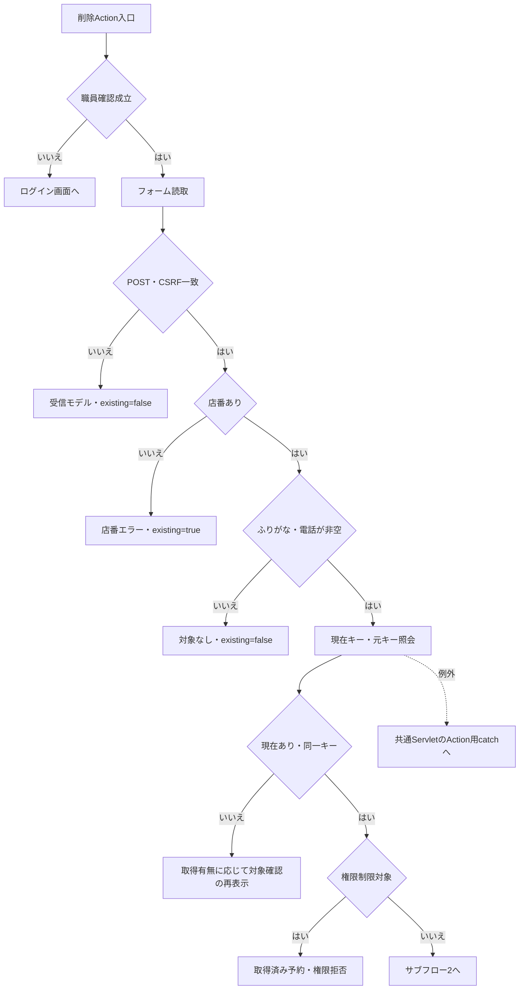

**サブフロー2：明細追加と本表削除。falseと例外を分けて返す。**

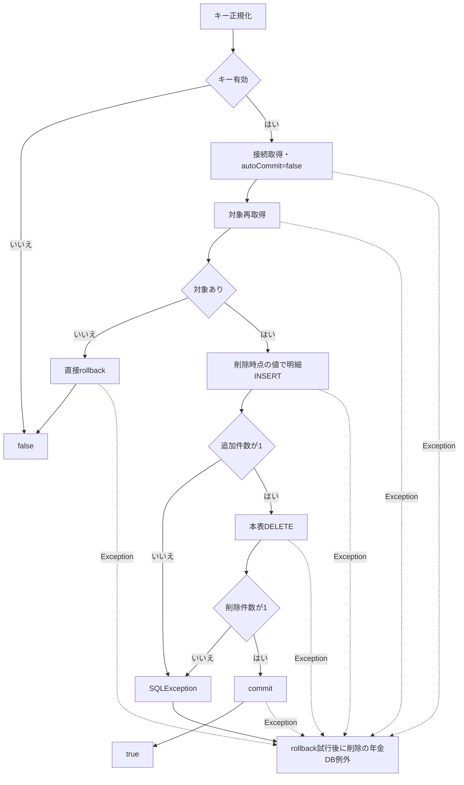

#### SQL・テーブル関連（ER図）

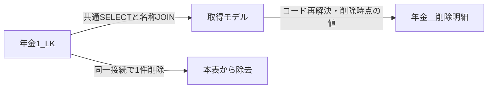

本表から削除明細への関係は処理上の転記であり、FKではない。明細追加と本表削除は一つのトランザクションである。

#### DB操作の詳細

再取得は予約共通SELECTへ`WHERE R.ふりがな = ? AND R.電話番号 = ?`を追加し、1へ`setString`、2へ`setBigDecimal`を設定する。ORDER BY・重複検査・行ロック指定はなく、先頭行を使う。

削除明細INSERTは、E03のINSERTの表名を`年金＿削除明細`へ置き換えた同じ28列・パラメータ順である。24は削除当日、25は削除時刻、26は削除職員、28はINTEGER NULLとなる。

```sql
DELETE FROM 年金1_LK
WHERE ふりがな = ? AND 電話番号 = ?
```

1は正規化ふりがなの`setString`、2は電話の`setBigDecimal`である。店番、顧客番号、元の更新日、比較版は条件にない。キー重複により2件以上削除した場合も件数エラーにしてrollbackを試みる。

削除明細はINSERT SELECTによる物理複写ではない。結合できない名称は空文字を経てコードNULLとなり得る。SQL NULLのフラグはfalseを経て0となり、年金種類も再計算する。元行の更新日・時刻・更新者・変更FLGは保持せず削除時点の値へ替える。削除Actionは保存用の全項目検査を行わず、DBから再取得したモデルを明細追加へ使う。

#### 結果・例外時の扱い

明細追加、コード再解決、本表削除、commit等でExceptionが起きるとrollbackを試み、削除のNenkinDataAccessExceptionを送出する。対象0件時の直接rollbackが失敗した場合もfalseにはならず、この例外経路へ進む。

rollback helper・close helperの失敗は抑制する。commit例外時の実DB確定状態は戻り値だけでは判別できない。trueはcommit呼出しが正常に戻ったことを示し、その後の候補再取得や画面応答完了まで保証しない。

### E05 登録内容印刷・店舗別Excelの抽出

#### 処理概要

印刷は店舗範囲と並び順で予約を全件取得し、画面プレビューへ渡す。店舗別Excelは単一店番の予約を取得してWorkbookへ渡す。いずれも予約本表を更新しない。

#### 処理手順

**1. 印刷条件を検索引数へ変換する。**

　**1.1.** `ReportPreviewAction`は職員確認後、USE_BRANCH_RANGEをboolean、BRANCH_FROM・BRANCH_TOを正数Integer、SORT_TYPEを正数intへ変換する。SORT_TYPEが得られなければ1にする。

　**1.2.** 範囲使用時は店番自を必須とし、店番至も得られた場合は自が至以下であることを確認する。店番至の空欄・不正値はnullとなり、自だけの検索になる。

　**1.3.** 範囲不使用時は要求に店番値があっても検索へ渡さない。取得結果を画面へ設定し、0件でもpreview=trueにする。

**2. 店舗別Excelの店番を確認する。**

　**2.1.** `ExcelExportAction`は職員確認後にBRANCH_NOをtrimする。空欄または正数Integerにできない値を拒否し、その後に3桁以内のASCII数字であることを確認する。

　**2.2.** `getBranch`で表示用店名を取得する。0件でも出力対象の検索へ進む。

　**2.3.** `PensionExcelExportService`が`listByBranch`で全対象を取得する。0件は空ファイル名・空byte配列・件数0を返す。1件以上なら18列の出力行へ変換し、Workbookをメモリ生成する。

#### 処理フロー

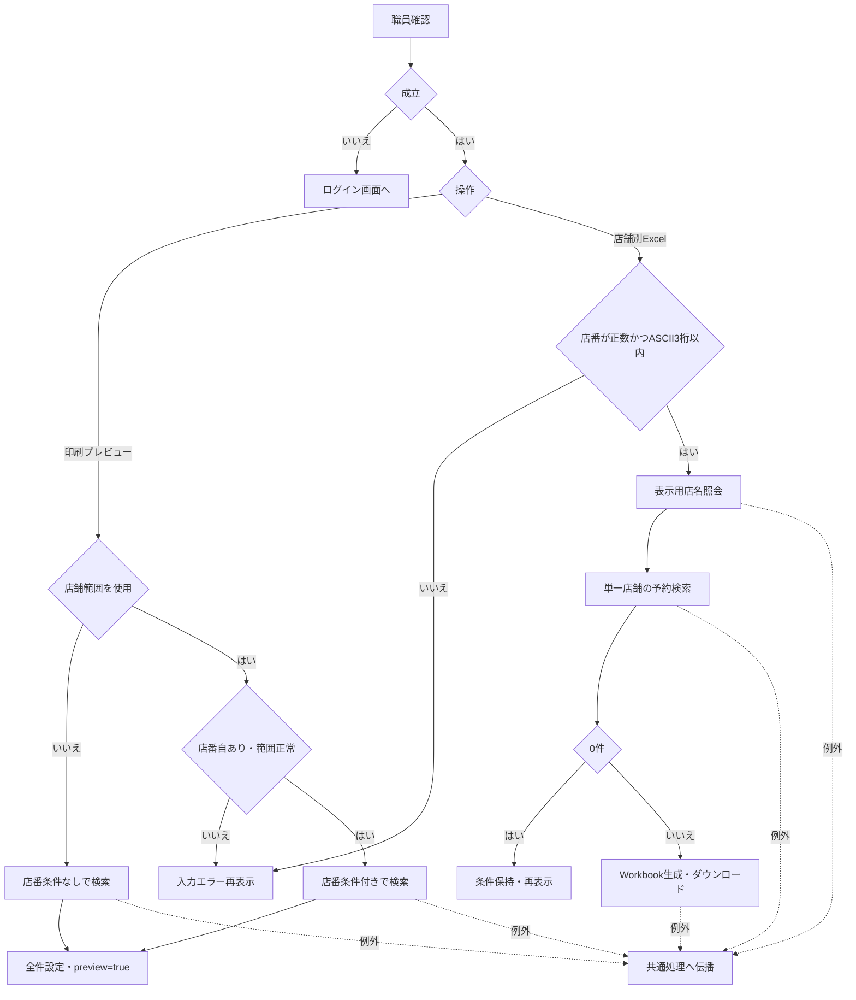

表示用店名の0件と、その店舗の予約0件は別の判定である。

#### SQL・テーブル関連（ER図）

両検索とも概要の予約共通SELECTと五つのLEFT JOINを使う。店舗別Excelに先行する店名照会はE01の単独SELECTであり、予約検索とは別接続である。

#### DB操作の詳細

印刷の基本条件は`WHERE 1 = 1`で、引数によって次を追加する。

| Repositoryの引数 | 追加条件 | バインド |
| --- | --- | --- |
| 自・至ともnull | なし | なし |
| 自だけ非null | `AND R.店番 = ?` | 1へ自を`setInt` |
| 自・至とも非null | `AND R.店番 >= ? AND R.店番 <= ?` | 1へ自、2へ至を`setInt` |
| 至だけ非null | `AND R.店番 <= ?` | 1へ至を`setInt`。Repository単体の契約で、通常画面は範囲使用時に自を要求する |

| sortType | ORDER BY |
| --- | --- |
| 2 | `R.店番, R.ふりがな, R.顧客番号` |
| 3 | `R.店番, R.生年月日, R.顧客番号` |
| 4 | `R.店番, R.請求予定日, R.顧客番号` |
| その他 | `R.店番, R.担当者コード, R.顧客番号` |

店舗別Excelは予約共通SELECTへ`WHERE R.店番 = ? ORDER BY R.請求予定日 DESC, R.担当者コード, R.顧客番号`を追加し、1へ店番を`setInt`で設定する。SQLページング・取得件数上限はない。両検索とも結果は全件の`List<PensionReservation>`で、NULL変換は概要に従う。

#### 結果・例外時の扱い

印刷0件でもプレビュー状態は成立する。店舗別Excelの0件はファイルを送信せず画面へ戻る。1件以上は生成byte配列を直接送信し、CSVという戻り値でServletのforwardを抑止する。

SQLExceptionは年金DB例外となる。Workbook生成・送信の失敗と、プレビュー後のJSP描画失敗は検索0件とは異なる。検索結果の取得から利用者のダウンロード受領やブラウザー印刷完了を確定しない。出力列・セル形式はOUTPUT-NENKINで対応する。

### E06 日次・月次の削除明細整理と区分別抽出

#### 処理概要

日次・月次は選択された新規・変更・削除を順に抽出する。抽出前に削除明細を整理する場合があり、そのcommitは後続の検索・ファイル生成・送信から独立する。職員指定は予約の担当者コードではなく更新者の条件である。

#### 処理手順

**1. 画面要求を受け付ける。**

　**1.1.** 日次は`BatchDailyAction`、月次は`BatchMonthlyAction`から共通の`BatchRunAction`へ入り、runModeをDAILYまたはMONTHLYにする。

　**1.2.** 職員確認後、STAFF_NO、三つのINCLUDE値、DAILY_DATE、MONTH_START、MONTH_END、DELETE_CUTOFF_DATEをBeanへ保持する。POST・CSRF、区分のいずれか一つ以上、職員番号が空欄または8桁以内のASCII数字であることを順に検査する。

　**1.3.** 通過値をPensionBatchExportRequestへ移す。画面初期値は日次対象日が当日、月次が当月初日・末日、削除基準日がCalendarで当日から2か月戻した日である。基準日はhiddenで往復する。

**2. サービスで期間・更新者を決める。**

　**2.1.** request=null、区分未選択、runMode未設定を拒否する。日次はrequiredDateの結果を開始・終了の両方にする。月次は両日付を正規化し、ISO文字列で開始が終了以下であることを確認する。

　**2.2.** 職員番号は空欄ならupdatedBy=null、非空ならIntegerへ変換する。サービス単体ではALLも全職員を表すが、通常ActionはALLや符号付き値を受け付けない。画面から数字の0が届いた場合はupdatedBy=0であり、全職員にはならない。

　**2.3.** requiredDateは正規化前のtrim後空欄を拒否する一方、DateUtilの返却後に非空を再確認しない。U+3000等だけの値がそのまま受信された場合、NFKCとtrimによって空文字になり得る。日次の両境界または月次の両境界が空なら日付WHEREを付けない。月次の開始だけ空なら下限が外れ、終了だけ空で開始が非空なら前後関係の検査で拒否される。

**3. 削除明細を先に整理する。**

　**3.1.** 削除基準日のtrim後が非空なら`purgeDeletedAuditsThrough`を呼ぶ。受信基準日の再計算、許容範囲、抽出期間との関係、削除区分の選択有無、指定職員との関係は照合しない。

　**3.2.** Repositoryは基準日を任意ISO日付へ変換し、結果が空なら接続せず0を返す。非空なら業務接続をautoCommit=falseにし、基準日以前の削除明細を全てDELETEする。

　**3.3.** 削除件数は0件も含めて採用し、commitする。サービスは返却件数を使用せず抽出へ進む。基準日によっては出力対象の削除明細が抽出前に消える。

**4. 選択区分を順に抽出・変換する。**

　**4.1.** 新規、変更、削除の順に、選択された区分だけ`findAuditRecords`を呼ぶ。区分ごとに別接続を取得する。

　**4.2.** 0件の区分はメッセージだけを追加する。非0件は店番、顧客番号、auditIdの順へメモリ上で追加ソートする。店番・顧客番号のnullは先に置く。

　**4.3.** auditIdは各SQL結果を読んだ順に1から付ける連番であり、永続監査IDではない。区分別明細行、タイトル・期間等の先行行を作り、Workbookを生成する。

　**4.4.** 明細では予約徴求日、生年月日、請求予定日、配偶者生年月日を和暦へ変換する。NULL・trim後空文字は空表示とし、それ以外は`DateUtil.toAccessWareki`へ渡す。ISOとして扱える日付でも明治元年より前なら和暦変換でIllegalArgumentExceptionとなり得る。この段階は整理commitの後である。

**5. 生成件数に応じて応答する。**

　**5.1.** 生成0件は空ファイル名・Excel種別・空byte配列、1件は当該Excelの名前と内容、複数件は日次または月次ZIPを返す。各枝でfilesとmessagesを保持する。

　**5.2.** Actionは内容なしならmessagesを連結してBeanへ保持し、画面へ戻る。内容ありならダウンロードを書き、CSVを返してforwardを抑止する。単独Excelへ0件区分のメッセージを同梱する処理はない。ZIPはメッセージがある場合に出力結果.txtを含める。

　**5.3.** buildとダウンロードは同じtry内にある。その内側から外へ出たIllegalArgumentExceptionは、発生段階を問わず同じ個別catchでBeanと例外メッセージを保持して再表示する。それ以外のExceptionは共通Servletへ伝播する。いずれも先に確定した整理を戻さない。

#### 処理フロー

**サブフロー1：要求検査とサービス引数の確定。正常出口は期間・updatedBy・基準日・選択区分をサブフロー2へ渡す。**

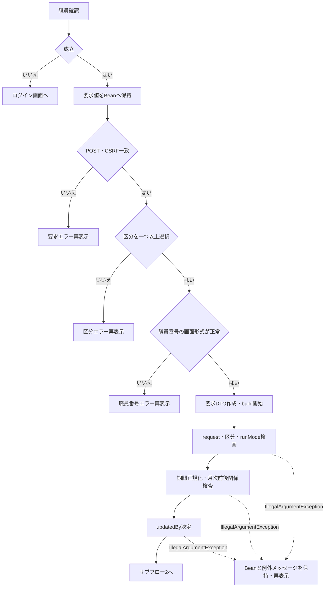

**サブフロー2：独立commitする整理。三つの正常出口は整理状態を保ってサブフロー3へ渡す。**

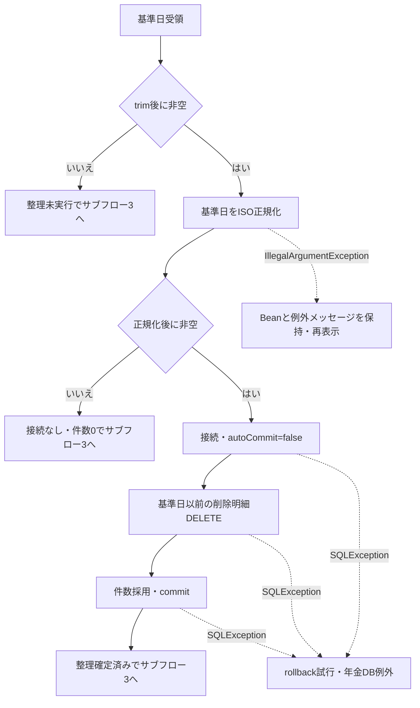

整理のSQL処理はSQLException用catchを持つ。そこで変換された年金DB例外はActionのIllegalArgumentException用catchへ入らず、共通Servletへ進む。commit例外時の実DB状態は確定できない。

**サブフロー3：区分抽出と出力結果。全出口で受け取った整理状態を維持する。**

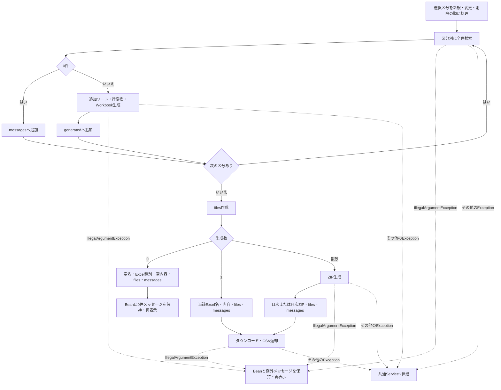

VIには明細の和暦変換で生じるIllegalArgumentExceptionも到達する。Xは個別catchの対象外となるExceptionの経路であり、NenkinDataAccessException、生成処理のIllegalStateException、通常の通信例外等が該当する。両経路とも整理確定済みの状態を引き継ぎ、整理をrollbackしない。VIがJSPを返しても、既に送信を始めた応答の再表示完了までは保証しない。

#### SQL・テーブル関連（ER図）

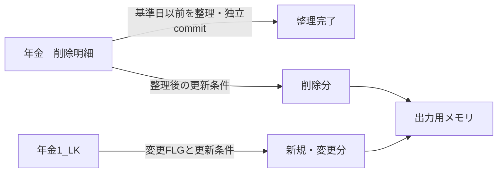

区分別SELECTは概要の五つのLEFT JOINを持つ。整理と各検索を包括する単一トランザクションはなく、三つの出力が同一DBスナップショットとなる保証はない。

#### DB操作の詳細

整理SQLは次のとおりであり、店番・更新者・区分の条件を持たない。

```sql
DELETE FROM 年金＿削除明細
WHERE データ更新日 <= ?
```

1へ正規化基準日をJDBC DATEとして設定する。executeUpdateのint件数は0件も正常とし、commit後に返す。基準日正規化はtry前であり、そのIllegalArgumentExceptionはRepositoryのSQLException用catchに入らない。

区分別抽出は予約共通SELECTへ次の3列を追加する。DATA_UPDATE_DATEに加え、同じ列をAUDIT_DATEとして取得する。

```sql
R.データ更新日 AS AUDIT_DATE,
R.更新時間 AS AUDIT_TIME,
R.更新者 AS UPDATED_BY
```

| 区分 | Rの表 | WHEREの追加順 | ORDER BY |
| --- | --- | --- | --- |
| NEW | 年金1_LK | `1 = 1`、`AND R.変更FLG = ?`、開始日非空なら`AND R.データ更新日 >= ?`、終了日非空なら`AND R.データ更新日 <= ?`、更新者非nullなら`AND R.更新者 = ?` | `R.データ更新日, R.更新時間, R.店番, R.顧客番号` |
| CHANGED | 年金1_LK | NEWと同じ条件構成 | `R.データ更新日, R.更新時間, R.店番, R.顧客番号` |
| DELETED | 年金＿削除明細 | `1 = 1`、存在する開始日・終了日・更新者の条件。変更FLG条件なし | `R.データ更新日, R.更新時間, R.店番, R.顧客番号` |

バインドは存在する変更FLGをNEW=0・CHANGED=1の`setInt`、開始DATE、終了DATE、更新者の`setInt`の順に1から詰める。省略条件へNULLを設定しない。type=nullはSQL構築前にIllegalArgumentExceptionとする。日付は任意ISO値へ正規化し、空なら対応するWHEREを付けない。

結果は全件の`List<PensionAuditRecord>`である。各要素はauditId、指定AuditType、日付文字列、時刻文字列、IntegerまたはnullのupdatedBy、予約モデルを持つ。updatedByは`getInt`と`wasNull`で変換する。取得後の追加ソートは手順4.2による。

新規・変更分は現在行の変更FLG・最終更新日・更新者で決まる。保存は全28列を上書きし、出力後にフラグを消費・初期化しない。過去の変更回数や変更前内容を全て再現する履歴ではなく、同じ条件で再出力され得る。Q番号は出力条件から作る結果識別文字列であり、同名の保存クエリーを実行するものではない。

| 生成数 | 返すファイル名・種別・内容 | files・messagesの扱い |
| --- | --- | --- |
| 0 | 空名、Excel Content-Type、空byte配列 | 両方を保持。Actionはmessagesを画面へ表示 |
| 1 | 当該Excel名、Excel Content-Type、その内容 | 両方を保持。messagesをExcelへ同梱しない |
| 複数 | 年金予約データ明細リスト（日次）.zipまたは（月次）.zip、ZIP Content-Type、ZIP内容 | 両方を保持。各Excelと、存在すれば出力結果.txtをZIPへ格納 |

#### 結果・例外時の扱い

Actionの個別catchは、期間・職員番号等の入力処理だけを対象にしていない。同じtry内の抽出準備、明細変換、レイアウト・Workbook生成、ZIP生成、送信から外へ出るIllegalArgumentExceptionも、Beanと例外メッセージを保持した再表示へ進む。明治元年より前の日付による和暦変換失敗は、この経路の具体例である。

SQLExceptionから変換されたNenkinDataAccessException、Workbook・ZIPの入出力失敗を包むIllegalStateException、通常の通信例外等は、その個別catchを通らず共通Servletへ伝播する。整理commit後にどちらの経路で失敗しても、整理済み行を戻す処理はない。

送信はresponse.reset、Content-Type、Content-Disposition、Content-Length、byte配列write、flushの順である。途中失敗では再表示先や共通エラーJSPへのforwardが成立するとは限らない。整理確定、抽出完了、生成完了、HTTP送信、利用者受領は別の境界である。

### E07 共通認証・職員所属情報の照会

#### 処理概要

年金ログインは共通LoginActionへ委譲し、共通認証、職員・所属情報設定の後、年金側で追加の職員確認を行う。共通側のSQLはStatement用の文字列連結であり、年金Repositoryの位置パラメータ方式とは異なる。

#### 処理手順

**1. 共通認証の引数を組み立て、認証前の入力を確認する。**

　**1.1.** 年金ログインフォームはAPPL_NAME=unifyを送る。通常のunify分岐では認証用ユーザーにアプリケーション名を使い、認証情報をDWH_PASS_WORDから組み立てる。職員番号は別のDWH_USER_IDとして保持する。

　**1.2.** 共通LoginActionは、最初に認証用の`sUser`・`sPass`を確認する。いずれかがnullまたは空文字ならloginStatus=falseとし、「ユーザ名・パスワードを入力してください。」をメッセージへ追加する。この場合は次の入力検査と認証用接続取得・SELECTへ進まない。

　**1.3.** 手順1.2を通過した場合だけ、`applName`・`dwhUserId`を確認する。いずれかがnullまたは空文字ならloginStatus=falseとし、「ログインに失敗しました。」を追加する。この場合も認証用接続取得・SELECTへ進まない。二段階の検査はnullと空文字との比較であり、この検査内でtrimは行わない。

　**1.4.** 両検査を通過した場合に、職員系の認証用接続を取得して共通認証表を照会する。結果Listが空なら拒否する。Baseのbooleanがtrueでも1件以上を意味しないため、Listの空判定を別に行う。

　**1.5.** 手順1.2または1.3で拒否した場合は、共通ログイン情報とメッセージListをセッションへ設定し、ログインJSPを返す。年金LoginActionはこの戻り値をそのまま返し、MenuViewActionと年金職員確認へ進まない。通常年金ログインでも、認証情報の欠落は最初の検査、そこを通過した職員番号の欠落は次の検査で拒否される。ここで省略するのは共通LoginActionの認証用接続・SELECTであり、Servletが別に行う運用可否確認や後続アクセス記録の接続とは区別する。

**2. 職員名簿と所属店番を処理する。**

　**2.1.** 職員番号をLong.parseLongで確認し、変換可能な場合に職員名簿を照会する。変換失敗は照会せず結果なしとして扱う。照会結果は先頭行を使う。

　**2.2.** 名簿行がある場合、所属店番を`getAdd0String(..., 4)`へ渡す。非空の値は最低4文字まで先頭ゼロを付け、4文字以上は切り捨てず返す。先頭2文字を詳細部室店コード、次の2文字を枝番にする。ゼロ埋めは数値検証や桁上限検査ではない。

　**2.3.** 名簿行の所属店番がSQL NULLなら、共通SELECTで空文字へ変わる。`getAdd0String`もNULL・空文字等を空文字で返すため、直後の`substring(0, 2)`でStringIndexOutOfBoundsExceptionとなる。名簿行が存在するが所属店番が空の場合を、事業所照会省略後の該当なしへ合流させない。

　**2.4.** 部分文字列を作れても、その後の`Integer.parseInt(syozokuTenban)`が失敗すればNumberFormatExceptionとなる。非数値やint範囲外の値は、事業所照会、後続の役職・所属課係設定、年金職員確認へ到達しない。

　**2.5.** 整数化できた所属店番が100未満なら共通Beanの所属店番を010、それ以外ならゼロ埋め後の先頭3文字にする。事業所照会に使う詳細部室店コード・枝番は、手順2.2で元のゼロ埋め値から作った二組の値である。

　**2.6.** 名簿行そのものがない場合は、共通Beanの所属店番999、詳細部室店コード99、枝番99、職員氏名に要求職員識別値、性別コード0、役職コード0等を設定する。この場合の事業所照会用所属店番は未取得のままであり、事業所照会を省略して所属店名を該当なしにする。

**3. 事業所・役職・所属課係を取得する。**

　**3.1.** 名簿行の所属店番処理が正常に終わり、事業所照会用の値が非空なら、顧客・DWH系接続で事業所コード表2を照会する。先頭行の事業所名を設定し、0件なら該当なしとする。

　**3.2.** 役職コードがnull・空・0なら役職照会を省略する。それ以外は役職名称を照会する。所属課係は職員番号をLong.parseLongで確認して照会する。この職員番号確認・照会を囲む局所tryでNumberFormatExceptionを捕捉した場合は結果をnullとする。所属課係の結果がnullまたは0件なら、Beanのコードを文字列0、名称を空文字にする。

　**3.3.** 所属課係行があれば、先頭行の所属課係コード文字列をBeanへ設定してから`CommonConverter.convertInt`で名称分類する。同メソッドはtrimを行わず、null・空文字・文字列0は整数0、それ以外は`Integer.parseInt`の結果を返す。共通SELECTから取得した値は、その前段でSQL NULLが空文字、非NULLがtrim済み文字列になっている。整数変換が成立した場合、10は店長席、100は融資Ｍ・リレーションＧ、600は事務グループ、それ以外の整数はその他とする。行がありコードが空文字または0の場合の名称はその他であり、結果なし時の名称空文字とは異なる。

　**3.4.** 取得した所属課係コードが非数値またはint範囲外なら、`convertInt`はNumberFormatExceptionを送出する。この変換は手順3.2の局所try・catchを出た後に行うため、結果なしやその他へ置き換えない。コード文字列をBeanへ設定した後、名称分類が完了せず、外側catchから再送出される。共通ログイン正常終了と年金職員確認には到達せず、ServletのAction用catchへ伝播する。

**4. 年金用職員情報を成立させる。**

　**4.1.** 共通側の処理が正常に戻った後、年金側はE01のverifyStaffで同じ職員番号を追加確認する。共通側が名簿なしの既定値で進んでも、年金職員を取得できなければ業務セッションを成立させない。

#### 処理フロー

**サブフロー1：認証前入力検査、認証と職員名簿取得。入力拒否はログイン画面へ戻り、認証後の名簿取得状況だけをサブフロー2へ渡す。**

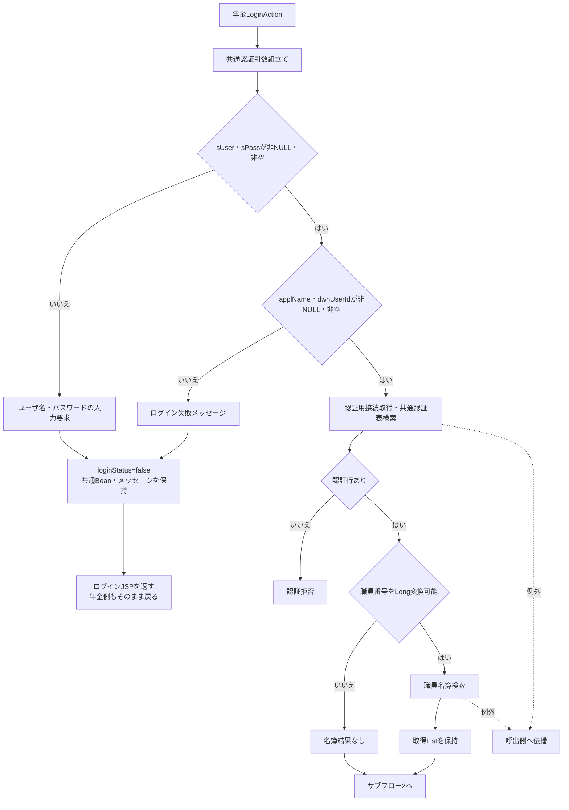

R1・R2からは認証用接続取得・SELECTへ進まない。Servletの事前運用可否確認と後続アクセス記録は、この認証前検査とは別の接続処理である。

**サブフロー2：所属情報設定と年金職員確認。名簿0件、取得行の不正値、所属課係コードの変換失敗を分ける。**

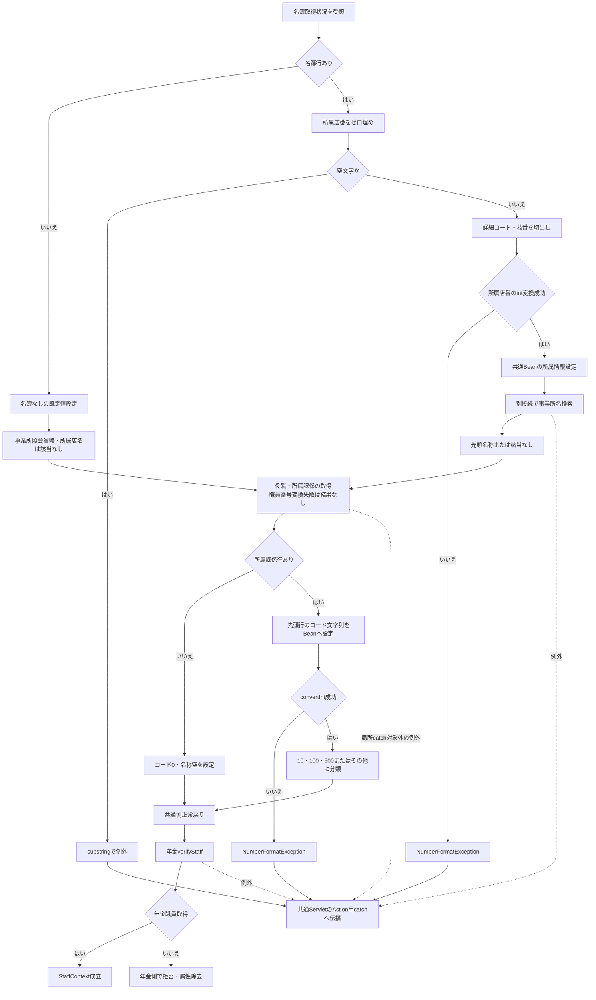

名簿行の空所属店番・整数変換失敗はXで終了し、事業所名設定や年金職員確認へ合流しない。所属課係コードの変換失敗もXへ進み、結果なしのJ0や整数変換成功後のJ4へ合流しない。Jの職員番号確認・照会を囲む局所catchと、J3の取得コード変換は別の範囲である。共通認証成功と年金職員成立を一つの成功判定にまとめない。

#### SQL・テーブル関連（ER図）

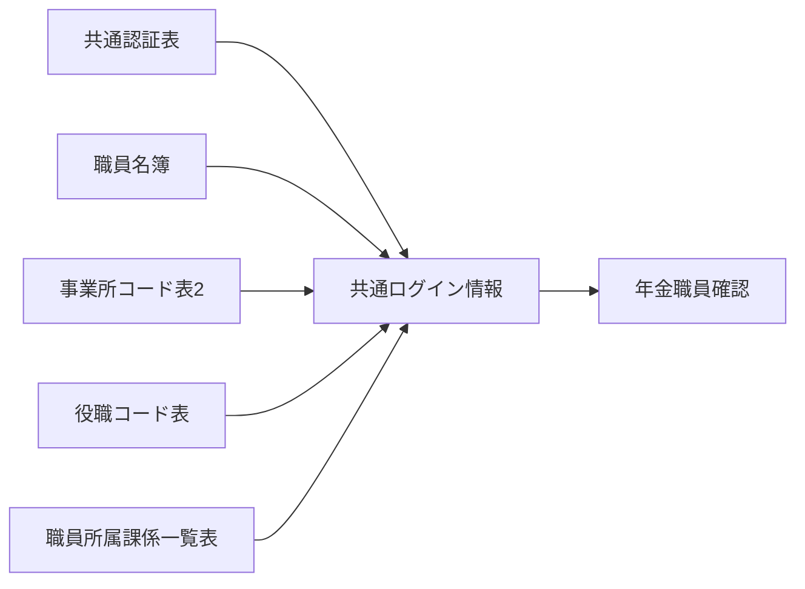

各表は個別SELECTであり、線はSQL JOINやFKではない。事業所名は顧客・DWH系接続、その他の共通認証・職員系照会は職員系接続を使う。共通ログインの所属店名と、年金の店名テーブルから付ける店舗名は取得元が異なる。

#### DB操作の詳細

次表の「連結値」は説明上の表記であり、JDBC位置パラメータではない。

| 操作 | SELECT・FROM | WHERE | 値の扱い・結果利用 |
| --- | --- | --- | --- |
| 三引数の共通認証 | `SELECT * FROM DB2.ＵＷＥＢログイン情報表` | アプリケーション名、ユーザーＩＤ、パスワードの三つの等価条件をANDで連結 | 各値を単一引用符で囲んで連結。0件拒否、非0件で後続へ |
| 職員名簿 | `SELECT * FROM DB2.Ｕ職員名簿表` | `職員番号 = 連結値` | 数値式として連結。先頭行を使用 |
| 職員所属課係 | `SELECT * FROM DB2.Ｕ職員所属課係一覧表` | `職員番号 = 連結値` | 数値式として連結。先頭行を使用 |
| 役職 | `SELECT 役職 FROM DB2.ＵＪＶ役職コード表` | `役職コード = 連結値` | 数値式として連結。先頭行を使用 |
| 事業所名 | `SELECT 事業所名 FROM N2_DWH.Ｊ事業所コード表２` | `店舗コード = 連結値 AND 枝番 = 連結値` | 手順2.2の二組の値を数値式として連結。先頭行を使用し、0件は該当なし |

全操作ともJOIN・ORDER BY・取得件数上限・JDBCバインド・パラメータ型・サイズ・NULLバインドの指定はない。`SELECT *`が本番で取得する全物理列は、本番外部表の完全DDLがないため列挙できない。ローカル互換定義を本番の返却列保証へ転用しない。

`CommonBaseSelect`はStatement.executeQueryの全行を`List<Map>`へ変換する。MapのキーはResultSetMetaData.getColumnNameで得た列名、値はgetStringのNULLなら空文字、それ以外ならtrim済み文字列である。正常0件は空Listとなり、BaseのbooleanはList非nullだけを確認する。

#### 結果・例外時の扱い

認証前の入力検査で拒否した場合は、共通LoginActionの認証用接続取得・SELECTを実行せず、共通ログイン情報とメッセージListをセッションへ保持してログインJSPを返す。年金LoginActionもこの戻り値をそのまま返す。認証SELECTの省略から要求全体をDB接続なしとは扱わず、Servletの運用可否確認・アクセス記録による別接続はE08・E09の契約に従う。

共通読取りはautoCommit=falseの接続を使うが、明示的commit・rollbackを行わず閉じる。close時の実際の処理は接続実装に依存する。単件前提の照会も全行取得後に先頭行を使い、重複を検査しない。

名簿0件は共通側の既定値設定へ進むが、取得行の空所属店番は部分文字列処理、非数値等は整数変換で例外となる。これらは後続の事業所SELECTが0件だった場合とは異なり、その後の所属情報設定・年金職員確認を中断する。

所属課係結果なしはコード0・名称空文字となる。一方、取得行のコードが空文字または文字列0なら整数0へ変換され、名称はその他となる。その他への分類は整数変換が成立した場合に限る。非数値・int範囲外のNumberFormatExceptionは、先行する職員番号確認・照会用の局所catchへ戻らず、外側catchで再送出される。finallyで接続closeを試みた後、年金LoginActionの共通処理呼出しから伝播し、ServletのAction用catchへ進む。この経路では共通ログイン正常終了、年金MenuViewAction、年金職員確認には到達しない。

共通BaseのResultSet・Statementのcloseは例外を抑制しない。close例外が先行例外を置き換えたり、後続closeへ到達させなかったりする可能性がある。Action中に伝播した例外は共通ServletのAction用catchの対象となるが、後続のアクセス記録準備・forwardの成功は別の境界である。

### E08 共通アクセス記録

#### 処理概要

共通ServletはAction終了またはAction用catchの後にアクセス記録を作る。カウンターシフトINSERTは年金の業務更新と別接続・別トランザクションであり、記録の成否から予約更新の確定を変更しない。

#### 処理手順

**1. 記録値を準備する。**

　**1.1.** 通常はAction後のLoginInfoBeanから記録ユーザーを取得する。ログアウトではAction前に職員番号を取得して保持する。

　**1.2.** FUNCTION_ID、VIEW_ID、COMMAND_ID、VIEW_IDとCOMMAND_IDを連結したアクションID、JSP名、ユーザーIDをMapへ設定する。MESSAGE属性があれば記録上のJSP名を`./JSP/COMMON/SubMessage.jsp`にするが、実forward先strUrlは変えない。

**2. 別接続で記録する。**

　**2.1.** CounterShiftがCommonUtil経由で職員系接続を取得し、autoCommit=falseでINSERTする。同じDateからアクセス日付と時刻を生成する。

　**2.2.** executeUpdateの件数はBaseのcountへ保持するが、呼出元は厳密1件を検査しない。INSERT呼出しが正常ならcommitする。

　**2.3.** Exception時はrollbackを試みる。rollback失敗と元例外をログへ記録する。接続close失敗もログへ記録して戻り、年金業務接続をrollbackしない。

**3. 元の応答処理へ進む。**

　**3.1.** strUrlがnull、PDF、CSV以外なら元のstrUrlへforwardする。アクセス記録上のJSP名を実遷移先として使わない。

#### 処理フロー

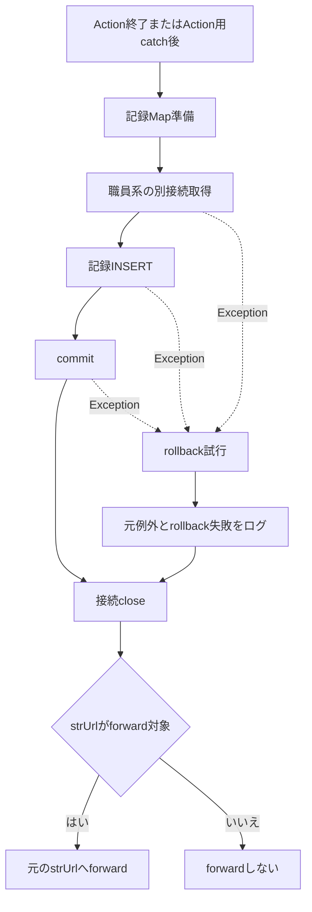

close失敗はログへ記録して後続へ戻る。記録Map準備と最終forwardはAction用catchの外にあり、CounterShift内の記録失敗捕捉とも範囲が異なる。

#### SQL・テーブル関連（ER図）

対象は`DB2.Ｕカウンターシフト`一表であり、JOINを使わないためER図は省略する。年金業務表へのFKや一体更新は定義されていない。

#### DB操作の詳細

| 順序 | 列 | 設定元 | SQL値の表現 |
| --- | --- | --- | --- |
| 1 | アクセス日付 | 同一DateをyyyyMMddで整形 | 引用符なしで連結 |
| 2 | アクセス時刻 | 同一DateをHHmmssSSSで整形 | 引用符なしで連結 |
| 3 | 機能ＩＤ | FUNCTION_ID | nullまたは空文字はSQL null、それ以外は引用符付き |
| 4 | 画面ＩＤ | VIEW_ID | nullまたは空文字はSQL null、それ以外は引用符付き |
| 5 | コマンドＩＤ | COMMAND_ID | nullまたは空文字はSQL null、それ以外は引用符付き |
| 6 | アクションＩＤ | VIEW_IDとCOMMAND_IDの連結 | nullまたは空文字はSQL null、それ以外は引用符付き |
| 7 | ＪＳＰ名 | strUrlまたはSubMessageの記録名 | nullまたは空文字はSQL null、それ以外は引用符付き |
| 8 | ユーザーＩＤ | 記録用userId | 常に引用符で囲む。Map値nullはSQL NULLではなく文字列nullとなる |

```sql
INSERT INTO DB2.Ｕカウンターシフト
(アクセス日付, アクセス時刻, 機能ＩＤ, 画面ＩＤ, コマンドＩＤ,
 アクションＩＤ, ＪＳＰ名, ユーザーＩＤ)
VALUES (各列の連結値)
```

VALUES内は上表の構築規則を示す説明表記である。実装は位置パラメータを使わず、完成SQLをStatementへ渡す。JDBC型・サイズ指定・引用符エスケープはない。

#### 結果・例外時の扱い

記録失敗はCounterShiftから業務Actionの失敗として再送出しない。予約更新済みでも記録だけが失敗し得る。Actionが拒否・例外となった要求も、後続記録処理へ到達すれば記録対象となる。

CommonBaseのStatement.closeが失敗した場合もCounterShiftのcatchへ進み、rollbackを試みる。commit例外時やrollback失敗時の実DB状態をログ出力だけで確定する契約はない。アクセス記録の完了もHTTP応答完了を意味しない。

### E09 通常導線未接続のSQLと共通基盤の利用境界

#### 処理概要

本節は宣言されているSQLを保守対象として記録する。予約候補検索・最終区分照会・予約全件一覧には、収録通常画面からの呼出元を確認できない。共通の支店変更認証と運用状態表には別業務向けの接続境界があり、年金の通常業務機能へ追加しない。

#### 処理手順

**1. 予約候補検索の単体契約を区別する。**

　**1.1.** `searchCandidates`はふりがなを正規化し、電話を数値正規形の文字列へ変換する。存在する条件だけをANDで付け、両方空なら全予約を対象にする。

　**1.2.** 全結果をPensionCandidateへ変換する。予約画面の候補ボタンはcandidateをcustomerへ置き換えて顧客参照を開くため、このメソッドを呼ぶ経路ではない。

**2. 最終区分・一覧の単体契約を区別する。**

　**2.1.** `findLatestAuditType`は無効キーなら接続せずnullを返す。有効なら本表を先に照会し、存在すれば変更FLGで返す。本表0件の場合だけ削除明細を調べる。

　**2.2.** `list`は予約共通SELECTを条件なしで全件取得する。店舗別Excelや印刷がこのメソッドを使うわけではない。

**3. 共通基盤の別用途を区別する。**

　**3.1.** SearchLoginInfoBaseの二引数照会は、共通ViewMenuActionの別業務向け支店変更で使われる。年金MenuViewActionはこの処理へ委譲しない。

　**3.2.** OperatePermissionは業務種別判定より前に職員系接続を取得する。年金は運用状態表照会の列挙対象外であり、接続取得等に成功すれば表を照会せずtrueを返す。接続取得等で失敗すればfalseとなり、Action前の運用拒否へ進み得る。

#### 処理フロー

```mermaid
flowchart TD
  A[最終区分メソッドが呼ばれた場合] --> B{正規化キー有効}
  B -->|いいえ| N[null]
  B -->|はい| C[本表の変更FLG取得・最大1行]
  C --> D{本表あり}
  D -->|はい| E{getIntが0}
  E -->|はい| R1[NEW]
  E -->|いいえ| R2[CHANGED]
  D -->|いいえ| F[削除明細を日付・時刻降順で最大1行]
  F --> G{削除明細あり}
  G -->|はい| R3[DELETED]
  G -->|いいえ| N
  C -. SQLException .-> X[最終区分取得の年金DB例外]
  F -. SQLException .-> X
```

```mermaid
flowchart TD
  A[共通運用可否判定] --> B[職員系接続取得]
  B --> C{年金等の列挙対象外}
  C -->|はい| T[表照会なしでtrue]
  C -->|いいえ| D[対象業務の運用状態表照会]
  D --> E{先頭行の処理中FLGが0}
  E -->|はい| T
  E -->|いいえ| F[false]
  B -. Exception .-> F
  D -. Exception .-> F
```

候補検索と全件一覧は各条件の全Listを返す処理であり、最終区分判定へ合流しない。

#### SQL・テーブル関連（ER図）

候補検索は本表単独、全件一覧は予約共通SELECTの関連を使う。最終区分照会は本表と削除明細を順に調べる処理で、二表のJOINでも両方の時刻比較でもない。共通二引数照会と運用状態照会は各単表であり、ER図を省略する。

#### DB操作の詳細

候補検索は次の6列を取得する。

```sql
SELECT R.店番 AS BRANCH_NO,
       R.顧客番号 AS CUSTOMER_NO,
       R.ふりがな AS KANA_NAME,
       R.顧客氏名 AS CUSTOMER_NAME,
       R.電話番号 AS PHONE_NUMBER,
       R.生年月日 AS BIRTH_DATE
FROM 年金1_LK R
WHERE 1 = 1
```

正規化ふりがな非空なら`AND UPPER(R.ふりがな) LIKE UPPER(?) ESCAPE '\'`、電話非空なら`AND CAST(R.電話番号 AS VARCHAR(40)) LIKE ? ESCAPE '\'`を追加する。ORDER BYは`R.ふりがな, R.店番, R.顧客番号`。存在するふりがな・電話の部分一致パターンをこの順に`setString`し、全件を返す。店番・顧客番号はgetInt、電話は表示変換、生年月日はgetStringで取得する。

| 操作 | SQLまたは共通SELECTへの追加 | バインド・結果 |
| --- | --- | --- |
| 最終区分の本表照会 | `SELECT 変更FLG FROM 年金1_LK WHERE ふりがな = ? AND 電話番号 = ?` | 1=`setString`、2=`setBigDecimal`、`setMaxRows(1)`。ORDER BYなし。getIntが0ならNEW、それ以外はCHANGED |
| 最終区分の削除照会 | `SELECT 1 FROM 年金＿削除明細 WHERE ふりがな = ? AND 電話番号 = ? ORDER BY データ更新日 DESC, 更新時間 DESC` | 同じバインド、`setMaxRows(1)`。存在すればDELETED、なければnull |
| 予約全件一覧 | 予約共通SELECTへ`ORDER BY R.店番, R.顧客番号, R.ふりがな` | WHERE・バインドなし。全件の予約List |
| 共通二引数照会 | `SELECT * FROM DB2.ＵＷＥＢログイン情報表`へアプリケーション名とユーザーＩＤの等価条件をAND追加 | 引用符付き文字列連結。認証情報条件・JDBCバインド・ORDER BYなし |
| 対象業務の運用状態 | `SELECT 処理中ＦＬＧ FROM DB2.ＵＤＢ管理ＤＢ`へＤＢ名の等価条件を追加 | DB名を引用符付き連結。JDBCバインド・ORDER BYなし。年金はこのSELECTの実行分岐に入らない |

本表の変更FLGはwasNullを検査しないため、SQL NULLもgetIntの0としてNEW側へ入る。本表行があれば削除明細は調べず、新旧の時刻を比較しない。

一引数の`save(reservation)`はupdatedByをモデルのstaffCodeから補い、二引数の`delete(kana, phone)`はupdatedBy=nullで主要メソッドへ委譲する。通常保存・削除Actionはログイン職員番号を明示するオーバーロードを使う。`getPensionTypeLabel(code)`は全コードMapから一名称を返すhelperであり、コード指定の単件SQLを追加するものではない。

#### 結果・例外時の扱い

候補・一覧の0件は空List、最終区分の対象なしはnullである。SQLExceptionは各操作の年金DB例外へ変換する。宣言や単体契約の存在から、通常画面での実行や配備先での使用を確定しない。

共通二引数照会を通常年金ログインの認証SQLとして扱わない。年金の運用判定では、運用状態表照会の省略と職員系接続への依存が同時に成立する。

## 補足説明

### 排他・制約・再確認の範囲

save、delete、purgeDeletedAuditsThroughの主要メソッドはインスタンスsynchronizedであり、通常はstatic singletonを共用する。同じインスタンスに対する三操作は相互に直列化される。参照メソッド、Actionの現在キー・元キー照会、画面表示時の候補照会はこの同期区間に入らない。

Actionの同一キー比較は、取得モデルのふりがなをtrim・NFKC・`Locale.ROOT`大文字化し、電話をNFKC後のASCII数字列として比較する。Repositoryの空白集約・`Locale.JAPAN`大文字化・BigDecimal化と同一処理ではなく、版比較でもない。

SQLにFOR UPDATE等の明示的行ロック指定はなく、UPDATE・DELETEに比較版がない。Action判定後に状態が変われば、RepositoryでINSERT・UPDATEの選択や削除対象の有無が変わる。RepositoryはActionの元キー照合・職員権限を再実行しない。同一JVM外の接続、別JVM、外部更新まで排除する保証はない。

収録DDLの予約本表・削除明細にはPK・一意制約・FKの宣言がない。ふりがな＋電話番号、本表の店番＋顧客番号、本表の変更FLG＋データ更新日＋更新者、削除明細のデータ更新日＋更新者の索引は非一意である。単件検索の先頭行採用は一意性保証ではなく、更新・削除では別途厳密1件を検査する。

店名・四つのコード表にはコード列PKの宣言がある。SQL Server用CREATE TABLEは既存表がない場合の定義であり、既存本番表へ適用済みであることを示さない。実行SQLの業務表名はスキーマ未修飾であり、DDLのdboを実行SQLへ補っていない。

### 入力制約と保存容量

予約画面のmaxlengthは店番3桁、顧客番号7桁、担当者コード4桁、予定年齢3桁、日付14である。保存Actionの整数変換はこれらの桁数検査と同じではなく、店番3桁上限も検査しない。任意整数の不正値はnullとなり、業務値0を保持する変換ではない。店舗別ExcelはE05の独自検査を行う。

備考の56バイトはWindows-31Jでの業務検査であり、文字数やNVARCHAR(400)の容量とは異なる。顧客氏名・ふりがな・配偶者名のNVARCHAR(100)、住所のNVARCHAR(300)はDB宣言容量であり、その長さへ入力を切り詰める処理はない。

店名・コード名称は、保存列とJOIN結果を分けて扱う。収録SQL Server DDLの店名はNVARCHAR(80)、性別・裁定請求・受給有無名称はNVARCHAR(10)、年金種類名称はNVARCHAR(120)である。接続された名称保守処理と業務上限は確認できず、これらの容量を承認済み業務上限として使用しない。

### 例外と応答が確定する境界

| 発生段階 | 捕捉・戻り方 | DB・応答への意味 |
| --- | --- | --- |
| Servletの識別値処理・共通事前処理 | Action用catchの前 | Action用の共通エラー変換範囲外 |
| Action内の通常入力拒否 | Beanを設定してJSPを返す | DB参照を伴う拒否もある。再表示完了は未確定 |
| 保存Repositoryのtry前再検査 | IllegalArgumentExceptionを送出 | 保存トランザクション未開始。保存Actionに専用catchなし |
| 保存・削除のtry内 | Exceptionを捕捉しrollback試行後に年金DB例外 | commit例外・rollback失敗時の実DB状態を戻り値で判別できない |
| 整理のSQL処理 | SQLExceptionを捕捉しrollback試行後に年金DB例外 | 別途完了したトランザクションを戻す契約はない |
| バッチbuild・ダウンロードのtry内のIllegalArgumentException | 個別catchでBeanと例外メッセージを保持して再表示 | 明細和暦変換等の失敗も含む。整理commit済みなら維持される |
| 同じバッチtry内のその他のException | 個別catchを通らず伝播 | DB例外、生成IllegalStateException、通常の通信例外等。整理commit済みなら維持される |
| 共通ログインの所属店番処理 | 空値の部分文字列例外、非数値等の整数変換例外が伝播 | 事業所照会・後続所属情報設定・年金職員確認へ到達しない |
| Actionから伝播したException | ServletのAction生成・perform用catch | 共通エラーの遷移先を設定するが、最終forward成功は未確定 |
| アクセス記録 | CounterShift内でrollback試行・ログ後に戻る | 業務更新と独立する |
| JSP forward・予約画面の候補再取得 | Action用catchの後 | 描画中のDB・表示例外は同catchの範囲外 |
| 出力write・flushの途中または後 | 発生位置と応答確定状態による | DB確定と利用者受領を同一視しない |

本書の戻り値・メッセージは各経路でソースが設定する値を示す。共通エラーの遷移先設定から全例外のHTTP状態を一律に確定しない。明示されていない取消機構、SQLタイムアウト、パラメータサイズ、接続分離レベルを補わない。

### 関連文書との責務対応

以下は計画上の対応であり、参照先の生成状態は未確認である。相対パスは本書の配置先を基準とする。

| 文書ID | 相対パス | 本書との分担 |
| --- | --- | --- |
| DB-INDEX | `../DBオブジェクト一覧.md` | 対象表の安定IDと区分 |
| DB-LOGICAL | `論理データ仕様書.md` | 列の業務上の意味と論理関連 |
| DB-PHYSICAL | `テーブル定義書.md` | 全列の物理属性、H2・SQL Server宣言差、外部表の属性境界 |
| DATA-CONTRACTS | `../データオブジェクト定義書.md` | 要求値・モデル・候補・結果型と保持領域 |
| COM-012 | `../共通仕様書_COM-012_共通コントロールサーブレット.md` | 共通入口、Action用catch、アクセス記録、forward |
| COM-015 | `../共通仕様書_COM-015_ログイン処理.md` | 共通認証引数とログイン情報設定 |
| COM-111 | `../共通仕様書_COM-111_年金業務共通処理.md` | 職員確認、CSRF、入力変換、権限制限、出力送信 |
| API-NENKIN | `../要求処理一覧.md` | 要求識別値、Action選択、HTTP・JSON・直接出力契約 |
| ENV-NENKIN | `../設定・配置・依存仕様書.md` | JNDI登録、接続配置、DDL適用条件 |
| OUTPUT-NENKIN | `../帳票一覧.md` | 出力列、ファイル名、セル形式、ZIP構成 |
| DET-SCR-018 | `../../詳細仕様書/詳細仕様書_SCR-018_新規・変更・削除.md` | 実コントロール、画面状態、保存・削除要求との対応 |
| DET-SCR-014 | `../../詳細仕様書/詳細仕様書_SCR-014_日次 _ 月次処理.md` | 日次・月次の画面入力、要求保持、実行結果表示 |
