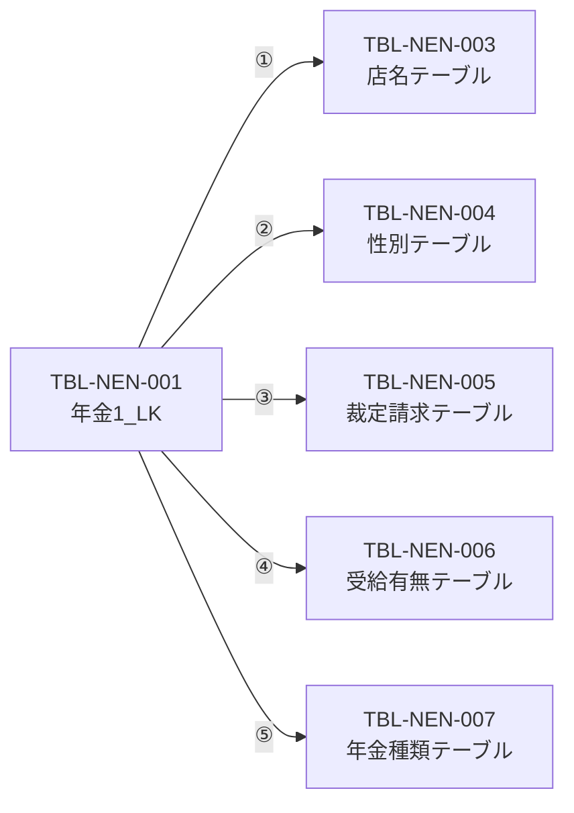
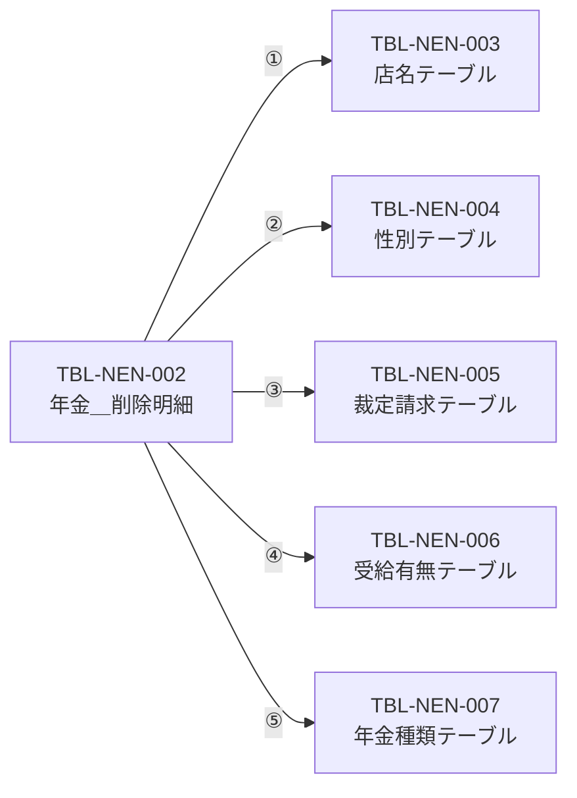

<!-- spec-meta: {"schema":"spec-md/1.0","documentId":"DB-PHYSICAL","version":"2.0","path":"共通/DB仕様書/テーブル定義書.md","sheets":[{"heading":"概要","kind":"GRID","sheet":"概要"},{"heading":"TBL-NEN-001 年金1_LK","kind":"GRID","sheet":"TBL-NEN-001"},{"heading":"TBL-NEN-002 年金＿削除明細","kind":"GRID","sheet":"TBL-NEN-002"},{"heading":"TBL-NEN-003 店名テーブル","kind":"GRID","sheet":"TBL-NEN-003"},{"heading":"TBL-NEN-004 性別テーブル","kind":"GRID","sheet":"TBL-NEN-004"},{"heading":"TBL-NEN-005 裁定請求テーブル","kind":"GRID","sheet":"TBL-NEN-005"},{"heading":"TBL-NEN-006 受給有無テーブル","kind":"GRID","sheet":"TBL-NEN-006"},{"heading":"TBL-NEN-007 年金種類テーブル","kind":"GRID","sheet":"TBL-NEN-007"},{"heading":"TBL-N2-001 DB2.ＵＷＥＢログイン情報表","kind":"GRID","sheet":"TBL-N2-001"},{"heading":"TBL-N2-002 DB2.Ｕ職員名簿表","kind":"GRID","sheet":"TBL-N2-002"},{"heading":"TBL-N2-003 DB2.Ｕ職員所属課係一覧表","kind":"GRID","sheet":"TBL-N2-003"},{"heading":"TBL-N2-004 DB2.ＵＪＶ役職コード表","kind":"GRID","sheet":"TBL-N2-004"},{"heading":"TBL-N2-005 N2_DWH.Ｊ事業所コード表２","kind":"GRID","sheet":"TBL-N2-005"},{"heading":"TBL-N2-006 DB2.Ｕカウンターシフト","kind":"GRID","sheet":"TBL-N2-006"},{"heading":"TBL-N2-007 N2_SIGHT.Ｂ顧客基本表","kind":"GRID","sheet":"TBL-N2-007"},{"heading":"TBL-N2-008 DB2.ＵＤＢ管理ＤＢ","kind":"GRID","sheet":"TBL-N2-008"},{"heading":"補足説明","kind":"GRID","sheet":"補足説明"}]} -->
# テーブル定義書

| 属性 | 内容 |
| --- | --- |
| 文書種別 | 物理データベース定義書 |
| システム名 | 年金自動受取予約管理システム |
| 共通／文書ID | DB-PHYSICAL |
| 版 | 2.0 |
| 解析対象 | 年金業務7表、共通・外部参照先8表のローカル互換定義と接続処理 |
| 基準日 | 2026-10-15 |

## 概要

本書は、予約の保存・検索、コード名称の変換、職員・顧客参照、共通認証、アクセス記録に関係する15表を統合した物理定義である。提供DDLにある111列を表ごとに記載する。年金業務7表はH2用定義とSQL Server用定義を並記し、外部8表はローカル互換DDLの属性として記載する。外部表について、ローカルに記載した列が本番の全実在列であるとは確定しない。

### 接続先と定義の範囲

| 区分 | 対象 | 接続・物理名の扱い |
| --- | --- | --- |
| 年金業務 | TBL-NEN-001～007 | 年金サービスは`jdbc/RAROA_DB`を使用する。SQL Server用DDLは`dbo`を明示するが、JavaのSQLは表名をスキーマ修飾しない。 |
| 職員・共通認証・アクセス記録 | TBL-N2-001～004、006、008 | 共通処理のSP2NM接続を使用する。年金の職員参照も`jdbc/Oracle_SP2NM`を使用する。表名の`DB2`はSQL上の修飾名であり、接続製品を表名だけから判断しない。 |
| 共通ログインの事業所名 | TBL-N2-005 | 共通ログインがDWH接続で参照する。年金の店名テーブルとは別の参照先である。 |
| 顧客基本情報 | TBL-N2-007 | 年金サービスは`jdbc/Oracle_DWH`を使用する。顧客基本表を参照し、予約への取込み値を作る。 |

年金の接続取得は、各JNDI名に続いて`java:comp/env/`付きの名前を探索し、取得したDataSourceを系統別にキャッシュする。JNDI名だけでは実接続先の製品、接続ユーザー、既定スキーマ、権限は確定しない。SQL Server向けDDLの`dbo`表と、実際の無修飾SQLが解決する表との一致は配備先で確認する属性である。

### 物理属性の読み方

PKとNOT NULL欄の「〇」は提供DDLの宣言を表す。空欄はその宣言がないことを表し、NOT NULL欄が空欄の列はNULL許容である。既定値欄の空欄は列DEFAULTの宣言がないことを表す。アプリケーションが設定する空文字、0、1、当日、現在時刻は列DEFAULTへ含めない。

文字列の長さ欄は、`VARCHAR(n)`または`NVARCHAR(n)`の宣言値nを保持する。画面上の文字数、Javaのコード単位数、Windows-31Jのバイト数への一律換算は行わない。実エンジン・バージョン・照合順序における補助文字を含む厳密な長さ判定は未確定である。DECIMALは精度を総桁数、位取りを小数部桁数として記載する。整数型・真偽型・DATEに文字列の桁数を付けない。

提供された対象表のDDLには、列DEFAULT、CHECK、FOREIGN KEY、IDENTITY、シーケンス、トリガーの宣言がない。PK以外の一意制約も宣言されていない。索引は各表の節へ記載し、PKに伴う実エンジン側の内部索引名は補わない。

### 予約・削除明細で共用するJDBC設定

本表と削除明細の列定義表のNoは、`bindRecord`が設定するSQLパラメータ番号1～28に一致する。INSERTはこの28個を使う。UPDATEは設定用28個に続いて、29番へ検索キーのふりがな、30番へ検索キーの電話番号を渡す。

| 記号 | モデル・内部値 | JDBC設定 | 空値・NULLの扱い | サイズ指定 |
| --- | --- | --- | --- | --- |
| I | `Integer`、逆引きしたコード | `setInt` | NULLは`setNull(Types.INTEGER)`。DB列がBIGINT・TINYINTでもこの設定を使う。 | なし |
| S | `String` | `setString` | 通常モデルの文字列NULLはsetterで空文字へ変換される。設定処理に個別の`setNull`分岐はない。 | なし |
| P | 電話文字列から作る`BigDecimal` | `setBigDecimal` | 数字がなければ`setNull(Types.DECIMAL)`。通常保存は先行検査で拒否する。 | 精度・位取りの明示設定なし |
| D | ISO日付文字列から作る`java.sql.Date` | `setDate` | 空欄は`setNull(Types.DATE)`。 | なし |
| B | `boolean` | `setInt`で1または0 | NULLを保存する分岐はない。読取時のDB NULLもモデル上はfalseになる。 | なし |
| T | 時刻文字列から作る`java.sql.Time` | `setTime` | 8文字未満なら`setNull(Types.TIME)`。それ以外は先頭8文字を時刻へ変換する。 | 小数秒精度の明示設定なし |

SQL ServerのNVARCHAR列に対してもSの`setString`を使用し、`setNString`は使用しない。JDBCの設定方法とDBの宣言型は別の属性である。

## TBL-NEN-001 年金1_LK

### テーブル属性

| 属性 | 定義 |
| --- | --- |
| 論理名 | 年金受取予約 |
| 物理名 | H2：`年金1_LK`／SQL Server用DDL：`dbo.年金1_LK` |
| 用途 | 予約の現在内容を保存し、読込み、印刷プレビュー、店舗別Excel、新規・変更分の抽出に使用する。 |
| PK・一意制約 | 宣言なし。ふりがな・電話番号はアプリケーションの検索・更新条件である。 |
| NULL・既定値 | 全28列がNULL許容。全列にDEFAULT宣言なし。 |
| その他の制約 | CHECK・FK・自動採番の宣言なし。 |

### 列定義

| No | 論理名 | 物理名 | H2型 | SQL Server型 | 長さ・単位／精度・位取り | PK | NOT NULL | 既定値 | 実装対応・用途 |
| --- | --- | --- | --- | --- | --- | --- | --- | --- | --- |
| 1 | 店番 | 店番 | INTEGER | INT | 非該当 |  |  |  | I。`BRANCH_NO`→`branchNo: Integer`。保存操作で必須。店舗名参照、店舗別出力、印刷範囲の条件になる。 |
| 2 | 顧客番号 | 顧客番号 | BIGINT | BIGINT | 非該当 |  |  |  | I。`CUSTOMER_NO`→`customerNo: Integer`。顧客基本情報の取込み、表示・出力に使用する。DBのBIGINT全範囲をモデルが扱う契約ではない。 |
| 3 | 担当者コード | 担当者コード | INTEGER | INT | 非該当 |  |  |  | I。`STAFF_CODE`→`staffCode: Integer`。担当者参照の選択値・顧客情報の取込み値を保持し、表示・並び順・出力に使用する。 |
| 4 | 顧客氏名 | 顧客氏名 | VARCHAR(100) | NVARCHAR(100) | 100（文字列宣言長） |  |  |  | S。`CUSTOMER_NAME`→`customerName: String`。trimした入力または顧客基本表の漢字氏名を保存し、予約表示・出力に使用する。 |
| 5 | フリガナ | ふりがな | VARCHAR(100) | NVARCHAR(100) | 100（文字列宣言長） |  |  |  | S。`KANA_NAME`→`kanaName: String`。Repositoryで正規化して検索・保存する。電話番号と組み合わせて予約を識別する。 |
| 6 | 性別コード | 性別 | TINYINT | TINYINT | 非該当 |  |  |  | I。`GENDER`→`gender: String`の名称から性別テーブルのコードを逆引きして保存する。表示時は名称へ変換する。 |
| 7 | 住所 | 住所 | VARCHAR(300) | NVARCHAR(300) | 300（文字列宣言長） |  |  |  | S。`ADDRESS`→`address: String`。trimした入力または顧客基本表の漢字住所を保存し、表示・出力に使用する。 |
| 8 | 電話番号 | 電話番号 | DECIMAL(15,0) | DECIMAL(15,0) | 精度15桁・小数0桁 |  |  |  | P。`PHONE_NUMBER`→`phoneNumber: String`。数字を抽出して数値保存し、フリガナとともに完全一致検索・更新・削除条件へ渡す。 |
| 9 | 生年月日 | 生年月日 | DATE | DATE | 非該当 |  |  |  | D。`BIRTH_DATE`→`birthDate: String`。入力または顧客基本情報から取得した日付をISO日付へ正規化して保存する。 |
| 10 | 国民年金選択 | 種類：国民年金 | BOOLEAN | BIT | 非該当 |  |  |  | B。`NATIONAL_PENSION`→`nationalPension: boolean`。選択状態を保存し、年金種類コードの1に対応する。 |
| 11 | 厚生年金選択 | 種類：厚生年金 | BOOLEAN | BIT | 非該当 |  |  |  | B。`EMPLOYEE_PENSION`→`employeePension: boolean`。選択状態を保存し、年金種類コードの2に対応する。 |
| 12 | 共済年金選択 | 種類：共済年金 | BOOLEAN | BIT | 非該当 |  |  |  | B。`MUTUAL_AID_PENSION`→`mutualAidPension: boolean`。選択状態を保存し、年金種類コードの4に対応する。 |
| 13 | 厚生年金基金選択 | 種類：厚生年金基金 | BOOLEAN | BIT | 非該当 |  |  |  | B。`EMPLOYEE_PENSION_FUND`→`employeePensionFund: boolean`。選択状態を保存し、年金種類コードの8に対応する。 |
| 14 | 国民年金基金選択 | 種類：国民年金基金 | BOOLEAN | BIT | 非該当 |  |  |  | B。`NATIONAL_PENSION_FUND`→`nationalPensionFund: boolean`。選択状態を保存し、年金種類コードの16に対応する。 |
| 15 | 年金種類コード | 年金種類 | INTEGER | INT | 非該当 |  |  |  | I。No.10～14の選択を1・2・4・8・16で合成する。合計0はNULL、非0は年金種類テーブルの存在確認後に保存する。表示用`pensionType: String`の直接保存先ではない。 |
| 16 | 裁定請求コード | 裁定請求 | TINYINT | TINYINT | 非該当 |  |  |  | I。`CLAIM_STATUS`→`claimStatus: String`の名称から裁請ｺｰﾄﾞを逆引きする。画面の裁定請求書徴収、表示・出力に対応する。 |
| 17 | 請求予定日 | 請求予定日 | DATE | DATE | 非該当 |  |  |  | D。`CLAIM_SCHEDULED_DATE`→`claimScheduledDate: String`。予約内容として保存し、店舗別出力・印刷の並び順にも使用する。 |
| 18 | 予定年齢 | 予定年齢 | INTEGER | INT | 非該当 |  |  |  | I。`PLANNED_AGE`→`plannedAge: Integer`。入力した予定年齢を表示・出力する。生年月日から自動算出する保存処理ではない。 |
| 19 | 配偶者名 | 配偶者名 | VARCHAR(100) | NVARCHAR(100) | 100（文字列宣言長） |  |  |  | S。`SPOUSE_NAME`→`spouseName: String`。trimした入力を保存し、予約表示・店舗別Excelへ移す。 |
| 20 | 配偶者生年月日 | 配偶者生年月日 | DATE | DATE | 非該当 |  |  |  | D。`SPOUSE_BIRTH_DATE`→`spouseBirthDate: String`。正規化した日付を保存し、表示・出力に使用する。 |
| 21 | 配偶者受給有無コード | 受給有無 | TINYINT | TINYINT | 非該当 |  |  |  | I。`HAS_BENEFIT`→`hasBenefit: String`の名称から受給ｺｰﾄﾞを逆引きし、配偶者情報の選択状態を保存する。 |
| 22 | 予約徴求日 | 予約徴求日 | DATE | DATE | 非該当 |  |  |  | D。`RESERVATION_REQUEST_DATE`→`reservationRequestDate: String`。正規化した入力日付を保存し、表示・出力に使用する。 |
| 23 | 備考 | 備考 | VARCHAR(400) | NVARCHAR(400) | 400（文字列宣言長） |  |  |  | S。`NOTES`→`notes: String`。trimした入力を保存・出力する。保存時はWindows-31J変換可能かつ56バイト以内を別途検査する。 |
| 24 | データ更新日 | データ更新日 | DATE | DATE | 非該当 |  |  |  | D。`DATA_UPDATE_DATE`の受信値は保存準備で当日へ上書きする。新規・変更分の期間抽出と出力順に使用する。 |
| 25 | 更新時間 | 更新時間 | TIME | TIME(0) | H2：小数秒指定なし／SQL Server：小数秒0桁 |  |  |  | T。保存実行時の時刻を設定する。生成文字列の先頭`HH:mm:ss`をバインドし、小数秒は引き継がない。抽出結果の並び順に使用する。 |
| 26 | 更新者 | 更新者 | INTEGER | INT | 非該当 |  |  |  | I。通常の保存Actionがログイン職員番号を渡す。日次・月次の職員指定はこの列を検索し、No.3の担当者コードは検索しない。 |
| 27 | 6ヶ月先確認 | ６ヶ月先確認 | BOOLEAN | BIT | 非該当 |  |  |  | B。`SIX_MONTH_CHECK`→`sixMonthCheck: boolean`。確認状態を保存する。Excelでは真を「確」、偽を空表示にする。 |
| 28 | 登録・変更区分 | 変更FLG | TINYINT | TINYINT | 非該当 |  |  |  | I。新規INSERTで0、UPDATEで1を設定する。日次・月次の新規分・変更分の抽出条件となる。 |

### 索引

| No | H2索引名 | SQL Server索引名 | 対象列・列順 | 一意性 | 用途 |
| --- | --- | --- | --- | --- | --- |
| 1 | IX_NENKIN1_KEY | IX_年金1_LK_検索キー | ふりがな、電話番号 | 非一意 | 予約読込み、存在確認、更新・削除対象の検索条件に対応する。 |
| 2 | IX_NENKIN1_CUSTOMER | IX_年金1_LK_顧客 | 店番、顧客番号 | 非一意 | 店舗・顧客の組に対応する索引である。この組による予約一意性は保証しない。 |
| 3 | IX_NENKIN1_UPDATE | IX_年金1_LK_更新区分 | 変更FLG、データ更新日、更新者 | 非一意 | 新規・変更の区分、期間、更新職員による抽出に対応する。 |

### 入力値と保存値

店番・顧客番号・担当者コード・予定年齢は、要求文字列をtrimして正のintへ変換する。欠落、空欄、0以下、変換失敗はNULLになる。保存操作では店番が必須であり、残り3項目はNULLのまま保存できる。画面のmaxlengthは順に3・7・4・3であるが、サーバーで同じ桁数の上限を検査する処理ではない。

フリガナは、RepositoryでNFKC、trim、全角空白の半角化、連続半角空白の集約、大文字化を行ってから検索・保存する。電話番号は数字をASCII数字へ集めてBigDecimalへ変換するため、区切り記号と先頭ゼロは数値の保存値に残らない。読取表示では先頭ゼロを整理し、9桁または10桁で0始まりでなければ0を補う。表示文字列と数値保存値を同じ表現として扱わない。

Actionの非空検査後も、Repositoryは正規化後フリガナの非空と数字抽出後電話番号の存在を検査する。したがって、受信時に文字があっても後段で拒否される経路がある。ふりがなの宣言長100、電話番号の精度15桁、Actionの元キー比較、Repositoryの正規化はそれぞれ別の制約・処理である。

顧客氏名・住所・配偶者名は保存時の必須項目ではなく、通常フォームの空欄は空文字として保存される。確認できる保存経路にはこれらの業務上の文字列長検査がなく、DB容量を受信上限の保証へ置き換えない。備考はDB宣言長400とは別に、Windows-31Jへ変換できることと56バイト以内を検査し、超過分を切り詰めず拒否する。

入力日付4列は空欄ならSQL NULLを保存する。非空なら和暦・西暦等の入力からISO日付へ正規化してDATEへ渡す。画面のmaxlength=14は入力文字列への制約であり、DATE列の容量ではない。

性別・裁定請求・受給有無は、画面が送信した名称をtrimし、空ならコードNULLを保存する。非空なら対応マスターの名称完全一致でコードを逆引きする。該当名称がなければSQLExceptionとなる。名称に一意制約がなく逆引きにORDER BYもないため、同名複数コードがある場合の採用順は確定しない。

### 更新の確定境界

保存Actionは現在キーと元キーの検索結果を確認し、既存予約の読込みを促す分岐、キー変更拒否、既存予約の更新権限制限を行う。Repositoryは保存準備の後、トランザクション内で正規化キーの存在を改めて検索し、存在すれば28列すべてをUPDATEし、なければINSERTする。この再検索は保存方法を決めるもので、Actionの元キー・権限判定を同一トランザクション内で再実施する処理ではない。

UPDATEのWHEREはふりがな・電話番号の一致だけで、比較版を含まない。INSERT・UPDATEとも影響件数が1以外ならSQLExceptionとし、正常時はcommit後に区分を返す。DB処理中の失敗ではrollbackを試み、rollback自体のSQLExceptionは元の例外を優先して抑制する。保存準備の検証はRepositoryのtryより前にあり、この検証例外をDB更新catchの捕捉対象へ含めない。

`save`と`delete`のsynchronizedは共有Repositoryインスタンス内の同期である。DDLの一意制約、比較版、明示的な行ロックによるDB全体の排他保証はない。本表の現在行は変更のたびに上書きされるため、全変更時点を保持する履歴表としては使用できない。

## TBL-NEN-002 年金＿削除明細

### テーブル属性

| 属性 | 定義 |
| --- | --- |
| 論理名 | 年金予約削除明細 |
| 物理名 | H2：`年金＿削除明細`／SQL Server用DDL：`dbo.年金＿削除明細` |
| 用途 | 予約削除時に対象内容を再構成して保存し、削除分出力の取得元にする。基準日以前の明細整理による削除対象にもなる。 |
| PK・一意制約 | 宣言なし。永続監査ID列もない。 |
| NULL・既定値 | 全28列がNULL許容。全列にDEFAULT宣言なし。 |
| その他の制約 | CHECK・FK・自動採番の宣言なし。 |

### 列定義

列順と物理型は本表と同じである。Noは削除明細INSERTのパラメータ番号に対応し、JDBC記号は概要の共通設定を使用する。

| No | 論理名 | 物理名 | H2型 | SQL Server型 | 長さ・単位／精度・位取り | PK | NOT NULL | 既定値 | 実装対応・用途 |
| --- | --- | --- | --- | --- | --- | --- | --- | --- | --- |
| 1 | 削除対象店番 | 店番 | INTEGER | INT | 非該当 |  |  |  | I。再取得した予約の店番を保存する。削除分の店舗名変換、表示・出力・並び順に使用する。 |
| 2 | 削除対象顧客番号 | 顧客番号 | BIGINT | BIGINT | 非該当 |  |  |  | I。予約モデルの`customerNo: Integer`を保存する。削除分の顧客識別表示・出力・並び順に使用する。 |
| 3 | 削除対象担当者コード | 担当者コード | INTEGER | INT | 非該当 |  |  |  | I。削除前予約の担当者コードを保存する。削除実行者はNo.26へ別に保存する。 |
| 4 | 削除対象顧客氏名 | 顧客氏名 | VARCHAR(100) | NVARCHAR(100) | 100（文字列宣言長） |  |  |  | S。再取得した予約の顧客氏名を保存し、削除分表示・出力に使用する。 |
| 5 | 削除対象フリガナ | ふりがな | VARCHAR(100) | NVARCHAR(100) | 100（文字列宣言長） |  |  |  | S。再取得した予約のフリガナを保存する。明細自体のPKではない。 |
| 6 | 削除対象性別コード | 性別 | TINYINT | TINYINT | 非該当 |  |  |  | I。予約読取で得た性別名称からコードを逆引きして保存する。元のコードを直接複写する処理ではない。 |
| 7 | 削除対象住所 | 住所 | VARCHAR(300) | NVARCHAR(300) | 300（文字列宣言長） |  |  |  | S。再取得した予約の住所を保存し、削除明細の予約内容を保持する。 |
| 8 | 削除対象電話番号 | 電話番号 | DECIMAL(15,0) | DECIMAL(15,0) | 精度15桁・小数0桁 |  |  |  | P。読取表示用電話文字列から数字を抽出し、再び数値化して保存する。表示用の先頭ゼロは数値には残らない。 |
| 9 | 削除対象生年月日 | 生年月日 | DATE | DATE | 非該当 |  |  |  | D。再取得した予約の日付を保存する。空欄はSQL NULLになる。 |
| 10 | 削除対象国民年金選択 | 種類：国民年金 | BOOLEAN | BIT | 非該当 |  |  |  | B。読取後の選択状態を1／0で再保存する。元のDB NULLはfalseと区別されない。 |
| 11 | 削除対象厚生年金選択 | 種類：厚生年金 | BOOLEAN | BIT | 非該当 |  |  |  | B。読取後の選択状態を再保存し、合成年金種類コードの2に対応する。 |
| 12 | 削除対象共済年金選択 | 種類：共済年金 | BOOLEAN | BIT | 非該当 |  |  |  | B。読取後の選択状態を再保存し、合成年金種類コードの4に対応する。 |
| 13 | 削除対象厚生年金基金選択 | 種類：厚生年金基金 | BOOLEAN | BIT | 非該当 |  |  |  | B。読取後の選択状態を再保存し、合成年金種類コードの8に対応する。 |
| 14 | 削除対象国民年金基金選択 | 種類：国民年金基金 | BOOLEAN | BIT | 非該当 |  |  |  | B。読取後の選択状態を再保存し、合成年金種類コードの16に対応する。 |
| 15 | 削除対象年金種類コード | 年金種類 | INTEGER | INT | 非該当 |  |  |  | I。5つの選択状態から合成し直す。合計0はNULL、非0はマスター存在確認後に保存する。 |
| 16 | 削除対象裁定請求コード | 裁定請求 | TINYINT | TINYINT | 非該当 |  |  |  | I。再取得した裁定請求名称からコードを逆引きして保存する。 |
| 17 | 削除対象請求予定日 | 請求予定日 | DATE | DATE | 非該当 |  |  |  | D。削除前予約の請求予定日を保存し、削除分の内容として出力する。 |
| 18 | 削除対象予定年齢 | 予定年齢 | INTEGER | INT | 非該当 |  |  |  | I。削除前予約の予定年齢を保存し、削除分の内容として出力する。 |
| 19 | 削除対象配偶者名 | 配偶者名 | VARCHAR(100) | NVARCHAR(100) | 100（文字列宣言長） |  |  |  | S。再取得した予約の配偶者名を保存する。 |
| 20 | 削除対象配偶者生年月日 | 配偶者生年月日 | DATE | DATE | 非該当 |  |  |  | D。再取得した予約の日付を保存する。空欄はSQL NULLになる。 |
| 21 | 削除対象配偶者受給有無コード | 受給有無 | TINYINT | TINYINT | 非該当 |  |  |  | I。再取得した受給有無名称からコードを逆引きして保存する。 |
| 22 | 削除対象予約徴求日 | 予約徴求日 | DATE | DATE | 非該当 |  |  |  | D。削除前予約の予約徴求日を保存する。 |
| 23 | 削除対象備考 | 備考 | VARCHAR(400) | NVARCHAR(400) | 400（文字列宣言長） |  |  |  | S。再取得した予約の備考を保存する。削除処理では保存準備の`validateNotes`を再実施する経路ではない。 |
| 24 | 削除実行日 | データ更新日 | DATE | DATE | 非該当 |  |  |  | D。削除時の当日へ変更して保存する。削除分の期間抽出、並び順、基準日以前の明細整理に使用する。 |
| 25 | 削除実行時刻 | 更新時間 | TIME | TIME(0) | H2：小数秒指定なし／SQL Server：小数秒0桁 |  |  |  | T。削除実行時の`HH:mm:ss`を保存し、削除分抽出の並び順に使用する。 |
| 26 | 削除実行者 | 更新者 | INTEGER | INT | 非該当 |  |  |  | I。通常の削除Actionがログイン職員番号を渡す。削除分の職員指定条件となる。 |
| 27 | 削除対象6ヶ月先確認 | ６ヶ月先確認 | BOOLEAN | BIT | 非該当 |  |  |  | B。再取得した確認状態を1／0で保存する。読取時にDB NULLと0はfalseへ合流する。 |
| 28 | 変更区分 | 変更FLG | TINYINT | TINYINT | 非該当 |  |  |  | I。削除明細INSERTは明示的にNULLを渡す。削除分抽出にはこの列の条件を付けない。 |

### 索引

| H2索引名 | SQL Server索引名 | 対象列・列順 | 一意性 | 用途 |
| --- | --- | --- | --- | --- |
| IX_NENKIN_DELETE_UPDATE | IX_年金削除明細_更新日 | データ更新日、更新者 | 非一意 | 削除分の期間・実行者抽出と、基準日以前の明細整理に対応する。 |

### 追加・削除・整理の境界

削除Actionのキー・元キー・権限確認後、Repositoryは業務接続を取得してautoCommitをfalseにし、対象予約を同じ接続で再取得する。正規化キーが空または電話番号に数字がなければ接続前にfalseを返す。再取得で対象がなければrollbackしてfalseを返す。対象がある場合は、更新日を当日にし、明細INSERT、予約本表DELETEの順に処理する。

明細INSERTは1件、本表DELETEも1件であることを検査する。どちらかが異なれば例外となり、同じトランザクションをrollbackする。両処理が正常ならcommitしてtrueを返す。明細追加と本表削除は一体の更新である。

明細は`INSERT SELECT`による物理列の複写ではない。予約をLEFT JOIN付きで読み、文字列NULLを空文字、真偽NULLをfalseへ変換したモデルから作り直す。コード列は表示名称から逆引きし、年金種類は選択状態から再合成する。このため、結合先がないコード、元の真偽NULL、元の更新日時・更新者をそのまま保持する保証はない。

削除明細整理は、`データ更新日 <= 基準日`の行を削除して独立commitする。基準日が空なら削除せず0件を返す。日次・月次では区分別抽出とWorkbook生成より先に整理するため、その後の出力失敗で整理済み行を一体rollbackしない。削除明細を無期限の完全履歴とは扱わない。

## TBL-NEN-003 店名テーブル

### テーブル属性

| 属性 | 定義 |
| --- | --- |
| 論理名 | 店舗名称 |
| 物理名 | H2：`店名テーブル`／SQL Server用DDL：`dbo.店名テーブル` |
| PK | 店舗ｺｰﾄﾞ。SQL Serverの制約名は`PK_店名テーブル`。H2では制約名の明示なし。 |
| その他の制約・索引 | 店名の一意制約、追加索引、FK、DEFAULTの宣言なし。 |
| 更新責務 | 確認できる年金サービスは参照のみであり、この表の保守・登録処理は含まれない。 |

### 列定義

| No | 論理名 | 物理名 | H2型 | SQL Server型 | 長さ・単位／精度・位取り | PK | NOT NULL | 既定値 | 実装対応・用途 |
| --- | --- | --- | --- | --- | --- | --- | --- | --- | --- |
| 1 | 店舗コード | 店舗ｺｰﾄﾞ | INTEGER | INT | 非該当 | 〇 | 〇 |  | 店舗候補の選択値。予約の店番とのJOIN、店舗名の単件取得、職員・顧客の店舗名を補うMapのキーに使用する。単件条件は`setInt`。 |
| 2 | 店舗名 | 店名 | VARCHAR(80) | NVARCHAR(80) | 80（文字列宣言長） |  | 〇 |  | 店舗候補・予約の表示名称。店舗検索では文字列化した店舗コードまたは店名の部分一致に使用する。予約本表へ名称自体は保存しない。 |

店舗参照は、正規化した検索語が空なら条件を付けず、非空なら店舗コードの文字列化または店名の部分一致で検索する。2つのLIKE値は`setString`で渡し、店舗ｺｰﾄﾞ順に取得する。文字列の明示サイズ指定はない。

職員・顧客の店舗名は、この表を業務接続で別途取得したMapへ店番を突き合わせて補う。外部マスターとのDB JOINやFKによる関連ではない。名称の保存・保守側が確認できないため、宣言長80から業務上の名称上限を確定しない。

## TBL-NEN-004 性別テーブル

### テーブル属性

| 属性 | 定義 |
| --- | --- |
| 論理名 | 性別区分 |
| 物理名 | H2：`性別テーブル`／SQL Server用DDL：`dbo.性別テーブル` |
| PK | 性別ｺｰﾄﾞ。SQL Serverの制約名は`PK_性別テーブル`。H2では制約名の明示なし。 |
| その他の制約・索引 | 名称の一意制約、追加索引、FK、DEFAULTの宣言なし。 |

### 列定義

| No | 論理名 | 物理名 | H2型 | SQL Server型 | 長さ・単位／精度・位取り | PK | NOT NULL | 既定値 | 実装対応・用途 |
| --- | --- | --- | --- | --- | --- | --- | --- | --- | --- |
| 1 | 性別コード | 性別ｺｰﾄﾞ | TINYINT | TINYINT | 非該当 | 〇 | 〇 |  | 予約本表・削除明細の性別コードに対応する。顧客基本情報の性別コードから名称を求める条件にも使用する。 |
| 2 | 性別名称 | 性別 | VARCHAR(10) | NVARCHAR(10) | 10（文字列宣言長） |  | 〇 |  | 画面候補の表示名兼送信値。保存時は名称完全一致を`setString`で渡し、取得コードを予約列へ設定する。 |

候補は性別ｺｰﾄﾞ順に取得する。予約読取はLEFT JOINであるため、マスターの名称列がNOT NULLでも、結合先のない予約の名称はNULLになり得る。モデルではそのNULLを空文字へ変換する。マスターの更新処理と名称の業務上限検査は確認できない。

## TBL-NEN-005 裁定請求テーブル

### テーブル属性

| 属性 | 定義 |
| --- | --- |
| 論理名 | 裁定請求区分 |
| 物理名 | H2：`裁定請求テーブル`／SQL Server用DDL：`dbo.裁定請求テーブル` |
| PK | 裁請ｺｰﾄﾞ。SQL Serverの制約名は`PK_裁定請求テーブル`。H2では制約名の明示なし。 |
| その他の制約・索引 | 名称の一意制約、追加索引、FK、DEFAULTの宣言なし。 |

### 列定義

| No | 論理名 | 物理名 | H2型 | SQL Server型 | 長さ・単位／精度・位取り | PK | NOT NULL | 既定値 | 実装対応・用途 |
| --- | --- | --- | --- | --- | --- | --- | --- | --- | --- |
| 1 | 裁定請求コード | 裁請ｺｰﾄﾞ | TINYINT | TINYINT | 非該当 | 〇 | 〇 |  | 予約本表・削除明細の裁定請求列に保存するコード。名称へのJOINと保存時の逆引き結果に使用する。 |
| 2 | 裁定請求名称 | 裁定請求 | VARCHAR(10) | NVARCHAR(10) | 10（文字列宣言長） |  | 〇 |  | 画面の「裁定請求書徴収」の候補・送信値、予約表示、帳票・Excelの表示値。名称の逆引き条件は`setString`で渡す。 |

候補は裁請ｺｰﾄﾞ順である。空選択はコードNULLとなり、非空の未登録名称は保存時に例外となる。LEFT JOINの未一致結果は名称NULLになり得る。名称を保守する処理と業務上限は確認できない。

## TBL-NEN-006 受給有無テーブル

### テーブル属性

| 属性 | 定義 |
| --- | --- |
| 論理名 | 配偶者受給有無区分 |
| 物理名 | H2：`受給有無テーブル`／SQL Server用DDL：`dbo.受給有無テーブル` |
| PK | 受給ｺｰﾄﾞ。SQL Serverの制約名は`PK_受給有無テーブル`。H2では制約名の明示なし。 |
| その他の制約・索引 | 名称の一意制約、追加索引、FK、DEFAULTの宣言なし。 |

### 列定義

| No | 論理名 | 物理名 | H2型 | SQL Server型 | 長さ・単位／精度・位取り | PK | NOT NULL | 既定値 | 実装対応・用途 |
| --- | --- | --- | --- | --- | --- | --- | --- | --- | --- |
| 1 | 受給有無コード | 受給ｺｰﾄﾞ | TINYINT | TINYINT | 非該当 | 〇 | 〇 |  | 予約本表・削除明細の受給有無列に保存するコード。表示名称へのJOINと逆引き結果に使用する。 |
| 2 | 受給有無名称 | 受給有無 | VARCHAR(10) | NVARCHAR(10) | 10（文字列宣言長） |  | 〇 |  | 配偶者情報の選択候補・送信値、予約表示・出力に使用する。保存時の名称完全一致条件は`setString`で渡す。 |

候補は受給ｺｰﾄﾞ順である。空選択はコードNULLとなり、非空の未登録名称は保存時に例外となる。LEFT JOINの未一致結果は名称NULLになり得る。名称の保守処理と業務上限は確認できない。

## TBL-NEN-007 年金種類テーブル

### テーブル属性

| 属性 | 定義 |
| --- | --- |
| 論理名 | 年金種類区分 |
| 物理名 | H2：`年金種類テーブル`／SQL Server用DDL：`dbo.年金種類テーブル` |
| PK | 種類ｺｰﾄﾞ。SQL Serverの制約名は`PK_年金種類テーブル`。H2では制約名の明示なし。 |
| その他の制約・索引 | 名称の一意制約、追加索引、FK、DEFAULTの宣言なし。 |

### 列定義

| No | 論理名 | 物理名 | H2型 | SQL Server型 | 長さ・単位／精度・位取り | PK | NOT NULL | 既定値 | 実装対応・用途 |
| --- | --- | --- | --- | --- | --- | --- | --- | --- | --- |
| 1 | 年金種類コード | 種類ｺｰﾄﾞ | INTEGER | INT | 非該当 | 〇 | 〇 |  | 5つの選択から合成したコードの存在確認と名称取得に使用する。条件は`setInt`。予約本表・削除明細の年金種類列へ対応する。 |
| 2 | 年金種類名称 | 年金種類 | VARCHAR(120) | NVARCHAR(120) | 120（文字列宣言長） |  | 〇 |  | 合成コードの表示名。画面の5つのチェックボックス名も、コード1・2・4・8・16に対応する名称から表示する。 |

種類ｺｰﾄﾞ順に取得した候補をコードと名称のMapへ格納する。Mapの反復順を候補取得SQLの順序と同一とは扱わない。予約保存では選択合計0をNULLとし、非0ならこの表にコードが存在することを確認して保存する。存在しなければSQLExceptionとなる。名称の保守処理と業務上限は確認できない。

## TBL-N2-001 DB2.ＵＷＥＢログイン情報表

### テーブル属性

| 属性 | 定義 |
| --- | --- |
| 論理名 | 共通Webログイン情報 |
| SQL上の物理名 | `DB2.ＵＷＥＢログイン情報表` |
| 物理属性の適用範囲 | 以下はローカルH2互換DDLの10列。本番外部表の実型・容量・NULL・キーは未確定。 |
| PK | アプリケーション名、ユーザーＩＤの複合PK。パスワードはPKに含まない。 |
| その他の制約・索引 | DEFAULT、追加索引、名称等の追加一意制約、FKの宣言なし。 |
| 取扱い | 認証列の構造と参照用途を定義し、認証値・初期値の実値は掲載しない。 |

### ローカル互換列定義

| No | 論理名 | 物理名 | ローカルH2型 | 長さ・単位／精度・位取り | PK | NOT NULL | 既定値 | 実装からの参照用途 |
| --- | --- | --- | --- | --- | --- | --- | --- | --- |
| 1 | ログイン対象アプリケーション | アプリケーション名 | VARCHAR(20) | 20（文字列宣言長） | 〇 | 〇 |  | 共通認証の一致検索条件。ログイン対象を識別する。 |
| 2 | 認証用ユーザーID | ユーザーＩＤ | VARCHAR(40) | 40（文字列宣言長） | 〇 | 〇 |  | 共通認証へ渡すユーザー識別値の一致条件。画面受信値から認証用値への組替えは共通ログインの責務である。 |
| 3 | 認証照合列 | パスワード | VARCHAR(100) | 100（文字列宣言長） |  | 〇 |  | 共通認証の一致検索条件。列名・型・検索方法だけを扱い、格納実値や本番保管方式は定義しない。 |
| 4 | 融資系ユーザー名 | 融資系ユーザー名 | VARCHAR(80) | 80（文字列宣言長） |  |  |  | 共通LoginActionのcredit分岐でログイン情報へ設定する。他業務向け列である。 |
| 5 | 融資系所属店番 | 融資系所属店番 | VARCHAR(4) | 4（文字列宣言長） |  |  |  | credit分岐でゼロ埋めした所属店番へ移す。年金職員確認の所属店番とは取得元が異なる。 |
| 6 | 債権書類権限 | 債権書類権限 | VARCHAR(4) | 4（文字列宣言長） |  |  |  | credit分岐で整数変換してログイン情報へ設定する。年金予約の更新権限列ではない。 |
| 7 | 決算書権限 | 決算書権限 | VARCHAR(4) | 4（文字列宣言長） |  |  |  | credit分岐の権限設定値。年金予約の更新判定には使用しない。 |
| 8 | CRD権限 | ＣＲＤ権限 | VARCHAR(4) | 4（文字列宣言長） |  |  |  | credit分岐の権限設定値。年金予約の更新判定には使用しない。 |
| 9 | 格付権限 | 格付権限 | VARCHAR(4) | 4（文字列宣言長） |  |  |  | credit分岐の権限設定値。年金予約の更新判定には使用しない。 |
| 10 | 自己査定権限 | 自己査定権限 | VARCHAR(4) | 4（文字列宣言長） |  |  |  | credit分岐の権限設定値。年金予約の更新判定には使用しない。 |

検索はアプリケーション名・ユーザーＩＤ・パスワードの一致条件による`SELECT *`である。SQLを文字列連結してStatementへ渡す方式であり、年金RepositoryのPreparedStatementとは異なる。JDBCパラメータの型・サイズ指定はない。呼出側は取得結果が空でないことも確認して認証成功を判断する。

列の型・長さと一致検索の実装だけから、本番の暗号化、ハッシュ化、認証情報保護方式を確定しない。年金の更新・削除制限は、この表の他業務向け権限ではなく、職員コンテキストの所属店番・役職コードを使用する。

## TBL-N2-002 DB2.Ｕ職員名簿表

### テーブル属性

| 属性 | 定義 |
| --- | --- |
| 論理名 | 職員名簿 |
| SQL上の物理名 | `DB2.Ｕ職員名簿表` |
| 物理属性の適用範囲 | 以下はローカルH2互換DDLの9列。本番外部表の物理属性は未確定。 |
| PK | 職員番号。制約名の明示なし。 |
| その他の制約・索引 | DEFAULT、追加索引、FKの宣言なし。 |
| 年金側の用途 | ログイン職員確認、担当者参照、所属店番・役職コードに基づく更新・削除制限。 |

### ローカル互換列定義

| No | 論理名 | 物理名 | ローカルH2型 | 長さ・単位／精度・位取り | PK | NOT NULL | 既定値 | 実装からの参照用途 |
| --- | --- | --- | --- | --- | --- | --- | --- | --- |
| 1 | 職員番号 | 職員番号 | DECIMAL(18,0) | 精度18桁・小数0桁 | 〇 | 〇 |  | 共通ログインの名簿照会、年金職員確認、担当者参照の識別値。年金条件は`setInt`、結果は`getInt`で読む。 |
| 2 | 所属店番 | 所属店番 | DECIMAL(18,0) | 精度18桁・小数0桁 |  |  |  | 担当者検索の店舗条件、店名のメモリ突合せ、職員コンテキストの権限制御に使用する。共通ログインでは事業所検索用の分解元にもなる。 |
| 3 | 職員漢字氏名 | 漢字氏名 | VARCHAR(40) | 40（文字列宣言長） |  |  |  | 共通ログイン情報、年金の職員表示、担当者候補へ移す。担当者検索では氏名部分一致の対象となる。 |
| 4 | 職員カナ氏名 | カナ氏名 | VARCHAR(40) | 40（文字列宣言長） |  |  |  | 共通ログイン情報と担当者候補へ移す。漢字氏名とORで部分一致検索する。 |
| 5 | 身分コード | 身分コード | DECIMAL(18,0) | 精度18桁・小数0桁 |  |  |  | 共通の`SELECT *`には含まれる。確認した年金職員確認・担当者検索・共通情報設定では明示的な使用を確認できない。 |
| 6 | 性別コード | 性別 | DECIMAL(18,0) | 精度18桁・小数0桁 |  |  |  | 共通LoginInfoBeanの性別コードへ設定する。年金予約の性別列へ直接保存する経路ではない。 |
| 7 | 職員生年月日 | 生年月日 | DECIMAL(18,0) | 精度18桁・小数0桁 |  |  |  | 共通の`SELECT *`には含まれる。確認した対象処理で明示利用はなく、数値内の日付表現も確定しない。 |
| 8 | 役職コード | 役職コード | DECIMAL(18,0) | 精度18桁・小数0桁 |  |  |  | 共通ログインの役職名称照会と、年金の更新・削除制限に使用する。年金参照は`getString`で読む。 |
| 9 | 作成日 | 作成日 | DECIMAL(18,0) | 精度18桁・小数0桁 |  |  |  | 共通の`SELECT *`には含まれる。確認した対象処理で明示利用はなく、数値の保存形式も確定しない。 |

年金の担当者検索は、所属店番が指定されれば一致条件を付け、検索語が非空ならカナ氏名または漢字氏名の部分一致条件を付ける。両方が空ならこれらの条件を付けず、職員番号順に取得する。店舗条件は`setInt`、2つの氏名条件は`setString`で渡す。単件職員取得も職員番号を`setInt`で渡し、先頭の取得行を使用する。

年金の職員番号・所属店番はintで読むため、ローカルDECIMAL(18,0)の全範囲を保持する保証はない。所属店番のDB NULLも`readStaff`では`getInt`の0として扱われる。所属店名は別接続で取得した店名Mapから補い、一致しなければ空文字にする。

共通LoginInfoBeanに設定する所属店番と、年金職員確認で読む所属店番は同じ変換ではない。共通側にはゼロ埋め後の値による分岐・部分取得があり、年金側は職員参照結果からコンテキストを作る。店番75に対する年金の更新・削除制限は、年金側の所属店番と役職コードによる。

## TBL-N2-003 DB2.Ｕ職員所属課係一覧表

### テーブル属性

| 属性 | 定義 |
| --- | --- |
| 論理名 | 職員所属課係 |
| SQL上の物理名 | `DB2.Ｕ職員所属課係一覧表` |
| 物理属性の適用範囲 | 以下はローカルH2互換DDL。本番外部表の物理属性は未確定。 |
| PK | 職員番号、所属課係コードの複合PK。制約名の明示なし。 |
| その他の制約・索引 | DEFAULT、追加索引、FKの宣言なし。 |

### ローカル互換列定義

| No | 論理名 | 物理名 | ローカルH2型 | 長さ・単位／精度・位取り | PK | NOT NULL | 既定値 | 実装からの参照用途 |
| --- | --- | --- | --- | --- | --- | --- | --- | --- |
| 1 | 職員番号 | 職員番号 | DECIMAL(8,0) | 精度8桁・小数0桁 | 〇 | 〇 |  | 共通ログインが所属課係を取得する検索条件。職員名簿側の同名列はDECIMAL(18,0)であり、型が同一とは扱わない。 |
| 2 | 所属課係コード | 所属課係コード | VARCHAR(20) | 20（文字列宣言長） | 〇 | 〇 |  | 最初の取得行からLoginInfoBeanへ設定する。所属課係名のコード分岐にも使用する。 |

共通ログインは職員番号を条件に`SELECT *`を行い、最初の行の所属課係コードを使う。SQLは文字列連結方式であり、JDBCバインドの型・サイズ指定はない。ORDER BYがないため、複数所属時にどの所属が先頭になるかは確定しない。

所属課係名はこの表の保存列ではない。コード10は「店長席」、100は「融資Ｍ・リレーションＧ」、600は「事務グループ」、それ以外は「その他」として共通処理が設定する。取得行がなければコード0・名称空文字を設定する。職員名簿とのFK宣言はない。

## TBL-N2-004 DB2.ＵＪＶ役職コード表

### テーブル属性

| 属性 | 定義 |
| --- | --- |
| 論理名 | 役職コード |
| SQL上の物理名 | `DB2.ＵＪＶ役職コード表` |
| 物理属性の適用範囲 | 以下はローカルH2互換DDL。本番外部表の物理属性は未確定。 |
| PK | 役職コード。制約名の明示なし。 |
| その他の制約・索引 | DEFAULT、追加索引、役職名称の一意制約、FKの宣言なし。 |

### ローカル互換列定義

| No | 論理名 | 物理名 | ローカルH2型 | 長さ・単位／精度・位取り | PK | NOT NULL | 既定値 | 実装からの参照用途 |
| --- | --- | --- | --- | --- | --- | --- | --- | --- |
| 1 | 役職コード | 役職コード | DECIMAL(4,0) | 精度4桁・小数0桁 | 〇 | 〇 |  | 職員名簿から得た役職コードによる共通ログインの検索条件。 |
| 2 | 役職名称 | 役職 | VARCHAR(40) | 40（文字列宣言長） |  |  |  | 共通LoginInfoBeanの役職名へ設定する表示名称。年金の更新可否はこの名称ではなく職員名簿の役職コードを使う。 |

役職コードが未設定・空・0なら共通ログインは名称照会を行わず、役職名を「該当なし」にする。照会しても行がなければ同じ名称を設定する。行が存在する場合は取得列を設定するため、NULL許容の役職列がNULLである場合を、行不在と同じ分岐として扱わない。

検索はコードをSQLへ文字列連結する方式であり、JDBCパラメータの型・サイズ指定はない。名称の保守処理と業務上限は確認できず、ローカルの宣言長40を本番の業務上限へ転用しない。

## TBL-N2-005 N2_DWH.Ｊ事業所コード表２

### テーブル属性

| 属性 | 定義 |
| --- | --- |
| 論理名 | 事業所名称 |
| SQL上の物理名 | `N2_DWH.Ｊ事業所コード表２` |
| 物理属性の適用範囲 | 以下はローカルH2互換DDL。本番外部表の物理属性は未確定。 |
| PK | 店舗コード、枝番の複合PK。制約名の明示なし。 |
| その他の制約・索引 | DEFAULT、追加索引、事業所名の一意制約、FKの宣言なし。 |

### ローカル互換列定義

| No | 論理名 | 物理名 | ローカルH2型 | 長さ・単位／精度・位取り | PK | NOT NULL | 既定値 | 実装からの参照用途 |
| --- | --- | --- | --- | --- | --- | --- | --- | --- |
| 1 | 事業所検索用店舗コード | 店舗コード | DECIMAL(2,0) | 精度2桁・小数0桁 | 〇 | 〇 |  | 共通ログインが所属店番を4桁へゼロ埋めした文字列の先頭2桁を検索条件にする。 |
| 2 | 事業所検索用枝番 | 枝番 | DECIMAL(2,0) | 精度2桁・小数0桁 | 〇 | 〇 |  | 同じ所属店番文字列の後半2桁を検索条件にする。 |
| 3 | 事業所名 | 事業所名 | VARCHAR(80) | 80（文字列宣言長） |  |  |  | 検索結果から共通LoginInfoBeanの所属店名へ設定する。 |

検索は店舗コードと枝番の両方の一致条件を使う。条件は数値SQLへ文字列連結し、JDBCパラメータの型・サイズ指定はない。共通側は取得行がなければ所属店名を「該当なし」にする。

この店舗コードは、年金の店名テーブルの店舗ｺｰﾄﾞとは別の列・別の定義である。両者の型同一性、FK、同じコード体系を保証する制約は宣言されていない。事業所名の更新責任と業務上限は確認できない。

## TBL-N2-006 DB2.Ｕカウンターシフト

### テーブル属性

| 属性 | 定義 |
| --- | --- |
| 論理名 | 共通アクセス記録 |
| SQL上の物理名 | `DB2.Ｕカウンターシフト` |
| 物理属性の適用範囲 | 以下はローカルH2互換DDLの8列。本番外部表の実型・NULL・キー・索引は未確定。 |
| PK・一意制約 | 宣言なし。登録ソースのPKに関するコメントは、このDDLのPK宣言には置き換えない。 |
| その他の制約・索引 | DEFAULT、索引、FKの宣言なし。 |
| 更新責務 | 共通ControlServletが業務Actionの処理後に記録する。年金業務更新とは別接続・別トランザクションである。 |

### ローカル互換列定義

| No | 論理名 | 物理名 | ローカルH2型 | 長さ・単位／精度・位取り | PK | NOT NULL | 既定値 | 実装からの設定用途 |
| --- | --- | --- | --- | --- | --- | --- | --- | --- |
| 1 | アクセス日付 | アクセス日付 | VARCHAR(8) | 8（文字列宣言長） |  | 〇 |  | 登録時の現在日時から`yyyyMMdd`を生成する。SQLへ引用符なしで連結する。 |
| 2 | アクセス時刻 | アクセス時刻 | VARCHAR(9) | 9（文字列宣言長） |  | 〇 |  | 同じ現在日時から`HHmmssSSS`を生成する。SQLへ引用符なしで連結する。 |
| 3 | 機能ID | 機能ＩＤ | VARCHAR(100) | 100（文字列宣言長） |  |  |  | 要求の`functionID`を記録する。Map値がNULLまたは空文字ならSQL NULLへ組み立てる。 |
| 4 | 画面ID | 画面ＩＤ | VARCHAR(100) | 100（文字列宣言長） |  |  |  | 要求の`viewID`を記録する。Map値がNULLまたは空文字ならSQL NULLへ組み立てる。 |
| 5 | コマンドID | コマンドＩＤ | VARCHAR(100) | 100（文字列宣言長） |  |  |  | 要求の`commandID`を記録する。Map値がNULLまたは空文字ならSQL NULLへ組み立てる。 |
| 6 | アクション識別値 | アクションＩＤ | VARCHAR(200) | 200（文字列宣言長） |  |  |  | `viewID + commandID`を記録する。クラスの完全修飾名を保存する列ではない。 |
| 7 | 記録用JSP名 | ＪＳＰ名 | VARCHAR(260) | 260（文字列宣言長） |  |  |  | 通常はAction戻り先を記録する。エラーメッセージリスト属性が存在する場合は`./JSP/COMMON/SubMessage.jsp`へ置き換える。 |
| 8 | 記録用ユーザーID | ユーザーＩＤ | VARCHAR(20) | 20（文字列宣言長） |  | 〇 |  | 共通ログイン情報の職員番号を記録する。ログアウトでは処理前に得た識別値を使用する。Map値を引用符付きで直接連結する。 |

### SQL値と記録の確定

登録はStatementへ組み立てたINSERTを渡し、PreparedStatementの型・サイズ指定は使用しない。任意5列はMap値のNULL・空文字をSQL NULLへ変換するが、ユーザーＩＤは同じ変換を通らない。ユーザーＩＤのMap値NULLはSQLのNULLリテラルにはならず、引用符で囲まれた文字列へ組み立てられる。

アクセス日付・時刻の生成形式と、実際に文字列列へ保存される表現は区別する。SQLへは引用符なしで連結するため、接続先の暗黙変換が関与する。とくにアクセス時刻の先頭ゼロが保存値に残ることは、この実装だけでは保証できない。

記録はSP2NMの別接続でcommitする。失敗時はrollbackを試み、ログを出力し、例外を業務Actionへ再送出しない。したがって、予約更新のcommitとアクセス記録のcommitは一体ではない。

記録用JSP名の置換は実際のforward先を変更する処理ではない。ControlServletは別に保持するAction戻り値に従ってforwardするため、SubMessage.jspという記録がそのJSPへの実遷移を意味するとは限らない。

## TBL-N2-007 N2_SIGHT.Ｂ顧客基本表

### テーブル属性

| 属性 | 定義 |
| --- | --- |
| 論理名 | 顧客基本情報 |
| SQL上の物理名 | `N2_SIGHT.Ｂ顧客基本表` |
| 物理属性の適用範囲 | 以下はローカルH2互換DDLの9列。本番外部マスターの全列・実型・容量・NULL・キーは未確定。 |
| PK | ローカル定義は店舗コード、顧客番号の複合PK。制約名の明示なし。 |
| その他の制約・索引 | DEFAULT、追加索引、FKの宣言なし。 |
| 更新責務 | 年金処理は参照・取込みを行う。顧客基本表自体は更新しない。予約保存は取込み後の別操作である。 |

### ローカル互換列定義

| No | 論理名 | 物理名 | ローカルH2型 | 長さ・単位／精度・位取り | PK | NOT NULL | 既定値 | 実装からの参照・取込用途 |
| --- | --- | --- | --- | --- | --- | --- | --- | --- |
| 1 | 顧客所属店舗 | 店舗コード | DECIMAL(18,0) | 精度18桁・小数0桁 | 〇 | 〇 |  | 顧客参照の店舗絞込み、詳細取込みの一致条件、候補表示・並び順に使用する。予約の店番へ移す。条件は`setInt`。 |
| 2 | 顧客番号 | 顧客番号 | DECIMAL(18,0) | 精度18桁・小数0桁 | 〇 | 〇 |  | 詳細取込みの一致条件、候補の選択値・並び順に使用する。予約の顧客番号へ移す。条件は`setInt`、モデルは`Integer`。 |
| 3 | 顧客カナ氏名 | カナ氏名 | VARCHAR(48) | 48（文字列宣言長） |  |  |  | 顧客参照の氏名部分一致・表示・並び順に使用する。詳細取込みでは予約のふりがなへ移す。 |
| 4 | 顧客漢字氏名 | 漢字氏名 | VARCHAR(96) | 96（文字列宣言長） |  |  |  | カナ氏名とORで氏名部分一致検索する。候補に表示し、詳細取込みでは予約の顧客氏名へ移す。 |
| 5 | 担当者コード | 担当者コード | DECIMAL(18,0) | 精度18桁・小数0桁 |  |  |  | 候補の取込み値と予約詳細の担当者コードに使用する。候補ではDB NULLを0、予約詳細取込みではNULLとして読む。 |
| 6 | 顧客電話番号 | 電話番号 | DECIMAL(18,0) | 精度18桁・小数0桁 |  |  |  | 顧客参照で`TO_CHAR`後の部分一致条件と表示に使用する。予約取込みでは表示用電話文字列へ変換する。 |
| 7 | 顧客漢字住所 | 漢字住所 | VARCHAR(160) | 160（文字列宣言長） |  |  |  | 顧客詳細取込みで予約の住所へ移す。顧客候補一覧の検索条件ではない。 |
| 8 | 顧客性別コード | 性別コード | VARCHAR(1) | 1（文字列宣言長） |  |  |  | 詳細取込み後、年金業務側の性別テーブルで名称へ変換する。予約保存ではその名称からコードを逆引きする。 |
| 9 | 顧客生年月日 | 生年月日 | DECIMAL(18,0) | 精度18桁・小数0桁 |  |  |  | 候補表示と詳細取込みに使用する。文字列として読み、日付へ変換して予約の生年月日へ移す。DDL上はDATEではない。 |

### 検索・表示・予約への移送

顧客参照は、店舗指定があれば店舗コード一致、正規化した氏名が非空なら漢字氏名またはカナ氏名の部分一致、数値表現へ整えた電話条件が非空なら電話番号の文字列化後の部分一致を付ける。空の条件に対応する述語は追加しない。店舗条件は`setInt`、氏名の2条件と電話条件は`setString`で渡し、店舗コード・顧客番号・カナ氏名の順に取得する。

詳細取込みは店舗コード・顧客番号の一致で取得する。店舗名は顧客基本表の列ではなく、別接続で取得した年金の店名Mapから補う。住所・性別を含む詳細値を予約モデルへ移す処理と、候補一覧で取得する列は異なる。

電話番号は文字列として読み、数字列の先頭ゼロを整理したうえで、9桁または10桁で0始まりでなければ0を補う。生年月日はtrim後の空文字または文字列「0」を空表示とし、それ以外は小数点以後を除去して日付解析する。どの不正数値でも空表示になる契約ではない。

この表のローカルDECIMAL(18,0)と、予約の顧客番号BIGINT・電話番号DECIMAL(15,0)は別定義である。Javaでは番号をint／Integerで扱うため、外部列の数値容量全体を取込み・再保存できる保証はない。文字列についても、外部表のローカル容量を予約入力の業務上限や本番外部列の属性へ転用しない。

## TBL-N2-008 DB2.ＵＤＢ管理ＤＢ

### テーブル属性

| 属性 | 定義 |
| --- | --- |
| 論理名 | 共通運用状態 |
| SQL上の物理名 | `DB2.ＵＤＢ管理ＤＢ` |
| 物理属性の適用範囲 | 以下はローカルH2互換DDL。本番外部表の物理属性は未確定。 |
| PK | ＤＢ名。制約名の明示なし。 |
| その他の制約・索引 | DEFAULT、追加索引、FKの宣言なし。 |
| 年金要求からの扱い | 共通運用判定は呼び出されるが、nenkinは表照会対象の業務分岐に含まれない。 |

### ローカル互換列定義

| No | 論理名 | 物理名 | ローカルH2型 | 長さ・単位／精度・位取り | PK | NOT NULL | 既定値 | 実装からの参照用途 |
| --- | --- | --- | --- | --- | --- | --- | --- | --- |
| 1 | 運用判定対象DB名 | ＤＢ名 | VARCHAR(80) | 80（文字列宣言長） | 〇 | 〇 |  | 共通の照会対象業務について、運用状態を取得する完全一致検索条件。年金通常要求ではこの条件による照会へ進まない。 |
| 2 | 処理中フラグ | 処理中ＦＬＧ | VARCHAR(1) | 1（文字列宣言長） |  | 〇 |  | 照会対象業務では値0を稼働可として判定する。年金業務の有効・無効をこの列で判定する実装ではない。 |

共通の検索処理はＤＢ名を文字列連結してStatementで照会し、JDBCパラメータの型・サイズ指定はない。運用判定はSP2NM接続を取得してから業務種別を判断するため、nenkinが照会対象外であっても、その前の接続取得で失敗し得る。正常に対象外分岐へ到達した場合はtrueを返し、この表は照会しない。

## 補足説明

### 検索上の関連

次の図は、予約本表と削除明細を読むSQLのLEFT JOINを表す。FK制約や本番の多重度を表すER図ではない。線の①～⑤は直後の条件表に対応する。

| 関連 | SQLの結合条件 | 取得する表示値 |
| --- | --- | --- |
| ① | `R.店番 = B.店舗ｺｰﾄﾞ` | 店舗名 |
| ② | `R.性別 = G.性別ｺｰﾄﾞ` | 性別名称 |
| ③ | `R.裁定請求 = C.裁請ｺｰﾄﾞ` | 裁定請求名称 |
| ④ | `R.受給有無 = H.受給ｺｰﾄﾞ` | 受給有無名称 |
| ⑤ | `R.年金種類 = P.種類ｺｰﾄﾞ` | 年金種類名称 |

共通ログインの職員名簿、所属課係、役職、事業所名は個別SELECTでつながる参照である。年金の職員・顧客と店名テーブルは、別接続の取得結果をMapで突き合わせる。これらへDDLにないFKや多重度を追加しない。

### 抽出区分と保持期間

新規分・変更分は現在の年金1_LKから取得し、それぞれ変更FLG=0・1を条件にする。削除分は年金＿削除明細から取得し、変更FLG条件を付けない。期間はデータ更新日の以上・以下、職員指定は更新者一致の条件となり、指定がなければその述語を付けない。取得順はデータ更新日・更新時間・店番・顧客番号である。

この抽出で作る`auditId`は、結果行へ1から付与するメモリ上の連番であり、DB保存列でも永続監査IDでもない。本表の上書きと削除明細の整理があるため、現在表と削除明細を組み合わせても、過去の全変更を再現できるとは限らない。

### DBのNULLとモデル値

予約のInteger項目は`getInt`後に`wasNull`を確認してNULLへ戻す。文字列はモデルsetterでNULLを空文字へ変換する。5つの年金選択と6ヶ月先確認は`getInt`の結果を0と比較し、`wasNull`を見ないため、DB NULLと0がともにfalseになる。

モデルの空文字やfalseから、元のDB値や列のNOT NULLを逆算しない。LEFT JOINで取得する名称も、マスター保存列のNOT NULLと、結合結果のNULL可能性を分けて扱う。

### 保存列へ含めない値

店舗・職員・顧客参照の検索語、店舗条件、PAGEは検索・表示制御値である。日次・月次の出力区分・期間・職員指定も抽出制御値であり、要求項目名のまま保存する列は追加しない。

`ORIGINAL_KANA`・`ORIGINAL_PHONE`は元予約の確認、`LOOKUP_KANA`・`LOOKUP_PHONE`は読込み制御、CSRFは要求検証に使う情報である。これらと店舗名・各コード名称は、予約の28保存列へそのまま追加する項目ではない。

`searchCandidates`と`findLatestAuditType`にはSQLの宣言があるが、通常の年金画面からの呼出元は確認できない。予約画面の候補ボタンは顧客参照へ接続する。未接続helperの存在を、通常UIで予約候補検索や完全な監査履歴照会が稼働している根拠にしない。

### DDLの適用条件

H2用DDLは`CREATE TABLE IF NOT EXISTS`、SQL Server用DDLは対象表の`OBJECT_ID`がない場合だけ表を作成する。既存表の型・NULL・列構成を検査し、ALTERで修正する処理は示されていない。したがって、DDLの存在は配備済みスキーマとの一致を保証しない。

SQL Serverの4索引は、対象表のobject_idと索引名に一致するsys.indexes行がない場合に作成する。既存の同名索引について、対象列や列順が期待どおりかを照合する処理ではない。

H2用DDL末尾には旧代替表`NENKIN_AUDIT`・`NENKIN_RESERVATION`・`NENKIN_BRANCH`・`NENKIN_STAFF`のDROP宣言がある。これらは現行15表の定義へ含めず、DDLの記載から削除実行済みとも扱わない。

### 関連文書

以下は全体計画上の対応先であり、生成済みであることを表すリンクではない。相対パスは納品文書群のルートを基準に記載する。

| 文書ID | 計画上の相対パス | 対応する責務 |
| --- | --- | --- |
| DB-INDEX | `共通/DBオブジェクト一覧.md` | 15表の安定ID、業務表・外部表・通常照会対象外表の一覧。 |
| DB-LOGICAL | `共通/DB仕様書/論理データ仕様書.md` | 各列の業務上の意味、予約・候補・認証・記録の論理的な関係。 |
| DB-OPS | `共通/DB仕様書/DB操作仕様書.md` | 操作別の全SQL、パラメータ順、取得件数、トランザクションと例外境界。 |
| DATA-CONTRACTS | `共通/データオブジェクト定義書.md` | 要求文字列、予約モデル、候補、職員コンテキスト、抽出結果の型と移送。 |
| ENV-NENKIN | `共通/設定・配置・依存仕様書.md` | JNDI、ローカル互換DB、DDLの配置・適用条件、接続設定。 |
| COM-015 | `共通/共通仕様書_COM-015_ログイン処理.md` | 共通認証、名簿・役職・所属課係・事業所名の取得とセッション設定。 |
| COM-012 | `共通/共通仕様書_COM-012_共通コントロールサーブレット.md` | アクセス記録の入口、業務応答との関係、記録名とforward先の区別。 |
