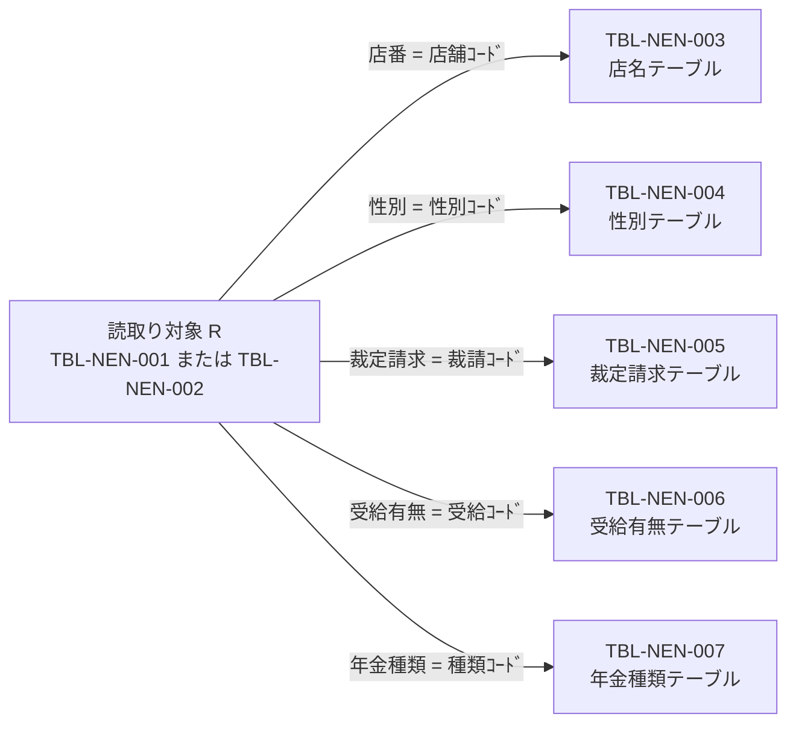
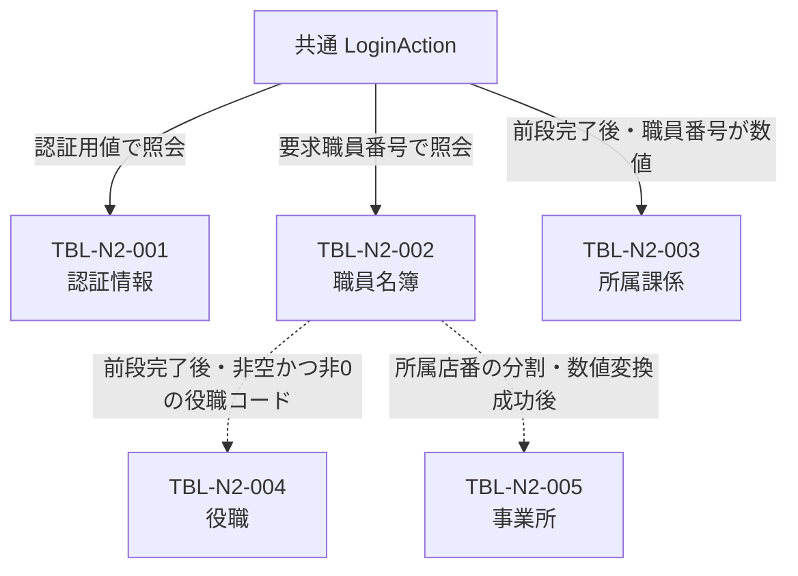
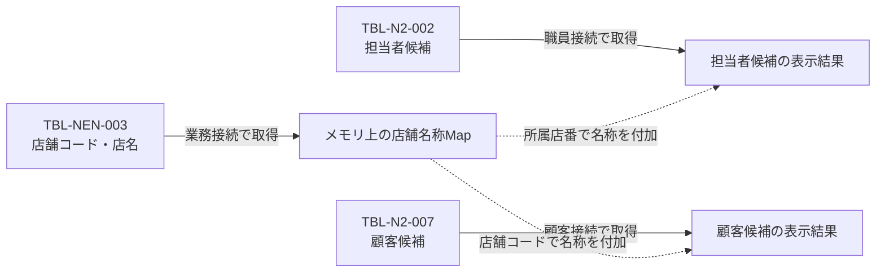
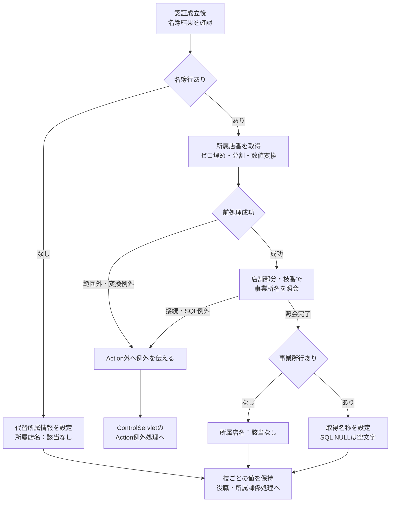

<!-- spec-meta: {"schema":"spec-md/1.0","documentId":"DB-LOGICAL","version":"2.0","path":"共通/DB仕様書/論理データ仕様書.md","sheets":[{"heading":"概要","kind":"GRID","sheet":"概要"},{"heading":"データ関連","kind":"GRID","sheet":"データ関連"},{"heading":"TBL-NEN-001 年金1_LK","kind":"GRID","sheet":"TBL-NEN-001"},{"heading":"TBL-NEN-002 年金＿削除明細","kind":"GRID","sheet":"TBL-NEN-002"},{"heading":"TBL-NEN-003 店名テーブル","kind":"GRID","sheet":"TBL-NEN-003"},{"heading":"TBL-NEN-004 性別テーブル","kind":"GRID","sheet":"TBL-NEN-004"},{"heading":"TBL-NEN-005 裁定請求テーブル","kind":"GRID","sheet":"TBL-NEN-005"},{"heading":"TBL-NEN-006 受給有無テーブル","kind":"GRID","sheet":"TBL-NEN-006"},{"heading":"TBL-NEN-007 年金種類テーブル","kind":"GRID","sheet":"TBL-NEN-007"},{"heading":"TBL-N2-001 DB2.ＵＷＥＢログイン情報表","kind":"GRID","sheet":"TBL-N2-001"},{"heading":"TBL-N2-002 DB2.Ｕ職員名簿表","kind":"GRID","sheet":"TBL-N2-002"},{"heading":"TBL-N2-003 DB2.Ｕ職員所属課係一覧表","kind":"GRID","sheet":"TBL-N2-003"},{"heading":"TBL-N2-004 DB2.ＵＪＶ役職コード表","kind":"GRID","sheet":"TBL-N2-004"},{"heading":"TBL-N2-005 N2_DWH.Ｊ事業所コード表２","kind":"GRID","sheet":"TBL-N2-005"},{"heading":"TBL-N2-006 DB2.Ｕカウンターシフト","kind":"GRID","sheet":"TBL-N2-006"},{"heading":"TBL-N2-007 N2_SIGHT.Ｂ顧客基本表","kind":"GRID","sheet":"TBL-N2-007"},{"heading":"TBL-N2-008 DB2.ＵＤＢ管理ＤＢ","kind":"GRID","sheet":"TBL-N2-008"},{"heading":"補足説明","kind":"GRID","sheet":"補足説明"}]} -->
# 年金・到達共通表の論理データ仕様

| 属性 | 内容 |
| --- | --- |
| 文書種別 | 論理データ仕様書 |
| システム名 | 年金自動受取予約管理システム |
| 共通／文書ID | DB-LOGICAL |
| 版 | 2.0 |
| 解析対象 | 年金業務7表、共通認証・職員・顧客参照・アクセス記録・運用判定に関係する8表 |
| 基準日 | 2026-10-15 |

## 概要

本書は、予約入力から検索、保存、削除明細の作成、日次・月次抽出までに使うデータと、共通ログインおよび職員・顧客参照で使うデータを、15表の安定IDで整理する。Markdownでは表ごとの見出しを設け、統合Excelでは同じ安定IDを表の対応単位とする。

予約の現行状態は年金1_LKに保持する。削除した予約は、取得した予約モデルから年金＿削除明細へ再構成して記録する。店舗と四つのコード表は、候補の供給、保存コードへの変換、表示名称の取得に使う。職員・顧客データは別の接続先から取得し、予約入力や職員セッションへ必要な値を移す。

### データ領域と接続

| 領域 | 対象ID | 主な接続先 | 年金からの利用 |
| --- | --- | --- | --- |
| 年金業務 | TBL-NEN-001〜007 | `jdbc/RAROA_DB` | 予約の検索・登録・変更・削除、削除明細の追加・整理、店舗・コードの参照 |
| 共通認証・職員 | TBL-N2-001〜004、006、008 | `jdbc/Oracle_SP2NM` | 認証、職員情報と所属課係・役職の取得、アクセス記録。008は年金通常経路では表照会を行わない |
| 共通所属店名 | TBL-N2-005 | `jdbc/Oracle_DWH` | 共通ログイン情報の事業所名取得 |
| 顧客参照 | TBL-N2-007 | `jdbc/Oracle_DWH` | 顧客候補検索と予約への基本情報取込み |

年金側の接続取得は、通常のJNDI名に続いて`java:comp/env/`付きの名前を探索する。接続先の違う表を、列名が似ていることだけで同一DB内の関連として扱わない。

### 定義の適用範囲

年金7表にはH2用定義とSQL Server用定義がある。本書の「H2／SQL Server」は、この二つのDDLの宣言を順に示す。同じ宣言の場合は型を一つだけ記載する。SQL Server用DDLは`dbo`配下の表が存在しない場合に作成するもので、既存表を定義どおりに変更する処理ではない。業務SQLの表名はスキーマ修飾がないため、実接続での解決先は接続設定にも依存する。

外部8表の型・容量・NULL・主キーは、各表に「ローカル互換定義」と明記する。本番外部表の物理属性は、このローカル定義から確定しない。掲載する外部列も、収録された互換定義と接続された処理で確認できる範囲である。

掲載DDLには列の`DEFAULT`指定がない。処理が設定する変更FLGの0・1、チェック状態の0・1、該当なしの場合のコード0などは、DBの既定値と区別する。年金7表および外部8表のローカル互換定義には、外部キー制約の宣言がない。

文字列型の括弧内はDB型の宣言長であり、画面の`maxlength`、業務上限、Windows-31Jでのバイト数とは別の属性である。店舗・コード名称や外部マスター名称の保守処理における業務上限は確認できないため、DB容量をその上限として採用しない。

## データ関連

### 予約・削除明細と表示名称

予約本表と削除明細の読取りは、対象表を`R`として同じ五つの`LEFT JOIN`を使う。以下の辺はSQLの結合条件を表す。FK、必須参照、多重度の宣言ではない。

コード表の名称列が`NOT NULL`でも、予約側のコードがNULL、または参照先が不在なら結合結果の名称はNULLになり得る。予約モデルのString setterはNULLを空文字へ変換するため、表示が空であることだけでは、保存コードのNULLと参照先不在を区別できない。

### 共通ログインの照会値の関連

共通ログインは、認証表と職員名簿をSQLでJOINしない。認証用に組み替えた値と要求職員番号を使い分け、職員名簿の取得値を後続の照会へ渡す。以下は照会値の関係であり、全処理が無条件に実行されることを示す図ではない。

点線は取得値を次の照会へ渡す関係を表す。所属店番のSQL NULLは共通検索で空文字となり、その後の文字列分割で例外になる。この場合、事業所照会にも役職・所属課係の後続処理にも進まない。名簿行がない場合の代替設定とは分けて、TBL-N2-005に条件を示す。

### 候補への店舗名付加

担当者候補と顧客候補の店舗名は、先に年金業務接続で取得した名称Mapから付加する。外部表と店名テーブルをSQLでJOINする処理ではない。

アクセス記録のTBL-N2-006は、Action処理後に共通処理が独立して追加する。TBL-N2-008は共通の運用判定用であり、年金通常経路の予約表と結合・照合する関係はない。

## TBL-NEN-001 年金1_LK

### 役割と識別

現在の年金予約を保持する本表である。画面で読み込む予約の識別と、保存時の存在確認・更新・削除には、正規化したふりがなと数値化した電話番号を使う。店番と顧客番号は、所属店舗、顧客参照、一覧・出力の識別や整列に使い、更新・削除の対象WHEREには使わない。

全28列がDDL上NULL可能であり、PK・UNIQUE・FK・DEFAULTの宣言はない。通常の保存Actionは店番・フリガナ・電話番号を検査するが、これは操作入口の条件である。DBのNULL可否や、検索キーの一意性を変更するものではない。

### 列定義と値の移送

次表のNoは、INSERTおよびUPDATEの共通バインド順にも対応する。Integerの設定は非NULLなら`setInt`、NULLなら`setNull(Types.INTEGER)`である。物理列が`BIGINT`や`TINYINT`でも、このInteger用設定処理を使う。文字列には`setString`を使い、JDBCでサイズを明示指定しない。

「入力・保持値」は、実コントロールID、要求パラメータ名、モデル項目を対応付けて示す。

| No | 論理項目 | 物理列 | 入力・保持値 | 変換・JDBC設定 | DB定義 H2／SQL Server | NULL | 用途・条件 |
| --- | --- | --- | --- | --- | --- | --- | --- |
| 1 | 予約所属店舗 | 店番 | `branchNo`／`BRANCH_NO` → `branchNo: Integer` | 受信文字列をtrimして正数へ変換。Integer共通設定 | `INTEGER`／`INT` | 可 | 保存Actionで必須。画面maxlengthは3。店舗別Excel、印刷範囲、店舗順、店名取得に使う |
| 2 | 店舗内顧客番号 | 顧客番号 | `customerNo`／`CUSTOMER_NO` → `customerNo: Integer` | 正数変換。空欄・不正数値・非正数・変換不能はNULL | `BIGINT` | 可 | 保存では任意。空欄時はNULL保存。画面maxlengthは7。顧客基本表の読込みと出力の識別に使う |
| 3 | 予約担当者 | 担当者コード | `staffCode`／`STAFF_CODE` → `staffCode: Integer` | 正数変換、Integer共通設定 | `INTEGER`／`INT` | 可 | 保存では任意。空欄時はNULL。画面maxlengthは4。担当者候補・顧客基本表からも設定する |
| 4 | 顧客氏名 | 顧客氏名 | `customerName`／`CUSTOMER_NAME` → `customerName: String` | 受信時trim、`setString` | `VARCHAR(100)`／`NVARCHAR(100)` | 可 | 予約の表示・出力用氏名。保存で空欄を拒否せず、通常フォームの空欄は空文字で渡す |
| 5 | フリガナ検索キー | ふりがな | `kanaName`／`KANA_NAME` → `kanaName: String` | Repositoryでキー正規化後、`setString` | `VARCHAR(100)`／`NVARCHAR(100)` | 可 | 保存では必須。電話番号との組合せで予約を検索する。正規化後にも空欄を検査する |
| 6 | 性別コード | 性別 | `gender`／`GENDER` → `gender: String` | 選択名称から性別ｺｰﾄﾞを逆引きし、Integer共通設定 | `TINYINT` | 可 | 空選択はNULL。読取り時は性別名称を取得する |
| 7 | 顧客住所 | 住所 | `address`／`ADDRESS` → `address: String` | 受信時trim、`setString` | `VARCHAR(300)`／`NVARCHAR(300)` | 可 | 予約表示・出力に使う。空欄を拒否せず、通常フォームの空欄は空文字で渡す |
| 8 | 電話番号検索キー | 電話番号 | `phoneNumber`／`PHONE_NUMBER` → `phoneNumber: String` | 数字を抽出して`BigDecimal`化。`setBigDecimal`、NULLなら`Types.DECIMAL` | `DECIMAL(15,0)` | 可 | 保存では数字を含む値が必要。表示文字列と保存数値を区別する |
| 9 | 顧客生年月日 | 生年月日 | `birthDate`／`BIRTH_DATE` → `birthDate: String` | 日付共通変換後、`setDate`または`Types.DATE`のNULL | `DATE` | 可 | 任意。空欄はNULL。画面maxlengthは14。表示、印刷順、予定年齢入力補助に使う |
| 10 | 国民年金の選択 | 種類：国民年金 | `NATIONAL_PENSION` → `nationalPension: boolean` | 真を1、偽を0として`setInt` | `BOOLEAN`／`BIT` | 可 | 個別選択を保存し、合成年金種類へ1を加える |
| 11 | 厚生年金の選択 | 種類：厚生年金 | `EMPLOYEE_PENSION` → `employeePension: boolean` | 真を1、偽を0として`setInt` | `BOOLEAN`／`BIT` | 可 | 個別選択を保存し、合成年金種類へ2を加える |
| 12 | 共済年金の選択 | 種類：共済年金 | `MUTUAL_AID_PENSION` → `mutualAidPension: boolean` | 真を1、偽を0として`setInt` | `BOOLEAN`／`BIT` | 可 | 個別選択を保存し、合成年金種類へ4を加える |
| 13 | 厚生年金基金の選択 | 種類：厚生年金基金 | `EMPLOYEE_PENSION_FUND` → `employeePensionFund: boolean` | 真を1、偽を0として`setInt` | `BOOLEAN`／`BIT` | 可 | 個別選択を保存し、合成年金種類へ8を加える |
| 14 | 国民年金基金の選択 | 種類：国民年金基金 | `NATIONAL_PENSION_FUND` → `nationalPensionFund: boolean` | 真を1、偽を0として`setInt` | `BOOLEAN`／`BIT` | 可 | 個別選択を保存し、合成年金種類へ16を加える |
| 15 | 年金種類の合成コード | 年金種類 | 五つのbooleanから算出する`Integer` | 合計0はNULL。非0はコード存在確認後にInteger共通設定 | `INTEGER`／`INT` | 可 | TBL-NEN-007から合成名称を得る。表示用`pensionType: String`を直接保存しない |
| 16 | 裁定請求書徴収の選択コード | 裁定請求 | `claimStatus`／`CLAIM_STATUS` → `claimStatus: String` | 選択名称から裁請ｺｰﾄﾞを逆引きし、Integer共通設定 | `TINYINT` | 可 | 任意。空選択はNULL。表示・出力では名称を使う |
| 17 | 請求予定日 | 請求予定日 | `claimDate`／`CLAIM_SCHEDULED_DATE` → `claimScheduledDate: String` | 日付共通変換後、`setDate`または`Types.DATE`のNULL | `DATE` | 可 | 任意。空欄はNULL。画面maxlengthは14。店舗別Excelの降順、印刷順、年齢入力補助に使う |
| 18 | 入力された予定年齢 | 予定年齢 | `plannedAge`／`PLANNED_AGE` → `plannedAge: Integer` | 正数変換、Integer共通設定 | `INTEGER`／`INT` | 可 | 任意。空欄・不正数値・ゼロ以下はNULL。画面maxlengthは3。サーバーでは年齢を再計算しない |
| 19 | 配偶者氏名 | 配偶者名 | `spouseName`／`SPOUSE_NAME` → `spouseName: String` | 受信時trim、`setString` | `VARCHAR(100)`／`NVARCHAR(100)` | 可 | 任意。通常フォームの空欄は空文字。配偶者生年月日の必須条件には使わない |
| 20 | 配偶者生年月日 | 配偶者生年月日 | `spouseBirthDate`／`SPOUSE_BIRTH_DATE` → `spouseBirthDate: String` | 日付共通変換後、`setDate`または`Types.DATE`のNULL | `DATE` | 可 | 任意。配偶者名があっても空欄を許容する。画面maxlengthは14 |
| 21 | 受給有無の選択コード | 受給有無 | `hasBenefit`／`HAS_BENEFIT` → `hasBenefit: String` | 選択名称から受給ｺｰﾄﾞを逆引きし、Integer共通設定 | `TINYINT` | 可 | 任意。空選択はNULL。Javaのboolean項目ではない |
| 22 | 予約徴求日 | 予約徴求日 | `requestDate`／`RESERVATION_REQUEST_DATE` → `reservationRequestDate: String` | 日付共通変換後、`setDate`または`Types.DATE`のNULL | `DATE` | 可 | 任意。空欄はNULL。画面maxlengthは14。予約表示と出力に使う |
| 23 | 予約備考 | 備考 | `notes`／`NOTES` → `notes: String` | trim後にWindows-31J変換可否・56バイト以内を検査し、`setString` | `VARCHAR(400)`／`NVARCHAR(400)` | 可 | 任意。通常保存は超過・変換不能を拒否し、切り捨てない |
| 24 | 最終保存日 | データ更新日 | `dataUpdateDate`／`DATA_UPDATE_DATE`をStringで受信するが、保存準備でサーバー当日へ置換 | ISO日付から`setDate` | `DATE` | 可 | 画面はreadonly表示。新規・変更抽出の期間条件に使う。受信値を保存日として採用しない |
| 25 | 最終保存時刻 | 更新時間 | サーバー生成の`updateTime: String` | `HH:mm:ss.SSS`の先頭8文字を`java.sql.Time`にして`setTime` | `TIME`／`TIME(0)` | 可 | 新規・変更抽出の整列に使う。JDBCへミリ秒を送らない |
| 26 | 保存実行職員 | 更新者 | 通常Actionが渡す`StaffContext.staffNo` → `updatedBy: Integer` | Integer共通設定 | `INTEGER`／`INT` | 可 | 保存操作の実行者。予約担当者と別の値。日次・月次の職員指定が絞り込む列 |
| 27 | ６ヶ月先の確認状態 | ６ヶ月先確認 | `SIX_MONTH_CHECK` → `sixMonthCheck: boolean` | 真を1、偽を0として`setInt` | `BOOLEAN`／`BIT` | 可 | 手入力の確認状態。出力は真を「確」、偽を空欄にする |
| 28 | 現在行の新規・変更区分 | 変更FLG | INSERT・UPDATEの処理が指定する`Integer` | INSERTは0、UPDATEは1としてInteger共通設定 | `TINYINT` | 可 | 新規・変更抽出の条件。出力済み状態、変更回数、比較版ではない |

顧客番号はDB列がBIGINTでも、フォームの変換、モデル、保存バインド、読取りの各層でIntegerを使う。DBの数値容量全域をアプリケーションが受信・読取りできる契約にはならない。店番の画面maxlength=3も、予約保存Actionが文字列の1〜3桁を再検査する契約ではない。店舗別ExcelのActionは別途、trim後の数字1〜3桁と正数変換を検査する。

担当者名は参照選択時の表示情報であり、本表に保存列はない。店名もTBL-NEN-003由来の表示情報である。店番が正数であることと店名が取得できることは別で、保存時の店名照会が0件の場合は名称の代替値を使い、この照会だけでは保存を拒否しない。

### 検索キーの正規化

Repositoryは、ふりがなにNFKC、trim、全角空白の半角化、連続半角空白の一つへの集約、日本ロケールでの大文字化を行う。この結果を保存し、`R.ふりがな = ?`の完全一致検索に`setString`で渡す。

電話番号は入力文字列から数字を抽出し、各数字をASCII数字へ変換してBigDecimalにする。区切りなどの非数字と先頭ゼロは、数値キーには保持しない。検索の第2引数は`R.電話番号 = ?`へ`setBigDecimal`で渡す。数字が一つもない場合はNULLとなるが、数字列の0は数値0であり、NULLとは異なる。

Actionの既存キー比較は、ふりがなについて内部空白を集約せず、電話について先頭ゼロを保持する数字文字列を比較する。したがって、Actionでのキー一致とRepositoryでの検索一致は、同一の等価条件ではない。

電話の読取り表示では、数字列の先頭ゼロを整理した後、9桁または10桁で先頭が0でなければ0を一つ補う。これは表示変換であり、受信した区切りや先頭ゼロの個数を復元する処理ではない。

### 日付・選択値・NULL

任意の業務日付は、空欄なら空文字としてモデルに保持し、保存時にDATEのNULLへ変換する。非空値は、対応する和暦、区切り付き西暦、8桁西暦から`yyyy-MM-dd`へ正規化する。`setDate`には`java.sql.Date`を渡す。入力欄の表示形式やmaxlengthは、DATE列の保存型と区別する。

予定年齢の画面補助は、生年月日と請求予定日を解析できた場合に西暦年の差を入力欄へ設定する。サーバーは受信した正数を保存し、満年齢や日付間の年齢を再計算しない。

性別・裁定請求・受給有無のselectは、候補名称を表示値と送信値に使う。保存時は名称をtrimしてコード表を等価検索する。空名称はNULLコードとなり、非空名称が見つからなければSQLExceptionとなる。名称に一意制約はなく、逆引きはORDER BYと重複件数検査を行わず最初の行を採用する。

チェック項目は、要求値が`1`、大文字小文字を問わない`true`または`on`の場合に真となり、欠落・その他の値は偽となる。五つの年金選択と６ヶ月先確認は、通常保存で必ず1または0を送る。一方、読取りは`getInt`の結果が0でないかで判定し、DBのNULLと0をモデル上で区別しない。

### 保存による状態の更新

通常の保存は、職員確認、要求値のモデル化、POST・CSRF確認、入力検査を経て、現在キーとORIGINALキーで既存予約を確認する。現在キーの予約が存在し、まだ既存予約として読み込まれていなければ、その内容を表示して保存を止める。元の予約だけが見つかる場合はキー変更を拒否する。既存変更では職員の更新制限も適用する。

Repositoryは入力モデルをコピーして正規化し、接続開始後に同じ検索キーの存在を再確認する。存在すれば28列をUPDATEして変更FLGを1にし、不在なら28列をINSERTして0にする。UPDATEでは設定パラメータ1〜28に続き、29へふりがな、30へ電話番号を渡して対象を特定する。処理件数は1件を要求し、commit後に`CHANGED`または`NEW`を返す。通常Actionはこの返却区分を画面に保持せず、空の予約モデルと完了メッセージを設定する。

保存準備ではデータ更新日をサーバー当日にし、接続内の存在再確認後に更新時間を生成する。日付と時刻は別々の現在時刻取得による値で、比較版や単一の採番値ではない。通常の更新者はログイン職員番号であり、予約担当者コードではない。

### 抽出と並び順

| 使用操作 | 対象・条件 | 整列・結果 |
| --- | --- | --- |
| 予約読込み・存在確認 | 正規化したふりがなと数値化した電話番号の等価条件 | 読込みは最初の一致行を採用。複数一致を一意エラーとして検出する処理ではない |
| 店舗別Excel | `R.店番 = ?`へ`setInt` | 請求予定日降順、担当者コード、顧客番号 |
| 登録内容印刷 | 範囲不使用は店舗条件なし。範囲使用時は店番自への等価条件、または店番自以上・店番至以下 | 店番を先頭に、担当者コード・ふりがな・生年月日・請求予定日の選択順項目、顧客番号を続ける |
| 新規抽出 | 本表の変更FLG=0。正規化後の非空日付に開始日以上・終了日以下を追加し、更新者指定時だけ等価条件を追加 | SQLはデータ更新日、更新時間、店番、顧客番号。出力側で店番、顧客番号、取得時連番の順に追加ソート |
| 変更抽出 | 本表の変更FLG=1。日付・更新者条件は新規と同じ | 新規と同じ |

新規・変更の区分は`setInt`、開始日・終了日はDATE、更新者は`setInt`でバインドする。任意条件が省略された場合、そのパラメータも追加しない。更新区分抽出はSQLの取得上限・ページングを指定せず、全結果をモデル化する。

印刷で店舗範囲を使用しない場合は、入力欄に値が残っていても検索へ店舗条件を渡さない。範囲を使用し、店番至が空または正数変換不能なら店番自だけの等価条件となる。両端があれば上下限条件を使う。

### 索引と競合

| H2索引名 | SQL Server索引名 | 対象列 | 制約性 |
| --- | --- | --- | --- |
| IX_NENKIN1_KEY | IX_年金1_LK_検索キー | ふりがな、電話番号 | 非一意 |
| IX_NENKIN1_CUSTOMER | IX_年金1_LK_顧客 | 店番、顧客番号 | 非一意 |
| IX_NENKIN1_UPDATE | IX_年金1_LK_更新区分 | 変更FLG、データ更新日、更新者 | 非一意 |

共有Repositoryインスタンスの保存・削除・整理は`synchronized`である。同期範囲は同じJVM内の当該インスタンスであり、DB側の一意制約、比較版、明示行ロックを追加するものではない。別JVMや別アプリケーションからの変更まで排除する保証はない。ORIGINALキーも内容の版を表さず、同じキーのまま行われた他の更新を検出する比較情報を持たない。

## TBL-NEN-002 年金＿削除明細

### 役割と作成単位

削除した予約を、削除区分の出力元として保持する。予約本表と同じ28列を持ち、全列NULL可能である。PK・UNIQUE・FK・DEFAULTは宣言されていない。

削除明細は、元行を`INSERT SELECT`で無変換に複写する処理ではない。予約とコード名称を読み込んだモデルから、名称をコードへ逆引きし、五つの年金選択から合成コードを作り直して追加する。文字列・日付・数値のJDBC移送契約はTBL-NEN-001と共通である。

### 列定義と削除時の意味

| No | 論理項目・物理列 | DB定義 H2／SQL Server | NULL | 削除時の設定・利用 |
| --- | --- | --- | --- | --- |
| 1 | 予約所属店舗／店番 | `INTEGER`／`INT` | 可 | 取得モデルの店番。削除明細の店舗識別・整列・店名取得に使う |
| 2 | 顧客番号／顧客番号 | `BIGINT` | 可 | Integerとして取得した顧客番号。削除出力の顧客識別と整列に使う |
| 3 | 予約担当者／担当者コード | `INTEGER`／`INT` | 可 | 取得モデルの予約担当者。削除実行者とは別に保持する |
| 4 | 顧客氏名／顧客氏名 | `VARCHAR(100)`／`NVARCHAR(100)` | 可 | 取得モデルの氏名。SQL NULLはモデルで空文字になる |
| 5 | フリガナ／ふりがな | `VARCHAR(100)`／`NVARCHAR(100)` | 可 | 取得モデルのふりがな。削除対象の識別情報と出力に使う |
| 6 | 性別コード／性別 | `TINYINT` | 可 | 結合で得た性別名称から逆引きする。名称が空ならNULL |
| 7 | 顧客住所／住所 | `VARCHAR(300)`／`NVARCHAR(300)` | 可 | 取得モデルの住所。削除出力に使う |
| 8 | 電話番号／電話番号 | `DECIMAL(15,0)` | 可 | 表示変換を経た電話文字列を再び数字抽出・BigDecimal化して送る |
| 9 | 顧客生年月日／生年月日 | `DATE` | 可 | 取得モデルの日付。空はDATEのNULL、非空はDATEとして送る |
| 10 | 国民年金の選択／種類：国民年金 | `BOOLEAN`／`BIT` | 可 | 読取りbooleanを1または0で送る。元のNULLは0となり、合成コードへ1を反映する |
| 11 | 厚生年金の選択／種類：厚生年金 | `BOOLEAN`／`BIT` | 可 | 読取りbooleanを1または0で送る。合成コードへ2を反映する |
| 12 | 共済年金の選択／種類：共済年金 | `BOOLEAN`／`BIT` | 可 | 読取りbooleanを1または0で送る。合成コードへ4を反映する |
| 13 | 厚生年金基金の選択／種類：厚生年金基金 | `BOOLEAN`／`BIT` | 可 | 読取りbooleanを1または0で送る。合成コードへ8を反映する |
| 14 | 国民年金基金の選択／種類：国民年金基金 | `BOOLEAN`／`BIT` | 可 | 読取りbooleanを1または0で送る。合成コードへ16を反映する |
| 15 | 年金種類の合成コード／年金種類 | `INTEGER`／`INT` | 可 | 五つのbooleanから再合成する。0はNULL、非0はコード表の存在を確認して送る |
| 16 | 裁定請求のコード／裁定請求 | `TINYINT` | 可 | 取得した裁定請求名称から再逆引きする。空名称はNULL |
| 17 | 請求予定日／請求予定日 | `DATE` | 可 | 取得モデルの予定日。削除出力に使う |
| 18 | 予定年齢／予定年齢 | `INTEGER`／`INT` | 可 | 取得モデルの予定年齢。削除時に再計算しない |
| 19 | 配偶者氏名／配偶者名 | `VARCHAR(100)`／`NVARCHAR(100)` | 可 | 取得モデルの配偶者名。削除出力に使う |
| 20 | 配偶者生年月日／配偶者生年月日 | `DATE` | 可 | 取得モデルの日付。空はNULLとして送る |
| 21 | 受給有無のコード／受給有無 | `TINYINT` | 可 | 取得した受給有無名称から再逆引きする。空名称はNULL |
| 22 | 予約徴求日／予約徴求日 | `DATE` | 可 | 取得モデルの徴求日。削除出力に使う |
| 23 | 予約備考／備考 | `VARCHAR(400)`／`NVARCHAR(400)` | 可 | 取得モデルの備考を文字列として送る |
| 24 | 削除日／データ更新日 | `DATE` | 可 | 取得時の最終保存日を削除当日のサーバー日付へ置き換える。削除抽出と整理に使う |
| 25 | 削除時刻／更新時間 | `TIME`／`TIME(0)` | 可 | 削除時のサーバー生成時刻。JDBCでは秒までを送る |
| 26 | 削除実行職員／更新者 | `INTEGER`／`INT` | 可 | 通常Actionが渡すログイン職員番号。削除抽出の職員条件に使う |
| 27 | ６ヶ月先の確認状態／６ヶ月先確認 | `BOOLEAN`／`BIT` | 可 | 取得booleanを1または0で送る。元のNULLは0となる |
| 28 | 変更区分／変更FLG | `TINYINT` | 可 | 削除明細追加ではNULLを設定する。削除区分はこの列の特定値ではなく表の選択で表す |

参照先コードが不在で結合名称が空になった項目は、削除明細でNULLコードとなり得る。個別年金選択と合成コードに不整合がある既存行でも、削除明細の合成コードは個別選択から決まる。したがって、明細は元の全物理値をそのまま保持する監査スナップショットではない。

### 削除の確定範囲

通常の削除Actionは、職員、POST・CSRF、店番と検索キー、現在キーとORIGINALキーの対応、削除権限を確認してRepositoryを呼ぶ。Repositoryでは、正規化後のふりがなが空、または数字抽出後の電話番号がNULLなら、接続を開始せずfalseを返す。接続後の再取得で対象が消失していた場合も、rollbackしてfalseを返し、明細を追加しない。

対象があれば、モデルのデータ更新日を削除当日へ変更し、削除時刻・削除実行職員・NULLの変更FLGを付けて明細を1件追加する。続いて本表を`ふりがな = ? AND 電話番号 = ?`で削除し、削除件数1件を要求する。両操作は一つの接続・トランザクションでcommitする。

削除明細追加や本表削除の件数不正、名称逆引きの失敗、DB処理中の例外ではrollbackを試みる。明細追加と本表削除の間に独立commitはない。ただしcommit例外やrollback失敗が起きた場合の実DB状態は、戻り値だけでは確定しない。

### 削除抽出と整理

削除抽出は本表の変更FLGを検索せず、この表を対象にする。開始日・終了日が正規化後に非空ならデータ更新日の上下限、更新者が指定されていれば等価条件を追加する。日付はDATE、更新者はIntegerとしてバインドする。SQLの順序はデータ更新日、更新時間、店番、顧客番号で、出力側の追加ソートは新規・変更と同じである。

整理は`データ更新日 <= ?`の条件で削除し、基準日をDATEとしてバインドする。NULLの日付はこの比較に一致しない。正規化後の基準日が空なら0件を返し、DB削除を行わない。

日次・月次画面の初期基準日は、現在のCalendarから2か月前の日として作り、hiddenの`DELETE_CUTOFF_DATE`へ保持する。実行時は受信した値を使い、サーバーで再び2か月前へ固定しない。非空の基準日による整理は区分別抽出より先に独立commitされる。後続の抽出、Workbook生成、ダウンロード送信が失敗しても、この整理を巻き戻さない。整理件数は出力結果へ記録しない。

索引はH2の`IX_NENKIN_DELETE_UPDATE`、SQL Serverの`IX_年金削除明細_更新日`で、対象列はデータ更新日・更新者である。いずれも非一意索引である。

## TBL-NEN-003 店名テーブル

店舗候補と表示名称の供給元である。予約本表・削除明細は店番から名称を結合し、担当者・顧客候補は別接続で取得したMapから店舗名を付加する。共通ログインの所属店名を取得する事業所表とは別の表である。

| No | 論理項目 | 物理列 | DB定義 H2／SQL Server | NULL・キー | 用途 |
| --- | --- | --- | --- | --- | --- |
| 1 | 店舗識別コード | 店舗ｺｰﾄﾞ | `INTEGER`／`INT` | NOT NULL、PK | 店舗候補の選択キー。予約の店番、職員の所属店番、顧客の店舗コードから表示名称を求めるキー |
| 2 | 店舗表示名 | 店名 | `VARCHAR(80)`／`NVARCHAR(80)` | NOT NULL | 店舗候補、予約、担当者候補、顧客候補、店舗別出力の表示名称 |

検索キーワードはNFKC、空白の整理、大文字化を行う。正規化後に空なら全店舗、非空なら店舗ｺｰﾄﾞを`VARCHAR(20)`に変換した文字列、または店名の大文字比較による部分一致を検索する。同じエスケープ済み部分一致値を二つの`setString`で渡し、店舗ｺｰﾄﾞ順に返す。

個別の店名照会は店舗ｺｰﾄﾞの等価条件へ`setInt`を使う。名称Mapの取得は全コード・名称を読み、Integerキーに格納する。名称列のUNIQUE、他表からのFK、列のDEFAULTは宣言されていない。店名の保守・更新側の業務上限は確認できず、宣言長80を入力可能文字数の規則にはしない。

## TBL-NEN-004 性別テーブル

性別コードと表示名称を対応付ける。予約入力では名称を選択・送信し、保存時にコードへ戻す。顧客基本表から取り込む性別コードの表示変換にも使う。

| No | 論理項目 | 物理列 | DB定義 H2／SQL Server | NULL・キー | 用途 |
| --- | --- | --- | --- | --- | --- |
| 1 | 性別識別コード | 性別ｺｰﾄﾞ | `TINYINT` | NOT NULL、PK | 予約・削除明細の性別コードとの結合キー。顧客基本表の性別コードを整数化した後の照会キー |
| 2 | 性別表示名 | 性別 | `VARCHAR(10)`／`NVARCHAR(10)` | NOT NULL | 画面の候補名称と送信値、予約モデル、印刷・Excelの表示名称。保存時の名称逆引き条件 |

候補は性別ｺｰﾄﾞ順に取得し、画面が別途空選択を先頭へ置く。空選択は予約側のNULLコードに対応する。名称の一意制約、FK、DEFAULTはない。マスター名称のNOT NULLは、LEFT JOIN不一致時の名称取得を保証しない。名称保守時の業務上限は、宣言長10とは別に確認する必要がある。

## TBL-NEN-005 裁定請求テーブル

画面の「裁定請求書徴収」に表示する選択肢と保存コードを対応付ける。列名から、徴収日や請求状態遷移を別に定義するものではない。

| No | 論理項目 | 物理列 | DB定義 H2／SQL Server | NULL・キー | 用途 |
| --- | --- | --- | --- | --- | --- |
| 1 | 裁定請求の選択コード | 裁請ｺｰﾄﾞ | `TINYINT` | NOT NULL、PK | 予約・削除明細の裁定請求列が保存するコード。読取りの結合キー |
| 2 | 裁定請求の選択名称 | 裁定請求 | `VARCHAR(10)`／`NVARCHAR(10)` | NOT NULL | 画面の候補名・送信値、予約と帳票の表示名称、保存時の逆引き条件 |

候補は裁請ｺｰﾄﾞ順に取得する。画面の空選択はNULLコードとして保存し、非空名称はこの表から逆引きする。名称の一意制約、FK、DEFAULTは宣言されていない。名称保守時の入力検証や業務上限は確認できない。

## TBL-NEN-006 受給有無テーブル

受給有無の名称とコードを対応付ける。画面・モデルは名称Stringを扱い、予約の保存列は数値コードを扱う。

| No | 論理項目 | 物理列 | DB定義 H2／SQL Server | NULL・キー | 用途 |
| --- | --- | --- | --- | --- | --- |
| 1 | 受給有無の選択コード | 受給ｺｰﾄﾞ | `TINYINT` | NOT NULL、PK | 予約・削除明細の受給有無列との結合キー、名称逆引きの返却値 |
| 2 | 受給有無の選択名称 | 受給有無 | `VARCHAR(10)`／`NVARCHAR(10)` | NOT NULL | 候補名と送信値、予約モデルと出力の表示名称、保存時の逆引き条件 |

候補は受給ｺｰﾄﾞ順に取得し、画面は空選択を許容する。空名称はNULLコードとして保存する。名称の一意制約、FK、DEFAULTは宣言されていない。名称保守時の業務上限は確認できない。

## TBL-NEN-007 年金種類テーブル

個別チェックボックスの名称と、選択を合成した年金種類の名称を供給する。予約保存では、五つの選択状態からコードを作る。

| No | 論理項目 | 物理列 | DB定義 H2／SQL Server | NULL・キー | 用途 |
| --- | --- | --- | --- | --- | --- |
| 1 | 個別・合成年金種類コード | 種類ｺｰﾄﾞ | `INTEGER`／`INT` | NOT NULL、PK | 個別選択1・2・4・8・16と、その合成コードの参照キー。予約・削除明細の年金種類列との結合に使う |
| 2 | 年金種類表示名 | 年金種類 | `VARCHAR(120)`／`NVARCHAR(120)` | NOT NULL | 個別チェックボックスの名称、予約モデルと帳票の合成名称。名称自体を予約列へ保存しない |

サービスは種類ｺｰﾄﾞ順に全件を読み、`Map<Integer,String>`へ格納する。画面の個別名称はコード1・2・4・8・16をキーに取得する。保存時は、国民年金1、厚生年金2、共済年金4、厚生年金基金8、国民年金基金16を選択に応じて加算する。

全て未選択なら合計0となり、予約の年金種類はNULLになる。非0なら種類ｺｰﾄﾞの等価条件へ`setInt`を渡し、該当行があることを確認する。不在ならSQLExceptionで保存を中断する。表の全コード値や本番での登録内容を、この加算規則だけで確定しない。名称の一意制約、FK、DEFAULTは宣言されていない。名称の業務上限や保守責務は確認できない。

## TBL-N2-001 DB2.ＵＷＥＢログイン情報表

### 役割とローカル互換定義

共通ログインの認証照会先である。認証SQLはアプリケーション名・認証用ユーザー・認証照合情報の三列の等価条件を文字列連結で組み立て、Statementで実行する。年金RepositoryのPreparedStatement契約とは異なる。以下は構造と用途だけを示し、認証情報の実値や保存方式は定義しない。

| No | 論理項目 | 物理列 | ローカルDB型・容量 | ローカルNULL・キー | 用途 |
| --- | --- | --- | --- | --- | --- |
| 1 | 認証対象アプリケーション | アプリケーション名 | `VARCHAR(20)` | NOT NULL、複合PKの一部 | 認証対象のアプリケーションを識別する等価条件 |
| 2 | 認証用ユーザー識別値 | ユーザーＩＤ | `VARCHAR(40)` | NOT NULL、複合PKの一部 | 共通処理が組み替えた認証用ユーザーを照合する。画面職員番号と常に同一ではない |
| 3 | 認証照合情報 | パスワード | `VARCHAR(100)` | NOT NULL | 認証SQLの照合条件に使う列。実値は扱わない |
| 4 | 融資系表示ユーザー名 | 融資系ユーザー名 | `VARCHAR(80)` | NULL可 | 共通LoginActionのcredit分岐がログイン情報へ設定する他業務向け属性 |
| 5 | 融資系所属店番 | 融資系所属店番 | `VARCHAR(4)` | NULL可 | credit分岐の所属店情報。予約の店番列へ直接保存する値ではない |
| 6 | 債権書類の権限値 | 債権書類権限 | `VARCHAR(4)` | NULL可 | credit分岐のログイン属性。年金予約の変更・削除判定へ転用しない |
| 7 | 決算書の権限値 | 決算書権限 | `VARCHAR(4)` | NULL可 | credit分岐のログイン属性 |
| 8 | CRDの権限値 | ＣＲＤ権限 | `VARCHAR(4)` | NULL可 | credit分岐のログイン属性 |
| 9 | 格付の権限値 | 格付権限 | `VARCHAR(4)` | NULL可 | credit分岐のログイン属性 |
| 10 | 自己査定の権限値 | 自己査定権限 | `VARCHAR(4)` | NULL可 | credit分岐のログイン属性 |

複合PKはアプリケーション名・ユーザーＩＤであり、認証照合情報はキーに含まれない。ローカル定義にDEFAULT・FKの宣言はない。本番表の実属性は別途確認を要する。

### 認証値と職員番号

年金のログインフォームは`APPL_NAME`に`unify`を指定する。通常のunify分岐では、共通処理がアプリケーション名から認証用ユーザーを組み立て、入力した`DWH_USER_ID`は職員名簿検索用の職員番号として別に扱う。

認証成立と年金の職員セッション成立は別の段階である。共通側で職員番号のLong変換ができなければ名簿検索を行わず、認証成功状態を保持し得るが、年金側では後続の職員存在確認が必要になる。職員番号の8桁ゼロ埋めは不足桁を補う処理で、超過桁の切捨てや上限検査ではない。

### 共通検索の結果形式

共通検索は全取得列を`getString`で読み、SQL NULLを空文字、それ以外をtrimしたStringとしてMapへ格納する。0件は空のListとなる。検索メソッドの「ListがNULLではない」という戻り値だけでは、該当行の存在を保証しない。LoginActionは認証・名簿・事業所・役職・所属課係について、リストが空でないことを別途確認する。

この結果変換はTBL-N2-002〜005および008の共通検索にも適用される。年金側サービスのIntegerやbooleanの読取りとは区別する。

## TBL-N2-002 DB2.Ｕ職員名簿表

共通ログイン後の職員情報、予約担当者候補、年金職員セッションの確認元である。年金から追跡した利用は参照であり、この表を更新する処理ではない。

| No | 論理項目 | 物理列 | ローカルDB型・容量 | ローカルNULL・キー | 用途 |
| --- | --- | --- | --- | --- | --- |
| 1 | 職員識別番号 | 職員番号 | `DECIMAL(18,0)` | NOT NULL、PK | 共通ログインの職員特定、担当者候補のキーと順序、年金職員確認。StaffContextの職員番号となる |
| 2 | 職員の所属店舗 | 所属店番 | `DECIMAL(18,0)` | NULL可 | 担当者候補の店舗条件、共通所属情報、店舗名称付加、年金の更新・削除制限に使う |
| 3 | 職員表示氏名 | 漢字氏名 | `VARCHAR(40)` | NULL可 | 共通ログイン情報、担当者候補と職員表示、StaffContextの氏名。候補の部分一致検索対象 |
| 4 | 職員カナ氏名 | カナ氏名 | `VARCHAR(40)` | NULL可 | 担当者候補のカナ表示と部分一致検索対象 |
| 5 | 身分区分 | 身分コード | `DECIMAL(18,0)` | NULL可 | 共通の全列検索に含まれる。年金通常経路の個別利用とコード体系は未確定 |
| 6 | 職員性別 | 性別 | `DECIMAL(18,0)` | NULL可 | 共通LoginInfoBeanの性別情報に使う。予約顧客の性別列とは別の属性 |
| 7 | 職員生年月日 | 生年月日 | `DECIMAL(18,0)` | NULL可 | 共通の全列検索に含まれる。年金での個別用途と数値日付形式は未確定 |
| 8 | 職員役職コード | 役職コード | `DECIMAL(18,0)` | NULL可 | 共通の役職名称照会、年金StaffContext、既存予約の変更・削除制限に使う |
| 9 | 名簿作成日 | 作成日 | `DECIMAL(18,0)` | NULL可 | 共通の全列検索に含まれる。具体的な日付表現と年金での個別用途は未確定 |

ローカル定義にDEFAULT・FKの宣言はない。数値列の18桁容量は、年金のInteger処理や職員番号の受信検査の上限と一致するものではない。

### 共通ログインへの移送

名簿行がある場合、共通LoginActionは先頭行を採用する。所属店番を4桁へゼロ埋めして先頭2文字と次の2文字に分割し、事業所照会用の値を作る。所属店番全体をIntegerへ変換した結果が100未満なら、共通LoginInfoBeanの所属店番を`010`とし、それ以外なら補完後文字列の先頭3文字を設定する。これは年金側の職員確認で名簿の所属店番を`getInt`する処理とは別である。

名簿行がない場合、共通処理は所属店番`999`、詳細部室店コード・枝番`99`、要求職員番号を使った職員氏名、性別コード`0`、役職コード`0`などの代替値を設定する。この代替設定は共通処理の動作であり、年金職員として受け入れる保証にはならない。

名簿行はあるが所属店番がSQL NULLの場合、共通検索で空文字となり、ゼロ埋め後も空文字のまま文字列分割へ進む。この経路は例外となり、名簿行なしの場合の代替設定には入らない。所属店名取得への影響はTBL-N2-005に示す。

### 担当者候補

担当者検索は、任意の店番を`S.所属店番 = ?`へ`setInt`で渡す。任意の氏名キーワードはNFKC、空白集約、大文字化を行い、カナ氏名または漢字氏名のエスケープ付き部分一致へ同じ検索値を二つの`setString`で渡す。空条件は対応する述語を追加しない。両方が空なら全職員を対象にし、職員番号順に全件取得する。

候補の店舗名は、別接続で先に作った店名Mapから所属店番をキーに付加する。読取りの所属店番は`getInt`であり、SQL NULLは独立したNULLとして保持せず0になる。Mapに名称がなければ店舗名を空表示にする。

### 年金の職員確認と制限

年金職員セッションがなければ、共通ログインの認証状態と、ゼロ埋め後の職員番号が1〜8桁のASCII数字であることを確認して名簿を再照会する。職員番号の等価条件は`setInt`で渡す。存在すれば職員番号・漢字氏名・所属店番・役職コードをStaffContextへ移し、セッションに保持する。以後は既存のStaffContextを再利用するため、操作の都度この表を読み直す契約ではない。

更新・削除制限で使う店番は、操作職員の所属店番である。所属店番75で役職コードを数値化した値が3000未満、または所属店番75で役職コードが数値化不能の場合を制限対象にする。これは既存予約の変更・削除に適用するAction側の条件であり、新規登録全体の禁止やDB権限制約ではない。

## TBL-N2-003 DB2.Ｕ職員所属課係一覧表

共通ログイン情報へ所属課係を設定する取得元である。年金予約の保存列や担当者候補の絞込み列ではない。

| No | 論理項目 | 物理列 | ローカルDB型・容量 | ローカルNULL・キー | 用途 |
| --- | --- | --- | --- | --- | --- |
| 1 | 所属を照会する職員 | 職員番号 | `DECIMAL(8,0)` | NOT NULL、複合PKの一部 | 要求職員番号による共通所属課係検索の等価条件 |
| 2 | 職員の所属課係 | 所属課係コード | `VARCHAR(20)` | NOT NULL、複合PKの一部 | 検索リストの先頭行からLoginInfoBeanへ設定し、Java側で表示名称を決める |

検索は全列を取得するがORDER BYを付けない。複合PKは同じ職員の異なる所属課係コードを許容するため、先頭行を業務上の主所属とする保証はない。要求職員番号のLong変換に失敗して照会しない場合、または対象がない場合は、共通処理がコード0と空名称を設定する。これは処理上の代替値であり、DDLのDEFAULTではない。

名称は別の課係マスターから取得せず、課係一覧に行がある場合は先頭行のコードをLoginInfoBeanへ設定した後、`CommonConverter.convertInt`の結果で決める。変換に渡す値がJavaの`null`、空文字、文字列`0`なら結果は0となり、名称は「その他」となる。それ以外はtrimせず`Integer.parseInt`へ渡し、変換に成功した整数が10なら「店長席」、100なら「融資Ｍ・リレーションＧ」、600なら「事務グループ」、それ以外なら「その他」とする。非数値、空白だけの文字列、int範囲外の値がこの変換へ渡ると`NumberFormatException`となる。共通検索でSQL NULLが空文字、非NULL値がtrim済み文字列になることと、変換メソッド自体にはtrimがないことを区別する。所属課係コードの変換は職員番号変換を扱う内側のcatchの外にあるため、変換例外は外側のcatchから再送出される。この場合、コード設定までは行われるが、所属課係名の設定とログイン後続処理は完了せず、課係一覧行がない場合のコード`0`・空名称への代替設定にも移らず、共通Action例外処理へ伝わる。ローカル定義にFK・DEFAULTはない。

所属店番の分割例外などで前段が中断した場合は、この所属課係取得にも到達しない。上記の代替値は、この処理まで正常に進んだ場合の条件である。

## TBL-N2-004 DB2.ＵＪＶ役職コード表

共通ログイン情報に表示する役職名の取得元である。年金の予約更新制限は名称で判定せず、職員名簿から取得した役職コードを使う。

| No | 論理項目 | 物理列 | ローカルDB型・容量 | ローカルNULL・キー | 用途 |
| --- | --- | --- | --- | --- | --- |
| 1 | 役職識別コード | 役職コード | `DECIMAL(4,0)` | NOT NULL、PK | 職員名簿の役職コードを使う共通名称検索の等価条件 |
| 2 | 役職表示名 | 役職 | `VARCHAR(40)` | NULL可 | 共通LoginInfoBeanへ設定する役職名 |

共通処理は、前段の所属情報処理を完了した後、名簿の役職コードが未設定・空・0でない場合だけ名称を照会する。コードを使わない場合、または検索0件の場合は「該当なし」を設定する。行が存在して名称列がNULLの場合は、共通検索のNULLから空文字への変換が適用され、0件と同じ判定にはならない。ローカル定義にFK・DEFAULTはない。

## TBL-N2-005 N2_DWH.Ｊ事業所コード表２

### 役割とローカル互換定義

共通ログインの所属店名を得る表である。TBL-NEN-003の店名とは、検索キーの作り方と接続先が異なる。

| No | 論理項目 | 物理列 | ローカルDB型・容量 | ローカルNULL・キー | 用途 |
| --- | --- | --- | --- | --- | --- |
| 1 | 事業所検索の店舗部分 | 店舗コード | `DECIMAL(2,0)` | NOT NULL、複合PKの一部 | 職員所属店番を4桁へ補完した文字列の先頭2文字を数値条件として照合する |
| 2 | 事業所検索の枝番部分 | 枝番 | `DECIMAL(2,0)` | NOT NULL、複合PKの一部 | 同じ所属店番文字列の続く2文字を数値条件として照合する |
| 3 | 共通所属店の表示名称 | 事業所名 | `VARCHAR(80)` | NULL可 | 共通LoginInfoBeanの所属店名に設定する |

ローカルの複合PKは店舗コード・枝番である。FK・DEFAULTは宣言されていない。本番のキー制約や名称保守時の業務上限は、この互換定義から確定しない。

### 照会値の作成と検索

共通LoginActionは、職員名簿の取得リストに行がある場合に所属店番を取り出す。共通検索は取得値をStringとし、SQL NULLを空文字へ変換する。`CommonConverter.getAdd0String`はNULLまたは空文字に対して空文字を返し、非空値で不足する桁だけ先頭ゼロを補う。

呼出側は、この補完結果を空欄検査する前に`substring(0,2)`と`substring(2,4)`で分割する。その後、所属店番全体を`Integer.parseInt`して共通所属店番の表示値などを設定する。文字列分割と数値変換を完了した場合に、店舗部分と枝番部分を使った事業所照会へ進む。

事業所照会は`店舗コード = 値 AND 枝番 = 値`を数値リテラルとして文字列連結し、Statementで実行する。PreparedStatementのJDBCパラメータやサイズ指定は使わない。取得列は事業所名であり、結果があれば先頭行を採用する。

所属店番が4桁を超えた場合、ゼロ埋めhelperは値を切り捨てない。呼出側の分割は先頭4文字を使用するが、その後のInteger変換は所属店番全体を対象にする。この変換が失敗した場合も、事業所照会には進まない。

### 名簿・名称の状態別結果

| 状態 | 処理と所属店名の結果 | 後続処理への到達 |
| --- | --- | --- |
| 名簿の取得リストがNULLまたは空 | 名簿なしの代替所属情報を設定する。内部の所属店番変数はNULLのままなので事業所照会を省略し、所属店名を「該当なし」にする | その後の役職・所属課係処理へ進む。年金職員の成立は別途確認する |
| 名簿行があり、所属店番がSQL NULL | 共通検索で空文字となる。ゼロ埋めhelperも空文字を返し、最初の`substring(0,2)`で`StringIndexOutOfBoundsException`となる | 事業所照会、所属店名の「該当なし」設定、役職・所属課係取得には到達しない |
| 所属店番の分割後、全体のInteger変換が失敗 | `NumberFormatException`となる | 事業所照会と後続の属性取得には到達しない |
| 所属店番の処理に成功し、事業所検索が0件 | 所属店名を「該当なし」にする | 後続の役職・所属課係処理へ進む |
| 事業所行があり、事業所名がSQL NULL | 共通検索で変換された空文字を所属店名へ設定する | 後続の役職・所属課係処理へ進む |
| 事業所行があり、事業所名が非NULL | trim後の名称を所属店名へ設定する | 後続の役職・所属課係処理へ進む |
| 接続取得または事業所検索で例外 | 例外を再送出する。「該当なし」への代替処理には入らない | 共通Action例外処理へ伝わる |

名簿行なしと、名簿行あり・所属店番NULLは、異なる分岐である。後者について所属店名が正常に代替表示される契約はない。

### 所属店名決定の処理フロー

入口は認証成立後の名簿結果である。正常な各枝は、枝ごとの所属情報と所属店名を保持したまま後続処理へ渡す。例外枝では、後続の名簿属性取得を行わずAction外へ伝える。

空文字の所属店番は、図の「範囲外・変換例外」のうち文字列分割の例外へ進む。正常枝の合流点で、取得済み名称を一律に「該当なし」へ置き換える処理はない。

年金LoginActionは共通LoginActionの呼出しを完了してからメニュー処理へ進むため、この例外時は年金メニューへの呼出しに到達しない。ControlServletのAction実行catchは共通エラー情報と遷移先を設定するが、その後のアクセス記録とforward・JSP描画は別の処理境界である。ここでHTTP応答や描画の完了までを保証するものではない。

## TBL-N2-006 DB2.Ｕカウンターシフト

### 役割と列定義

共通要求処理のアクセス記録を追加する表である。予約の更新日・更新時間・更新者を保持する表とは別で、予約の変更履歴を復元するための明細ではない。

| No | 論理項目 | 物理列 | ローカルDB型・容量 | ローカルNULL・キー | 設定元・用途 |
| --- | --- | --- | --- | --- | --- |
| 1 | アクセス記録日 | アクセス日付 | `VARCHAR(8)` | NOT NULL、PKなし | 記録時のDateから`yyyyMMdd`を生成する |
| 2 | アクセス記録時刻 | アクセス時刻 | `VARCHAR(9)` | NOT NULL、PKなし | 同じDateから`HHmmssSSS`を生成する。予約更新時間と異なり生成書式にはミリ秒を含む |
| 3 | 要求機能識別値 | 機能ＩＤ | `VARCHAR(100)` | NULL可 | 要求の`FUNCTION_ID`を記録する |
| 4 | 要求画面識別値 | 画面ＩＤ | `VARCHAR(100)` | NULL可 | 要求の`VIEW_ID`を記録する |
| 5 | 要求操作識別値 | コマンドＩＤ | `VARCHAR(100)` | NULL可 | 要求の`COMMAND_ID`を記録する |
| 6 | 実行Actionの識別値 | アクションＩＤ | `VARCHAR(200)` | NULL可 | `VIEW_ID`と`COMMAND_ID`を連結して記録する |
| 7 | 記録対象JSP名 | ＪＳＰ名 | `VARCHAR(260)` | NULL可 | 通常の戻り先、またはメッセージ一覧属性がある場合の`SubMessage.jsp`を記録する |
| 8 | アクセス利用者 | ユーザーＩＤ | `VARCHAR(20)` | NOT NULL、PKなし | 通常はAction後のログイン職員番号。ログアウトではAction前に退避した番号を使う |

ローカル定義にPK・UNIQUE・FK・DEFAULTはない。INSERT処理のコメントにPK項目という表現があっても、これを主キー宣言として扱わない。

### SQLへの移送

INSERTはStatement用の文字列連結であり、パラメータのJDBC型・サイズを設定しない。機能・画面・コマンド・Action・JSPの五列は、Map値がNULLまたは空ならSQL NULLを組み込む。ユーザーＩＤは別の引用符付き連結を行い、この五列と同じNULL分岐を通らない。

日付と時刻は固定書式の文字列を生成するが、SQLへは引用符なしで連結する。特にアクセス時刻について、生成書式が9桁であることと、DB保存後の文字列が先頭ゼロを含む9桁で保持されることは区別する。文字列列への変換を含む実際の保存形式は、生成書式だけでは保証できない。

### 記録の確定境界

ControlServletはAction処理後、forwardを行う経路ではその前に記録を呼ぶ。直接ダウンロードを行うActionでは、Action内で応答出力が進んだ後に記録処理へ到達し得る。

記録は職員系の別接続を使い、autoCommit=falseでINSERTして独立commitする。失敗時はrollbackを試み、ログを出力して、業務処理へ再送出しない。予約更新とアクセス記録は一体のトランザクションではない。

ＪＳＰ名は実際のforward先と常に一致する値ではない。メッセージ一覧属性がある場合は`SubMessage.jsp`を記録するため、記録行の存在やその名称から、予約更新の成功、実forward先、JSP描画完了までを確定しない。

## TBL-N2-007 N2_SIGHT.Ｂ顧客基本表

### 役割とローカル互換定義

顧客参照候補と、未保存の予約モデルへ顧客基本情報を取り込む際の取得元である。年金から追跡した処理は参照であり、この表を更新しない。

| No | 論理項目 | 物理列 | ローカルDB型・容量 | ローカルNULL・キー | 参照・移送用途 |
| --- | --- | --- | --- | --- | --- |
| 1 | 顧客所属店舗 | 店舗コード | `DECIMAL(18,0)` | NOT NULL、複合PKの一部 | 候補の店舗条件・整列、店名Mapのキー。顧客取込みでは予約の店番へ移す |
| 2 | 店舗内顧客識別番号 | 顧客番号 | `DECIMAL(18,0)` | NOT NULL、複合PKの一部 | 候補の識別・整列、店舗コードと組み合わせた基本情報照会。予約の顧客番号へ移す |
| 3 | 顧客カナ氏名 | カナ氏名 | `VARCHAR(48)` | NULL可 | 氏名部分一致、候補表示・整列、予約のふりがなへの取込み。その後の予約保存では検索キー正規化を行う |
| 4 | 顧客漢字氏名 | 漢字氏名 | `VARCHAR(96)` | NULL可 | 氏名部分一致と候補表示、予約の顧客氏名への取込み |
| 5 | 顧客担当職員 | 担当者コード | `DECIMAL(18,0)` | NULL可 | 候補の担当者情報と予約の担当者コードへの取込み。ログイン職員・更新者とは別 |
| 6 | 顧客電話番号 | 電話番号 | `DECIMAL(18,0)` | NULL可 | 数値を文字列化した部分一致検索、候補表示、予約の電話番号への取込み |
| 7 | 顧客住所 | 漢字住所 | `VARCHAR(160)` | NULL可 | 基本情報照会で取得し、予約の住所へ移す。通常の候補一覧SQLの取得列ではない |
| 8 | 顧客性別コード | 性別コード | `VARCHAR(1)` | NULL可 | 基本情報照会で取得し、整数化後に年金の性別テーブルから名称を得て予約モデルへ移す |
| 9 | 顧客生年月日 | 生年月日 | `DECIMAL(18,0)` | NULL可 | 候補表示と基本情報取込み。文字列化して日付へ変換し、予約の生年月日へ移す |

ローカルの複合PKは店舗コード・顧客番号である。FK・DEFAULTは宣言されていない。本番表の属性、文字長の単位、全列構成はこの互換定義から確定しない。

### 候補検索

候補検索は店番・氏名・電話の任意条件をANDで組み合わせる。店番があれば`C.店舗コード = ?`へ`setInt`を渡す。氏名はNFKC、空白集約、大文字化後、漢字氏名またはカナ氏名の部分一致へ同じエスケープ済み値を二つの`setString`で渡す。電話は数字抽出と先頭ゼロ整理の後、`TO_CHAR(C.電話番号)`の部分一致へ`setString`で渡す。

条件が正規化後に空ならその述語を追加しない。電話に数字がなければ電話条件は追加されず、全条件が空なら全顧客を対象とする。LIKE用の値は、バックスラッシュ、パーセント、アンダースコア、角括弧をエスケープして前後に部分一致用の記号を付ける。バインド順は、存在する条件だけを店番、氏名の二値、電話の順に並べる。

ORDER BYは店舗コード、顧客番号、カナ氏名である。全件取得後に候補画面が20件単位で切り出す。担当者候補も同じ方式であり、SQL側の20件制限ではない。ページ上限の補正は切出し後に行うため、補正済みのページ番号に合わせて切出し済み内容を再計算する処理にはなっていない。

### 取得後の値と予約への取込み

候補の店舗コード・顧客番号は`getInt`で読む。担当者コードはSQL NULLを0へ置き換えるhelperを使う。一方、予約基本情報の取込みでは、店番・顧客番号・担当者コードを`getInt`後の`wasNull`で判定し、NULLをIntegerのNULLとして保持する。候補DTOの0と予約モデルのNULLは、異なる読取り契約である。

電話番号は予約と共通の表示変換を行う。生年月日は、文字列化した値がNULL・空・`0`なら空表示にし、それ以外は小数点以降を除去して日付変換する。店舗名は別接続のMapから付加し、不在なら空表示となる。

予約Loadは、`LOOKUP_KANA`・`LOOKUP_PHONE`を優先したキーで既存予約を検索する。既存予約がない場合だけ、正数の店番・顧客番号で顧客基本表を照会する。この照会は両列の等価条件に順に`setInt`を使う。顧客行が取得できた後、業務接続で店名と性別名称を補う。

顧客取込みの結果は、保存前の新規予約モデルである。店舗コードと顧客番号を予約更新のWHEREへ変更したり、候補選択だけで予約を保存したりする処理ではない。顧客側と予約側では電話の数値容量や氏名・住所の宣言長も異なるため、取込み元の容量を予約の受信・保存保証へ転用しない。

## TBL-N2-008 DB2.ＵＤＢ管理ＤＢ

共通の業務運用判定で、処理中状態を取得する表である。年金通常経路ではこの表を照会しないが、共通判定の接続依存を説明するため対象に含める。

| No | 論理項目 | 物理列 | ローカルDB型・容量 | ローカルNULL・キー | 用途 |
| --- | --- | --- | --- | --- | --- |
| 1 | 運用判定対象のDB名 | ＤＢ名 | `VARCHAR(80)` | NOT NULL、PK | 対象業務に対応するDB名の等価検索条件 |
| 2 | 処理中・運用可否の値 | 処理中ＦＬＧ | `VARCHAR(1)` | NOT NULL | 対象行があり、取得値が`0`の場合に共通運用判定を許可する |

表照会を行う分岐は`ing`、`credit`、`crd`、`rate`、`saiken`である。`nenkin`は対象外として許可を返す分岐に入る。ただし業務種別を分岐する前に共通接続を取得するため、表を照会しないことは接続障害の影響がないことを意味しない。

この表の値で年金予約の登録・変更・削除を直接制御する設計とは説明しない。ローカル定義にFK・DEFAULTはない。本番物理属性と運用値の管理責任は未確定である。

## 補足説明

### 現在状態と履歴の区別

新規・変更出力の取得元は現在の予約本表である。新規行を変更すると変更FLGが1となり、更新日・時刻・更新者も上書きされる。更新前の行を別の変更履歴表へ追加する処理ではない。削除した行は本表から消え、その後の新規・変更抽出には残らない。削除明細も整理によって消去される。

したがって、現在の本表と削除明細から、任意の過去時点の全状態、全変更内容、操作回数を復元できる契約はない。ローカルDDLの旧代替表`NENKIN_AUDIT`、`NENKIN_RESERVATION`、`NENKIN_BRANCH`、`NENKIN_STAFF`はDROPの対象であり、現行15表へ追加しない。

### DBへ直接保存しない情報

| 情報 | 保持・移送先 | 具体的な役割 |
| --- | --- | --- |
| ORIGINAL_KANA・ORIGINAL_PHONE | hidden要求値とAction内の文字列 | 既存予約の読込み状態とキー対応を確認する。変更版や永続IDではない |
| LOOKUP_KANA・LOOKUP_PHONE | hidden要求値、次のLoad | 参照選択後の予約照会キー。予約の追加列ではない |
| CSRF_TOKEN | 要求値とセッション属性 | POST操作の照合に使う。DBへ保存しない |
| StaffContext、画面Bean、参照Bean | セッション | 職員情報、入力・再表示状態、参照結果を保持する。予約表や職員表の追加列ではない |
| TARGET・KEYWORD・NAME_KEYWORD・PHONE_KEYWORD・PAGE | 参照要求と参照Bean | 参照モード、検索条件、表示ページを指定する。検索入力そのものを顧客・職員・予約へ保存しない |
| STAFF_NO | 日次・月次要求DTO | 更新者の絞込み。空欄は条件省略で全職員。予約担当者コードの条件ではない |
| INCLUDE_NEW・INCLUDE_CHANGED・INCLUDE_DELETED | 日次・月次要求DTO | 抽出元・変更FLG条件を選ぶ。三つのいずれか一つ以上が必要で、各項目を個別必須としない |
| DAILY_DATE・MONTH_START・MONTH_END | 日次・月次要求DTOから検索引数 | データ更新日の期間条件。日次は同じ日付を両端へ渡し、月次は指定した両端を渡す |
| DELETE_CUTOFF_DATE | hidden要求値から整理引数 | 削除明細のデータ更新日以下を削除する基準日。予約へ保存する日付ではない |
| USE_BRANCH_RANGE・BRANCH_FROM・BRANCH_TO・SORT_TYPE | 印刷要求と検索引数 | 店舗条件の採否・範囲・ORDER BYを決める。予約の更新値ではない |
| auditId | 取得結果のPensionAuditRecord | 検索ごとに1から付ける連番。永続監査IDではない |
| AuditTypeのN・C・D | Javaの区分 | 新規・変更・削除を識別する。変更FLGへ文字として保存しない |
| Q番号、出力No、ファイル名、シート名、出力結果メッセージ | 出力サービスのメモリと出力内容 | 出力識別と表示に使う生成情報。DBオブジェクトや保存クエリーではない |

通常の日次・月次Actionは、職員指定を8桁以内のASCII数字として検査する。サービス単体には文字列`ALL`を未指定として扱う分岐があるが、これを画面で受け付ける値へ拡張しない。

予約画面の「候補」ボタンは顧客参照を開き、取得元はTBL-N2-007である。Repositoryの`searchCandidates`と`findLatestAuditType`は宣言されているが、通常画面からの呼出元が確認できないため、通常候補や公開機能の取得元として採用しない。

### 日付検査と抽出条件の境界

日次・月次サービスの必須日付検査は、NULLまたはJavaのtrim後の空文字を拒否してから日付正規化を呼ぶ。正規化処理はNFKC後にtrimし、空なら空文字を返すが、サービスはその戻り値を再度必須検査しない。全角空白だけの入力が前段を通り、正規化後に空になる経路がある。

Repositoryは空の日付にWHEREを追加しない。月次では正規化した開始・終了文字列を比較して前後関係を確認するため、空になった端点によって結果が異なる。

| モード・正規化結果 | サービスの後続判定 | 抽出の日付条件 |
| --- | --- | --- |
| 日次の日付が有効なISO日付 | 同じ日付を両端に設定 | 当日以上かつ当日以下 |
| 日次の日付が正規化後に空 | 空の両端を渡す | 両方を省略 |
| 月次の開始・終了が有効で開始以前の終了ではない | 期間を渡す | 開始日以上かつ終了日以下 |
| 月次の開始だけが正規化後に空、終了は有効 | 空文字と終了日の比較では逆転として拒否されない | 終了日以下だけを追加 |
| 月次の開始は有効、終了だけが正規化後に空 | 開始文字列が空の終了文字列より大きく、逆転として拒否 | 抽出へ進まない |
| 月次の両端が正規化後に空 | 比較結果が同値となり、期間を渡す | 両方を省略 |

これは現行の検査・正規化・WHERE生成を結び付けた動作である。日次・月次入力が常に指定した1日または両端付き期間だけに限定される保証には置き換えない。

### 例外と確定状態

保存準備は接続用tryの前に行う。Actionで非空と判断したふりがながRepository正規化後に空となる場合、または電話に数字がない場合はIllegalArgumentExceptionとなり、Repository内のDB例外変換を通らない。削除は同じような正規化後の空キーに対し、接続前にfalseを返す。保存と削除のこの境界は同じではない。

通常の保存・削除Actionには個別catchがなく、Action実行中の例外はControlServletの共通エラー処理へ伝わる。共通ログインで所属店番の分割に失敗した場合も、このAction実行catchへ伝わるが、各処理の中断位置と設定済み属性は異なる。

保存・削除の接続開始後の例外ではrollbackを試みる。rollbackの失敗は元の例外を優先して抑止するため、エラー応答だけからrollbackの完了を保証しない。commitで例外が起きた場合も、実DBの確定状態と応答結果を同一視しない。

Actionのcatch範囲と、その後のforward・JSP描画は別である。予約画面の候補再取得などが描画段階で失敗する可能性もあり、DBのcommit完了を画面描画完了まで拡張しない。日次・月次の整理commitと、その後のファイル生成・利用者への受領完了も別の境界である。

### 出力での利用

店舗別Excelは予約モデルから18列、日次・月次は新規17列、変更・削除20列の明細を作る。日付、電話、コード名称、確認状態は出力用に変換する。出力サービスに、出力後の変更FLGリセットや出力済み列の更新はない。

出力済みであることは予約行の属性として保持されず、アクセス記録の存在もファイル受領完了を表すものではない。出力列順、セル型、名称規則などの対応先はOUTPUT-NENKINとする。

### 関連文書

以下は計画上の関連先であり、生成済みの参照先としては扱わない。相対パスは本書の配置先からの対応を示す。

| 文書ID | 相対パス | 対応する責務 |
| --- | --- | --- |
| DB-INDEX | `../DBオブジェクト一覧.md` | 全15表の安定IDと文書対応 |
| DB-PHYSICAL | `テーブル定義書.md` | 表・列・制約・索引の統合物理定義 |
| DB-OPS | `DB操作仕様書.md` | SQL全文、条件、バインド順、結果件数、接続・トランザクションの操作別契約 |
| DATA-CONTRACTS | `../データオブジェクト定義書.md` | モデル、候補、職員セッション、要求・結果DTOの型と保持範囲 |
| CODE-NENKIN | `../コード一覧.md` | 候補コード・合成区分・出力区分の対応 |
| OUTPUT-NENKIN | `../帳票一覧.md` | 印刷・店舗別Excel・日次月次出力への列移送 |
| COM-012 | `../共通仕様書_COM-012_共通コントロールサーブレット.md` | Action実行、共通例外処理、アクセス記録、forwardの境界 |
| COM-015 | `../共通仕様書_COM-015_ログイン処理.md` | 認証値の組替えと共通職員・所属情報の取得 |
| COM-111 | `../共通仕様書_COM-111_年金業務共通処理.md` | 職員確認、入力変換、日付・備考・CSRFの共通契約 |
| ENV-NENKIN | `../設定・配置・依存仕様書.md` | JNDI接続、ローカル互換定義、SQL Server用DDLの適用範囲 |
