<!-- spec-meta: {"schema":"spec-md/1.0","documentId":"CODE-NENKIN","version":"2.0","path":"共通/コード一覧.md","sheets":[{"heading":"概要","kind":"GRID","sheet":"概要"},{"heading":"項目一覧","kind":"LIST","sheet":"項目一覧","key":["No"]},{"heading":"イベント仕様","kind":"GRID","sheet":"イベント仕様"},{"heading":"補足説明","kind":"GRID","sheet":"補足説明"}]} -->
# 年金コード・区分一覧

| 文書属性 | 内容 |
| --- | --- |
| 文書種別 | 共通コード一覧 |
| システム名 | 年金自動受取予約管理システム |
| 共通/文書ID | CODE-NENKIN |
| 版 | 2.0 |
| 解析対象 | 年金の候補取得、予約保存・削除、日次・月次抽出に関するソースとDDL |
| 基準日 | 2026-10-15 |

## 概要

本書は、予約入力で使う性別・裁定請求書徴収・受給有無・年金種類と、予約の新規・変更・削除および日次・月次出力を識別する区分を説明する。名称、フォーム送信値、Java内の値、DB保存値を対応付け、候補取得から保存・抽出までの変換条件を示す。

性別・裁定請求書徴収・受給有無は、名称を表示し、その名称をフォームから送信する。保存処理は受信した名称から数値コードを逆引きする。年金種類は5個のチェック状態を個別に受信し、保存時に重みを加算して、合計に対応するコード表の行が存在することを確認する。

| 区分体系 | 表現 | 用途 |
| --- | --- | --- |
| 性別・裁定請求・受給有無 | 画面・モデルでは名称、予約DBでは数値コード | 候補表示、既存予約の名称復元、保存時の名称逆引き |
| 年金種類 | 5個のboolean、重み1・2・4・8・16の合計、合成名称 | 個別選択の保持、組合せコードの保存、参照・出力用名称の取得 |
| ６ヶ月先確認 | Javaのboolean、保存値1・0 | 年金種類とは独立した確認状態 |
| 変更FLG | 本表保存時の0・1、削除明細追加時のNULL | 本表からの新規・変更抽出 |
| AuditType | NEW・CHANGED・DELETED、文字列コードN・C・D | Java内の保存結果と抽出区分 |
| 実行区分 | PensionBatchRunMode.DAILY・MONTHLY | 使用する期間入力と出力名称の決定 |
| 出力対象 | 新規分・変更分・削除分の3個のboolean | 複数選択できる検索・出力制御 |

補足説明に掲載するコード値と名称は、`data.sql`で定義されたローカル初期データである。登録されたローカルDB初期化処理は、`n2nenkin.localDb`の既定値falseでは初期化せず、有効時に`schema.sql`、`data.sql`の順で処理する。本番DBの登録値や、コード追加・廃止について承認された業務規則を表すものではない。

項目一覧の入出力は利用画面から見た方向を示す。内部で設定する識別値は「‐」とする。日次・月次の区分、職員指定、期間、削除整理基準日は検索・処理制御値であり、予約の保存列へ直接書き込まない。

## 項目一覧

| No | グループ | 項目名 | 種類 | 入出力 | DB連携項目 | 候補取得元 | 必須 | 形式・桁 | 説明 |
| --- | --- | --- | --- | --- | --- | --- | --- | --- | --- |
| 1 | 予約候補 | 性別 | `select#gender` | I／O | 本表・削除明細の性別 | 性別テーブルの性別ｺｰﾄﾞ・性別、コード昇順 | 登録・変更時は任意。空名称はNULL保存 | 要求GENDER、モデルgenderは`String`。受信時にNULLを空文字化してtrim。名称の業務上限は未確認 | optionの値と表示は名称。保存時にコードを逆引きし、第6パラメータへ設定する |
| 2 | 予約候補 | 裁定請求書徴収 | `select#claimStatus` | I／O | 本表・削除明細の裁定請求 | 裁定請求テーブルの裁請ｺｰﾄﾞ・裁定請求、コード昇順 | 登録・変更時は任意。空名称はNULL保存 | 要求CLAIM_STATUS、モデルclaimStatusは`String`。受信時にNULLを空文字化してtrim。名称の業務上限は未確認 | 保存時に名称からコードを逆引きし、第16パラメータへ設定する |
| 3 | 予約候補 | 受給有無 | `select#hasBenefit` | I／O | 本表・削除明細の受給有無 | 受給有無テーブルの受給ｺｰﾄﾞ・受給有無、コード昇順 | 登録・変更時は任意。空名称はNULL保存 | 要求HAS_BENEFIT、モデルhasBenefitは`String`。受信時にNULLを空文字化してtrim。名称の業務上限は未確認 | 保存時の第21パラメータ。ローカル初期名称は「未」「既」 |
| 4 | 年金種類 | 国民年金 | checkbox、要求NATIONAL_PENSION | I／O | 本表・削除明細の「種類：国民年金」、合成先の年金種類 | 年金種類テーブルのキー1の名称 | 登録・変更時は任意。未選択はfalse | ブラウザー送信値1、モデルnationalPensionは`boolean`、個別保存値1・0 | 合成時の重み1。個別列の保存パラメータは第10番 |
| 5 | 年金種類 | 厚生年金 | checkbox、要求EMPLOYEE_PENSION | I／O | 本表・削除明細の「種類：厚生年金」、合成先の年金種類 | 年金種類テーブルのキー2の名称 | 登録・変更時は任意。未選択はfalse | ブラウザー送信値1、モデルemployeePensionは`boolean`、個別保存値1・0 | 合成時の重み2。個別列の保存パラメータは第11番 |
| 6 | 年金種類 | 共済年金 | checkbox、要求MUTUAL_AID_PENSION | I／O | 本表・削除明細の「種類：共済年金」、合成先の年金種類 | 年金種類テーブルのキー4の名称 | 登録・変更時は任意。未選択はfalse | ブラウザー送信値1、モデルmutualAidPensionは`boolean`、個別保存値1・0 | 合成時の重み4。個別列の保存パラメータは第12番 |
| 7 | 年金種類 | 厚生年金基金 | checkbox、要求EMPLOYEE_PENSION_FUND | I／O | 本表・削除明細の「種類：厚生年金基金」、合成先の年金種類 | 年金種類テーブルのキー8の名称 | 登録・変更時は任意。未選択はfalse | ブラウザー送信値1、モデルemployeePensionFundは`boolean`、個別保存値1・0 | 合成時の重み8。個別列の保存パラメータは第13番。フォームが8を送信する構造ではない |
| 8 | 年金種類 | 国民年金基金 | checkbox、要求NATIONAL_PENSION_FUND | I／O | 本表・削除明細の「種類：国民年金基金」、合成先の年金種類 | 年金種類テーブルのキー16の名称 | 登録・変更時は任意。未選択はfalse | ブラウザー送信値1、モデルnationalPensionFundは`boolean`、個別保存値1・0 | 合成時の重み16。個別列の保存パラメータは第14番。フォームが16を送信する構造ではない |
| 9 | 年金種類 | 合成年金種類・名称 | 内部算出値・参照名称 | O | 本表・削除明細の年金種類 | 年金種類テーブルの種類ｺｰﾄﾞ・年金種類 | 全未選択を許容し、合計0はNULL保存 | 保存コードは`Integer`、参照名称pensionTypeは`String` | コードは5チェックから算出する。参照名称を合成入力には使わない。保存パラメータは第15番 |
| 10 | 確認状態 | ６ヶ月先確認 | checkbox、要求SIX_MONTH_CHECK | I／O | 本表・削除明細の６ヶ月先確認 | 候補表なし。画面固定の「確認済」 | 登録・変更時は任意。未選択はfalse | ブラウザー送信値1、モデルsixMonthCheckは`boolean`、保存値1・0 | 保存パラメータは第27番。年金種類の合計へ加算しない |
| 11 | 出力対象 | 新規分 | checkbox、要求INCLUDE_NEW | I／O | 直接保存なし。本表の変更FLG=0を検索 | 画面固定 | 新規分・変更分・削除分のいずれか一つ以上 | 送信値1、Bean・要求DTOのincludeNewは`boolean`、初期false | 選択時にAuditType.NEWを抽出する |
| 12 | 出力対象 | 変更分 | checkbox、要求INCLUDE_CHANGED | I／O | 直接保存なし。本表の変更FLG=1を検索 | 画面固定 | 新規分・変更分・削除分のいずれか一つ以上 | 送信値1、Bean・要求DTOのincludeChangedは`boolean`、初期false | 選択時にAuditType.CHANGEDを抽出する |
| 13 | 出力対象 | 削除分 | checkbox、要求INCLUDE_DELETED | I／O | 直接保存なし。年金＿削除明細を検索 | 画面固定 | 新規分・変更分・削除分のいずれか一つ以上 | 送信値1、Bean・要求DTOのincludeDeletedは`boolean`、初期false | 選択時にAuditType.DELETEDを抽出する。変更FLG条件は付けない |
| 14 | 実行区分 | 日次・月次 | 実行ボタンとCOMMAND_ID | I | 直接保存なし。使用する期間入力を決定 | 日次・月次の固定入口 | 実行入口を選択。サービスはrunModeのNULLを拒否 | Daily・Monthlyから`PensionBatchRunMode`を設定 | BatchDailyActionがDAILY、BatchMonthlyActionがMONTHLYを設定する。runModeというフォーム項目の直接変換ではない |
| 15 | 更新区分 | 変更FLG | 内部設定値 | ‐ | 本表・削除明細の変更FLG | 候補なし | 利用者入力なし | 本表保存は0・1、削除明細追加はNULL。DBはNULL許容のTINYINT | 第28パラメータ。本表の存在再確認により新規0・変更1を選ぶ。差分比較ではない |
| 16 | 更新区分 | AuditType | Javaのenum | ‐ | N・C・Dの直接保存なし | NEW・CHANGED・DELETEDの定義 | 抽出Repositoryのtype引数はNULL不可 | 文字列コードN・C・D、表示名は新規・変更・削除 | 保存結果と抽出区分を表す。変更FLGやcheckbox送信値とは別体系 |
| 17 | 抽出範囲 | 抽出対象の職員番号 | `input#batchStaff`、要求STAFF_NO | I／O | 直接保存なし。対象表の更新者を検索 | 候補なし。空欄で全職員 | 任意。空欄は更新者条件を付けない | Bean・要求DTOは`String`。ブラウザーmaxlength=8。Actionはtrim後8桁以内のASCII数字を検査し、サービスで`Integer`へ変換 | 担当者コードの検索ではない。通常ActionはALLを拒否する。数値0は更新者=0の指定となる |
| 18 | 抽出期間 | 日次対象日 | `input#dailyDate`、要求DAILY_DATE | I／O | 直接保存なし。データ更新日の下限・上限 | 初期値は当日 | 日次で正規化前のNULL・trim後空を拒否。正規化後の必須再検査はない | Bean・要求DTOは`String`。ブラウザーmaxlength=14。DateUtil.toIsoDateで正規化し、非空の条件だけDATEをバインド | 正規化した同じ値を両端へ渡す。全角空白だけの値は空へ正規化され、両方の期間条件が外れ得る。月次の期間決定には使わない |
| 19 | 抽出期間 | 月次開始日 | `input#monthStart`、要求MONTH_START | I／O | 直接保存なし。データ更新日の下限 | 初期値は当月初日 | 月次で正規化前のNULL・trim後空を拒否。正規化後の必須再検査はない | Bean・要求DTOは`String`。ブラウザーmaxlength=14。正規化後の非空値だけDATEをバインド | 全角空白だけなら下限が外れ得る。終了日も空なら両端が外れる。正規化後の開始文字列が終了文字列を超える場合は拒否する |
| 20 | 抽出期間 | 月次終了日 | `input#monthEnd`、要求MONTH_END | I／O | 直接保存なし。データ更新日の上限 | 初期値は当月末日 | 月次で正規化前のNULL・trim後空を拒否。正規化後の必須再検査はない | Bean・要求DTOは`String`。ブラウザーmaxlength=14。正規化後の非空値だけDATEをバインド | 終了日を含む。開始日と同日は許容する。終了日だけ空へ正規化され開始日が非空なら、大小比較で拒否される。日次の期間決定には使わない |
| 21 | 整理制御 | 削除整理基準日 | hidden、要求DELETE_CUTOFF_DATE | I／O | 直接保存なし。削除明細のデータ更新日以下を削除 | 初期値は画面初期化時点からCalendarで2か月戻した日 | サービスのtrim後空なら整理を呼ばない。Repositoryで正規化後空なら0を返す | Bean・要求DTOは`String`。正規化後非空の場合だけDATEをバインド | 全角空白だけではRepositoryを呼ぶが、接続・DELETE・commitを行わない。非空の有効日なら出力区分・更新者と独立して整理し、後続出力とは別にcommitする |

## イベント仕様

### 候補取得・既存コードの表示

#### 処理概要

予約画面は描画の都度、業務DBから候補を取得する。性別・裁定請求書徴収・受給有無は名称を選ぶselectとして、年金種類は特定のコードに対応する名称を付けた5個のcheckboxとして表示する。既存予約から名称を復元する読取りと、画面候補を取得する読取りは別に行う。

#### 処理手順

**1. 表示する予約モデルを用意する。**

　**1.1.** 初期表示とクリアでは空モデルを設定する。gender・claimStatus・hasBenefit・pensionTypeは空文字、年金5チェックとsixMonthCheckはfalseになる。登録成功後と削除成功後も空モデルを設定する。

　**1.2.** 既存予約では本表のコードをコード表へLEFT JOINし、取得した名称をモデルへ設定する。結合結果の名称がNULLならsetterで空文字にする。年金5チェックと６ヶ月先確認は個別列をgetIntで読み、0以外をtrueとする。wasNullでNULLを区別しないため、個別列のNULLはfalseになる。

　**1.3.** 予約が見つからず、店番と顧客番号を得られる場合は顧客基本表を読む。その性別コードはStringとして取得し、trim後にIntegerへ変換する。空欄・変換失敗はnullとし、別の業務接続で性別名称を照会する。コードがnullまたは該当行なしなら名称は空文字になる。これはフォームから受信する性別名称とは異なる入力境界である。

**2. 画面用候補を取得する。**

　**2.1.** `Pension.jsp`は性別、裁定請求、受給有無、年金種類の順に取得する。各取得は別に業務接続を開くため、4一覧を一つのトランザクションの同時点で固定する処理ではない。途中で失敗すると、後続の候補取得と通常描画には進まない。

　**2.2.** 各表をコード昇順で全件取得し、intのcodeとStringのlabelを持つ`CodeLookupItem`にする。labelのNULLは空文字に変換する。停止値除外、名称検索、ページングは行わない。

　**2.3.** 年金種類は全行を`HashMap<Integer,String>`へ格納する。画面はMapの列挙順を使わず、HTMLに記述された1、8、2、16、4の順で名称を参照する。候補SQLの取得順と画面の配置順は異なる。

**3. モデルと候補から選択状態を表示する。**

　**3.1.** 3個のselectには、JSPが先頭に空optionを追加する。通常候補のoptionは名称をvalueと表示文字の両方に使い、モデル名称とのJava文字列比較が一致する場合にselectedを出力する。値と表示文字はHTMLエスケープする。

　**3.2.** 年金checkboxのcheckedは個別booleanから決める。名称Mapに指定キーがなくてもチェック項目は残り、名称が空表示になる。

　**3.3.** 合成年金種類の名称と個別チェックは、異なる保存列から復元する。読込み時に再合成して両者を整合させたり、不整合を拒否したりする処理はない。

#### 処理フロー

入口は手順1で表示モデルを設定した状態である。取得済みのモデルと個別booleanは、その後の候補取得でも保持する。

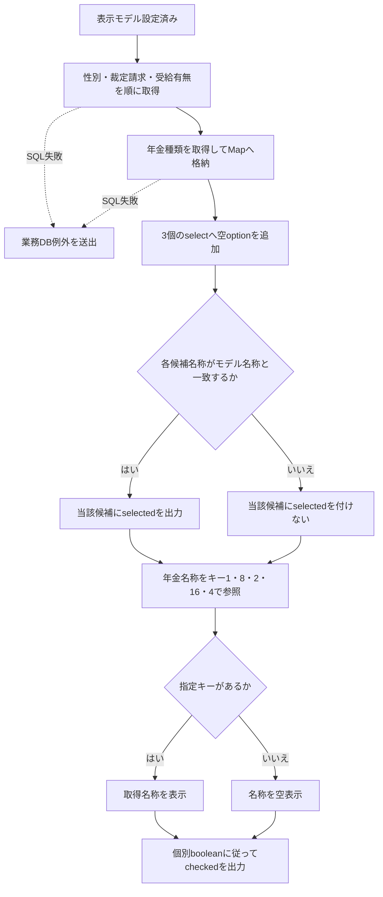

#### SQL・テーブル関連（ER図）

次の図は予約取得SQLの参照関係であり、FK制約や業務上の多重度を表さない。Rの実体は年金1_LKまたは年金＿削除明細である。店名は同じ取得SQLに含まれる表示用の関連として併記する。

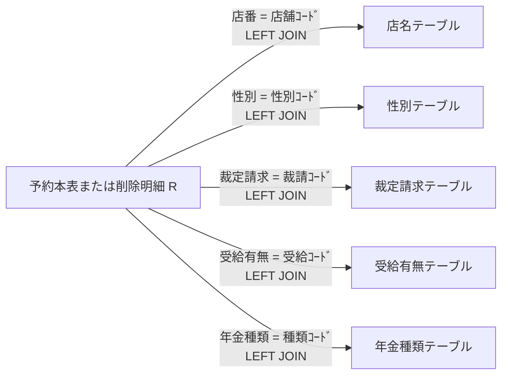

収録DDLはコード表のコード列にPKを宣言するが、予約側からのFKは宣言していない。名称保存列がNOT NULLでも、LEFT JOINで参照先が見つからない場合の結合結果はNULLになり得る。

#### DB操作の詳細

候補取得には次のSQLを使う。いずれもWHERE、検索パラメータ、取得件数上限はなく、コードと名称の全行を返す。

```sql
SELECT 性別ｺｰﾄﾞ AS CODE_VALUE, 性別 AS LABEL_VALUE
FROM 性別テーブル ORDER BY 性別ｺｰﾄﾞ;

SELECT 裁請ｺｰﾄﾞ AS CODE_VALUE, 裁定請求 AS LABEL_VALUE
FROM 裁定請求テーブル ORDER BY 裁請ｺｰﾄﾞ;

SELECT 受給ｺｰﾄﾞ AS CODE_VALUE, 受給有無 AS LABEL_VALUE
FROM 受給有無テーブル ORDER BY 受給ｺｰﾄﾞ;

SELECT 種類ｺｰﾄﾞ AS CODE_VALUE, 年金種類 AS LABEL_VALUE
FROM 年金種類テーブル ORDER BY 種類ｺｰﾄﾞ;
```

顧客基本表から得た性別コードの名称照会は、`SELECT 性別 FROM 性別テーブル WHERE 性別ｺｰﾄﾞ = ?`である。第1パラメータをsetIntで設定し、コードがnullなら照会しない。

接続は`NenkinDataSource.openConnection()`で取得する。DataSourceの探索名は`jdbc/RAROA_DB`、`java:comp/env/jdbc/RAROA_DB`の順である。候補取得によるDB更新はなく、ResultSet・Statement・接続を終了時に閉じる。

#### 結果・例外時の扱い

候補が0件でも、サービスは空選択用データや固定候補を補充しない。selectにはJSPが追加する空optionが残り、年金種類の指定キーがなければ名称が空になる。停止状態を判定する条件もなく、登録されている行をその理由で取得対象から除外しない。

SQL失敗は`NenkinDataAccessException`へ変換し、空一覧やローカル初期値に置き換えない。候補取得はJSP内で行うため、入力拒否後の再表示や保存commit後にも失敗し得る。共通ServletのAction実行catchはforwardより前で終了しており、JSP内の候補取得例外を同じcatchで共通エラーへ変換する契約にはなっていない。

### 登録・変更時のコード確定

#### 処理概要

登録・変更は、受信した3名称をコードへ逆引きし、年金5チェックから合成コードを求めて予約本表へ保存する。変更FLGと戻り値のAuditTypeは、トランザクション内の存在再確認で決定する。入力内容の差分有無による判定ではない。

#### 処理手順

**1. 画面入口で要求値と保存対象を確認する。**

　**1.1.** `PensionSaveAction`は職員確認後に要求値をモデルへ取り込む。GENDER・CLAIM_STATUS・HAS_BENEFITはrequest.getParameterで得たStringをNULLから空文字へ変換してtrimする。年金5チェックと６ヶ月先確認は、要求値が厳密に1、または大文字小文字を区別しないtrue・onの場合だけtrueにする。判定前のtrimはなく、NULLやその他の文字列はfalseになる。通常のcheckbox送信値は1である。

　**1.2.** POST・CSRF確認後、店番、フリガナ、電話番号、各日付、備考を検査する。3名称と年金5チェックに選択必須の検査はない。他の条件が成立すれば、空名称・年金全未選択で保存へ進める。

　**1.3.** 入力検査が失敗した場合は現在キーの予約を照会し、存在有無を既存モードへ設定して、入力モデルとメッセージを保持する。この照会自体の例外を入力メッセージへ変換する個別catchはない。

　**1.4.** 検査通過後、現在キーとORIGINALキーの予約を照会する。現在予約があり元予約と同じキーでない場合は、現在予約を表示して保存しない。現在予約がなく元予約がある場合は、キー変更を拒否して元予約を表示する。既存予約を変更する場合は職員権限も確認する。

**2. Repositoryで保存区分を決定する。**

　**2.1.** `save(PensionReservation, Integer updatedBy)`はモデルをコピーし、検索キーの正規化、電話番号・備考・日付の検査、データ更新日の設定を行う。この準備は保存メソッドのtryより前にあり、検証例外は同メソッドのrollback処理を通らない。

　**2.2.** 業務接続を開いてautoCommitをfalseにし、店名照会後、ふりがな・電話番号で本表の存在を再確認する。存在すればUPDATE・変更FLG=1・戻り区分CHANGED、不在ならINSERT・変更FLG=0・戻り区分NEWを選ぶ。Actionの事前照会結果だけでは確定しない。

**3. 共通バインド処理で保存コードを確定する。**

　**3.1.** 性別名称を空文字化・trimし、空ならコードnullにする。非空なら名称の等価条件でコードを照会する。裁定請求名称と受給有無名称にも同じ変換を使う。この逆引きではNFKC変換や空白集約を行わない。

　**3.2.** 年金5チェックの個別列へ1・0を設定し、trueの重み1・2・4・8・16を加算する。合計0なら合成コードはnullとし、コード表を照会しない。非0なら種類ｺｰﾄﾞで照会し、該当行がある場合に合計値を採用する。照会した名称をモデルへ代入する処理はなく、pensionType文字列も合成入力には使わない。

　**3.3.** ６ヶ月先確認を独立した1・0として設定する。年金種類へは加算しない。変更FLGには手順2.2で決めた値を設定する。

**4. 更新を確定して画面へ戻す。**

　**4.1.** INSERTまたはUPDATEの件数が1件であることを確認し、commitする。UPDATEは共通28列を設定し、ふりがな・電話番号をWHEREに使う。比較版をWHEREへ付ける処理はない。

　**4.2.** commit正常復帰後にNEWまたはCHANGEDを返す。Actionはこの戻り区分で表示を分けず、空モデルと「登録終了！」を設定して予約画面へ戻す。JSPは候補を再取得する。

#### 処理フロー

サブフロー1の入口確認には手順1の検査を含む。拒否先のモデル・既存モードは直後の表のとおりであり、拒否理由を一つの固定状態へまとめない。サブフロー2・3は、サブフロー1のコード変換で使用する。

**サブフロー1：保存区分と更新確定**

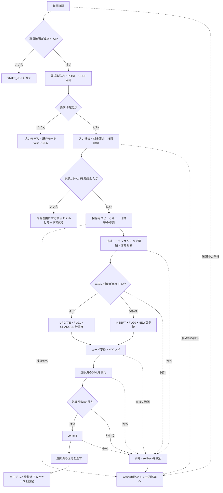

| 拒否・復帰条件 | 表示モデル | 既存モード | 保存 |
| --- | --- | --- | --- |
| POST・CSRF不正 | 入力モデル | false | 行わない |
| 入力検査不正 | 入力モデル | 現在キーの照会結果が存在する場合true | 行わない |
| 現在予約があり元予約と同じキーでない | 現在予約 | true | 行わない |
| 現在予約がなく元予約がある | 元予約 | true | 行わない |
| 既存予約の変更権限不足 | 現在予約 | true | 行わない |
| 保存正常復帰 | 空モデル | false | commit正常復帰済み |

**サブフロー2：名称からコードへの逆引き**

性別、裁定請求、受給有無で共用する。入口はモデル名称、出口はIntegerのコードまたは例外である。

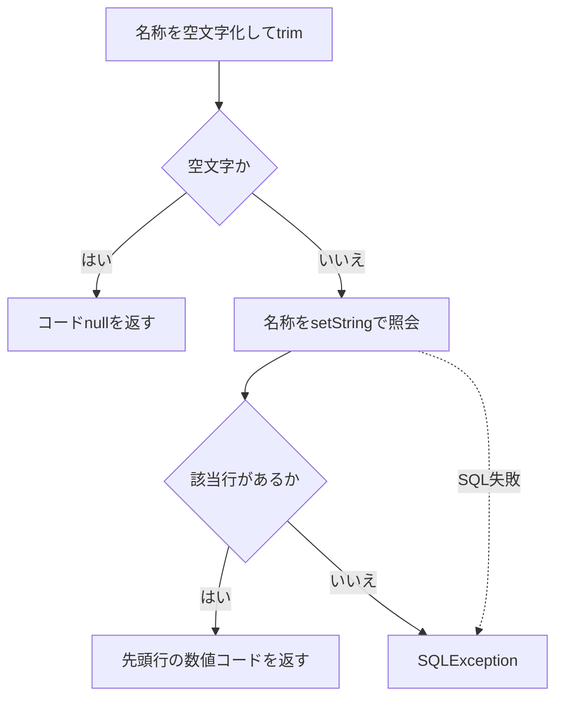

**サブフロー3：年金種類の合成**

入口は5個のboolean、出口は合成コードまたは例外である。個別列の1・0と、選択済み変更FLG・戻り区分は保持する。

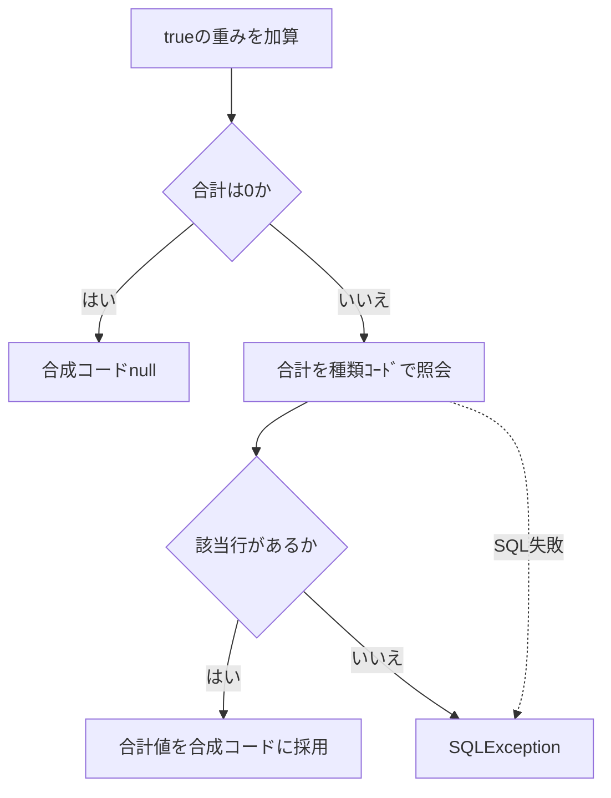

#### SQL・テーブル関連（ER図）

コード表への参照関係は「候補取得・既存コードの表示」の図と共通である。保存時は同じ業務接続でコード表をSELECTし、年金1_LKへINSERTまたはUPDATEする。コード表自体を登録・更新する処理は含まれない。

#### DB操作の詳細

名称逆引きと年金種類の存在確認は次の条件で行う。名称照会はsetString、年金種類照会はsetIntを使い、JDBC呼出しにサイズ指定はない。

| 対象 | SELECT列 | FROM | WHERE | 第1パラメータ |
| --- | --- | --- | --- | --- |
| 性別 | 性別ｺｰﾄﾞ | 性別テーブル | 性別 = ? | trim後のgender、setString |
| 裁定請求 | 裁請ｺｰﾄﾞ | 裁定請求テーブル | 裁定請求 = ? | trim後のclaimStatus、setString |
| 受給有無 | 受給ｺｰﾄﾞ | 受給有無テーブル | 受給有無 = ? | trim後のhasBenefit、setString |
| 年金種類 | 年金種類 | 年金種類テーブル | 種類ｺｰﾄﾞ = ? | 5チェックの合計、setInt |

名称逆引きにはORDER BYと複数件検査がなく、最初に得た行のコードを返す。収録DDLには名称の一意制約がないため、同名の複数コードから一意に選ぶ契約にはなっていない。数字に見える名称を受信しても、それを数値コードとして直接採用しない。

本書対象の保存バインドは次のとおりである。年金種類の存在確認は第15番、裁定請求と受給有無の逆引きはそれぞれ第16番・第21番の設定時に行う。

| パラメータ番号 | 保存列 | 設定値・JDBC呼出し |
| --- | --- | --- |
| 6 | 性別 | 名称逆引きのInteger。非NULLはsetInt、NULLはsetNullのTypes.INTEGER |
| 10 | 種類：国民年金 | booleanに応じてsetIntで1・0 |
| 11 | 種類：厚生年金 | booleanに応じてsetIntで1・0 |
| 12 | 種類：共済年金 | booleanに応じてsetIntで1・0 |
| 13 | 種類：厚生年金基金 | booleanに応じてsetIntで1・0 |
| 14 | 種類：国民年金基金 | booleanに応じてsetIntで1・0 |
| 15 | 年金種類 | 合成コード。非NULLはsetInt、NULLはsetNullのTypes.INTEGER |
| 16 | 裁定請求 | 名称逆引きのInteger。非NULLはsetInt、NULLはsetNullのTypes.INTEGER |
| 21 | 受給有無 | 名称逆引きのInteger。非NULLはsetInt、NULLはsetNullのTypes.INTEGER |
| 24 | データ更新日 | 保存準備で設定した当日、setDate |
| 25 | 更新時間 | 保存処理で取得した時刻、共通setTime処理 |
| 26 | 更新者 | Actionが渡すログイン職員番号。非NULLはsetInt、NULLはsetNullのTypes.INTEGER |
| 27 | ６ヶ月先確認 | booleanに応じてsetIntで1・0 |
| 28 | 変更FLG | INSERTは0、UPDATEは1、setInt |
| 29・30 | UPDATEのWHERE | 29：ふりがなをsetString、30：電話番号をsetBigDecimal。INSERTには付かない |

コード列のDB型がTINYINTでも、NULLバインドの型指定はTypes.INTEGERである。Java型とJDBC型からDB列のNULL可否を推測せず、補足説明のDDL属性と区別する。

#### 結果・例外時の扱い

非空名称の逆引き不成立と、非0の合成年金種類コード不在はSQLExceptionになる。保存メソッドのcatchはrollbackを試み、既存のNenkinDataAccessExceptionはそのまま、それ以外は業務DB例外へ変換して送出する。rollback失敗は元の例外を優先して抑制するため、例外が返ったことだけではrollback成功を保証しない。

保存準備中の検証例外はRepositoryのtryより前から送出される。保存Actionには、これらを入力エラーへ戻す個別catchがないため、共通ServletのAction実行catchへ伝わる。共通側によるエラー属性と戻り先の設定後もforwardが残り、最終HTTP応答まで一律に成功する保証はない。

commit正常復帰と画面表示成功は別の段階である。保存後のJSP候補取得が失敗しても、確定済み保存を取り消す処理はない。commit自体が例外となった場合のDB確定状態は、例外だけから断定しない。

### 削除明細のコード再構成と削除区分

#### 処理概要

削除区分は、既存予約を年金＿削除明細へ追加し、本表から削除することで成立する。削除明細は、再取得した予約モデルを共通バインド処理へ渡して作成するため、名称復元とコード再逆引き、年金種類の再合成が介在する。変更FLGへDや2を設定する方式ではない。

#### 処理手順

**1. 画面入口で対象と権限を確認する。**

　**1.1.** `PensionDeleteAction`は職員確認、要求モデル取込み、POST・CSRF確認、店番必須、フリガナ・電話番号の有無の順に確認する。

　**1.2.** 現在キーとORIGINALキーの予約を照会する。現在予約がない場合、または元予約と同じキーでない場合は削除せず、入力値または既存値を表示する。その後、削除権限を確認する。

　**1.3.** Repositoryへ渡す値は、フリガナ、電話番号、ログイン職員番号である。フォームで受信した性別・裁定請求・受給有無・年金チェックを、削除明細の内容として直接採用しない。

**2. Repositoryで対象を再取得する。**

　**2.1.** キーを正規化し、ふりがなが空または電話番号の数値が得られなければ、接続前にfalseを返す。

　**2.2.** 業務接続でトランザクションを開始し、本表をキーで再取得する。不在ならrollbackが正常に終わった後にfalseを返す。Actionの事前確認後に対象が消えた場合も、この分岐になり得る。

**3. コードを再構成して削除を確定する。**

　**3.1.** 再取得したモデルのデータ更新日を当日にする。性別・裁定請求・受給有無はLEFT JOINで得た名称から再逆引きし、年金種類は個別列から復元した5チェックで再合成する。変換条件は登録・変更と共通である。

　**3.2.** 年金＿削除明細へ共通28列を追加する。更新時間と更新者は今回の削除処理の値、変更FLGはnullにする。追加件数が1件でなければ例外とする。

　**3.3.** 本表をふりがな・電話番号で削除し、削除件数が1件であることを確認する。明細追加と本表削除を同じトランザクションでcommitし、正常復帰後にtrueを返す。

**4. 戻り値から画面状態を設定する。**

　**4.1.** trueなら空モデルと「削除終了！」を設定する。falseなら入力モデルを保持し、既存モードをtrueにして「削除対象が見つかりません。」を設定する。予約画面へ戻ると候補を再取得する。

#### 処理フロー

**サブフロー1：画面入口の確認**

拒否先の表示状態は図の後の表に示す。照会例外を入力拒否と同じ結果へ置き換えない。

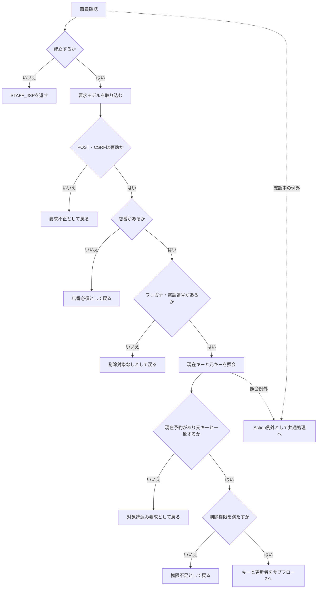

| 復帰条件 | 表示モデル | 既存モード |
| --- | --- | --- |
| POST・CSRF不正 | 入力モデル | false |
| 店番なし | 入力モデル | true |
| フリガナまたは電話番号なし | 入力モデル | false |
| 現在予約なし | 入力モデル | false |
| 現在予約はあるが元キーと不一致 | 現在予約 | true |
| 削除権限不足 | 現在予約 | true |
| Repositoryがfalseを返す | 入力モデル | true |
| Repositoryがtrueを返す | 空モデル | false |

**サブフロー2：削除明細と本表削除の確定**

入口は削除キーと更新者である。コード再変換には前イベントの名称逆引き・年金種類合成の分岐を使う。

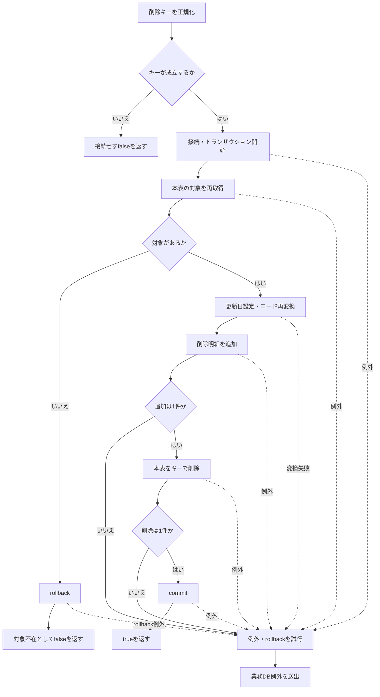

#### SQL・テーブル関連（ER図）

予約再取得は、最初のイベントに示した店名・4コード表へのLEFT JOINを使用する。削除明細への移送は物理行の直接複写ではない。

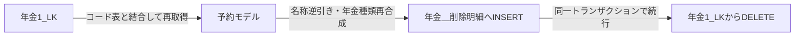

#### DB操作の詳細

対象再取得は予約の共通SELECT列とLEFT JOINに、`R.ふりがな = ? AND R.電話番号 = ?`を付ける。第1パラメータはsetStringのふりがな、第2パラメータはsetBigDecimalの電話番号である。ORDER BYと複数件検査はなく、最初の予約をモデル化する。

削除明細のINSERT列・バインド順は保存と共通である。ただし第28パラメータの変更FLGをsetNullのTypes.INTEGERにする。名称逆引きと年金種類の存在確認も保存と同じSQLを使う。

本表削除は`DELETE FROM 年金1_LK WHERE ふりがな = ? AND 電話番号 = ?`である。setString、setBigDecimalの順で設定する。コード表を更新・削除するSQLはない。

#### 結果・例外時の扱い

コード表の参照先が欠けて名称が空になった場合、削除明細には元の物理コードを保持せずNULLを設定し得る。年金種類も元の合成コードを複写せず、個別チェックから算出し直す。元の合成コードと個別列が不整合なら、削除明細の合成コードが本表値と同じになる保証はない。

非空名称の逆引き不成立、非0の合成コード不在、追加・削除件数不正は例外となる。catchでrollbackを試みて業務DB例外を送出する。不在分岐で明示的に呼ぶrollbackが失敗した場合も、false正常復帰ではなく例外経路へ進む。

trueはcommit後の戻り値であり、N・C・DをDBへ保存した結果ではない。rollback失敗、commit例外、commit後の描画失敗による確定境界は、登録・変更と同じく区別する。

### 日次・月次での抽出区分適用

#### 処理概要

日次・月次は期間の決定方法を、新規分・変更分・削除分は取得元と変更FLG条件を決める。職員指定は更新者の検索条件であり、これらとは独立する。複数区分の処理順はNEW、CHANGED、DELETEDに固定される。

期間入力の必須検査は、日付正規化前のNULL・trim後空に対して行う。正規化後の非空は再検査しないため、画面上の「指定した1日」「開始日から終了日」という説明にかかわらず、全角空白だけの要求値から期間述語が欠ける経路がある。

#### 処理手順

**1. Actionで入口と要求値を確定する。**

　**1.1.** 画面はFUNCTION_ID=nenkin、VIEW_ID=Batchを送信する。日次ボタンはCOMMAND_ID=Daily、月次ボタンはMonthlyとし、共通ServletのAction名組立てによりBatchDailyAction、BatchMonthlyActionへ接続する。

　**1.2.** Actionは職員確認後、新しいBatchViewBeanへ要求値を取り込み、POST・CSRF、出力区分、職員番号の順に確認する。文字列はNULLを空文字化してtrimし、出力3チェックは共通のisCheckedでbooleanへ変換する。

　**1.3.** 出力区分は一つ以上を要求する。各項目単独の必須ではない。職員番号は空欄なら通過し、非空なら8桁以内のASCII数字を要求する。通常ActionはALLを拒否する。

　**1.4.** 要求DTOへ、選択された入口のDAILYまたはMONTHLYを設定する。要求DTOのrunMode初期値はDAILYだが、通常Actionは明示的に上書きする。

**2. サービスで期間と更新者条件を決める。**

　**2.1.** 要求DTOがnull、出力区分が全false、runModeがnullの場合は拒否する。日付は`requiredDate`で正規化前のNULL・trim後空を拒否し、その後`DateUtil.toIsoDate`へ渡す。

　**2.2.** DateUtilはNFKC正規化とtrimを行い、結果が空なら空文字を返す。Javaのtrimだけでは残る全角空白は、この段階で空になる。requiredDateには戻り値の非空再検査がない。空にならない不正日付はIllegalArgumentExceptionとなる。

　**2.3.** 日次は正規化結果dayを開始・終了の両方へ設定する。有効日ならその日を含む両端の条件になる。dayが空なら両端とも空のままRepositoryへ渡り、両方の期間述語が付かない。

　**2.4.** 月次は開始・終了を順に必須検査・正規化し、`from.compareTo(to) > 0`だけを拒否する。有効日同士なら終了日が開始日より前の場合に拒否し、同日は許容する。同じ暦月、月初・月末への一致は検査しない。正規化後の空文字も比較対象になるため、実効条件は次表のとおりとなる。

| 実行区分 | 正規化後の開始・対象日 | 正規化後の終了日 | サービスの結果 | Repositoryの期間述語 |
| --- | --- | --- | --- | --- |
| 日次 | 有効日 | 同じ有効日 | 通過 | 下限・上限の両方 |
| 日次 | 空文字 | 同じ空文字 | 通過 | 両方なし |
| 月次 | 有効日 | 開始日以後の有効日 | 通過。同日も許容 | 下限・上限の両方 |
| 月次 | 有効日 | 開始日より前の有効日 | 大小比較で拒否 | 検索しない |
| 月次 | 空文字 | 有効日 | 比較を通過 | 上限のみ |
| 月次 | 有効日 | 空文字 | 非空開始文字列が空終了文字列を超えるため拒否 | 検索しない |
| 月次 | 空文字 | 空文字 | 比較結果が0となり通過 | 両方なし |

表の空文字は、正規化前の必須検査を通過した値から生じる。NULL、通常の空文字、trimで空になる空白は、これより前に拒否される。期間述語がなくても、区分条件と指定時の更新者条件は保持する。

　**2.5.** 職員番号をIntegerのupdatedByへ変換する。空欄はnullで更新者条件を付けない。サービス単体ではALLもnullにするが、通常画面の許容値ではない。数字の0はIntegerの0となり、更新者=0で検索する。

**3. 削除明細を整理する。**

　**3.1.** サービスはDELETE_CUTOFF_DATEのtrim後が空なら整理を呼ばない。非空ならRepositoryへ渡す。Repositoryは`optionalDate`で日付を正規化し、結果が空なら接続前に0を返す。全角空白だけの基準日は、この早期復帰に該当する。

　**3.2.** 正規化後も非空の有効日であれば、削除明細のデータ更新日が基準日以下の行を削除する。更新者条件や選択した出力区分の条件は付けない。新規分だけを選んだ場合も整理対象になる。

　**3.3.** DB整理は独立した接続・トランザクションでcommitする。後続の抽出・生成失敗によって同時にrollbackしない。基準日正規化の入力例外はDB接続とRepositoryのtryより前で生じる。

**4. 選択区分を順に抽出・生成する。**

　**4.1.** NEWは本表の変更FLG=0、CHANGEDは本表の変更FLG=1、DELETEDは削除明細を検索する。削除分には変更FLG条件を付けない。正規化後に非空である日付条件と、非NULLのupdatedByだけを追加する。

　**4.2.** 各結果に呼出し時のAuditType、対象行のデータ更新日・更新時間・更新者を設定する。auditIdは検索ごとに1から付けるメモリ上の連番である。

　**4.3.** 0件の区分は条件に対応するメッセージを追加し、ファイルを作らず次へ進む。明細があれば追加ソート、行変換、Workbook生成を行い、当該ファイルの名称・内容・件数を保持する。

**5. 生成ファイル数から応答を組み立てる。**

　**5.1.** 0ファイルなら空ファイル名、Excel用Content-Type、空byte配列、区分別メッセージを返す。Actionはメッセージを空白区切りで連結し、入力Beanを保持してBatch.jspへ戻す。

　**5.2.** 1ファイルなら実際に生成した区分のExcel名・内容を返す。複数ファイルなら日次または月次のZIPを返す。選択数ではなく、生成できたファイル数で決める。

　**5.3.** 内容がある場合、Actionはダウンロード応答を書いて戻り値CSVを返し、通常のJSP forwardを抑止する。CSVは共通処理への制御値であり、生成ファイル形式を表さない。

#### 処理フロー

**サブフロー1：Actionの入口確認**

入口はDailyまたはMonthlyの要求である。要求を取り込んだ後の拒否では入力Beanを保持する。正常出口からは入口に対応するrunModeと入力値をサブフロー2へ渡す。

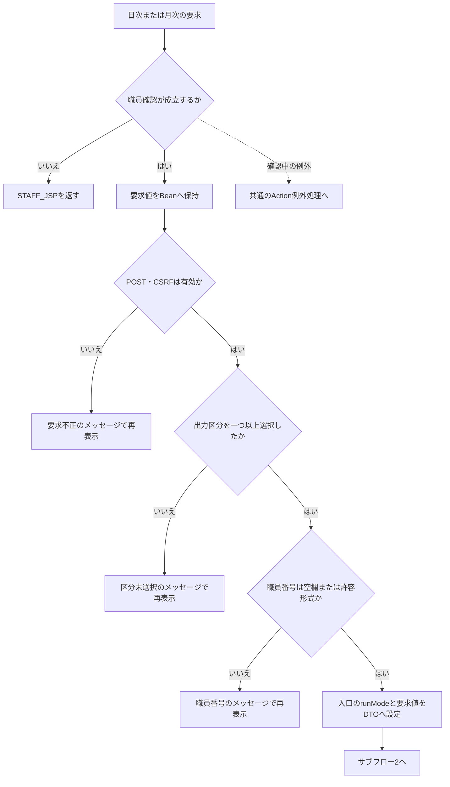

**サブフロー2：正規化後の期間決定**

手順2の組合せ表と同じ条件で分岐する。月次の比較は正規化後の文字列比較であり、空文字も比較対象に含む。正常出口では空の有無を含めたfrom・toとupdatedByを保持する。

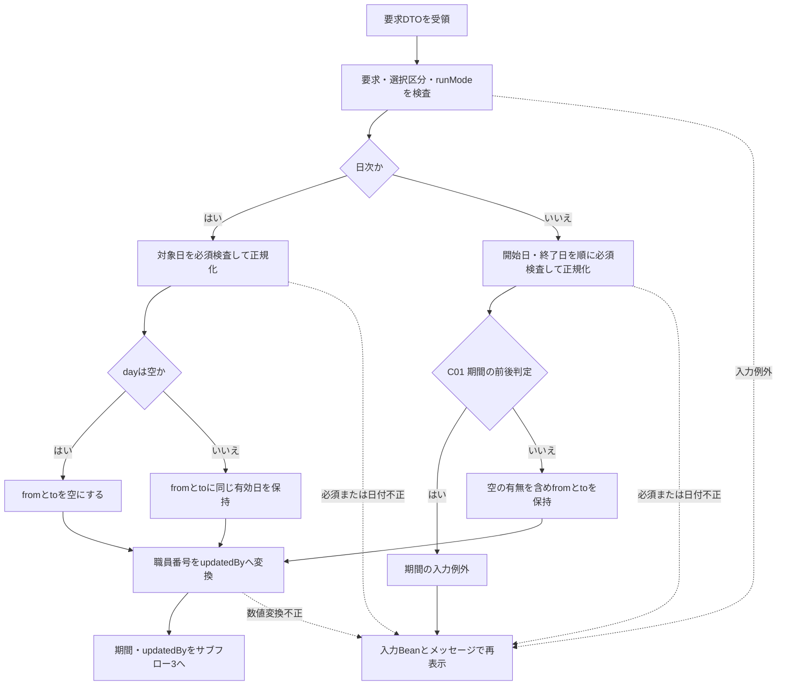

| 条件ID | 元の式・判定条件 | はいの分岐先 | いいえの分岐先 |
| --- | --- | --- | --- |
| C01 | `from.compareTo(to) > 0`。正規化後のfromとtoを文字列として比較する。空文字も比較対象とし、比較結果が正なら「はい」、0または負なら「いいえ」とする。 | R「期間の入力例外」からU「入力Beanとメッセージで再表示」へ進む。 | J「空の有無を含めfromとtoを保持」からK「職員番号をupdatedByへ変換」へ進む。 |

**サブフロー3：削除整理の呼出しと早期復帰**

入口では期間・updatedBy・選択区分・runMode・整理基準日を引き継ぐ。整理を呼ばない経路、Repositoryが0を返す経路、DB整理をcommitする経路は区別する。いずれも正常時は条件を保持してサブフロー4へ進む。

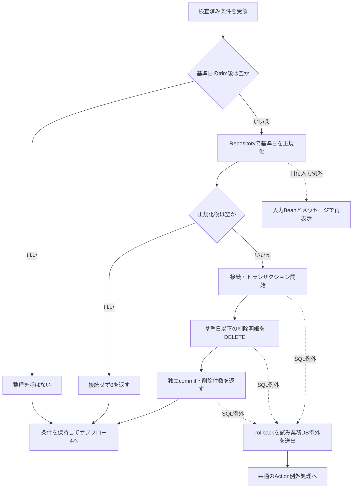

**サブフロー4：区分別検索と生成**

各検索の期間述語は、手順2の実効条件に従う。正常出口は生成済みファイルの一覧とメッセージであり、0件だった区分のために既存ファイルの識別情報を上書きしない。

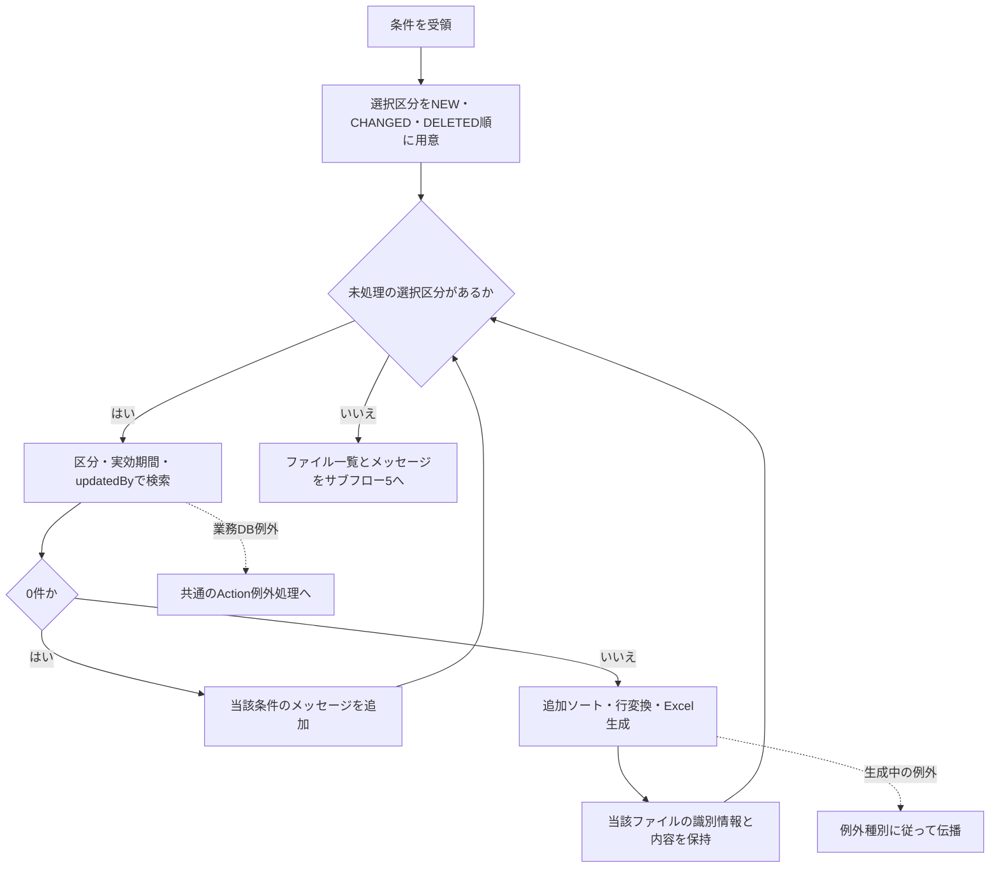

**サブフロー5：生成数と応答**

0件メッセージと生成ファイル一覧を保持して分岐する。送信・生成中の例外は、後述のcatch範囲に従って扱う。

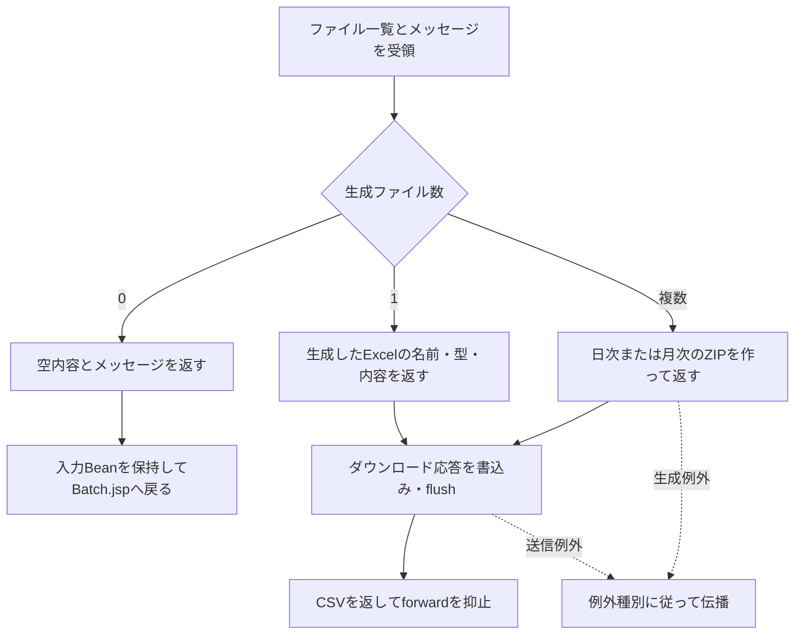

#### SQL・テーブル関連（ER図）

区分による取得元と条件は次のとおりである。名称復元には最初のイベントに示した店名・4コード表へのLEFT JOINを使用する。

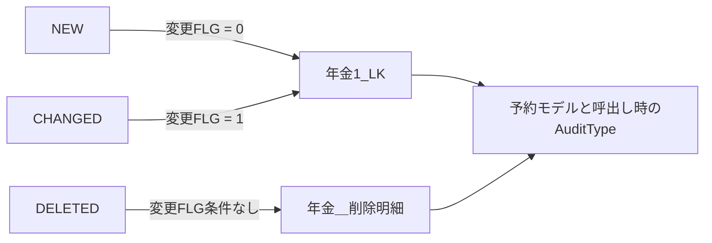

削除明細整理は年金＿削除明細だけを対象とするDELETEである。他表との関連や出力区分による従属削除を追加する処理ではない。

#### DB操作の詳細

`findAuditRecords(type, dateFrom, dateTo, updatedBy)`はtypeがnullなら接続前にIllegalArgumentExceptionとする。日付は`optionalDate`で正規化した後、非空の場合だけWHEREとバインドを追加する。通常の日次・月次入口でも正規化後の空文字が到達し得るため、両端の期間条件が必ず付く保証はない。

SELECTは予約共通列に、R.データ更新日をAUDIT_DATE、R.更新時間をAUDIT_TIME、R.更新者をUPDATED_BYとして追加する。

| 条件・順序 | SQLへの反映 | JDBCバインド |
| --- | --- | --- |
| 基本条件 | WHERE 1 = 1 | パラメータなし |
| NEW | 対象は年金1_LK、AND R.変更FLG = ? | 先頭にsetIntで0 |
| CHANGED | 対象は年金1_LK、AND R.変更FLG = ? | 先頭にsetIntで1 |
| DELETED | 対象は年金＿削除明細、変更FLG条件なし | 変更FLGのパラメータなし |
| 正規化後の開始日が非空 | AND R.データ更新日 >= ? | 変更FLGの後に、存在する場合だけsetDate |
| 正規化後の終了日が非空 | AND R.データ更新日 <= ? | 開始日条件の後に、存在する場合だけsetDate |
| updatedByが非NULL | AND R.更新者 = ? | 存在する日付条件の後にsetInt |
| 取得順 | ORDER BY R.データ更新日, R.更新時間, R.店番, R.顧客番号 | すべて昇順。パラメータなし |

省略する条件はパラメータ自体を追加しない。NULL日付を比較値としてバインドする方式ではない。日次で両端が空の場合や月次で両端が空の場合は、区分条件と指定時の更新者条件による検索になる。月次の開始だけが空なら上限だけで検索する。明示された取得件数上限、ページング、クエリー取消処理はない。

削除整理SQLは`DELETE FROM 年金＿削除明細 WHERE データ更新日 <= ?`で、第1パラメータをsetDateする。正規化後の基準日が空ならこのSQLを用意せず、接続もcommitも行わない。非空の有効日なら更新者・出力区分条件を付けずに削除し、削除件数を返す。

抽出結果のauditTypeは検索引数をそのまま設定する。auditIdは検索ごとの連番である。本表の変更FLGがNULLまたは0・1以外なら新規・変更の等価条件に該当せず、削除分へ自動振分けする条件もない。

#### 結果・例外時の扱い

Actionでの要求不正、区分未選択、職員番号不正は、サービスを呼ばずに入力Beanとメッセージを設定して戻る。サービス呼出し、結果処理、ダウンロード書込みを囲むtryでIllegalArgumentExceptionが生じた場合も、同じActionのcatchが入力Beanへ例外メッセージを設定してBatch.jspへ戻す。業務DB例外やそれ以外の生成・送信例外はこのcatchの対象ではなく、共通ServletのAction実行catchへ伝わる。

再表示ではBeanに取り込んだ入力を保持する。日付欄はHtmlUtil.formatWesternDateで表示変換し、解析できない値は元の文字列を返してHTMLエスケープする。サービスで求めた正規化値をBeanへ書き戻す処理ではないため、正規化後に空になった入力と、再表示用Beanに残る元の値を区別する。

区分別の0件は業務DB例外ではなく、その区分のファイルを生成せずメッセージを追加する結果である。メッセージは次の形で作り、「区分名」を新規・変更・削除に置き換える。

| 実行区分 | 職員指定 | 0件メッセージ |
| --- | --- | --- |
| 日次 | あり | 入力した担当者の【区分名分（日次）】の該当明細はありませんでした |
| 日次 | なし | 入力年月日の【区分名分（日次）】の該当明細はありませんでした |
| 月次 | あり | 入力した担当者の【区分名分（月次）】の該当明細はありませんでした |
| 月次 | なし | 入力年月の【区分名分（月次）】の該当明細はありませんでした |

0ファイル時はActionがメッセージを画面表示する。1ファイル時はExcelを直接返し、結果に残る他区分の0件メッセージをActionが画面へ再表示する経路には進まない。複数ファイルのZIPでは、メッセージがあれば「出力結果.txt」へ格納する。

整理commit後に抽出・生成が失敗しても、整理済みデータを復元しない。一方、整理基準日が正規化後空となって0を返した経路では、整理によるDB更新自体がない。

ダウンロード応答はreset、Content-Type・Content-Disposition・長さの設定、write、flushの順に進む。送信開始後の失敗では、入力再表示や共通エラー画面が利用者へ届くことを保証しない。flush正常復帰から利用者の受領完了も確定しない。

## 補足説明

### ローカル初期コード：性別・裁定請求・受給有無

次の値はローカル初期データの定義である。受給有無の「未」「既」を「無」「有」へ読み替えない。

| 体系 | コード列 | コード | 名称 |
| --- | --- | --- | --- |
| 性別 | 性別ｺｰﾄﾞ | 1 | 男 |
| 性別 | 性別ｺｰﾄﾞ | 2 | 女 |
| 裁定請求 | 裁請ｺｰﾄﾞ | 1 | 未 |
| 裁定請求 | 裁請ｺｰﾄﾞ | 2 | 済 |
| 受給有無 | 受給ｺｰﾄﾞ | 1 | 未 |
| 受給有無 | 受給ｺｰﾄﾞ | 2 | 既 |

空選択はコード0ではない。フォームの空名称を保存処理がnullへ変換し、予約側のコード列へNULLを設定する。

### ローカル初期コード：年金種類

種類ｺｰﾄﾞは選択した重みの合計に対応する。例えば国民年金と厚生年金基金なら1+8=9になる。全未選択の合計0に対応する行はローカル初期データになく、保存処理もコード0ではなくNULLを設定する。

| 種類ｺｰﾄﾞ | ローカル初期名称 |
| --- | --- |
| 1 | 国民年金 |
| 2 | 厚生年金 |
| 3 | 国民年金+厚生年金 |
| 4 | 共済年金 |
| 5 | 国民年金+共済年金 |
| 6 | 厚生年金+共済年金 |
| 7 | 国民年金+厚生年金+共済年金 |
| 8 | 厚生年金基金 |
| 9 | 国民年金+厚生年金基金 |
| 10 | 厚生年金+厚生年金基金 |
| 11 | 国民年金+厚生年金+厚生年金基金 |
| 12 | 共済年金+厚生年金基金 |
| 13 | 国民年金+共済年金+厚生年金基金 |
| 14 | 厚生年金+共済年金+厚生年金基金 |
| 15 | 国民年金+厚生年金+共済年金+厚生年金基金 |
| 16 | 国民年金基金 |
| 17 | 国民年金+国民年金基金 |
| 18 | 厚生年金+国民年金基金 |
| 19 | 国民年金+厚生年金+国民年金基金 |
| 20 | 共済年金+国民年金基金 |
| 21 | 国民年金+共済年金+国民年金基金 |
| 22 | 厚生年金+共済年金+国民年金基金 |
| 23 | 国民年金+厚生年金+共済年金+国民年金基金 |
| 24 | 厚生年金基金+国民年金基金 |
| 25 | 国民年金+厚生年金基金+国民年金基金 |
| 26 | 厚生年金+厚生年金基金+国民年金基金 |
| 27 | 国民年金+厚生年金+厚生年金基金+国民年金基金 |
| 28 | 共済年金+厚生年金基金+国民年金基金 |
| 29 | 国民年金+共済年金+厚生年金基金+国民年金基金 |
| 30 | 厚生年金+共済年金+厚生年金基金+国民年金基金 |
| 31 | 国民年金+厚生年金+共済年金+厚生年金基金+国民年金基金 |

画面は31名称を列挙するselectではなく、キー1・8・2・16・4に対応する5個のcheckboxを持つ。コード表へ他のキーを追加しても、新しいcheckboxを自動生成しない。

### コード表と保存列の物理属性

コード表の宣言は次のとおりである。名称列の宣言容量と、名称保守時の業務上限は区別する。

| 表 | コード列とH2／SQL Server型 | 名称列とH2型 | 名称列のSQL Server型 | 宣言された制約 |
| --- | --- | --- | --- | --- |
| 性別テーブル | 性別ｺｰﾄﾞ：TINYINT／TINYINT | 性別：VARCHAR(10) | NVARCHAR(10) | コードはPK・NOT NULL、名称はNOT NULL |
| 裁定請求テーブル | 裁請ｺｰﾄﾞ：TINYINT／TINYINT | 裁定請求：VARCHAR(10) | NVARCHAR(10) | コードはPK・NOT NULL、名称はNOT NULL |
| 受給有無テーブル | 受給ｺｰﾄﾞ：TINYINT／TINYINT | 受給有無：VARCHAR(10) | NVARCHAR(10) | コードはPK・NOT NULL、名称はNOT NULL |
| 年金種類テーブル | 種類ｺｰﾄﾞ：INTEGER／INT | 年金種類：VARCHAR(120) | NVARCHAR(120) | コードはPK・NOT NULL、名称はNOT NULL |

名称列の一意制約、掲載コードだけを許可するCHECK、これらの列のDEFAULTは宣言されていない。型の括弧内の宣言長を、日本語の業務文字数やWindows-31Jのバイト上限として代用しない。名称を登録・更新する通常画面・サービスは確認できず、入力側の業務上限も未確認である。

予約側の属性は本表と削除明細で共通である。

| 列 | H2型 | SQL Server型 | NULL | 実装での用途・設定 |
| --- | --- | --- | --- | --- |
| 性別・裁定請求・受給有無 | TINYINT | TINYINT | 許容 | 名称から逆引きしたコード。空名称はNULL |
| 年金種類 | INTEGER | INT | 許容 | 5チェックの合計。全未選択はNULL |
| 種類：国民年金・種類：厚生年金・種類：共済年金・種類：厚生年金基金・種類：国民年金基金 | BOOLEAN | BIT | 許容 | 個別チェックを1・0で保存。読込み時のNULLはgetInt経由でfalseになる |
| ６ヶ月先確認 | BOOLEAN | BIT | 許容 | 確認状態を1・0で保存。年金合成には不使用 |
| 変更FLG | TINYINT | TINYINT | 許容 | 本表保存は0・1、削除明細追加はNULL。DEFAULTと0・1限定CHECKはない |
| データ更新日 | DATE | DATE | 許容 | 保存・削除時の日付、期間抽出、削除整理基準との比較 |
| 更新時間 | TIME | TIME(0) | 許容 | 保存・削除時の時刻、抽出順と抽出結果 |
| 更新者 | INTEGER | INT | 許容 | 今回操作の職員番号。職員指定抽出の比較対象 |

年金1_LKと年金＿削除明細には、収録DDL上のPK・一意制約がない。検索キー索引は非一意であり、同じキーの複数行をDB定義だけで防がない。保存・削除のsynchronizedはRepositoryインスタンスの同期であり、比較版やDB全体の排他保証を加えるものではない。

### 新規・変更・削除の表現と保持範囲

| 論理区分 | AuditType | 文字列コード | 表示名 | 通常処理での成立条件 | 抽出元・条件 |
| --- | --- | --- | --- | --- | --- |
| 新規 | NEW | N | 新規 | 本表の存在再確認で不在となりINSERTをcommit | 年金1_LK、変更FLG=0 |
| 変更 | CHANGED | C | 変更 | 本表の存在再確認で既存となりUPDATEをcommit | 年金1_LK、変更FLG=1 |
| 削除 | DELETED | D | 削除 | 削除明細追加と本表削除をcommit | 年金＿削除明細、変更FLG条件なし |

新規・変更抽出の対象は本表の現在行である。更新時に変更FLG、データ更新日、更新時間、更新者を上書きするため、過去の新規・変更をすべて残す監査履歴ではない。削除明細も日次・月次出力前の整理対象になる。

`AuditType.fromCode`はNULLを空文字として扱い、trim後にN・C・Dを大文字小文字を区別せず照合する。不一致はIllegalArgumentExceptionになる。通常保存・バッチはenum定数を直接使用しており、この文字列変換helperを画面入力の検証や公開APIとして接続する呼出しは確認できない。

`findLatestAuditType`も通常の年金Java・JSPからの呼出しが確認できないhelperである。単体では、正規化キーが成立しなければnullを返す。本表に行があれば変更FLGのgetInt結果が0ならNEW、それ以外ならCHANGEDとする。本表取得は最大1行、ORDER BYなしで、wasNull判定がないためSQL NULLもNEW側になる。

本表が不在の場合だけ、削除明細を更新日・時刻降順の最大1行で調べ、存在すればDELETED、なければnullを返す。両表の日時を比較した最新判定ではなく、新規・変更抽出の0・1等価条件とも判定が異なる。通常運用の最終履歴判定機能として扱わない。

### 実行区分・出力区分と出力識別情報

PensionBatchRunModeはDAILY、MONTHLYの2定数であり、数値コードや日本語表示名の属性を持たない。日次・月次の表示とファイル名はサービス側の分岐で組み立てる。

初期画面は出力3区分が全false、職員番号が空欄、日次対象日が当日、月次開始・終了日が当月初日・末日になる。整理基準日は画面初期化時点からCalendarで2か月戻した日をhiddenへ保持する。複数区分は利用者が選んだ順ではなく、新規、変更、削除の順で処理する。

ブラウザーの職員番号maxlength=8、日付maxlength=14は入力補助側の制限である。Actionの職員番号形式検査、サービスの日付必須・正規化・大小比較、Repositoryの実効WHERE判定は別の条件であり、ブラウザー制限によってサーバーへの受信値を保証しない。

サービスが生成するQ番号は実行区分、職員指定有無、AuditTypeの組合せを表す。

| 実行区分 | 職員範囲 | 新規 | 変更 | 削除 |
| --- | --- | --- | --- | --- |
| 日次 | 職員指定あり | Q010 | Q020 | Q030 |
| 日次 | 全職員 | Q040 | Q050 | Q060 |
| 月次 | 職員指定あり | Q070 | Q080 | Q090 |
| 月次 | 全職員 | Q100 | Q110 | Q120 |

queryNameは「Q番号_Excel出力_年金予約_区分名_データ明細リスト」、Excel名は「年金予約【区分名】データ明細リスト（範囲名期間名）.xlsx」、シート名は「区分名分データ」として組み立てる。区分名は新規・変更・削除、範囲名は担当者別・全担当者、期間名は日次・月次である。

ファイル名の「担当者別」は実装上の名称であり、SQLの比較列は担当者コードではなく更新者である。Q番号もサービスが作る出力識別情報であり、保存クエリーやDBオブジェクトの実行先ではない。

### コード表変更・参照欠落時の扱い

候補描画から保存時再照会までを固定する版情報や共通トランザクションはない。描画後に名称が改名・削除されれば、送信した旧名称の逆引きが失敗する場合がある。名称のDB比較は照合順序などにも依存し、画面のJava文字列比較と同じ条件であるとは扱わない。

既存コードの参照先が欠ける場合は名称が空になる。モデルは元の物理コードを別項目として保持しないため、再保存や削除明細作成でNULLへ変換され得る。年金種類も読込み時には個別チェックと合成コードの整合検査をせず、保存時に個別チェックから再合成する。

改名・削除・同名登録の許否、欠落コードの警告・拒否・保持に関する運用規則は未確認である。`getPensionTypeLabel(int)`は全名称Mapから単一名称を返し、不在なら空文字にするhelperだが、通常UIからの呼出しは確認できない。

### 関連文書の計画上の対応

次表は文書計画のIDと本書からの相対パスを示す。各参照先の生成状態は未確認である。本書のコード変換、区分条件、結果分岐は前節までに記載し、参照先の存在を前提に省略していない。

| 文書ID | 本書からの相対パス | 対応する責務 |
| --- | --- | --- |
| COM-111 | `共通仕様書_COM-111_年金業務共通処理.md` | 職員確認、CSRF、権限、受信値変換、ダウンロード応答 |
| DATA-CONTRACTS | `データオブジェクト定義書.md` | 名称・コード・boolean・要求DTO・抽出結果の保持と型 |
| DB-OPS | `DB仕様書/DB操作仕様書.md` | 予約操作全体のSQL、全バインド、件数検査、トランザクション |
| DB-LOGICAL | `DB仕様書/論理データ仕様書.md` | コード表と予約列の意味。対象はTBL-NEN-001・002・004・005・006・007 |
| DB-PHYSICAL | `DB仕様書/テーブル定義書.md` | 対象表の全列、H2・SQL Serverの属性、制約・索引 |
| DET-SCR-018 | `../詳細仕様書/詳細仕様書_SCR-018_新規・変更・削除.md` | 予約画面全項目と読込み・登録・変更・削除・クリア |
| DET-SCR-014 | `../詳細仕様書/詳細仕様書_SCR-014_日次 _ 月次処理.md` | 日次・月次の画面状態、期間、整理・抽出・応答 |
| OUTPUT-NENKIN | `帳票一覧.md` | 出力識別情報、ファイル形式、列・セル・帳票 |
| COM-012 | `共通仕様書_COM-012_共通コントロールサーブレット.md` | Action生成、Action例外、アクセス記録、forward境界 |
