<!-- spec-meta: {"schema":"spec-md/1.0","documentId":"SYS-ARCHITECTURE","version":"2.0","path":"共通/システム分析.md","sheets":[{"heading":"概要","kind":"GRID","sheet":"概要"},{"heading":"構成要素一覧","kind":"LIST","sheet":"構成要素一覧","key":["No"]},{"heading":"保持領域と寿命","kind":"GRID","sheet":"保持領域と寿命"},{"heading":"イベント仕様","kind":"GRID","sheet":"イベント仕様"},{"heading":"補足説明","kind":"GRID","sheet":"補足説明"}]} -->

# 年金システム構成・処理依存

| 属性 | 内容 |
| --- | --- |
| 文書種別 | システム設計書 |
| システム名 | 年金自動受取予約管理システム |
| 共通/文書ID | SYS-ARCHITECTURE |
| 版 | 2.0（本仕様書の版） |
| 解析対象 | 年金Webアプリケーションと、その要求から接続するn2framework共通処理 |
| 基準日 | 2026年10月15日 |

## 概要

本システムは、職員が年金自動受取予約を登録・変更・削除し、予約内容を参照・印刷・Excel出力するWebアプリケーションである。ブラウザーからの通常操作は共通コントロールサーブレットを通り、操作ごとに生成したActionが業務処理を実行する。画面の状態はセッション内のBeanに保持し、予約の永続データは業務DBへ保存する。

本書は、画面・共通基盤・業務処理・データ接続の依存、保持情報の寿命、認証と更新の確定境界を定める。個々の画面項目やSQLの全列・バインド順は関連する画面仕様・DB操作仕様の責務とし、本書では各接続の目的、呼出し順、結果と例外の引継ぎを説明する。

### 配置と通常の入口

配置定義はcommon.ControlServletを起動時ロード対象として登録し、コンテキスト内の/Action.doへ割り当てる。welcome-fileはJSP/MENU/Login.jspである。同じ配置定義にはローカルDB初期化用のnenkin.H2JndiSetupListenerと、ログ設定名LOGGER_NAME=n2nenkinがある。

メニューの四つの入口は次のとおりである。いずれもFUNCTION_ID=nenkinとしてPOSTする。ログアウトはFUNCTION_ID=common、VIEW_ID=Logout、COMMAND_IDは空文字で送信する。

| 操作 | VIEW_ID | COMMAND_ID | 生成対象Action |
| --- | --- | --- | --- |
| 新規・変更・削除 | Pension | View | nenkin.PensionViewAction |
| 処理データ | Batch | View | nenkin.BatchViewAction |
| 印刷 | Report | View | nenkin.ReportViewAction |
| EXCEL出力 | Excel | View | nenkin.ExcelViewAction |

### 画面から業務処理への依存

以下は通常操作の接続を示す。矢印はラベルに従う呼出しまたは値の受渡しであり、DBの外部キー関係を表さない。

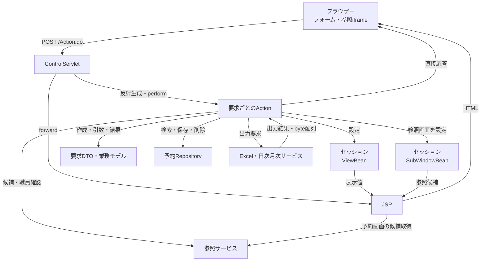

JSPはActionで作られた表示情報を読むほか、予約画面の描画開始時に参照サービスを呼び、性別・裁定請求・受給有無・年金種類を取得する。入力拒否後や保存完了後も、再表示にはこのDB読取りが必要になる。したがって、Actionが戻り先JSPを返した時点と、画面の描画が完了する時点は異なる。

### 接続先と共通基盤への依存

年金側はNenkinDataSourceを介して三系統の論理接続先を使う。共通認証・運用可否確認・アクセス記録はCommonUtilを使う別の接続経路である。

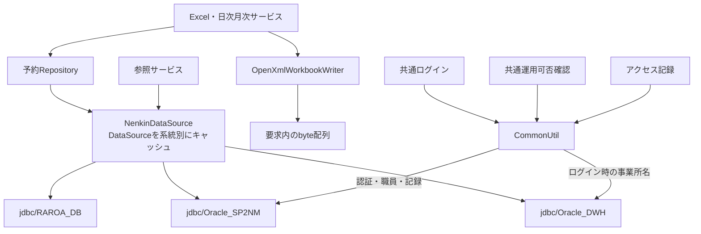

| 論理接続先 | 年金側の用途 | 共通側の用途 |
| --- | --- | --- |
| jdbc/RAROA_DB | 年金1_LK、年金＿削除明細、店名テーブル、性別テーブル、裁定請求テーブル、受給有無テーブル、年金種類テーブル | 本書で扱う共通認証・アクセス記録は使用しない |
| jdbc/Oracle_SP2NM | DB2.Ｕ職員名簿表から職員候補と年金職員情報を取得 | DB2.ＵＷＥＢログイン情報表、職員名簿、役職・所属課係の参照、DB2.Ｕカウンターシフトへのアクセス記録、運用可否処理の接続取得 |
| jdbc/Oracle_DWH | N2_SIGHT.Ｂ顧客基本表から顧客候補と基本情報を取得 | 所属情報がある場合にN2_DWH.Ｊ事業所コード表２を参照 |

三系統は論理上の用途の分離であり、物理サーバー数を表さない。職員・顧客候補に付ける店舗名は、業務接続で店名テーブルをMapへ読み込み、その接続を閉じてから職員・顧客の検索結果へメモリ上で突き合わせる。追加職員確認も店舗名の読取りを経由する。顧客基本情報から予約モデルを作る処理は、顧客接続を閉じた後に業務接続を開き、店舗名と性別名称を補う。これらの別接続の読取りには、DBをまたぐ単一スナップショットの保証はない。

## 構成要素一覧

| No | 層 | 実装要素 | 責務 | 主な入出力・保持先 | 主な依存先 |
| --- | --- | --- | --- | --- | --- |
| 1 | ブラウザー | 各JSPが返すフォーム、参照iframe、画面スクリプト | 操作識別値と入力値を送信し、参照選択値を親画面へ移す。登録内容印刷はブラウザーで行う | HTTPパラメータ、HTML、postMessage、ダウンロード応答 | /Action.do、JSP、画面用CSS・JavaScript |
| 2 | 表示 | JSP/MENU/Login.jsp、JSP/NENKIN配下のJSP | セッションBeanを表示し、操作別の送信値を組み立てる。Pension.jspは描画時に候補を取得する | ViewBean、SubWindowBean、候補List・Map | 共通Servlet、ReferenceDataService |
| 3 | 共通要求制御 | common.ControlServlet | 識別値の解決、共通ログイン・運用可否確認、Action生成・実行、アクセス記録、forwardを順に行う | HttpServletRequest、HttpServletResponse、戻り先strUrl | CommonAction、OperatePermission、CounterShift |
| 4 | 共通認証 | common.LoginAction、common.LogoutAction | 共通認証情報を組み立て、ログアウト時に共通の二属性を除去する | LoginInfoBean、LoginBean、ViewBean、MESSAGE | 共通検索処理、CommonUtil |
| 5 | 年金共通 | nenkin.NenkinBaseAction | 職員確認、CSRF、変更・削除制限、受信値変換、画面Bean設定、直接ダウンロードを共用する | StaffContext、PensionReservation、セッション属性、応答ストリーム | CommonAction、ReferenceDataService、日付・文字列補助 |
| 6 | 操作制御 | メニュー、予約、参照、印刷、Excel、日次・月次の各Action | 入力を取り込み、操作条件を確認し、サービス結果に応じて画面状態または直接応答を選ぶ | 受信文字列、要求DTO、画面Bean、JSP名またはforward抑止値 | NenkinBaseAction、Repository、各サービス |
| 7 | 画面状態 | MenuViewBean、PensionViewBean、LookupViewBean、ReportViewBean、ExcelViewBean、BatchViewBean | 入力、メッセージ、選択状態、表示用結果を保持する | 主画面はViewBean、参照画面はSubWindowBean | JSP、各Action |
| 8 | 業務・候補データ | PensionReservation、StaffContext、候補モデル、出力要求・結果 | 予約値、職員属性、候補のキーと名称、出力条件・結果を表す | JavaのString、Integer、int、boolean、List、byte配列等 | Action、Repository、各サービス |
| 9 | 予約永続化 | PensionRepository | 予約・顧客基本情報の取得、予約保存、削除明細追加と予約削除、出力抽出、削除明細整理を行う | モデル、検索結果List、AuditType、boolean、件数 | NenkinDataSource、業務表・コード表・顧客基本表 |
| 10 | 参照データ | ReferenceDataService | 店舗・職員・顧客・コード候補、追加職員確認を提供する | 候補List、店舗名Map、StaffContext | NenkinDataSource、業務・職員・顧客の各参照先 |
| 11 | 出力 | PensionExcelExportService、PensionBatchExportService、OpenXmlWorkbookWriter | 明細を組み立て、単一シートのxlsxまたは複数ファイルのZIPをメモリ生成する | Object配列の明細List、byte配列、出力結果 | PensionRepository、JavaのZIP・メモリストリーム |
| 12 | 年金接続管理 | NenkinDataSource | 系統別のJNDI探索、DataSourceキャッシュ、呼出しごとのConnection取得を行う | 三つのstatic volatile DataSource、各Connection | JNDI、javax.sql.DataSource |
| 13 | 共通接続・記録 | CommonUtil、CounterShift、共通DB基底処理 | 共通接続のautoCommitをfalseとし、共通検索または独立したアクセス記録を行う | Connection、共通List・Map、記録用Map | Oracle_SP2NM、ログイン時はOracle_DWHも使用 |
| 14 | 配置・ローカル互換 | web.xml、H2JndiSetupListener | ServletとListenerを登録し、ローカルDB有効時に初期化・JNDI登録・終了処理を行う | コンテキスト設定、ローカルDB、JNDI登録 | コンテナー、H2、収録DDL・初期データ |

## 保持領域と寿命

| 保持単位 | 実体・キー | 内容と寿命 |
| --- | --- | --- |
| HTTP要求 | 反射生成されたAction、入力文字列、要求DTO、作業変数 | 通常要求ごとにActionを生成してperformへ渡す。NenkinBaseActionのnormalizedDateもAction内の作業値であり、セッション共有値ではない |
| 主画面セッション | ViewBean | メニュー・予約・印刷・Excel・日次月次が同じ属性名へ異なるBeanを設定する。次の設定で前のBeanを置き換える |
| 予約画面セッション | ViewBean内のPensionViewBean | 予約モデル、メッセージ、職員表示、existingを保持する。入力途中の値や拒否された値も入り得るため、Beanの存在はDB保存を意味しない |
| 印刷画面セッション | ViewBean内のReportViewBean | 検索条件、preview、メッセージ、取得済み予約Listを保持する。検索結果はDBの現在行と常時同期する値ではない |
| 参照画面セッション | SubWindowBean内のLookupViewBean | 検索条件、総件数、ページ番号とそのページの候補を保持する。主画面Beanとは別属性である |
| 共通認証セッション | LoginBean内のLoginInfoBean | 共通認証可否、職員番号、所属・役職等を保持する。年金の追加確認結果とは別に成立する |
| 年金職員セッション | NENKIN_STAFF_CONTEXT内のStaffContext | staffNoはint、staffNameはString、branchNoはint、roleCodeはString。存在時はrequireStaffが名簿を再照会せず再利用する |
| CSRF用セッション | NENKIN_CSRF_TOKEN | 非空Stringがあれば再利用し、なければ生成する。通常ログイン開始時と年金職員確認の拒否時に除去する |
| メッセージ用セッション | ErrorMsg、MESSAGE | ErrorMsgは共通エラー表示に使い、MESSAGEはメッセージ一覧等に使う。MESSAGEの有無はアクセス記録上のJSP名にも影響する |
| 共有インスタンス | PensionRepository、ReferenceDataService、出力サービスのINSTANCE | 同じクラスをロードした範囲で共有する。予約データの常駐ストアではなく、検索Listや店舗名Mapは呼出し内で作る |
| 接続先キャッシュ | NenkinDataSourceの三つのDataSourceフィールド | 系統ごとに初回探索結果を保持する。Connectionを保存するフィールドではなく、明示的な解除・再探索入口もない |
| DB呼出し内 | Connection、PreparedStatementまたはStatement、ResultSet | 接続・文・結果は各処理で取得し、後処理でcloseする。Repositoryの更新用接続と共通記録用接続は共有しない |
| 出力要求内 | 抽出List、明細List、xlsx・ZIPのbyte配列、出力結果 | 通常Actionはローカル変数で受け取り送信する。生成物をサーバーファイルや永続ジョブとして保存する経路はない |
| ブラウザー内 | 入力DOM、参照iframe、受信した選択値 | 参照を閉じるとiframeをabout:blankへ変更する。これはサーバーのSubWindowBean除去とは別の操作である |

参照検索はDBから全件をListへ取得した後、Actionが20件単位の新しい部分Listを作り、セッションへ保存する。全件Listは要求内の作業用である。ページ番号の上限補正は部分Listを作った後に行うため、範囲外ページでは表示ページ番号だけが補正され、候補が空のままになる経路がある。DB側ページングとしては扱わない。

出力結果は、受け取ったbyte配列をコンストラクタでcloneし、getContentでもcloneを返す。日次・月次結果のファイル情報ListとメッセージListは、コピーしたListを変更不可にして保持する。Serializableであることだけから、出力バイナリがセッションへ格納されるとは判断しない。

同一セッションの複数タブはViewBeanとSubWindowBeanの属性名を共有する。画面単位・タブ単位の独立した保管領域は確認できない。セッションの有効時間、永続化・複製、並行要求の実行順はコンテナー設定による部分があり、本書では固定しない。

## イベント仕様

### E1 通常要求の振分け・アクセス記録・応答

#### 処理概要

通常POSTを、共通の認証・運用判定から年金Actionへ接続する。Actionが選んだ画面または直接応答を保持したままアクセス記録を試み、必要な場合だけJSPへforwardする。

#### 処理手順

**1. 要求を解釈する。**

　**1.1.** processは要求文字コードをWindows-31Jに設定する。通常入口ではFUNCTION_ID、VIEW_ID、COMMAND_IDをgetParameterで受け取る。特殊連携値がある場合は別の識別値設定を経る。

　**1.2.** FUNCTION_IDを小文字化してpackage名とする。FUNCTION_IDの欠落によるtoLowerCase、VIEW_IDの欠落によるequalsの例外は、後述のAction実行用tryより前で発生する。COMMAND_IDの空文字は通常ログイン・ログアウトでも使う値であり、欠落と同一に扱う検証はない。

**2. 実行するActionと戻り先を決める。**

　**2.1.** VIEW_IDがLoginでなければLoginBeanの存在と共通ログイン可否を確認する。拒否時はErrorMsgにログイン時間切れを設定し、共通エラーJSPを選ぶ。

　**2.2.** 共通確認を通過したログアウト要求では、属性除去前のLoginInfoBeanからアクセス記録用職員番号を退避する。

　**2.3.** OperatePermissionを呼ぶ。nenkinは運用状態表を検索する業務分岐に含まれないが、業務種別の判定前にOracle_SP2NM接続を取得する。接続取得が例外となり同処理がfalseを返した場合は、メンテナンス中のErrorMsgと共通エラーJSPを選ぶ。

　**2.4.** 実行可能なら、package名にVIEW_ID、COMMAND_ID、Actionを連結し、Class.forNameとnewInstanceでActionを生成してperformを呼ぶ。この生成・呼出しを囲むcatch(Exception)は、例外を記録し、アプリケーションエラーのErrorMsgと共通エラーJSPを設定する。正常に戻った場合はActionの戻り値をstrUrlへそのまま引き継ぐ。

**3. 記録して応答する。**

　**3.1.** ログアウト以外は、処理後のLoginBeanがあれば利用者番号を取得する。ログアウトは手順2.2の退避値を使い、その手順へ到達しなかった場合は初期nullのままとする。要求識別値、VIEW_IDとCOMMAND_IDを連結したAction ID、利用者ID、記録JSP名をMapへ設定する。

　**3.2.** MESSAGEが存在すれば、記録JSP名だけを./JSP/COMMON/SubMessage.jspにする。MESSAGEがなければstrUrlを記録JSP名にする。どちらの場合も実forward先strUrlは変更しない。

　**3.3.** CounterShift.countUpで独立した記録を試みる。処理が戻った後、strUrlがnull、PDF、CSVならforwardを行わない。それ以外はHTML応答のWindows-31Jとキャッシュ抑止ヘッダーを設定してforwardする。

#### 処理フロー

サブフローE1-1の出口は、枝ごとに決まったstrUrl、ErrorMsg、セッション状態、必要なら既に開始した直接応答である。識別値処理の例外はE1-2へ合流しない。

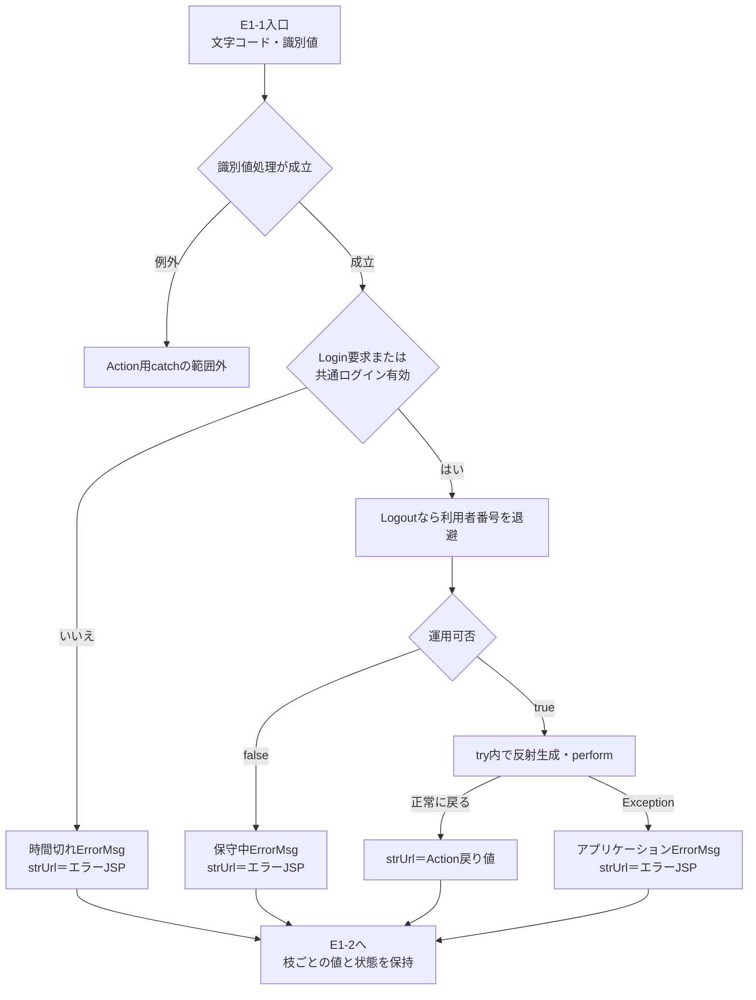

サブフローE1-2はstrUrlを保持して処理する。アクセス記録上の名称を変えても、画面遷移先を置き換えない。

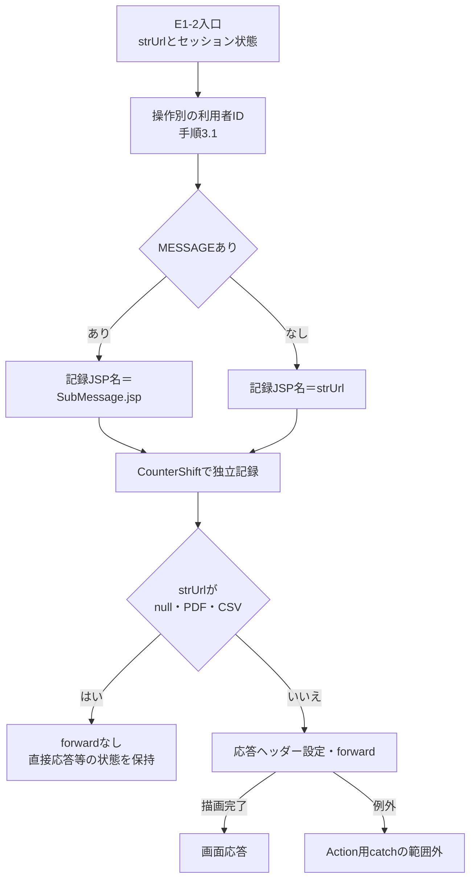

#### SQL・テーブル関連（ER図）

本イベント自体の記録先はDB2.Ｕカウンターシフトの単一表であるため、表間ER図は省略する。認証照会と業務操作の関連はE2・E3・E4で示す。nenkin要求の運用可否処理はDB2.ＵＤＢ管理ＤＢを検索しない。

#### DB操作の詳細

CounterShiftはCommonUtilからOracle_SP2NMの新しい接続を取得し、DB2.Ｕカウンターシフトへアクセス日付・時刻、機能ID、画面ID、コマンドID、Action ID、JSP名、ユーザーIDをINSERTしてcommitする。日付と時刻は登録処理側で付ける。年金の業務接続は引数として受け取らない。

記録中のExceptionは同処理が捕捉し、接続があればrollbackを試みる。記録例外、rollback時のSQLException、close時のSQLExceptionはログへ出す。捕捉した記録失敗によって、選択済みの業務応答を差し替える処理はない。

#### 結果・例外時の扱い

共通ログイン拒否、運用可否拒否、Action実行例外は、異なる理由のErrorMsgを持つ共通エラー画面である。ServletはこれらについてHTTP状態コードを明示設定していないため、図の合流点を固定の成功コードや一律のエラーコードとはしない。

Action実行用catchの対象は反射生成とperform内のExceptionである。識別値処理、実行後の利用者情報取得、アクセス記録の前後、forward先JSPの候補取得・描画は同じcatchでは保護されない。入力拒否による再表示もJSP描画へ続くため、Action内の検査結果だけで表示完了を保証しない。

直接出力を行うActionでは、アクセス記録より先に応答のwrite・flushが行われる。送信後にServlet末尾へ進むことと、利用者がファイルを完全に受領したことは別である。

### E2 共通認証・年金職員確認・ログアウト

#### 処理概要

通常ログインは共通認証を先に行い、その結果の職員番号を使って年金側の名簿確認を行う。共通認証用のLoginInfoBeanと、年金業務に使うStaffContextを別に成立させる。ログアウトは共通属性の除去であり、全セッションの破棄ではない。

#### 処理手順

**1. 共通認証結果を作る。**

　**1.1.** 通常ログインフォームはAPPL_NAME=unify、FUNCTION_ID=nenkin、VIEW_ID=Login、空のCOMMAND_ID、UNIFY_FLG=0を送る。nenkin.LoginActionは、先にNENKIN_STAFF_CONTEXTとNENKIN_CSRF_TOKENを除去してcommon.LoginActionへ委譲する。

　**1.2.** 共通処理は受信した職員番号を名簿用に保持し、unify認証の照会ユーザーにはアプリケーション名を使う。Oracle_SP2NMで認証表と名簿を読み、所属情報があればOracle_DWHで事業所名を読む。その後、役職名・所属課係を取得してLoginInfoBeanを組み立てる。

　**1.3.** 認証照合の成功と職員名簿の存在は同じ判定ではない。共通側には、職員番号の数値変換に失敗した場合や名簿がない場合もログイン可否をtrueとし、名簿不在用の情報を設定する経路がある。職員番号の8桁ゼロ埋めは上限検査でも切捨てでもない。

　**1.4.** 共通処理の戻り値が./JSP/MENU/Login.jspなら年金側もそのまま返す。それ以外はMenuViewActionを呼び、次の職員確認へ進む。読取り・変換途中の例外は、後続のBean設定やメニュー表示を成立させず、E1のAction実行用catchへ伝わる。

**2. 年金職員情報を確保する。**

　**2.1.** requireStaffはStaffContextが既にあれば名簿を再照会せず、CSRF情報を確保してtrueを返す。このメソッド単体では、共通Beanの確認より前に再利用を判断する。通常のAction.do要求では、その前段にE1の共通ログイン確認がある。

　**2.2.** StaffContextがなければ共通Beanの型とログイン可否を確認し、職員番号をtrimしてASCII数字1～8桁と照合する。条件に合えば数値化した同じ番号をverifyStaffへ渡す。

　**2.3.** 名簿が見つかれば、職員番号・氏名・所属店番・役職コードをStaffContextへ移し、セッションへ設定する。CSRF値は既存の非空Stringを再利用し、なければ生成する。MenuViewBeanには8桁表示の職員番号と氏名を設定する。

　**2.4.** 番号不正または名簿不在ならLoginBeanを除去して拒否メッセージをMESSAGEへ設定する。共通認証がなければログイン要求メッセージを設定する。いずれも職員情報とCSRF情報を除去し、falseを返す。呼出元ActionはログインJSPを返す。

**3. ログアウトする。**

　**3.1.** E1が利用者番号を退避した後、common.LogoutActionがViewBeanとLoginBeanを除去してログインJSPを返す。SubWindowBean、NENKIN_STAFF_CONTEXT、NENKIN_CSRF_TOKENはこのActionでは除去しない。

　**3.2.** 後続の通常業務要求は共通ログイン確認で拒否される。通常の再ログインを開始すると、手順1.1で残存する年金職員情報とCSRF情報を先に除去する。セッション全体のinvalidateや、ログアウト時のCSRF更新は行わない。

#### 処理フロー

サブフローE2-1は通常ログインの接続を示す。例外はE1のAction実行用catchへ伝わる。

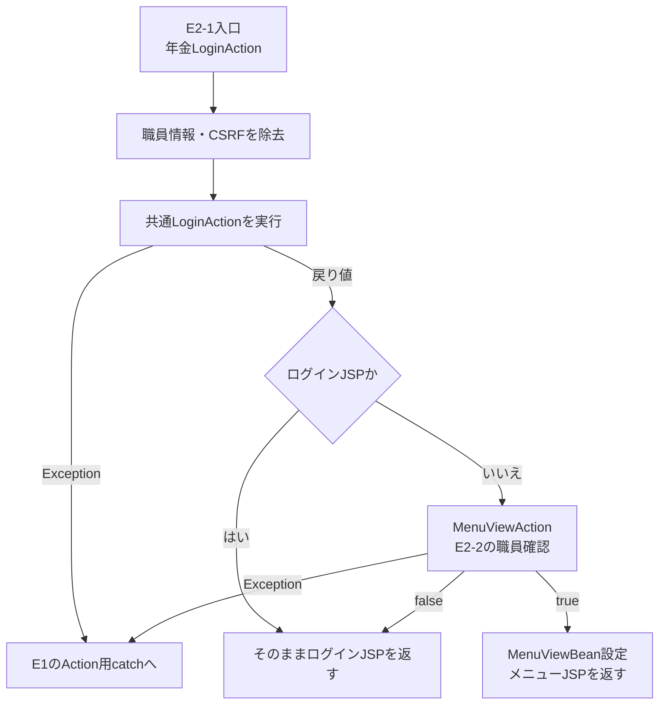

サブフローE2-2はrequireStaffの処理である。通常業務要求ではE1の共通ログイン確認を先に通過する。

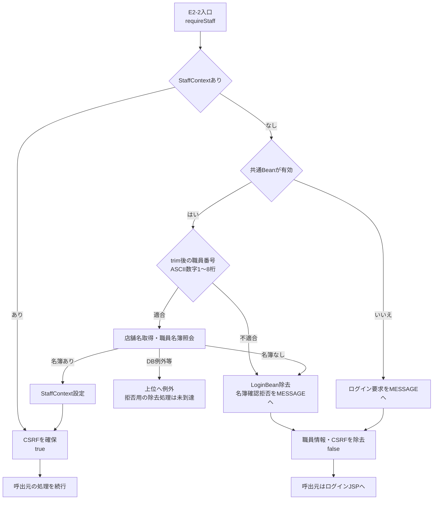

サブフローE2-3はログアウト時の属性変更である。入口ではE1の共通確認と運用可否確認を通過しており、利用者番号は除去前に退避している。

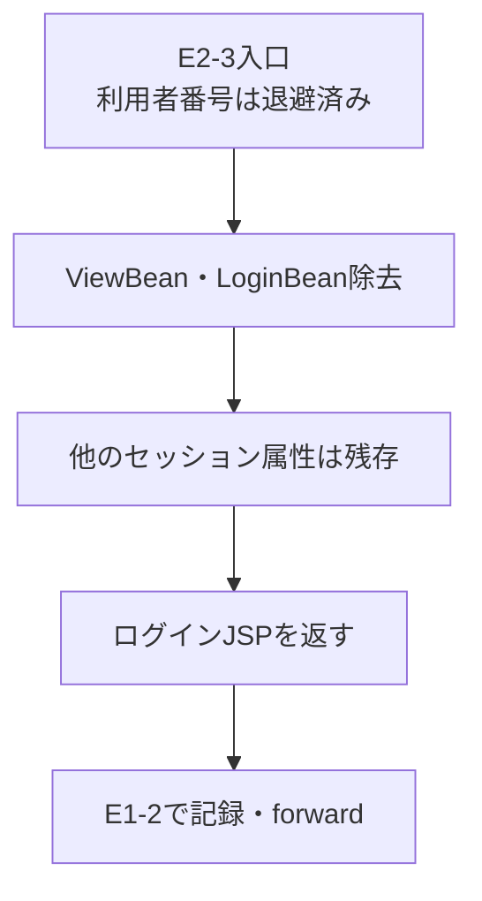

#### SQL・テーブル関連（ER図）

以下は参照対象との関連図であり、FKや多重度を示すER制約ではない。共通認証後の年金職員確認は、共通側の名簿読取り結果をそのまま転用せず、別の読取りを行う。

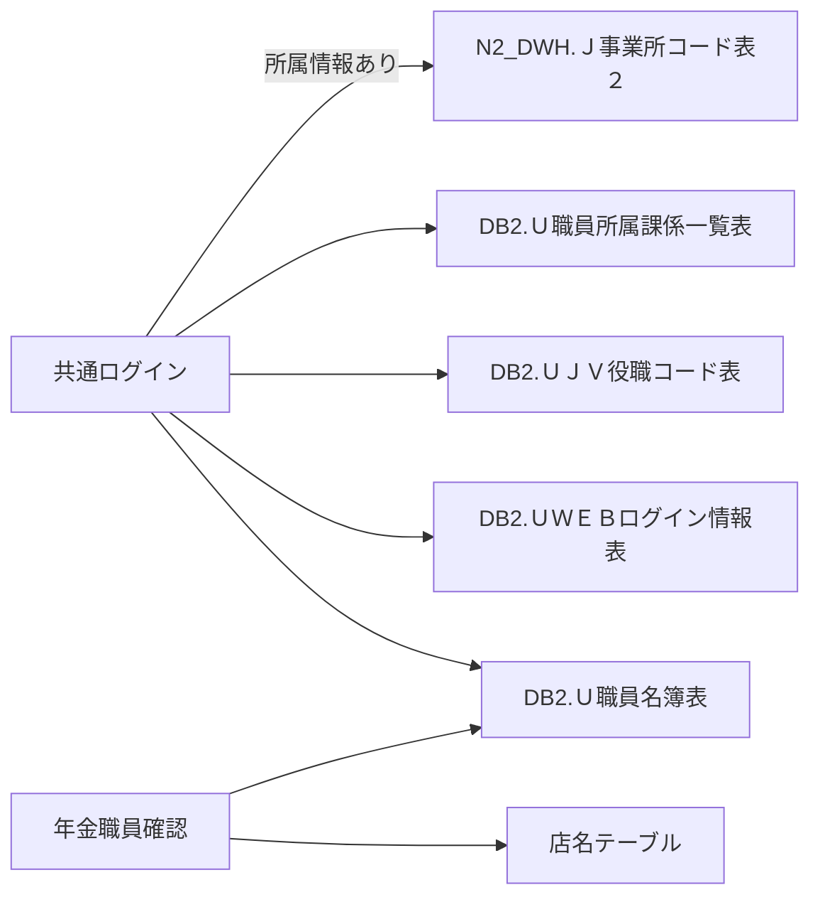

#### DB操作の詳細

年金の追加確認は、業務接続で店名テーブルをMapへ取得した後、職員接続でDB2.Ｕ職員名簿表を職員番号の等価条件で検索する。パラメータはsetIntで渡し、先頭の検索行があればStaffContextを作り、行がなければnullを返す。この処理は認証表や職員名簿を更新しない。

共通側の認証・職員・事業所検索は値を連結したSQLをStatementで実行する。共通の検索結果は全列をStringで読み、SQL NULLを空文字、非NULLをtrim済み文字列にする。年金側のPreparedStatementとnullable Integerを含むモデル変換とは異なる契約である。認証値の実値は本書の対象に含めない。

#### 結果・例外時の扱い

共通認証の成功だけでは年金業務セッションの成立を意味しない。メニュー表示には追加職員確認の成功が必要であり、通常操作で職員番号を再入力する画面は介在しない。

verifyStaffや先行する店舗名取得のDB例外は、「名簿なし」のnullへ変換されない。例外が起きた位置から上位へ伝わるため、手順2.4の属性除去まで実行されたとは判断しない。StaffContextの再利用時は所属・役職も再取得しないため、その要求で最新名簿を確認したという保証にはならない。

ログアウト後の残存属性だけを見て業務操作可能とは判断しない。通常要求の前段には共通ログイン確認がある。一方、直接JSPアクセスまで同じ確認で保護されるとは、本書で確認したAction.do経路からは確定できない。

### E3 予約保存・削除と業務更新の確定

#### 処理概要

予約の画面操作は、職員確認、受信値の取込み、POST・CSRF確認、操作別検査を経てRepositoryへ接続する。保存と削除は業務接続で確定し、後続のアクセス記録や画面描画とはトランザクションを共有しない。

#### 処理手順

**1. 操作の前提と対象を確認する。**

　**1.1.** Save・DeleteはrequireStaffを最初に呼び、失敗ならログインJSPを返す。成功後、フォーム文字列をPensionReservationへ明示的に移す。数値項目はtrim後の正数だけをIntegerとし、欠落・空文字・変換失敗・ゼロ以下はnullにする。文字列の欠落は空文字にし、チェック項目は1、true、onに一致する場合にtrueにする。

　**1.2.** 取込み後にHTTP methodがPOSTであることと、要求CSRF_TOKENがセッション値に一致することを確認する。拒否時は入力モデルと無効要求メッセージを画面Beanに設定して予約画面を再表示する。

　**1.3.** Saveは店番・ふりがな・電話番号、日付、備考を検査する。検査でエラーとなった場合も既存判定の検索を行ってから入力値とメッセージを再表示する。この検索が失敗すれば、その再表示用Bean設定まで到達しない。

　**1.4.** Saveは現在キーとORIGINALキーを別々に照会する。現在キーに既存行があり、元キーの行と同じ予約でなければ、その既存行を読み込んで確認を求める。現在行がなく元の行がある場合はキー変更を拒否する。現在行がある場合に変更権限を確認し、Repositoryへ進む。

　**1.5.** Deleteは店番とキーの入力を検査し、現在キーと元キーの照会結果が同じ対象であることを確認する。その後に削除権限を確認する。店番75で役職コードが数値として3000未満、または数値化できない職員は変更・削除を拒否する。新規登録全体や全メニューを禁止する判定ではない。

**2. Repository内で更新を確定する。**

　**2.1.** saveは受領モデルのコピーを作り、ふりがな、電話番号、備考、日付等を検証・正規化する。この前処理は接続取得用tryの前にあり、そこでのIllegalArgumentExceptionはRepositoryのDB例外ラップやrollbackを経由しない。

　**2.2.** 保存は業務接続を開いてautoCommitをfalseにし、その接続で存在を再確認する。存在すればUPDATE、なければINSERTを選び、成功時にcommitしてAuditTypeを返す。更新日・時刻・更新者・変更FLG等の保存値はRepositoryで設定する。更新者はStaffContextの職員番号であり、予約の担当者コードとは別の値である。

　**2.3.** 削除は、まずキーを正規化し、ふりがなが空または電話番号の数値化結果がnullなら接続を開かずfalseを返す。有効なキーでは業務接続を開いてautoCommitをfalseにし、対象を再取得する。不在ならrollbackしてfalseを返す。存在すれば削除時の更新日・時刻・更新者を付けて削除明細を1件追加し、本表を1件削除する。両方が成立した場合に同じ接続でcommitしてtrueを返す。

**3. 操作結果を画面へ渡す。**

　**3.1.** SaveActionはRepositoryのAuditTypeを画面分岐には使わず、戻った後に空の入力モデルと登録終了メッセージを設定する。

　**3.2.** DeleteActionはtrueなら空の入力モデルと削除終了メッセージ、falseなら受信モデルと対象不在メッセージを設定する。どちらも予約JSPを返す。以後はE1-2の記録・forwardへ進み、JSPは候補を再取得する。

#### 処理フロー

サブフローE3-1では、現在キー・元キーの各照会結果と権限判定を一括した成功状態へ置き換えない。個々の照会後に該当する枝を評価する。

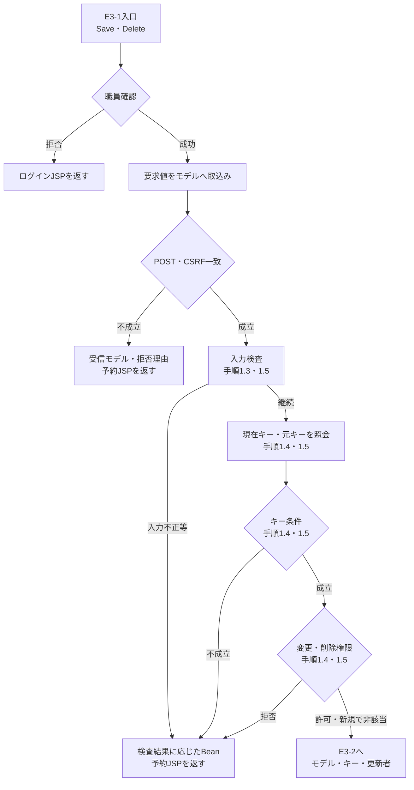

手順1.3のエラー時検索、手順1.4・1.5の対象照会、職員確認における例外は、それぞれの呼出し位置から上位へ伝わる。図の再表示枝へ一律に変換するものではない。

サブフローE3-2は、保存の前処理とDB内の確定を分ける。図中の例外出口は、Save・Delete内に個別catchがないためE1のAction実行用catchへ伝わる。

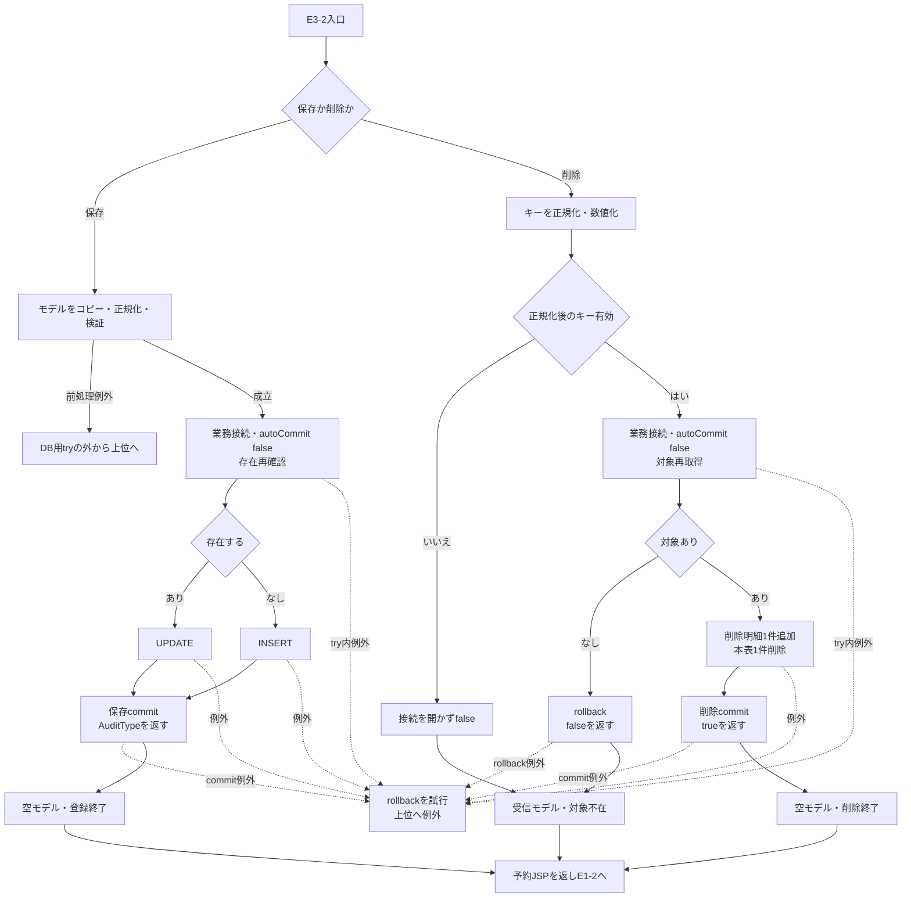

#### SQL・テーブル関連（ER図）

以下は保存・削除で扱う表と操作の関係であり、表間のFKを示さない。

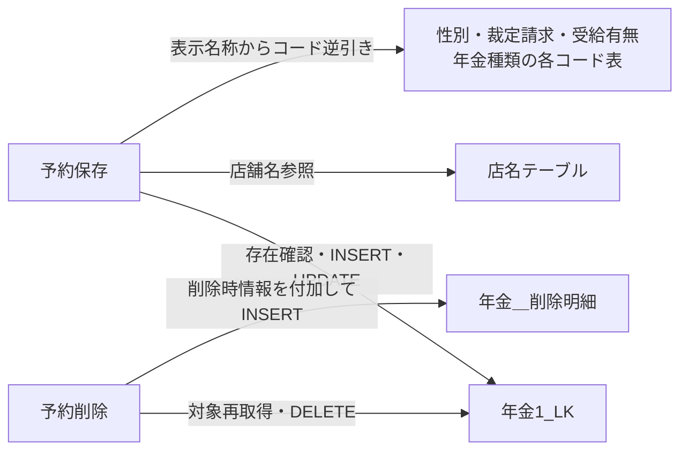

#### DB操作の詳細

保存のUPDATEと本表DELETEのWHEREは、正規化したふりがなと数値化した電話番号である。電話番号はBigDecimalでバインドする。表示名称は必要なコードへ逆引きし、日付文字列はJDBC DATEへ変換して保存する。フォームの表示文字列、業務モデルの型、DBの格納型は同一ではない。

Actionのキー比較とRepositoryのキー正規化は別処理である。ActionはNFKC・trim・英字大文字化とASCII数字抽出を使い、Repositoryのふりがなには空白集約がある。電話番号はRepositoryでUnicode数字を抽出して数値化するため、先頭ゼロの表現も保持されない。Actionの非空検査後に、Repositoryで空キーや数字のない電話番号として拒否される経路がある。

Repositoryの保存・削除・削除明細整理は、共有INSTANCEに対するsynchronizedメソッドである。同一JVM内の当該呼出しを直列化するが、Actionの事前照会、他JVM、別接続からの更新は囲まない。比較版をWHEREへ含める処理はない。収録DDLでは予約本表・削除明細にPK・一意制約はなく、検索キー索引は非一意である。

#### 結果・例外時の扱い

Actionの事前確認とRepositoryの再確認は別時点である。Repository内の再確認は保存方法を選ぶ存在確認であり、ORIGINALキーや職員権限の再判定ではない。Actionが新規と判断した後、別処理で同じキーが作られれば、Repository側はUPDATEを選ぶ余地がある。Actionの権限判定だけから、競合後の更新まで同じ条件で拒否できるとは保証しない。

保存成功はRepositoryのcommitが正常に戻った時点、削除成功は削除明細と本表削除のcommitが正常に戻った時点である。保存は現在行をINSERTまたはUPDATEし、変更前後を独立履歴として毎回追加する処理ではない。

Repositoryのtry内例外ではrollbackを試み、DBアクセス例外へ変換する。保存では既存のNenkinDataAccessExceptionをそのまま再送出する枝もある。共通rollback補助の失敗とclose失敗は元の結果を優先して抑制される。commit例外後の永続状態は、例外が返ったという事実だけでは確定できない。削除のfalseには接続前の正規化後キー不成立と、接続内での対象不在がある。Actionはどちらも対象不在メッセージへ変換するが、接続・rollbackの有無は異なる。DB例外による失敗とは区別する。

### E4 店舗別Excel・日次月次出力

#### 処理概要

店舗別Excelは予約を検索して出力する参照処理である。日次・月次は新規・変更・削除を区分別に抽出するほか、指定がある場合に削除明細整理を先に確定する。両者の出力バイナリはメモリで完成させ、ActionからHTTP応答へ書き出す。

#### 処理手順

**1. 出力要求を受け付ける。**

　**1.1.** 店舗別Excelは職員確認後にBRANCH_NOをtrimして保持し、正数Integerへ変換する。空欄・変換不能を拒否し、続いてASCII数字3桁以内を検査する。店舗名を照会し、名称が見つからなくても店舗別抽出へ進む。予約の取得件数が0なら入力Beanとメッセージを設定してExcel画面へ戻る。

　**1.2.** 日次・月次は職員確認後に入力値をBeanへ保持し、POST・CSRF、出力区分の一つ以上選択、任意の職員番号を順に確認する。職員番号空欄は全職員を対象にする。画面で受理した条件をPensionBatchExportRequestへ移し、サービスへ渡す。

　**1.3.** 日次・月次サービスは要求と区分選択、対象日・期間、職員番号を検査する。サービス単体で受け取れる値と、Actionが受理するフォーム値の範囲は同一としない。

**2. 整理・抽出・生成を行う。**

　**2.1.** 日次・月次で削除基準日が非空なら、削除明細整理を先に呼ぶ。整理は独自の業務接続で削除してcommitし、終了する。その接続を後続出力へ引き継がない。

　**2.2.** 店舗別Excelは予約Listを明細Listへ移す。日次・月次は選択区分ごとに本表または削除明細から検索し、0件区分のメッセージを保持する。データがある区分は追加ソート、明細変換、レイアウト設定を行う。

　**2.3.** OpenXmlWorkbookWriterはByteArrayOutputStream上のZipOutputStreamへ構成XMLを書き、単一シートxlsxのbyte配列を返す。日次・月次は区分別の生成物を保持し、0ファイルなら空内容、1ファイルならそのxlsx、複数ならZIPを結果に設定する。どの枝でもファイル情報とメッセージを引き継ぐ。

**3. 結果を画面または直接応答へ渡す。**

　**3.1.** 日次・月次で内容がなければメッセージをBeanへ設定し、日次・月次画面を返す。内容があれば出力結果を直接送信する。複数ファイルのZIPに未出力区分のメッセージがある場合は、出力結果.txtも含める。単独xlsxでは、そのメッセージを別ファイルとして添付しない。

　**3.2.** writeDownloadはファイル名をUTF-8でエンコードし、response.reset、Content-Type、Content-Disposition、Content-Length設定の後、完成済みbyte配列をwrite・flushする。送信後のAction戻り値CSVはE1でforwardを抑止する制御値であり、生成ファイル形式ではない。

#### 処理フロー

サブフローE4-1は受付である。店舗別Excelは手順1.1の検査、日次・月次は手順1.2の順序で拒否理由とBeanを決める。拒否後もE1-2のforwardによる描画が続く。

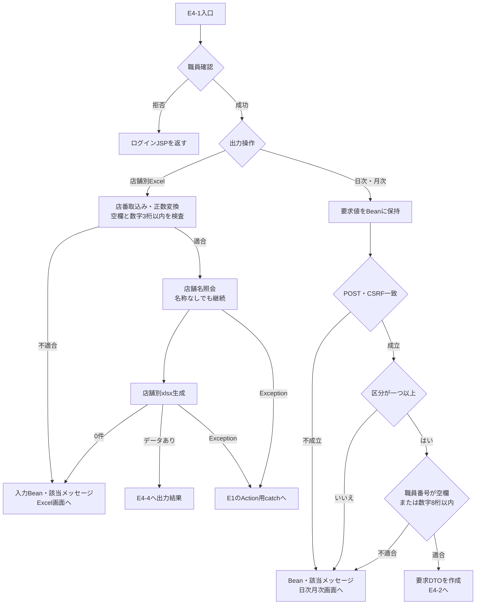

サブフローE4-2は日次・月次の整理と生成である。個別catchはサービス呼出しから送信までのtryに適用される。IllegalArgumentExceptionとそれ以外のExceptionを同じ失敗出口へまとめない。

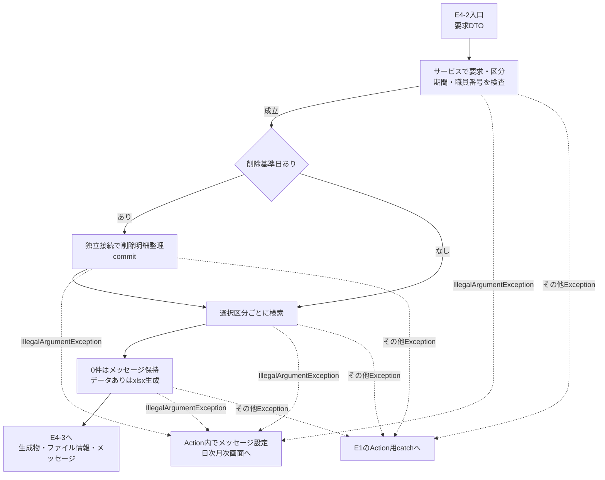

どの例外出口へ進んでも、先に正常commitした削除明細整理は戻さない。整理そのもののcommit例外では、確定済みと断定しない。

サブフローE4-3は生成物の数による結果選択である。ファイル情報とメッセージは三つの枝すべてで保持する。

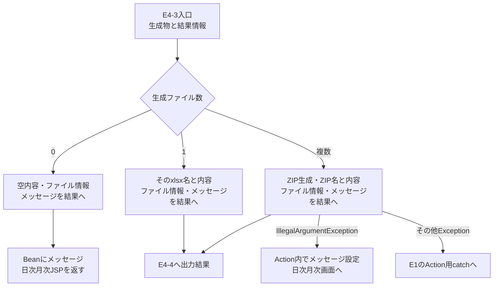

サブフローE4-4は店舗別Excelと内容ありの日次・月次に共通する。入口はファイル名・Content-Type・完成済みbyte配列である。送信中の例外は操作別のcatchへ伝わり、既に応答を確定していれば再表示への切替えは保証できない。

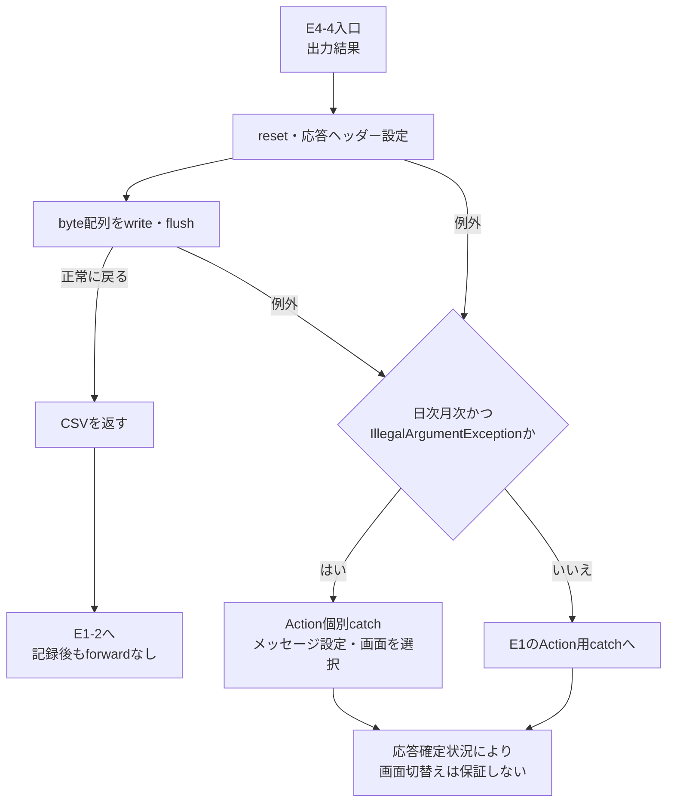

#### SQL・テーブル関連（ER図）

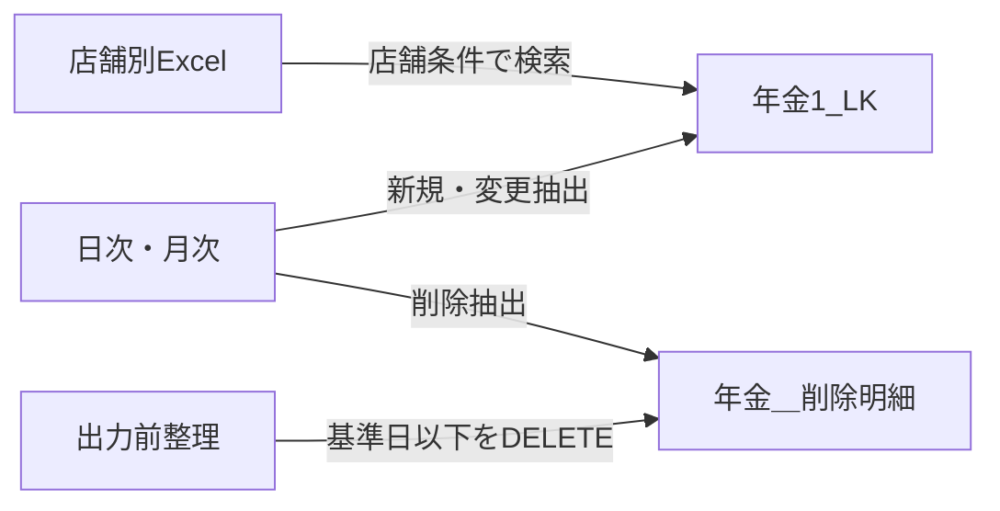

図は抽出元と整理対象の関連を示す。予約検索時の名称参照を含む列単位の関係はDB-OPSへ接続する。

#### DB操作の詳細

新規・変更の抽出元は予約本表であり、変更FLGをそれぞれ0・1で絞る。削除区分は削除明細を読む。期間と任意の更新者を検索条件に使う。日次・月次の出力区分や期間は検索・生成制御値であり、それ自体を予約列へ保存する処理ではない。

削除明細整理はデータ更新日が基準日以下の行をDELETEし、件数を取得してcommitする。基準日はJDBC DATEとしてバインドする。区分別検索、xlsx・ZIP生成、HTTP送信とは接続・トランザクションを共有しない。店舗別Excelの予約検索は業務表を更新しないが、E1の共通アクセス記録は別途発生する。

#### 結果・例外時の扱い

日次・月次Actionの個別catchはIllegalArgumentExceptionをメッセージ付きの画面再表示へ変える。その他のExceptionは共通側へ伝わる。出力0件、入力拒否、DB失敗、生成失敗、送信失敗は同じ結果ではない。

削除明細整理が正常commitした後に抽出・生成・送信で失敗しても、整理済みの行は出力処理のrollback対象にならない。HTTP送信後にアクセス記録が失敗した場合も、先行する出力応答と記録の成否は独立する。

生成用List、xlsx・ZIPのbyte配列、結果オブジェクトは要求内で保持する。大きな検索結果や複数ファイルでは、明細と生成物、cloneされた配列が併存する。サーバー上の出力ファイルや永続キューへ退避する処理はない。

## 補足説明

### 接続取得とキャッシュ

NenkinDataSourceは各系統で、短いJNDI名、java:comp/env/付き同名の順に探索する。取得物がDataSourceなら採用し、NamingExceptionなら次候補へ進む。最後まで採用できなければSQLExceptionを投げ、最後のNamingExceptionがあればcauseへ付ける。

三つのDataSourceはstatic volatileフィールドに保存し、初回取得時はクラス単位の同期内でも再確認する。各open呼出しはキャッシュ済みDataSourceから新しいConnectionを取得する。キャッシュ解除の入口がないため、JNDIを再登録しただけで既存キャッシュが更新されるとは扱わない。

CommonUtilは指定された一つのJNDI名をlookupし、Connection取得後にautoCommitをfalseにする。NenkinDataSourceは取得時にautoCommitを変更せず、保存・削除・削除明細整理が個別にfalseを設定する。年金の参照接続について、autoCommitと分離レベルの固定値はこの取得処理からは定まらない。

### 記録と出力用監査モデルの意味

予約本表は現在の予約行と変更FLGを持ち、削除明細は削除時の内容を保持する。アクセス記録は要求識別値と記録上のJSP名等を保持する。これらは異なる目的のデータであり、全更新の変更前後を網羅した一つの監査履歴ではない。

PensionAuditRecordのauditIdは検索結果を読みながら1から付与するメモリ上の連番であり、DBに永続化された監査IDではない。MESSAGEによって記録JSP名がSubMessage.jspになる場合も、実際のforward先や描画成功を示す値にはならない。

### 通常導線と共通・互換資源の境界

| 資源・入口 | 本システムでの位置付け |
| --- | --- |
| 店舗・担当者・顧客参照 | 通常画面からiframe対象のPOSTでLookup/Viewを開き、同一originとメッセージ内source識別値を確認して選択値を受け取る。顧客選択後はLOOKUP_KANA・LOOKUP_PHONE等を保持してPension/Loadへ進む |
| 予約画面の候補ボタン | TARGETをcustomerへ置き換えて顧客参照を開く。予約RepositoryのsearchCandidatesを呼ぶ通常機能ではない |
| PensionLookupAction | 職員確認後、POST以外を405とし、POSTではJSONを直接返してCSVを戻す実装がある。付属JSP・assetsからの呼出しは確認できず、通常UIの非同期照会には含めない |
| StaffViewAction・StaffVerifyAction・StaffClearAction | すべてMenuViewActionへ委譲する。旧職員入力画面を通常ログイン後の再入力機能として追加しない |
| StaffViewBean | コメント上の役割は旧セッションのデシリアライズ互換である。通常の職員確認情報はStaffContextが担う |
| searchCandidates・findLatestAuditType | 実装宣言はあるが、確認範囲の年金ソースに呼出元がない。通常接続されたRepository機能とは区別する |
| 登録内容印刷 | ReportPreviewActionが予約検索結果をReportViewBeanへ保持し、Report.jspで表示してwindow.printを呼ぶ。ブラウザー印刷であり、サーバーPDF出力ではない |
| 共通Servletの旧GET/PDF経路 | OPKとcharCommonUIDがともに未設定ならPDFUtilへ進む。セッションagent、コールバック結果、タイマーを使う別経路であり、年金の登録内容印刷との接続は確認できない |
| 共通の特殊連携・他業務分岐 | OPK、Otheflg、charCommonUID等による分岐や、credit・bat・cif・ringi等のログイン分岐がある。通常年金フォームのunify条件とは区別し、他業務の画面や代行店舗選択を年金の通常機能へ拡張しない |

旧GET経路はPDFUtil呼出しまたはprocess呼出しを外側のcatchでログ出力するが、POST側のAction例外と同じ共通エラー遷移を設定しない。反射規則からActionが選択され得ることと、通常画面から利用されることも別の到達性である。

### ローカル互換構成と配置契約

H2JndiSetupListenerはn2nenkin.localDbの既定値falseでは初期化を行わない。有効時はローカルDBを初期化し、schema.sql、data.sqlの順に適用して、同じDataSourceをOracle_SP2NM、Oracle_DWH、RAROA_DB、RAROA_SHAREの各JNDI名へ登録する。通常構成の用途別三系統に対し、ローカル互換構成は一つのDataSourceへ集約する。論理接続先が同じDataSourceでも、業務更新とアクセス記録の別Connection・別commitという処理境界は変わらない。

ローカルDBの既定保存先はWEB-INF/local-db/nenkinで、n2nenkin.db.pathによる変更がある。終了時はJNDI登録解除とSHUTDOWNを試みる。収録SQL Server DDLの作成対象は年金業務7表であり、職員・顧客表は既存Oracle表として作成対象から分けている。

収録ビルド定義は、既存n2frameworkのWEB-INF/classesをFW.jarへまとめ、年金ソースをコンパイルする構成である。共通ソース、使用される既存class、配備FW.jarが一致することは、配置契約とは別に確認が必要である。

### 関連文書との責務分担

下表は全体計画上の参照先である。相対パスは本書の共通/システム分析.mdを起点とし、各文書の生成状態は未確認である。

| 文書ID | 計画上の相対パス | 本書から接続する契約 |
| --- | --- | --- |
| COM-012 | 共通仕様書_COM-012_共通コントロールサーブレット.md | 共通要求分岐、反射生成、アクセス記録、forward、旧GET/PDF経路 |
| COM-015 | 共通仕様書_COM-015_ログイン処理.md | 共通認証用値への組替え、共通表参照、LoginInfoBean設定、ログアウト |
| COM-111 | 共通仕様書_COM-111_年金業務共通処理.md | 職員確認、CSRF、変更・削除制限、入力変換、キー比較、直接応答 |
| API-NENKIN | 要求処理一覧.md | HTTP入口、識別値、フォーム・JSON・ダウンロードの応答と捕捉境界 |
| DB-OPS | DB仕様書/DB操作仕様書.md | SQL全文とJDBC、三系統接続、保存・削除・整理・記録の確定境界 |
| ENV-NENKIN | 設定・配置・依存仕様書.md | Servlet・Listener、JNDI探索とキャッシュ、ローカルDB、ビルド依存 |
| DATA-CONTRACTS | データオブジェクト定義書.md | 画面Bean、要求・業務モデル、候補、出力結果の型とコピー範囲 |
| OUTPUT-NENKIN | 帳票一覧.md | ブラウザー印刷、店舗別xlsx、日次月次xlsx・ZIPの内容と形式 |

本書で区別した各確定境界は、業務DBのcommit、削除明細整理のcommit、アクセス記録のcommit、JSP描画、HTTP送信である。一つの境界の成立を、他の境界の成立条件として読み替えない。
