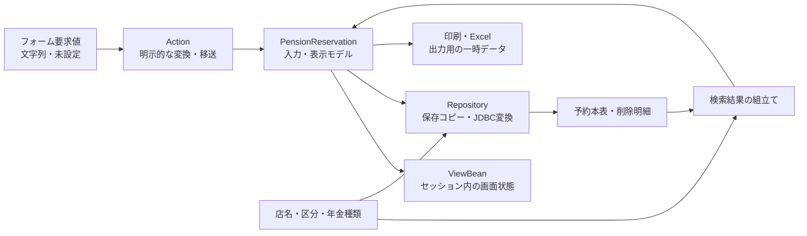

<!-- spec-meta: {"schema":"spec-md/1.0","documentId":"DATA-CONTRACTS","version":"2.0","path":"共通/データオブジェクト定義書.md","sheets":[{"heading":"概要","kind":"GRID","sheet":"概要"},{"heading":"保持領域と共通変換","kind":"GRID","sheet":"保持領域と共通変換"},{"heading":"予約モデル","kind":"GRID","sheet":"予約モデル"},{"heading":"画面状態","kind":"GRID","sheet":"画面状態"},{"heading":"参照候補","kind":"GRID","sheet":"参照候補"},{"heading":"職員セッション","kind":"GRID","sheet":"職員セッション"},{"heading":"監査データ","kind":"GRID","sheet":"監査データ"},{"heading":"出力要求・結果","kind":"GRID","sheet":"出力要求・結果"},{"heading":"補足説明","kind":"GRID","sheet":"補足説明"}]} -->
# 年金データオブジェクト定義

| 属性 | 内容 |
| --- | --- |
| 文書種別 | 共通データ契約定義書 |
| システム名 | 年金自動受取予約管理システム |
| 共通/文書ID | DATA-CONTRACTS |
| 版 | 2.0 |
| 解析対象 | 年金のViewBean、予約・候補・職員・監査モデル、出力要求・結果、および接続する共通LoginInfoBean |
| 基準日 | 2026-10-15 |

## 概要

本書は、利用者が送信した文字列が、画面状態、検索引数、予約の保存値、表示名称、出力ファイルへ移る際のデータ契約を定義する。対象クラスのフィールドに加え、値を設定するAction、変換処理、RepositoryのJDBCバインド、取得結果の表示までを対応付ける。

予約の中心となる`PensionReservation`は、入力、DB取得結果、印刷、Excel出力で共用する可変モデルである。店名や区分名称などの表示値を含む一方、更新者、更新時間、変更FLGは含まない。画面状態を表す`existing`、検索条件、ページ番号、出力区分は、それぞれ別の保持領域で扱う。

図の矢印はデータの移送・変換を示す。DB間の外部キー制約や多重度は示さない。職員名簿と顧客基本表は別系統の接続を使い、その候補に付ける店名は業務DBから取得したMapによるメモリ上の突合せである。

## 保持領域と共通変換

### 保持領域

| 保持領域・属性 | 格納内容 | 保持・置換の契約 |
| --- | --- | --- |
| セッション`ViewBean` | `MenuViewBean`、`PensionViewBean`、`ReportViewBean`、`ExcelViewBean`、`BatchViewBean` | 主画面で共用する一つの属性。画面遷移や再表示時に別のBeanへ置き換えるため、画面ごとに独立した状態を同時保持する構成ではない。 |
| セッション`SubWindowBean` | `LookupViewBean` | 参照画面の検索条件、ページ情報、表示対象候補を保持する。主画面の`ViewBean`とは別属性である。 |
| セッション`LoginBean` | 共通の`LoginInfoBean` | 共通ログインの結果と職員・所属等を保持する。年金の業務用職員情報とは別オブジェクトである。 |
| セッション`NENKIN_STAFF_CONTEXT` | `StaffContext` | 年金の職員確認結果。更新者の設定、職員表示、変更・削除の制限判定に使う。 |
| セッション`NENKIN_CSRF_TOKEN` | 照合用`String` | 保存、削除、日次・月次実行の要求値`CSRF_TOKEN`との照合に使う。予約列には保存しない。 |
| ブラウザー内のフォーム・DOM | 入力値、hidden値、候補から選択した名称、モーダルの状態 | 送信対象のコントロールと表示用spanを区別する。spanの表示名を変えても、その名称がフォーム値として送信されるとは限らない。 |
| Action・サービス内のメモリ | 受信値から作るモデル、出力要求、検索結果、行配列、出力結果 | 処理のローカル変数として受け渡す。出力結果DTOやファイル本体をセッションへ保存する処理は確認されない。 |

対象のBean、モデル、公開出力要求・結果は`Serializable`を実装する。ただし、この宣言だけでDB永続化、セッション複製、再起動後の復元を保証するものではない。

### HTTP要求からJava値への変換

フォーム値は`HttpServletRequest.getParameter`で取得し、Actionが明示的にBeanやモデルへ設定する。JSONから要求DTOへ自動バインドする構成ではない。共通POST入口は要求の文字コードにWindows-31Jを指定するが、DTOが扱うのはServletコンテナーによる復号後のJava文字列である。

| 変換 | 入力と結果 | 適用上の注意 |
| --- | --- | --- |
| `trim(String)` | `null`は空文字、それ以外はJavaの`trim()`結果 | NFKC、内部空白の集約、数字抽出は行わない。後段の正規化とは別処理である。 |
| Actionの`integerOrNull(String)` | trim後の空文字、変換失敗、Integer範囲外、ゼロ以下は`null`。正の値だけを`Integer`として返す。 | ブラウザーのmaxlengthに相当する桁数検査ではない。変換失敗の理由を数値属性に保持しない。 |
| `integerOrDefault(String, int)` | 上記の変換結果が`null`なら指定した既定値 | 参照ページと印刷の並び順は通常1を既定値とする。 |
| `isChecked(request, name)` | 未設定は`false`。設定値が`1`、大小文字を区別しない`true`または`on`の場合だけ`true` | 値のtrimは行わない。任意の非空文字列を真とは扱わない。 |
| 年金側のString setter | 原則として`null`を空文字にする | trim、日付検査、名称からコードへの変換は行わない。Menu・予約Beanの職員表示値、Lookupのtargetには個別の代替値がある。 |
| 共通`LoginInfoBean`のsetter | 引数を直接代入 | Stringの`null`をそのまま保持できる。年金側モデルと同じ空文字化契約ではない。 |

DTOの初期値、Java型、画面のreadonlyやmaxlengthは、それぞれの層の属性である。これらからHTTP要求値の妥当性やDB列のNOT NULLを推定しない。

## 予約モデル

### 型、初期値、コピー

`PensionReservation`の`branchNo`、`customerNo`、`staffCode`、`plannedAge`は`Integer`で、初期値は`null`である。次表のString属性はすべて空文字、boolean属性はすべて`false`で初期化する。String setterは`null`を空文字に変えるが、数値属性のsetterには正数検査がなく、boolean属性には未設定を表す第三の状態がない。

コピーコンストラクターと`copy()`は、宣言された全属性を新しい予約モデルへ移す。StringとIntegerは参照、booleanは値を代入する。内部に配列やコレクションは持たない。コピー元が`null`の場合は、各初期値を持つ新規モデルとなる。

Repositoryの保存準備は予約のコピーを加工する。ふりがなの正規化、日付の再変換、更新日の設定を行っても、呼出元モデルの各フィールドを直接書き換える処理ではない。一方、`PensionViewBean`の非null予約設定とgetterは同じモデル参照を渡し、コピーしない。

### フォーム、モデル、保存列の対応

次表のDB型は提供SQL Server用DDLの宣言である。予約本表`年金1_LK`と`年金＿削除明細`の28列はすべてNULL可で、PK宣言はない。通常保存時の必須条件は後述のAction・Repository検査であり、DBのNOT NULL制約ではない。

JDBC位置は`bindRecord`を位置1から呼んだ場合の順序を表す。「整数」は、非null時に`setInt`、null時に`setNull(Types.INTEGER)`を使う共通処理を示す。文字列の`setString`にサイズ引数はない。UPDATEは28項目を設定した後、位置29に正規化ふりがな、位置30に数値電話番号を追加して対象を指定する。

| 論理項目・Java属性 | 実コントロール／要求名 | 保存列・DB型 | JDBC位置・設定 | 入力・表示・保存の契約 |
| --- | --- | --- | --- | --- |
| 店番 `branchNo: Integer` | `branchNo`／`BRANCH_NO` | 店番 `INT` | 1・整数 | ブラウザーmaxlength=3。Actionでは正のIntegerへ変換し、保存時は非null必須。店名表示と店舗参照の基準にも使う。 |
| 店名 `branchName: String` | 表示span `branchName`。受信項目なし | 予約には店名列なし。参照元は店名テーブル.店名 `NVARCHAR(80) NOT NULL` | 保存パラメータなし | 店番と店舗ｺｰﾄﾞのLEFT JOIN等で得る名称。結合不成立や取得値nullはモデル上で空文字となる。 |
| 顧客番号 `customerNo: Integer` | `customerNo`／`CUSTOMER_NO` | 顧客番号 `BIGINT` | 2・整数 | ブラウザーmaxlength=7。保存必須検査の対象ではなく、空欄・変換失敗はnullで進む。顧客基本読込みでは店番とともに必要。JavaとJDBCはInteger・setIntであり、BIGINT全域を扱う契約ではない。 |
| 担当者コード `staffCode: Integer` | `staffCode`／`STAFF_CODE` | 担当者コード `INT` | 3・整数 | ブラウザーmaxlength=4。予約に割り当てる担当者。空欄・変換失敗はnull。ログイン職員を示す更新者とは別である。 |
| 顧客氏名 `customerName: String` | `customerName`／`CUSTOMER_NAME` | 顧客氏名 `NVARCHAR(100)` | 4・`setString` | 受信値をtrimして保存。空欄をSQL NULLへ置き換える共通処理はなく、空文字として渡す。 |
| フリガナ `kanaName: String` | `kanaName`／`KANA_NAME` | ふりがな `NVARCHAR(100)` | 5・`setString` | 保存時必須で予約キーの一部。保存コピーではNFKC、空白集約、大文字化を行う。既存表示時はreadonly。DB容量とは別の文字数上限検査は確認されない。 |
| 性別 `gender: String` | `gender`／`GENDER` | 性別 `TINYINT` | 6・名称を逆引きして整数 | フォームとモデルは表示名称を保持。空選択は保存コードnull。非空名称がコード表に存在しない場合は保存失敗となる。 |
| 住所 `address: String` | textarea `address`／`ADDRESS` | 住所 `NVARCHAR(300)` | 7・`setString` | trim後文字列を保存。空欄は空文字として渡す。 |
| 電話番号 `phoneNumber: String` | `phoneNumber`／`PHONE_NUMBER` | 電話番号 `DECIMAL(15,0)` | 8・`setBigDecimal`、null時`Types.DECIMAL` | 受信・表示はString、予約検索と保存は数字抽出後の数値。保存時は数字が得られることが必要。既存表示時はreadonly。 |
| 生年月日 `birthDate: String` | `birthDate`／`BIRTH_DATE` | 生年月日 `DATE` | 9・`setDate`、空値時`Types.DATE` | ブラウザーmaxlength=14。空欄は任意、非空は日付検査後にISO形式へ変換。画面は和暦表示に変換する。 |
| 国民年金 `nationalPension: boolean` | checkbox／`NATIONAL_PENSION` | 種類：国民年金 `BIT` | 10・`setInt`で1または0 | 未送信はfalse。合成年金種類コードへの加算値は1。 |
| 厚生年金 `employeePension: boolean` | checkbox／`EMPLOYEE_PENSION` | 種類：厚生年金 `BIT` | 11・`setInt`で1または0 | 未送信はfalse。合成への加算値は2。 |
| 共済年金 `mutualAidPension: boolean` | checkbox／`MUTUAL_AID_PENSION` | 種類：共済年金 `BIT` | 12・`setInt`で1または0 | 未送信はfalse。合成への加算値は4。 |
| 厚生年金基金 `employeePensionFund: boolean` | checkbox／`EMPLOYEE_PENSION_FUND` | 種類：厚生年金基金 `BIT` | 13・`setInt`で1または0 | 未送信はfalse。合成への加算値は8。 |
| 国民年金基金 `nationalPensionFund: boolean` | checkbox／`NATIONAL_PENSION_FUND` | 種類：国民年金基金 `BIT` | 14・`setInt`で1または0 | 未送信はfalse。合成への加算値は16。 |
| 年金種類名称 `pensionType: String` | 直接の受信項目なし | 保存先は年金種類 `INT`。名称取得元は年金種類テーブル.年金種類 `NVARCHAR(120) NOT NULL` | 15・チェックから合成したコードを整数設定 | モデル値はJOINで得る名称。保存コードはこの文字列から取得せず、五つのチェックから計算する。全未選択ならSQL NULL。 |
| 裁定請求書徴収 `claimStatus: String` | `claimStatus`／`CLAIM_STATUS` | 裁定請求 `TINYINT` | 16・名称を逆引きして整数 | 裁定請求テーブルの表示名称を送受信。空欄はコードnull、非空で逆引きできなければ保存失敗。 |
| 請求予定日 `claimScheduledDate: String` | `claimDate`／`CLAIM_SCHEDULED_DATE` | 請求予定日 `DATE` | 17・`setDate`、空値時`Types.DATE` | ブラウザーmaxlength=14。空欄は任意。画面は西暦スラッシュ形式へ表示変換する。 |
| 予定年齢 `plannedAge: Integer` | `plannedAge`／`PLANNED_AGE` | 予定年齢 `INT` | 18・整数 | ブラウザーmaxlength=3。空欄・変換失敗・ゼロ以下はnull。ブラウザーの補助計算は請求予定年から出生年を引く。サーバーは受信値を再計算しない。 |
| 配偶者名 `spouseName: String` | `spouseName`／`SPOUSE_NAME` | 配偶者名 `NVARCHAR(100)` | 19・`setString` | trim後文字列。空欄は空文字として渡す。 |
| 配偶者生年月日 `spouseBirthDate: String` | `spouseBirthDate`／`SPOUSE_BIRTH_DATE` | 配偶者生年月日 `DATE` | 20・`setDate`、空値時`Types.DATE` | ブラウザーmaxlength=14。空欄は任意。画面は和暦表示へ変換する。 |
| 受給有無 `hasBenefit: String` | `hasBenefit`／`HAS_BENEFIT` | 受給有無 `TINYINT` | 21・名称を逆引きして整数 | booleanではなく表示名称を持つString。空欄はコードnull、非空で逆引きできなければ保存失敗。 |
| 予約徴求日 `reservationRequestDate: String` | `requestDate`／`RESERVATION_REQUEST_DATE` | 予約徴求日 `DATE` | 22・`setDate`、空値時`Types.DATE` | ブラウザーmaxlength=14。空欄は任意。画面は西暦スラッシュ形式へ表示変換する。 |
| 備考 `notes: String` | textarea `notes`／`NOTES` | 備考 `NVARCHAR(400)` | 23・`setString` | trim後にWindows-31Jへの変換可否と56バイト以内を検査。DB容量400とは別の業務制約であり、自動切捨ては行わない。 |
| データ更新日 `dataUpdateDate: String` | readonlyの`dataUpdateDate`／`DATA_UPDATE_DATE` | データ更新日 `DATE` | 24・`setDate`、空値時`Types.DATE` | 要求値はモデルへ読まれるが、通常保存では保存コピーに当日を設定して上書きする。削除明細作成でも当日を設定する。 |
| 更新時間・予約モデルに属性なし | フォーム受信なし | 更新時間 `TIME(0)` | 25・`setTime`、短い値は`Types.TIME` | Repositoryが生成した現在時刻の先頭8文字を使う。生成時刻に含まれるミリ秒は保存しない。 |
| 更新者・予約モデルに属性なし | フォーム受信なし | 更新者 `INT` | 26・整数 | 通常保存・削除ではログイン中の`StaffContext.staffNo`を引数として渡す。 |
| ６ヶ月先確認 `sixMonthCheck: boolean` | checkbox／`SIX_MONTH_CHECK` | ６ヶ月先確認 `BIT` | 27・`setInt`で1または0 | 未送信はfalse。表示・Excelでは真を「確」とする投影がある。 |
| 変更区分・予約モデルに属性なし | フォーム受信なし | 変更FLG `TINYINT` | 28・整数 | INSERTは0、UPDATEは1、削除明細への追加はnull。`AuditType`の文字コードとは別表現である。 |

整数属性のDB読取りは`getInt`の後に`wasNull`を確認し、SQL NULLをIntegerのnullとして残す。一方、五つの種類フラグと６ヶ月先確認は`getInt(...) != 0`で読み、SQL NULLもfalseに集約する。Stringは取得値nullをsetterで空文字に変えるため、DBのNULLと空文字をモデルから区別できない項目がある。

### 予約キー、電話番号、日付、名称の変換

予約のDB検索キーは、正規化したふりがなと数値電話番号である。RepositoryはふりがなをNFKC変換し、trim、全角空白の置換、連続半角空白の集約、大文字化を行う。検索は`R.ふりがな = ? AND R.電話番号 = ?`で、順に`setString`と`setBigDecimal`を使う。正規化後のふりがなが空、または電話番号から数字が得られなければ、検索はDBへ進まずnullを返す。

Actionの`sameReservationKey`は別の比較である。ふりがなはtrim後にNFKCと大文字化を行うが、内部空白を集約しない。電話番号はNFKC後のASCII数字列を比較し、先頭ゼロを残す。Repositoryの数値比較と同じ同値関係ではない。

電話番号の数字抽出はJavaのchar単位で`Character.isDigit`と`Character.digit`を使い、該当する数字をASCII数字へ移す。その他の文字は除去し、得た数字列を`BigDecimal`へ変換する。符号、区切り記号、元の先頭ゼロは保存形式に残らない。数字がない場合はnullだが、数字列「0」は数値0となり、数字がない場合とは異なる。電話番号の正数限定や15桁以内を保存前に明示検査する処理は確認されない。

電話番号の再表示は取得文字列から数字を抽出し、余分な先頭ゼロを除く。その結果が9桁または10桁で先頭が0でない場合に限り、0を一つ補う。元のハイフン位置や入力時の桁表現を復元する契約ではない。

日付文字列は、NFKC後に西暦の年・月・日をスラッシュ、ドット、ハイフンで区切った形式、8桁の`yyyyMMdd`、明治から令和の和暦形式を解析する。和暦は元号名またはM・T・S・H・R、元年または数値年を扱い、実在日と元号の開始・終了範囲を検査する。非空の正常値は`yyyy-MM-dd`となる。

保存Actionの日付検査順は、生年月日、配偶者生年月日、請求予定日、予約徴求日である。最初の不正項目で戻るため、その前の項目だけが正規化済みとなり、後続項目は入力文字列のまま残る場合がある。Repositoryの保存コピーでは、生年月日、請求予定日、予約徴求日、配偶者生年月日の順に再変換する。空値はJDBC DATEのNULL、非空値は`java.sql.Date.valueOf`を経由して設定する。

性別、裁定請求、受給有無のselectは、`CodeLookupItem.code`ではなく`label`をoption値として送る。保存時はそれぞれ性別→性別ｺｰﾄﾞ、裁定請求→裁請ｺｰﾄﾞ、受給有無→受給ｺｰﾄﾞを名称一致で逆引きする。空名称はnull、非空で該当行がなければ`SQLException`である。読取りはコード列とのLEFT JOINで名称に戻すため、参照先が欠けた名称は空表示となり得る。

年金種類は五つのbooleanから1・2・4・8・16を加算する。合計0はSQL NULL、非ゼロは年金種類テーブルに合成コードが存在することを確認して保存する。個別フラグと合成コードを同時に設定し、表示用`pensionType`を直接保存コードとして扱わない。

備考は、通常Actionではtrim後文字列に対してWindows-31Jへの変換可否と56バイト以内を確認し、Repositoryの保存コピーでも再検査する。文字数やJavaの文字列長による56文字制限ではない。変換不能や超過は拒否し、保存経路で切り捨てる処理はない。

### 操作別の入力条件と状態移送

保存Actionでは、変換後の店番が非null、trim後のフリガナと電話番号が非空であることを先に確認する。顧客番号、担当者コード、予定年齢はこの操作の必須項目ではなく、空欄・不正数値・ゼロ以下がnullに集約された状態で後段へ進む。氏名、住所、配偶者名の空欄は空文字、区分の空選択と任意日付の空欄は対応する保存コード・日付のSQL NULLとなる。年金種類は全未選択でも保存でき、その場合の合成コードはNULLである。

先行の非空検査は、Repositoryで有効なキーが得られることまで保証しない。全角空白だけのフリガナや数字を含まない電話番号は、先行検査を通った後、保存コピーの正規化・数字抽出で拒否され得る。`prepareForSave`はRepositoryのDB処理用tryより前に実行されるため、この段階の`IllegalArgumentException`はDBアクセス例外へ包み直されない。

| 操作・条件 | 表示へ渡す予約 | `existing`・制御結果 |
| --- | --- | --- |
| 初期表示・クリア | 新しい空モデル | false。`createEmpty(StaffContext)`も店番・担当者を職員情報から自動設定しない。 |
| Loadで予約キーに一致 | 取得した予約モデル | true。予約の読込みを顧客基本情報より優先する。 |
| Loadで予約なし、正の店番・顧客番号があり顧客基本表に一致 | 顧客基本情報から作ったモデル | false。既存予約の状態にはしない。 |
| Loadでいずれも取得できない | 今回フォームから作った入力モデル | false。空モデルへ一律に戻さない。 |
| 保存のPOST・CSRF拒否 | 入力モデル | false。保存検査・保存処理へ進まない。 |
| 保存の入力検査で拒否 | 入力モデル。先行する日付のみ正規化済みの場合がある | 入力キーをDB検索した結果の有無で決定する。この再検索自体が失敗すれば通常の入力再表示は成立しない。 |
| 保存で現入力キーに既存予約があり、元キーから得た予約とAction上のキーが一致しない | 現入力キーで得た既存予約 | true。同じキーの予約を表示し、内容の再確認を求める。 |
| 保存で現入力キーの予約がなく、元キーの予約だけがある | 元キーの予約 | true。キー変更を拒否する。 |
| 既存変更で職員制限に該当 | 現入力キーで得た既存予約 | true。更新しない。 |
| 保存が正常に戻る | 新しい空モデル | false。Repositoryが返すNEW／CHANGEDは画面状態へ保持しない。 |
| 削除で店番がnull | 入力モデル | true。削除処理へ進まない。 |
| 削除でフリガナまたは電話番号が空 | 入力モデル | false。削除処理へ進まない。 |
| 削除で対象なし、または元キーとの一致を確認できない | 対象があれば取得予約、なければ入力モデル | 対象の有無に応じてtrue／false。削除処理へ進まない。 |
| 削除で職員制限に該当 | 取得予約 | true。削除しない。 |
| Repositoryの削除結果がtrue | 新しい空モデル | false。「削除終了！」を表示する。 |
| Repositoryの削除結果がfalse | 入力モデル | true。「削除対象が見つかりません。」を表示する。 |

Loadの`LOOKUP_KANA`と`LOOKUP_PHONE`はそれぞれ空なら入力モデルの値で補完する。`ORIGINAL_KANA`と`ORIGINAL_PHONE`は既存表示時にモデルからhiddenへ出し、保存・削除時の元キー照会に使う。いずれも予約の追加保存列ではなく、比較版や署名付きの予約識別子でもない。

通常保存・削除では更新者として`StaffContext.staffNo`を渡す。単引数の`save(reservation)`だけは予約の`staffCode`を更新者の既定値に使うため、通常Actionの二引数呼出しと区別する。

Repositoryの保存は存在を再確認し、INSERTまたはUPDATEを選んでcommit後に区分を返す。これはActionの元キー照合や権限判定を再実行する処理ではない。削除は対象を再取得し、当日の更新日・更新者を付けた削除明細を追加してから本表を削除し、両方を同じトランザクションで確定する。挿入・更新・削除の件数は1件であることを検査するが、比較版による更新条件はない。同一Repositoryインスタンスの同期と、DB全体の一意性・排他は別の契約である。

## 画面状態

### メニュー・予約画面の表示情報

| Bean・属性 | 型・初期値 | NULL設定と用途 |
| --- | --- | --- |
| `MenuViewBean.staffNo`、`PensionViewBean.staffNo` | String・`-` | null設定も`-`。職員番号の表示文字列で、予約担当者コードではない。 |
| `MenuViewBean.staffName`、`PensionViewBean.staffName` | String・`未確認` | null設定も`未確認`。ログイン職員の氏名表示。 |
| `PensionViewBean.reservation` | PensionReservation・新規モデル | null設定は新規モデルへ置換。非null設定とgetterは同じ参照を共有する。 |
| `PensionViewBean.message` | String・空文字 | nullは空文字。入力拒否、読込み、登録・削除の結果文言を表示する。 |
| `PensionViewBean.existing` | boolean・false | 既存予約としての表示状態。フリガナ・電話番号のreadonlyとORIGINALキーの生成に使う。DBの存在や更新権限を単独で保証する値ではない。 |

職員番号は`StaffContext.staffNo`を`%08d`で整形して設定する。これは最小8桁の表示整形であり、8桁を超える値の切捨てや上限検査ではない。日次・月次画面と印刷画面の職員表示は、それぞれのViewBeanへ職員属性を複製せず、JSPが`NENKIN_STAFF_CONTEXT`を直接参照する。

予約画面の`staffNameDisplay`は担当者参照で更新するブラウザー内の表示spanであり、予約モデルには担当者名フィールドがない。画面上部のログイン職員氏名と混同しない。店名も表示span自体は送信項目ではなく、DBへ渡す店舗値は`BRANCH_NO`である。

### 店舗別Excel画面

| `ExcelViewBean`属性 | 型・初期値 | 入出力と使用条件 |
| --- | --- | --- |
| `branchNo` | String・空文字 | `excelBranch`／`BRANCH_NO`のtrim後文字列を保持。数値検索引数とは別に、再表示用の入力文字列を残す。 |
| `branchName` | String・空文字 | 店舗照会で得た表示名称。照会結果なしでも出力サービスは呼ぶ。予約の保存項目ではない。 |
| `message` | String・空文字 | 入力拒否、対象0件の表示文言。 |

三属性のsetterはnullを空文字へ変換する。出力Actionは、店番が空または正のIntegerへ変換できなければ拒否し、続いてtrim後3文字以内のASCII数字列であることを検査する。ブラウザーmaxlength=3に加え、このActionにはサーバー側の形式検査がある。

検索は`R.店番 = ?`へ`setInt`し、請求予定日降順、担当者コード、顧客番号の順で取得する。入力拒否・0件時は今回のBeanを`ViewBean`へ設定するが、正常ダウンロード経路では今回作ったBeanをセッションへ設定しない。

### 登録内容印刷画面

| `ReportViewBean`属性 | 型・初期値 | 入出力と使用条件 |
| --- | --- | --- |
| `useBranchRange` | boolean・false | `useBranch`／`USE_BRANCH_RANGE`。falseなら店番文字列が保持されていても店舗条件を検索へ渡さない。 |
| `branchFrom` | String・空文字 | `branchFrom`／`BRANCH_FROM`。trim後の入力保持値。別途正のIntegerへ変換する。ブラウザーmaxlength=3。 |
| `branchTo` | String・空文字 | `branchTo`／`BRANCH_TO`。trim後の入力保持値。別途正のIntegerへ変換する。ブラウザーmaxlength=3。 |
| `sortType` | int・1 | radio／`SORT_TYPE`。変換失敗・ゼロ以下は1。未対応の正数はBeanに残り、検索SQLのdefault分岐を使う。 |
| `preview` | boolean・false | 検索を正常に実施した状態。件数が0でもtrueにする。 |
| `message` | String・空文字 | 店番条件の拒否文言。null設定は空文字。 |
| `rows` | `List<PensionReservation>`・新規空リスト | null設定は新規空リスト。非nullリストと要素はコピーせず保持し、getterも同じリストを返す。 |

範囲指定を使う場合だけ店番自が必要である。店番至が空欄、不正数値、ゼロ以下等でnullとなれば、自の一店舗を対象とする。両方が正数なら「店番自≦店番至」を受付条件とし、同値も受け付ける。店番自が店番至を超える場合は拒否する。正常な範囲は上下限を含む。範囲指定なしでは両検索引数をnullにして全店舗を対象とする。

| 検索指定 | SQLへの対応 |
| --- | --- |
| 範囲指定なし | 店番述語なし。保持中の店番文字列は保存も検索使用もしない。 |
| 自だけ有効 | `R.店番 = ?`へ自を`setInt`。 |
| 自・至とも有効かつ自≦至 | `R.店番 >= ? AND R.店番 <= ?`へ自、至の順に`setInt`。 |
| 自・至とも有効かつ自＞至 | Actionで拒否し、検索を呼ばない。入力値とメッセージをBeanへ保持する。 |
| sortType=2 | 店番、ふりがな、顧客番号の順。 |
| sortType=3 | 店番、生年月日、顧客番号の順。 |
| sortType=4 | 店番、請求予定日、顧客番号の順。 |
| sortType=1または未対応の正数 | 店番、担当者コード、顧客番号の順。 |

`rows`は店舗ごとの明細表示に使い、店番・店名、顧客・担当者、予約の各属性を投影する。出力日時はJSP描画時に作る一時値であり、BeanやDBの更新日時ではない。印刷ボタンは`preview`により活性を決めるため、0件でも検索正常終了後は活性になる。印刷はブラウザーの`window.print()`であり、このBeanにPDF本体や印刷完了結果は保持しない。

## 参照候補

### 参照画面の状態

| `LookupViewBean`属性 | 型・初期値 | 設定・用途 |
| --- | --- | --- |
| `target` | String・`customer` | null設定だけはcustomerへ置換。通常Actionは要求`TARGET`がbranch・staffのどちらでもなければcustomerへ補正する。 |
| `keyword` | String・空文字 | `lookupKeyword`／`KEYWORD`。店舗の番号・名称検索、または職員氏名検索に使う。 |
| `branchNo` | String・空文字 | `lookupBranch`／`BRANCH_NO`。職員・顧客モードの店舗絞込み。ブラウザーmaxlength=3。 |
| `nameKeyword` | String・空文字 | `lookupName`／`NAME_KEYWORD`。顧客の漢字氏名・カナ氏名検索。 |
| `phoneKeyword` | String・空文字 | `lookupPhone`／`PHONE_KEYWORD`。顧客電話番号検索。 |
| `page` | int・1 | hidden `lookupPage`／`PAGE`から正数変換。setterも1未満を1へ補正する。 |
| `pageSize` | int・20 | 1ページの表示件数。setterはない。 |
| `totalCount` | int・0 | サービスが取得した全件リストのsize。setterに非負補正はない。 |
| `branches` | `List<BranchLookupItem>`・空リスト | 店舗モードの表示候補。 |
| `customers` | `List<CustomerLookupItem>`・空リスト | 顧客モードの表示候補。 |
| `staff` | `List<StaffLookupItem>`・空リスト | 職員モードの表示候補。 |

target以外のString setterはnullを空文字へ変える。候補リストのnull設定は新しい空リストに変えるが、非nullリストとその要素をコピーせず、getterからも同じリストを返す。

総ページ数は総件数を20件で切り上げ、最低1とする。先頭行は0件なら0、それ以外はページから算出し、末尾行はページ末尾と総件数の小さい方を表示する。これらはDB列やSQLのページング条件ではない。

Actionは候補全件を取得し、総件数を設定してから、要求ページの範囲を新しいArrayListへ切り出す。リスト構造は新しくなるが、要素DTOは同じ参照である。要求ページが総ページ数を超えた場合のページ番号補正は切出し後に行うため、正の総件数があるのに表示リストは空のまま、ページ番号だけ最終ページへ補正される経路がある。

### 候補DTOの属性と取得元

候補DTOのint属性はすべて初期値0、String属性はすべて空文字である。Stringのコンストラクター引数・setter引数がnullなら空文字に変える。intには予約モデルのIntegerが持つnull状態を残せない。

| DTO | 属性とJava型 | 取得元・使用先 |
| --- | --- | --- |
| `BranchLookupItem` | `branchNo: int`、`branchName: String` | 店名テーブルの店舗ｺｰﾄﾞ、店名。店舗選択と店名表示に使う。 |
| `StaffLookupItem` | `staffCode: int`、`staffName: String`、`staffKanaName: String`、`branchNo: int`、`branchName: String`、`roleCode: String` | 職員名簿の職員番号、漢字氏名、カナ氏名、所属店番、役職コード。店名だけは別接続のMapから補う。`getStaffNo`・`setStaffNo`はstaffCodeの別名であり、独立した第二の職員番号を持たない。 |
| `CustomerLookupItem` | `branchNo: int`、`customerNo: int`、`staffCode: int`、`kanaName: String`、`customerName: String`、`phoneNumber: String`、`birthDate: String`、`branchName: String` | 顧客基本表の店舗コード、顧客番号、担当者コード、カナ氏名、漢字氏名、電話番号、生年月日。店名をMapから補い、電話番号・生年月日を表示用文字列へ変換する。 |
| `CodeLookupItem` | `code: int`、`label: String` | 性別・裁定請求・受給有無・年金種類のコード列と名称列。可変DTOであり、codeの正数検査等は持たない。 |

顧客候補の担当者コードはSQL NULLを0へ変換する。他の候補intも`getInt`で取得するため、SQL NULLを別のnull状態として保持しない。対して、顧客基本表から直接`PensionReservation`を作る処理では、店番・顧客番号・担当者コードに`wasNull`を使ってnullを残す。同じ顧客を表す場合でも、候補DTOと予約モデルのNULL表現は異なる。

生年月日の`compactDate`は、初めにtrim後空文字または文字列「0」を空表示にする。その後、小数点以降を取り除いて日付変換するが、切除後の「0」は再検査しない。このため「0.0」等は日付変換の`IllegalArgumentException`となり得る。候補取得・顧客基本読込みの`SQLException`用catchは、この変換例外を処理しない。

### 検索入力とJDBCへの対応

店舗・名称キーワードはNFKC、trim、空白集約、大文字化で正規化する。部分一致用の値は、バックスラッシュ、パーセント、アンダースコア、角括弧をエスケープし、前後にパーセントを付ける。各LIKEにはエスケープ指定を付ける。文字列バインドにはサイズ指定がない。

| モード・取得元 | 条件と空欄時の範囲 | パラメータ順・取得順 |
| --- | --- | --- |
| 店舗・店名テーブル | KEYWORDの正規化後が非空なら、`CAST(店舗ｺｰﾄﾞ AS VARCHAR(20))`または店名に部分一致。空ならWHEREを付けず全店舗。 | 同じ部分一致文字列を番号側、店名側の順に二つの`setString`へ設定。店舗ｺｰﾄﾞ昇順。VARCHAR(20)は検索時のCASTで、店舗コード保存列の型・業務桁ではない。 |
| 職員・`DB2.Ｕ職員名簿表` | BRANCH_NOの正数変換が非nullなら所属店番一致。KEYWORDの正規化後が非空ならカナ氏名または漢字氏名に部分一致。二つの条件群はAND。空・変換不能店番は店舗条件を付けない。 | 存在する条件だけを、所属店番の`setInt`、カナ氏名・漢字氏名の二つの`setString`の順に設定。職員番号昇順。 |
| 顧客・`N2_SIGHT.Ｂ顧客基本表` | BRANCH_NOが非nullなら店舗コード一致。NAME_KEYWORDが正規化後非空なら漢字氏名またはカナ氏名に部分一致。PHONE_KEYWORDの数字抽出・先頭ゼロ整理後が非空なら`TO_CHAR(電話番号)`に部分一致。条件群はAND、氏名二列はOR。 | 存在する条件だけを、店舗コードの`setInt`、漢字氏名・カナ氏名の二つの`setString`、電話番号の`setString`の順に設定。店舗コード、顧客番号、カナ氏名の順。 |

数字を含まない電話検索値は電話条件を省略する。未指定・不正な店番も変換後nullなら店舗条件を省略するため、入力が空でないことだけから絞込み済みとは判断できない。これらの値は検索に使う列が確定した非保存入力であり、予約の保存列へ直接移送するものではない。

職員候補・顧客候補は、業務接続で店舗コードと店名のMapを取得した後、職員用・顧客用接続で候補を読み、所属・店舗コードで店名を補う。Mapに該当名称がなければ空文字となる。外部表とのDB JOINではない。

### コード候補と名称の扱い

性別、裁定請求、受給有無の候補は、各コード表をコード列昇順で全件取得する。画面は先頭に空optionを置き、モデルの名称と一致するoptionを選択する。有効・停止を判定するWHEREはなく、停止区分に応じた候補除外や既存値の救済規則は確認されない。

年金種類は種類ｺｰﾄﾞをキー、年金種類名称を値とするMapへ移す。予約画面は1・2・4・8・16の名称を各checkboxのラベルに使う。組合せ名称は、予約取得時のJOINと保存時の合成コード存在確認に使う。

提供SQL Server用DDLでは、三つの区分コードはTINYINTのPK、各名称はNVARCHAR(10) NOT NULLである。年金種類コードはINTのPK、名称はNVARCHAR(120) NOT NULL、店舗コードはINTのPK、店名はNVARCHAR(80) NOT NULLである。これらの名称を保存・更新する業務入口と業務上限は確定していないため、DDLの容量を名称入力の業務上限として扱わない。LEFT JOIN不成立によるモデルの空表示と、参照先名称列のNOT NULLも別の事象である。

### ブラウザーでの選択値移送

参照画面は選択ボタンのdata属性から文字列を読み、`source=nenkin.lookup`を付けて同一originの親画面へ`postMessage`する。サーバーのintがブラウザーへ移る際にはdata属性の文字列となる。

| target | メッセージのデータ項目 | 親画面の使用先 |
| --- | --- | --- |
| `branch` | branchNo、branchName | 予約画面の店番入力・店名span、またはExcel画面の店番入力・店名span。名称は表示だけで、名称保存列の要求値ではない。 |
| `staff` | staffCode、staffName、branchNo | 予約画面は担当者コードと担当者名spanだけを変更する。メッセージ内のbranchNoを予約店番へ代入しない。 |
| `customer` | branchNo、customerNo、branchName、customerName、staffCode、kanaName、phoneNumber | 予約画面は店番・顧客番号・表示名とLOOKUPキーを設定し、Loadを送信する。staffCodeを直接担当者入力へ代入せず、生年月日もメッセージに含まれない。 |
| `close` | targetのみ | 親画面がモーダルを閉じる。選択済みの予約値を消すメッセージではない。 |

親画面はorigin、dataの存在、sourceを確認する。顧客選択後の予約値はLoadの予約優先・顧客基本表フォールバックによって決まり、メッセージだけで全予約項目を確定しない。参照画面のクリアは検索入力を空にしPAGE=1で再検索する操作で、予約本体のクリアとは異なる。

`PensionCandidate`は、別途宣言された予約候補用DTOである。intの店番・顧客番号と、Stringのカナ氏名・顧客氏名・電話番号・生年月日を持ち、`PensionRepository.searchCandidates`が予約本表から生成する。付属予約画面の「候補」ボタンは顧客基本表を検索するcustomerモードへ接続するため、通常UIの`CustomerLookupItem`とこの補助DTOを統合しない。

## 職員セッション

### 年金用職員情報

| `StaffContext`属性 | 型・初期値 | 取得元・使用先 |
| --- | --- | --- |
| `staffNo` | int・0 | 職員名簿の職員番号。通常保存・削除の更新者、メニュー・予約の職員表示に使う。 |
| `staffName` | String・空文字 | 職員名簿の漢字氏名。表示用。 |
| `branchNo` | int・0 | 職員名簿の所属店番。店番75に対する変更・削除制限の判定に使う。予約の店番初期値には自動設定しない。 |
| `roleCode` | String・空文字 | 職員名簿の役職コード。店番75ではtrim後に数値化して制限を判定する。 |

コンストラクターとString setterはnullを空文字に変えるが、職員番号・店番の正数や桁数を検査しない。`verifyStaff`は指定職員番号を`setInt`して名簿を取得し、`StaffLookupItem`の職員番号、氏名、所属店番、役職コードから`StaffContext`を作る。該当職員なしはnullである。

制限対象は、所属店番が75で役職コード数値が3000未満の職員である。同店番で役職コードを数値変換できない場合も制限対象となる。既存予約の変更と削除でこの情報を使い、新規予約の担当者コードとは結び付けない。

### 共通ログイン情報

`LoginInfoBean`は共通基盤が使う可変Beanである。次表は宣言されているデータを示し、他業務の権限項目を年金の権限判定へ追加するものではない。全setterは直接代入で、Stringのnullを保持できる。

| 属性 | Java型・初期値 | 契約上の位置付け |
| --- | --- | --- |
| ログイン可否 | boolean・false | 共通ログインの結果。StaffContextが未成立の場合、年金側の職員確認へ進めるかの判定に使う。 |
| アプリケーション名、遷移元アプリケーション名 | String・null | 共通基盤のアプリケーション識別情報。 |
| 職員番号 | String・null | 共通ログイン後の番号文字列。年金側がtrim後1～8桁のASCII数字列かを検査し、名簿再照会の引数へ変換する。 |
| 性別コード、職員氏名、職員カナ氏名 | String・null | 共通ログインで保持する職員属性。年金側の予約顧客の性別・氏名とは別である。 |
| 所属店番、詳細部室店コード、詳細部室店枝番、所属店名 | String・null | 共通側の所属情報。年金側はこの所属店番加工値をStaffContextへそのままコピーしない。 |
| 役職コード、役職名 | String・null | 共通側の役職情報。年金の制限判定用roleCodeは名簿を再照会して取得する。 |
| 融資系ユーザーＩＤ、融資系ユーザー名 | String・null | 共通Beanに宣言された他業務向け情報。年金予約の入力・保存項目ではない。 |
| 所属課係コード、所属コード、所属課係名 | String・null | 共通側の所属階層情報。 |
| 債権書類権限、決算書権限、ＣＲＤ権限、格付権限、自己査定権限 | int・0 | 共通Beanに宣言された各権限。年金の変更・削除制限はこれらではなくStaffContextを使用する。 |
| ＵＮＩＦＹフラグ | String・null | 共通基盤のフラグ保持欄。 |
| システム事務統括部職員 | boolean・false | 共通基盤の職員判定保持欄。年金の店番75・役職条件と同一の判定ではない。 |

共通ログインはゼロ埋めした職員番号と名簿等の取得値を設定する。ゼロ埋めhelperは指定桁以上の文字列を切り捨てず返すため、8桁以内の検査とは別である。

年金側は、型の合うStaffContextが既にあれば再利用し、名簿を毎要求で再照会しない。未成立なら共通ログイン可否と職員番号形式を確認し、名簿を照会する。職員を取得できなければ共通ログイン情報を除去し、StaffContextとCSRF属性も除去して拒否する。共通認証成功だけでは年金業務用セッション成立を意味しない。

年金LoginActionは共通ログイン呼出し前にStaffContextとCSRF属性を除去する。一方、メニューからの共通LogoutActionが除去するのは`ViewBean`と`LoginBean`であり、`SubWindowBean`、StaffContext、CSRF属性はその処理では除去しない。セッション全体のinvalidateとは異なる。

CSRF照合値は、既存の非空Stringがあれば再利用し、なければUUID文字列を作って保持する。要求の`CSRF_TOKEN`はその値と完全一致させ、対象操作のHTTP methodがPOSTであることも確認する。照合値は業務予約の識別キーや版番号ではない。

## 監査データ

### 監査スナップショット

| `PensionAuditRecord`属性 | 型・初期値 | 取得・設定の契約 |
| --- | --- | --- |
| `auditId` | long・0 | 検索結果の読取り時に1から付ける連番。検索呼出しごとに採番をやり直す。DB保存列ではない。 |
| `auditType` | AuditType・null | 抽出した区分を設定する。setterはnullを拒否しない。 |
| `auditDate` | String・空文字 | データ更新日の取得値。コンストラクターとsetterはnullを空文字へ変える。 |
| `auditTime` | String・空文字 | 更新時間の取得値。nullは空文字へ変える。 |
| `updatedBy` | Integer・null | 更新者の取得値。DB NULLをnullとして残す。予約担当者コードとは別である。 |
| `reservation` | PensionReservation・新規モデル | コンストラクターとsetterでコピーし、getterでも毎回コピーを返す。null設定は新規モデルとなる。 |

予約の授受はコピーで分離されるが、auditId、区分、日付、時刻、更新者のsetterは存在する。監査DTO全体が変更不可という契約ではない。

### 区分と取得元

| AuditType | 文字コード・表示名 | DBからの抽出 |
| --- | --- | --- |
| `NEW` | N・新規 | 現在の年金1_LKから変更FLG=0を抽出。 |
| `CHANGED` | C・変更 | 現在の年金1_LKから変更FLG=1を抽出。 |
| `DELETED` | D・削除 | 年金＿削除明細から抽出。変更FLGによる絞込みは付けない。 |

`fromCode`はtrim後に大小文字を区別せずN・C・Dを変換し、null、空、不明値は`IllegalArgumentException`で拒否する。通常画面からこの変換を呼ぶ経路は確認されない。

`findAuditRecords`は区分nullを拒否し、任意の下限・上限日付を正規化する。パラメータは、削除以外の変更FLG、非空の更新日下限、非空の更新日上限、非nullの更新者の順で設定する。変更FLGと更新者は`setInt`、日付はJDBC DATEを使う。空の期間端点には述語自体を付けない。ORDER BYはデータ更新日、更新時間、店番、顧客番号で、全件をリストにする。

日次・月次出力では、このリストを店番、顧客番号、auditIdの順に追加ソートし、店番・顧客番号のnullは非nullより前に置く。同一店番・顧客番号の順序に使うauditIdは検索時の連番であり、永続監査IDではない。Excelの明細Noはソート後に改めて1から作るため、auditIdとも別の番号である。

新規・変更は本表の現在値で、更新のたびに全世代の行を追加保存する方式ではない。削除は削除時の値を明細表へ追加するが、整理処理によって削除される。このDTO群を、全変更世代を保持した完全な監査履歴として扱わない。

## 出力要求・結果

### 日次・月次の画面状態と要求DTO

`BatchViewBean`は画面再表示のための状態、`PensionBatchExportRequest`はサービスへ渡す条件である。どちらもString setterはnullを空文字にするだけで、trimや日付解析を行わない。通常Actionが先にtrimした要求値をBeanへ保持し、検査後に要求DTOへ移す。

| 論理項目 | 画面・要求名 | BatchViewBean | PensionBatchExportRequest・用途 |
| --- | --- | --- | --- |
| 実行区分 | 日次／月次の実行入口 | 対応属性なし | `runMode: PensionBatchRunMode`。初期値DAILY、setterはnullも保持。通常入口はBatchDailyActionがDAILY、BatchMonthlyActionがMONTHLYを明示する。 |
| 抽出対象職員番号 | `batchStaff`／`STAFF_NO` | `staffNo: String`・空文字 | `staffNo: String`・空文字。予約担当者ではなく更新者の抽出条件。空欄は全更新者。 |
| 新規分 | checkbox／`INCLUDE_NEW` | `includeNew: boolean`・false | 同名boolean・false。NEWの抽出・ファイル生成を選択する。 |
| 変更分 | checkbox／`INCLUDE_CHANGED` | `includeChanged: boolean`・false | 同名boolean・false。CHANGEDを選択する。 |
| 削除分 | checkbox／`INCLUDE_DELETED` | `includeDeleted: boolean`・false | 同名boolean・false。DELETEDを選択する。 |
| 日次対象日 | `dailyDate`／`DAILY_DATE` | `dailyDate: String`・空文字 | 同名String・空文字。日次の更新日下限・上限を同じ日にする。 |
| 月次開始日 | `monthStart`／`MONTH_START` | `monthStart: String`・空文字 | 同名String・空文字。月次の更新日下限。 |
| 月次終了日 | `monthEnd`／`MONTH_END` | `monthEnd: String`・空文字 | 同名String・空文字。月次の更新日上限。 |
| 削除明細整理基準日 | hidden／`DELETE_CUTOFF_DATE` | `deleteCutoffDate: String`・空文字 | 同名String・空文字。削除明細の更新日上限として消費する制御値。新たな保存列ではない。 |
| 画面メッセージ | 表示のみ | `message: String`・空文字 | 対応属性なし。入力拒否、0件理由等を画面へ返す。 |

`PensionBatchRunMode`の値はDAILYとMONTHLYの二つである。要求DTOの既定値DAILYを月次入口の動作へ適用しない。

Beanを生成しただけでは日付は空である。BatchViewActionは日次対象日を当日、月次開始・終了を当月初日・末日、削除基準日をCalendarで現在から2か月戻した日に設定する。職員番号はログイン職員から自動設定せず空欄を保つ。ブラウザーmaxlengthは職員番号8、入力日付14である。

通常実行は、職員確認、要求値のBeanへの保持、POST・CSRF照合、三区分のいずれか一つ以上の選択、任意職員番号のASCII数字8桁以内検査、要求DTO作成、サービス呼出しの順で進む。区分は個々のcheckboxが必須ではなく、三つのうち一つ以上が必要である。

サービスは要求null、区分全未選択、runMode未設定を拒否する。日次は対象日、月次は開始・終了日を解析し、月次では開始が終了以前であることを確認する。月初・月末そのもの、同月内の範囲であることは検査しない。

職員番号はサービスでIntegerへ変換して`updatedBy`に渡し、更新者列へ`setInt`する。空欄はnullとなって条件を付けない。サービス単体では大小文字を区別しないALLもnullとなるが、通常Actionは数字列検査でALLを拒否する。通常Actionはゼロだけの数字列を拒否しないため、「0」は更新者=0の条件となる。名簿存在確認や正数限定はこの条件の検査に含まれない。

### 正規化後の期間と削除基準日

必須日付の検査は、まず正規化前の`value.trim()`が非空かを調べ、その後`DateUtil.toIsoDate`の結果を返す。正規化結果の非空は再検査しない。全角空白だけの入力など、先行trimでは非空でもNFKC後に空となる値では、次の経路がある。

| 実行区分・正規化結果 | サービス・検索での扱い |
| --- | --- |
| 日次の対象日が空へ変化 | 下限・上限とも空。Repositoryは両方の日付述語を省略する。 |
| 月次の開始・終了がともに空へ変化 | 文字列比較を通り、両方の日付述語を省略する。 |
| 月次の開始だけ空へ変化、終了は有効日 | 下限だけを省略し、終了日以下を条件とする。 |
| 月次の終了だけ空へ変化、開始は有効日 | 開始が終了より後と判定して拒否する。 |

このため、先行する必須検査だけでは、日次の一日または月次の指定期間に必ず限定される契約にならない。

サービスは期間と職員条件を解決した後、削除基準日がtrim後非空なら整理処理へ渡す。初期表示で設定した日をサーバー側で再計算するのではなく、受信したhidden値を使う。整理処理は再正規化後が空なら0を返し、非空なら`年金＿削除明細.データ更新日 <= ?`をJDBC DATEで指定して削除・commitする。整理件数は最終出力結果DTOへ保持しない。

整理のcommit後に区分抽出、Excel生成、ZIP生成、HTTP送信へ進む。このため、後段の失敗や入力画面への再表示から整理が未実施だったとは判断できず、出力全体で一体にrollbackする契約でもない。

### 日次・月次の集約結果

| `PensionBatchExportResult`属性 | Java型 | 構築・取得の契約 |
| --- | --- | --- |
| `fileName` | final String | null引数は空文字。送信対象となる単独ExcelまたはZIPの名称。 |
| `contentType` | final String | null引数は空文字。通常サービスはExcelのMIME型または`application/zip`を設定する。 |
| `content` | final `byte[]` | null引数は長さ0の配列。非nullはコンストラクターでcloneし、getterでもcloneを返す。 |
| `files` | final `List<PensionBatchExportFileResult>` | 新しいArrayListへ浅くコピーし、変更不可リストで包む。生成したExcelの明細を保持する。 |
| `messages` | final `List<String>` | 新しいArrayListへ浅くコピーし、変更不可リストで包む。選択区分の0件理由を保持する。 |

`hasContent()`はcontentの配列長だけを判定し、files件数や明細件数を検証しない。リストの追加・削除は元リストから切り離され、getter経由でもできないが、要素の深いコピーは行わない。files・messages引数のnullを空リストへ置き換える処理はなく、nullではArrayListのコピー構築時に`NullPointerException`となる。通常サービスは両方に非nullリストを渡す。

区分は新規、変更、削除の順で処理する。選択した区分が0件なら理由をmessagesへ追加し、その区分のExcelを作らない。最終結果は選択区分数ではなく、実際に生成したExcel数で決める。

| 生成Excel数 | fileName・contentType・content | files・messagesとActionの扱い |
| --- | --- | --- |
| 0 | 名称は空文字、型は`application/vnd.openxmlformats-officedocument.spreadsheetml.sheet`、本体は空配列 | filesは空。messagesには各選択区分の0件理由を保持する。Actionはmessagesを半角空白で連結し、今回の要求を保持したBeanへ設定して再表示する。 |
| 1 | そのExcelの名称、ExcelのMIME型、そのWorkbook本体 | filesには生成Excelの1明細を保持し、messagesもそのまま保持する。Actionはダウンロードする。別区分の0件理由を単独Excel本文へ埋め込む処理はない。 |
| 複数 | 日次は「年金予約データ明細リスト（日次）.zip」、月次は「年金予約データ明細リスト（月次）.zip」。型は`application/zip`、本体はZIP | filesは内包Excelの明細。messagesが非空ならUTF-8の「出力結果.txt」をZIPへ追加する。テキストファイル自体の明細をfilesへ追加する処理はない。 |

### Excelファイルの明細情報

| `PensionBatchExportFileResult`属性 | Java型 | 内容 |
| --- | --- | --- |
| `queryName` | final String | 日次／月次、職員指定の有無、区分から組み立てたQ番号付きの識別名。 |
| `fileName` | final String | 生成済みExcelの名称。 |
| `categoryName` | final String | 新規、変更、削除の区分表示名。 |
| `rowCount` | final int | Excel明細行数。コンストラクターに非負検査や補正はない。 |

Stringのnull引数は空文字となる。このDTOはファイル本体のbyte配列を持たない。

Q番号は、次表の基数に新規0、変更10、削除20を加え、100未満では3桁相当の表記にする。これはサービスが生成する識別文字列で、同名の保存クエリーやDBオブジェクトの存在を示さない。

| 実行条件 | 基数 | 新規・変更・削除の番号 |
| --- | --- | --- |
| 日次・職員指定あり | 10 | Q010、Q020、Q030 |
| 日次・職員指定なし | 40 | Q040、Q050、Q060 |
| 月次・職員指定あり | 70 | Q070、Q080、Q090 |
| 月次・職員指定なし | 100 | Q100、Q110、Q120 |

queryNameは、この番号に`_Excel出力_年金予約_`、区分名、`_データ明細リスト`を連結する。ファイル名の範囲表記は職員指定ありで「担当者別」、指定なしで「全担当者」となるが、実際の抽出列は予約担当者コードではなく更新者である。

### 店舗別Excelの結果

| `PensionExcelExportResult`属性 | Java型 | 構築・使用の契約 |
| --- | --- | --- |
| `fileName` | final String | nullは空文字。明細ありでは店番の最小3桁表記と当日を含む`年金データ_店番_yyyyMMdd.xlsx`を設定する。 |
| `content` | final `byte[]` | nullは空配列。構築時とgetterでcloneする。 |
| `rowCount` | final int | 取得・出力した明細数。負数の検査やcontentとの整合検査はない。 |

サービスの0件結果は空名称、空配列、rowCount=0である。明細ありではWorkbook本体と明細数を返す。`hasContent()`は配列長を調べるが、通常ExcelExportActionが再表示判定に使うのは`rowCount == 0`である。MIME型はこのDTOの属性ではなく、ActionのExcel型定数を使う。

### 出力行と一時オブジェクト

予約モデルは、Workbookへ渡す段階で`List<Object[]>`の行データへ投影する。DBの型やモデルの属性型を、そのまま全出力で共通のExcelセル型にする構成ではない。

| 出力 | 行データの形と型変換 |
| --- | --- |
| 店舗別Excel | 18列。顧客番号、担当者コード、顧客氏名、ふりがな、性別、住所、電話番号、生年月日、年金種類、裁定請求、受給有無、請求予定日、予定年齢、配偶者名、配偶者生年月日、予約徴求日、備考、６ヶ月先確認の順。顧客番号・担当者コード・予定年齢は数値、電話番号と日付はモデルのString、確認済は「確」または空文字。 |
| 日次・月次の新規 | 17列。No、予約徴求日、フリガナ、顧客氏名、性別、住所、生年月日、電話番号、年金種類、予定年齢、請求予定日、備考、配偶者名、配偶者生年月日、店番、顧客番号、担当者の順。日付は和暦文字列、担当者は最小2桁の文字列とする。 |
| 日次・月次の変更・削除 | 20列。No、店番、顧客番号、顧客氏名、フリガナ、性別、住所、電話番号、生年月日、年金種類、裁定請求、請求予定日、予定年齢、配偶者名、配偶者生年月日、受給有無、予約徴求日、担当者、備考、確認済の順。日付は和暦文字列、担当者は最小2桁の文字列、確認済は「確」または空文字。 |

Workbook生成器はNumberだけを数値セルにし、それ以外は文字列セル、nullは空文字とする。したがって同じ担当者コードでも、店舗別では数値、日次・月次では文字列として渡される。No、和暦表示、確認済の文字表現は出力用の値で、保存列を追加するものではない。

| サービス内privateクラス | 保持する値 | 共有・寿命 |
| --- | --- | --- |
| `DateRange` | `from: String`、`to: String` | 正規化結果の上下限。前述の経路では空文字もあり得る。出力処理内だけで使う。 |
| `ExportSpec` | `type: AuditType`、queryName・fileName・sheetName・titleの各String | 区分ごとの生成定義。DB取得行や保存要求ではない。 |
| `WorkbookLayout` | `leadingRows: List<Object[]>`、`mergedRanges: List<String>`、`printScale: int` | 渡されたリストと行配列を直接保持する。最終結果DTOのようなコピー・変更不可化は行わない。 |
| `GeneratedFile` | `spec: ExportSpec`、`rowCount: int`、`content: byte[]` | 生成したExcelを集約する一時情報。byte配列を直接保持し、ここではcloneしない。 |

WorkbookとZIPはByteArrayOutputStreamでメモリ上に生成する。最終結果DTOの構築時に本体配列をcloneし、送信時のgetterでもcloneを得る。privateな一時クラスを、セッション属性やDB保存DTOとして扱わない。

### 例外と結果確定の境界

BatchRunActionはサービス呼出しとダウンロード処理を囲む`IllegalArgumentException`を捕捉し、例外文言を今回のBeanのmessageへ設定して再表示する。このcatchは出力前の入力検査だけに限定されず、整理commit後の変換等で同型例外が発生した場合も到達し得る。DBアクセス例外、生成処理のIllegalStateException、一般の通信例外を同じ入力拒否として扱うcatchではない。

保存Actionには保存準備のIllegalArgumentExceptionを受ける個別catchがなく、RepositoryのDB処理内例外とは包み方が異なる。共通ServletはAction生成・実行中のExceptionを共通エラーへ変換するが、JSPへのforwardはそのcatchの外にある。予約JSPは再表示時にもコード候補を取得するため、入力拒否で戻り先を決めた時点では描画完了は確定していない。

ダウンロードは応答をresetし、Content-Type、ファイル名を含むContent-Disposition、配列長を設定してwrite・flushする。正常経路の戻り値`CSV`は共通Servletのforwardを抑止する印であり、CSV形式のファイルを表さない。出力結果DTOの生成、DBのcommit、HTTPへの書込み、利用者による受領完了はそれぞれ別の境界である。

## 補足説明

### 表示・JSONへの投影

JSPの`HtmlUtil.value`はnullを空表示にし、`escape`はHTML特殊文字を変換する。日付の表示変換はISO形式を解析できれば西暦スラッシュ形式または短い和暦へ変え、解析できなければ元文字列を返す。そのため、入力拒否後の不正日付も表示モデルへ残り得る。表示変換はモデルを書き換えず、保存時の日付検査やSQL NULL変換を代行しない。checked・selectedは真の場合だけ属性文字列を出す。

`PensionLookupAction`には別のJSON投影がある。職員確認後にPOST以外を405で拒否し、`LOOKUP_MODE=key`では予約キー検索、それ以外では正の店番・顧客番号を使った顧客基本読込みを行う。要求はgetParameterで受け、要求JSONをDTOへバインドしない。

結果なしは`found=false`、結果ありは`found=true`と予約を返す。予約属性名をJSONキーに使い、数値nullはJSON null、Number・Booleanは値、その他はエスケープした文字列とする。生年月日、請求予定日、予約徴求日、データ更新日、配偶者生年月日には、それぞれ`birthDateDisplay`、`claimScheduledDateDisplay`、`reservationRequestDateDisplay`、`dataUpdateDateDisplay`、`spouseBirthDateDisplay`も生成する。これらは保存値とは別の表示文字列である。

付属予約画面はこのJSON入口を呼ばず、フォームのLoadとiframeの候補通信を使う。JSON投影を通常画面の非同期照会として説明しない。

### 宣言された補助・互換資源

`findLatestAuditType`と`AuditType.fromCode`は宣言された補助処理で、通常画面からの呼出しは確認されない。予約候補の`searchCandidates`も、顧客参照の通常導線とは区別する。

`StaffViewBean`はstaffNoとmessageのStringを空文字で保持し、nullを空文字に変える。コメントでは旧セッションのデシリアライズ互換用と説明される。一方、現行のStaffViewAction、StaffVerifyAction、StaffClearActionはいずれもMenuViewActionへ委譲する。通常利用者が職員番号を再入力・確認する現行機能のBeanとして追加しない。

### DB属性と関連契約

予約キーの索引は非一意のCREATE INDEXであり、ふりがなと電話番号の一意制約ではない。コード表とのJOINも、DDLの外部キー制約を意味しない。提供DDLは既存表を作り直さない条件付き作成であり、既存配備表の属性をこの定義だけで確定しない。

ローカルDDLのVARCHAR、BOOLEAN、TIMEと、SQL Server用DDLのNVARCHAR、BIT、TIME(0)は宣言が異なる。職員名簿・顧客基本表の本番型、容量、NULL、制約にはローカル互換定義を転用しない。特に外部数値列や顧客番号をJavaのint・Integer・getIntで扱えるデータ範囲は、型宣言とは別に確認が必要である。

次表は文書計画上の対応先を示す。本書以外の生成状態は未確認であり、生成済み成果物へのリンクとは扱わない。

| 文書ID | 計画上の相対パス | 本書との分担 |
| --- | --- | --- |
| API-NENKIN | `共通/要求処理一覧.md` | HTTP入口、識別値、要求項目、JSON・forward・直接出力の応答契約。 |
| COM-111 | `共通/共通仕様書_COM-111_年金業務共通処理.md` | 職員確認、CSRF、入力変換、権限制限、ダウンロードの共通処理。 |
| COM-015 | `共通/共通仕様書_COM-015_ログイン処理.md` | 共通認証、LoginInfoBeanの設定とログアウト。 |
| DB-OPS | `共通/DB仕様書/DB操作仕様書.md` | 全SQL、JDBC順序、件数検査、トランザクションの詳細。 |
| DB-PHYSICAL | `共通/DB仕様書/テーブル定義書.md` | 全対象表の物理型、容量、NULL、索引・制約と環境差。 |
| CODE-NENKIN | `共通/コード一覧.md` | 候補コード、名称、合成年金種類、監査・実行区分。 |
| OUTPUT-NENKIN | `共通/帳票一覧.md` | 列・ファイル・シート・レイアウト等の出力形式。 |
