<!-- spec-meta: {"schema":"spec-md/1.0","documentId":"COM-012","version":"2.0","path":"共通/共通仕様書_COM-012_共通コントロールサーブレット.md","sheets":[{"heading":"概要","kind":"GRID","sheet":"概要"},{"heading":"項目一覧","kind":"LIST","sheet":"項目一覧","key":["No"]},{"heading":"イベント仕様","kind":"GRID","sheet":"イベント仕様"},{"heading":"補足説明","kind":"GRID","sheet":"補足説明"}]} -->
# 共通コントロールサーブレット

| 文書属性 | 内容 |
| --- | --- |
| 文書種別 | 共通仕様書 |
| システム名 | 年金自動受取予約管理システム |
| 共通/文書ID | COM-012 |
| 版 | 2.0 |
| 解析対象 | common.ControlServlet、Action共通契約、運用可否、アクセス記録、共通ログ、GETから接続する旧PDF処理 |
| 基準日 | 2026-10-15 |

## 概要

共通コントロールサーブレットは、要求の処理識別値からActionを決定し、共通ログイン状態と運用可否を確認して呼び出す。Actionの返却値を応答制御に保持し、アクセス記録を試みた後にJSPへのforward要否を判断する。

年金では、`common.ControlServlet`を起動優先度1で登録し、`/Action.do`へ対応付ける。welcome-fileは`JSP/MENU/Login.jsp`である。通常ログインのPOSTは`FUNCTION_ID=nenkin`、`VIEW_ID=Login`、`COMMAND_ID=空文字`を送り、共通制御はこの組合せから`nenkin.LoginAction`を生成する。

| 入口 | 呼出し契機 | 主な処理と出口 |
| --- | --- | --- |
| init | Servlet初期化 | アプリケーション用loggerとエラー用loggerを設定する。 |
| POST /Action.do | 通常フォーム送信、特殊連携要求 | doPostからprocessへ進み、識別値決定、ログイン確認、運用判定、Action実行、アクセス記録、forward判定を行う。 |
| GET /Action.do | 特殊連携要求、旧PDF要求 | OPKとcharCommonUIDの存在でprocessと旧PDF処理を分ける。両方がNULLなら旧PDF処理を呼ぶ。 |

本共通部に専用の入力画面はない。各画面の項目・配置・操作は画面仕様で定義し、本書では要求パラメータ、内部変数、セッション、DB記録、HTTP応答の対応を説明する。

共通ログイン確認が扱うのは`LoginBean`の存在とログイン可否である。年金の職員情報、更新・削除権限、CSRFの確認は年金側Actionの責務となる。`CommonAction`のコメントには入力検査や結果のセッション格納が示されているが、抽象基底クラスがこれらを自動実行する実装はない。

年金は運用状態表の照会対象に含まれない。ただし、運用判定は対象業務を選別する前に共通DB接続を取得する。このため、年金のAction実行も共通接続の取得成否に依存する。

アクセス記録は業務Actionとは別に取得した接続でcommitする。業務更新の確定、アクセス記録の確定、forwardとJSP描画、ファイルの受領は、それぞれ別の処理境界である。

GETから呼ぶ旧PDF処理は、セッション内Agentと外部Form ManagerのJobを使用する。年金の登録内容印刷はJSPプレビューとブラウザーの印刷機能を使用しており、この旧PDF処理とは区別する。

## 項目一覧

| No | グループ | 項目名 | 種類 | 入出力 | DB連携項目 | 候補取得元 | 必須 | 形式・桁 | 説明 |
| --- | --- | --- | --- | --- | --- | --- | --- | --- | --- |
| 1 | 通常要求 | FUNCTION_ID | 要求パラメータ | I | Ｕカウンターシフト.機能ＩＤ | ‐ | 通常分岐では使用前に非NULLが必要。明示検査なし | `String`。trim・長さ・字種の明示検査なし | functionIDへ保持する。小文字化したactionPackageを反射先に使い、記録には小文字化前の値を渡す。 |
| 2 | 通常要求 | VIEW_ID | 要求パラメータ | I | Ｕカウンターシフト.画面ＩＤ、アクションＩＤの構成値 | ‐ | 通常分岐では使用前に非NULLが必要。明示検査なし | `String`。大文字小文字を保持 | 厳密にLoginなら共通ログイン確認を省略し、Logoutなら記録用利用者を処理前に退避する。 |
| 3 | 通常要求 | COMMAND_ID | 要求パラメータ | I | Ｕカウンターシフト.コマンドＩＤ、アクションＩＤの構成値 | ‐ | 空文字は通常ログインで使用。NULLの明示拒否なし | `String`。加工なし | viewIDへ連結してAction名を作る。NULLは連結中で文字列nullとなり、空文字とは異なる。 |
| 4 | 特殊連携 | OPK | 要求パラメータ | I | 直接保存なし | ‐ | 特殊分岐の選択条件 | `String`。内容照合なし | processでは非NULLかつ非空なら最優先の連携分岐を選ぶ。GET振分けでは空文字でもprocessを選択する。 |
| 5 | 特殊連携 | DSP | 要求パラメータ | I | 直接保存なし | ‐ | OPK分岐内で判定 | `String` | NULL・空文字とそれ以外に分岐するが、両枝は同じ連携情報を設定する。 |
| 6 | 特殊連携 | UID | 要求パラメータ | I | 本共通部で直接保存なし | ‐ | OPK分岐で取得。欠落検査なし | `String` | OtherUserBeanの連携利用者へ渡す。アクセス記録用userIdと同じ値になる保証はない。 |
| 7 | 特殊連携 | Otheflg | 要求パラメータ | I | 直接保存なし | ‐ | OPK分岐不成立時の選択条件 | `String` | 非NULLかつ非空なら他アプリケーション連携を選ぶ。unify・cif・ringiによって連携認証設定の取得先を分ける。GET振分けには使わない。 |
| 8 | 特殊連携 | APPL_NAME | 要求パラメータ | I | 直接保存なし | ‐ | Otheflg分岐等で使用。欠落検査なし | `String` | OtherUserBeanのアプリケーション名へ渡す。LoginInterfaceActionは要求値を直接参照する特別枝も持つ。 |
| 9 | 特殊連携 | OtherUserId | 要求パラメータ | I | 本共通部で直接保存なし | ‐ | Otheflg分岐で取得。欠落検査なし | `String` | OtherUserBeanの連携利用者へ渡す。 |
| 10 | 特殊連携 | Package | 要求パラメータ | I | 直接保存なし | ‐ | Otheflg分岐の遷移候補に使用。欠落検査なし | `String` | vFunctionIDを経てOtherUserBeanへ保持し、連携Actionの反射先パッケージに使用する。 |
| 11 | 特殊連携 | Screen | 要求パラメータ | I | 直接保存なし | ‐ | Otheflg分岐の遷移候補に使用。欠落検査なし | `String` | vViewIDを経てOtherUserBeanへ保持し、連携Actionの反射先画面IDに使用する。 |
| 12 | 特殊連携 | charCommonUID | 要求パラメータ | I | 本共通部で直接保存なし | ‐ | 上位二分岐不成立時の選択条件 | `String` | processでは非NULLかつ非空なら渉外支援連携を選ぶ。GET振分けでは非NULLだけでprocessを選択する。 |
| 13 | 特殊連携 | intCustNr | 要求パラメータ | I | 本共通部で直接保存なし | ‐ | charCommonUID分岐でintBrと組合せ判定 | `String`。数値変換なし | NULL・空文字の組合せで遷移候補を分ける。組合せによってはisEmptyで例外となる。 |
| 14 | 特殊連携 | intBr | 要求パラメータ | I | 本共通部で直接保存なし | ‐ | charCommonUID分岐でintCustNrと組合せ判定 | `String`。数値変換なし | この分岐では店番の業務検査やDB検索を行わない。短絡条件はE2に示す。 |
| 15 | 連携Action | DWH_USER_ID | 要求パラメータ | I | 本共通部で直接保存なし | ‐ | APPL_NAMEがringiの場合の特別枝判定 | `String` | NULLまたは空文字の場合、共通認証を呼ばない他業務向けの枝を選ぶ。 |
| 16 | 共通セッション | LoginBean | セッション属性 | I | 職員番号をＵカウンターシフト.ユーザーＩＤへ移送 | 共通認証処理 | Login以外の共通ログイン確認に必要 | `LoginInfoBean`へキャスト | ログイン可否と職員番号を読む。属性の型不一致を事前検査しない。 |
| 17 | 連携セッション | OtherUserBean | セッション属性 | I／O | 本共通部で直接保存なし | 特殊連携要求とコンテキスト設定 | 三つの連携識別子のいずれかが非NULLなら上書き | `OtherUserBean`。保持項目は`String` | 連携利用者、連携認証情報、アプリケーション名、遷移候補を保持する。空文字の識別子でも上書き条件を満たす。 |
| 18 | 共通エラー | ErrorMsg | セッション属性 | O | 直接保存なし | 共通拒否・Action例外分岐 | ログイン拒否、運用不可、Action例外時に設定 | 設定値は文字列 | 共通Error.jspの表示情報。MESSAGEとは別の属性である。 |
| 19 | メッセージ | MESSAGE | セッション属性 | I | 非NULLなら記録用ＪＳＰ名を固定 | Action等が設定した属性 | 非NULLかどうかで記録名を選択 | 型・内容・件数の検査なし | 記録用ＪＳＰ名をSubMessage.jspにする。実forward先は変更しない。 |
| 20 | 応答制御 | strUrl | Action戻り値・内部変数 | I／O | MESSAGEがNULLならＵカウンターシフト.ＪＳＰ名へ移送 | `CommonAction.perform`または共通拒否分岐 | 遷移・forward抑止の判定に使用 | `String`。NULL・PDF・CSVを特別扱い | Actionの実戻り値を保持する。特別値は出力生成命令ではなくforward抑止条件である。 |
| 21 | アクセス記録 | userId | 内部変数 | O | Ｕカウンターシフト.ユーザーＩＤ | LoginBeanの職員番号 | 初期値NULL。取得時点はviewIDに依存 | `String` | Logoutは処理前、それ以外は処理後に取得する。NULLも記録SQLの組立てへ渡す。 |
| 22 | アクセス記録 | アクセス日付 | 生成値 | O | Ｕカウンターシフト.アクセス日付 | INSERT時の`new Date()` | INSERT組立て時に生成 | yyyyMMdd | 時刻と同じDateを使い、引用符なしでSQLへ連結する。 |
| 23 | アクセス記録 | アクセス時刻 | 生成値 | O | Ｕカウンターシフト.アクセス時刻 | アクセス日付と同じDate | INSERT組立て時に生成 | HHmmssSSS | SimpleDateFormatへタイムゾーンを明示しない。 |
| 24 | 要求内情報 | mapCS | 一時Map | ‐ | Ｕカウンターシフトへ渡す識別値・JSP名・利用者 | processの内部変数とセッション | 記録段階に到達した場合に生成 | raw `Map` | 要求処理内だけで使用する。セッションへ保存しない。 |
| 25 | PDFセッション | FcwAgent | セッション属性 | I／O | DB保存なし | 既存属性または新規生成 | 旧PDF処理で取得・生成 | `FWSessionAgent` | 外部FMComposerAgent・FMJobとタイマーを保持する。 |
| 26 | PDF取得 | fcw-retrieve | 要求パラメータ | I | DB保存なし | 取得用HTMLに組み込むURL | 非NULLならcallbackとして扱う | `String`。値の照合なし | 空文字でもcallback=trueとなる。Agent固有IDとの一致は確認しない。 |
| 27 | PDF要求情報 | Host | HTTPヘッダー | I | DB保存なし | 要求ヘッダー | 非NULLの場合に保持値を更新 | `String` | Host全体と最初のコロンより前の文字列を保持する。欠落時は既保持値を消さない。 |
| 28 | PDF要求情報 | 要求URI | 要求情報 | I | DB保存なし | `getRequestURI()` | PDFパラメータ解析で保持 | `String` | 最終スラッシュより前を取得URLの基部に使用する。 |
| 29 | PDFデータ | koteidata・data | 呼出し引数 | I | DB保存なし | PDFUtil呼出元 | GET入口は空配列・空Vectorを渡す | `String[][]`、raw `Vector` | 固定項目と可変明細。非NULLの空固定配列は、非callbackの準備で配列参照例外となる。 |
| 30 | PDF制御 | vectorCount・formatFileName・method | 呼出し引数 | I | DB保存なし | PDFUtil呼出元 | GET入口は0・空文字・0を渡す | `int`、`String`、`int` | vectorCountをformCountとして使用する。method=0はFCW_GETである。 |
| 31 | PDF制御 | _timeout | 内部設定値 | ‐ | DB保存なし | PDFUtilの定義値 | 新規Agentのタイマー設定に使用 | `long`、180000ミリ秒 | PDF資源保持用の時間。共通ログインやHttpSession全体の有効時間ではない。 |

## イベント仕様

### E1 Servlet初期化と共通ログ

#### 処理概要

Servlet初期化時にアプリケーション用loggerとエラー用loggerを保持する。要求処理、DB記録、旧PDF処理は、この共通ログを使用する。

#### 処理手順

**1. loggerを初期化する。**

　**1.1.** `ControlServlet.init`はServletContextの`LOGGER_NAME`を取得し、`FWLog.initLogger`へ渡す。年金の設定値は`n2nenkin`である。

　**1.2.** FWLogは指定名のloggerと、名称`error`のerrorLoggerをstaticフィールドへ保持する。

**2. 各処理のログを出力する。**

　**2.1.** debug・info・warnはアプリケーション用loggerを呼ぶ。クラス指定版は、メッセージにクラス名と区切り文字を付加する。

　**2.2.** errorの文字列版・クラス指定版・Throwable版は、errorLogger、アプリケーション用loggerの順に呼ぶ。Throwable版は例外オブジェクトも渡す。

　**2.3.** 収録log4j設定はrootLoggerをINFO、出力先をConsoleAppenderとし、日時・レベル・logger名・メッセージの出力形式を設定する。

#### 処理フロー

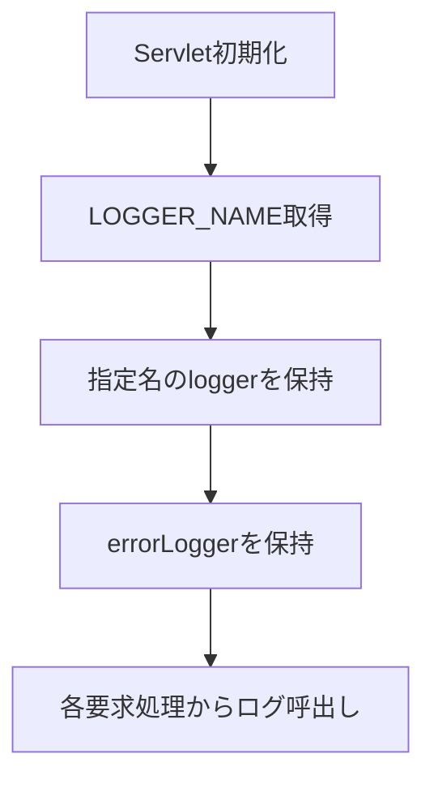

#### SQL・テーブル関連（ER図）

DBは使用しない。保持先はFWLogのstaticフィールドであり、表間ER図は非該当である。

#### DB操作の詳細

SQL、DB接続、commit・rollbackは行わない。ここでのログ呼出しと、E4で行うアクセス記録INSERTは独立した処理である。

#### 結果・例外時の扱い

初期化処理とFWLogのログ配送に独自のcatchはない。また、FWLogは保存結果を返さない。二つのloggerへ順に呼び出したことだけでは、二件の永続記録完了を示さない。

### E2 POSTおよび特殊連携の共通要求処理

#### 処理概要

POSTはdoPostからprocessへ委譲する。processは受信文字コード設定、特殊連携の優先判定、セッション保持、共通ログイン確認、Logout利用者退避、運用判定、Action実行の順に処理し、枝ごとの結果をE4へ渡す。GETでも、E5の入口条件を満たす場合は同じprocessを呼ぶ。

要求値はServlet APIの`getParameter`が返すStringとして取得する。この共通部には要求DTOへの自動バインドや業務入力の数値変換はなく、後続Actionによる取得・変換と区別する。

#### 処理手順

**1. 文字コードを設定し、実行用識別値を決める。**

　**1.1.** doPostはデバッグログを呼んでprocessへ進む。processは自身のgetParameterより先に`setCharacterEncoding("Windows-31J")`を呼ぶ。

　**1.2.** 特殊連携は次表の優先順位で判定する。最初に成立した分岐だけを採用し、非空判定の前にtrimは行わない。連携情報と遷移候補の作業変数は、分岐による代入がなければ初期の空文字を保持する。

| 優先 | 条件 | 実行用functionID / viewID / commandID | 連携利用者・アプリケーション | 遷移候補vFunctionID / vViewID |
| --- | --- | --- | --- | --- |
| 1 | OPKが非NULLかつ非空 | common / Login / Interface | UID / unify | custportal / CstPtlSm |
| 2 | 1が不成立でOtheflgが非NULLかつ非空 | common / Login / Interface | OtherUserId / APPL_NAME | Package / Screen |
| 3 | 1・2が不成立でcharCommonUIDが非NULLかつ非空 | 原則common / Login / Interface。既ログイン枝では要求の三識別値 | charCommonUID / unify | 未ログイン時は手順1.5・1.6で決定。既ログイン枝は初期の空文字 |
| 4 | 1～3がすべて不成立 | 要求のFUNCTION_ID / VIEW_ID / COMMAND_ID | 初期の空文字 | 初期の空文字 |

　**1.3.** OPK分岐はDSPのNULL・空文字とそれ以外に分かれるが、両枝で同じ連携利用者、認証設定の取得先、アプリケーション名、実行用識別値、遷移候補を設定する。OPKの内容照合やUIDの欠落検査は行わない。

　**1.4.** Otheflg分岐では、unify・ringiに同じ連携認証設定、cifに別の設定を使用する。それ以外の非空値でも分岐へ入り、連携認証情報の変数は初期の空文字を保持する。APPL_NAMEとOtheflgの一致、コンテキスト設定値の存在は、この箇所では検査しない。

　**1.5.** charCommonUID分岐は、最初にセッションのLoginBeanをLoginInfoBeanへキャストする。実行用識別値等を設定した後、intCustNrとintBrを次表の短絡条件で判定する。

| intCustNr | intBr | 判定結果 |
| --- | --- | --- |
| NULL | NULL | 顧客番号・店番なしの枝。最初の両NULL条件で短絡する。 |
| NULL | 非NULL | intCustNr.isEmptyでNullPointerExceptionになり得る。 |
| 空文字 | NULL | intBr.isEmptyでNullPointerExceptionになり得る。 |
| 空文字 | 空文字 | 顧客番号・店番なしの枝。 |
| 空文字 | 非空文字 | それ以外の枝。 |
| 非空文字 | NULL・空文字・非空文字 | それ以外の枝。intBr.isEmptyは短絡される。 |

　**1.6.** 未ログインの場合、顧客番号・店番なしの枝は`list / MenuSyougai`、それ以外は`custportal / CstPtlLg`を遷移候補にする。LoginBeanが存在してログイン可否がtrueの場合は、いずれの枝でも要求の三識別値を実行用へ採用し、遷移候補は追加設定しない。intCustNrとintBrはStringのまま判定し、数値変換や店舗・顧客の業務検査は行わない。

**2. 連携情報を保持し、反射先パッケージを作る。**

　**2.1.** `req.getSession()`でセッションを取得する。OPK・Otheflg・charCommonUIDのいずれかが非NULLなら、新しいOtherUserBeanへ連携利用者、連携認証情報、アプリケーション名、遷移候補パッケージ・画面を設定し、同名属性を上書きする。Beanのsetterは値をそのまま保持する。

　**2.2.** この格納条件は手順1.2の非空条件と異なる。空文字のOPKだけが存在する場合、実行用識別値は通常分岐から取得する一方、OtherUserBeanは初期の空文字等で上書きする。三識別子がすべてNULLなら、この処理では既存OtherUserBeanを変更しない。

　**2.3.** 記録用userIdをNULLで初期化し、`functionID.toLowerCase()`でactionPackageを作る。識別値のtrim、長さ・字種検査、許可組合せとの照合は行わない。

**3. 共通ログイン状態を確認する。**

　**3.1.** viewIDが厳密に`Login`なら共通ログイン確認を省略する。この省略条件ではfunctionID・commandIDとの組合せを検査しない。

　**3.2.** Login以外では、LoginBeanをLoginInfoBeanへキャストし、Beanが存在してログイン可否がtrueの場合だけ通過する。型不一致を事前検査する処理はない。

　**3.3.** 不成立ならErrorMsgに「ログイン時間切れです。再度ログインしてください。」を設定し、strUrlを`./JSP/COMMON/Error.jsp`にする。運用判定とAction実行を省略し、手順7へ進む。

**4. Logoutの利用者を処理前に退避する。**

　**4.1.** 手順3を通過し、viewIDがLogoutの場合はLoginBeanを再取得して職員番号をuserIdへ退避する。この再取得後にNULL検査はなく、取得・キャスト・職員番号参照はAction用tryの前にある。

　**4.2.** common.LogoutActionはViewBeanとLoginBeanを除去してログインJSPを返すため、後段の記録には退避値を使う。手順3で拒否されたLogoutは退避しない。

**5. 運用可否を確認する。**

　**5.1.** `OperatePermission.check(actionPackage)`を呼ぶ。接続取得、対象業務、戻り値の契約はE3による。

　**5.2.** falseならErrorMsgに「現在メンテナンス中のため画面を表示できません。」を設定し、strUrlを共通エラーJSPにする。Actionを生成せず手順7へ進む。

**6. Actionを反射生成して実行する。**

　**6.1.** 次のクラス名をClass.forNameへ渡し、newInstanceで要求ごとにオブジェクトを生成する。

```text
actionPackage + "." + viewID + commandID + "Action"
```

　**6.2.** 生成したオブジェクトをCommonActionへキャストし、`perform(req, res)`を呼ぶ。Stringの戻り値をstrUrlへそのまま保持する。CommonAction.performはExceptionを送出できる抽象メソッドであり、共通の入力検査や業務commit・rollbackを実装していない。基底クラスのgetConnectionはCommonUtilへの委譲である。

　**6.3.** 反射生成、キャスト、performを囲むtry内のExceptionは、スタック出力、FWLog.error、ErrorMsg設定の順に処理する。ErrorMsgは「アプリケーションエラーが発生しました。<BR>システム管理者に連絡してください。」とし、strUrlを共通エラーJSPへ置き換える。

　**6.4.** 特殊連携で選ぶLoginInterfaceActionの通常枝は、未ログインの場合に共通LoginActionのperformへ委譲する。既ログインの場合も、連携利用者を8桁ゼロ埋めした結果とLoginBeanの職員番号を`!=`で比較し、不一致なら委譲する。この比較はString内容の等価比較ではない。ゼロ埋め処理はNULL等を空文字へ変換し、非空値をtrimして不足桁を補うが、8桁以上を切り捨てない。

　**6.5.** 通常枝は共通LoginActionの返却文字列を判定に使わない。例外なく戻れば、OtherUserBeanのパッケージ・画面からさらにActionを反射生成し、そのperformの戻り値を返す。共通認証処理が文字列を返したことだけで、この追加呼出しの停止を意味しない。

　**6.6.** LoginInterfaceActionは通常枝より先に、要求APPL_NAMEがringiで、DWH_USER_IDがNULLまたは空文字の場合の特別枝を持つ。`ringi.RingiPrintInsatuAction`を生成した後、新しいLoginBeanのログイン可否をtrueにし、当該Actionを実行して返す。この枝は共通LoginAction.performを呼ばない。他業務向けの接続契約であり、年金の通常ログイン手順には含めない。

**7. 枝ごとの結果を記録・応答処理へ渡す。**

　**7.1.** 共通ログイン拒否、運用不可、Action正常終了、Action例外処理は、それぞれが選んだstrUrlと、その時点のuserId・セッション状態を維持してE4へ進む。

　**7.2.** E4で処理後利用者の取得、アクセス記録、forward判定を行う。合流時に、Actionの正常戻り値を固定JSPへ置き換えたり、取得済みuserIdをNULLへ戻したりしない。

#### 処理フロー

**サブフロー1：文字コードと識別値の決定（手順1）**

入口はprocess、出口はサブフロー2である。実行用識別値、連携情報、遷移候補を引き継ぐ。

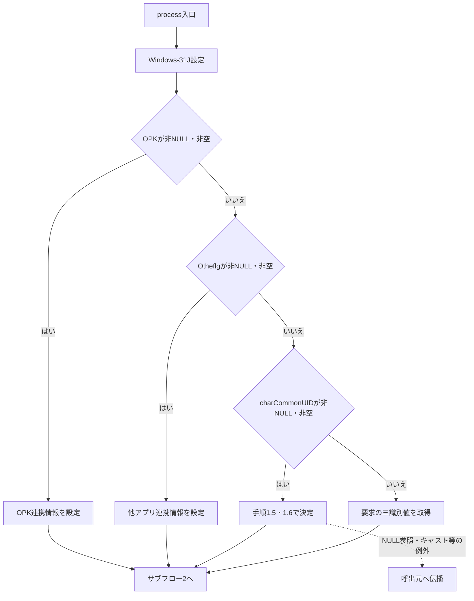

**サブフロー2：保持情報・ログイン確認・Logout退避（手順2～4）**

ログイン拒否の出口はE4、それ以外はサブフロー3である。Logoutの退避を行った枝だけが処理前職員番号を保持する。

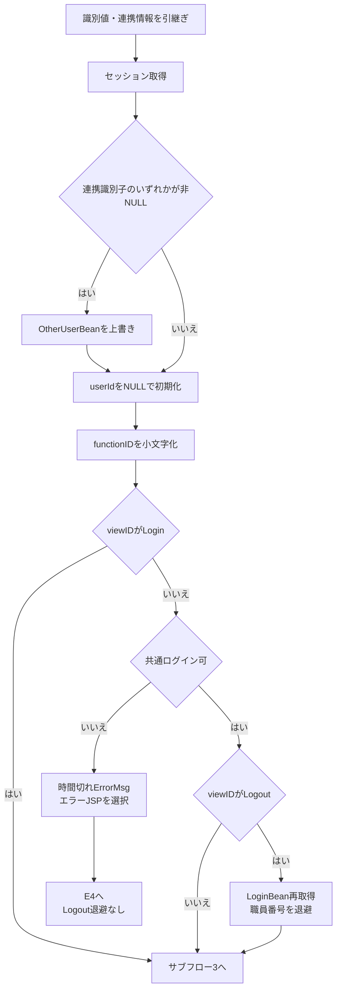

この図のセッション参照、キャスト、小文字化、equals、退避等の未捕捉例外は呼出元へ伝播する。後続のAction用catchへ入る経路はない。

**サブフロー3：運用判定とAction実行（手順5～7）**

入口で受け取った識別値とuserIdを維持し、結果ごとのstrUrl・セッション状態をE4へ渡す。

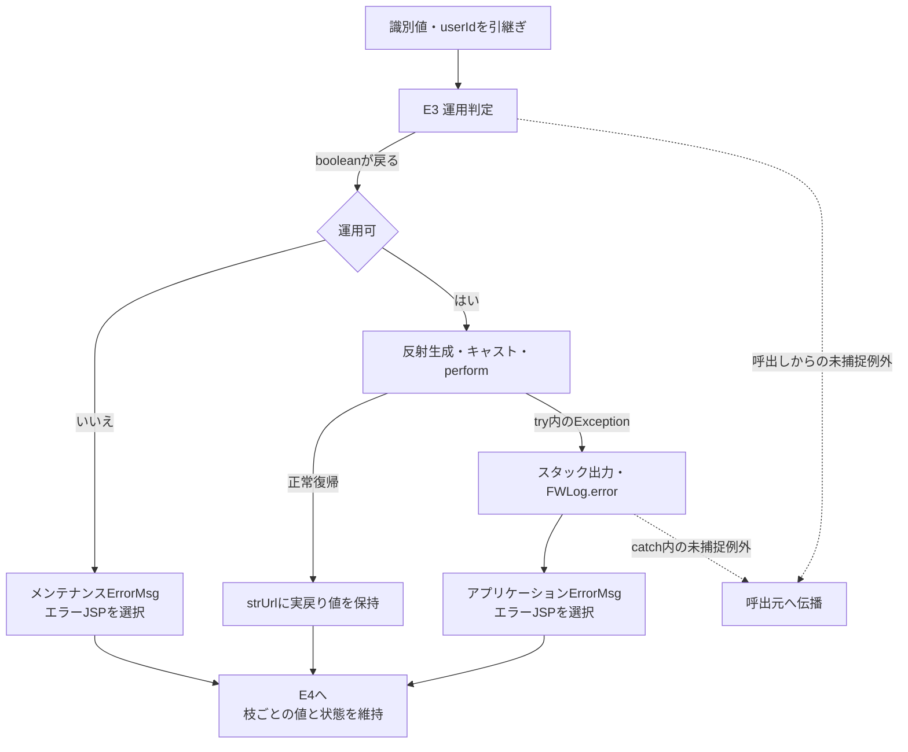

#### SQL・テーブル関連（ER図）

本イベントは運用判定、要求単位のAction、アクセス記録を順に呼ぶ。二つの共通表は独立した単表操作であり、表間のJOINやFKを示す関係はない。

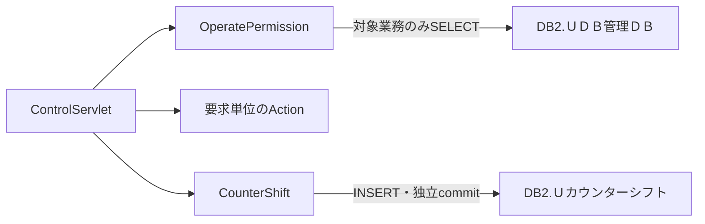

この図は処理依存図である。年金の運用判定は接続取得まで行うが、運用状態表のSELECTは行わない。

#### DB操作の詳細

共通要求処理は業務画面の入力項目を直接JDBCへバインドしない。運用状態SELECTはE3、アクセス記録INSERTはE4による。Actionの業務SQL・トランザクションは呼出先の責務であり、CommonActionやControlServletが一括してcommit・rollbackする契約はない。

#### 結果・例外時の扱い

FUNCTION_IDがNULLならtoLowerCaseで、VIEW_IDがNULLならequalsで、Action用tryの前に例外となり得る。COMMAND_IDがNULLの場合は同位置で拒否されず、クラス名や記録用アクションＩＤへ文字列nullが含まれる。反射先不存在をAction用catchで扱えるのは、先行する識別値処理、ログイン確認、運用判定を通過した場合である。

Action用catchの対象はtry内から伝わるExceptionであり、Throwable全体ではない。catch内のスタック・ログ出力や属性設定で生じる例外を同じcatchで再捕捉する構造でもない。

共通エラーJSPの選択は、HTTPエラー状態設定、応答reset、業務rollbackを伴わない。Actionが応答を書き始めた後に失敗しても、共通制御は応答確定状態を確認せずエラーJSPを選択する。利用者へ届く最終本文は、先行出力と後続forwardの成立に依存する。

doPostに包括catchはない。Action用tryの前後から伝わる例外は呼出元へ送出される。GETからprocessを呼んだ場合は、E5のdoGet側catchへ届いたExceptionに対してログだけを呼ぶ。

GET側の事前getParameterや先行処理で既に解釈された受信値を、processの文字コード設定が再解釈するとは保証しない。

### E3 運用可否の確認

#### 処理概要

OperatePermission.checkは共通DB接続を取得した後に業務種別を選別する。対象業務は運用状態表を照会し、対象外は照会せずtrueを選択する。年金は対象外だが、先行する接続取得を省略しない。

#### 処理手順

**1. 共通DB接続を取得する。**

　**1.1.** InitialContextと`jdbc/Oracle_SP2NM`をCommonUtil.getConnectionへ渡す。

　**1.2.** CommonUtilはJNDI lookup、DataSource.getConnection、`setAutoCommit(false)`の順に実行し、取得した接続を返す。

**2. 運用状態の照会対象を決める。**

　**2.1.** actionPackageを次表と比較する。対象外はSELECTせずtrueを選択し、finallyへ進む。

| actionPackage | ＤＢ名の検索値 | 照会 |
| --- | --- | --- |
| ing | Ｕ員外管理顧客情報 | 行う |
| credit、crd、rate | Ｕ融資情報 | 行う |
| saiken | Ｕ債権情報 | 行う |
| nenkin、common、その他 | 設定しない | 行わない |

**3. 対象業務の運用状態を確認する。**

　**3.1.** SelectDBKanriDBBase.selectへＤＢ名を渡し、結果Listを取得する。selectのboolean戻り値は使用しない。

　**3.2.** Listが非NULLかつ非空の場合だけ先頭Mapの処理中ＦＬＧを参照する。文字列`0`ならtrue、それ以外と0件はfalseとなる。

**4. 例外と接続終了を処理する。**

　**4.1.** try内のExceptionはFWLog.errorへ渡し、falseへ進む。

　**4.2.** finallyでconが非NULLならcloseする。closeのSQLExceptionはログへ出すが、選択済みの戻り値を変更する処理はない。

#### 処理フロー

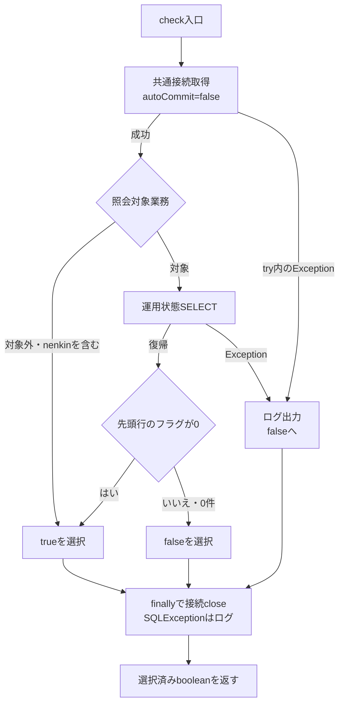

ログ呼出し等が戻る場合のフローである。catch・finally内の新たな未捕捉例外までbooleanへ変換する包括catchはない。

#### SQL・テーブル関連（ER図）

対象は`DB2.ＵＤＢ管理ＤＢ`一表で、計画上の安定IDはTBL-N2-008である。JOINとFK参照を使用しないため、表間ER図は省略する。

```sql
select 処理中ＦＬＧ
  from DB2.ＵＤＢ管理ＤＢ
 where ＤＢ名 = '<手順2の検索値>'
```

#### DB操作の詳細

ＤＢ名は手順2の固定対応からSQL文字列へ連結し、Statement.executeQueryで実行する。PreparedStatement、プレースホルダー、JDBCパラメータの型・サイズ指定はない。全述語はＤＢ名の等価条件だけであり、JOIN、ORDER BY、ページング、取得件数上限、明示的タイムアウト・取消処理は付けない。

CommonBaseSelectは結果全行を読み、列名をキーとするMapをListへ追加する。値はgetStringで取得し、SQL NULLは空文字、それ以外はtrimしたStringへ変換する。取得件数はList.sizeで保持する。複数行が返っても運用判定に使うのは先頭行だけであり、SQLに順序指定はない。select自身のbooleanはListが非NULLかどうかを示し、0件かどうかとは異なる。

CommonBaseSelectのfinallyはResultSet、Statementの順にcloseし、SQLExceptionは呼出元へ伝わる。ResultSet.closeで例外となった場合に、Statement.closeも必ず実行する入れ子構造ではない。結果読取りが済んでいても、これらのcloseから例外が伝わればOperatePermissionのcatchを通ってfalseになり得る。

ローカル互換DDLは、ＤＢ名を`VARCHAR(80) NOT NULL PRIMARY KEY`、処理中ＦＬＧを`VARCHAR(1) NOT NULL`と宣言する。これは収録ローカル表の属性であり、本番外部表の物理保証とは区別する。SELECT実装によるSQL NULLの空文字変換も、このNOT NULL宣言とは別の契約である。

本処理に明示的なcommit・rollbackはない。

#### 結果・例外時の扱い

falseには運用フラグによる拒否に加え、接続取得、照会、結果変換、SELECT資源のcloseで捕捉したExceptionが含まれる。ControlServletはこれらを区別せずメンテナンス文言と共通エラーJSPを選び、Actionを生成しない。

OperatePermission自身のfinallyで接続closeがSQLExceptionとなる場合は、ログ後に選択済みの結果を維持する。先にtrueを選択した年金の対象外分岐を、このclose例外だけでfalseへ変更しない。

CommonUtilには接続取得失敗時のcloseがない。DataSourceから接続を取得した後、setAutoCommit(false)で失敗すると呼出元conへの代入が完了しないため、OperatePermissionのconを条件とするfinallyでは、その取得済み接続を回収できない。

### E4 アクセス記録とforward制御

#### 処理概要

共通要求処理の各枝から引き継いだ結果に対し、記録用利用者とJSP名を決定してアクセス記録を試みる。CounterShiftが戻った後、保持していたstrUrlで追加forwardの要否を判断する。本イベントはprocess内の後処理であり、独立したHTTP入口ではない。

#### 処理手順

**1. 記録用利用者を決める。**

　**1.1.** viewIDがLogout以外なら処理後のLoginBeanをLoginInfoBeanへキャストし、Beanが存在する場合だけ職員番号をuserIdへ設定する。この時点でログイン可否は再判定しない。

　**1.2.** Logoutなら処理後取得を省略し、E2で退避した値を維持する。共通ログイン確認で拒否されたLogoutは退避していないため、userIdは初期のNULLを保持する。

**2. 要求内の記録Mapを作る。**

　**2.1.** functionID、viewID、commandID、viewIDとcommandIDの連結値、userIdを、それぞれ機能ＩＤ、画面ＩＤ、コマンドＩＤ、アクションＩＤ、ユーザーＩＤへ設定する。特殊連携で実行用識別値を置換した場合は置換後の値を使用する。

　**2.2.** セッションMESSAGEが非NULLなら、記録用ＪＳＰ名を`./JSP/COMMON/SubMessage.jsp`とする。NULLならstrUrlを使用する。MESSAGEの型・内容・件数は確認しない。

　**2.3.** この選択はmapCS内だけに適用する。strUrlの書換え、MESSAGEの除去、SubMessage.jspへのforwardは行わない。

**3. 別接続でアクセスを記録する。**

　**3.1.** CounterShift.countUpへmapCSを渡す。countUpは業務Actionの接続を受け取らず、`jdbc/Oracle_SP2NM`から接続を改めて取得する。CommonUtilがautoCommit=falseを設定する。

　**3.2.** InsertCounterShiftBaseが8列のINSERTを組み立て、CommonBaseのStatement.executeUpdateで実行する。INSERT処理が戻った後、countUpがcommitする。CommonBaseは更新件数を保持するが、countUpは1件であることを検査しない。

**4. 記録失敗と接続終了を処理する。**

　**4.1.** countUpのtry内でExceptionとなった場合、conが非NULLならrollbackを試みる。rollbackのSQLExceptionを先にログへ出し、続けて元のExceptionをログへ出す。

　**4.2.** finallyでconが非NULLならcloseし、そのSQLExceptionをログへ出す。これらの捕捉処理が戻れば、記録結果や例外を業務側へ返さず、選択済みstrUrlを維持して次へ進む。

**5. strUrlに従って応答処理を行う。**

　**5.1.** strUrlがNULL、厳密に`PDF`、厳密に`CSV`のいずれかなら追加forwardを行わずprocessを終了する。本文出力済みか、正常終了したかは検査しない。

　**5.2.** その他のstrUrlなら次表の設定を行い、`req.getRequestDispatcher(strUrl).forward(req, res)`を呼ぶ。

| 設定対象 | 設定値 |
| --- | --- |
| Content-Type | text/html; charset=Windows-31J |
| Expires | Sat, 01 Jan 2000 00:00:00 GMT |
| cache-control | no-store |
| Pragma | no-cache |

#### 処理フロー

**サブフロー1：記録内容と実forward先の分離（手順1・2・5）**

E2からstrUrl、userId、セッション状態を受け取る。記録用ＪＳＰ名を選択した後も実strUrlを保持する。

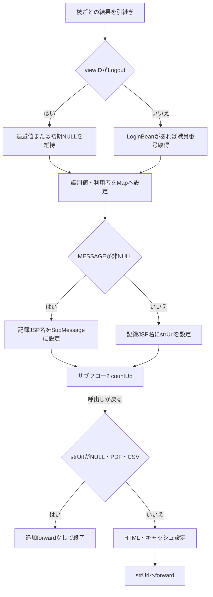

処理後のセッション参照、Map作成、countUpからの未捕捉例外、ヘッダー設定、forwardの例外は、E2のAction用catchへ戻らない。

**サブフロー2：countUpの独立トランザクション（手順3・4）**

業務Actionの接続・トランザクションは引き継がない。出口は呼出元への復帰であり、成功件数や記録確定状態は返さない。

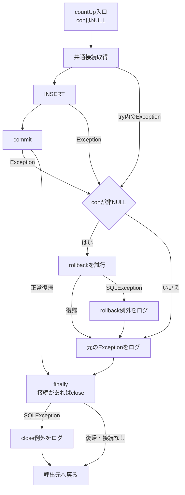

ログ等が戻る場合のフローである。catch・finally内の新たな未捕捉例外を吸収する包括catchはない。

#### SQL・テーブル関連（ER図）

対象は`DB2.Ｕカウンターシフト`一表で、計画上の安定IDはTBL-N2-006である。他表とのJOIN・FK参照を使わないため、表間ER図は省略する。

INSERTの列順は、アクセス日付、アクセス時刻、機能ＩＤ、画面ＩＤ、コマンドＩＤ、アクションＩＤ、ＪＳＰ名、ユーザーＩＤである。WHERE、比較版、対象再検索、UPDATE、DELETEはない。

#### DB操作の詳細

記録項目の設定元とSQL化は次表による。DDL欄は収録ローカル互換表の宣言であり、受信値の業務上限や本番外部表の属性を示さない。

| 保存列 | 設定元と意味 | SQL化・NULLの扱い | ローカル互換DDL |
| --- | --- | --- | --- |
| アクセス日付 | INSERT組立て時のDateから生成する記録日 | yyyyMMddを引用符なしで連結 | VARCHAR(8) NOT NULL |
| アクセス時刻 | 日付と同じDateから生成する記録時刻 | HHmmssSSSを引用符なしで連結 | VARCHAR(9) NOT NULL |
| 機能ＩＤ | 小文字化前の実行用functionID | NULL・空文字はSQL NULL。それ以外は単一引用符で囲む | VARCHAR(100)、NULL可 |
| 画面ＩＤ | 実行用viewID | NULL・空文字はSQL NULL。それ以外は単一引用符で囲む | VARCHAR(100)、NULL可 |
| コマンドＩＤ | 実行用commandID | NULL・空文字はSQL NULL。それ以外は単一引用符で囲む | VARCHAR(100)、NULL可 |
| アクションＩＤ | viewIDとcommandIDの文字列連結 | NULL・空文字はSQL NULL。それ以外は単一引用符で囲む。連結要素のNULLは文字列nullになる | VARCHAR(200)、NULL可 |
| ＪＳＰ名 | MESSAGE非NULLならSubMessage.jsp、それ以外はstrUrl | NULL・空文字はSQL NULL。それ以外は単一引用符で囲む。PDF・CSVも文字列として記録対象になる | VARCHAR(260)、NULL可 |
| ユーザーＩＤ | 条件に応じて取得したLoginBeanの職員番号 | 常に単一引用符で囲む。JavaのNULLは文字列'null'となり、空文字もSQL NULLへ置き換えない | VARCHAR(20) NOT NULL |

日付・時刻は同じnew Dateから生成するが、SimpleDateFormatにタイムゾーンを指定しない。JSTを指定するCommonUtil.getCurrentDateは、このINSERTでは使用しない。日付・時刻を引用符なしで文字列列へ渡すため、暗黙変換と先頭ゼロの保存結果は接続先DBの動作に依存する。

文字列の引用符をエスケープする処理と、PreparedStatementによる型・サイズ付きバインドはない。Servlet側にもDDL宣言長に対応した入力上限検査はない。収録DDLはこの表にPK、FK、DEFAULTを宣言しておらず、INSERT内の「PK項目」というコメントからユーザーＩＤを実PKとは判断しない。

CommonBaseはStatementを生成してexecuteUpdateの件数を保持する。DEBUG有効時はSQLをログへ出し、SQLExceptionではSQLをログへ出して再送出する。Statement生成はCommonBase内部のtryより前にあるが、countUp側のtryには含まれる。finallyのStatement.closeから伝わる例外も、countUpのcommit前の失敗経路へ入り得る。実行タイムアウトや取消は明示設定しない。

commit例外やrollback失敗の後に、アクセス記録の実際の確定状態を返す契約はない。業務更新を取り消すための接続や制御も、この記録処理には渡していない。

#### 結果・例外時の扱い

アクセス記録はAction正常終了時だけでなく、共通ログイン拒否、運用不可、Action例外から後段へ到達した場合にも試みる。countUp内の捕捉経路から戻った場合、記録失敗によってstrUrlは変更しない。反対に、記録commit後にforwardが失敗しても、その記録をrollbackする処理はない。

年金のrequireStaff拒否は、MESSAGEへメッセージListを設定し、ActionがSTAFF_JSPを返す具体例である。STAFF_JSPはログインJSPと同じ値なので、記録用ＪＳＰ名はSubMessage.jsp、実forward先はログインJSPとなる。ログインJSPはMESSAGEが非NULLかつ非空の場合に表示して除去する。空ListでもServletの記録名変更条件は満たすが、このJSPの表示・除去条件は満たさない。

PDF・CSVはforward抑止用の戻り値である。年金ExcelExportActionはXLSXのダウンロード書込み後にCSVを返すため、CSVという戻り値からCSVファイル生成を意味付けしない。書込み途中に例外が伝わった場合は、そのreturnへ到達したとは扱わない。NULL戻り値も、出力済みや正常完了を確認した結果ではない。

forwardとJSP描画はAction用catchの外にある。Error.jsp自身はUTF-8を宣言し、ErrorMsgがNULLなら「処理を完了できませんでした。」、それ以外は属性値をHTMLエスケープして表示する。このため、Action例外文言内の`<BR>`も改行タグにはならない。ErrorMsgは表示後に除去しない。Servletのforward前のWindows-31J設定と、JSP自身の文字コード宣言は別に存在する。

### E5 GET振分けと旧PDF処理

#### 処理概要

GETはOPKとcharCommonUIDを先に取得し、両方がNULLなら旧PDF処理へ、それ以外ならprocessへ進む。旧PDF側はセッションAgentの獲得、ロック後の同一性再確認、callback判定、保持応答取得または帳票処理、結果送信を行い、到達した経路で保持用タイマーを開始する。

旧PDF側はprocessを経由しないため、共通ログイン確認、運用判定、CounterShift記録を行わない。Action実行時にGETを認めないというコメントはあるが、実装にはGETからprocessを呼ぶ分岐がある。

#### 処理手順

**1. GET入口を振り分ける。**

　**1.1.** doGetはOPKとcharCommonUIDを取得する。どちらかが非NULLなら、空文字でもprocessを呼ぶ。Otheflgだけが存在する場合は、この入口条件では旧PDF側を選ぶ。

　**1.2.** 両方がNULLなら開始ログを呼び、空のString二次元配列、空Vector、件数0、空帳票名、method=0を、新しいPDFUtilのpdfControlへ渡す。method=0はFCW_GETである。

　**1.3.** pdfControl呼出しとprocess呼出しは別々のcatch(Exception)で囲み、捕捉時はFWLog.errorだけを呼ぶ。最初のパラメータ取得とPDF開始ログは、これらのtryより前にある。

**2. セッションとPDF Agentを獲得する。**

　**2.1.** pdfControlはagentがNULLの間、`getSession(true)`でセッションを取得する。この呼出しはAgent獲得用tryの前にある。取得結果がNULLならコード9999999の独自HTMLエラーを出して戻る。

　**2.2.** セッションFcwAgentをFWSessionAgentへキャストする。存在しなければPDFUtilインスタンスの_sessionLockをロックしてAgentを生成する。新しいAgentはForm Managerルートを`C:\iWFM`に設定し、FMComposerAgentとFMJobを生成する。

　**2.3.** 新規Agentには180000ミリ秒、handlerである当該PDFUtil、userInfoであるHttpSessionを設定してセッションへ保存する。この設定だけではタイマーThreadを開始しない。既存Agentなら処理前にstopTimerを呼ぶ。

　**2.4.** Agent獲得区間は次表のcatch順で処理する。先行catchが処理した例外を、後段catchへ重ねない。

| 区分 | catch順・対象 | 処理と出口 |
| --- | --- | --- |
| A1 | 1：FMSystemException | 再送出する。 |
| A2 | 2：FMPropertyException | 捕捉例外のmessage・statusCodeで独自HTMLエラーを出し、セッションをinvalidateして戻る。 |
| A3 | 3：IllegalStateException | セッションをinvalidateし、agentをNULLへ戻して獲得ループを再試行する。 |

　**2.5.** A2・A3内のinvalidate自体から例外が伝われば、同じcatchでは再捕捉しない。A3の再試行はinvalidate等が戻った場合に行う。

**3. Agentをロックして要求と帳票データを準備する。**

　**3.1.** synchronized(agent)へ入り、セッションFcwAgentが同じオブジェクトか再確認する。不一致ならIllegalStateExceptionを送出する。この確認は獲得用tryの外なので、A3の再獲得処理へ戻らない。

　**3.2.** parseParametersは、Hostが非NULLの場合にHost全体と最初のコロンより前の値を保持する。コロンがなければ同じHostを両方へ設定し、Host欠落時は既保持値を消さない。要求URIは各呼出しで更新する。fcw-retrieveは非NULLなら空文字でもcallback=true、欠落ならfalseとし、値の形式やAgent固有IDとの一致は確認しない。

　**3.3.** 非callbackの場合だけ既存Jobをclearし、setFMParametersへ固定データ、可変データ、formCount、帳票ファイル名を渡す。同メソッドは帳票名をfm-formfilename、生成したフィールドデータをfm-fielddataへ設定し、fm-target=client、fm-action=view、fm-outputtype=pdfを設定する。

　**3.4.** makeFieldDataはControl SectionにVERSION=5.0を置き、次表の条件で固定セクションを省略するか生成する。配列の行・列数やNULL要素を先に検証する処理はない。

| fixedDataの状態 | 固定セクションの扱い・結果 |
| --- | --- |
| NULL | 固定項目全体を省略する。先頭配列要素は参照しない。 |
| 非NULLの空配列 | fixedData[0]参照でArrayIndexOutOfBoundsExceptionになり得る。 |
| 先頭行がNULL | 先頭行の列参照でNullPointerExceptionになり得る。 |
| 先頭行の列数が0 | 先頭キー参照でArrayIndexOutOfBoundsExceptionになり得る。 |
| 先頭キーがNULL | 先頭キーのequalsでNullPointerExceptionになり得る。 |
| 先頭キーが空文字 | 後続行が存在しても固定項目全体を省略する。 |
| 先頭キーが非空文字 | 各行のキーと値から固定項目を生成する。後続行や値も事前検証しない。 |

　**3.5.** 固定項目処理の後はBody Data Sectionを作る。formCountが1以下なら可変データを行List・列要素として読み、1より大きければページList・行List・列要素の順に読む。NULLのList・行・セル、入れ子の型不一致は独自入力検証例外へ変換しない。

　**3.6.** 複数フォームではvariableData.sizeを繰返し上限としてページを処理し、処理後のpageCountがformCountより小さければForm Section、NEXTPAGE、必要な固定セクション、次のBody Data Sectionを追加する。次の固定セクションでも手順3.4と同じNULL・先頭キー空文字の判定を繰り返す。formCountと実ページ数の事前照合はない。

　**3.7.** 可変セルはtoString後にバックスラッシュを二重化し、二重引用符で囲んでカンマ区切りにする。固定項目の値には同じtoString・バックスラッシュ置換を行わない。二重引用符や改行の別途エスケープはない。固定値・可変値には既定文字セットのgetBytes結果をWindows-31JとしてStringへ戻す箇所があり、その変換でUnsupportedEncodingExceptionとなれば元の文字列を使う。最終byte配列化も引数なしgetBytesである。

　**3.8.** ControlServletが渡す固定データは非NULLの空配列なので、非callback GETがここへ到達すると手順3.4の配列参照例外となる。これはcanOverlayより前の準備区間であり、後続の型付きHTMLエラー処理へ入らず再送出される。有効な引数を渡す汎用メソッドの契約と、このGET入口の到達結果を区別する。

**4. 保持応答を取得するか、オーバーレイを行う。**

　**4.1.** method=FCW_GETかつcallbackなら、getLastResponseで保持Jobの応答を取得する。NULLならコード9999999のFMPrintExceptionを生成する。新規Agentに保持応答があるとは仮定しない。

　**4.2.** それ以外ではcanOverlayを判定する。falseならAgentのmessageとコード9999999のFMPropertyExceptionを生成する。trueならoverlayを呼び、その結果がNULLならコード9999999のFMPrintExceptionを生成する。

　**4.3.** FWSessionAgent.overlayはJobを同期実行し、Job状態、応答の有無、応答fm-statusを確認する。

| 条件 | 処理 | 結果 |
| --- | --- | --- |
| Job状態0、応答あり、fm-status=0 | 取得した応答を返す | FMResponse |
| 上記不成立かつJobがタイムアウト | clear、旧Job除去、新Job生成 | 置換処理の完了後にFMPrintException・4001010 |
| 上記不成立かつタイムアウトでない | fm-messageを取得し、NULLならJob状態を含む文言を補う | FMPrintException・4999999 |

　**4.4.** clear・Job除去・再生成、応答値の参照自体から伝わる例外を、必ず4001010または4999999になるものとは扱わない。overlay内のFMPropertyException、FMPrintException、FMIllegalStatusExceptionのcatchは再送出する。

　**4.5.** pdfControlのオーバーレイ区間は次表のcatch順で処理する。手順3の準備区間は別のtryであり、そこでのExceptionは再送出される。

| 区分 | catch順・対象 | 処理と出口 |
| --- | --- | --- |
| B1 | 1：FMPrintException | 捕捉例外のmessage・statusCodeで独自HTMLエラーを出し、Agent.startTimerを呼んで戻る。 |
| B2 | 2：FMSystemException | 再送出する。 |
| B3 | 3：FMPropertyException | 先行catchで処理されずこのcatchへ到達した場合、捕捉例外のmessage・statusCodeで独自HTMLエラーを出し、Agent.startTimerを呼んで戻る。 |

**5. 結果を送信し、到達した経路でタイマーを開始する。**

　**5.1.** returnHttpResponseはPragmaにno-cache、ExpiresにsetDateHeaderの時刻値0、Dateに現在時刻を設定する。結果fm-statusをIntegerへキャストして判定し、0なら非callbackは取得用HTML、callbackはPDF本体を送る。0以外なら結果のfm-message・fm-statusを独自HTMLエラーへ渡す。結果やstatusのNULL・型不一致を事前検証する処理はない。

　**5.2.** 取得用HTMLを作るreturnCallbackは、HTMLの組立て、DataOutputStreamのflush、byte配列化、Content-Length設定、ServletOutputStream取得、writeを行う。その後の内側tryは、ServletOutputStream.flush、DataOutputStream.flush、ByteArrayOutputStream.flush、後二者のcloseを順に実行し、この区間のExceptionを無視する。途中で例外となれば、残る内側処理は飛ばす。

　**5.3.** returnCallbackのfinallyは、ServletOutputStream参照が非NULLなら再度flushする。内側Exceptionを無視した後でも、このfinallyが戻り、ほかに未処理例外がなければ呼出元へ復帰し、通常のタイマー開始へ進み得る。一方、HTML組立て、ストリーム取得、write等を内側catchへ含めない。外側catchへ到達したFMSystemException、SocketException、IOExceptionは再送出し、finallyからの例外も伝播し得る。returnHttpResponseとpdfControlの結果処理区間は、実際に伝わった例外を再送出する。

　**5.4.** returnPDFはPDF本文を送信する。try内のSocketExceptionでは出力ストリーム参照をNULLにして再送出し、その他のIOExceptionはログ後に再送出する。finallyは入力close、出力参照が非NULLならflushを行うため、別の例外が元の例外に優先して伝わる場合がある。

　**5.5.** returnHttpResponseはreturnPDFから実際に届いたSocketExceptionを先に捕捉して無視し、その他のIOExceptionは再送出する。SocketExceptionの捕捉後に結果処理が戻ればタイマー開始へ進むが、finally由来の別のIOExceptionまで同じ続行経路には含めない。

　**5.6.** 通常のreturnHttpResponseが戻った後にAgent.startTimerを呼んで終了する。B1・B3はそれぞれのcatch内で独自HTML処理後にstartTimerを呼ぶ。準備、再送出、結果送信、startTimer自身の例外で抜けた場合にタイマー再開を保証するfinallyはない。

#### 処理フロー

**サブフロー1：GET入口（手順1）**

processを選んだ場合はE2からE4の契約に接続する。旧PDF側だけがサブフロー2へ進む。

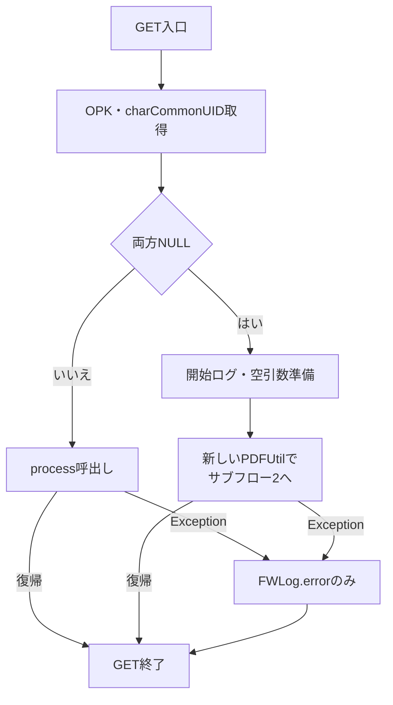

最初のパラメータ取得と開始ログは呼出し用tryの外である。catch内のログ自体の未捕捉例外を再捕捉する構造もない。

**サブフロー2：Agent獲得とロック後の再確認（手順2・3.1）**

成功時はセッションとAgentをサブフロー3へ渡す。ロック後の不一致は獲得用catchへ戻さない。

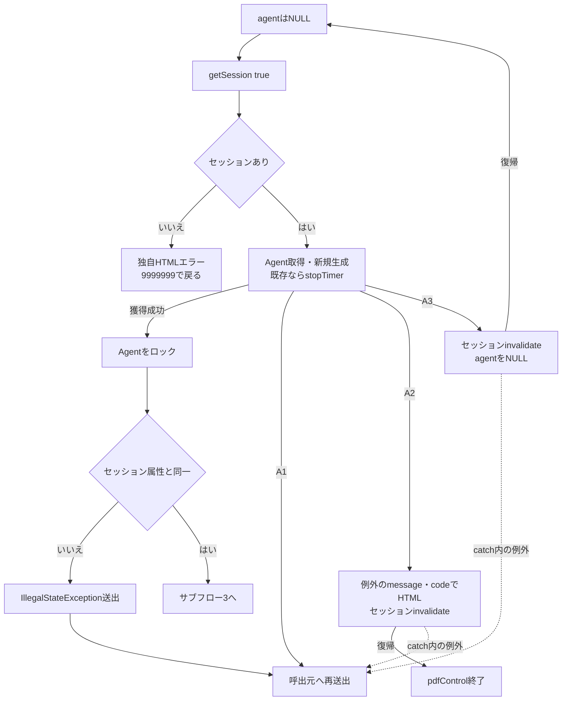

getSessionの例外と、表Aに捕捉されない例外も呼出元へ伝わる。_sessionLockはPDFUtilごとのフィールドであり、GETごとにPDFUtilを生成する入口では、セッション共通の生成ロックにならない。

**サブフロー3：データ準備と結果取得（手順3.2～4）**

成功出口は、取得したFMResponseを保持してサブフロー4へ進む。準備例外、B2、その他の未捕捉例外は再送出出口である。

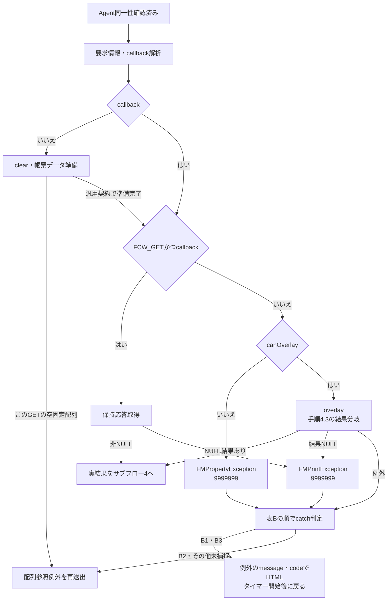

callback解析やデータ準備から伝わる例外は表Bを経由しない。B1・B3へ渡すcodeは捕捉例外のstatusCodeであり、4001010・4999999・9999999等を共通固定値へ置き換えない。catch内のHTML処理やタイマー開始からの未捕捉例外も呼出元へ伝わる。

**サブフロー4：結果送信と通常のタイマー開始（手順5）**

取得した結果とcallback状態を引き継ぐ。取得用HTMLの内部処理はサブフロー5で区別する。

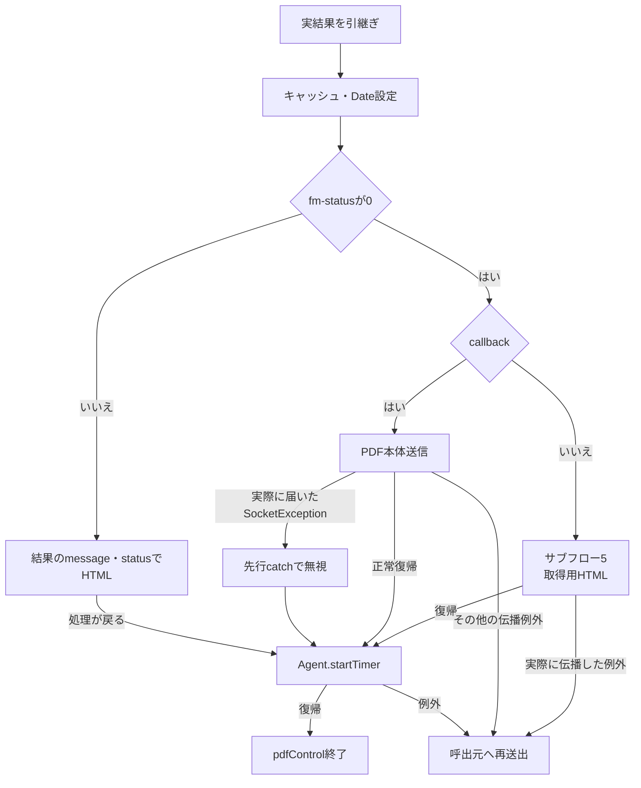

結果参照・型変換・ヘッダー設定等の未捕捉例外も再送出される。独自HTMLのcodeは結果fm-statusを引き継ぎ、B1・B3の例外statusCodeと混同しない。

**サブフロー5：取得用HTMLの内部catchとfinally（手順5.2・5.3）**

内側のflush・close例外を処理した場合と、呼出元へ伝わる例外を分ける。復帰出口だけがサブフロー4の通常タイマー開始へ接続する。

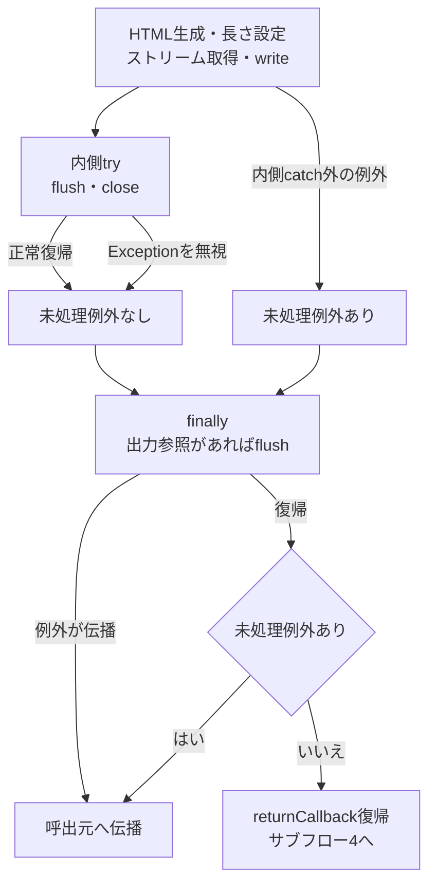

内側処理でExceptionとなれば、残る内側のflush・closeは実行せずfinallyへ進む。図の復帰はHTMLの受領完了を意味しない。

#### SQL・テーブル関連（ER図）

旧PDF処理で共通DBのSELECT・INSERTは行わない。保持領域と外部入出力は、HttpSession、FWSessionAgent、Form ManagerのFMJob、結果データ、HTTPストリームである。

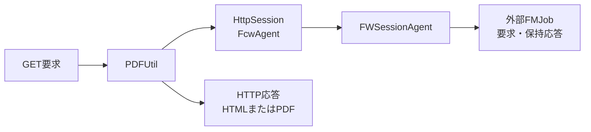

これはオブジェクトと入出力の関連図であり、DBのERや永続化関係を表さない。

#### DB操作の詳細

DB操作は非該当である。外部出力の契約は次表による。

| 出力区分 | 内容・生成元 | HTTP設定・送信方式 |
| --- | --- | --- |
| 取得用HTML | 要求URIの最終スラッシュより前へ、`/servlet/common.ControlServlet/callback.pdf?fcw-retrieve=固有ID.pdf`を連結する。FRAMESETへ`/n2fcw/blank.html`とPDFViewフレームを配置する | text/html。HTMLをWindows-31Jでbyte配列化し、その長さをContent-Lengthへ設定して書き込む。 |
| PDF本体 | AgentのJobからResponseOperatorを取得し、そのInputStreamを読む | HTTP状態200、application/pdf。2048バイト単位で読み書きし、flushする。 |
| 独自HTMLエラー | 引数message・codeからError Message・Error Codeを含むHTMLを生成する | text/htmlのWriterへ直接出力する。codeをHTTP状態へ設定せず、共通Error.jspへforwardしない。 |

取得用URLの現在の組立て式は要求URIを使用し、保持したHostは使用しない。収録年金web.xmlのServlet mappingは`/Action.do`であり、旧callbackパスのmappingは同じ設定には存在しない。

PDFのContent-Lengthは、fm-databytesが非NULLならbyte配列長、それ以外はfm-datafileをFileへキャストしたlengthを、longの文字列として設定する。両方の不存在や型不一致を独自検証で拒否しない。長さの取得元と、本文InputStreamの取得元は別の呼出しである。outSizeの集計は長さ照合や利用者の受領完了判定に使わない。

returnPDFのfinallyは入力closeの後に出力flushを行う。入力closeで例外となった場合に、出力flushも必ず実行する入れ子構造ではない。returnHttpResponseのSocketException捕捉は、finallyを含めて実際に届いた例外型に対して適用する。

独自HTMLエラーはmessageをHTMLエスケープせず、Writerへ直接出力してflush・closeする。agent引数は使用しない。IOExceptionだけをログへ出して戻り、WriterのcheckErrorによる送信確認は行わない。ErrorMsg設定、応答reset、表示codeに対応したHTTP状態設定も行わない。

#### 結果・例外時の扱い

Agent獲得区間のFMPropertyException用catchへ到達した場合はセッション全体をinvalidateする。オーバーレイ区間のB1・B3へ到達した場合は独自HTML処理後にAgentタイマーを開始する。両区間を同じ回復処理として扱わない。

非callback GETは、Agent獲得・clear等を通過して空固定配列の参照へ到達すると、canOverlay前に例外となる。既存Agentではその前にstopTimerを呼んでいるが、この準備失敗後のタイマー再開をfinallyで保証しない。汎用の非callbackオーバーレイや取得用HTML処理を、この空引数GETで正常に実行できる経路とは記載しない。

取得用HTMLでは内側のflush・close例外を無視して復帰する経路がある。外側処理やfinallyから実際に伝播した例外だけが通常タイマー開始を通過しない。PDF本体では、実際に届いたSocketExceptionを捕捉して続行する経路と、その他のIOException等を伝播する経路を分ける。

FMSystemExceptionの再送出、準備区間の配列参照例外、結果送信の未捕捉例外等がdoGetの呼出し用catchへ届いた場合、そのcatchはログだけを呼ぶ。共通エラー属性設定、sendError、forward、応答resetは行わないため、最終本文・HTTP状態は、その時点までの出力状態に依存する。

外部例外型の扱いは記載したcatch順を保つ。先行catchが処理する例外を後段catchへ重ねたり、一般例外を一律に型付きHTMLエラーへ変換したりする契約はない。

### E6 PDFタイマーの開始・取消・資源解放

#### 処理概要

PDF用タイマーは、保持結果を180000ミリ秒残した後にセッション内のPDF資源を解放するための仕組みである。共通ログインやHttpSession全体の有効時間は設定しない。

#### 処理手順

**1. タイマーを設定・開始する。**

　**1.1.** setSessionTimerはFWSessionTimerを新規生成するか既存タイマーをcancelし、時間、handler、userInfoを設定する。このメソッドだけではThreadを開始しない。

　**1.2.** startTimerは設定済みタイマーのrestartを呼ぶ。restartはcancel後に新しいdaemon Threadを生成して開始する。E5では通常の結果処理が戻った経路と、B1・B3の指定catch内で呼ぶ。

**2. 継続要求でタイマーを取り消す。**

　**2.1.** 既存Agentを再利用する場合、stopTimerがcancelを呼ぶ。cancelは保持Thread参照をNULLにするだけで、sleep中のThreadへinterruptを送らない。

**3. 期限到達後のhandler呼出しを判定する。**

　**3.1.** FWSessionTimer.runは設定時間が正ならsleepし、InterruptedExceptionは無視する。その後、保持Thread参照をローカル変数threadへ読み、現在Threadとの同一性を比較する。不一致ならhandlerを呼ばない。

　**3.2.** 一致ならhandlerをロックし、同じローカル変数threadを使って再比較する。一致した場合にhandleTimer(userInfo)を呼ぶ。ロック取得後に保持Thread参照を読み直す処理ではない。

　**3.3.** この区間が戻れば保持Thread参照をNULLにする。handlerの未捕捉例外時にも必ず代入するfinallyはない。

**4. その時点のセッションAgentを解放する。**

　**4.1.** PDFUtil.handleTimerはsynchronizedメソッドであり、userInfoをHttpSessionへキャストする。セッションが非NULLなら、その時点のFcwAgentを取得する。

　**4.2.** AgentがあればAgentをロックし、invalidateを呼ぶ。属性取得後、Agentのロックを獲得した段階でセッション属性との同一性を再確認する処理はない。

　**4.3.** Agent.invalidateはJobのclear、外部AgentのremoveJobを行う。clear内のFMIllegalStatusExceptionと、removeJobのFMSystemExceptionは各箇所で無視する。

　**4.4.** 解放処理が戻ればFcwAgent属性を除去する。Agentがなかった場合も、セッションが存在すれば属性除去へ進む。HttpSession全体をinvalidateする行はコメント化されており実行しない。

　**4.5.** handleTimerはIllegalStateExceptionをログへ出す。ほかの未捕捉例外や、catch内ログの例外を包括的に吸収しない。

#### 処理フロー

**サブフロー1：開始・期限判定（手順1～3）**

開始時に時間、handler、userInfoを保持する。期限後に同一性を確認できた場合だけ、サブフロー2へuserInfoを渡す。

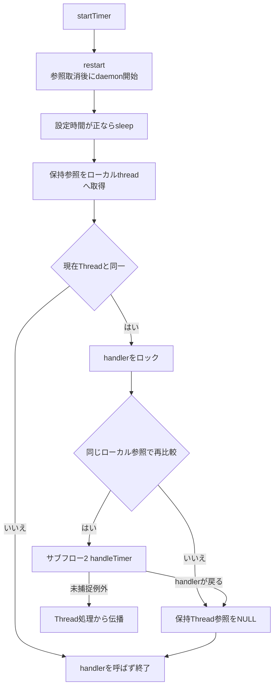

cancelが最初の参照取得前に認識されて不一致になればhandlerを呼ばない。一方、最初の比較通過後の取消に対し、ロック内では保持参照を読み直さないため、取消だけでhandler呼出し抑止を保証しない。

**サブフロー2：セッション資源の解放（手順4）**

userInfoから得たセッションと、その時点で取得したAgentを対象とする。

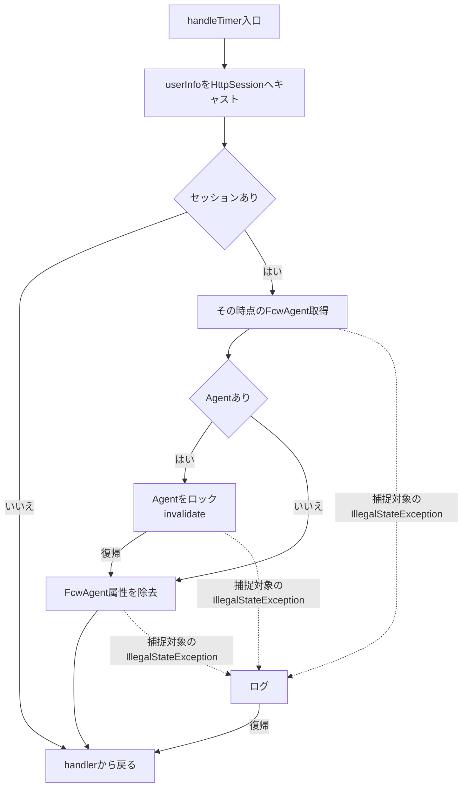

図中の捕捉対象以外の例外と、catch内の未捕捉例外はサブフロー1へ伝わる。Agent内部で無視する例外は手順4.3の二箇所に限る。

#### SQL・テーブル関連（ER図）

DBは使用しない。保持領域はTimerのThread参照、handler、userInfoのHttpSession、セッションFcwAgent、外部Jobであり、表間ER図は非該当である。

#### DB操作の詳細

資源解放は外部Jobのclear・removeJobとセッション属性の除去である。DBのDELETE、commit、rollbackではない。タイマーはセッション属性を取得し直すため、開始時のAgentそのものをuserInfoで固定して解放する構造ではない。

#### 結果・例外時の扱い

解放手順が戻ればFcwAgent属性を除去する。Agent内部で無視する型付き例外、handleTimerで捕捉するIllegalStateException、Timer.runから伝わる未捕捉例外は、それぞれ扱いが異なる。

要求処理前のstopTimer、指定経路でのstartTimer、期限後のhandlerは別の時点で動作する。要求処理が例外で抜けた場合の再開、取消後のhandler不実行、属性差替え時の解放対象について、実装された同期範囲以上の保証はない。Agent単位の同期、PDFUtilインスタンス単位の生成ロック、handlerの同期を、セッション全体の一つの排他保証へ拡張しない。

## 補足説明

### 状態と保持領域

| 情報 | 保持領域・寿命 | 本共通部での用途・変更 |
| --- | --- | --- |
| functionID、viewID、commandID、actionPackage | processの要求処理内 | 連携分岐、共通確認、Action生成、アクセス記録に使用する。 |
| strUrl、userId、mapCS | processの要求処理内 | 応答結果と記録情報を保持する。記録用JSP名の選択後もstrUrlを維持する。 |
| LoginBean | HttpSession | 共通ログイン確認と記録用職員番号取得に使用する。呼出先Actionが設定・除去し得る。 |
| OtherUserBean | HttpSession | 三つの連携識別子のいずれかが非NULLなら新しいBeanで上書きする。 |
| ErrorMsg | HttpSession | 共通拒否・Action例外の表示情報。ControlServletとError.jspは表示後除去を行わない。 |
| MESSAGE | HttpSession | 記録用JSP名を選ぶ。実forward先を決める値ではなく、ControlServlet自身は除去しない。 |
| FcwAgent | HttpSession | 旧PDFのAgentと外部Jobを保持する。指定経路でタイマーを開始し、期限後に属性を除去する。 |
| FMResponse、PDFデータ、ストリーム | 外部Job・メモリ・HTTP入出力 | 帳票結果を保持・送出する。業務DBの保存状態とは別に扱う。 |
| logger、errorLogger | FWLogのstaticフィールド | 共通ログ呼出しに使用する。アクセス記録のDB接続とは独立している。 |

### 例外の捕捉境界と確定範囲

| 発生段階 | 共通部の扱い | その段階だけでは確定しない事項 |
| --- | --- | --- |
| processの識別値処理、連携情報格納、ログイン情報参照、Logout退避 | Action用catchの外。POSTでは呼出元へ、GETのprocess呼出し内ならdoGetのcatchへ伝わる | 共通エラーJSP選択、アクセス記録、最終HTTP本文・状態 |
| OperatePermissionのtry内で捕捉するException | ログ後falseへ進み、ControlServletがメンテナンス分岐を選ぶ | 状態フラグ停止と接続・照会障害の区別 |
| Action反射生成・キャスト・performのtry内Exception | スタックとログ出力後、共通エラー属性・JSPを選ぶ | 業務rollback、応答reset、forward成功、利用者への画面到達 |
| CounterShiftのtry内で捕捉するException | rollbackを試みてログを呼ぶ。復帰すればstrUrlを維持する | commit例外やrollback失敗後の実際の記録状態 |
| 記録前後のセッション参照、ヘッダー設定、forward、JSP描画 | Action用catchの外 | 先行する業務更新・記録の取消、代替エラー表示 |
| 旧PDFのAgent獲得区間 | 表Aの順で再送出、独自HTMLとセッションinvalidate、再試行を分ける | 全例外に共通する回復、固定HTTP状態 |
| 旧PDFのオーバーレイ区間 | 表Bの順で独自HTMLとタイマー開始、再送出を分ける | 準備例外や送信例外にも同じ処理が適用されること |
| 取得用HTMLの内側flush・close | Exceptionを無視する。finally等が戻れば通常経路へ復帰し得る | HTMLの受領完了、残る内側closeの実行完了 |
| 取得用HTMLの外側処理・finally、PDF本体送信 | 実際に伝播した例外に各層のcatchを適用する | 一律の再送出、一律のタイマー開始、送信完了 |
| doGetの呼出し用catch | ExceptionをFWLog.errorへ渡すだけ | エラーJSPへの遷移、本文置換、特定HTTP状態 |

### 別宣言のPDF結合処理と年金印刷

PDFUtilには、pdfControlとは別にaddPdfControl、PdfReaderを保持するpdfDataList、outputPDFが宣言されている。addPdfControlはiTextReturnHttpResponseを呼び、その処理ではcallback用フラグ設定がコメント化されている。PDFを通常の本文コピーで送る代わりにPdfReaderをリストへ追加する。outputPDFは保持リストをPdfCopyFieldsへ順に追加して出力し、捕捉したExceptionはログだけにする。

ControlServletのGETが呼ぶのはpdfControlである。これらの別宣言を、当該GETで実行されるPDF結合処理や、年金の接続済み出力機能とは扱わない。

年金の登録内容印刷では、ReportViewAction・ReportPreviewActionがViewBeanをセッションへ設定してREPORT_JSPを返す。Report.jspのフォームは`nenkin / Report / Preview`をPOSTし、印刷ボタンが`window.print()`を呼ぶ。旧PDFのAgent、callback URL、Form Manager、保持タイマーは、このブラウザー印刷の実行契約に含まれない。

### 関連文書との責務対応

次表は文書計画上のIDと、Markdown正本ルートからの相対pathである。関連文書の生成済み状態を示す一覧ではない。

| 文書ID | 計画上の相対path | 本書との関係 |
| --- | --- | --- |
| API-NENKIN | 共通/要求処理一覧.md | 操作別のHTTP method、三識別値、Action、応答形式を対応付ける。本書は共通実行順と例外境界を扱う。 |
| COM-015 | 共通/共通仕様書_COM-015_ログイン処理.md | 共通認証、職員情報取得、連携認証の詳細を扱う。本書は確認省略条件と追加Actionへの接続を扱う。 |
| COM-111 | 共通/共通仕様書_COM-111_年金業務共通処理.md | 年金職員、CSRF、入力変換、ダウンロードの共通契約を扱う。本書はこれらを呼ぶActionと共通catchの境界を扱う。 |
| ENV-NENKIN | 共通/設定・配置・依存仕様書.md | Servlet登録、JNDI、logger、外部PDF依存等の配置条件を扱う。 |
| DB-OPS | 共通/DB仕様書/DB操作仕様書.md | 運用状態SELECTとアクセス記録INSERTをDB操作全体に位置付ける。 |
| DB-LOGICAL | 共通/DB仕様書/論理データ仕様書.md | TBL-N2-006の記録項目とTBL-N2-008の運用判定項目の業務上の意味を扱う。 |
| DB-PHYSICAL | 共通/DB仕様書/テーブル定義書.md | 両表の物理属性、ローカル互換定義と本番外部表の区別を扱う。 |
| DET-SCR-011 | 詳細仕様書/詳細仕様書_SCR-011_エラー.md | ErrorMsgの表示、エスケープ、復帰操作を扱う。本書は設定元とforwardまでの境界を扱う。 |
| DET-SCR-019 | 詳細仕様書/詳細仕様書_SCR-019_登録内容印刷.md | 年金のJSPプレビューとブラウザー印刷を扱う。旧GET PDF経路とは分離する。 |
