<!-- spec-meta: {"schema":"spec-md/1.0","documentId":"COM-015","version":"2.0","path":"共通/共通仕様書_COM-015_ログイン処理.md","sheets":[{"heading":"概要","kind":"GRID","sheet":"概要"},{"heading":"項目一覧","kind":"LIST","sheet":"項目一覧"},{"heading":"イベント仕様","kind":"GRID","sheet":"イベント仕様"},{"heading":"補足説明","kind":"GRID","sheet":"補足説明"}]} -->
# ログイン処理

| 属性 | 内容 |
| --- | --- |
| 文書種別 | 共通仕様書 |
| システム名 | 年金自動受取予約管理システム |
| 共通／文書ID | COM-015 |
| 版 | 2.0 |
| 解析対象 | 共通ログイン・ログアウト・連携入口、および年金の追加職員確認 |
| 基準日 | 2026-10-15 |
| 版の意味 | 本仕様書の版。原プログラムの版とは別に管理する |

## 概要

本処理は、要求から共通認証用の値を組み立て、認証結果と職員・所属情報をセッションの`LoginBean`へ保持する。年金の通常ログインでは、共通処理の成功後に同じ職員番号で職員名簿を再照会し、年金業務用の職員情報とCSRF値を確保してメニューへ進む。共通認証の成立と、年金業務を開始できる状態の成立は別段階である。

通常の年金フォームは`APPL_NAME=unify`を送る。この経路では、認証表のユーザーＩＤと比較する値はアプリケーション名であり、入力した職員番号ではない。職員番号は共通側の名簿・所属課係検索、共通Beanへの保持、年金側の追加職員確認に使う。認証表への一致を、入力職員番号に対する個人別認証と同一視しない。

共通側の検索は、値を文字列連結したSQLを`Statement`へ渡す。年金側の追加職員検索は、`PreparedStatement`の位置1へ職員番号を`setInt`する。予約Repositoryのバインド契約を、共通認証にも適用される契約として扱わない。

ログインは認証・職員・名称の各表を参照し、これらの表へ登録・更新しない。要求処理に付随するアクセス記録は、共通コントロールサーブレットが別接続・独立したトランザクションで登録する。

| 入口 | 要求・識別値 | 呼出し | 結果 |
| --- | --- | --- | --- |
| 年金の通常ログイン | POST、コンテキスト配下の`/Action.do`。`FUNCTION_ID=nenkin`、`VIEW_ID=Login`、`COMMAND_ID`は空文字 | `nenkin.LoginAction`から`common.LoginAction`。共通戻り値がログインJSP以外なら`MenuViewAction` | 認証拒否・年金職員不在はログインJSP。追加確認成功は年金メニュー |
| 年金メニューのログアウト | POST、同じ`/Action.do`。`FUNCTION_ID=common`、`VIEW_ID=Logout`、`COMMAND_ID`は空文字 | `common.LogoutAction` | 共通の画面状態とログイン情報を除去してログインJSP |
| 特殊連携 | `OPK`、`Otheflg`、`charCommonUID`等でServletが分岐 | 主に`common.LoginInterfaceAction`。条件により要求のActionを再利用 | 連携宛先のActionへ委譲。年金の通常画面機能とは別の共通基盤契約 |

画面の配置・外観・入力操作はSCR-013／DET-SCR-013とSCR-017／DET-SCR-017が担当し、本書はその要求値、共通認証、職員確認、保持状態、戻り値を定義する。

## 項目一覧

| No | グループ | 項目名 | 種類 | 入出力 | DB連携項目 | 候補取得元 | 必須 | 形式・桁 | 説明 |
| --- | --- | --- | --- | --- | --- | --- | --- | --- | --- |
| 1 | 通常要求 | 職員番号 | テキスト入力`loginUser`／要求`DWH_USER_ID` | I | 共通・年金の職員名簿の職員番号、共通の所属課係一覧の職員番号 | ‐ | 通常ログインではNULL・空文字を拒否。年金側でも整形後形式と存在を確認 | 受信`String`。画面`maxlength=8`、`inputmode=numeric`。共通Long変換、8桁指定ゼロ埋め、年金のASCII数字1～8桁検査は別処理 | 通常unifyでは認証表のユーザーＩＤへ渡さない。名簿へ保存しない検索入力 |
| 2 | 通常要求 | パスワード | パスワード入力`loginPassword`／要求`DWH_PASS_WORD` | I | ＵＷＥＢログイン情報表のパスワードとの比較 | ‐ | 通常ログインではNULL・空文字を拒否 | 受信`String`。画面`maxlength=20`。共通Actionに同じ最大長検査やtrimはない | 認証用比較値。実値は掲載しない。`LoginInfoBean`にはパスワード項目がない |
| 3 | 通常要求 | アプリケーション名 | hidden`APPL_NAME` | I | 認証表のアプリケーション名。通常unifyではユーザーＩＤとの比較にも使用 | ‐ | 通常フォームは`unify`。組替え後の値を共通処理が検査 | `String` | 年金Actionが受信値を`unify`へ強制置換する処理はない |
| 4 | 要求識別 | 機能ID | hidden`FUNCTION_ID` | I | 業務表へ直接保存しない。アクセス記録へ使用 | ‐ | 通常ログインは`nenkin`、ログアウトは`common` | `String`。Actionのパッケージ名決定時に小文字化 | NULLならAction生成前の小文字化で例外になり得る |
| 5 | 要求識別 | 画面ID | hidden`VIEW_ID` | I | 業務表へ直接保存しない。アクセス記録へ使用 | ‐ | 通常ログインは`Login`、ログアウトは`Logout` | `String` | `Login`は既存ログイン判定を省略。NULLならAction用catch前の比較で例外になり得る |
| 6 | 要求識別 | コマンドID | hidden`COMMAND_ID` | I | 業務表へ直接保存しない。アクセス記録へ使用 | ‐ | 通常フォームは空文字の項目を送信 | `String`。空文字と欠落によるNULLは別値 | 欠落値を空文字へ補完しない。Action名の連結に文字列`null`が入り得る |
| 7 | 通常要求 | 共通メニュー区分 | hidden`UNIFY_FLG` | I | DB列へ直接保存しない | ‐ | 通常フォームは`0`。未設定・個別分岐外は共通メニュー側 | `String`。個別分岐値は`0`、`1`、`3` | 共通戻り先の選択値。年金LoginActionは成功戻り先を年金メニュー処理へ接続する |
| 8 | 共通要求 | 遷移元アプリケーション名 | 要求`FROM_APPL_NAME` | I | DB列へ直接保存しない | ‐ | 通常年金フォームは送信しない。未設定ならBeanのNULLを保持 | `String`。trimなし | 成功時、名簿情報移送前に設定。空文字との比較は内容比較ではなく参照比較 |
| 9 | 他アプリケーション要求 | 融資系ユーザーID | 要求`CREDIT_USER_ID` | I | credit分岐の認証表ユーザーＩＤ | ‐ | credit分岐の認証用値。通常年金フォームは送信しない | `String` | 通常年金の職員番号とは別の認証引数 |
| 10 | 他アプリケーション要求 | 融資系パスワード | 要求`CREDIT_PASS_WORD` | I | credit分岐の認証表パスワード | ‐ | credit分岐の認証用値。通常年金フォームは送信しない | `String` | 年金通常画面の入力項目へ追加しない |
| 11 | 特殊連携要求 | 連携識別値 | 要求`OPK`、`Otheflg`、`charCommonUID` | I | DB列へ直接保存しない | ‐ | 通常年金要求では送信しない。特殊入口は各条件による | 各`String` | Servletの入口選択は非NULLかつ非空。Bean保存と共通LoginActionの特殊判定は非NULLだけで成立 |
| 12 | 特殊連携要求 | 連携ユーザー・宛先・対象情報 | 要求`UID`、`OtherUserId`、`Package`、`Screen`、`DSP`、`intCustNr`、`intBr` | I | 連携認証、後続Action選択、対象有無の判定。年金の直接保存列なし | ‐ | 特殊入口別の条件による。NULL・空文字を一律に許容しない | 各`String`。要求DTOへの自動数値変換なし | 対応と片側NULL時の分岐は特殊連携イベントに定義 |
| 13 | 共通セッション | 共通ログイン情報 | `LoginBean`／`LoginInfoBean` | O | 認証結果、職員・所属・名称の取得値を保持。DBへ書き戻さない | ‐ | ‐（内部項目） | `Serializable`。String項目、boolean2項目、int権限5項目 | 通常成功・通常拒否で新規Beanを保存。保存前の例外では旧Beanが残り得る |
| 14 | 年金セッション | 年金職員情報 | `NENKIN_STAFF_CONTEXT`／`StaffContext` | O | 追加照会した職員番号・漢字氏名・所属店番・役職コード | ‐ | ‐（内部項目） | `staffNo:int`、`staffName:String`、`branchNo:int`、`roleCode:String` | 共通Beanの加工済み所属店番ではなく、年金側の名簿取得値を保持 |
| 15 | 年金セッション | CSRF値 | `NENKIN_CSRF_TOKEN` | O | 非DB項目 | ‐ | ‐（内部項目） | `String`。生成値はUUIDの文字列表現 | 通常ログイン開始時に除去し、職員確認成功後に確保。生成と要求値照合は別処理 |
| 16 | 画面セッション | メニュー表示情報 | `ViewBean`／`MenuViewBean` | O | 表示元は年金職員情報。直接保存列なし | ‐ | ‐（内部項目） | 職員番号表示・職員氏名は`String` | 職員情報の再取得結果が非NULLなら8桁番号表示と氏名を設定 |
| 17 | 表示連絡 | ログイン用メッセージ | `MESSAGE` | I／O | 非DB項目。属性の有無をアクセス記録のJSP名判定にも使用 | ‐ | ‐（内部項目） | 共通側は`List`。年金拒否は1要素のList | ログインJSPが非空Listを表示後に除去。共通成功時の積極的な消去はない |
| 18 | 表示連絡 | 共通エラーメッセージ | `ErrorMsg` | O | 非DB項目 | ‐ | ‐（内部項目） | `String` | 時間切れ、運用拒否、Action実行例外の共通エラー表示に使用 |
| 19 | 連携セッション | 他アプリケーション連携情報 | `OtherUserBean` | I／O | 認証引数と後続Action宛先を保持。直接保存列なし | ‐ | 特殊枝には参照前の存在確認がない箇所がある | ユーザ・パスワード・アプリケーション名・パッケージ名・画面IDは各`String`、初期値NULL | setterに正規化・検証はない。ログアウトの除去対象外 |

## イベント仕様

### 通常ログイン要求と共通認証

#### 処理概要

通常フォームからのPOSTを受け、共通認証用のアプリケーション名・ユーザーID・パスワードを決める。認証表に該当すれば職員・所属情報を組み立て、`LoginBean`へ保存する。年金LoginActionは共通戻り値がログインJSPかを判定し、それ以外の正常戻り値では追加職員確認へ進む。

フォームの`accept-charset`とServletの要求文字コード設定はWindows-31Jである。入力は`getParameter`で取得するStringであり、要求DTOへのバインドやフレームワークによる自動数値変換を挟まない。ブラウザーの入力長・入力モードは、サーバー受信値の上限・形式を保証しない。

#### 処理手順

**1. Servletで入口と実行条件を決める。**

　**1.1.** 要求文字コードをWindows-31Jにし、通常要求から`FUNCTION_ID`、`VIEW_ID`、`COMMAND_ID`を取得する。機能IDを小文字化してActionのパッケージ名を決める。

　**1.2.** `VIEW_ID=Login`では既存`LoginBean`の認証判定を省略し、運用可否判定へ進む。機能IDのNULLによる小文字化失敗、画面IDのNULLによる比較失敗はAction用catchより前である。

　**1.3.** `OperatePermission.check`は、業務種別の判定前に`jdbc/Oracle_SP2NM`の共通接続を取得する。`nenkin`は運用状態表の照会対象外だが、先行する接続取得等でExceptionになると運用不可となる。Servletはメンテナンスの`ErrorMsg`と共通エラー宛先を設定し、ログインActionを実行しない。

　**1.4.** 通過した場合はパッケージ名・画面ID・コマンドIDを連結してActionを反射生成する。通常値では`nenkin.LoginAction`となる。同Actionは`NENKIN_STAFF_CONTEXT`、`NENKIN_CSRF_TOKEN`の順に除去してから共通LoginActionを呼ぶ。この時点で`LoginBean`と`ViewBean`は除去しない。

**2. 要求値を認証用の値へ組み替える。**

　**2.1.** 共通LoginActionは通常要求でもセッションの`OtherUserBean`をキャスト取得する。属性なしはNULLとなるが、別の型が格納されていれば認証検査前に型例外となり得る。通常枝では同Beanの内容を認証引数として参照しない。

　**2.2.** `DWH_USER_ID`、`DWH_PASS_WORD`、`CREDIT_USER_ID`、`CREDIT_PASS_WORD`、`APPL_NAME`、`UNIFY_FLG`をStringとして取得する。欠落値を一律に空文字へ補完しない。

　**2.3.** 通常年金フォームの`APPL_NAME=unify`では、認証用ユーザーID`sUser`へアプリケーション名、認証用パスワード`sPass`へ`DWH_PASS_WORD`を設定する。職員番号`dwhUserId`は別に保持する。認証前のtrim、文字置換、パスワードのハッシュ変換は行わない。

　**2.4.** 次の順で未設定を検査する。先行条件に該当すれば後続条件と認証表検索へ進まない。空白のみの文字列は、この空文字検査を通過する。

| 順序 | 条件 | 結果 |
| --- | --- | --- |
| 1 | `sUser`または`sPass`がNULLまたは空文字 | 可否false。「ユーザ名・パスワードを入力してください。」を追加 |
| 2 | 順序1を通過し、`applName`または`dwhUserId`がNULLまたは空文字 | 可否false。「ログインに失敗しました。」を追加 |
| 3 | 両方を通過 | 認証表検索へ進む |

未対応のアプリケーション名では`sUser`と`sPass`がNULLのままなので、順序1で拒否する。他アプリケーションの組替えは特殊連携イベントに示す。

**3. 認証表と最初の職員名簿を読む。**

　**3.1.** SP2NM接続を取得し、認証表を検索する。呼出元は検索Baseのboolean戻り値を使わず、`getList()`のNULL・空判定で認証結果を決める。

　**3.2.** 認証表がNULLまたは0件なら可否falseとし、「ログインに失敗しました。ユーザ名・パスワードを確認してください。」を追加する。1件以上なら名簿検索へ進む。複数件を理由に拒否する検査はない。

　**3.3.** 未trimの`dwhUserId`を`Long.parseLong`で検査する。成功した場合は、変換したLongではなく元のStringを名簿検索SQLへ連結する。局所tryの`NumberFormatException`では名簿リストをNULLにし、共通認証の成功を維持する。検索0件も後続の補完処理へ進む。

　**3.4.** 認証表・最初の名簿読取の接続を閉じる。接続・SQL・結果取得・検索リソース解放の失敗を名簿不在へ変える一般catchはない。接続closeのSQLExceptionはログ出力して抑止する。この読取区間に明示的なcommit・rollbackはない。

**4. 共通番号、遷移元、職員・名称情報を順に設定する。**

　**4.1.** 共通処理内で作成した新規`LoginInfoBean`へ、可否とアプリケーション名を設定する。元職員番号がNULLまたは空文字なら`00000000`、それ以外なら`getAdd0String(dwhUserId, 8)`を設定する。この処理は通常拒否でも行う。

　**4.2.** 可否trueの場合、名簿情報を移送する前に`FROM_APPL_NAME`を取得する。非NULLで、かつ空文字との参照比較が不一致なら遷移元アプリケーション名を設定する。trimや文字列内容による空文字比較は行わない。通常年金フォームが送信しない場合は、新規BeanのNULLが残る。

　**4.3.** 名簿に行があれば先頭行の所属・氏名等を移送し、行がなければ補完値を設定する。所属店番の整形・分割と補完内容は「共通職員情報の移送」に示す。名簿行の加工失敗を、名簿なしの補完枝へ戻す処理はない。

　**4.4.** 検索用ローカル所属店番が非NULL・非空なら、DWH接続を取得して事業所名を検索する。名簿所属店番を4桁指定で整形した先頭2文字と次の2文字を条件に使う。先頭行があれば所属店名へ移送し、0件なら「該当なし」とする。名簿なしでは検索用所属店番がNULLのままなので検索を省略し、「該当なし」とする。

　**4.5.** 事業所名処理の後、役職検索の要否を調べる前にSP2NM接続を取得する。役職コードがNULL・空文字・文字列`0`のいずれでもない場合だけ役職名を検索する。行があれば先頭行の役職をBeanとローカル変数`yakusyoku`へ設定し、未検索・0件なら両方を「該当なし」とする。

　**4.6.** 同じ接続で元の職員番号を再度`Long.parseLong`し、成功時だけ所属課係一覧を検索する。この局所数値変換の失敗ではリストをNULLとする。未取得・0件はコード`0`・名称空文字とし、行があれば先頭行のコードを保持して次の対応で名称を設定する。取得コードの`convertInt`は局所catchの外にあり、その不正値を0件扱いにはしない。

| 所属課係の取得状態・変換結果 | Beanのコード | Beanの名称 |
| --- | --- | --- |
| 行あり、変換結果10 | 取得String | 店長席 |
| 行あり、変換結果100 | 取得String | 融資Ｍ・リレーションＧ |
| 行あり、変換結果600 | 取得String | 事務グループ |
| 行あり、その他の変換可能値。空文字等が0となる場合を含む | 取得String | その他 |
| 未取得、0件、職員番号の局所数値変換失敗 | `0` | 空文字 |

事業所名・役職名は、行が存在して名称列だけSQL NULLなら空文字になる。0件・検索省略時の「該当なし」とは別の結果である。

**5. アプリケーション別情報と共通結果を保存する。**

　**5.1.** 通常unifyでは融資系ユーザーＩＤをNULL、融資系ユーザー名をローカル役職名`yakusyoku`にする。五種類の融資系権限は新規Beanのint初期値0を保つ。

　**5.2.** 成功時は組立済みBeanを`LoginBean`へ保存する。unifyでは保存した同じBeanにＵＮＩＦＹフラグを設定し、`0`なら`./JSP/MENU/Menu.jsp`、`1`なら`./JSP/LIST/Menu.jsp`、`3`なら`./JSP/LIST/MenuHT.jsp`、それ以外なら共通メニューを返す。既存`MESSAGE`は積極的に消去しない。

　**5.3.** 通常拒否では、手順4.1まで設定した可否falseの新規Beanで`LoginBean`を置き換え、理由別のListを`MESSAGE`へ保存し、`./JSP/MENU/Login.jsp`を返す。旧成功Beanを維持する拒否処理ではない。

　**5.4.** 年金LoginActionは、共通戻り値がログインJSPと内容一致した場合、そのまま返す。それ以外の正常戻り値では`new MenuViewAction().perform(...)`を呼び、次イベントの戻り値を採用する。共通処理が例外を送出した場合は追加確認へ到達しない。

**6. Servletがアクセス記録とforwardを行う。**

　**6.1.** Actionの反射生成から`perform`までのExceptionは、Servletがログ出力し、アプリケーションエラーの`ErrorMsg`と`./JSP/COMMON/Error.jsp`を設定する。このcatchは`LoginBean`を除去しない。

　**6.2.** 通常ログインでは、Action後の`LoginBean`からアクセス記録用職員番号を取得する。拒否Beanの番号、年金拒否でBeanを除去した状態、例外で旧Beanが残った状態を同じ値へ置き換えない。この取得自体はAction用catchの外である。

　**6.3.** Servletは機能・画面・コマンド・Action ID・JSP名・職員番号を`CounterShift`へ渡す。`MESSAGE`属性が非NULLなら記録上のJSP名だけを`./JSP/COMMON/SubMessage.jsp`にする。実forward先`strUrl`は変更しない。アクセス記録は独立commitで、失敗はrollbackを試みたうえでログ出力し、再送出しない。

　**6.4.** 戻り値がNULL、`PDF`、`CSV`以外なら、ServletはWindows-31JのContent-Typeとキャッシュ抑止ヘッダーを設定し、決定した宛先へforwardする。forwardはAction用catchの外である。

#### 処理フロー

各サブフローは、決定済み宛先、メッセージ、共通Beanの新旧・有無、取得済み職員情報を引き継ぐ。Action内で局所処理されないExceptionはサブフロー5のAction例外入口へ進む。

**サブフロー1：入口とログイン開始。** 運用拒否は年金属性を除去する前に終了する。

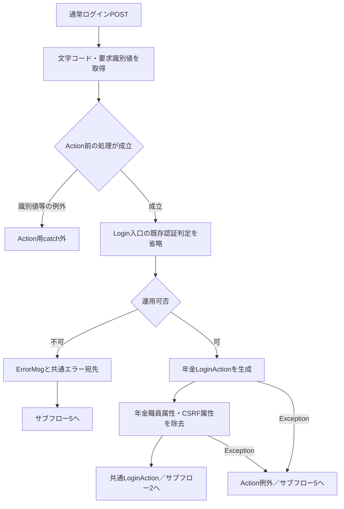

**サブフロー2：未設定検査、認証、最初の名簿。** 三つの拒否出口は手順2.4・3.2の理由を保持する。

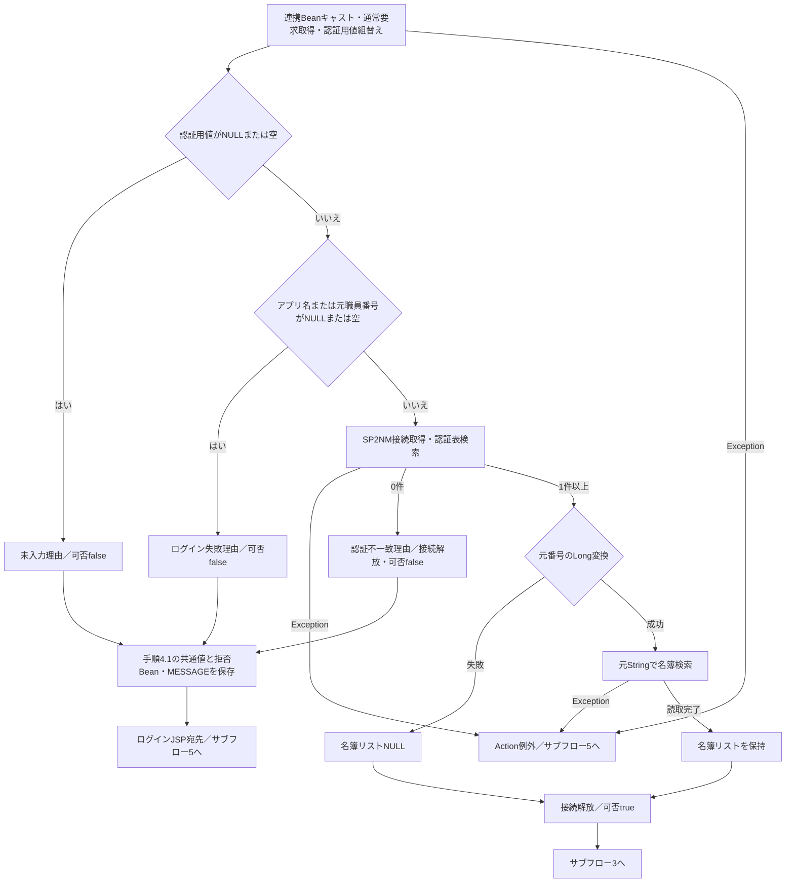

接続closeのSQLExceptionは抑止する。共通検索のResultSet・Statement解放時SQLExceptionは、図の検索Exceptionに含む。

**サブフロー3：遷移元、職員情報、事業所名。** 遷移元設定は名簿移送より先である。合流後も名簿取得値と補完値の違いを保持する。

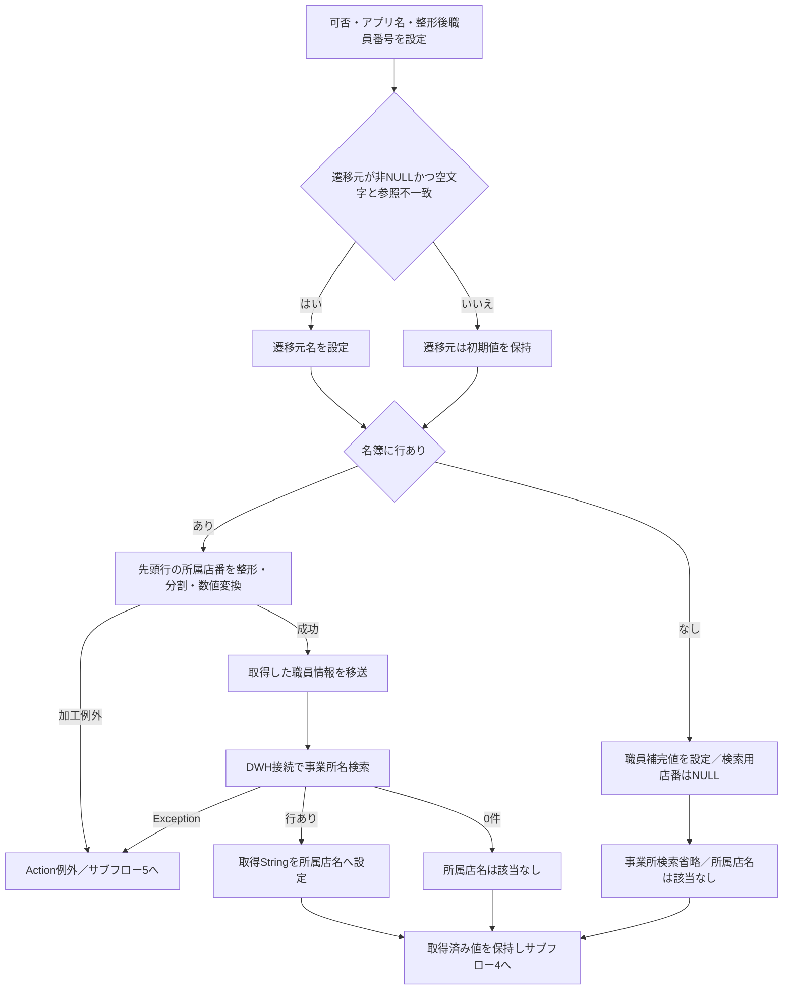

**サブフロー4：役職・所属課係と成功保存。** 役職コードによる検索省略の前に接続を取得する。所属課係の取得コード変換失敗を、職員番号変換失敗へ合流させない。

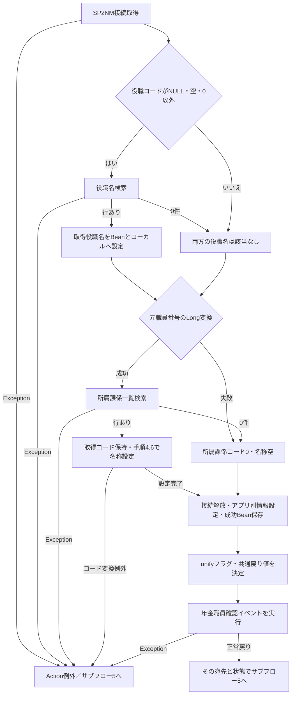

**サブフロー5：記録と応答。** 宛先だけを共通化し、各枝の認証状態を一律に削除しない。

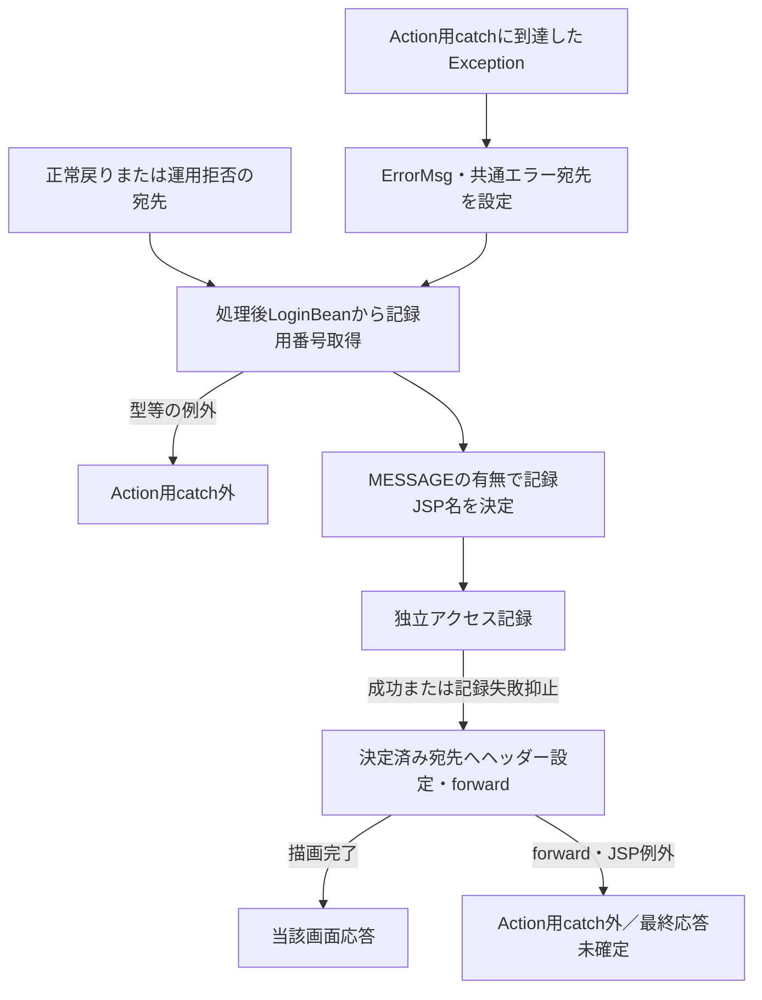

#### SQL・テーブル関連（ER図）

次は個別検索とJava内の値移送を示す関連図である。線はSQL JOIN、FK、多重度を表さない。

**関連図COM-015-ER-01：認証結果と追加職員確認への接続。**

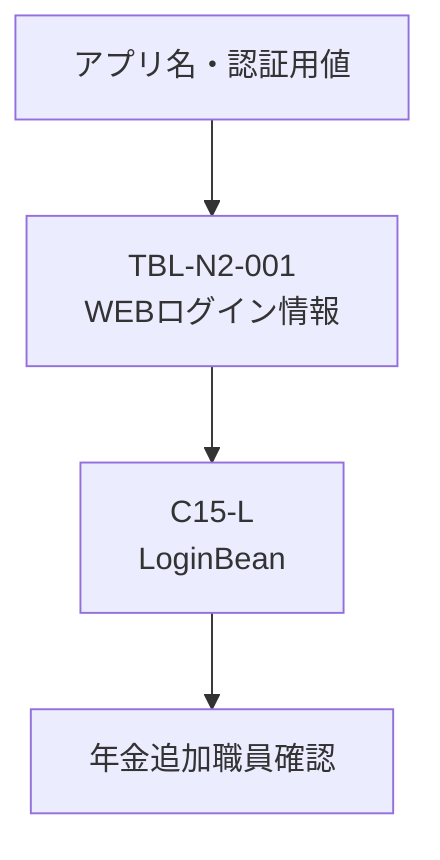

**関連図COM-015-ER-02：元職員番号による職員・所属課係取得。**

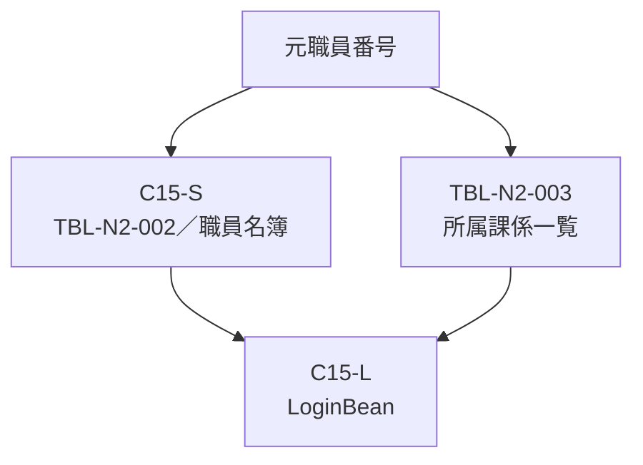

**関連図COM-015-ER-03：職員名簿から取得する名称。**

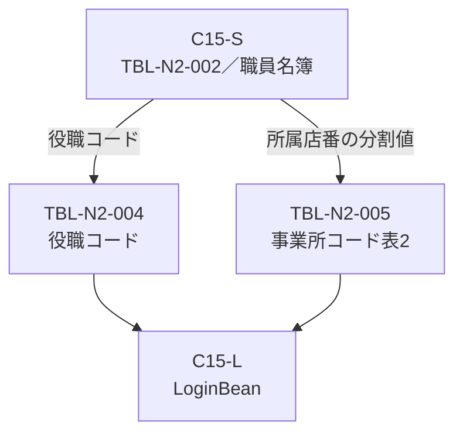

| 参照ID | 共有する対象 | 図間の接続 |
| --- | --- | --- |
| C15-S | TBL-N2-002の共通職員名簿取得結果 | COM-015-ER-02の取得結果をCOM-015-ER-03の役職コード・所属店番の分割値に使用する |
| C15-L | セッションへ保存する同じ`LoginBean` | COM-015-ER-01～03の認証結果・職員・所属課係・名称を集約する。COM-015-ER-01の年金追加職員確認は、次イベントのCOM-015-ER-04へ接続する |

#### DB操作の詳細

表中の`【値名】`はSQL組立値であり、JDBCバインド変数ではない。認証値の実値を含むSQLは掲載しない。

| 操作 | 対象・SELECT列 | WHEREの全条件 | 値の渡し方 | 結果の使用 |
| --- | --- | --- | --- | --- |
| 共通認証 | `DB2.ＵＷＥＢログイン情報表`から`*` | `アプリケーション名 = '【applName】' AND ユーザーＩＤ = '【sUser】' AND パスワード = '【sPass】'` | 三値を引用符付きで文字列連結。引用符エスケープなし | NULL・空Listは拒否。1件以上は後続へ進む |
| 共通職員 | `DB2.Ｕ職員名簿表`から`*` | `職員番号 = 【dwhUserId】` | 局所Long変換を通した元Stringを引用符なしで連結 | 先頭行を移送。未取得・0件は補完 |
| 事業所名 | `N2_DWH.Ｊ事業所コード表２`から`事業所名` | `店舗コード = 【syosaiBushitsuCode】 AND 枝番 = 【syosaiBushitsuEdaban】` | 所属店番の分割String二値を引用符なしで連結 | 先頭行の事業所名を所属店名へ設定 |
| 役職名 | `DB2.ＵＪＶ役職コード表`から`役職` | `役職コード = 【yakusyokuCode】` | Stringを引用符なしで連結。直前の数値変換なし | 先頭行の役職をBeanとローカルへ設定 |
| 所属課係 | `DB2.Ｕ職員所属課係一覧表`から`*` | `職員番号 = 【dwhUserId】` | 再度の局所Long変換を通した元Stringを引用符なしで連結 | 先頭行のコードから名称を決定 |

各SELECTにJOIN、ORDER BY、ページング、SQL上の件数上限、明示的なタイムアウト・取消設定はない。先頭行を採用する検索に複数行があった場合、その業務上の優先順位は定義されていない。SQLパラメータの位置、JDBC型、サイズを設定するAPI呼出しもない。

`CommonBaseSelect`は`createStatement`、`executeQuery`の順に実行し、全行をList内のMapへ変換する。キーは`ResultSetMetaData.getColumnName`の列名である。各値は`getString`し、SQL NULLなら空文字、それ以外ならtrimしたStringにする。正常0件でも空Listを作るため、List非NULLに基づく検索Baseのtrueは「該当行あり」を意味しない。

共通接続は指定JNDI名を直接lookupし、取得後に`autoCommit=false`を設定する。認証・最初の名簿、事業所名、役職・所属課係は別の接続区間である。SELECT後に明示的なcommit・rollbackはなく、接続を閉じる。複数区間を一括したトランザクションや同一時点のマスター状態を保証する処理ではない。

共通検索は、SQL実行成功後のdebug有効時とSQLException時にSQLをログへ渡す。認証値を連結したSQLも対象となり得る。認証表の取得結果はAction内の一時List・Mapに保持し、通常の`LoginInfoBean`へパスワードを移送する項目はない。

#### 結果・例外時の扱い

| 条件・発生段階 | 結果 | 保持状態・捕捉境界 |
| --- | --- | --- |
| 認証前検査で拒否、または認証表0件 | ログインJSPを返す | 可否falseの新規`LoginBean`と理由別`MESSAGE`。年金職員・CSRF属性は開始時に除去済み |
| 職員番号の局所Long変換失敗、または共通名簿0件 | 共通認証trueを維持し、職員補完値で継続 | 年金側の形式・存在確認は別に行う |
| 名簿行の所属店番が空文字 | 分割時の`substring`等で例外になり得る | 名簿なしの補完枝には戻らない |
| 名簿行の所属店番が非数値・int範囲外 | `Integer.parseInt`の例外 | 元職員番号の局所catchの対象外 |
| 取得した所属課係コードが不正数値・int範囲外 | `convertInt`の例外 | 所属課係0件のコード0・空名称へ置換しない |
| 接続・SQL・結果変換のException | ServletのAction用catchへ到達すれば共通エラー宛先 | 認証不一致へ置換しない。catchは`LoginBean`を除去しない |
| 共通検索のResultSet・Statement解放時SQLException | 呼出元へ伝播し得る | 読取済みでも失敗となる。ResultSet解放失敗ではStatement解放へ進まず、先行例外を置き換え得る |
| 共通LoginActionの接続close時SQLException | ログ出力して抑止 | この失敗だけでは得られた処理結果を変更しない |
| 識別値処理、共通認証判定、Action後のBeanキャスト・番号取得 | Action用catchの外 | 同catchによる固定のエラー応答を保証しない |
| forward・JSP描画の例外 | Action用catchの外 | Action正常復帰と画面表示完了は別 |

共通成功Beanの保存前に例外となると、以前の`LoginBean`が残り得る。共通成功Beanを保存した後に年金の読取が失敗すると、新しい成功Beanが残り得る。どちらも年金職員不在による通常拒否の除去処理とは異なる。

ログインJSPは`MESSAGE`をListへキャストし、非NULLかつ非空なら各要素を`HtmlUtil.escape`で表示してから属性を除去する。NULL・空Listはこの除去経路に入らない。型例外や描画途中の例外では、表示・除去の完了を確定できない。エスケープはNULLを空文字とし、アンパサンド、大小記号、二重・単一引用符を変換する。

この経路には、認証拒否を401・403へ変える処理や、Action例外に固定HTTP状態を設定する処理はない。ServletのWindows-31J設定と年金JSPのUTF-8宣言は別に存在する。Action戻り値だけから最終文字コード、最終HTTP状態、ブラウザー表示完了を一括して確定しない。

### 年金職員確認とメニュー状態の確立

#### 処理概要

`MenuViewAction`は先頭で`requireStaff`を呼ぶ。年金職員情報がなければ、共通認証済みBeanの整形後職員番号で名簿を再照会する。これはActionからの内部呼出しであり、独立した公開HTTP APIではない。

通常ログインでは開始時に年金職員属性を除去するため、新規確認へ進む。他の年金Actionから呼ばれた場合は、既存`StaffContext`を再利用する経路もある。

#### 処理手順

**1. 既存職員情報または共通ログイン情報を確認する。**

　**1.1.** `NENKIN_STAFF_CONTEXT`が`StaffContext`型なら、名簿を再照会せずCSRF値を確保してtrueを返す。この内部再利用は、通常HTTP入口のServletによる共通認証判定を代替しない。

　**1.2.** 再利用できなければ、`LoginBean`が`LoginInfoBean`型で可否trueかを確認する。満たさなければ「ログインしてください。」を`MESSAGE`へ設定し、年金職員・CSRF属性を除去してfalseを返す。この枝では`LoginBean`自体を除去しない。

　**1.3.** 共通職員番号をNULLなら空文字、それ以外ならtrimし、`[0-9]{1,8}`に一致する場合だけintへ変換して`verifyStaff(int)`へ渡す。対象は共通側のゼロ埋め後のStringである。正数限定ではなく、数字0のみの値も形式検査を通る。

**2. 店舗名を先行取得してから職員を検索する。**

　**2.1.** `verifyStaff`は`getStaff`を呼ぶ。`getStaff`は職員読取用tryへ入る前に`loadBranchNames`を呼び、業務接続から店名テーブルを全件取得する。店舗コードをIntegerキー、店名を値とするHashMapを作る。

　**2.2.** 店舗名取得後、職員接続で名簿を検索する。職員番号を位置1へ`setInt`する。最初の`next()`がfalseならNULL、trueなら先頭行を`StaffLookupItem`へ変換する。在職・停止状態等の追加条件はない。

　**2.3.** 職員番号と所属店番は`getInt`で読み、この箇所では`wasNull`を確認しないためSQL NULLは0になる。氏名・カナ氏名・役職コードは`getString`し、モデルがNULLを空文字へ変換する。非NULL文字列のtrimは行わない。

　**2.4.** 所属店番で店舗名Mapを突き合わせ、名称未取得は空文字にする。その後、職員番号・氏名・所属店番・役職コードだけを`StaffContext`へ移す。カナ氏名と店舗名は移さない。最終職員情報に店名を保存しない場合でも、先行する店名取得は省略されない。

**3. 年金属性とメニュー表示情報を確立する。**

　**3.1.** 職員が見つかれば、先に`NENKIN_STAFF_CONTEXT`へ保存し、その後CSRF値を確保してtrueを返す。CSRF属性が長さ1以上のStringなら再利用し、それ以外なら`UUID.randomUUID().toString()`を保存する。通常ログインでは開始時に旧値を除去しているため新規生成となる。

　**3.2.** 共通認証はtrueだが、番号形式が不正または職員0件なら`LoginBean`を除去する。「ログイン職員番号が職員名簿に存在しません。管理者に確認してください。」を`MESSAGE`へ設定し、年金職員・CSRF属性も除去してfalseを返す。形式不正では職員検索を行わない。

　**3.3.** falseを受けた`MenuViewAction`は`STAFF_JSP`を返す。この定数はログインJSPと同値であり、別の業務職員番号入力画面には進まない。

　**3.4.** trueなら新規`MenuViewBean`を作り、セッションの職員情報を再取得する。非NULLなら`Locale.ROOT`の`%08d`で職員番号表示を作り、氏名とともに設定する。再取得結果がNULLならBean初期値の番号`-`・氏名「未確認」を保持する。続いて`ViewBean`へ保存し、`./JSP/NENKIN/Menu.jsp`を返す。JSPは番号と氏名をHTMLエスケープして表示する。

#### 処理フロー

**サブフロー1：再利用と照会前検査。** 再利用成功はサブフロー2のメニュー表示入口へ進み、新規照会はint職員番号を引き継ぐ。

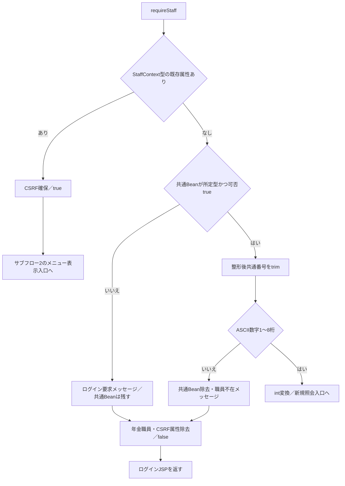

**サブフロー2：読取、職員保存、メニュー表示。** 読取例外は通常拒否の属性除去を通らない。既存再利用成功は職員保存をやり直さず、表示モデル作成へ入る。

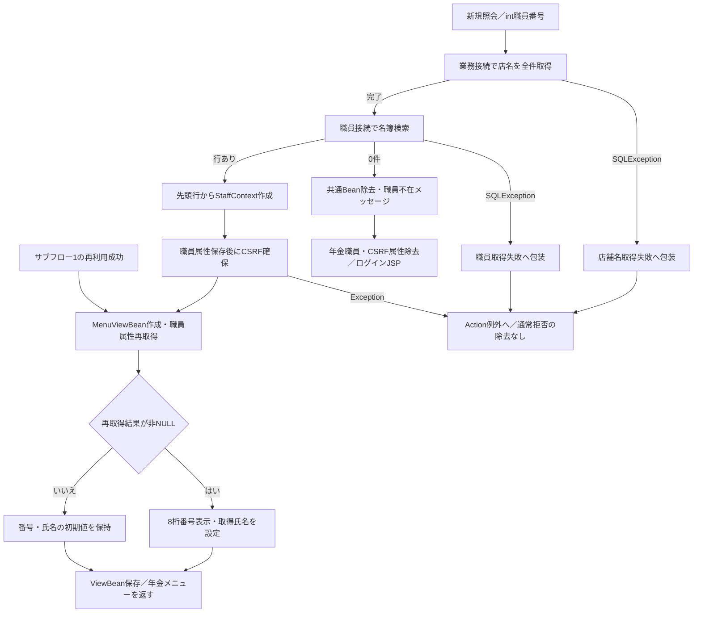

モデル生成・セッション操作等のその他のExceptionも、発生位置からAction例外へ伝播する。完了済み属性設定を巻き戻す処理はない。戻り値・例外は通常ログインイベントのServlet応答処理へ戻る。

#### SQL・テーブル関連（ER図）

**関連図COM-015-ER-04：共通番号から年金職員を再検索する入力。**

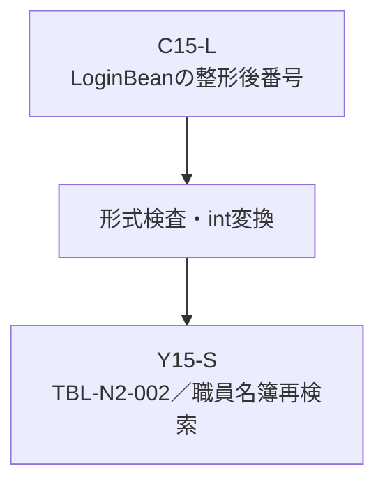

**関連図COM-015-ER-05：店舗名Mapと職員取得結果の突合せ。**

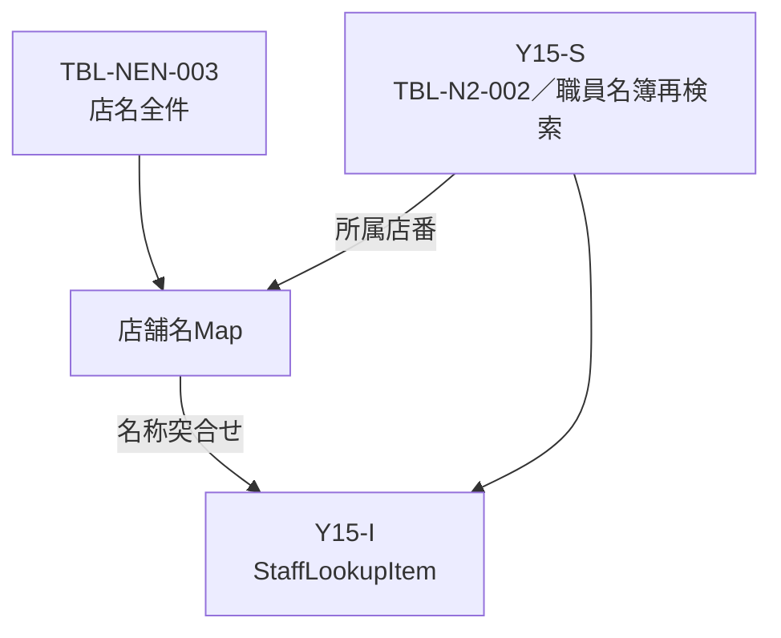

**関連図COM-015-ER-06：職員四項目のセッション移送と表示。**

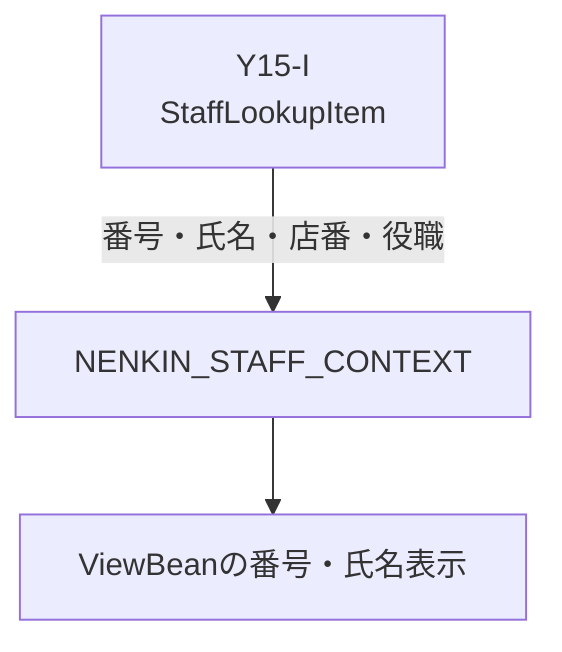

| 参照ID | 共有する対象 | 図間の接続 |
| --- | --- | --- |
| C15-L | 共通認証イベントで保存した`LoginBean` | COM-015-ER-01～03の同じBeanから、COM-015-ER-04へ整形後職員番号を渡す |
| Y15-S | TBL-N2-002の年金追加職員照会結果 | COM-015-ER-04の再検索結果をCOM-015-ER-05へ渡す。店舗名Mapは処理手順2.1のとおり職員検索より先に取得する |
| Y15-I | 名称突合せ後の同じ`StaffLookupItem` | COM-015-ER-05からCOM-015-ER-06へ引き継ぎ、番号・氏名・店番・役職の四項目を`NENKIN_STAFF_CONTEXT`へ移す |

店舗名と職員は別SQL・別接続で読み、メモリ上で突き合わせる。SQL JOINではなく、この関連からFKや多重度を追加しない。CSRF値は職員情報とは別のセッション属性である。

#### DB操作の詳細

| 操作 | 接続先・SELECT | WHERE・バインド | 結果形・取得範囲 |
| --- | --- | --- | --- |
| 店舗名Map作成 | 業務接続。`SELECT 店舗ｺｰﾄﾞ AS BRANCH_NO, 店名 AS BRANCH_NAME FROM 店名テーブル` | WHEREなし、バインドなし | 全行をHashMapへ格納。キーは`getInt`したコード。職員照会より先に実行 |
| 年金職員照会 | 職員接続。`SELECT S.職員番号 AS STAFF_NO, S.漢字氏名 AS STAFF_NAME, S.カナ氏名 AS STAFF_KANA_NAME, S.所属店番 AS BRANCH_NO, S.役職コード AS ROLE_CODE FROM DB2.Ｕ職員名簿表 S` | `S.職員番号 = ?`。位置1へ`setInt(staffCode)`。Java引数は`int`、整数バインド、サイズ指定なし | 最初の`next()`がtrueなら1行採用、falseならNULL。複数件検査なし |

両SQLにJOIN、ORDER BY、ページング、明示的な件数上限・タイムアウト・取消設定はない。職員照会が先頭行だけを消費することと、SQLに件数上限があることは別である。

年金側は業務用・職員用のDataSourceを別々にキャッシュし、初回取得をクラス単位で同期する。業務用は`jdbc/RAROA_DB`、次に`java:comp/env/jdbc/RAROA_DB`、職員用は`jdbc/Oracle_SP2NM`、次に`java:comp/env/jdbc/Oracle_SP2NM`を探索する。取得できなければSQLExceptionとなる。接続取得メソッドはautoCommitを変更せず、共通接続の`autoCommit=false`設定とは異なる。

店舗名Mapは当該サービス呼出し内の一時情報である。ログイン処理は店名テーブル・職員名簿を更新しない。

#### 結果・例外時の扱い

| 条件 | 結果 | 状態・境界 |
| --- | --- | --- |
| 既存職員情報を再利用 | true、CSRF確保 | 名簿の変更・停止等を再照会する処理はない |
| 共通Bean未成立 | false、ログインJSP | メッセージ設定、年金職員・CSRF除去。共通Bean自体はこの枝で除去しない |
| 共通番号形式不正 | false、ログインJSP | 照会せず、共通Beanと年金職員・CSRFを除去 |
| 形式正常、職員0件 | false、ログインJSP | 形式不正と同じメッセージ・除去対象だが、照会は実施済み |
| 職員あり | true、メニュー処理 | 職員属性保存、CSRF確保、表示Bean設定の順 |
| 店舗名取得のSQLException | 「店舗名の取得に失敗しました。」の`NenkinDataAccessException` | 職員取得用tryより前なので、職員取得失敗へ再分類しない。通常拒否の除去へ到達しない |
| 職員取得のSQLException | 「職員の取得に失敗しました。」の`NenkinDataAccessException` | 0件のNULL返却とは別。通常拒否の除去へ到達しない |
| サービスのリソース解放時Exception | 抑止 | 取得結果または先行失敗を優先 |

共通成功Bean保存後に年金読取が失敗すると、そのBeanは残り得る。Servletが共通エラー宛先を設定しても、職員不在時と同じ属性除去は行わない。また、職員保存後のCSRF確保や表示モデル設定で失敗した場合も、先行した保存を一括で取り消さない。

共通側と年金側では変換時点が異なる。前後に空白のある数字列は、未trimの共通Long変換で失敗して補完情報となった後、ゼロ埋め処理のtrimで数字列となり、年金形式検査・再照会を通過し得る。この場合、共通Beanの補完氏名・所属情報と年金職員情報の実名簿値が併存する。

8文字を超える数字列はゼロ埋めで短縮されず、年金の形式検査で拒否する。符号を含む値も、共通側の数値変換成功だけでは年金側のASCII数字条件を満たさない。共通側で空文字へ正規化される値は、年金側の形式検査を通らない。

### ログアウト

#### 処理概要

年金メニューのログアウトは共通LogoutActionを呼び、`ViewBean`と`LoginBean`を除去してログインJSPへ戻す。セッション全体を終了する処理ではなく、年金職員情報や連携情報の一括破棄も行わない。

#### 処理手順

**1. Servletで実行条件と記録用番号を確認する。**

　**1.1.** メニューはPOSTで`FUNCTION_ID=common`、`VIEW_ID=Logout`、空文字の`COMMAND_ID`を送る。フォームに`CSRF_TOKEN`はない。

　**1.2.** `Logout`は`Login`以外なので、Servletは先に共通ログイン可否を確認する。未成立なら時間切れの`ErrorMsg`と共通エラー宛先を設定し、LogoutActionを実行しない。

　**1.3.** 成立時は、削除前の`LoginBean`から職員番号を記録用に取得する。その後に運用可否を調べる。`common`は運用状態表の照会対象外だが、先行する共通接続取得の失敗で運用不可となり得る。

**2. 共通の二属性を除去する。**

　**2.1.** 運用判定を通過すると、Servletが`common.LogoutAction`を反射生成して実行する。

　**2.2.** LogoutActionは`ViewBean`、`LoginBean`の順に除去し、`./JSP/MENU/Login.jsp`を返す。年金の更新用検査`isAuthorizedMutation`は呼ばない。

**3. 記録とログイン画面へのforwardを行う。**

　**3.1.** Servletは削除前に取得した職員番号をアクセス記録へ使う。削除後のBeanから番号を読み直さない。

　**3.2.** 共通アクセス記録を独立処理し、決定済み宛先へforwardする。`MESSAGE`が非NULLなら記録JSP名だけがSubMessageとなり、実forward先は変更しない。

　**3.3.** ログインJSPに非空Listの`MESSAGE`があれば表示後に除去する。この削除はLogoutActionの二属性削除とは別段階である。

#### 処理フロー

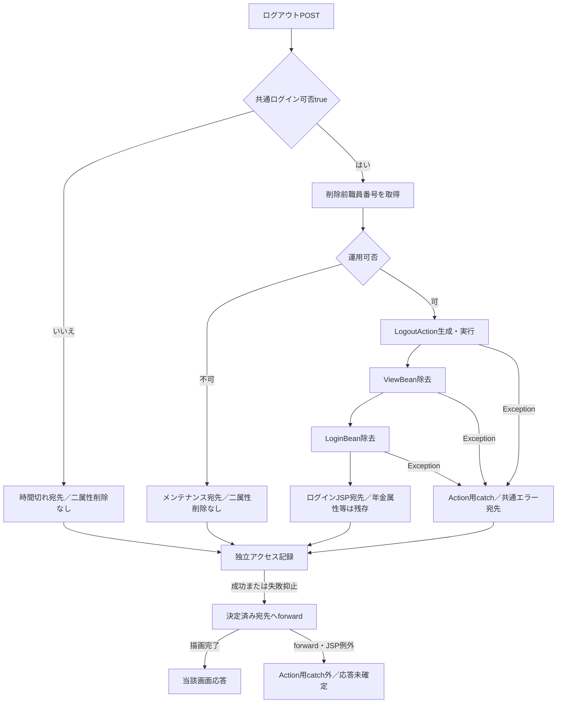

識別値処理・共通ログイン判定・削除前番号取得の例外はAction用catchの外である。Action内例外では、除去済み範囲は発生位置による。未認証・運用拒否の枝へ二属性削除完了を付与しない。

#### SQL・テーブル関連（ER図）

LogoutActionはDBを使用せず、HttpSession内の二属性を操作するため、同ActionのER図は設けない。

付随アクセス記録の対象はTBL-N2-006の`DB2.Ｕカウンターシフト`である。これは共通Servletの責務であり、セッション属性除去と一体のDBトランザクションではない。

#### DB操作の詳細

LogoutActionにSELECT・INSERT・UPDATE・DELETEはない。除去対象は`CommonConst.SS_JSP_BEAN`の`ViewBean`と、`CommonConst.SS_LOGIN_INFO_BEAN`の`LoginBean`である。

共通アクセス記録は、処理時刻から作った`yyyyMMdd`のアクセス日付、`HHmmssSSS`のアクセス時刻と、機能・画面・コマンド・Action・JSP・ユーザー識別情報をINSERTしてcommitする。失敗時はrollbackを試み、ログ出力して抑止する。記録失敗でログアウト済み属性を復元しない。

アクセス記録もStatement用の文字列組立てである。機能・画面・コマンド・Action・JSP名のNULL・空文字はSQL NULLへ変える一方、ユーザーＩＤは値を引用符で囲んで連結するため、Java NULLは文字列`null`を含むSQLになる。ログイン情報を除去した状態と、記録列のSQL NULLを同一視しない。登録SQL全体はCOM-012・DB-OPSの担当とする。

#### 結果・例外時の扱い

| 属性・操作 | 正常LogoutActionの扱い | 後続への意味 |
| --- | --- | --- |
| `ViewBean` | 除去 | 共通画面状態を破棄 |
| `LoginBean` | 除去 | 通常Servlet入口の共通認証判定を通過できなくなる |
| `NENKIN_STAFF_CONTEXT` | 除去しない | 年金職員情報が残り得る |
| `NENKIN_CSRF_TOKEN` | 除去・更新しない | 既存CSRF値が残り得る |
| `SubWindowBean`、`OtherUserBean` | 除去しない | サブ画面状態・連携情報が残り得る |
| `MESSAGE`、`ErrorMsg` | LogoutActionでは除去しない | 後続JSPの表示・保持条件に従う |
| セッション全体 | invalidateしない | 同じセッションを継続 |
| セッションID | 更新しない | IDを更新した状態とは扱わない |

ログアウト後に年金職員属性が残っても、通常の年金業務要求は先にServletの共通認証判定を受ける。内部`requireStaff`の再利用枝だけから、ログアウト後も通常業務へ進めるとは説明しない。再ログインでは年金LoginActionが職員・CSRF属性を除去し、共通認証と追加職員確認をやり直す。

アクセス記録失敗やforward失敗で、完了した属性除去を戻す処理はない。ActionがログインJSPを返すことと、ブラウザーへ同画面を表示できたことは別である。

### 特殊連携入口と他アプリケーション分岐

#### 処理概要

共通Servletには、特殊識別パラメータから認証用情報と後続Actionを選択する入口がある。連携情報はセッションの`OtherUserBean`に保持し、共通LoginActionまたはLoginInterfaceActionで使用する。本節はこの共通境界を定義し、顧客ポータル・稟議・融資等の画面を年金通常機能へ追加しない。

#### 処理手順

**1. HTTP methodによる入口を区別する。**

　**1.1.** POSTは`process`へ進む。GETは`OPK`と`charCommonUID`がともにNULLなら旧PDF処理へ進み、いずれかが非NULLなら`process`へ進む。GET側の振分けは空文字も対象とする。`Otheflg`だけを指定したGETは、この条件では特殊連携側へ振り分けない。

　**1.2.** GET側は各呼出しのExceptionをログ出力して抑止する。POST側のAction用catchと同じエラー画面応答を保証しない。通常の年金ログインフォームはPOSTを使用する。

**2. processで特殊入口と連携情報を決める。**

　**2.1.** 非NULLかつ非空の`OPK`、同条件の`Otheflg`、同条件の`charCommonUID`、通常要求の順で選ぶ。複数指定時は先行枝を採用する。

| 枝 | ユーザー・アプリケーション・認証用値の取得元 | 入口と後続宛先 |
| --- | --- | --- |
| OPK | ユーザーは要求`UID`、アプリケーションは`unify`。認証用値はServletContext初期化パラメータ | `common.LoginInterfaceAction`から`custportal.CstPtlSmAction`。`DSP`有無の両枝は同じ宛先 |
| Otheflg | ユーザーは`OtherUserId`、アプリケーションは`APPL_NAME`。認証用値は識別値`unify`・`cif`・`ringi`に応じた初期化パラメータ | `common.LoginInterfaceAction`。後続パッケージは要求`Package`、画面IDは`Screen` |
| charCommonUID | ユーザーは同要求値、アプリケーションは`unify`。認証用値は初期化パラメータ | 既存共通ログインtrueなら要求Actionを再利用。未ログインなら対象情報で後続宛先を決定 |

初期化パラメータの認証値そのものは記載しない。

　**2.2.** charCommonUID枝の対象なし判定は、`intCustNr`と`intBr`が両方NULL、または両方空文字の場合である。未ログインで対象なしなら`list.MenuSyougaiAction`、対象ありなら`custportal.CstPtlLgAction`を後続にする。既存ログインtrueなら要求の機能・画面・コマンドIDを再利用する。

　**2.3.** 対象判定は片側NULLを個別防御しない。条件式は次のとおりである。

`(wk_CustNr == null && wk_Br == null) || (wk_CustNr.isEmpty() && wk_Br.isEmpty())`

顧客番号NULL・店番非NULL、または顧客番号空文字・店番NULLではNULL参照が起こり得る。顧客番号が非空で店番だけNULLの場合は短絡評価により対象ありへ進む。このServlet内判定はAction用catchより前である。

　**2.4.** 入口選択後、特殊識別値のいずれかが非NULLなら、新規`OtherUserBean`へユーザ・パスワード・アプリケーション名・パッケージ名・画面IDを設定して保存する。この保存条件は非空を要求せず、手順2.1の入口選択条件と一致しない。

**3. 共通LoginActionが特殊枝の認証値を取り出す。**

　**3.1.** 共通LoginActionも特殊識別値の非NULLだけで特殊枝を選ぶ。`Otheflg=ringi`なら`DWH_USER_ID`、`DWH_PASS_WORD`、`APPL_NAME`を要求から取得し、それ以外なら`OtherUserBean`のユーザ・パスワード・アプリケーション名を取得する。Beanの参照前に存在を検査しない。

　**3.2.** 特殊unify・cifでは、連携ユーザーを`dwhUserId`へ移し、認証用ユーザーIDにアプリケーション名、認証用パスワードに連携Beanの値を使う。

　**3.3.** charCommonUIDが非NULLなら、手順2.3と同種の対象判定でＵＮＩＦＹフラグを対象なし`1`、対象あり`2`にする。こちらの片側NULL例外はAction実行内で発生する。なお共通成功戻り先の個別分岐は`0`・`1`・`3`なので、`2`はそれ以外の共通メニュー側になる。

**4. LoginInterfaceActionが再認証と委譲を行う。**

　**4.1.** セッションの`LoginBean`と`OtherUserBean`をキャスト取得した後、要求`APPL_NAME=ringi`かつ`DWH_USER_ID`がNULLまたは空文字なら、通常の`super.perform`を呼ばない。先に`ringi.RingiPrintInsatuAction`を反射生成し、その成功後、新規`LoginInfoBean`の可否だけをtrueにして保存する。続いて生成Actionを実行し、その戻り値を返す。

　**4.2.** 特例以外で既存共通ログインがtrueなら、連携ユーザーの8桁指定ゼロ埋めStringと既存職員番号を`!=`で比較し、不一致なら共通LoginActionを呼ぶ。これは文字列内容ではなく参照の比較なので、同じ番号内容でも再認証され得る。

　**4.3.** 既存ログインがなければ共通LoginActionを呼ぶ。手順4.2・4.3とも共通戻り値を捨て、成功を再判定しない。共通処理が通常拒否で戻っても後続生成へ進む。一方、共通処理が例外を送出すれば正常復帰せず、後続へ到達しない。

　**4.4.** `OtherUserBean`のパッケージ名を小文字化し、画面IDと`Action`を連結して反射生成する。後続の`perform`を呼び、その戻り値を採用する。Bean・宛先値のNULL防御や、共通認証拒否後の中断検査はこの箇所にない。

**5. 他アプリケーションの共通分岐を適用する。**

次の組替え後に、通常ログインイベントの未設定検査を行う。年金Actionはアプリケーション名を固定しないが、これらを年金通常フォームの業務手順へ追加しない。

| アプリケーション | 認証用ユーザーID | 認証用パスワード | 処理範囲・成功後の相違 |
| --- | --- | --- | --- |
| dwh、navi | アプリケーション名 | `DWH_PASS_WORD` | 認証表、職員・所属情報を取得 |
| unify、cif | アプリケーション名 | 通常は`DWH_PASS_WORD`、特殊枝は連携Beanの値 | unifyはフラグ別戻り値。cif等は融資系IDをNULL、同ユーザー名を役職名にする |
| credit | `CREDIT_USER_ID` | `CREDIT_PASS_WORD` | 認証表先頭行から融資系名称・所属店番・五権限を移送。成功Bean保存後に`ViewDaikoAction`へ委譲 |
| bat | `DWH_USER_ID` | `DWH_PASS_WORD` | 認証表一致後、専用固定ユーザー情報を保存して共通メニューへ早期return。通常の職員・名称取得を省略 |
| ringi | アプリケーション名 | `DWH_PASS_WORD` | 共通LoginAction経路では未設定検査・接続取得後に認証表照会を省略し、職員照会を試みて可否true。債権書類権限50を設定 |

creditは融資系所属店番を3桁指定で整形し、債権書類・決算書・ＣＲＤ・格付・自己査定の五権限を`convertInt`する。不正数値・int範囲外は例外になる。現在有効な成功後処理は`ViewDaikoAction`への無条件委譲であり、直後の代行職員判定による分岐はブロックコメント内である。

#### 処理フロー

**サブフロー1：processの入口選択。** HTTP methodによるprocess到達条件は手順1に従う。

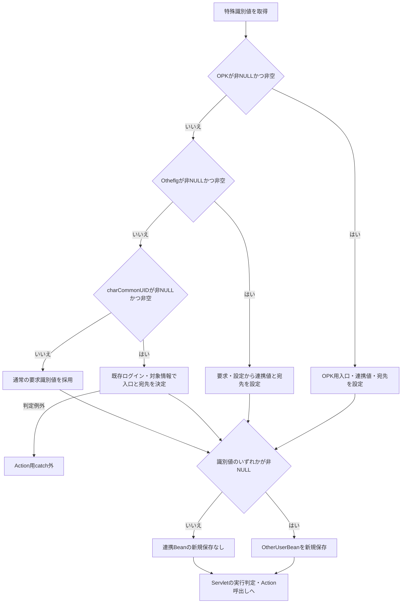

**サブフロー2：LoginInterfaceAction。** 共通処理の通常拒否と例外による中断を別に扱う。

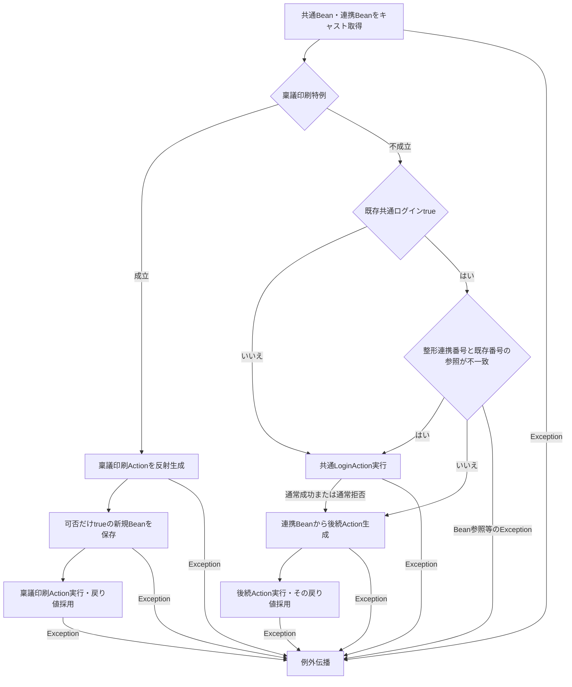

稟議印刷特例では反射生成成功後にBeanを保存する。共通認証の通常拒否後は、その拒否Bean・メッセージを保持したまま後続へ進み得る。後続がこれらを変更するかは呼出先の契約に従う。

#### SQL・テーブル関連（ER図）

共通LoginActionを呼ぶ場合の表と値移送は、通常ログインイベントの関連図COM-015-ER-01～03に従う。ただしringiは認証表照会を省略し、batは認証後の通常職員・名称取得を省略する。

`OtherUserBean`と`LoginBean`はセッション情報であり、DBテーブルではない。パッケージ名・画面IDはJavaの呼出先選択値である。他アプリケーションのテーブル関連を本書へ推定して追加しない。

#### DB操作の詳細

共通LoginActionを実行した場合は、前述のStatement用SQL連結契約を使う。通常年金のPreparedStatement契約へ置き換えない。

`SearchLoginInfoBase`にはアプリケーション名・ユーザーIDだけで認証表を読む二引数版もある。確認できる呼出元は`common.ViewMenuAction`の代行店舗変更後の再照会である。通常LoginActionが呼ぶのはパスワードを含む三引数版であり、二引数版の宣言は年金のパスワード不要ログイン入口を意味しない。

creditの`ViewDaikoAction`は別の店舗一覧を取得し、`ViewBean`へ`DaikoBean`を設定して`./JSP/MENU/Daiko.jsp`を返す。他アプリケーション向けの委譲境界であり、年金メニューや年金店番参照へ統合しない。その他の動的呼出先におけるDB操作・トランザクションは、入口の契約だけから確定しない。

#### 結果・例外時の扱い

空文字の特殊識別値は、Servletの非空入口選択で特殊枝を選ばなくても、連携Bean保存と共通LoginActionの特殊判定へ影響する。通常要求と同じ認証値移送になるとは限らない。

LoginInterfaceActionは共通LoginActionの通常拒否戻り値を採用せず、成功再判定なしで後続へ進む。共通認証失敗が必ず委譲を停止する契約にはなっていない。共通処理が例外を送出した場合は後続へ到達しない。

稟議印刷特例の反射生成失敗は新規成功Bean保存前である。保存後の後続実行失敗では、そのBeanをこの入口で除去しない。連携Beanの型不整合・不存在、宛先NULL等は、通常の認証未入力メッセージより前に例外となり得る。

Servlet内の入口選択・対象判定の例外と、Action実行中の例外では捕捉範囲が異なる。GETでprocessを呼んだ場合にはさらに外側のログ出力・抑止があり、POSTと同じ最終応答を保証しない。

`OtherUserBean`はログアウト後も残り得る。同BeanにはパスワードStringも保持するため、パスワード項目を持たない通常の`LoginInfoBean`とは保持内容が異なる。後続Actionの認証再確認・拒否・副作用・最終応答は、当該実装の契約として別に確認する。

## 補足説明

### 共通職員情報の移送

次は共通認証trueとなった後の移送である。名簿なしには検索0件と元職員番号の局所数値変換失敗がある。遷移元アプリケーション名は、この表の移送より前に設定する。

| 共通Beanの項目・型 | 名簿あり | 名簿なし | 用途・相違 |
| --- | --- | --- | --- |
| 所属店番`String` | 所属店番を4桁指定で整形し、整数値100未満なら`010`、それ以外は整形値の先頭3文字 | `999` | 共通向け所属情報。年金の所属店番とは加工が異なる |
| 詳細部室店コード`String` | 整形所属店番の先頭2文字 | `99` | 事業所検索の店舗コード。名簿なしでは検索を省略 |
| 詳細部室店枝番`String` | 同じ整形値の次の2文字 | `99` | 事業所検索の枝番 |
| 職員氏名`String` | 漢字氏名 | 元の`dwhUserId` | 名簿なしは要求値による補完 |
| 職員カナ氏名`String` | カナ氏名 | setterを呼ばずNULL | 空文字設定とは別 |
| 性別コード`String` | 性別 | `0` | 共通検索のString取得値 |
| 役職コード`String` | 役職コード | `0` | 後続役職名検索の条件 |
| システム事務統括部職員`boolean` | 整形所属店番の整数値が65または70ならtrue、それ以外false | false | 年金の店番75・役職による更新制御とは別属性 |
| 所属店名`String` | 別検索の事業所名。0件は「該当なし」 | 「該当なし」 | 年金店名テーブルの名称とは取得元が異なる |
| 役職名`String` | 条件付き別検索の役職。未検索・0件は「該当なし」 | 「該当なし」 | 通常unifyでは融資系ユーザー名にも使用 |
| 所属課係コード・名称`String` | 元職員番号の別検索で決定 | 元番号を数値変換できれば検索を試みる。未取得・0件はコード`0`・名称空 | 名簿なしを理由に所属課係処理全体を省略しない |

`LoginInfoBean`はSerializableである。アプリケーション名、遷移元、職員番号、性別、氏名・カナ氏名、所属店番・詳細コード・枝番・店名、役職コード・名、融資系ユーザーＩＤ・名、所属課係コード・名、所属コード、ＵＮＩＦＹフラグはStringで初期値NULLである。ログイン可否とシステム事務統括部職員はbooleanのfalse、五権限はintの0で初期化される。setterは値をそのまま保持する。所属コードには宣言・getter・setterがあるが、本ログイン経路に設定呼出しはない。

### ゼロ埋めと数値変換

`getAdd0String`は最初に`null2blank`を呼ぶ。NULL、または大文字小文字を無視して文字列`null`とそのまま一致する値を空文字にし、それ以外をtrimする。前後に空白を含む文字列`null`はtrim前の比較では一致せず、この段階で直接空文字にはならない。

空文字なら空文字を返す。それ以外はJavaの`String.length`が指定数未満のときだけ先頭へ0を足し、指定数以上ならそのまま返す。長さはUTF-16コード単位であり、数値検査、最大長検査、切捨てではない。所属店番が4文字を超えていても短縮しない。元職員番号が空白だけなら、共通のNULL・空文字検査を通過した後、整形で空文字になり得る。

`convertInt`はNULL・空文字・文字列`0`を0にし、それ以外を`Integer.parseInt`する。不正数値やint範囲外を0へ補完しない。このため、所属課係の取得コードやcreditの権限に不正値がある場合は、通常の0件・権限0とは異なる例外になる。

### 入力・参照列とDB属性

外部共通表の次の型・宣言長・NULL・PKは、同梱のローカル互換DDLの属性である。本番外部表の物理保証へ転用せず、DB宣言長を画面上限・業務上限にも置き換えない。

| 安定ID・対象 | キー・比較列のローカル定義 | 取得列のローカル定義 | ログインでの用途 |
| --- | --- | --- | --- |
| TBL-N2-001／ＵＷＥＢログイン情報表 | アプリケーション名`VARCHAR(20) NOT NULL`、ユーザーＩＤ`VARCHAR(40) NOT NULL`の複合PK。パスワード`VARCHAR(100) NOT NULL` | 融資系ユーザー名`VARCHAR(80)`、融資系所属店番`VARCHAR(4)`、五権限は各`VARCHAR(4)`。いずれもNULL許容 | 通常unifyは三条件一致判定。creditは名称・店番・権限も移送。画面のパスワード上限20とDB宣言長100は別 |
| TBL-N2-002／Ｕ職員名簿表 | 職員番号`DECIMAL(18,0) NOT NULL`、PK | 所属店番・役職コード・性別はNULL許容`DECIMAL(18,0)`。漢字氏名・カナ氏名はNULL許容`VARCHAR(40)` | 共通はString化して加工。年金は番号・店番をint、氏名・役職をStringで取得 |
| TBL-N2-003／Ｕ職員所属課係一覧表 | 職員番号`DECIMAL(8,0) NOT NULL`、所属課係コード`VARCHAR(20) NOT NULL`の複合PK | 所属課係コード | 職員番号で検索して先頭行を採用。職員番号単独の一意性は宣言していない |
| TBL-N2-004／ＵＪＶ役職コード表 | 役職コード`DECIMAL(4,0) NOT NULL`、PK | 役職はNULL許容`VARCHAR(40)` | 名簿の役職コードを名称化。行の存在と名称の非NULLは別条件 |
| TBL-N2-005／Ｊ事業所コード表２ | 店舗コード・枝番は各`DECIMAL(2,0) NOT NULL`、複合PK | 事業所名はNULL許容`VARCHAR(80)` | 所属店番から分割した二値で名称検索 |
| TBL-NEN-003／店名テーブル | H2は店舗ｺｰﾄﾞ`INTEGER NOT NULL`、PK。SQL Server用DDLは`INT NOT NULL`、PK | H2は店名`VARCHAR(80) NOT NULL`、SQL Server用DDLは`NVARCHAR(80) NOT NULL` | 年金追加確認で先行全件取得し、所属店番とメモリ突合せ。StaffContextへ店名は移送しない |

SQL Server用の業務DDLは職員名簿を既存外部表として作成対象から外す。店名テーブルは未存在時だけ作成する。これらのDDL宣言と、実配置の既存表属性は区別する。

共通名簿の`SELECT *`では身分コード・生年月日・作成日等も取得対象になるが、このログイン経路に個別移送先はない。全列取得と全列の業務利用は別である。

漢字氏名、カナ氏名、役職名、事業所名、店名を保存・保守する処理は、本ログイン経路から接続を確認できない。これらの業務上限、保守時検査、名称規則はDB宣言長だけから確定しない。共通検索のSQL NULLから空文字への変換と、年金モデルのNULL変換も、元列のNULL制約とは別の処理である。

### 保持領域と確定時点

| 情報 | 保持領域 | 設定・消去時点 | 確定範囲 |
| --- | --- | --- | --- |
| 認証用値・元職員番号 | Action内ローカルString | 共通処理の要求取得・組替え時 | 認証・検索引数。業務表への保存ではない |
| 共通検索結果 | 検索Base・Action内のListとMap | 各SELECTの全行変換時 | 当該読取結果。後続別接続と同一時点とは限らない |
| 店舗名Map | 年金サービス呼出し内メモリ | 職員検索前 | 名称突合せ用の一時情報 |
| 共通ログイン情報 | セッション`LoginBean` | 通常成功・拒否の保存時 | 共通結果。年金職員確認成功までは含まない |
| 年金職員情報 | セッション`NENKIN_STAFF_CONTEXT` | 職員取得後、CSRF確保より前 | 年金用の番号・氏名・店番・役職コード |
| 年金CSRF値 | セッション`NENKIN_CSRF_TOKEN` | 職員保存後または既存職員再利用時 | 値の確保。ログイン・ログアウトでの照合実施とは別 |
| メニュー表示情報 | セッション`ViewBean` | 職員確認成功後の表示モデル設定時 | JSPへ渡す値。forward完了とは別 |
| 連携情報 | セッション`OtherUserBean` | Servletで特殊識別値のいずれかが非NULLの場合 | 認証引数・後続宛先。後続成功は含まない |
| アクセス記録 | 共通DBのカウンターシフト | Action後の独立commit | 記録の確定。画面表示・利用者の受領完了とは別 |

CSRF照合は年金の別メソッド`isAuthorizedMutation`がPOSTと要求`CSRF_TOKEN`を検査する契約である。通常ログインActionと共通LogoutActionは同メソッドを呼ばない。共通エラーJSPは`ErrorMsg`をエスケープ表示し、その属性を除去しない。

### 関連文書との分担

次は全体計画上の対応先であり、生成済みであることを示す一覧ではない。パスは成果物ルートからの相対パスである。

| 文書ID | 計画上の相対パス | 対応する責務 |
| --- | --- | --- |
| COM-012 | `共通/共通仕様書_COM-012_共通コントロールサーブレット.md` | 要求識別、運用可否、Action用catch、アクセス記録、forward |
| COM-111 | `共通/共通仕様書_COM-111_年金業務共通処理.md` | 他Actionの職員確認、CSRF照合、年金更新権限制御 |
| SCR-013 | `基本設計書/基本設計書_SCR-013_年金自動受取予約管理システム - ログイン.md` | 通常ログインの画面・業務導線 |
| DET-SCR-013 | `詳細仕様書/詳細仕様書_SCR-013_年金自動受取予約管理システム - ログイン.md` | 実コントロール・送信値・表示状態と本共通契約の接続 |
| SCR-017 | `基本設計書/基本設計書_SCR-017_年金自動受取予約管理システム.md` | メニューの表示・操作・ログアウト導線 |
| DET-SCR-017 | `詳細仕様書/詳細仕様書_SCR-017_年金自動受取予約管理システム.md` | メニュー表示Beanとログアウト要求 |
| DATA-CONTRACTS | `共通/データオブジェクト定義書.md` | 共通Bean・職員モデル・画面Beanの全体定義 |
| DB-OPS | `共通/DB仕様書/DB操作仕様書.md` | SQL組立・JDBCバインド・アクセス記録を含むDB操作 |
| DB-PHYSICAL | `共通/DB仕様書/テーブル定義書.md` | 安定ID別の全列とローカル互換定義・本番定義の区別 |
| ENV-NENKIN | `共通/設定・配置・依存仕様書.md` | Servlet登録、JNDI探索・キャッシュ、配置設定 |
