<!-- spec-meta: {"schema":"spec-md/1.0","documentId":"COM-111","version":"2.0","path":"共通/共通仕様書_COM-111_年金業務共通処理.md","sheets":[{"heading":"概要","kind":"GRID","sheet":"概要"},{"heading":"項目一覧","kind":"LIST","sheet":"項目一覧","key":["No"]},{"heading":"イベント仕様","kind":"GRID","sheet":"イベント仕様"},{"heading":"補足説明","kind":"GRID","sheet":"補足説明"}]} -->
# 年金業務共通処理

| 文書属性 | 内容 |
| --- | --- |
| 文書種別 | 共通仕様書 |
| システム名 | 年金自動受取予約管理システム |
| 共通/文書ID | COM-111 |
| 版 | 2.0 |
| 解析対象 | NenkinBaseAction、職員・予約モデル、画面モデル、参照サービス、予約Repository、文字・日付・表示変換、および接続するAction・JSP |
| 基準日 | 2026-10-15 |

## 概要

本共通処理は、年金業務を操作する職員の確認、フォーム値の変換、更新要求のCSRF照合、予約識別と権限制御、文字・日付の検査、表示用変換、ファイル応答を提供する。業務画面の各Actionが処理途中で利用する契約であり、抽象クラス`NenkinBaseAction`自体に独立したHTTP入口や画面はない。

通常のフォーム要求は`/Action.do`の`common.ControlServlet`へ送られる。POST処理では受信文字コードをWindows-31Jに設定し、共通ログイン確認などを経て、`FUNCTION_ID`を小文字化したパッケージと`VIEW_ID`・`COMMAND_ID`からAction名を組み立てる。Actionは要求ごとに生成される。共通Servletによるログイン確認と、年金Actionによる職員名簿確認は別の段階である。

フォーム値は`HttpServletRequest.getParameter`で取得する。独自DTOバインダーが整数や日付へ一括変換する構成ではなく、Actionが文字列を読み、その用途に応じて変換する。同じ店番入力でも、予約保存、参照検索、店舗別Excel、印刷条件では、変換後に行う検査と不正値の扱いが異なる。

共通部品は次の領域を区別して扱う。

| 保持領域 | 内容 | 保持・更新の単位 |
| --- | --- | --- |
| 要求パラメータ | 予約入力、検索条件、操作識別値、CSRF、ORIGINAL・LOOKUPキー | 当該HTTP要求。予約モデルへ移さない制御値もある |
| Actionインスタンス | 日付正規化の作業変数`normalizedDate`など | 要求ごとに生成されるAction内 |
| セッション`LoginBean` | 共通ログイン情報 | 共通ログイン・ログアウト等が設定・除去 |
| セッション`NENKIN_STAFF_CONTEXT` | 年金業務の職員番号、氏名、所属店番、役職コード | 職員確認成功後に保持し、後続操作で再利用 |
| セッション`NENKIN_CSRF_TOKEN` | フォームへ渡すCSRF文字列 | 非空Stringなら再利用。再ログイン開始時等に除去 |
| セッション`ViewBean` | 主画面の入力値、表示値、メッセージ、既存予約状態 | 各Actionが画面モデルを設定 |
| セッション`SubWindowBean` | 店番・担当者・顧客参照の条件と結果 | 参照Actionが設定 |
| 共有サービス・Repository | 参照・予約処理の入口 | 各クラスの共有インスタンス。予約保存・削除・削除明細整理にはインスタンス同期がある |
| 出力用メモリ | 完成したExcel・ZIPの`byte[]`、出力結果・メッセージ一覧 | 出力処理内。予約DBやセッションへの保存ではない |
| 業務DB | 予約、削除明細、店舗・区分名称 | 個別のDB操作・トランザクション |

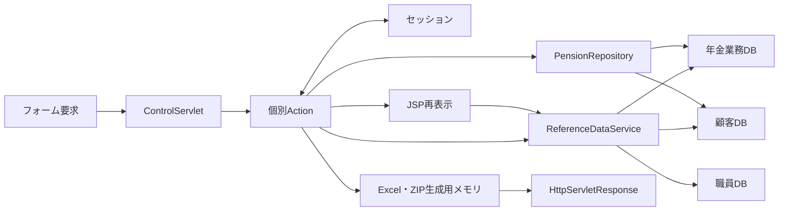

JSP再表示も後続処理を持つ。予約画面は描画開始時に区分候補をDBから取得するため、Actionが入力拒否の戻り先を返しただけでは画面表示の完了は確定しない。直接出力の場合も、DB確定、応答への書込み、利用者によるファイル受領はそれぞれ別の境界である。

## 項目一覧

| No | グループ | 項目名 | 種類 | 入出力 | DB連携項目 | 候補取得元 | 必須 | 形式・桁 | 説明 |
| --- | --- | --- | --- | --- | --- | --- | --- | --- | --- |
| 1 | 職員 | ログイン職員番号 | セッション・表示 | I／O | 職員名簿の職員番号。更新・削除時は更新者へ移送 | 共通ログイン情報と職員名簿 | 職員情報自動生成時に形式確認と名簿確認 | LoginBeanではString、StaffContextではint。照会前はASCII数字1～8桁 | trim後の番号を整数化する。正数用helperは使わず、0も形式検査だけでは排除しない。画面用職員番号は8桁ゼロ埋めで表示する |
| 2 | 職員 | 職員氏名 | セッション・表示 | O | 職員名簿の漢字氏名 | 職員名簿 | 入力項目ではない | StaffContext.staffName：String | NULLは空文字へ変換する。既存StaffContext再利用時は名簿から更新しない |
| 3 | 職員 | 職員所属店番 | セッション・権限制御 | ‐ | 職員名簿の所属店番 | 職員名簿 | 入力項目ではない | StaffContext.branchNo：int | getInt後のwasNull確認がなく、DB NULLは0となる。予約対象店番とは別で、75の場合に役職制限を適用する |
| 4 | 職員 | 役職コード | セッション・権限制御 | ‐ | 職員名簿の役職コード | 職員名簿 | 所属店番75の変更・削除判定で使用 | StaffContext.roleCode：String | NULLは空文字。trim後の整数値が3000未満、または整数化失敗なら制限対象とする |
| 5 | 要求制御 | CSRF値 | hidden・セッション | I／O | DB非連携 | セッションのUUID文字列 | Save・Delete・日次/月次Runで一致必須 | 要求名CSRF_TOKEN：String | POST判定とセッション値との完全一致に使う。照合時にtrimしない |
| 6 | 予約 | 店番 | テキスト・参照 | I／O | 年金1_LK.店番 | 店名テーブル | 保存・削除で正数変換できる値が必要 | branchNo／BRANCH_NO→branchNo：Integer。HTML maxlength=3、DB INT NULL | 空・不正整数・int範囲外・0以下はNULL。予約Actionの変換自体には3桁検査がない。削除WHEREには使用しない |
| 7 | 予約 | 店舗名 | 表示 | O | 店名テーブル.店名 | 予約取得時のLEFT JOIN、店舗参照 | 入力項目ではない | branchName：String。SQL Server用DDLはNVARCHAR(80) NOT NULL | フォームから予約モデルへ読み込まない。予約に店舗名そのものを保存する列はない。結合不成立時は空表示となる |
| 8 | 予約 | 顧客番号 | テキスト・参照 | I／O | 年金1_LK.顧客番号。顧客基本表検索にも使用 | 顧客基本表 | 保存は任意。顧客基本表からの読込みでは店番とともに正数が必要 | customerNo／CUSTOMER_NO→customerNo：Integer。HTML maxlength=7、DB BIGINT NULL | 任意保存項目として空・不正・0以下はSQL NULL。JDBCはsetIntであり、DB BIGINTの全範囲を扱う契約ではない |
| 9 | 予約 | 担当者コード | テキスト・参照 | I／O | 年金1_LK.担当者コード | 職員名簿 | 保存は任意 | staffCode／STAFF_CODE→staffCode：Integer。HTML maxlength=4、DB INT NULL | 空・不正・0以下はSQL NULL。ログイン職員を設定する更新者とは別項目 |
| 10 | 予約 | 顧客氏名 | テキスト | I／O | 年金1_LK.顧客氏名 | 顧客基本表から取込み可能 | 保存時の非空検査なし | customerName／CUSTOMER_NAME→customerName：String。DB NVARCHAR(100) NULL | 要求値をtrimして保持する。空欄は空StringをsetStringする |
| 11 | 予約キー | フリガナ | テキスト | I／O | 年金1_LK.ふりがな | 顧客基本表から取込み可能 | 保存はtrim後非空かつRepository正規化後も非空。削除はキー照合が必要 | kanaName／KANA_NAME→kanaName：String。DB NVARCHAR(100) NULL | 要求読取り、Action比較、Repository正規化を別段階で行う。既存状態ではreadonly |
| 12 | 予約 | 性別 | 選択 | I／O | 年金1_LK.性別にコードを保存。表示元は性別テーブル.性別 | 性別テーブルを性別ｺｰﾄﾞ順 | 空選択可 | gender／GENDER→gender：String。保存列TINYINT NULL、名称列NVARCHAR(10) NOT NULL | optionは名称を送信する。空選択はコードNULL。非空名称がマスターにない場合は保存途中のエラー |
| 13 | 予約 | 住所 | 複数行テキスト | I／O | 年金1_LK.住所 | 顧客基本表から取込み可能 | 保存時の非空検査なし | address／ADDRESS→address：String。DB NVARCHAR(300) NULL | trim後のStringをsetStringする。空欄は空String |
| 14 | 予約キー | 電話番号 | テキスト | I／O | 年金1_LK.電話番号 | 顧客基本表から取込み可能 | 保存はtrim後非空かつ数値化できる数字が必要。削除はキー照合が必要 | phoneNumber／PHONE_NUMBER→phoneNumber：String。検索・保存はBigDecimal、DB DECIMAL(15,0) NULL | 数値保存によりハイフンと元の先頭ゼロ数は保持しない。既存状態ではreadonly |
| 15 | 予約 | 生年月日 | 日付入力 | I／O | 年金1_LK.生年月日 | 顧客基本表から取込み可能 | 空欄可。非空時は日付検査 | birthDate／BIRTH_DATE→birthDate：String。HTML maxlength=14、DB DATE NULL | 保存用ISO値へ正規化し、空欄はSQL NULL。予約画面は和暦表示 |
| 16 | 年金種類 | 国民年金 | チェック | I／O | 年金1_LK.種類：国民年金、年金種類の合成値1 | 年金種類テーブルの種類ｺｰﾄﾞ1の名称 | 未選択可 | NATIONAL_PENSION→nationalPension：boolean。DB BIT NULL | 未送信等はfalse。保存時はsetIntの0または1 |
| 17 | 年金種類 | 厚生年金 | チェック | I／O | 年金1_LK.種類：厚生年金、年金種類の合成値2 | 年金種類テーブルの種類ｺｰﾄﾞ2の名称 | 未選択可 | EMPLOYEE_PENSION→employeePension：boolean。DB BIT NULL | 未送信等はfalse。保存時はsetIntの0または1 |
| 18 | 年金種類 | 共済年金 | チェック | I／O | 年金1_LK.種類：共済年金、年金種類の合成値4 | 年金種類テーブルの種類ｺｰﾄﾞ4の名称 | 未選択可 | MUTUAL_AID_PENSION→mutualAidPension：boolean。DB BIT NULL | 未送信等はfalse。保存時はsetIntの0または1 |
| 19 | 年金種類 | 厚生年金基金 | チェック | I／O | 年金1_LK.種類：厚生年金基金、年金種類の合成値8 | 年金種類テーブルの種類ｺｰﾄﾞ8の名称 | 未選択可 | EMPLOYEE_PENSION_FUND→employeePensionFund：boolean。DB BIT NULL | 未送信等はfalse。保存時はsetIntの0または1 |
| 20 | 年金種類 | 国民年金基金 | チェック | I／O | 年金1_LK.種類：国民年金基金、年金種類の合成値16 | 年金種類テーブルの種類ｺｰﾄﾞ16の名称 | 未選択可 | NATIONAL_PENSION_FUND→nationalPensionFund：boolean。DB BIT NULL | 未送信等はfalse。保存時はsetIntの0または1 |
| 21 | 年金種類 | 年金種類名称 | 表示・内部算出 | O | 年金1_LK.年金種類と年金種類テーブル.年金種類 | 年金種類テーブル | 入力項目ではない | pensionType：String。保存コードINT NULL、名称NVARCHAR(120) NOT NULL | フォームから名称を読まない。五つのbooleanの合計が0ならコードNULL、非0ならマスター存在確認後にコードを保存 |
| 22 | 予約 | 裁定請求書徴収 | 選択 | I／O | 年金1_LK.裁定請求にコードを保存。表示元は裁定請求テーブル.裁定請求 | 裁定請求テーブルを裁請ｺｰﾄﾞ順 | 空選択可 | claimStatus／CLAIM_STATUS→claimStatus：String。保存列TINYINT NULL、名称NVARCHAR(10) NOT NULL | 名称を送信し保存時に逆引きする。空欄はコードNULL |
| 23 | 予約 | 請求予定日 | 日付入力 | I／O | 年金1_LK.請求予定日 | なし | 空欄可。非空時は日付検査 | claimDate／CLAIM_SCHEDULED_DATE→claimScheduledDate：String。HTML maxlength=14、DB DATE NULL | ISO値へ正規化し、空欄はSQL NULL。予約画面は西暦表示 |
| 24 | 予約 | 予定年齢 | テキスト | I／O | 年金1_LK.予定年齢 | なし | 保存は任意 | plannedAge／PLANNED_AGE→plannedAge：Integer。HTML maxlength=3、DB INT NULL | 正数変換できない値はSQL NULL。共通サーバー処理は生年月日等から年齢を再計算しない |
| 25 | 配偶者 | 配偶者名 | テキスト | I／O | 年金1_LK.配偶者名 | なし | 保存時の非空検査なし | spouseName／SPOUSE_NAME→spouseName：String。DB NVARCHAR(100) NULL | trim後のStringを保存。空欄は空String |
| 26 | 配偶者 | 配偶者生年月日 | 日付入力 | I／O | 年金1_LK.配偶者生年月日 | なし | 空欄可。非空時は日付検査 | spouseBirthDate／SPOUSE_BIRTH_DATE→spouseBirthDate：String。HTML maxlength=14、DB DATE NULL | ISO値へ正規化し、空欄はSQL NULL。予約画面は和暦表示 |
| 27 | 配偶者 | 受給有無 | 選択 | I／O | 年金1_LK.受給有無にコードを保存。表示元は受給有無テーブル.受給有無 | 受給有無テーブルを受給ｺｰﾄﾞ順 | 空選択可 | hasBenefit／HAS_BENEFIT→hasBenefit：String。保存列TINYINT NULL、名称NVARCHAR(10) NOT NULL | 名称を送信し保存時に逆引きする。空欄はコードNULL |
| 28 | 予約 | 予約徴求日 | 日付入力 | I／O | 年金1_LK.予約徴求日 | なし | 空欄可。非空時は日付検査 | requestDate／RESERVATION_REQUEST_DATE→reservationRequestDate：String。HTML maxlength=14、DB DATE NULL | ISO値へ正規化し、空欄はSQL NULL。予約画面は西暦表示 |
| 29 | 予約 | 備考 | 複数行テキスト | I／O | 年金1_LK.備考 | なし | 空欄可。非空時もWindows-31J変換と56バイト以内が必要 | notes／NOTES→notes：String。textareaのmaxlength指定なし。DB NVARCHAR(400) NULL | フォーム読取りでtrimした値を検査する。56文字制限ではない。自動切捨てせず、検査後のStringを保存する |
| 30 | 更新情報 | データ更新日 | readonly表示 | I／O | 年金1_LK.データ更新日 | サーバー当日 | 保存時にサーバーで設定 | dataUpdateDate／DATA_UPDATE_DATE→dataUpdateDate：String。DB DATE NULL | 要求値は一旦読むが、保存用検証の対象外。Repositoryで当日へ置換する |
| 31 | 予約 | ６ヶ月先確認 | チェック | I／O | 年金1_LK.６ヶ月先確認 | なし | 未選択可 | SIX_MONTH_CHECK→sixMonthCheck：boolean。DB BIT NULL | 未送信等はfalse。保存時は0または1。DB NULL読取もfalseとなる |
| 32 | 読込制御 | 元フリガナ | hidden | I／O | ふりがなによる再検索に使用。専用保存列なし | existing=true時の予約値 | 既存変更・削除のキー照合に使用 | originalKana／ORIGINAL_KANA：String | 予約モデルへ格納しない。新規状態では空。セッション保持の読込キーや比較版との照合はない |
| 33 | 読込制御 | 元電話番号 | hidden | I／O | 電話番号による再検索に使用。専用保存列なし | existing=true時の予約値 | 既存変更・削除のキー照合に使用 | originalPhone／ORIGINAL_PHONE：String | Repositoryの電話番号正規化を通して検索する。元の更新日時・版番号ではない |
| 34 | 読込制御 | 選択フリガナ | hidden | I | 予約検索のふりがな条件 | 顧客参照からの選択値等 | 空欄時は現在フォームのフリガナを使用 | lookupKana／LOOKUP_KANA：String | 電話番号側とは独立して代替値を決める。予約モデルへ専用項目として保存しない |
| 35 | 読込制御 | 選択電話番号 | hidden | I | 予約検索の電話番号条件 | 顧客参照からの選択値等 | 空欄時は現在フォームの電話番号を使用 | lookupPhone／LOOKUP_PHONE：String | フリガナ側とは独立して代替値を決める。検索後の保存値とは区別する |
| 36 | 画面状態 | 既存予約状態 | 画面モデル | ‐ | DB非保存 | Actionの結果判定 | 操作結果として設定 | PensionViewBean.existing：boolean、初期false | キーreadonlyとORIGINALキーの出力を制御する。要求値や比較版として直接読む項目ではない |
| 37 | 画面状態 | メッセージ | 表示 | O | DB非保存 | Actionの判定結果 | なし | PensionViewBean.message：String、初期空文字 | NULL設定は空文字に変換する。MESSAGEセッション属性とは別で、予約画面内の結果・入力不備を表示する |
| 38 | 出力 | ファイル名 | 応答ヘッダー用引数 | I／O | DB非保存 | 出力サービスの結果 | ダウンロード呼出時に使用 | writeDownloadのfileName：String | UTF-8でURL符号化し、空白の符号化を%20へ揃えてfilename*に設定する |
| 39 | 出力 | 内容種別 | 応答ヘッダー用引数 | I／O | DB非保存 | 出力Action・サービス | ダウンロード呼出時に使用 | writeDownloadのcontentType：String | 店舗別Excelはxlsx用MIME型。日次・月次は単独ExcelまたはZIPの型を引き継ぐ |
| 40 | 出力 | ファイル内容 | バイト列 | I／O | DB・セッションへ保存しない | Excel・ZIP生成処理 | 出力内容ありの場合に送信 | writeDownloadのcontent：byte[] | 完成済み配列の長さをContent-Lengthに設定し、write後flushする |

## イベント仕様

### E1 職員確認とセッションの生成・再利用・除去

#### 処理概要

業務Actionは`requireStaff`を呼び、年金業務に必要な職員情報を確保する。既存の`StaffContext`を再利用できる場合はDBを読まず、不在の場合だけ共通ログイン情報から職員名簿を照会する。通常拒否はfalseを返し、呼出元が`STAFF_JSP`、すなわちログインJSPを選ぶ。

#### 処理手順

**1. 既存職員情報を確認する。**

　**1.1.** セッションの`NENKIN_STAFF_CONTEXT`を取得する。値が`StaffContext`である場合だけ職員情報として扱う。別の型や未設定値は職員情報なしとする。

　**1.2.** 既存職員情報があればCSRF値を確保してtrueを返す。この枝では`LoginBean`の再検査、名簿再照会、氏名・所属・役職の更新を行わない。通常Servlet経路の前段には共通ログイン確認がある。

**2. 職員情報がない場合は共通ログインから生成する。**

　**2.1.** `LoginBean`が`LoginInfoBean`で、ログイン可否がtrueであることを確認する。

　**2.2.** 職員番号をtrimし、ASCII数字1～8桁の全体一致を確認する。適合時は整数化して`verifyStaff`へ渡す。ここでは正数用helperを使わないため、0だけの番号も名簿照会へ進み得る。

　**2.3.** `verifyStaff`は`getStaff`を呼ぶ。先に業務DBから店舗名一覧をMapへ取得し、その後、職員DBを職員番号で照会する。

　**2.4.** 名簿があれば職員番号、漢字氏名、所属店番、役職コードで`StaffContext`を作り、セッションへ設定する。店舗名は職員候補表示用のMapで補完するが、`StaffContext`には保持しない。CSRF値を確保してtrueを返す。

**3. 通常拒否時の情報を整理する。**

　**3.1.** 有効な共通ログイン情報がある状態で番号形式不適合または名簿不在となった場合は、`LoginBean`を除去し、`MESSAGE`へ「ログイン職員番号が職員名簿に存在しません。管理者に確認してください。」の一覧を設定する。

　**3.2.** 有効な共通ログイン情報がなければ、`MESSAGE`へ「ログインしてください。」を設定する。この枝では`LoginBean`を除去する命令はない。

　**3.3.** 両方の通常拒否経路で職員情報とCSRF値を除去し、falseを返す。

**4. ログイン・ログアウトとの関係を保つ。**

　**4.1.** 年金`LoginAction`は、共通ログインを呼ぶ前に職員情報とCSRF値を除去する。共通処理がログインJSPを返した場合はそのまま返し、それ以外の場合は`MenuViewAction`を通して年金職員確認へ進む。

　**4.2.** メニューのログアウトが呼ぶ`common.LogoutAction`は`ViewBean`と`LoginBean`を除去する。職員情報、CSRF値、`SubWindowBean`の除去やセッション全体のinvalidateはこの処理にない。

　**4.3.** `StaffViewAction`、`StaffVerifyAction`、`StaffClearAction`は、いずれも`MenuViewAction`へ委譲する。職員番号の手入力確認や職員情報消去の独立機能としては動作しない。

#### 処理フロー

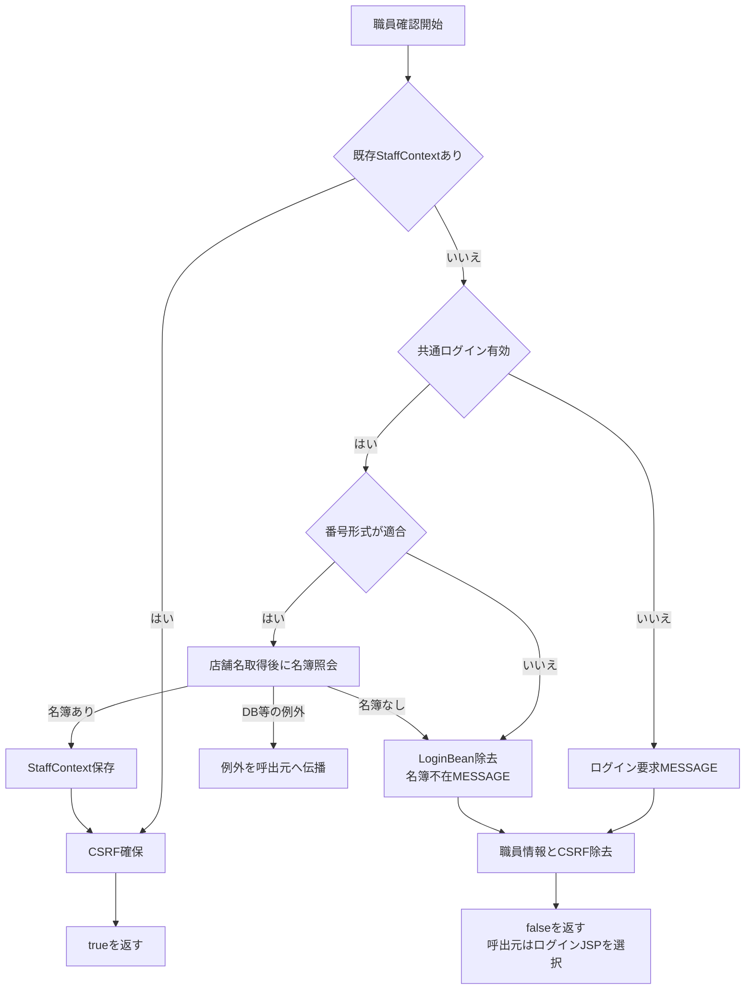

例外出口Xは通常拒否の整理処理Rを通らない。既存情報再利用の枝と、新規に名簿から生成した枝は、trueという戻り値は同じでも名簿参照と属性更新の有無が異なる。

#### SQL・テーブル関連（ER図）

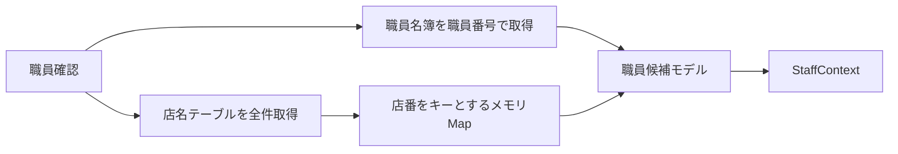

これは異なる接続から取得した結果のメモリ突合せであり、店名テーブルと職員名簿をSQLでJOINする処理ではない。検索関連からFKや多重度は定義しない。

#### DB操作の詳細

| 処理 | 接続・対象 | SQL条件と取得列 | パラメータ・結果 |
| --- | --- | --- | --- |
| 店舗名Map取得 | 年金業務接続、店名テーブル | 店舗ｺｰﾄﾞ、店名を全件取得。WHERE・ORDER BYなし | パラメータなし。店舗ｺｰﾄﾞをIntegerキーとしてMapへ格納 |
| 職員取得 | 職員接続、DB2.Ｕ職員名簿表 S | `S.職員番号 = ?`。職員番号、漢字氏名、カナ氏名、所属店番、役職コードを取得。ORDER BYなし | 第1引数をsetInt。最初の1行があればモデル化し、0行ならNULL |

職員取得は全件件数や重複件数を検査しない。所属店番はgetInt後にwasNullを確認せず、NULLを0として移す。役職コードと氏名のNULLはモデル生成で空文字へ変わる。接続された本処理は参照のみで、職員名簿を更新しない。

#### 結果・例外時の扱い

trueは年金職員情報を利用できるという戻り値であり、毎回最新の名簿・役職を確認したことを意味しない。falseは前記の通常拒否処理を終えた状態である。

店舗名または職員名簿のSQL失敗は`NenkinDataAccessException`として伝播する。照会途中の例外では通常拒否末尾へ到達せず、職員情報・CSRF・LoginBeanの除去が一律に完了する契約ではない。通常Servlet経路でAction実行中に伝播した例外は共通Action用catchへ進む。

### E2 要求値の変換、CSRF照合、予約入力の検証

#### 処理概要

要求文字列を予約モデルや出力条件へ移し、操作別の検査を適用する。予約Save・Deleteと日次/月次Runは、職員確認、要求値読取り、POST・CSRF照合の順で処理する。保存用の日付・備考検査はSaveに接続され、Deleteには接続されない。

#### 処理手順

**1. 文字列・数値・booleanを変換する。**

　**1.1.** `trim`はNULLを空文字にし、それ以外にJavaの`String.trim`を適用する。この段階にNFKCや内部空白集約はない。

　**1.2.** `integerOrNull`はtrim後の空文字、整数化失敗、int範囲外、0以下をNULLにまとめ、正のintだけを`Integer`で返す。ASCII数字限定検査、画面maxlengthと同じ桁数検査、NFKCはこのhelper内にない。

　**1.3.** `integerOrDefault`は前項の結果がNULLなら呼出元の既定値を返す。参照PAGEと印刷SORT_TYPEでは既定値1を使用する。

　**1.4.** `isChecked`は厳密な文字列「1」、または大文字小文字を無視した「true」「on」だけをtrueにする。trimは行わない。NULL・空文字・その他はfalseとなり、未送信と明示falseの違いを残さない。

**2. 予約要求をモデルへ移す。**

　**2.1.** `readReservation`は店番、顧客番号、担当者コード、予定年齢を正数Integerへ変換する。名称、住所、電話番号、各日付、備考などの文字項目はtrim後のStringとして移す。五つの年金種類と６ヶ月先確認はbooleanへ変換する。

　**2.2.** この時点では日付解析、カナのNFKC、電話番号の数字抽出・数値化を行わない。店舗名と年金種類名称はフォームから読まない。CSRF、ORIGINAL・LOOKUPキーは予約モデルへ格納せず、個別用途で要求から読む。

**3. 更新要求のCSRFを照合する。**

　**3.1.** `ensureCsrfToken`はセッション値が長さ1以上のStringならそのまま返す。それ以外は`UUID.randomUUID().toString()`を生成して保存する。

　**3.2.** `isAuthorizedMutation`はHTTP methodが大文字小文字を無視してPOSTであることを先に確認する。その後、セッション値がStringで、要求`CSRF_TOKEN`とequals一致する場合だけtrueを返す。要求値欠落は一致しない。

　**3.3.** 照合helper自体には期限、単回消費、空文字排除の処理がない。接続された呼出元では先行する職員確認が非空値を確保する。照合成功によるトークン更新もない。

　**3.4.** 不一致時は「画面の有効期限が切れました。メニューから操作しなおしてください。」を設定する。予約Save・Deleteは入力モデルを残してexisting=false、日次/月次Runは読み取った条件Beanを残して各画面へ戻す。

**4. Saveの必須項目と日付を順に検査する。**

　**4.1.** 店番NULL、フリガナ空文字、電話番号空文字の順に確認し、最初の不備を返す。顧客番号、担当者コード、予定年齢、顧客氏名などをこの処理で必須にはしない。

　**4.2.** 生年月日、配偶者生年月日、請求予定日、予約徴求日の順に正規化し、成功した項目からモデルへ戻す。四日付は空欄を許し、空文字へ設定する。失敗した項目より前だけが正規化済みという中間状態が生じる。

　**4.3.** 日付の形式・実在性不正は項目別のメッセージにする。`DATA_UPDATE_DATE`はこの検査に含めない。

**5. 備考を検査する。**

　**5.1.** 四日付を通過した後、Windows-31Jへ変換可能で、符号化長が56バイト以下であることを検査する。NULLは空文字相当として有効で、フォーム経路ではtrim済みの備考を対象とする。

　**5.2.** Actionは変換不能と56バイト超過を「Excel出力した際、文字が途中で切れてしまいます。編集しなおしてください」という同じメッセージにする。文字数やDB容量による代替判定は行わない。

　**5.3.** 入力不備があるSaveは、現在のフリガナ・電話番号でも予約検索し、結果の存在有無をexistingへ設定して再表示する。入力検査で不備が見つかった後もDB読取りが残る。

#### 処理フロー

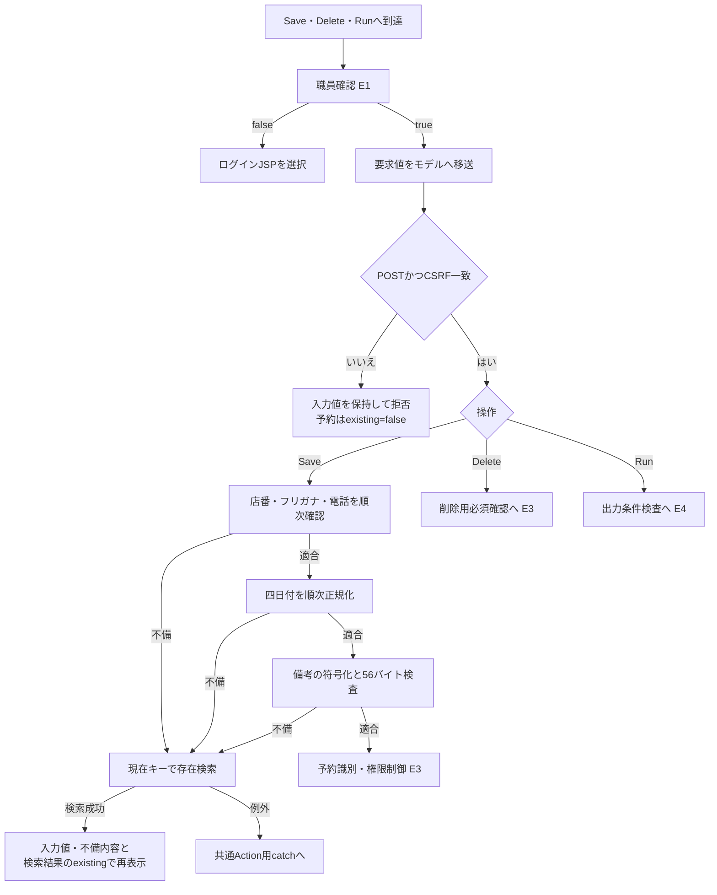

#### SQL・テーブル関連（ER図）

要求変換、CSRF、日付、備考の各helperはDBを使わない。要求値と要求内モデル、セッションのCSRF、Action内の`normalizedDate`を扱う。Saveの入力不備後に行う存在検索だけは予約本表と名称参照表を使用し、E3の予約検索関連に従う。

#### DB操作の詳細

Saveの入力不備後の検索は、入力中のカナと電話番号をRepository方式で正規化し、`R.ふりがな = ? AND R.電話番号 = ?`へsetString、setBigDecimalの順で渡す。正規化後カナ空または電話番号の数字なしなら接続前にNULLを返し、画面状態はexisting=falseとなる。

ブラウザーの数字入力補助やmaxlengthは、このサーバー変換の前提条件ではない。予約画面の`data-digits-only`は全角数字の半角化と非数字除去を行うが、任意のHTTP要求に同じ加工が済んでいる保証はない。

#### 結果・例外時の扱い

| 操作 | POST・CSRF照合 | 続く検査・処理 | 拒否時の状態 |
| --- | --- | --- | --- |
| Save | あり | 必須、四日付、備考、予約識別、権限制御 | CSRF拒否は入力保持・existing=false。保存用入力不備は存在検索結果でexistingを設定 |
| Delete | あり | 店番、キー非空、予約識別、権限制御 | CSRF拒否は入力保持・existing=false。その他の状態はE3参照 |
| 日次/月次Run | あり | 区分、職員番号、期間、削除基準日 | 条件Beanを保持してバッチ画面へ戻す |
| Load・Clear・参照検索・印刷Preview・店舗別Excel | 呼出しなし | 各操作の検査 | CSRF照合を実施する契約には含まれない |
| JSON Lookup | 呼出しなし | 職員確認後に独自のPOST判定 | POST以外へ405を設定する |

各Actionのmethod条件は、そのActionへ到達した場合の契約である。共通ServletのGET処理がPOSTと同じ年金Actionを呼ぶことを意味しない。

CSRF拒否後の予約画面はexisting=falseとなるため、キーreadonlyとORIGINALキーを既存読込状態のまま保持しない。入力不備後の再表示では不正文字列や一部だけ正規化された値が残る。JSP描画での候補取得失敗は、Action内の通常拒否とは別の失敗となる。

### E3 予約キーの識別、変更・削除権限、DB確定

#### 処理概要

Save・Deleteは、現在入力のキーとORIGINALキーで取得した予約を照合してから変更・削除の可否を判定する。Actionのキー比較とRepositoryの検索キー正規化は処理内容が異なる。Repositoryは保存・削除の直前にも対象を確認するが、Actionで行った職員権限や読込元の照合を再実行しない。

#### 処理手順

**1. 用途別にキーを加工する。**

　**1.1.** Actionの`sameReservationKey`は、比較する二つの予約がともに非NULLであることを必要とする。フリガナへtrim、NFKC、`Locale.ROOT`の大文字化を適用し、電話番号へtrim、NFKC、ASCII数字だけの抽出を適用して比較する。内部連続空白の集約と電話番号の先頭ゼロ除去は行わない。

　**1.2.** RepositoryはカナへNULLの空文字化、NFKC、trim、全角空白の半角化、連続半角空白の1個への集約、`Locale.JAPAN`の大文字化を行う。

　**1.3.** Repositoryの電話番号処理はJavaのcharごとに`Character.isDigit`と`Character.digit`を使い、十進数字をASCII化する。数字なしはNULL、数字ありは`BigDecimal`とする。電話番号全体へNFKCを行うAction比較とは異なり、数値化後は元の先頭ゼロ数を識別要素にしない。

**2. Saveで現在キーと読込元を確認する。**

　**2.1.** E2の保存用検査後、現在キーで予約を取得し、続けて`ORIGINAL_KANA`・`ORIGINAL_PHONE`で元予約を取得する。Action比較の対象は、この二つの検索結果モデルである。

　**2.2.** 現在予約が存在し、元予約と同じキーでなければ、現在予約をexisting=trueで表示し、既存データを読み込んだ旨を通知して保存しない。

　**2.3.** 現在予約がなく元予約が存在する場合は、元予約をexisting=trueで表示し、キー変更を拒否する。

　**2.4.** 現在予約が存在する場合だけ職員制限を確認する。制限対象なら現在予約を表示し、変更権限不足を通知する。現在予約がない新規判定時にはこの制限を適用しない。

　**2.5.** 保存へ進む場合は入力予約とログイン職員番号をRepositoryへ渡す。成功後は空予約、existing=false、メッセージ「登録終了！」へ置換する。RepositoryのNEW・CHANGEDという戻り値を、画面の完了文言の分岐には使用しない。

**3. Deleteで対象と読込元を確認する。**

　**3.1.** CSRF照合後、店番がNULLなら入力値をexisting=trueで残し、店番必須のメッセージを表示する。次にフリガナまたは電話番号が空なら、入力値をexisting=falseで残して読込みを求める。保存用の日付・備考検査は行わない。

　**3.2.** 現在キーとORIGINALキーで予約を検索する。現在予約なしなら入力値をexisting=falseで表示する。現在予約があっても同じキーでなければ、現在予約をexisting=trueで表示する。いずれも削除せず対象の読込みを求める。

　**3.3.** 対象照合後に職員制限を確認する。制限対象ならDBから取得した現在予約をexisting=trueで表示し、削除権限不足を通知する。

　**3.4.** 削除へ進む場合は現在入力のカナ・電話番号とログイン職員番号をRepositoryへ渡す。trueなら空予約・existing=false・「削除終了！」、falseなら入力予約・existing=true・「削除対象が見つかりません。」とする。

**4. 職員制限を判定する。**

　**4.1.** 判定対象はログイン職員の所属店番であり、予約対象店番ではない。職員情報NULLまたは所属店番75以外では、制限helperはfalseを返す。通常の呼出しでは先行する職員確認で職員情報を確保する。

　**4.2.** 所属店番75では、trimした役職コードを整数化し、3000未満なら制限する。整数化失敗も制限する。3000以上なら制限しない。画面文言は「推進役以上」だが、この判定で役職名称や役職マスターを照会する処理はない。

**5. Repositoryで保存・削除を確定する。**

　**5.1.** saveは同期メソッドへ入り、DB処理用tryの前に予約をcopyする。カナ正規化後非空、電話番号の数字の存在、備考、四日付を再検査し、更新日を当日に置換する。日付の順は生年月日、請求予定日、予約徴求日、配偶者生年月日で、Actionの検査順とは異なる。

　**5.2.** 接続取得後はautoCommit=falseとし、店舗名を照会し、同じ接続で現在キーの存在を再確認する。存在すればUPDATE、なければINSERTを実行し、実行件数1件を確認してcommitする。

　**5.3.** deleteはカナ・電話番号を正規化し、無効キーなら接続前にfalseを返す。有効キーではautoCommit=falseの接続で対象を再読込し、対象なしならrollback後falseを返す。

　**5.4.** 削除対象があれば、DBから取得した予約の更新日を当日に替え、更新者・時刻付きで削除明細へ追加してから本表を削除する。両方の件数が1件であることを確認し、commit後trueを返す。

#### 処理フロー

サブフロー1はSaveの入力検査後を入口とし、保存呼出しまたは予約画面再表示を出口とする。

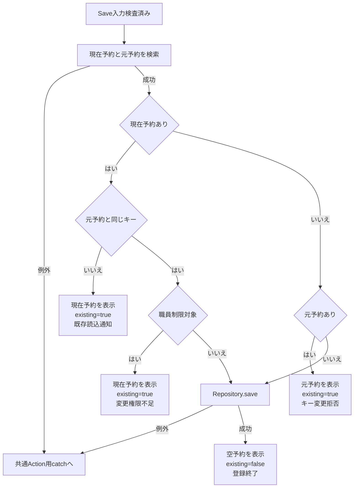

サブフロー2はDeleteのCSRF照合後を入口とする。拒否理由ごとに、表示予約とexistingを引き継ぐ。

```mermaid
flowchart TD
    A[DeleteのCSRF照合済み] --> B{店番NULL}
    B -- はい --> R1[入力予約・existing=true<br/>店番必須]
    B -- いいえ --> C{カナまたは電話が空}
    C -- はい --> R2[入力予約・existing=false<br/>読込み要求]
    C -- いいえ --> D[現在予約と元予約を検索]
    D -- 例外 --> X[共通Action用catchへ]
    D -- 成功 --> E{現在予約あり}
    E -- いいえ --> R3[入力予約・existing=false<br/>対象読込み要求]
    E -- はい --> F{元予約と同じキー}
    F -- いいえ --> R4[現在予約・existing=true<br/>対象読込み要求]
    F -- はい --> G{職員制限対象}
    G -- はい --> R5[現在予約・existing=true<br/>削除権限不足]
    G -- いいえ --> H[Repository.delete]
    H -- 例外 --> X
    H -- true --> S[空予約・existing=false<br/>削除終了]
    H -- false --> T[入力予約・existing=true<br/>対象なし]
```

Repository内の確定境界は次のとおり。保存前検証の例外は、DB用tryに入る前に発生する。

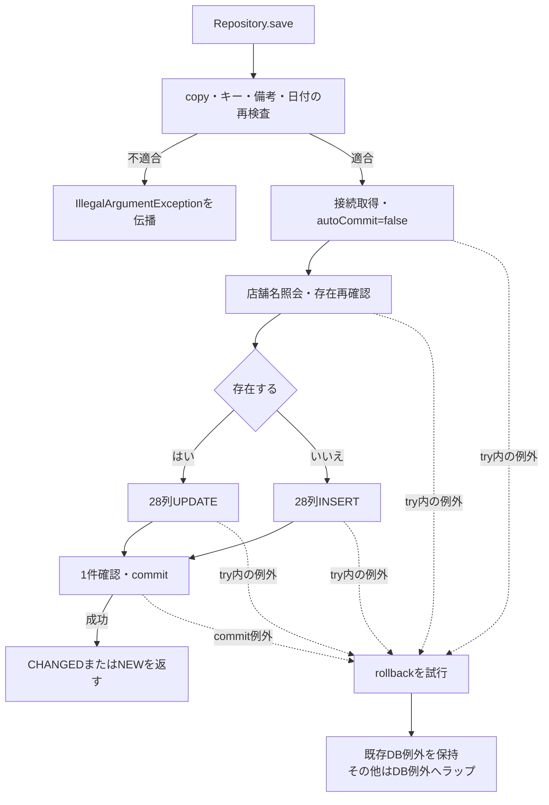

#### SQL・テーブル関連（ER図）

予約取得では本表または削除明細をRとして、次のLEFT JOINを使う。この図はSQLの関連を示し、FK制約や多重度を定義するものではない。

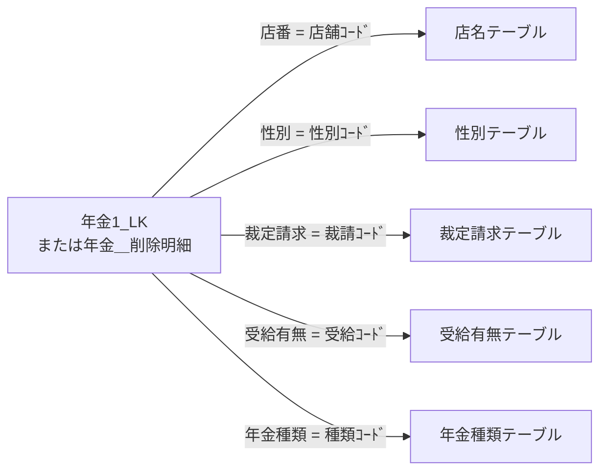

予約検索は予約の数値・文字・日付・boolean項目と、これらの名称を`PensionReservation`へ移す。名称列のNOT NULL宣言があっても、LEFT JOIN不成立による取得結果のNULLは発生し得る。文字列setterでNULLを空文字へ変換する。

#### DB操作の詳細

予約キー検索は`R.ふりがな = ? AND R.電話番号 = ?`を使用し、第1引数を正規化カナのsetString、第2引数を電話番号のsetBigDecimalで設定する。ORDER BY・SQLページングはなく、最初の1行を返す。保存時の存在確認は同じ二述語による`SELECT 1`である。更新・削除のWHEREも同じ二項目だけで、店番、更新日時、更新者、版番号を比較しない。

INSERTとUPDATEは次の28項目を同じ順でバインドする。UPDATEでは、この後の第29・30引数にWHERE用カナと電話番号を設定する。削除明細追加も同じ28項目を使用する。

| SQL引数位置 | DB列・値 | JDBC設定 |
| --- | --- | --- |
| 1 | 店番 | setInt、NULLはTypes.INTEGER |
| 2 | 顧客番号 | setInt、NULLはTypes.INTEGER。DB列はBIGINT |
| 3 | 担当者コード | setInt、NULLはTypes.INTEGER |
| 4 | 顧客氏名 | setString |
| 5 | 正規化後ふりがな | setString |
| 6 | 性別の名称逆引きコード | setInt、空名称はTypes.INTEGERのNULL |
| 7 | 住所 | setString |
| 8 | 電話番号のBigDecimal | setBigDecimal。共通setterは数字なし時にTypes.DECIMALのNULL |
| 9 | 生年月日 | setDate、空文字はTypes.DATEのNULL |
| 10～14 | 国民年金、厚生年金、共済年金、厚生年金基金、国民年金基金の順 | 各booleanをsetIntの1または0 |
| 15 | 五つの年金種類から合成したコード | setInt、合計0はTypes.INTEGERのNULL |
| 16 | 裁定請求の名称逆引きコード | setInt、空名称はTypes.INTEGERのNULL |
| 17 | 請求予定日 | setDate、空文字はTypes.DATEのNULL |
| 18 | 予定年齢 | setInt、NULLはTypes.INTEGER |
| 19 | 配偶者名 | setString |
| 20 | 配偶者生年月日 | setDate、空文字はTypes.DATEのNULL |
| 21 | 受給有無の名称逆引きコード | setInt、空名称はTypes.INTEGERのNULL |
| 22 | 予約徴求日 | setDate、空文字はTypes.DATEのNULL |
| 23 | 備考 | 56バイト検査後のStringをsetString |
| 24 | サーバーで設定したデータ更新日 | setDate |
| 25 | 更新時間 | HH:mm:ss.SSSの先頭8文字をjava.sql.Timeへ変換してsetTime |
| 26 | 更新者 | Actionが渡すログイン職員番号をsetInt |
| 27 | ６ヶ月先確認 | setIntの1または0 |
| 28 | 変更FLG | 新規0、変更1をsetInt。削除明細追加はTypes.INTEGERのNULL |

性別・裁定請求・受給有無の逆引きは、各コード表の名称列を`= ?`で検索し、trimした名称を第1引数へsetStringする。空名称は照会せずNULLとし、非空名称に該当行がなければSQLExceptionを発生させる。年金種類は1・2・4・8・16を合計し、非0の場合は`種類ｺｰﾄﾞ = ?`へsetIntしてコードの存在を確認する。

各パラメータへの明示サイズ指定、自動切捨て、クエリータイムアウト、要求取消の連携はこの共通処理にない。保存の再確認からUPDATE等までに、明示的な比較版や行ロック指定はない。

#### 結果・例外時の扱い

Repository.saveの事前検証はDB用tryの外にある。Actionで非空だった全角空白だけのカナが正規化後空となる場合や、電話番号に数字がない場合は、`IllegalArgumentException`がDB接続前に伝播する。SaveActionに個別catchはないため、通常Servlet経路では共通Action用catchへ進む。Actionの入力不備メッセージと同じ再表示経路にはならない。

saveのDB用try内ではExceptionを捕捉してrollbackを試み、既存の`NenkinDataAccessException`は保持し、それ以外を同例外へ包む。deleteのtry内例外はrollbackを試みた後、削除失敗の同例外へ包む。rollback・close失敗は元の結果・例外を上書きしない。commitで例外になった場合も、rollback試行だけからDB未確定・未更新とは断定できない。

予約本表と削除明細の収録DDLにはPK・一意制約がなく、検索キー索引も非一意である。対象が複数あれば、検索は最初の行を返し得る一方、更新・削除は件数が1でないため失敗する。同期は同じJVMの共有Repositoryに限られ、別プロセスを含むDB全体の排他ではない。

Actionの権限制限はRepositoryに入る前の存在判定に依存する。Actionで新規と判断した後に対象が作られれば、Repositoryの再確認によってUPDATEへ変わり得るが、その時点で職員権限を再検査しない。ORIGINALキーもセッション上の読込証跡や比較版ではなく、要求から受け取る再検索キーである。

### E4 参照・印刷・出力条件の共通変換

#### 処理概要

共通変換helperを検索条件へ接続する際は、不正な数値がNULLになった後の用途を操作ごとに決める。参照検索では条件省略、印刷では範囲使用状態に応じた拒否または単一店舗化、店舗別Excelでは入力拒否となる。日次・月次の職員番号は正数helperを使わず、空欄と0を区別する。

#### 処理手順

**1. 参照検索条件を作る。**

　**1.1.** TARGETをtrimし、branch・staff以外はcustomerへ移す。文字条件はtrim、店番は正数Integer、PAGEは既定値1へ変換する。

　**1.2.** 店番が空、不正、0以下ならNULLとなり、担当者・顧客検索では店舗条件を付けない。名称条件はサービスでNFKC、trim、空白集約、大文字化を行う。電話条件は数字抽出と先頭ゼロ整理を行い、数字がなければ電話条件を付けない。

　**1.3.** SQLでは全対象行を取得し、Actionで20件単位に切り出す。PAGEの上限補正は切出し後であり、補正後のページ番号を使った再取得・再切出しは行わない。

**2. 印刷条件を作る。**

　**2.1.** USE_BRANCH_RANGEをbooleanへ変換し、店番自・至はtrim後Stringとして保持した上で正数Integerへ変換する。範囲使用時に店番自がNULLなら拒否し、有効な至がある場合だけ大小を検査する。

　**2.2.** 至が空、不正、0以下ならNULLとなり、範囲使用時は店番自の単一店舗検索へ進む。範囲未使用なら、画面モデルに文字列が残っていても検索へは両方NULLを渡す。

　**2.3.** SORT_TYPEは正数変換できなければ1とし、その他の正数はそのまま渡す。Repositoryは2・3・4以外を担当者順として扱う。検索成功時は0件でもpreview=trueとする。

**3. 店舗別Excelの条件を作る。**

　**3.1.** 店番をtrimしたStringとして保持し、正数Integerへ変換する。空または変換結果NULLを先に拒否し、次に文字長3以内かつASCII数字のみであることを検査する。

　**3.2.** 店舗名を表示用に取得する。名称が見つからないことだけでは出力を拒否しない。対象0件は入力店番と取得できた名称を残して再表示し、対象があれば完成したExcelをE6へ渡す。

**4. 日次・月次の条件を検査する。**

　**4.1.** Runは職員番号、三出力区分、対象日、開始日、終了日、削除基準日をBeanへ読み、E2のPOST・CSRF照合を行う。その後、新規・変更・削除のいずれか一つ以上、非空職員番号のASCII数字8桁以内の順で確認する。

　**4.2.** サービスは要求NULLと区分未選択を検査し、日次・月次の期間、職員番号の順に変換する。日次は対象日を開始・終了の両方にする。月次は両端を受け取り、開始日が終了日以下であることを検査する。同一月や暦上の月初・月末への限定はない。

　**4.3.** 職員番号空欄は全職員を表すNULLとし、数字を指定した場合はInteger化する。0だけの指定も0として残り、更新者0の検索になる。サービス単体はALLも全職員として受け付けるが、画面接続のActionは数字形式検査でALLを拒否する。

　**4.4.** 削除基準日がtrim後非空なら、区分別検索より先に削除明細整理を呼ぶ。Repositoryは基準日を日付正規化し、空なら0件で戻り、非空なら基準日以下を削除して独立commitする。hidden値とサーバー側の再計算値を照合する処理はない。

　**4.5.** 選択区分を抽出し、店番・顧客番号・取得連番で並べ直してExcelを生成する。生成0件なら画面へメッセージを返し、1ファイルならそのExcel、複数ならZIPをE6へ渡す。

#### 処理フロー

日次・月次の共通経路を示す。入口は職員確認と要求読取り・CSRF照合が済んだ状態である。

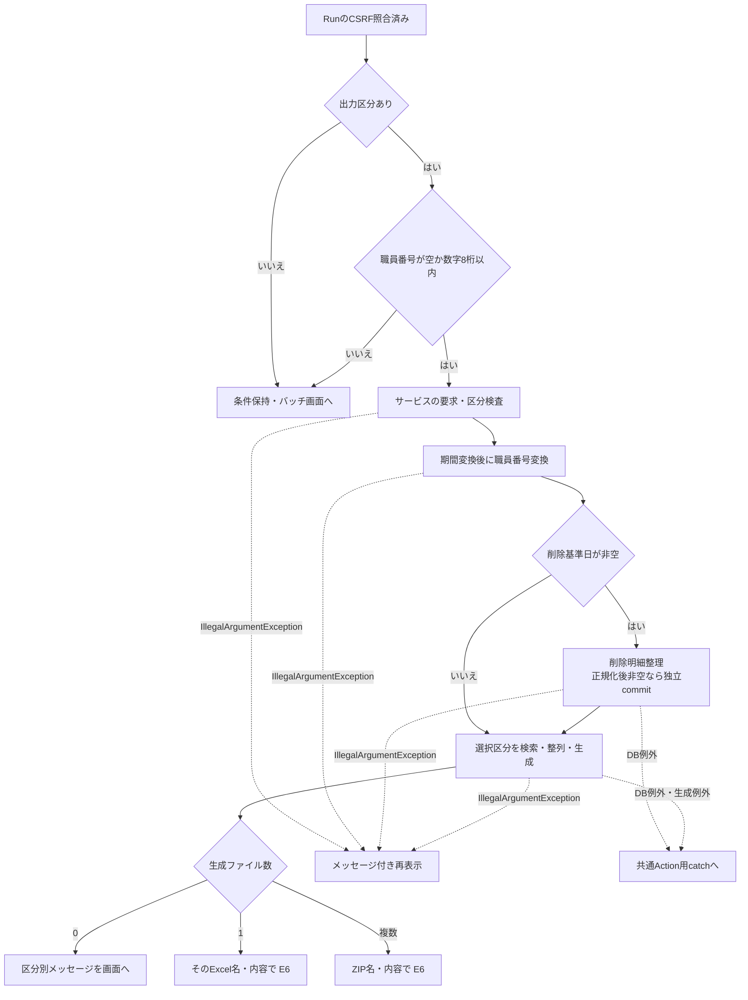

期間の必須検査はNFKC前のtrimで非空を確認した後、DateUtilの戻り値をそのまま使う。全角空白だけの入力は前段を通過して正規化後空文字になり得る。日次で両端が空、月次で両端とも空となる場合は、Repositoryが期間WHEREを省略する経路がある。正規化後の非空再検査を実施した動作としては扱わない。

#### SQL・テーブル関連（ER図）

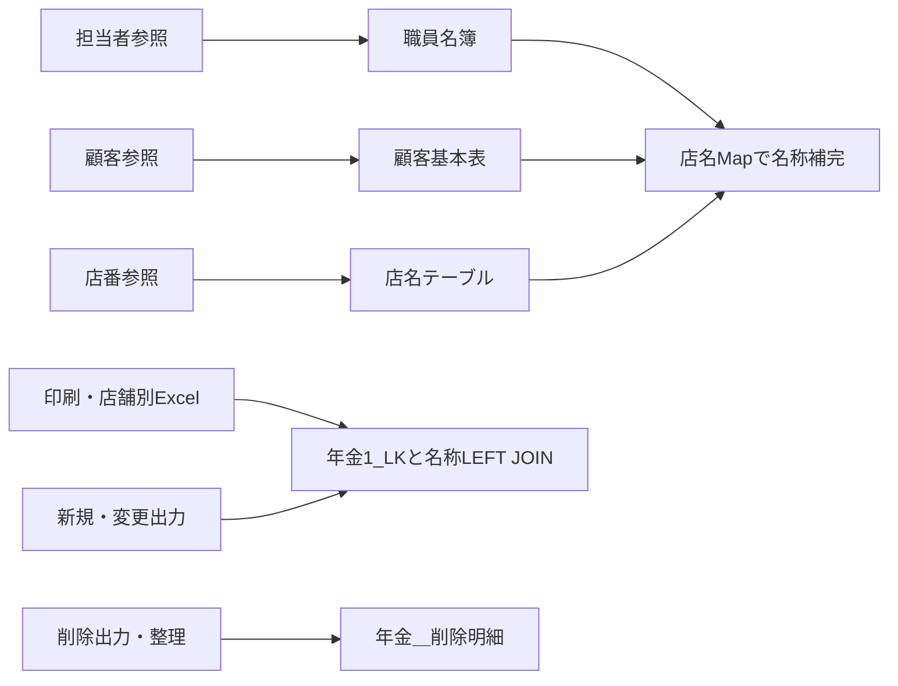

検索条件、ページ、並び順、出力区分、期間は処理制御値であり、要求値を予約列へ直接保存しない。日次・月次の新規・変更は予約本表の現在状態を検索し、完全な変更履歴表を読む処理ではない。

#### DB操作の詳細

名称の包含検索値は、バックスラッシュ、%、_、角括弧をエスケープして前後に%を付ける。以下の各LIKEにはバックスラッシュをESCAPE文字として指定する。条件を省略する場合は、そのパラメータもバインドしない。

| 用途 | WHERE・結合条件 | バインド順・型 | ORDER BY・結果 |
| --- | --- | --- | --- |
| 店番参照 | 名称条件非空時だけ、`CAST(店舗ｺｰﾄﾞ AS VARCHAR(20)) LIKE ?`と`UPPER(店名) LIKE UPPER(?)`のOR | 同じ包含検索値をsetStringで2回 | 店舗ｺｰﾄﾞ順。店番・店名の全件リスト |
| 担当者参照 | 基底はWHERE 1=1。店番非NULL時に`S.所属店番 = ?`。名称非空時にカナ氏名と漢字氏名の大文字化LIKEを括弧内ORで追加 | 店番setInt、名称setStringを2回 | 職員番号順。職員番号・漢字氏名・カナ氏名・所属店番・役職コードを取得し、店舗名をMap補完 |
| 顧客参照 | 基底はWHERE 1=1。店番非NULL時に`C.店舗コード = ?`。名称非空時に漢字氏名とカナ氏名の大文字化LIKEを括弧内ORで追加。電話非空時に`TO_CHAR(C.電話番号) LIKE ?` | 店番setInt、名称setStringを2回、電話包含値setString | 店舗コード、顧客番号、カナ氏名順。店番・顧客番号・カナ氏名・漢字氏名・電話・生年月日・担当者コードを取得し、店舗名をMap補完 |
| 店舗別Excel | `R.店番 = ?` | 第1引数setInt | 請求予定日降順、担当者コード、顧客番号。予約モデルの全件リスト |
| 印刷・範囲なし | 店舗WHEREを追加しない | 店舗バインドなし | 下記の並び順。予約モデルの全件リスト |
| 印刷・至なし | `R.店番 = ?` | 店番自setInt | 同上 |
| 印刷・両端あり | `R.店番 >= ? AND R.店番 <= ?` | 店番自、至をsetInt | 同上 |
| 新規出力 | 予約本表の`変更FLG = ?`。非空開始日に更新日以上、非空終了日に更新日以下、職員非NULL時に更新者等価を追加 | 0をsetInt、開始setDate、終了setDate、更新者setIntの順 | データ更新日、更新時間、店番、顧客番号順で全件取得後、サービスで再整列 |
| 変更出力 | 新規と同じ述語構成 | 変更FLGは1。他は同順 | 同上 |
| 削除出力 | 削除明細を使用し、変更FLG条件なし。期間・職員条件は同じ | 開始setDate、終了setDate、更新者setIntの順 | 同上 |
| 削除明細整理 | `DELETE FROM 年金＿削除明細 WHERE データ更新日 <= ?` | 正規化基準日を第1引数へsetDate | 削除件数を返し、独立commit |

印刷のORDER BYは、2が店番・ふりがな・顧客番号、3が店番・生年月日・顧客番号、4が店番・請求予定日・顧客番号、それ以外が店番・担当者コード・顧客番号である。いずれもSQLページングは行わない。

参照検索と予約出力検索の取得件数上限や、処理途中の要求取消に対応するStatement取消は設定していない。参照画面の20件表示はDB取得上限ではない。

#### 結果・例外時の扱い

| 入力・結果 | 現行の扱い |
| --- | --- |
| 参照の店番が空・不正・0以下 | 店舗条件を省略するため、他の指定条件に一致する全店舗が対象となり得る |
| 印刷範囲未使用 | 店番自・至の表示文字列が残っていても全店舗を検索 |
| 印刷範囲使用、至が変換できない | 有効な自があれば単一店舗を検索 |
| 印刷検索0件 | preview=trueで再表示。明細ありの場合と件数だけが異なる |
| 店舗別Excel0件 | ダウンロードせず、店番・取得済み店舗名とメッセージで再表示 |
| バッチ生成0件 | 空byte配列と区分別メッセージを返し、Actionが画面へ表示 |
| バッチ生成1件 | そのExcel名・内容を使用。結果に残る未出力区分メッセージは、直接送信のため画面表示しない |
| バッチ生成複数件 | ZIP名・内容を使用。メッセージはUTF-8の出力結果.txtにも収録 |

バッチActionのIllegalArgumentException用catchはサービス呼出しからダウンロードまでを囲む。この例外が期間検査以後の和暦変換などで発生しても、条件Beanとメッセージで再表示する。既にcommitした削除明細整理は戻らない。DB例外や生成失敗を包むIllegalStateException等は、このcatchでは処理せず共通Action用catchへ進む。

### E5 日付・HTML・JSON・boolean属性の表示変換

#### 処理概要

保存用の日付正規化、JSPでの表示、JSONでの表示値、日次・月次ファイルの日付表現を用途別に変換する。HTMLエスケープは表示文字列をHTMLへ出すための処理であり、入力の業務検証やJSON文字列化とは別契約である。

#### 処理手順

**1. DateUtilで入力日付を正規化する。**

　**1.1.** NULLを空文字にし、NFKC、trim、全角空白の半角化を行う。結果が空なら空文字を返す。

　**1.2.** 非空値は、西暦4桁年と1～2桁月日を.・/・-で区切る形式、8桁のyyyyMMdd、和暦のいずれかに全体一致する必要がある。西暦の二つの区切りを同じ文字に限定する検査はない。

　**1.3.** 和暦は明治・大正・昭和・平成・令和、またはM・T・S・H・Rを使う。英字は大文字小文字を区別せず、年は元または1～3桁の数字で、0以下を拒否する。年区切りには.・/・-・年、月区切りには.・/・-・月を使え、末尾の日は省略できる。

　**1.4.** lenient=falseの解析で日付実在性を検査し、和暦入力は当該元号の開始・終了日も確認する。成功時はyyyy-MM-ddを返す。`isValid`は、正規化に成功しても空文字ならfalseを返す。

**2. 接続先に応じた日付を作る。**

　**2.1.** DateUtilの西暦表示はyyyy/MM/dd、和暦表示は元号記号と2桁以上の年を用いた`R 08/06/11`形式、Access向け表示は年の先頭ゼロを除いた`R8.06.11`形式とする。非空で明治開始より前の日付は、DateUtilの和暦表示で例外となる。

　**2.2.** `todayIso`と`currentTime`は実行時の日時から値を作る。明示タイムゾーンの指定はない。月初・月末helperは正規化日付から月の端を求め、空入力には空文字を返す。

　**2.3.** JSP用`HtmlUtil`はyyyy-MM-ddの解析を試み、成功時だけ表示を整える。解析不能なら元文字列、NULLなら空文字を返す。入力全体を消費したかを確認する処理はなく、DateUtilの受理判定とは同一ではない。明治開始より前の日付は西暦表示へ戻す。

**3. HTML出力を変換する。**

　**3.1.** `HtmlUtil.escape`はNULLを空文字にし、文字列化した値のアンパサンド、大小記号、二重引用符、単一引用符をHTML参照へ変換する。

　**3.2.** `HtmlUtil.value`はNULLを空文字にするだけで、エスケープしない。予約JSPでは数値モデルのvalue出力に使用し、名称・備考・日付表示などはescapeを通す。

　**3.3.** `checked`はtrue時だけ属性文字列を出す。String版`selected`はexpected.equals(actual)、int版は数値一致で判定し、一致時だけ属性文字列を出す。String版はexpected=NULLを許容するhelperではない。

**4. boolean属性を画面状態へ接続する。**

　**4.1.** 予約の種類・確認済、バッチ区分、印刷範囲選択ではtrue時だけcheckedを出力する。予約キーのreadonlyはexisting=true時だけ出力し、更新日のreadonlyは常時出力する。

　**4.2.** 印刷ボタンは未プレビュー時だけdisabledを出力する。印刷店舗入力はJavaScriptが範囲使用状態の逆値をdisabledプロパティへ設定する。HTML属性へfalseという文字列を付けて無効化する方式ではない。

**5. JSON用の値を作る。**

　**5.1.** `HtmlUtil.json`は文字列内容のバックスラッシュ、引用符、改行等の制御文字、大小記号、U+2028、U+2029をJSON向けにエスケープする。このhelper単独は値を囲む引用符やJSONオブジェクトを作らない。

　**5.2.** `PensionLookupAction`のappendが、NULLをJSON null、Number・Booleanを引用符なし、その他を引用符付き文字列として出す。日付原値に加え、DateUtilで作る表示値も設定する。

　**5.3.** JSON入口は職員確認後にPOST以外へ405を設定する。POSTでは、LOOKUP_MODEが厳密にkeyならカナ・電話番号で予約を検索し、それ以外は正数変換した店番・顧客番号で顧客を検索する。UTF-8のapplication/jsonへwrite・flushしてCSVを返す。CSRF照合は呼ばない。

#### 処理フロー

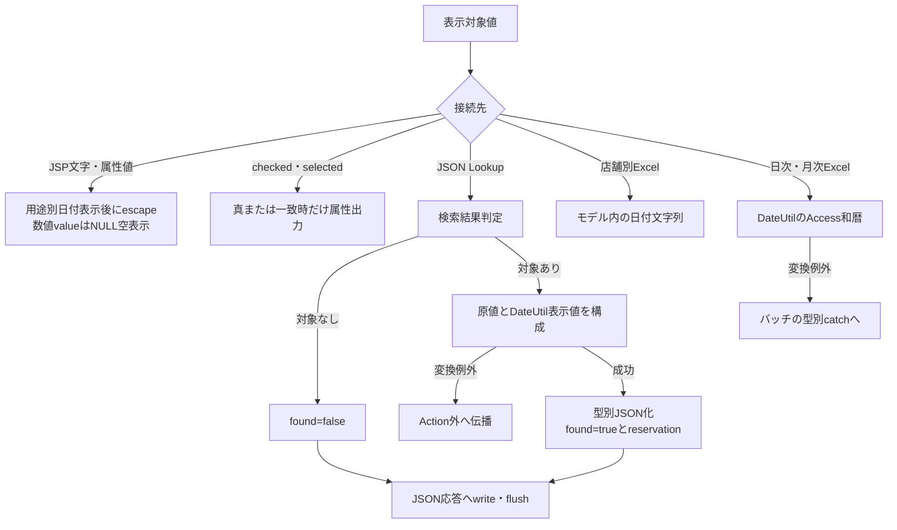

JSON入口のmethod拒否は、結果構成に入る前の経路である。JSPの解析不能時の原値保持と、DateUtilの例外を同じ結果へまとめない。

#### SQL・テーブル関連（ER図）

文字・日付・属性の変換helperはDBを使用しない。変換対象はモデル、要求内String、JSON組立て用StringBuilderである。

予約JSPは表示前に性別、裁定請求、受給有無、年金種類を業務DBから取得する。前三者の候補はコード順に並び、空optionを先頭へ置く。年金種類はコードをキーとするMapから各チェックの表示名称を取得する。予約検索・JSON検索に伴うDB関連はE3・E4および要求処理仕様の契約に従う。

#### DB操作の詳細

候補取得は各表のコードと名称をSELECTし、コード列のORDER BYで全件を返す。取得時に候補を選択済みにするのではなく、JSPが予約モデルの名称とoption名称を比較してselectedを出力する。候補一覧と予約の選択値は別の情報である。

DBから電話番号を表示するときは、数字を抽出し、先頭ゼロを1桁残るまで除去する。その後、9桁または10桁で先頭0がなければ0を一つ補う。DB NULLは空表示、数値0は「0」となる。数値保存前の電話表記を復元する処理ではない。

#### 結果・例外時の扱い

| 接続先 | 日付・文字の扱い | 不正値・境界 |
| --- | --- | --- |
| 保存用DateUtil | 正規化したISO日付 | 非空の形式・実在性不正はIllegalArgumentException。空を許すかは呼出元が決める |
| 予約JSP | 本人・配偶者生年月日は和暦、請求予定日・予約徴求日・更新日は西暦 | 解析できない文字列は原値を保持してescape。入力拒否後の不正値を一律消去しない |
| 印刷JSP | formatReportDateで和暦表示のスラッシュを「. 」へ変換 | 明治以前は西暦表示を基に同じ区切り変換を行う |
| JSON Lookup | 日付原値とbirthDateDisplay・spouseBirthDateDisplay等の表示値を併記 | DateUtilの和暦変換が失敗すればJSON構成途中で例外。常にfound応答を返す保証はない |
| 店舗別Excel | 予約モデルの日付文字列を使用 | 日次・月次と同じ和暦加工ではない |
| 日次・月次Excel | DateUtil.toAccessWarekiを使用 | 日付変換のIllegalArgumentExceptionはバッチActionの個別catchへ入る |

JSONの対象なしは`found=false`、対象ありは`found=true`とreservationを返す。職員確認失敗時はJSON構成へ進まずログインJSPを返す。付属予約画面の読込みはLoadへのフォーム送信であり、このJSON入口を呼ぶ通常UIは確認できない。

### E6 ダウンロード応答と途中失敗

#### 処理概要

店舗別Excelおよび日次・月次の出力は、完成済みのbyte配列を`writeDownload`へ渡す。helperは応答を初期化してヘッダーを設定し、全内容を書き込んでflushする。戻り値CSVは共通Servletのforward抑止用制御値であり、CSV形式のファイル生成を示さない。

#### 処理手順

**1. 出力内容を用意する。**

　**1.1.** Excel・ZIPはByteArrayOutputStream等のメモリ内で完成させる。店舗別Excelの結果とバッチ結果は、内容NULLを空配列へ置換してcloneし、getContentでもcloneを返す。

　**1.2.** バッチ結果のファイル一覧・メッセージ一覧は別ArrayListへコピーし、変更不可として保持する。byte配列や一覧をセッション・予約DBへ保存する処理ではない。

**2. ファイル名と応答を設定する。**

　**2.1.** ファイル名をUTF-8のURLEncoderで符号化し、+を%20へ置換する。これはresponse.resetより前に行う。

　**2.2.** response.reset、Content-Type、Content-Disposition、Content-Lengthの順で設定する。Content-Dispositionはattachment、互換用のfilename=download、UTF-8の実ファイル名を示すfilename*を併記する。Content-Lengthには配列のcontent.lengthを使う。

**3. 内容を送る。**

　**3.1.** OutputStreamへ全byte配列をwriteし、続けてflushする。helper内にNULL検査、isCommitted確認、個別catch、再試行はない。

　**3.2.** 呼出元Actionは送信処理が戻ればCSVを返す。共通Servletはアクセス記録を行った後、CSV・PDFの戻り値に対するJSP forwardを抑止する。

**4. 失敗時は呼出元のcatchへ戻す。**

　**4.1.** バッチActionではサービスbuild、0件判定、writeDownloadを同じtryが囲み、IllegalArgumentExceptionだけを条件Beanのメッセージへ変える。

　**4.2.** 店舗別Excelには個別catchがない。バッチでもDB例外、生成失敗を包むIllegalStateException、送信IOException等は前項のcatchを通らず、通常Servlet経路の共通Action用catchへ進む。

#### 処理フロー

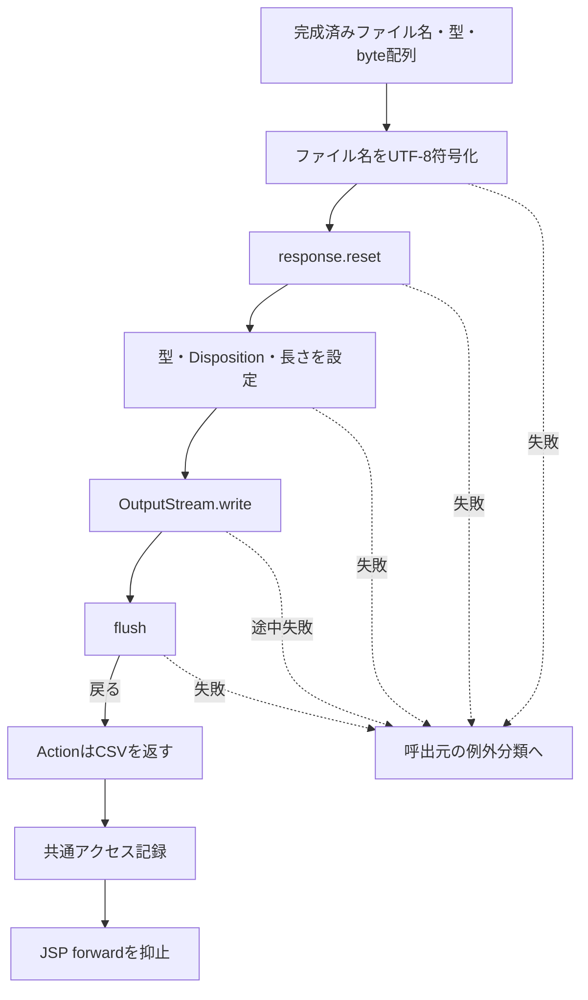

例外分類では、バッチのIllegalArgumentException用catchへ入る場合と、共通Action用catchへ伝播する場合を分ける。応答の確定状態は、どの段階で失敗したかによって異なる。

#### SQL・テーブル関連（ER図）

writeDownloadはDBを使用しない。出力サービスの結果オブジェクト、byte配列、HttpServletResponse、OutputStreamを扱うため、このhelper単独のER図はない。前段の予約抽出と削除明細整理はE4、共通アクセス記録はCOM-012の別契約である。

#### DB操作の詳細

ファイル送信を囲む業務DBトランザクションはない。日次・月次の削除明細整理は、後続の検索・日付変換・Excel生成・ZIP生成・送信より前に独立commitする。後段失敗によって整理をrollbackする外側処理はない。

共通アクセス記録も別接続でcommitし、失敗時はその接続のrollbackとログ出力を行う。予約の保存・削除、削除明細整理、ファイル送信と一体の確定処理ではない。

#### 結果・例外時の扱い

| 段階・例外 | 呼出元の扱い | 確定できる範囲 |
| --- | --- | --- |
| ファイル名符号化の失敗 | helperから伝播 | reset前の失敗であり、このhelperによる応答初期化には未到達 |
| reset・ヘッダー設定の失敗 | helperから伝播 | 設定処理をすべて終えたとはいえない。helperは応答確定状態を確認しない |
| write途中・flushの失敗 | helperから伝播 | 既に送ったヘッダー・本文をエラー画面へ置換できる保証はない |
| バッチ処理内のIllegalArgumentException | バッチ画面への再表示を選ぶ | 既にcommitした削除明細整理は保持される。再表示の完了は別境界 |
| DB例外、生成IllegalStateException、送信IOException等 | 共通Action用catchが共通エラーJSPを選ぶ | 共通エラー選択だけでは、送信済み応答の置換やエラー画面到達は確定しない |
| flushまで戻った | ActionがCSVを返す | サーバーの送信処理が戻った範囲。利用者の保存・受領完了は確定しない |

## 補足説明

### 日付の元号境界

| 元号 | 記号 | 受理する開始日 | 受理する終了日 |
| --- | --- | --- | --- |
| 明治 | M | 1868-09-08 | 1912-07-29 |
| 大正 | T | 1912-07-30 | 1926-12-24 |
| 昭和 | S | 1926-12-25 | 1989-01-07 |
| 平成 | H | 1989-01-08 | 2019-04-30 |
| 令和 | R | 2019-05-01 | 終了境界の定義なし |

この境界は和暦入力の検証と和暦表示に用いる。西暦入力へ明治開始以後という制約を追加するものではない。西暦として受理した日付でも、後段でDateUtilによる和暦変換を求めれば別途例外になり得る。

予約日付のJDBC変換はISO Stringからjava.sql.Dateを作り、空文字はTypes.DATEのNULLとする。更新時間はミリ秒付きで生成するが、TIMEへの設定ではHH:mm:ssの8文字を使う。更新日と更新時刻は別の日時取得呼出しで作り、同一の日時オブジェクトから分解する実装ではない。

### 入力上限、DB容量、NULLの区別

予約モデルの初期値は、四つのIntegerがNULL、文字列が空文字、booleanがfalseである。文字列setterはNULLを空文字へ変えるが、trimや形式検査は行わない。copyは別の予約オブジェクトへ全フィールドを移す。PensionViewBeanは予約NULLを新しい空予約に置換し、職員表示の初期値は番号「-」、氏名「未確認」とする。

これらはJava側の初期値であり、DBのNULL制約やDEFAULTではない。SQL Server用DDLでは予約本表・削除明細の28列はいずれもNULL可である。一方、保存Actionは店番とキーを必須とし、booleanを必ず0・1へ変換する。DBのNULL可否と操作上の必須条件は別に扱う。

SQL Server用DDLの文字列はNVARCHAR、ローカルDDLの対応列は同じ宣言長のVARCHARである。括弧内のDB宣言長を、Windows-31Jのバイト数や入力業務上限へ換算しない。顧客氏名・ふりがな・配偶者名100、住所300、備考400という宣言長を、サーバーが同じ長さで入力検査する契約にも置き換えない。

備考の56バイトはWindows-31Jで符号化した配列長である。AnsiTextUtilの符号化・復号は、不正入力と変換不能をREPORTとして文字コード例外をIllegalArgumentExceptionへ包む。RepositoryのvalidateNotesは変換不能と上限超過を別メッセージで拒否する。truncateはコードポイント単位で変換不能または上限超過の直前に止めるhelperだが、接続された予約保存はこれを使わず拒否する。備考を56バイトへ自動短縮して保存する動作はない。

表示名称には、店舗名80、性別・裁定請求・受給有無10、年金種類120のDDL宣言長がある。候補取得と保存時逆引きは確認できるが、これらのマスターを保守する保存処理の業務上限は本共通契約では確定しない。名称のNOT NULL宣言と、予約からLEFT JOINした結果のNULL可能性も区別する。

### 読込み・クリアと画面状態

LoadはLOOKUP_KANA・LOOKUP_PHONEを個別にtrimし、空の側だけ現在フォーム値へ置き換えて予約検索する。予約があればその予約をexisting=trueで表示する。予約なしの場合は、店番と顧客番号がともに正数Integerへ変換できるときだけ顧客基本表を照会する。顧客があれば取込モデルをexisting=falseで表示し、顧客もなければ現在入力をexisting=falseで残す。

ClearはPensionViewActionの処理を継承し、職員確認後に空予約を作り直す。createEmptyにStaffContextを渡しても、予約の店番や担当者コードを職員値で初期設定する処理はない。クリアは画面モデルの再作成であり、予約DBの削除や職員セッションの消去ではない。

予約画面の候補ボタンはcustomerモードの参照画面を開く。RepositoryにあるsearchCandidatesやfindLatestAuditTypeは、接続された通常画面の呼出元を確認できない。宣言の存在だけから、候補検索や最新履歴照会を通常UIの稼働機能へ追加しない。

### 共通Servletの例外・再表示境界

NenkinDataAccessExceptionは原因を保持するRuntimeExceptionである。ReferenceDataServiceやRepositoryのSQL失敗は操作名を付けて同例外へ包むが、SQL以外の変換例外が常にこの型になるわけではない。

ControlServletのAction用catchは、反射によるAction生成とperformを囲む。捕捉したExceptionではErrorMsgを設定し、共通エラーJSPを選択する。FUNCTION_IDの小文字化、VIEW_IDの比較、共通ログイン確認、運用判定はこのtryより前にあり、アクセス記録後のforwardはtryより後にある。これらの段階の例外を同じcatchで処理する契約ではない。

通常の入力拒否や共通エラー選択には明示的なHTTPエラー状態設定がない。JSON入口のmethod拒否で設定する405と同一視しない。JSP描画では候補のDB再取得や表示処理が続くため、Actionの戻り先決定と最終表示完了も区別する。

共通ServletはMESSAGEが存在する場合、アクセス記録に使うJSP名をSubMessage.jspとする。ただし、実際のforward先strUrlをSubMessage.jspへ置換する処理ではない。予約Bean内messageとも別の保持項目である。

### 関連文書

以下は全体計画上の対応先であり、本書から各成果物の生成完了を判定するものではない。

| 文書ID | 計画上の参照先 | 本書との責務分担 |
| --- | --- | --- |
| COM-012 | [共通コントロールサーブレット](共通仕様書_COM-012_共通コントロールサーブレット.md) | 要求受付、Action生成、共通catch、アクセス記録、forwardの全体契約 |
| COM-015 | [ログイン処理](共通仕様書_COM-015_ログイン処理.md) | 共通認証とLoginBeanの生成・除去 |
| API-NENKIN | [要求処理一覧](要求処理一覧.md) | HTTP入口、識別パラメータ、JSON項目、直接出力と戻り先 |
| DATA-CONTRACTS | [データオブジェクト定義書](データオブジェクト定義書.md) | モデル・画面Bean・出力要求と結果の型・初期値・コピー範囲 |
| DB-OPS | [DB操作仕様書](DB仕様書/DB操作仕様書.md) | 個別SQLの取得列、全バインド、接続、件数、トランザクション |
| ENV-NENKIN | [設定・配置・依存仕様書](設定・配置・依存仕様書.md) | JNDI探索、接続設定、DDLと実行環境の区別 |
| COM-150 | [単一シートOpen XML生成](<共通仕様書_COM-150_外部ライブラリを使わず、単1シートの Open XML (.xlsx) を生成する.md>) | Workbook内部構成、セル・XML変換、印刷設定 |
| COM-151 | [画面共通入力・通信制御](共通仕様書_COM-151_画面共通入力・通信制御.md) | 数字入力補助、カレンダー、参照通信、画面側の状態制御 |
| OUTPUT-NENKIN | [帳票一覧](帳票一覧.md) | 出力列、ファイル名、シート、日付表現、ZIPの内容 |
| DET-SCR-018 | [予約登録・変更・削除詳細仕様](../詳細仕様書/詳細仕様書_SCR-018_新規・変更・削除.md) | 予約画面の全イベントとコントロール対応 |
| DET-SCR-014 | [日次・月次処理詳細仕様](../詳細仕様書/詳細仕様書_SCR-014_日次%20_%20月次処理.md) | バッチ画面の条件、出力分岐、整理と生成の境界 |

別冊解析報告の計画上の記録先は`agents/reverse-agent/report/20261015-nenkin-all-01`である。
