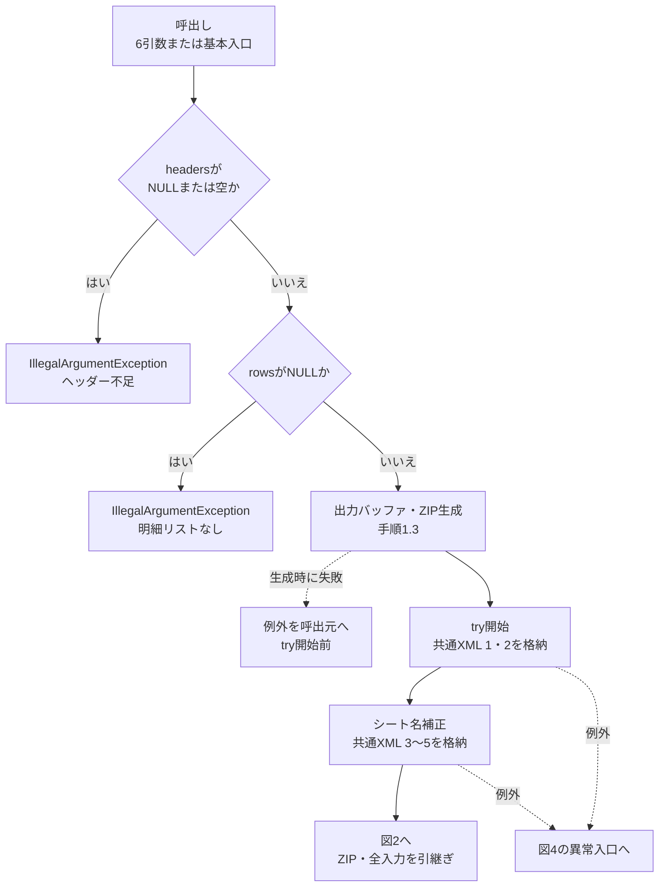
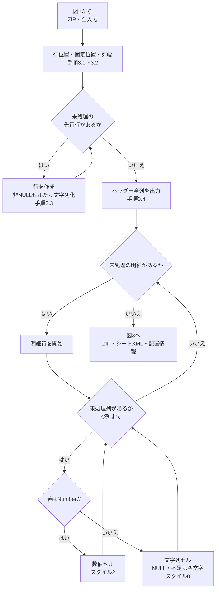
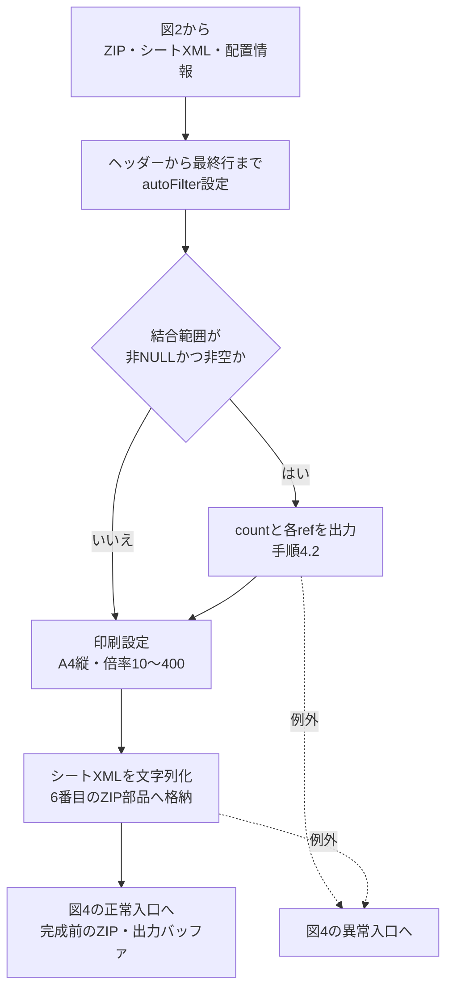
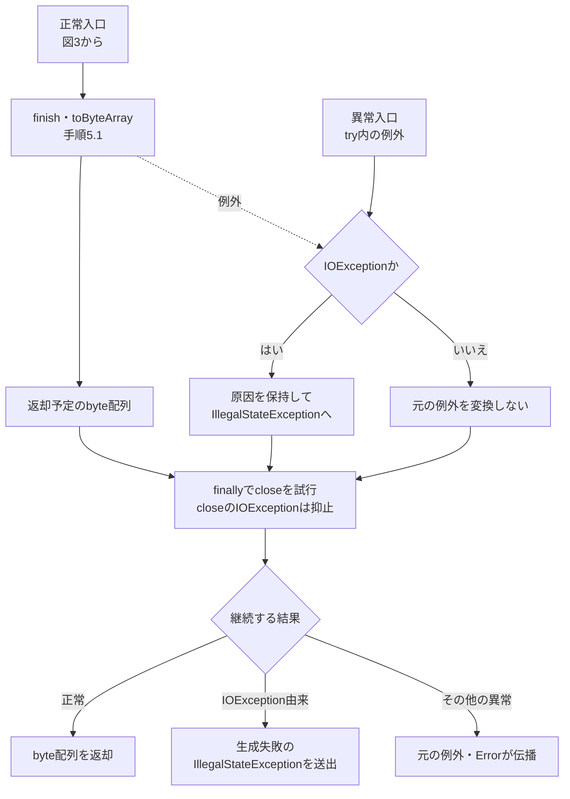

<!-- spec-meta: {"schema":"spec-md/1.0","documentId":"COM-150","version":"2.0","path":"共通/共通仕様書_COM-150_外部ライブラリを使わず、単1シートの Open XML (.xlsx) を生成する.md","sheets":[{"heading":"概要","kind":"GRID","sheet":"概要"},{"heading":"項目一覧","kind":"LIST","sheet":"項目一覧","key":["No"]},{"heading":"イベント仕様","kind":"GRID","sheet":"イベント仕様"},{"heading":"補足説明","kind":"GRID","sheet":"補足説明"}]} -->
# 外部ライブラリを使わず、単1シートの Open XML (.xlsx) を生成する

| 属性 | 内容 |
| --- | --- |
| 文書種別 | 共通仕様書 |
| システム名 | 年金自動受取予約管理システム |
| 共通/文書ID | COM-150 |
| 版 | 2.0 |
| 解析対象 | OpenXmlWorkbookWriter、店舗別出力サービス、日次・月次出力サービス |
| 基準日 | 2026-10-15 |

## 概要

`OpenXmlWorkbookWriter`は、呼出元が用意した列見出しと行配列から、単一シートのOpen XML形式Excelファイルを生成する。Java標準の文字列処理、`ByteArrayOutputStream`、`ZipOutputStream`を使用し、完成したファイルを`byte[]`で返す。生成器自身はDB、HTTP応答、ファイルシステムを扱わない。

店舗別出力では予約の一覧を18列へ移し、日次・月次出力では選択区分ごとの明細と帳票上部の情報を組み立ててから本生成器を呼ぶ。抽出条件の判定、日付・電話番号・担当者の表示用変換、ファイル名、複数ファイルの取りまとめ、ダウンロード送信は呼出側の責務である。本書に画面固有の入力コントロールはない。

### 呼出入口

```java
public static byte[] buildWorkbook(
    String sheetName, List<String> headers, List<Object[]> rows)

public static byte[] buildWorkbook(
    String sheetName, List<String> headers, List<Object[]> rows,
    List<Object[]> leadingRows, List<String> mergedRanges, int printScale)
```

基本入口は拡張入口へ`leadingRows=null`、`mergedRanges=null`、`printScale=100`を渡す。拡張入口はヘッダーより前の行、結合範囲、印刷倍率を追加指定する。ヘッダー列数がシートの列構成を決め、先行行・明細の配列長によって列を増やすことはない。

| 利用元 | 通常の呼出経路 | 生成器へ渡す構成 |
| --- | --- | --- |
| 店舗別出力 | `ExcelExportAction` → `PensionExcelExportService.buildByBranch(int)` | シート名「年金ﾃﾞｰﾀ」、18列、先行行・結合なし、倍率100％ |
| 日次・月次の新規分 | `BatchDailyAction`／`BatchMonthlyAction` → `BatchRunAction` → `PensionBatchExportService.build` | シート名「新規分データ」、17列、先行7行、結合5件、倍率70％ |
| 日次・月次の変更分・削除分 | 同じ日次・月次経路で区分ごとに呼出し | 「変更分データ」／「削除分データ」、20列、先行7行、結合5件、倍率60％ |

通常画面の送信先は`Action.do`で、`FUNCTION_ID=nenkin`を用いる。店舗別は`VIEW_ID=Excel`・`COMMAND_ID=Export`、日次・月次は`VIEW_ID=Batch`・`COMMAND_ID=Daily`または`Monthly`に対応する。本生成器はこれらのHTTP入口として直接公開されるクラスではなく、サービス内部から利用される。

## 項目一覧

| No | グループ | 項目名 | 種類 | 入出力 | DB連携項目 | 候補取得元 | 必須 | 形式・桁 | 説明 |
| --- | --- | --- | --- | --- | --- | --- | --- | --- | --- |
| 1 | 共通入力 | シート名 | 引数 `sheetName` | I | ‐ | ‐ | NULL・空欄可 | `String`。置換後31 UTF-16コード単位まで | NULLまたはtrim後空欄はSheet1。前後のtrim、禁止記号の置換、切詰めを順に行う。 |
| 2 | 共通入力 | 列見出し | 引数 `headers` | I | ‐（抽出列との対応は呼出元） | ‐ | リストは必須、1列以上 | `List<String>`。要素長・最大列数の検査なし | 件数が出力列数となる。各要素は文字列セルにするが、NULL要素は先行する列幅算定で例外となり得る。 |
| 3 | 共通入力 | 明細行 | 引数 `rows` | I | ‐（抽出済みの行配列） | ‐ | リストは必須、0行可 | `List<Object[]>`。最大行数・セル文字数の検査なし | NULL行・不足列・NULL要素は空文字セル。余剰列は出力しない。Number要素だけ数値セルとなる。 |
| 4 | 拡張入力 | ヘッダー前の先行行 | 引数 `leadingRows` | I | ‐ | ‐ | NULL・0行可 | `List<Object[]>`。要素数が先行行数 | NULL配列も1行として数える。ヘッダー列数以内の非NULL要素だけ文字列セルにする。基本入口はNULL。 |
| 5 | 拡張入力 | 結合範囲 | 引数 `mergedRanges` | I | ‐ | ‐ | NULL・0件可 | `List<String>`。例：`D1:M3` | リスト順に結合指定を出力する。範囲構文・重なり・境界を検査せず、NULL要素は例外となり得る。基本入口はNULL。 |
| 6 | 拡張入力 | 印刷倍率 | 引数 `printScale` | I | ‐ | ‐ | 拡張入口で指定 | `int`。出力時に10～400へ補正 | 単位は％。基本入口は100。用紙方向・列幅の変更には使わない。 |
| 7 | 共通出力 | Excelファイル内容 | 戻り値 | O | ‐（DB保存なし） | ‐ | 正常終了時に返却 | `byte[]`。単一シート.xlsxのZIP内容 | finish後にメモリから配列化する。ファイル名・Content-Type・明細件数はこの戻り値に含めない。 |

## イベント仕様

### 単一シートWorkbook生成

#### 処理概要

呼出元が入力リストを渡した時点で生成を開始し、入力検査、共通XML、シートXML、ZIPの完成の順に処理する。`headers.size()`をC、`leadingRows`がNULLなら0、それ以外はその件数をL、`rows.size()`をNとする。ヘッダーはL+1行目、最初の明細はL+2行目、最終行はL+1+N行目となる。

列名は1始まりの番号をA～Z、AA以降へ変換する。使用範囲`dimension`は`A1:最終列最終行`であり、空の先行行も行番号へ含める。N=0でもヘッダーを含むシートを生成できる。実際の二サービスは検索0件時に生成器を呼ばないため、画面からの0件結果とは区別する。

#### 処理手順

**1. 入力を検査し、生成用のメモリを確保する。**

　**1.1.** `headers`がNULLまたは空なら、`IllegalArgumentException`「ヘッダーは1列以上必要です。」を送出する。

　**1.2.** 1.1を通過後、`rows`がNULLなら、`IllegalArgumentException`「明細リストはnullにできません。」を送出する。明細0行は拒否しない。

　**1.3.** `ByteArrayOutputStream`と、それを出力先とする`ZipOutputStream`を作る。両者の生成は後続の`try`より前にある。ここまでの失敗は、生成器のIOException変換およびfinallyによるcloseの対象に入らない。

**2. Workbookの共通部品を順に格納する。**

　**2.1.** `[Content_Types].xml`、`_rels/.rels`を作成し、ZIPへ書く。

　**2.2.** シート名はNULLまたはtrim後空欄なら`Sheet1`、それ以外はtrim結果を使用する。バックスラッシュ、スラッシュ、疑問符、アスタリスク、左右角括弧、コロンをアンダースコアへ置換する。その後、`String.length()`が31を超える場合に`substring(0,31)`で切り詰める。

　**2.3.** 2.2の名前をXMLエスケープして`xl/workbook.xml`へ埋め込み、続いて`xl/_rels/workbook.xml.rels`、`xl/styles.xml`を格納する。シートは`sheetId=1`の1件である。

**3. シートの行・セルを組み立てる。**

　**3.1.** L・C・Nから使用範囲と固定位置を決める。`ySplit`はL+1、`topLeftCell`は`A`列のL+2行目、`activePane=bottomLeft`、`state=frozen`とする。

　**3.2.** 各列について、ヘッダーの表示長+2と先頭最大100明細の同列値の表示長+2の最大値を求め、5～40へ補正する。`customWidth=1`を付けて列幅を出力する。表示長の数え方は補足説明に定める。

　**3.3.** 先行行をリスト順に作る。NULL配列や全要素NULLでも行要素を作るが、セルはヘッダー列数以内の非NULL要素に限る。値はNumberを含め`String.valueOf`で文字列化する。1行目は高さ28・スタイル3、それ以降の先行行のセルはスタイル4とする。2行目以降の先行行には明示的な行高を設定しない。

　**3.4.** ヘッダーをL+1行目へ、高さ45で作る。全列を文字列セル・スタイル1として出力する。

　**3.5.** 明細をリスト順に作り、各行でC列分のセルを出力する。NULL行、配列の不足位置、NULL要素は空文字の文字列セル・スタイル0とする。非NULLのNumberは数値セル・スタイル2、それ以外は`String.valueOf`による文字列セル・スタイル0とする。C列を超える要素は無視する。

**4. 表の操作・印刷情報を付け、シートを格納する。**

　**4.1.** `autoFilter`をヘッダー行のA列から最終列・最終行まで設定する。N=0でもフィルター要素を作る。先行行はフィルター範囲へ含めない。

　**4.2.** `mergedRanges`が非NULLかつ非空の場合だけ、件数を`mergeCells`の`count`へ設定する。各文字列をXMLエスケープして`mergeCell`の`ref`へリスト順に出力する。値の移送・削除は行わない。

　**4.3.** 水平中央、A4縦、倍率、余白を設定する。倍率は入力値を10～400へ補正する。用紙幅に合わせる自動収容、列数による用紙方向変更、印刷タイトル行の定義は行わない。

　**4.4.** 組み立てたシートXML全体を文字列化し、`xl/worksheets/sheet1.xml`としてZIPへ書く。

**5. 完成した内容を返し、ZIPを閉じる。**

　**5.1.** 全6エントリーの格納後に`zip.finish()`を呼び、`output.toByteArray()`を戻り値とする。

　**5.2.** try内の`IOException`は原因を保持した`IllegalStateException`「Excelファイルの生成に失敗しました。」へ変換する。他の実行時例外やErrorを同じ例外へ変換するcatchはない。

　**5.3.** tryへ入った処理は、正常・異常ともfinallyで`zip.close()`を試みる。このcloseの`IOException`だけは抑止する。失敗時に空の成功ファイルや途中の配列を返す処理はない。

#### 処理フロー

図は手順順の四つのサブフローに分ける。図2・3の途中、または図1のtry内で発生した例外は、生成途中のZIPを保持して図4の異常入口へ進む。図1の入力拒否・ストリーム生成時の失敗は図4へ合流しない。

**1. 入力検査・共通XML**



共通XMLの番号は補足説明「xlsxの内部構成」の格納順に対応する。入口の二つの拒否メッセージは手順1.1・1.2のとおりである。

**2. 行・セルの組立て**



先行行ではNumberも文字列にする。明細では実際の要素型で分岐するため、数字だけのStringも文字列セルとなる。図2内の例外は図4へ渡し、後続のフィルター・印刷設定へは進まない。

**3. フィルター・結合・印刷情報**



図3の他の処理中に生じた例外も図4の異常入口へ渡す。結合の有無によって、印刷倍率・戻り値の契約は変わらない。

**4. ZIP完成・例外変換・close**



図4の「継続する結果」はreturn／throwとfinallyの関係を表す説明上の区分である。closeのIOExceptionを正常結果や別の生成失敗へ置き換えない。

#### SQL・テーブル関連（ER図）

本イベントはSQLを実行せず、テーブルを参照・更新しない。入力行はサービスが取得・変換済みのメモリ上の値であり、本生成器を対象とするER図はない。

店舗別出力の抽出元は予約本表、日次・月次の新規・変更分は現在の予約本表、削除分は削除明細である。性別等の名称はRepositoryの結合結果からモデルへ移され、本生成器へはStringとして渡る。コードの逆引き、候補取得、DB列のNULL可否判定を本生成器で行うことはない。

#### DB操作の詳細

生成器内のDB操作、commit、rollback、生成物保存は非該当である。保持領域は呼出元の行リスト、シートXMLの`StringBuilder`と完成文字列、UTF-8変換配列、ZIP用メモリバッファ、返却用`byte[]`である。逐次送信用APIや一時ファイルは用いず、全体をメモリへ保持する。

日次・月次の呼出側には生成前の削除明細整理がある。この更新とWorkbook生成は同一トランザクションではない。整理がcommit済みの場合、その後の抽出・変換・生成失敗では取り消されない。生成器の非DB処理と、呼出側の更新確定を分けて扱う。

#### 結果・例外時の扱い

| 発生段階 | 条件・例外 | 生成器の結果 |
| --- | --- | --- |
| 入口検査 | headersがNULLまたは空、rowsがNULL | 手順1のIllegalArgumentException。ZIP生成を開始しない。 |
| ストリーム生成 | try開始前の生成時異常 | 本生成器のIOException変換・finallyを経由しない。 |
| シート組立て | ヘッダー要素がNULL | 列幅算定中の`displayLength`が`length()`を呼び、NullPointerExceptionとなり得る。ヘッダーセルのNULL→空文字変換には到達しない。 |
| 結合指定 | 結合範囲の要素がNULL | XMLエスケープの`replace`でNullPointerExceptionとなり得る。 |
| ZIP格納・完成 | try内のIOException | 原因付きIllegalStateExceptionへ変換し、finallyへ進む。 |
| try内のその他の異常 | 実行時例外・Error | 一律変換しない。finallyを経由して伝播する。 |
| finally | zip.closeのIOException | 抑止し、既存の正常結果または例外を維持する。 |
| 正常完了 | 全部品を格納し、finish・配列化が完了 | 完成した.xlsxのbyte配列を返す。ファイル名・件数・HTTP状態は呼出元が扱う。 |

生成器はセル数、セル文字数、Excelの最大行列数、結合範囲の整合性、数値表現を検証する仕組みを持たない。明示検査を通過したことから、任意の入力で正常終了する保証へ拡張しない。呼出元Actionごとの例外処理と送信境界は、補足説明「結果の取りまとめとHTTP応答」に示す。

## 補足説明

### セル型・文字列変換

| 入力位置・型 | セル形式 | 適用する変換 |
| --- | --- | --- |
| ヘッダー | `t="inlineStr"`、スタイル1 | 文字列用XML処理。列幅算定が先に行われる。 |
| 先行行の非NULL要素 | `t="inlineStr"`、1行目はスタイル3、以降4 | Numberを含めString.valueOf後、文字列用XML処理。NULL要素はセルを作らない。 |
| 明細のNumber | `v`要素、スタイル2。`t`属性なし | `String.format(Locale.ROOT, "%s", value)`。文字列用XML処理は通さない。 |
| 明細のNULL・不足列・NULL行 | `t="inlineStr"`、スタイル0 | 空文字のセルを作る。 |
| 明細のその他の型 | `t="inlineStr"`、スタイル0 | String.valueOf後、文字列用XML処理。 |

数値セルには丸め、桁制限、有限値検査、Excelの数値精度への補正がない。数値を表すStringをNumberへ変換することもない。日付シリアル値、日付専用書式、boolean専用型、数式要素は生成しない。先頭が「=」のStringもinlineStrであり、本生成器は数式へ変換しない。

文字列セルは、まずコードポイント単位でXMLに使用する文字を選別する。保持する文字はU+0009・U+000A・U+000D、U+0020～U+D7FF、U+E000～U+FFFD、U+10000～U+10FFFFであり、それ以外は除去する。補助文字はコードポイント単位で保持し、孤立サロゲートは除去する。NULLは空文字として扱う。

選別後に、`&`、`<`、`>`、二重引用符、単一引用符をそれぞれ`&amp;`、`&lt;`、`&gt;`、`&quot;`、`&apos;`へ置換する。選別後の文字列が非空で、先頭または末尾のcharが`Character.isWhitespace`に該当する場合だけ、`t`要素へ`xml:space="preserve"`を付ける。trim・文字数切詰めは行わず、ヘッダー中の改行も残す。

シート名と結合範囲にはXMLエスケープを適用するが、セル本文の文字選別は適用しない。シート名の31という制限はUTF-16コード単位数であり、31コードポイントや31バイトではない。補助文字の途中で切る可能性や、制御文字が残る経路を排除する実装はない。結合範囲も構文・重複・重なり・シート内外を解析せず、結合先の値を整理しない。

### 列幅・表示固定・印刷スタイル

表示長はコードポイントごとにU+007F以下を1、それ以外を2として加算する近似値である。実フォントの幅やバイト数ではない。改行も行分割せず1として数え、XML不適合文字の除去前の値で算定する。先行行と101件目以降の明細は算定対象にしない。幅5～40の指定はExcelの自動調整要求ではなく、固定の`customWidth`である。

先行行なしでは1行目、先行7行では1～8行目を固定する。固定表示と印刷時の繰返しヘッダーは別機能であり、印刷タイトル行を登録する定義はない。フィルターは先行行を除いたヘッダー・明細範囲へ設定する。

| スタイル番号 | 主な使用位置 | メイリオのサイズ・太字 | 罫線・塗り | 配置 |
| --- | --- | --- | --- | --- |
| 0 | 明細文字列・空文字 | 10、通常 | 細線罫線、塗りなし | 明示的な配置・折返し指定なし |
| 1 | ヘッダー | 10、太字 | 細線罫線、`FFFFFF96`の塗り | 水平・垂直中央、折返しあり |
| 2 | 明細数値 | 10、通常 | 細線罫線、塗りなし | 右寄せ、上寄せ |
| 3 | 先行1行目のセル | 22、太字 | 罫線なし、塗りなし | 水平・垂直中央 |
| 4 | 先行2行目以降のセル | 16、通常 | 罫線なし、塗りなし | 水平・垂直中央 |

全スタイルの`numFmtId`は0であり、日付書式・数値のゼロ埋め書式を定義しない。

| 印刷属性 | 出力値 |
| --- | --- |
| 用紙・方向 | `paperSize=9`（A4）、`orientation=portrait`（縦） |
| 水平方向の位置 | `horizontalCentered=1` |
| 倍率 | 入力値を10～400％へ補正。店舗別100％、日次・月次の新規70％、変更・削除60％ |
| 左右余白 | `left=0`、`right=0` |
| 上下余白 | `top=0.3937`、`bottom=0.3937` |
| ヘッダー・フッター余白 | `header=0.1181`、`footer=0.1181` |

### xlsxの内部構成

| 格納順 | ZIPエントリー | 内容・参照関係 |
| --- | --- | --- |
| 1 | `[Content_Types].xml` | rels・xmlの既定Content-Typeと、workbook・worksheet・stylesのContent-Typeを宣言する。 |
| 2 | `_rels/.rels` | `rId1`から`xl/workbook.xml`を参照する。 |
| 3 | `xl/workbook.xml` | 正規化したシート名、`sheetId=1`、`r:id=rId1`を持つシートを1件定義する。 |
| 4 | `xl/_rels/workbook.xml.rels` | `rId1`から`worksheets/sheet1.xml`、`rId2`から`styles.xml`を参照する。 |
| 5 | `xl/styles.xml` | 4フォント、塗り、罫線、5セルスタイル等を定義する。 |
| 6 | `xl/worksheets/sheet1.xml` | 使用範囲、固定位置、列幅、行・セル、フィルター、結合、印刷情報を格納する。 |

各XMLはUTF-8のXML宣言を持ち、文字列全体をUTF-8バイト配列へ変換して格納する。各エントリーには`setTime(0L)`を指定し、`putNextEntry`、`write`、`closeEntry`の順で処理する。sharedStrings、画像、マクロ、追加シートは生成しない。エントリー時刻の固定だけから、異なるJDK等でもファイル全体が同一バイト列になる保証は導かない。

### 呼出元が用意する明細

下表は同じモデル値の使用先をまとめたものである。見出し中の`<br>`は実際の改行位置を示す。列記号は出力先を表し、「‐」の項目はその出力構成に含めない。

| モデル値・Java型 | 店舗別の列・見出し | 新規分の列・見出し | 変更・削除分の列・見出し | 生成器へ渡す値 |
| --- | --- | --- | --- | --- |
| 出力順連番 `Integer` | ‐ | A No | A No | 区分ごとの追加ソート後に1から付与。数値セル。 |
| `branchNo: Integer` | ‐ | O 店番 | B 店番 | 非NULL時は数値セル。 |
| `customerNo: Integer` | A 顧客番号 | P 顧客番号 | C 顧客番号 | 非NULL時は数値セル。 |
| `staffCode: Integer` | B 担<br>当 | Q 担<br>当 | R 担<br>当 | 店舗別はInteger。日次・月次は最低2桁のString。 |
| `customerName: String` | C 顧客氏名 | D 漢字氏名 | D 漢字氏名 | モデルの文字列。 |
| `kanaName: String` | D ふりがな | C カナ氏名 | E カナ氏名 | モデルの文字列。 |
| `gender: String` | E 性<br>別 | E 性<br>別 | F 性<br>別 | 結合先の性別名称。 |
| `address: String` | F 住所 | F 住所 | G 住所 | モデルの文字列。 |
| `phoneNumber: String` | G 電話番号 | H 電話番号 | H 電話番号 | Repositoryで表示用補正済みの文字列。 |
| `birthDate: String` | H 生年月日 | G 生年月日 | I 生年月日 | 店舗別は取得文字列、日次・月次は和暦文字列。 |
| `pensionType: String` | I 年金種類 | I 年金<br>種類 | J 年金<br>種類 | 結合先の年金種類名称。 |
| `claimStatus: String` | J 裁定<br>請求 | ‐ | K 裁定<br>請求 | 結合先の裁定請求名称。 |
| `hasBenefit: String` | K 受給<br>有無 | ‐ | P 受給<br>有無 | 結合先の受給有無名称。 |
| `claimScheduledDate: String` | L 請求予定日 | K 請求予定日 | L 請求予定日 | 店舗別は取得文字列、日次・月次は和暦文字列。 |
| `plannedAge: Integer` | M 予定<br>年齢 | J 予定<br>年齢 | M 予定<br>年齢 | 非NULL時は数値セル。 |
| `spouseName: String` | N 配偶者名 | M 配偶者名 | N 配偶者名 | モデルの文字列。 |
| `spouseBirthDate: String` | O 配偶者<br>生年月日 | N 配偶者<br>生年月日 | O 配偶者<br>生年月日 | 店舗別は取得文字列、日次・月次は和暦文字列。 |
| `reservationRequestDate: String` | P 予約徴求日 | B 予約徴求日 | Q 予約徴求日 | 店舗別は取得文字列、日次・月次は和暦文字列。 |
| `notes: String` | Q 備考 | L 備考 | S 備考 | モデルの文字列。生成器による業務長検査はない。 |
| `sixMonthCheck: boolean` | R ６ヶ月先<br>確認 | ‐ | T ６ヶ月<br>先確認 | trueなら「確」、falseなら空文字。boolean値を直接渡さない。 |

名称は予約側コードと各コード表のLEFT JOINから取得する。結合が成立しない名称はモデル設定時に空文字となる。表示文字列であることから、参照先保存列のNOT NULLや業務上限を推定しない。

電話番号はDBの取得値から数字を抽出してASCII数字へ寄せ、先頭0を整理した後、9桁または10桁で0始まりでない場合に0を一つ前置する。両出力とも結果はStringであり、数値セルへの変換で先頭0を失う経路ではない。

店舗別の日付はRepositoryの`getString`結果を追加の書式変換なしで渡す。日次・月次の日付はNULLまたはtrim後空欄なら空文字、それ以外は`DateUtil.toAccessWareki`で`R8.06.11`のような形式へ変換する。形式不正や和暦変換の対象外の日付は、行変換・上部レイアウト作成時にIllegalArgumentExceptionとなり、生成器へ到達しない場合がある。

日次・月次の担当者コードはNULLなら空文字、それ以外は`String.format(Locale.ROOT, "%02d", value)`による最低2桁のStringとなる。3桁以上は切り捨てない。店舗別はIntegerを渡すため、同じ担当者コードでもセル型と表示用ゼロ埋めが異なる。

### 店舗別出力との接続

Actionは職員確認後、`BRANCH_NO`をNULL→空文字・trimしたStringとしてBeanへ保持し、正のIntegerへ変換する。空欄または変換結果NULLを先に拒否し、続いて3文字超またはASCII数字以外を拒否する。ブラウザーの`excelBranch`の`maxlength=3`とは別のサーバー検査である。店名照会で名称が得られなくても、対象予約の検索へ進む。

`buildByBranch(int)`は画面用の店番検査を繰り返さず、受け取ったintで検索する。結果は請求予定日降順、担当者コード、顧客番号の順で行配列へ移す。0件なら生成器を呼ばず、ファイル名空文字・空配列・件数0を返す。Actionは店番・取得済み店名を保持し、「入力された店番には対象データがありません。」としてExcel画面へ戻す。

非0件では本生成器の基本入口を呼ぶ。N件の場合、ヘッダーは1行目、明細は2行目から、使用範囲とフィルターは`A1:R(N+1)`となる。ファイル名は`年金データ_店番_yyyyMMdd.xlsx`で、店番は最低3文字まで0を前置する。サービス自体に3文字超を切り捨てる処理はない。日付部分は`DateUtil.todayIso()`からハイフンを除いて作る。

### 日次・月次出力との接続

Actionは職員確認後、職員番号・日付・削除基準日をtrimしたString、出力区分をbooleanとしてBeanへ保持する。POST・CSRF照合、いずれかの区分選択、職員番号が空欄または8文字以内のASCII数字であることを順に確認し、通過後に要求DTOを作る。日次と月次のモードはActionが指定する。これらは抽出制御値であり、生成器の明細列へそのまま移す入力ではない。

サービスは要求NULL、全区分未選択、モードNULLを拒否する。日次は対象日を開始日・終了日に使用し、月次は両端を解析して開始日が終了日より後なら拒否する。職員番号空欄は全職員、それ以外は整数の更新者指定となる。サービス単体では大文字小文字を問わないALLも全職員にするが、通常Actionの数字検査からこの文字列は渡らない。

必須日付の検査はtrim後の空欄に対して行い、その後のNFKC正規化で空になった値を再検査しない。全角空白だけの値等がこの経路を通ると、日次は日付条件なし、月次は両端が空なら日付条件なし、開始だけ空なら終了側の上限条件だけとなり得る。開始が非空で終了が空なら前後比較で拒否する。これらの値を生成器が再検査することはない。

期間・職員番号の解析後、削除基準日のtrim結果が非空なら整理処理を呼ぶ。整理側で正規化後に空なら0件を返して更新しない。それ以外は基準日以前の削除明細を削除し、独立してcommitする。後続出力と一体でrollbackされる処理ではない。

選択区分は新規、変更、削除の順に処理する。新規・変更は現在の予約本表の変更区分で抽出し、削除は削除明細を抽出する。職員番号による条件は明細の担当者コードではなく更新者である。取得後は店番、顧客番号、検索時の連番auditIdの昇順へ並べ替え、店番・顧客番号のNULLは先に置く。ExcelのNoはこの並べ替え後に区分ごとに1から付け直す。auditIdは永続監査IDではなく、新規・変更分も完全な変更履歴を復元する取得ではない。

検索0件の区分はWorkbookを作らずメッセージだけを追加する。非0件の区分は下表の上部レイアウトを組み立て、本生成器の拡張入口を呼ぶ。どの区分も先行7行、ヘッダー8行目、明細9行目以降となる。

| 属性 | 新規分 | 変更分・削除分 |
| --- | --- | --- |
| 列数・最終列 | 17列・Q列 | 20列・T列 |
| タイトル配置 | D1 | E1 |
| 「処理日」配置 | D5 | E5 |
| 期間表示配置 | F5 | G5 |
| 「職員番号」配置 | J5 | L5 |
| 職員表示値配置 | L5 | N5 |
| タイトル結合 | D1:M3 | E1:P3 |
| 処理日ラベル結合 | D5:E6 | E5:F6 |
| 期間結合・日次 | F5:H6 | G5:H6 |
| 期間結合・月次 | F5:I6 | G5:I6 |
| 職員番号ラベル結合 | J5:K6 | L5:M6 |
| 職員表示値結合 | L5:M6 | N5:P6 |
| 印刷倍率 | 70％ | 60％ |
| 使用範囲・N件 | A1:Q(N+8) | A1:T(N+8) |
| フィルター・N件 | A8:Q(N+8) | A8:T(N+8) |

7行の先行配列は各出力の列数と同じ長さで作り、表の位置以外はNULLとする。日次の期間表示は開始日の和暦、月次は開始日の和暦＋「～」＋終了日の和暦である。職員表示は要求文字列のtrim値を用い、空欄時だけALLとする。検索用整数へ変換した際に先頭0が消えても、上部表示には元の先頭0が残る。

シート名は「新規分データ」「変更分データ」「削除分データ」、タイトルは「年金予約【区分名】データ明細リスト」とする。ファイル名は`年金予約【区分名】データ明細リスト（対象範囲＋処理周期）.xlsx`で、対象範囲は「担当者別」または「全担当者」、処理周期は「日次」または「月次」となる。

区分結果の`queryName`はサービス内で作る識別情報である。Q番号は日次指定職員10、日次全職員40、月次指定職員70、月次全職員100を基数とし、新規+0、変更+10、削除+20を加える。100未満は数字の前に0を付ける。これはRepositoryへ保存クエリー名を渡す処理ではない。

### 結果の取りまとめとHTTP応答

店舗別結果はファイル名、内容、明細件数を保持する。日次・月次結果は選択区分すべての処理後に作り、次の分岐で名前・Content-Type・内容を決める。どの分岐でも生成ファイル情報のリスト`files`と0件メッセージ`messages`を引き継ぐ。filesにはQ番号を含む識別情報、ファイル名、区分表示名、明細件数を保持する。

| 生成Workbook数 | 結果ファイル名 | Content-Type | 内容と後続 |
| --- | --- | --- | --- |
| 0 | 空文字 | Excel用 | 空byte配列。Actionがmessagesを空白で連結してBatch画面へ戻す。 |
| 1 | 生成した.xlsxの名前 | Excel用 | そのWorkbook。別区分の0件メッセージを.xlsxへ埋め込む処理はなく、Actionもメッセージ再表示へ進まない。 |
| 2以上 | 年金予約データ明細リスト（日次）.zip、または（月次）.zip | `application/zip` | 生成済み.xlsxを新規・変更・削除の処理順に格納した外側ZIP。 |

Excel用Content-Typeは`application/vnd.openxmlformats-officedocument.spreadsheetml.sheet`である。複数ファイルの外側ZIPは、個々の.xlsx内部にある6エントリーのZIPとは別階層である。messagesがある場合だけ「出力結果.txt」を追加し、各メッセージへCRLFを付けたUTF-8内容にする。外側ZIPもメモリ生成で、エントリー時刻を0Lにし、IOExceptionは原因付きIllegalStateException「ZIPファイルの生成に失敗しました。」へ変換する。

日次・月次は区分ごとの例外を捕捉して処理を続けない。後続区分の抽出・変換・生成で失敗した場合、先に生成したメモリ内のWorkbookだけを正常結果として返すことはない。

結果DTOはbyte配列を格納時・取得時にcloneする。日次・月次のfilesとmessagesは別リストへコピーして変更不可にする。`hasContent`は配列長が正であることだけを判定し、内容の妥当性や利用者の受領を判定する機能ではない。

Actionは完成した内容を`writeDownload`へ渡す。この処理はファイル名をUTF-8でURLエンコードして空白を%20へ変え、response.reset、Content-Type、attachmentのContent-Disposition、配列長のContent-Lengthを設定した後、出力ストリームへwrite・flushする。正常終了時のAction戻り値`CSV`は共通Servletのforward抑止値であり、CSV形式を生成したという意味ではない。

| 呼出経路 | 例外の扱い | 応答・状態の境界 |
| --- | --- | --- |
| 店舗別Action | 個別catchなし。検索・生成・送信のExceptionは共通Servletへ伝播する。 | Servletが共通エラー情報と戻り先を設定する。生成成功だけでは送信成功にならない。 |
| 日次・月次Actionのtry内 | IllegalArgumentExceptionを先に捕捉し、メッセージと入力Beanを保持してBatch画面へ戻す。 | サービスの入力・日付変換拒否等が対象。整理が既にcommit済みならその状態は残る。 |
| 日次・月次Actionのその他のException | DBアクセス例外、生成失敗のIllegalStateException、送信IOException等は共通Servletへ伝播する。 | 先行するIllegalArgumentException用catchの処理をこの経路へ含めない。 |
| 共通ServletのAction実行catch | Action.perform全体から伝播したExceptionを共通エラー化する。Errorは対象外。 | 後続のアクセス記録とJSPへのforwardはこのcatchの外にある。 |
| 再表示・ダウンロード途中以降 | JSP描画や送信済み応答を生成器から巻き戻す処理はない。 | 共通エラー先の設定だけでは、送信済み内容の取消や最終HTTP応答を確定できない。 |

Batch画面への再表示では保持した入力値を用い、日付表示用変換で解析できない値は元文字列を返してからHTMLエスケープする。このforward・JSP処理はAction実行catchの外であり、再表示先の決定を描画完了と同一視しない。

### 関連文書

以下は計画上の対応先である。パスは文書ルートからの相対パスを示し、各文書の生成状態は未確認のため、生成済み成果物へのリンクとしては扱わない。

| 文書ID | 相対パス | 本書との対応 |
| --- | --- | --- |
| DET-SCR-015 | 詳細仕様書/詳細仕様書_SCR-015_EXCEL出力.md | 店舗別画面の入力・検索・出力操作 |
| DET-SCR-014 | 詳細仕様書/詳細仕様書_SCR-014_日次 _ 月次処理.md | 日次・月次の入力、整理更新、抽出、画面再表示 |
| OUTPUT-NENKIN | 共通/帳票一覧.md | 帳票・出力ファイル全体の形式と命名 |
| COM-111 | 共通/共通仕様書_COM-111_年金業務共通処理.md | 職員確認、変換、ダウンロード送信 |
| COM-012 | 共通/共通仕様書_COM-012_共通コントロールサーブレット.md | Action呼出し、共通エラー、アクセス記録、forward |
| DB-OPS | 共通/DB仕様書/DB操作仕様書.md | 呼出元Repositoryの検索・削除整理・JDBC契約 |
| DATA-CONTRACTS | 共通/データオブジェクト定義書.md | 出力要求、モデル、結果DTOの保持・型・コピー |
