<!-- spec-meta: {"schema":"spec-md/1.0","documentId":"COM-151","version":"2.0","path":"共通/共通仕様書_COM-151_画面共通入力・通信制御.md","sheets":[{"heading":"概要","kind":"GRID","sheet":"概要"},{"heading":"項目一覧","kind":"LIST","sheet":"項目一覧","key":["No"]},{"heading":"イベント仕様","kind":"GRID","sheet":"イベント仕様"},{"heading":"補足説明","kind":"GRID","sheet":"補足説明"}]} -->
# 画面共通入力・通信制御

| 文書属性 | 内容 |
| --- | --- |
| 文書種別 | 共通仕様書 |
| システム名 | 年金自動受取予約管理システム |
| 共通/文書ID | COM-151 |
| 版 | 2.0 |
| 解析対象 | 数字入力・日付入力の共通JavaScript、共有CSS、予約・参照・Excel・日次月次・印刷JSP、および接続するJavaの要求値・日付・表示処理 |
| 基準日 | 2026-10-15 |

## 概要

本書は、年金画面で共用する入力補助、カレンダー、参照iframeとの通信、および表示制御を定義する。ブラウザー内の表示値加工、フォームの送信値、Javaが取り込んだ値、DBへ渡す値を区別し、確認ダイアログや入力ロックが保証する範囲を示す。

数字入力補助は、実際に`data-digits-only`を持つ入力へ接続する。電話番号やフリガナを含む全入力へ適用する仕組みではない。日付入力は表示モードに従って整形するが、対象JSPでは別のISO日付hiddenへ同期する属性を使用せず、表示入力自身のnameで送信する。

店番・担当者・顧客の参照は、一時フォームをiframeへPOSTし、選択結果をpostMessageで親へ返す構成である。予約画面とExcel画面の開閉処理は別実装であり、app.jsの汎用モーダルとは接続していない。送信後は共通Servletの認証等に加え、各Actionの先頭で年金職員を確認する。拒否、入力再表示、業務処理例外、描画例外を同じ結果にまとめない。

### 適用先と責務

| 適用先 | 使用する共通制御 | 画面固有の制御 |
| --- | --- | --- |
| Pension.jsp | 数字入力、四つの日付入力、共有CSS | 登録・削除確認、キー変更時のLoad、参照通信、予定年齢計算、完了案内 |
| Lookup.jsp | 絞込み店番の数字入力、共有CSS | 検索、条件クリア、ページ操作、選択結果の返却 |
| Excel.jsp | 出力店番の数字入力、共有CSS | 店番参照、選択結果の移送、出力、戻る |
| Batch.jsp | 職員番号の数字入力、三つの日付入力、共有CSS | Daily・Monthlyの送信、出力条件の保持 |
| Report.jsp | 店番自・店番至の数字入力、共有CSS | 店舗条件の活性切替、プレビュー、ブラウザー印刷 |
| Java側 | DateUtil、HtmlUtil、要求値変換 | 受信値検査、ISO正規化、表示変換、DB・出力処理への引渡し |

### 画面要求の入口

以下は稼働画面の送信契約である。通常フォームと参照起動用一時フォームは、送信先を`{contextPath}/Action.do`、methodをPOST、文字コード指定をWindows-31Jとする。FUNCTION_IDはnenkinである。

| 操作 | VIEW_ID | COMMAND_ID | 表示・応答先 |
| --- | --- | --- | --- |
| 予約の登録・削除・読込み・クリア | Pension | Save・Delete・Load・Clear | 主画面の要求として送信 |
| 参照を開く | Lookup | View | target=lookupFrameの一時フォーム |
| 参照検索・ページ・条件クリア | Lookup | Search | 参照iframe内のフォーム |
| 店舗別Excel出力 | Excel | Export | 主画面の要求。データありは直接ダウンロード |
| 日次・月次 | Batch | Daily・Monthly | 主画面の要求。内容に応じ再表示または直接ダウンロード |
| 印刷プレビュー | Report | Preview | 主画面に明細HTMLを表示 |
| 戻る | Menu | View | 各画面の同じフォームを使用 |

### 共通外枠と参照付き入力の静的投影

Excel初期画面を例に、実DOMのヘッダー、見出し、店番入力、名称表示、ボタン、参照枠を示す。これは実画面撮影ではない。送信先は上の入口表に保持し、投影HTMLにはaction・formaction・スクリプト・イベントハンドラーを設けない。投影専用のinert属性でフォーム内操作を停止し、出力ボタンもtype=buttonにする。このinertは稼働画面の入力ロック条件を表さない。参照枠は初期状態のhiddenを保持し、原画面のiframeを通常のdivへ置き換える。元要素の種類とname・titleは非実行のdata属性に保持する。

<!DOCTYPE html>
<html lang="ja">
<head>
<meta charset="UTF-8">
<meta name="viewport" content="width=device-width, initial-scale=1">
<title>EXCEL出力</title>
<style>
:root{--bg:#edf1f4;--surface:#ffffff;--line:#b8c2cc;--text:#18212a;--muted:#566370;--nav:#16324a;--nav-text:#f4f8fb;--primary:#0f6b5f;--primary-dark:#0a5148;--button:#e8edf1;--button-border:#7b8792;--focus:#1a75bb;--work-screen-width:1180px}
*,*::before,*::after{box-sizing:border-box}
[hidden]{display:none!important}
html{min-height:100%}
button,input{margin:0;font:inherit}
button,[type="button"]{cursor:pointer}
body{min-height:100vh;margin:0;color:var(--text);background:var(--bg);font-family:'Yu Gothic UI','Meiryo','Segoe UI',sans-serif}
.app-shell{width:100%;max-width:1440px;margin-inline:auto}
.app-nav{display:flex;min-height:48px;align-items:center;justify-content:space-between;gap:12px;padding:7px 18px;color:var(--nav-text);background:var(--nav);border-bottom:1px solid #0c2236}
.app-nav__title{color:var(--nav-text);font-weight:800;line-height:1.25}
main.app-shell:not(.login-shell){padding:20px 18px 52px}
.surface{background:var(--surface);border:1px solid var(--line);border-radius:6px;box-shadow:0 1px 2px rgba(16,32,48,.08)}
.screen{padding:18px}
.compact-screen{max-width:640px;margin-top:28px}
.screen-header{display:flex;gap:16px;align-items:flex-start;justify-content:space-between;margin-bottom:18px;padding-bottom:12px;border-bottom:1px solid var(--line)}
h1{margin:0;font-size:1.45rem;font-weight:700;letter-spacing:0}
h2{margin:0 0 10px;font-size:1rem;font-weight:700;letter-spacing:0}
.access-form{margin:0}
.field-row{display:grid;grid-template-rows:auto 38px auto;gap:4px;min-width:0}
.field-row label{color:var(--muted);font-size:.88rem;font-weight:700}
.form-control{display:block;width:100%;padding:6px 10px;color:var(--text);background:#ffffff;border:1px solid #9da9b4;line-height:1.4;min-height:38px;border-radius:3px}
.form-control:focus,button:focus-visible{outline:2px solid var(--focus);outline-offset:1px}
.short-input{max-width:110px}
.input-reference{display:inline-grid;grid-template-columns:minmax(0,auto) auto minmax(7em,auto);gap:6px;align-items:center;justify-content:start;min-width:0}
.input-reference .form-control{width:100%}
.code-input{width:auto;box-sizing:border-box;font-variant-numeric:tabular-nums}
.input-reference .code-input{width:100%}
.code-name-display{min-width:7em;color:var(--text);font-size:.9rem;line-height:1.25;white-space:nowrap}
.lookup-button{display:inline-flex;min-height:38px;align-items:center;justify-content:center;padding:6px 10px;color:var(--text);background:#f4f6f8;border:1px solid var(--button-border);border-radius:3px;font-size:.88rem;font-weight:700;line-height:1.2}
.lookup-button:hover,.lookup-button:focus{background:#dce5eb;border-color:var(--focus)}
.access-button{display:inline-flex;min-height:42px;align-items:center;justify-content:center;padding:8px 18px;color:var(--text);background:var(--button);border:1px solid var(--button-border);border-radius:4px;font-weight:700;text-decoration:none;line-height:1.2}
.access-button:hover,.access-button:focus{color:var(--text);background:#dce5eb;border-color:var(--focus)}
.access-button.primary{color:#ffffff;background:var(--primary);border-color:var(--primary-dark)}
.access-button.primary:hover,.access-button.primary:focus{color:#ffffff;background:var(--primary-dark)}
.access-button.secondary{background:#f4f6f8}
.access-button.narrow{min-width:96px}
.button-row{display:flex;flex-wrap:wrap;gap:10px;align-items:center;margin-top:16px}
.lookup-modal{position:fixed;inset:0;z-index:1000;display:grid;place-items:center;padding:24px}
.lookup-modal__backdrop{position:absolute;inset:0;background:rgb(15 23 42 / 52%)}
.lookup-modal__panel{position:relative;z-index:1;display:grid;grid-template-rows:auto minmax(0,1fr);width:min(1120px,96vw);height:min(720px,90vh);overflow:hidden;background:var(--surface);border:1px solid #7f8b96;border-radius:4px;box-shadow:0 18px 42px rgb(15 23 42 / 34%)}
.lookup-modal__header{display:flex;gap:12px;align-items:center;justify-content:space-between;padding:12px 14px;background:#e8eef2;border-bottom:1px solid var(--line)}
.lookup-modal__header h2{margin:0;color:var(--text);font-size:1rem;font-weight:800}
.lookup-modal__close{min-height:34px;padding:5px 12px;color:var(--text);background:#ffffff;border:1px solid var(--button-border);border-radius:3px;font-size:.88rem;font-weight:700}
.lookup-modal__frame{width:100%;height:100%;border:0;background:#f8fafb}
.screen:not(.lookup-screen-popup){max-width:var(--work-screen-width);margin-right:auto;margin-left:auto}
@media(max-width:640px){.screen-header{display:grid}.short-input{max-width:100%}.input-reference{grid-template-columns:minmax(0,1fr) auto minmax(6em,auto);width:100%}}
</style>
</head>
<body>
<header class="app-nav"><div class="app-nav__title">年金自動受取予約管理システム</div></header>
<main class="app-shell"><section class="screen surface compact-screen excel-screen">
<div class="screen-header"><h1>EXCEL出力</h1><button class="access-button secondary narrow" type="button">戻る</button></div>
<form id="excelForm" class="access-form" accept-charset="Windows-31J" inert>
<input type="hidden" name="FUNCTION_ID" value="nenkin"><input id="excelView" type="hidden" name="VIEW_ID" value="Excel"><input id="excelCommand" type="hidden" name="COMMAND_ID" value="Export">
<div class="field-row"><label for="excelBranch">店番</label><div class="input-reference"><input id="excelBranch" name="BRANCH_NO" value="" class="form-control code-input short-input" maxlength="3" inputmode="numeric" data-digits-only><button class="lookup-button" type="button">参照</button><span id="excelBranchName" class="code-name-display"></span></div></div>
<div class="button-row"><button class="access-button primary" type="button">EXCEL出力</button><button class="access-button secondary" type="button">戻る</button></div>
</form>
<div id="lookupModal" class="lookup-modal" role="dialog" aria-modal="true" hidden><div class="lookup-modal__backdrop"></div><div class="lookup-modal__panel"><div class="lookup-modal__header"><h2>店番参照</h2><button class="lookup-modal__close" type="button">閉じる</button></div><div id="lookupFrame" class="lookup-modal__frame" data-source-element="iframe" data-source-name="lookupFrame" data-source-title="店番参照"></div></div></div>
</section></main>
</body>
</html>

予約画面は共有ヘッダーのapp-nav__metaへ職員番号・氏名を表示し、基本情報と予約情報を二列に並べる。参照iframe内のLookup.jspは共有ヘッダーを持たない。これらの配置差、入力ロック、狭幅条件、印刷条件は補足説明で定義する。

## 項目一覧

| No | グループ | 項目名 | 種類 | 入出力 | DB連携項目 | 候補取得元 | 必須 | 形式・桁 | 説明 |
| --- | --- | --- | --- | --- | --- | --- | --- | --- | --- |
| 1 | 予約・数字 | 店番 | input：branchNo／BRANCH_NO | I／O | 年金1_LK.店番 | 店名テーブル | 登録・削除時必須 | maxlength=3、数字補助、Java Integer | 空欄・整数変換失敗・0以下はnull。参照選択は店番と表示店名を変更する。 |
| 2 | 予約・数字 | 顧客番号 | input：customerNo／CUSTOMER_NO | I／O | 年金1_LK.顧客番号、顧客基本表の検索条件 | N2_SIGHT.Ｂ顧客基本表 | 保存時の必須検査なし | maxlength=7、数字補助、Java Integer | 空欄等はnullで保存する。店番との組で顧客読込みに使う。changeによる参照起動では顧客番号自体を送らない。 |
| 3 | 予約・数字 | 担当者コード | input：staffCode／STAFF_CODE | I／O | 年金1_LK.担当者コード | DB2.Ｕ職員名簿表 | 保存時の必須検査なし | maxlength=4、数字補助、Java Integer | 空欄等はnull。参照職員番号を設定し、担当者名は別spanへ表示する。 |
| 4 | 予約・数字 | 予定年齢 | input：plannedAge／PLANNED_AGE | I／O | 年金1_LK.予定年齢 | ‐ | 保存時の必須検査なし | maxlength=3、数字補助、Java Integer | 有効な生年月日・請求予定日の年差を補助設定する。送信値が0以下ならJava取込み時にnullとなる。 |
| 5 | 参照・数字 | 絞込み店番 | input：lookupBranch／BRANCH_NO | I／O | 顧客基本表.店舗コード、職員名簿表.所属店番の検索条件 | ‐ | 任意 | maxlength=3、数字補助、BeanはString、検索引数はInteger | 担当者・顧客モードで使用する。nullへの変換時は店番条件を付けない。直接保存しない。 |
| 6 | Excel・数字 | 出力店番 | input：excelBranch／BRANCH_NO | I／O | 年金1_LK.店番の検索条件 | 店名テーブル | 出力時必須 | maxlength=3、数字補助、trim後ASCII数字3桁以内・正数 | 店名照会の成功は出力の必須条件ではない。直接保存しない。 |
| 7 | 日次月次・数字 | 抽出対象職員番号 | input：batchStaff／STAFF_NO | I／O | 本表・削除明細の更新者の検索条件 | ‐ | 任意 | maxlength=8、数字補助、Bean・要求DTOはString | 空欄は全職員。Actionは非空値をASCII数字8桁以内で検査する。 |
| 8 | 印刷・数字 | 店番自 | input：branchFrom／BRANCH_FROM | I／O | 年金1_LK.店番の等価・下限条件 | ‐ | 店舗指定時必須 | maxlength=3、数字補助、Stringから正数Integer | 店舗指定なしではdisabledとし、サーバーも検索引数へ渡さない。 |
| 9 | 印刷・数字 | 店番至 | input：branchTo／BRANCH_TO | I／O | 年金1_LK.店番の上限条件 | ‐ | 任意 | maxlength=3、数字補助、Stringから正数Integer | 店舗指定時も空欄・変換失敗等でnullなら店番自だけの単店検索となる。 |
| 10 | 予約・日付 | 生年月日 | input：birthDate／BIRTH_DATE | I／O | 年金1_LK.生年月日 | 日付カレンダー | 任意 | maxlength=14、japanese、Java String | 空欄は保存時SQL NULL。予定年齢の補助計算に使う。 |
| 11 | 予約・日付 | 配偶者生年月日 | input：spouseBirthDate／SPOUSE_BIRTH_DATE | I／O | 年金1_LK.配偶者生年月日 | 日付カレンダー | 任意 | maxlength=14、japanese、Java String | 空欄は保存時SQL NULL。 |
| 12 | 予約・日付 | 請求予定日 | input：claimDate／CLAIM_SCHEDULED_DATE | I／O | 年金1_LK.請求予定日 | 日付カレンダー | 任意 | maxlength=14、western、Java String | 空欄は保存時SQL NULL。予定年齢の補助計算に使う。 |
| 13 | 予約・日付 | 予約徴求日 | input：requestDate／RESERVATION_REQUEST_DATE | I／O | 年金1_LK.予約徴求日 | 日付カレンダー | 任意 | maxlength=14、western、Java String | 空欄は保存時SQL NULL。 |
| 14 | 日次月次・日付 | 日次対象日 | input：dailyDate／DAILY_DATE | I／O | データ更新日の抽出開始・終了条件 | 日付カレンダー | 日次時必須 | maxlength=14、western、Java String | 初期値はサーバー当日。予約の日付列へ直接保存しない。 |
| 15 | 日次月次・日付 | 月次開始日 | input：monthStart／MONTH_START | I／O | データ更新日の抽出下限条件 | 日付カレンダー | 月次時必須 | maxlength=14、western、Java String | 初期値は当月初日。終了日より後ならサービスで拒否する。 |
| 16 | 日次月次・日付 | 月次終了日 | input：monthEnd／MONTH_END | I／O | データ更新日の抽出上限条件 | 日付カレンダー | 月次時必須 | maxlength=14、western、Java String | 初期値は当月末日。直接保存しない。 |
| 17 | 予約・表示 | データ更新日 | readonly input：dataUpdateDate／DATA_UPDATE_DATE | I／O | 年金1_LK.データ更新日 | ‐ | 利用者入力対象外 | 西暦表示、Java String、カレンダーなし | 受信値は取り込むが、保存用コピーではサーバー当日で上書きする。 |
| 18 | 予約・キー | フリガナ | input：kanaName／KANA_NAME | I／O | 年金1_LK.ふりがな | 顧客参照後のLoad | 登録・削除時必須 | Java String、数字補助なし | 既存時readonly。changeからのLoadは元キー・readonly・空値を確認して起動する。 |
| 19 | 予約・キー | 電話番号 | input：phoneNumber／PHONE_NUMBER | I／O | 年金1_LK.電話番号 | 顧客参照後のLoad | 登録・削除時必須 | Java String、数字補助なし | 表示文字列とDB数値を区別する。非空でも数字を含まなければ保存前検査で拒否され得る。 |
| 20 | 予約・制御 | 元の予約キー | hidden：originalKana／ORIGINAL_KANA、originalPhone／ORIGINAL_PHONE | I／O | 元キーによる本表照会 | ‐ | 既存対象の照合に使用 | 受信String | existing時の元値を出力する。サーバーは受信値で再照会し、hidden自体を真正性の保証にしない。 |
| 21 | 予約・制御 | 読込み用キー | hidden：lookupKana／LOOKUP_KANA、lookupPhone／LOOKUP_PHONE | I | ふりがな・電話番号の検索条件 | 顧客選択、キー入力 | 任意 | 受信String | 空なら通常入力キーへ項目ごとに戻す。直接保存しない。 |
| 22 | 名称表示 | 店名・顧客名・担当者名 | branchName、customerNameDisplay、staffNameDisplay、excelBranchNameのspan | O | 店名・顧客氏名・職員漢字氏名等の表示元 | 店番・顧客・担当者参照 | ‐ | textContent、表示用String | spanは送信項目ではない。参照直後の表示とLoad後のモデルを区別する。名称の業務上限は未確定。 |
| 23 | 要求制御 | 機能・画面・コマンド | hidden：FUNCTION_ID、VIEW_ID、COMMAND_ID | I | 直接保存なし | 各フォーム・操作関数 | 要求識別に使用 | String | FUNCTION_ID=nenkin。VIEW_IDとCOMMAND_IDからActionを決める。 |
| 24 | 更新制御 | CSRF | hidden：CSRF_TOKEN | I／O | 直接保存なし | セッション | Save・Delete・日次月次実行で照合 | String | セッション保持値と受信値を比較する。確認ダイアログとは別の検査。 |
| 25 | 日次月次・制御 | 削除整理基準日 | hidden：DELETE_CUTOFF_DATE | I／O | 年金＿削除明細.データ更新日のDELETE条件 | 初期表示Action | 出力サービスの整理条件に使用 | ISO形式のString | 初期値はサーバー日付の2か月前。整理は後続出力とは別にcommitする。 |
| 26 | 参照・条件 | 検索文字列 | lookupKeyword／KEYWORD、lookupName／NAME_KEYWORD、lookupPhone／PHONE_KEYWORD | I／O | 店舗コード・店名、氏名、電話番号の検索条件 | ‐ | 任意 | Java String | 空欄は該当条件による限定なし。電話条件は数字抽出後に空となる場合も述語を付けない。 |
| 27 | 参照・制御 | 対象・ページ・埋込み識別 | hidden：TARGET、PAGE、POPUP | I | 直接保存なし | 親画面・参照フォーム | 操作に応じ設定 | TARGETはString、PAGEは正数int・既定1、POPUP=1 | モードと20件単位の切出しを制御する。条件クリアでは固定識別値を消さない。 |
| 28 | 印刷・条件 | 店舗指定・並び順 | checkbox：useBranch／USE_BRANCH_RANGE、radio：SORT_TYPE | I／O | WHERE・ORDER BYの制御 | 固定選択肢 | 店舗指定は任意、並び順は既定1 | boolean、int | 店舗指定なしは全店舗。並び順1～4は担当者・氏名・生年月日・請求予定日。 |
| 29 | 日次月次・条件 | 新規分・変更分・削除分 | checkbox：INCLUDE_NEW、INCLUDE_CHANGED、INCLUDE_DELETED | I／O | 抽出表・変更FLGの制御 | 固定選択肢 | 三つのうち一つ以上 | boolean | 各項目が個別必須という意味ではない。直接保存しない。 |
| 30 | 共通表示 | 参照枠・確認枠・カレンダー | lookupModal、messageBox、div.era-calendar | I／O | 直接DB連携なし | 各JSP・共通JS | ‐ | hidden、class、フォーカス、メモリ | dialogごとに開閉関数、bodyクラス、フォーカス制御が異なる。 |
| 31 | 予約・結果 | 状態メッセージ | pensionStatusMessage | O | Actionの処理結果 | セッションViewBean | ‐ | role=status、aria-live=polite | 本文に「終了」を含むとsuccess表示にし、完了案内も開く。 |

## イベント仕様

### 要求到達後の職員確認

#### 処理概要

各年金Actionの業務処理に入る前に、`requireStaff`で年金職員セッションを確認する。これは共通Servletのログイン確認を通過してActionへ到達した後の追加確認である。以下の共通サブフローを、後続イベントの「職員確認」節点から使用する。

#### 処理手順

**1. 保持済み職員を確認する。**

　**1.1.** セッションのNENKIN_STAFF_CONTEXTがStaffContextなら再利用する。CSRF値を確保し、trueを返す。

**2. 共通ログイン情報から職員を確認する。**

　**2.1.** 職員情報がなければLoginInfoBeanを調べる。ログイン可の場合、trimした職員番号がASCII数字1～8桁であるときだけ整数化して職員名簿を照会する。

　**2.2.** 職員を取得できればStaffContextをセッションへ設定し、CSRF値を確保してtrueを返す。CSRF値は非空のStringがあれば再利用し、なければ新しく生成する。

**3. 拒否または例外を返す。**

　**3.1.** ログイン可の情報があっても番号形式不正または職員不在なら、共通ログイン属性を除去し、職員名簿不在の案内を設定する。ログイン情報が利用できなければログインを求める案内を設定する。

　**3.2.** 拒否では年金職員・CSRF属性を除去してfalseを返す。呼出ActionはSTAFF_JSPを返す。この定数の実体は`./JSP/MENU/Login.jsp`であり、旧職員入力JSPではない。

　**3.3.** 名簿照会等の例外はこの関数で拒否へ変換しない。例外発生後に3.1・3.2の除去が必ず完了するとは扱わず、Action外へ伝える。

#### 処理フロー

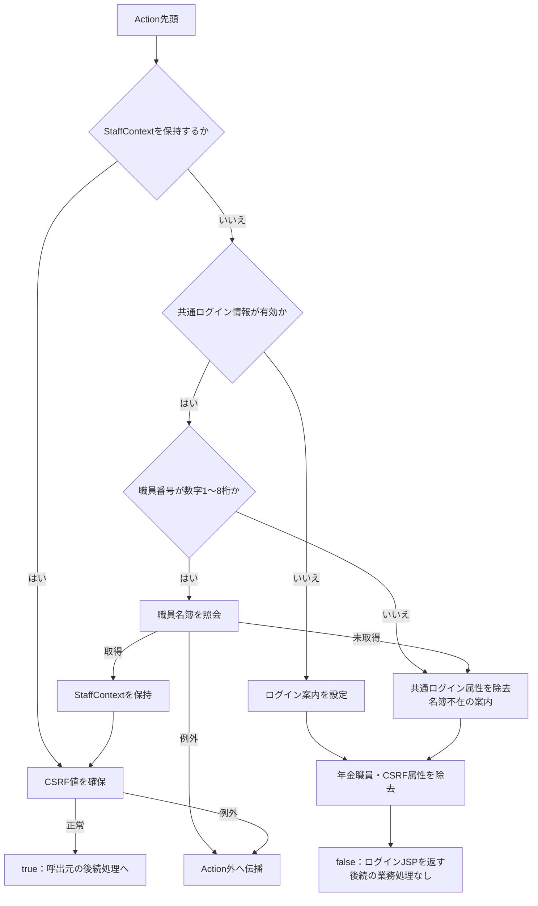

#### SQL・テーブル関連（ER図）

保持済み職員の再利用では名簿照会を行わない。自動確認時は職員接続のDB2.Ｕ職員名簿表を参照する。予約本表とのJOINや予約更新はこの段階では行わないため、表間ER図は設けない。

#### DB操作の詳細

照会引数は形式確認後の職員番号intである。職員確認の取得契約、セッション設定、CSRF生成の共通詳細はCOM-111へ対応する。職員確認拒否後は要求モデル取込み、参照検索、予約更新、出力サービスへ進まない。ただし共通Servlet側のアクセス記録は別契約である。

#### 結果・例外時の扱い

trueは後続処理へ進めることを表し、入力・権限・対象存在・DB処理の成功を表さない。falseはログインJSPへの戻りであり、共通Servlet自身のログイン時間切れによる共通エラーとは別経路である。iframe宛て参照要求の戻り先もその要求の応答先となり、親画面全体を遷移させる処理は参照通信に定義されていない。

Action内で外へ伝わったExceptionは、共通ServletのAction実行catchの対象となる。その後のforward・JSP描画は同じcatchの対象外である。

### 初期化と数字入力補助

#### 処理概要

app.jsは対象入力へ一度ずつリスナーを接続し、初期値・入力中・フォーカス離脱時に数字以外を除去する。値を変更した場合だけchangeを同期通知するため、画面固有のchange処理がその場で続くことがある。

#### 処理手順

**1. 共通制御を接続する。**

　**1.1.** document.readyStateがloadingならDOMContentLoadedを待ち、それ以外は直ちにbind(document)を呼ぶ。数字入力、文字列正規化、汎用モーダル、印刷ボタンの順に接続する。

　**1.2.** `data-digits-only`を持つHTMLInputElementのうち未接続のものへ印を付ける。inputmode未設定時はnumericを補い、input・blur・focusのリスナーを登録してから初期値も正規化する。

**2. 数字列へ置き換える。**

　**2.1.** 全角０～９を半角化した後、ASCII数字以外を除く。桁数上限、正数、業務上の番号有効性は検査しない。

　**2.2.** 加工前後が同じなら終了する。異なる場合は加工前のカーソル位置までに残る数字数を求め、valueを置換する。操作中の入力なら選択位置をその数字数へ戻す。

　**2.3.** bubbles=trueのchangeを同期発火する。inputやblurを追加発火する処理ではない。

**3. フォーカス時に選択する。**

　**3.1.** readonlyでもdisabledでもなく値がある場合に、requestAnimationFrameで全選択する。正規化処理自体にはreadonly・disabledを除外する条件がない。

#### 処理フロー

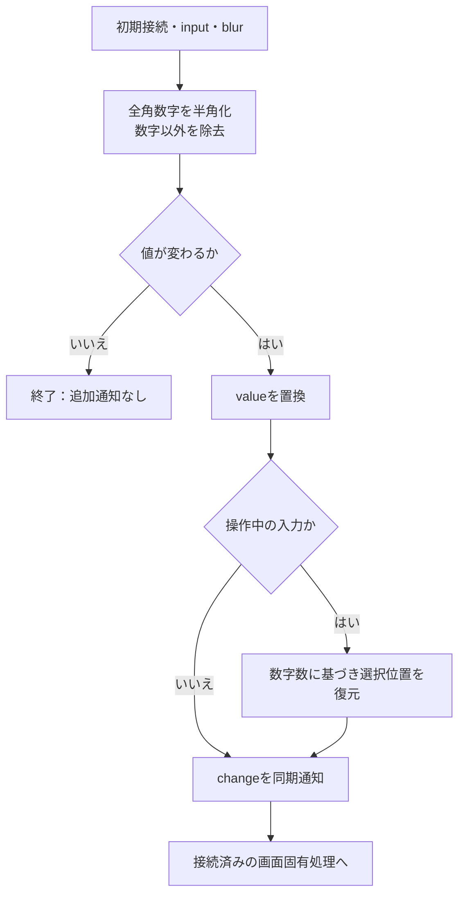

#### SQL・テーブル関連（ER図）

DOMのvalueと選択位置だけを操作し、SQLは実行しない。顧客番号のchangeから参照を開く場合のDB照会は、後続の別要求で行う。

#### DB操作の詳細

Javaの整数変換は受信StringをtrimしてInteger.parseIntし、空欄・変換失敗・0以下をnullへ変換する。ブラウザーと同じ非数字除去を再実施する処理ではない。項目ごとの検索・保存先とJDBC型は補足説明に示す。

#### 結果・例外時の扱い

予約JSP末尾の固有スクリプトは、deferの共通JSより先にリスナーを登録する。数字補助が顧客番号を変更して発火したchangeも、顧客参照の起動判定へ届く。加工が不要なら、この補助から追加changeは発生しない。

valueだけのプログラム代入はchangeを発火しない。IME合成状態による分岐や動的DOMの自動監視はなく、追加要素への適用は公開bind等の再呼出しによる。

### 日付入力の初期表示と手入力確定

#### 処理概要

日付入力は画面で指定された和暦・西暦モードに整形する。初期接続とblur・changeでは不正値の扱いが異なり、ブラウザーの整形結果からJavaの受理を一律に保証しない。

#### 処理手順

**1. JSPから初期値を表示する。**

　**1.1.** HtmlUtilの表示用関数へモデル日付を渡す。解析できれば暦別表示へ変換し、できなければ元文字列を返す。JSP出力時は別途HTMLエスケープする。

　**1.2.** BatchViewActionは日次対象日をサーバー当日、月次開始・終了を当月初日・末日に設定する。カレンダーを開いた際の当日フォールバックとは別の初期値設定である。

**2. カレンダー入力を接続する。**

　**2.1.** body直下に共有のdiv.era-calendarを一つ用意し、hidden、role=dialog、aria-modal=falseとする。初期接続だけでは開かない。

　**2.2.** 入力に接続済み印を付ける。任意の同期先が存在し表示値が空文字なら同期先から表示を作り、それ以外は表示値を整形して同期先へ反映する。初期整形は解析不能な非空値もtrimした原文で返す。

　**2.3.** 初期値処理の後、表示入力のblur・change・keydownと、同期先がある場合のchangeを接続する。

**3. 手入力を整形・同期する。**

　**3.1.** blur・changeでは主解析、次にISO補助解析を試す。成功時だけ表示を暦別文字列へ置換し、失敗時はこの段階では表示値を残す。

　**3.2.** `data-era-hidden-input`があれば、そのIDのHTMLInputElementを同期先とする。type=hidden自体は検査しない。同期先には空欄なら空文字、解析成功ならISO日付、失敗ならtrimした原文を設定し、input、changeの順に通知する。

　**3.3.** 同期先のchangeは表示を作り直すが、表示入力のinput・changeは通知しない。この接続を使う場合、不正表示値も同期の往復でtrimされ得る。対象JSPには同期先属性がなく、表示入力のnameで送信する。

#### 処理フロー

サブフロー1は初期接続であり、出口では入力リスナーを接続済みとし、カレンダーを閉じたままにする。

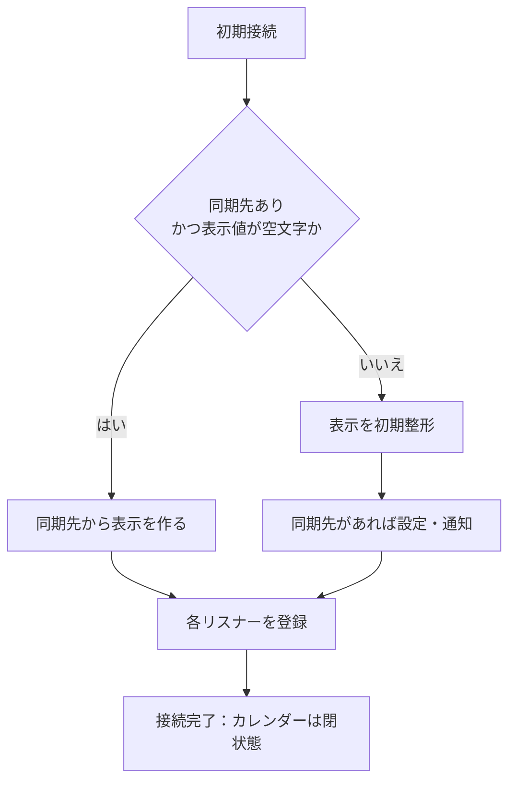

サブフロー2は接続後のblur・changeである。

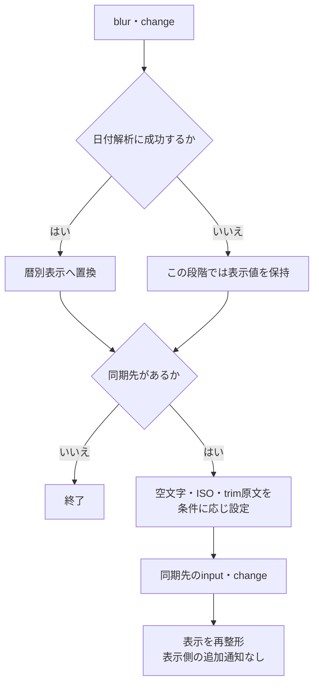

#### SQL・テーブル関連（ER図）

整形・同期はDOM内処理でありDBを使わない。予約の四日付は保存列、日次月次の三日付はデータ更新日の抽出条件へ接続する。用途を同じ保存項目にまとめない。

#### DB操作の詳細

Saveは職員確認、要求モデル取込み、POST・CSRF照合、店番・フリガナ・電話番号の検査に続き、生年月日、配偶者生年月日、請求予定日、予約徴求日の順にISO正規化する。空欄を許容し、途中の不正で終了した場合は後続日付が未正規化のままモデルに残り得る。

Repositoryは保存用コピーの四日付を再正規化し、受信したデータ更新日はサーバー当日で上書きする。空文字はsetNull(Types.DATE)、値ありはjava.sql.Date.valueOfを経てsetDateする。

#### 結果・例外時の扱い

ブラウザーは解析不能値を常に空へ消す実装ではない。JavaのDateUtilは空欄を空文字で返し、不正な非空値にはIllegalArgumentExceptionを投げる。Actionの日付検査はこれを入力案内へ変換するが、Saveの検証エラー経路もexisting判定のDB照会後にBeanを設定するため、照会例外では入力再表示まで到達しない。

Repositoryの保存前正規化はDB処理tryより前にある。ここでのIllegalArgumentExceptionはRepositoryのDB処理catchを通らずAction外へ伝わる。受理形式と表示helperの差は補足説明に示す。

### カレンダーの表示・月移動・日選択・終了

#### 処理概要

一つのカレンダーを複数の日付入力で共有する。開くときに基準日と表示月を決め、月移動では表示年月だけを変え、日選択で入力値と通知を確定する。

#### 処理手順

**1. 対象入力と初期表示月を決める。**

　**1.1.** 入力上のAlt+ArrowDownまたはF4、対応ボタンのclickで開く。ボタンはdata-era-calendar-toggleのIDで入力を解決し、HTMLInputElementなら開いた後にその入力へfocusする。

　**1.2.** activeInputを設定する。解析可能な表示入力、解析可能な同期先、ブラウザーのローカル年月日による当日の順に基準日を決め、UTC年と0始まり月番号をvisibleYear・visibleMonthへ設定する。

　**1.3.** 描画してhiddenを解除し、位置を再計算する。当日へのフォールバックは表示月と強調の基準を決めるもので、空欄・不正入力へ当日値を設定しない。

**2. 月を描画・移動する。**

　**2.1.** 日曜始まりの7列に、月初前の空セルと対象月の日ボタンを作る。日曜、基準日一致、当日一致にis-sunday、is-selected、is-todayをそれぞれ付ける。

　**2.2.** 主見出しは表示月の1日と表示モードから決める。別暦の副見出しが異なる場合だけ併記する。改元月も月初基準であり、月途中の元号へ見出し全体を切り替えない。

　**2.3.** 前月・翌月はdata-era-monthの年と0始まり月番号を表示年月へ代入して再描画する。開くときの初期年月決定へ戻らず、入力値も変えない。強調基準日は入力等から再計算するため、移動先月にその日がなければ選択強調はない。

**3. 日を選択する。**

　**3.1.** activeInputをselectedInputへ退避する。日ボタンのdata-era-dateをISO解析し、暦別表示へ変換して表示入力へ設定する。

　**3.2.** 任意の同期先へ設定・通知し、続いて表示入力のinput、changeを順に同期通知する。changeの正規化リスナーも動くため、同期先を使う構成では同期先通知が再び発生する。

　**3.3.** カレンダーをhiddenにしてactiveInputをnullへ戻し、退避した表示入力へfocusする。

**4. 選択せず閉じる・再配置する。**

　**4.1.** 外側mousedownで閉じる。ただしカレンダー内、activeInput内、起動ボタン上は除外する。Escapeでも閉じる。これらの終了処理にはフォーカス復帰を定義していない。

　**4.2.** 入力矩形とスクロール量から位置を決める。横余白8px、基本幅286px、利用幅の下限240pxを使う。下に収まらず上に収まる場合だけ入力上へ配置する。表示中のresizeと捕捉段階のscrollで再配置する。

#### 処理フロー

サブフロー1は開くときの初期決定であり、activeInputと表示年月を後続へ引き継ぐ。

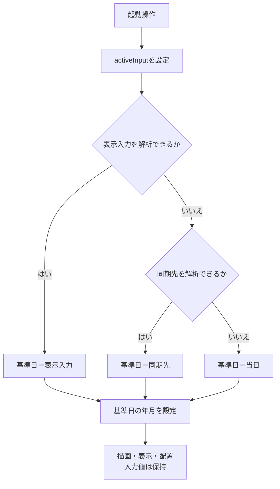

サブフロー2は表示中の月移動であり、入力値とactiveInputを保持する。

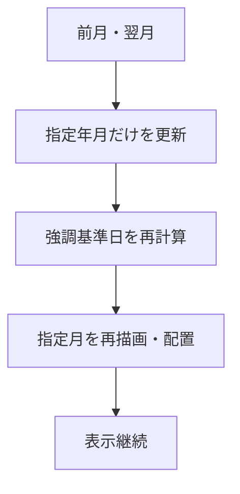

サブフロー3は選択時の値更新と終了を分ける。

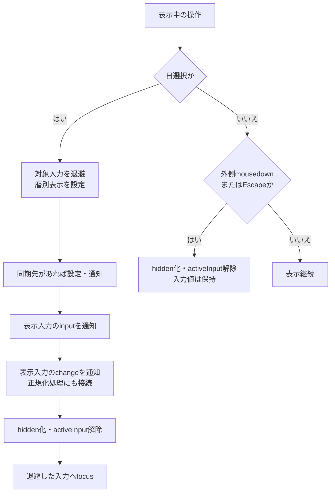

#### SQL・テーブル関連（ER図）

ブラウザーメモリのactiveInput・表示年月とDOMを操作する。日選択そのものによるDB更新はなく、フォーム送信後に各Actionへ渡す。

#### DB操作の詳細

DB接続、トランザクション、SQL取消処理はない。カレンダーを閉じる操作は、送信済み要求やダウンロードの取消ではない。

#### 結果・例外時の扱い

開く、月移動、選択せず閉じる操作は、日付入力を確定しない。日選択だけが表示値を設定して必要な通知とフォーカス復帰を行う。

月移動には業務上の最小・最大年月検査がない。予約固有のEscapeとカレンダーのEscapeは別のdocumentリスナーであり、最上位dialogだけを閉じる共通スタックにはなっていない。

### 予定年齢の補助計算

#### 処理概要

予約画面は生年月日・請求予定日のinputとchangeを受け、両日付が解析可能な場合に予定年齢を設定する。計算は年差であり、誕生日の到来を判定する満年齢計算ではない。

#### 処理手順

**1. 二つの日付を解析する。**

　**1.1.** window.nenkinEraDateがなければ終了する。あれば公開parseで生年月日と請求予定日を解析する。このparseは主解析であり、ISO接頭辞の補助解析を含まない。

**2. 年差を入力へ設定する。**

　**2.1.** 両方が有効なら、請求予定日のUTC年から出生UTC年を引き、StringとしてplannedAgeへ代入する。月日は比較しない。

　**2.2.** 片方が空欄・不正なら既存値を残す。plannedAge自身のinput・changeは通知しない。

#### 処理フロー

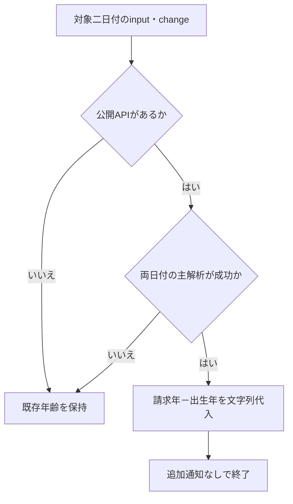

#### SQL・テーブル関連（ER図）

計算自体はDBを使わない。送信されたPLANNED_AGEは予約モデルを経て年金1_LK.予定年齢へ渡す。対象は単一列のためER図は省略する。

#### DB操作の詳細

Javaは送信値を正数Integerまたはnullへ変換し、setIntまたはsetNull(Types.INTEGER)で保存する。保存前処理に日付からの再算出はない。ブラウザーの計算結果が0以下でも代入時に数字補助は自動発火せず、Java取込み時にnullとなる経路がある。

#### 結果・例外時の扱い

カレンダー選択はinput・changeを順に通知するため、計算処理が両通知で呼ばれ得る。画面固有のchangeリスナーはカレンダーの正規化リスナーより先に登録される。日付表示の整形に成功することと、その時点の文字列が公開parseで受理されることは同じ契約ではない。

### 登録・削除の確認とクリア

#### 処理概要

予約画面は登録・削除前に空値案内と確認ダイアログを行う。OKは送信を許可する結果であり、職員、CSRF、権限、対象キー、更新成否の判定はサーバーで別に行う。クリアは確認を通さず、サーバーで入力状態を作り直す。

#### 処理手順

**1. 送信前の空値を確認する。**

　**1.1.** 登録・削除とも店番valueが空なら案内だけを表示する。次にフリガナまたは電話番号valueが空なら、登録は入力案内、削除は既存レコード読込みの案内を表示する。

　**1.2.** ここではtrim、日付解析、職員権限、既存予約の確認を行わない。空白だけの非空文字列をこの段階で拒否する検査ではない。

**2. 確認結果に応じて送信する。**

　**2.1.** showBoxはPromiseを返す。タイトル・本文をtextContentで設定し、確認時は「?」とキャンセルを表示、案内時は「!」としてキャンセルをhiddenにする。表示後はOKへfocusする。

　**2.2.** OKはtrue、キャンセルはfalseで解決し、hidden化と両onclick解除を行う。予約のEscapeはmessageBox表示中ならmessageCancel.clickを呼ぶ。案内時にもキャンセルのハンドラーは設定されている。

　**2.3.** 確認がtrueの場合だけVIEW_ID=Pension、COMMAND_ID=SaveまたはDeleteとしてform.submitする。背景clickでの終了、元フォーカス復帰、bodyクラス変更はshowBoxにない。

**3. サーバーで要求と対象を検査する。**

　**3.1.** 共通の職員確認がfalseならログインJSPを返し、例外なら上位へ伝える。trueの場合だけ要求モデルを取り込み、POST・CSRFを照合する。Save・Deleteのどちらも不正要求では要求モデル・existing=falseで予約画面を返す。

　**3.2.** Saveは操作別入力を検査する。検証エラーではキー照会の結果をexistingへ設定して要求モデルを返す。通過時は現在キー、元キーの順に照会する。

　**3.3.** Saveで現在キーの既存予約と元予約が一致しなければ、取得済みの既存予約を表示して再確認を求める。現在キーの予約がなく元予約だけ残る場合は、元予約を表示してキー変更を拒否する。

　**3.4.** Deleteは店番、次に二つのキーを検査し、現在キーと元キーを照会する。対象不在または両予約のキー不一致なら、対象読込みを案内して削除しない。

　**3.5.** 既存更新と削除ではログイン職員の所属店番・役職を検査する。所属店番75かつ役職コードを整数化した値が3000未満なら拒否する。所属店番75で役職の整数変換に失敗した場合も拒否する。この制限を新規INSERTへ一律適用する構成ではない。

　**3.6.** 通過後にRepositoryの保存・削除を呼ぶ。Repositoryは内部で対象存在を再確認する。Actionでの照会だけで後続成功を保証しない。

**4. クリアと結果を表示する。**

　**4.1.** クリアはClearを送信する。PensionClearActionはPensionViewActionを継承し、職員確認成功後に新しい空モデル・existing=falseを作る。フォーム内だけのresetではない。

　**4.2.** 保存完了は空モデルと「登録終了！」、削除成功は空モデルと「削除終了！」を設定する。メッセージに「終了」を含む場合はsuccess、それ以外はerrorで表示する。「終了」があればsetTimeoutで完了案内も開く。

#### 処理フロー

サブフロー1はブラウザー内の案内・確認であり、送信した場合だけサブフロー2へ進む。

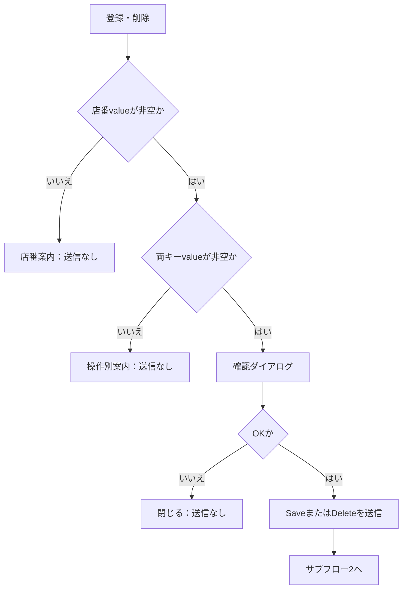

サブフロー2はサーバー側の共通拒否を示す。検査後の操作別分岐と保持値は直後の出口表に対応する。

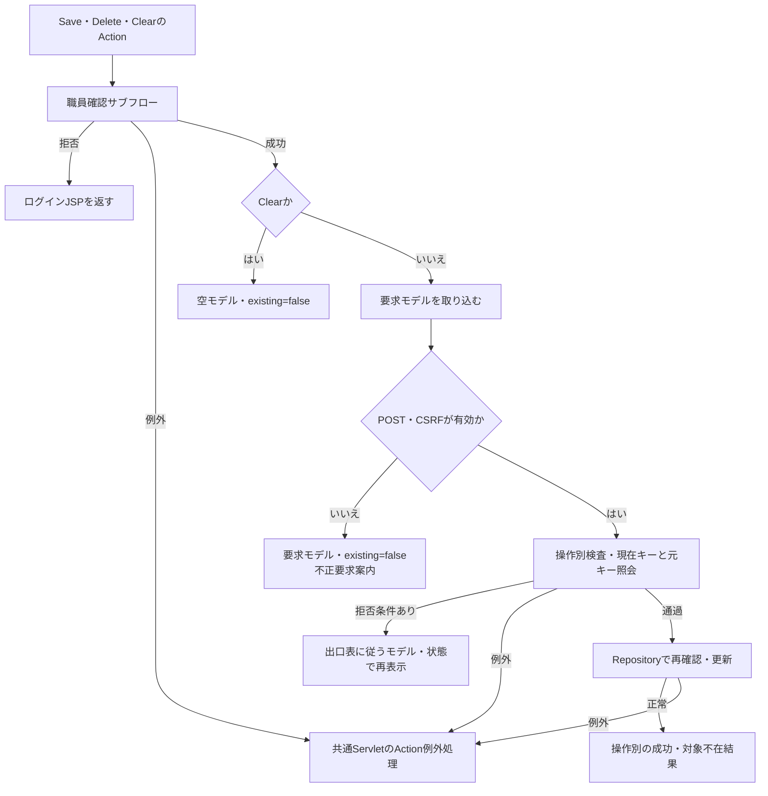

| 出口条件 | 返すモデル・existing | 案内・結果 |
| --- | --- | --- |
| Save・Delete・Clearの職員確認拒否 | その操作の新しい要求Beanは設定しない | ログインJSPを返し、後続業務処理なし |
| SaveのPOST・CSRF不正 | 要求モデル・false | 不正要求案内 |
| DeleteのPOST・CSRF不正 | 要求モデル・false | 不正要求案内 |
| Saveの入力不正 | 途中まで正規化した要求モデル・キー照会結果の有無 | 入力案内。照会例外ではこの出口に到達しない |
| Saveの既存予約と元予約が不一致 | 取得した現在キーの予約・true | 内容確認を要求 |
| Saveで元予約だけ残る | 取得した元予約・true | キー変更を拒否 |
| Save・Deleteの役職制限 | 取得済み既存予約・true | 変更または削除の権限不足案内 |
| Save完了 | 空モデル・false | 登録終了 |
| Deleteの店番不正 | 要求モデル・true | 店番案内 |
| Deleteのキー不足 | 要求モデル・false | 既存レコード読込み案内 |
| Deleteの対象不在・元キー不一致 | 対象ありは取得モデル・true、対象なしは要求モデル・false | 削除対象の読込み案内 |
| Repository.deleteがfalse | 要求モデル・true | 削除対象が見つからない旨を表示 |
| Repository.deleteがtrue | 空モデル・false | 削除終了 |
| Clear完了 | 空モデル・false | 入力状態を再作成 |

#### SQL・テーブル関連（ER図）

確認ダイアログ自体はDBを操作しない。送信後の予約照会・保存と、削除明細追加・本表削除の処理上の関連を示す。FKや多重度を表す図ではない。

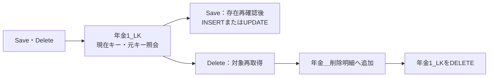

#### DB操作の詳細

Repositoryの予約キーは、NFKC・空白集約・大文字化したフリガナと、数字抽出後にBigDecimal化した電話番号である。照会WHEREはふりがな一致と電話番号一致で、setString、setBigDecimalを使用する。店番はこのキーWHEREに含めない。

saveは同一Repositoryインスタンス内のsynchronized処理である。保存前検査の後に接続を取得してautoCommit=falseとし、存在を再確認してINSERTまたは記録列のUPDATEを選びcommitする。UPDATEのWHEREもふりがな・電話番号であり、比較版による楽観ロックはない。

deleteは正規化キーが空または電話番号を数値化できなければfalseを返す。接続後の再照会で対象が消失していればrollbackしてfalseを返す。対象があれば削除明細へ追加し、同じキーで本表を削除する。削除件数が1でなければ例外とし、正常時はcommitしてtrueを返す。

DB処理中の例外ではrollbackを試みて上位へ伝える。rollback helperのSQLExceptionは元例外を優先して抑止するため、失敗時にrollback完了まで保証する契約ではない。全設定列はDB-OPS・DET-SCR-018の対象とする。

#### 結果・例外時の扱い

確認後でも、正規化による空キー、数字を含まない電話番号、対象状態の変化、DB例外で処理は止まり得る。Saveの保存前検査例外とDB処理例外は捕捉位置が異なる。

commit後にも空モデル・Bean生成、共通アクセス記録、JSP描画、通信が続く。予約JSPは再表示時に候補を再取得するため、成功案内の設定とHTML応答完了は別の境界である。

### 参照画面の起動・検索・ページ操作

#### 処理概要

親画面はLookup.jspをiframeへ表示し、店番・担当者・顧客を検索させる。検索条件の空欄や整数変換失敗は、該当条件を外して対象範囲を広げる場合がある。親の選択済み値を消す操作と、参照内の条件クリアを区別する。

#### 処理手順

**1. 親画面から参照を起動する。**

　**1.1.** 予約のopenLookupはactiveElementを起動元として保持し、candidateをcustomerへ読み替える。全モードへ現在店番を渡し、候補ボタンだけは現在フリガナ・電話番号をNAME_KEYWORD・PHONE_KEYWORDへ渡す。

　**1.2.** 予約は見出しを変更してhiddenを解除し、bodyへlookup-modal-openを付け、閉じるボタンへfocusした後に一時フォームを送信する。

　**1.3.** 一時フォームは入口表の送信先・method・文字コードを使い、target=lookupFrameとする。FUNCTION_ID、VIEW_ID、COMMAND_ID、TARGET、POPUP=1と検索条件をhiddenへ設定し、bodyへ追加してsubmit後に削除する。

　**1.4.** Excelはbranch固定の識別値だけを送り、現在店番は渡さない。参照枠は表示するが、起動元保存、閉じるボタンへのfocus、bodyクラス操作、固有Escape処理はない。

**2. 職員確認後に条件を取り込む。**

　**2.1.** LookupViewActionの職員確認が拒否ならログインJSPを返し、検索しない。例外はAction外へ伝える。成功した場合だけ新しいLookupViewBeanを作る。

　**2.2.** TARGETがbranch・staff以外ならcustomerとする。条件文字列をtrimして保持し、PAGEが正数へ変換できなければ1とする。担当者・顧客の店番が正数Integerにならなければ店番条件を付けない。

**3. 検索結果と表示範囲を設定する。**

　**3.1.** モード別サービスで全件取得し、総件数を設定して20件単位にメモリ切出しする。その後にページ上限を補正し、SubWindowBeanへ保持してLookup.jspを返す。

　**3.2.** 検索はSearchのフォームPOSTとする。ページ操作はPAGEを設定してform.submitし、1未満は送らない。描画する検索フォームのPAGEは1である。

　**3.3.** クリアはtype未指定またはtype=textの入力だけを空にし、PAGE=1として送る。hidden識別値、TARGET、POPUPは残し、親の選択済み値は変更しない。

#### 処理フロー

サブフロー1は親の参照枠を表示して要求を送るまでとする。

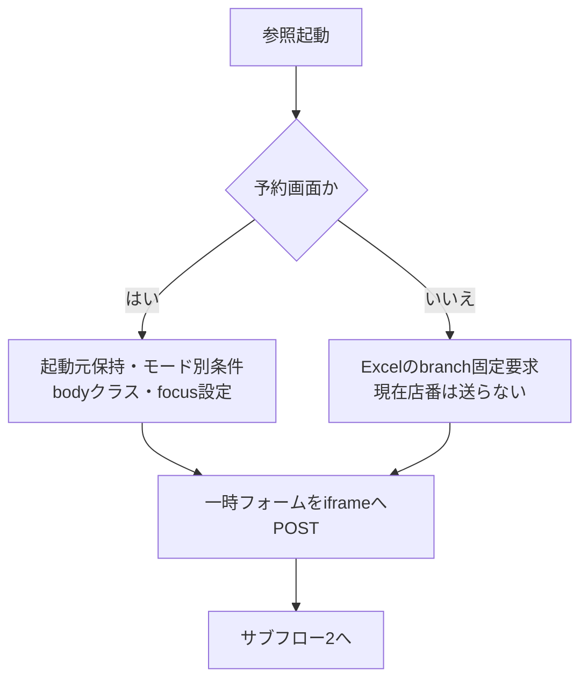

サブフロー2は職員確認成功時だけ検索へ進む。参照内の検索・ページ・クリアもこの取得処理へ接続する。

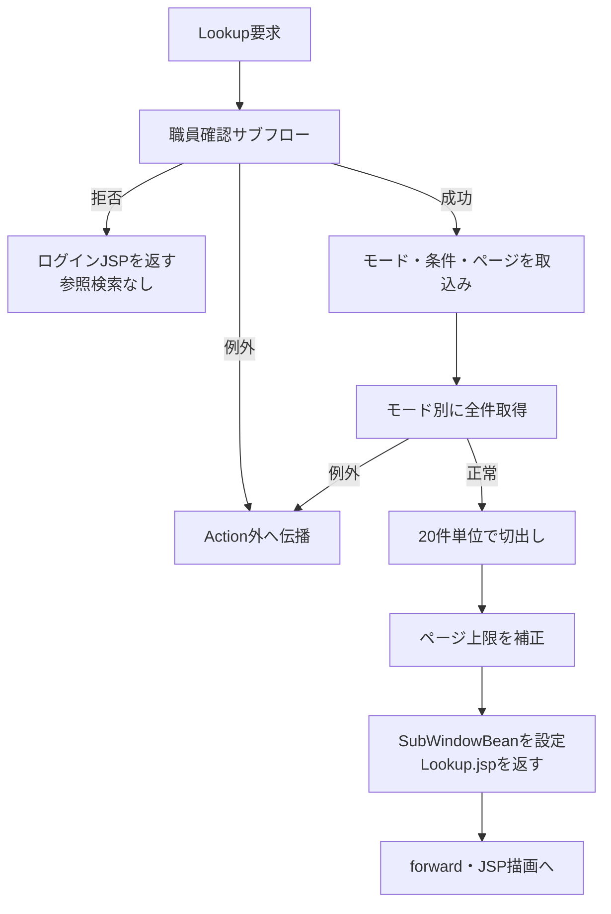

#### SQL・テーブル関連（ER図）

店番は業務接続、担当者は職員接続、顧客は顧客接続を使う。担当者・顧客の表示店名は別途取得した対応表をメモリで突き合わせる。以下は取得・補完関係であり、表間FKではない。

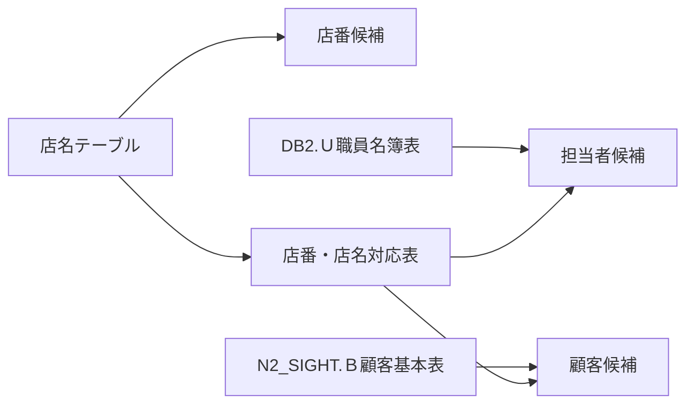

#### DB操作の詳細

| モード | 取得値・検索条件 | 順序・バインド |
| --- | --- | --- |
| branch | 店舗ｺｰﾄﾞ・店名。正規化KEYWORDが非空なら、店舗コードのVARCHAR(20)化LIKEまたはUPPER(店名)のLIKE | 店舗ｺｰﾄﾞ順。非空時だけ同じ部分一致値をsetStringで2回 |
| staff | 職員番号・漢字氏名・カナ氏名・所属店番・役職コード。指定時だけ所属店番一致。KEYWORD非空時だけカナ氏名または漢字氏名の大小文字を無視したLIKE | 職員番号順。存在する条件だけ店番setInt、文字列setStringを2回 |
| customer | 店舗コード・顧客番号・カナ氏名・漢字氏名・電話番号・生年月日・担当者コード。指定時だけ店舗コード一致。氏名非空時は漢字氏名またはカナ氏名のLIKE。電話条件非空時はTO_CHAR(電話番号)のLIKEをAND追加 | 店舗コード・顧客番号・カナ氏名順。存在する条件だけ店番setInt、氏名setStringを2回、電話setString |

検索文字列はNFKC、trim、全角空白置換、連続半角空白集約、大文字化を行う。電話条件は数字抽出後に先頭ゼロを少なくとも1桁残して集約する。数字を含まなければ電話条件は空となり、電話述語を付けない。LIKE値はバックスラッシュ、%、_、角括弧をエスケープして前後に%を付ける。

SQLページングではなく全件取得後の切出しである。setStringに明示サイズ引数はなく、この経路に検索取消・タイムアウト指定はない。

#### 結果・例外時の扱い

0件では候補行を表示しない。範囲外PAGEは明細を切り出した後でページ番号だけ補正するため、補正後ページの明細を再取得・再切出ししない。

検索例外はデータ取得例外として上位へ伝える。顧客生年月日の変換でもDateUtil例外が発生し得る。参照枠の表示、検索の正常終了、JSP描画、親への通信到達はそれぞれ別の段階である。

### 参照結果の返却・移送と予約読込み

#### 処理概要

参照画面は選択ボタンのdatasetから文字列を取り出し、同一origin宛てのpostMessageで返す。親はtargetごとに項目を移送する。予約の顧客選択は参照枠を閉じてLoadを送信し、サーバーで予約優先の読込みを行う。

#### 処理手順

**1. 選択結果または閉じる要求を返す。**

　**1.1.** Lookup.jspはsource='nenkin.lookup'を付け、window.parent.postMessage(data, location.origin)を呼ぶ。dataset由来の返却値は文字列である。

| target | 返却項目 |
| --- | --- |
| branch | branchNo、branchName |
| staff | staffCode、staffName、branchNo |
| customer | branchNo、customerNo、branchName、customerName、staffCode、kanaName、phoneNumber |
| close | targetのみ。共通のsourceは付ける |

　**1.2.** 顧客行に表示する生年月日は返却しない。閉じるはcloseを返し、親の入力を空値で置き換える要求ではない。

**2. 親が検査・移送する。**

　**2.1.** originがlocation.originと一致し、dataが存在し、data.sourceがnenkin.lookupの場合だけ処理する。event.sourceとlookupFrame.contentWindowの一致、要求ごとの識別、各値の型・形式は検査していない。

　**2.2.** 予約のbranchは店番・表示店名だけ、staffは担当者コード・表示担当者名だけを設定する。staffの返却店番は移送せず、branch選択で顧客番号・担当者・元キーを解除しない。これらの代入はinput・changeを通知しない。

　**2.3.** 予約のcustomerは店番・顧客番号・表示店名・表示顧客名・LOOKUP_KANA・LOOKUP_PHONEを設定する。返却staffCodeを担当者欄へ直接入れず、参照を閉じてからLoadを送信する。

　**2.4.** 予約はその他のtargetでも、認識済みsourceなら参照を閉じる。Excelはbranchだけ店番・店名を設定し、その他の認識済みsourceも値を保持したまま閉じる。

**3. 参照を閉じる。**

　**3.1.** 両親画面ともhidden化し、iframeのsrcをabout:blankへ変える。予約はbodyのlookup-modal-openを除去して保持した起動元へfocusする。Excelにこの復帰処理はない。

**4. Loadで予約または顧客を取得する。**

　**4.1.** 職員確認成功後に要求モデルを取り込む。LOOKUP_KANA・LOOKUP_PHONEが空なら、通常入力キーへそれぞれ個別に戻す。

　**4.2.** 正規化フリガナ・数値化電話番号で予約を先に検索する。取得時はそのモデル・existing=trueで戻る。

　**4.3.** 予約未取得なら、店番・顧客番号の両方が正数Integerである場合だけ顧客基本表を検索する。顧客取得時は取得モデル、未取得または番号不足時は要求モデルを、existing=falseで返す。

**5. キー変更による自動起動を処理する。**

　**5.1.** フリガナ・電話番号のchangeは、ORIGINAL_KANAあり、いずれかreadonly、いずれかtrim後空欄なら終了する。それ以外は現在キーをLOOKUP項目へ入れてLoadを送る。

　**5.2.** 顧客番号changeは店番・顧客番号が非空、ORIGINAL_KANAが空の場合にcustomer参照を開く。ただし起動要求にCUSTOMER_NOを含めないため、入力顧客番号による即時一意照会ではない。

#### 処理フロー

サブフロー1は親のDOM移送であり、顧客選択だけLoadへ続く。

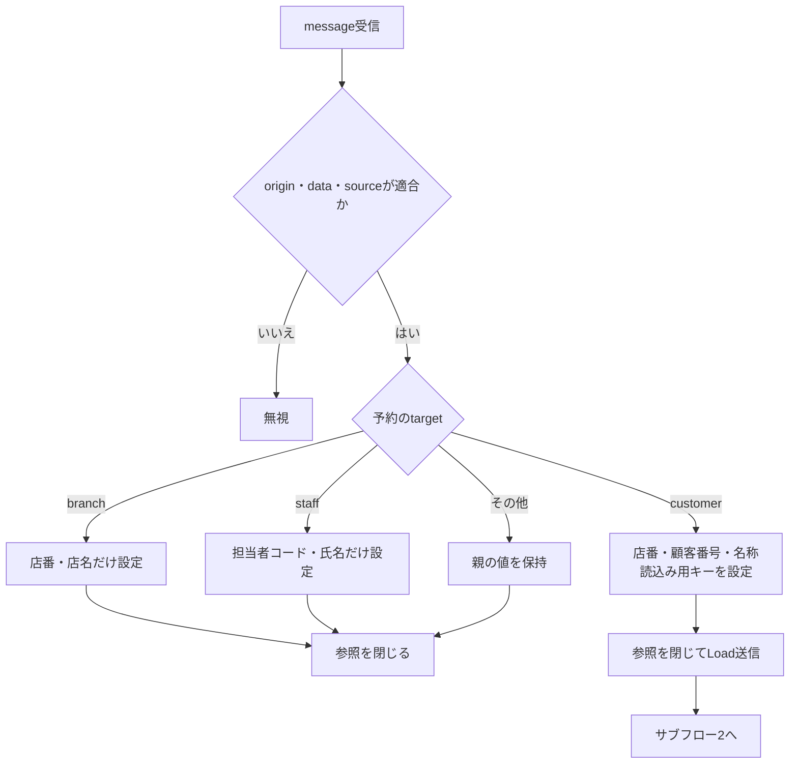

Excelはbranchで設定した店番・店名を保持して閉じ、それ以外のtargetでは従来値を保持して閉じる。

サブフロー2はLoadの取得モデルとexistingを枝ごとに保持する。

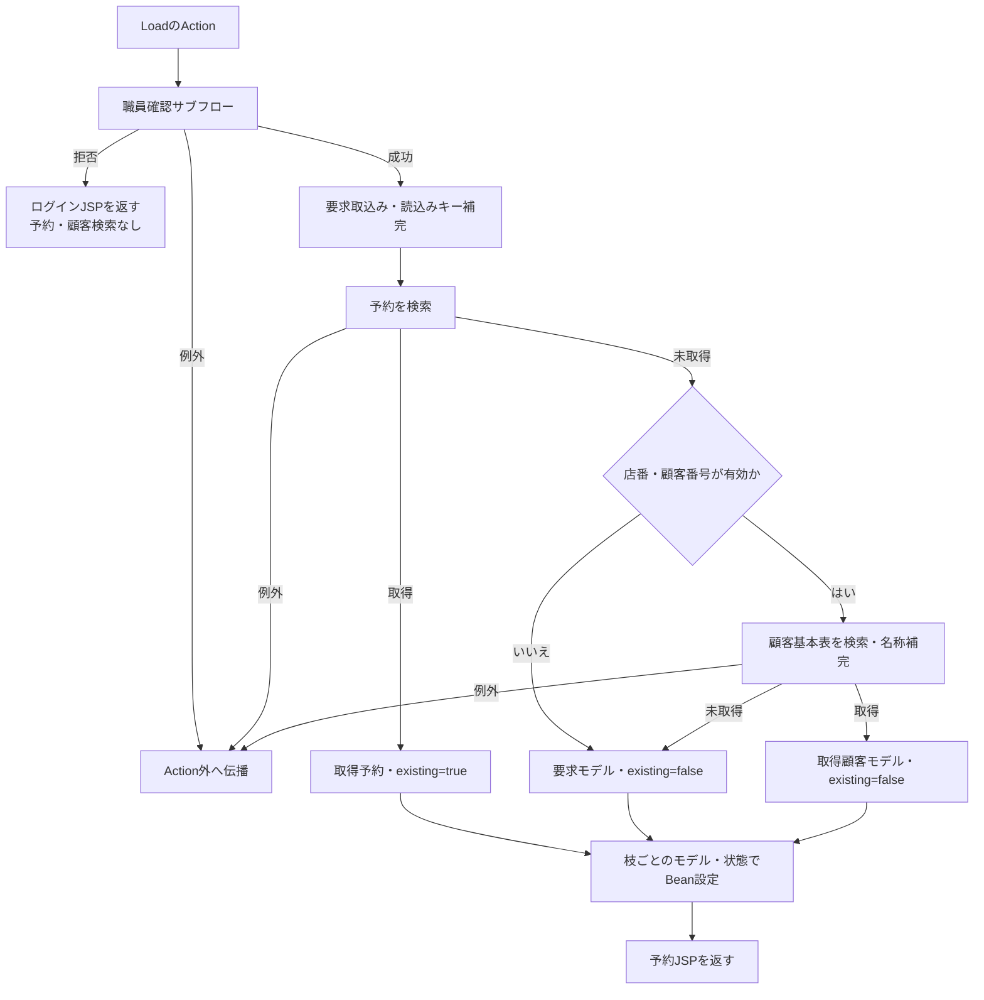

#### SQL・テーブル関連（ER図）

postMessageとDOM移送はDBを使わない。Loadは予約本表を優先し、未取得の場合に顧客基本表へ進む。店名・性別名称は業務接続で補完する。単一SQLで両表をJOINする処理ではない。

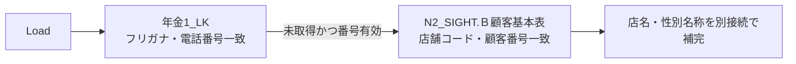

#### DB操作の詳細

予約検索はふりがな・電話番号の一致へsetString・setBigDecimalを設定し、最初の1件をモデル化する。正規化フリガナが空、または電話番号に数字がなければ照会せずnullを返す。

顧客検索は店舗コード=? AND 顧客番号=?とし、この順でsetIntする。顧客氏名、カナ氏名、担当者、住所、電話番号、生年月日等を取得し、業務接続から店名・性別名称を補完する。

候補の電話表示は先頭ゼロを集約し、9桁または10桁で先頭が0でない場合に0を一つ補う。候補担当者のSQL NULLはintの0となり、文字列NULLはモデルで空文字になる。顧客生年月日は空欄・文字列0を空とし、ピリオドがあればその前までをDateUtilへ渡す。店名対応表にない店番は空名称となる。これらは候補表示・返却用加工であり、そのまま全項目を保存する契約ではない。

#### 結果・例外時の扱い

閉じるだけでは選択済み値を消さない。branch・staff選択は画面内変更で終わり、customer選択はLoad結果でモデルを置き換える。予約取得、顧客取得、未取得の各枝で取得済み値とexistingを保持する。

読取・名称補完の例外は上位へ伝える。通常UIはJSP・postMessage経路を使う。PensionLookupActionのJSON入口やRepository.searchCandidatesを、この参照ボタンの接続先として扱わない。

### 出力条件の活性切替・送信・印刷・戻る

#### 処理概要

各JSPはフォーム識別値を操作別に設定して送信する。Reportは店舗指定に応じて店番入力をdisabledにし、成立したプレビューHTMLに対してwindow.printを呼ぶ。Excel・日次月次のダウンロードとは応答方法が異なる。

#### 処理手順

**1. 印刷条件の活性を切り替える。**

　**1.1.** Reportは初期表示でtoggleBranch(false)を呼び、USE_BRANCH_RANGEのcheckedに従ってbranchFrom・branchToのdisabledを設定する。

　**1.2.** チェック変更で有効化した場合だけ店番自へfocusする。無効化してもDOM値は消さない。サーバーは店舗指定なしなら両値を検索へ渡さない。

**2. 識別値を設定して要求する。**

　**2.1.** ExcelはExcel／Export、印刷プレビューはReport／Previewを送信する。日次月次はCOMMAND_IDだけをDaily・Monthlyへ変えてform.submitする。

　**2.2.** 戻るは同じフォームのVIEW_IDをMenu、COMMAND_IDをViewへ変えて送る。これらは入口表のPOST・文字コード契約を使う。

**3. Actionで操作別に検査する。**

　**3.1.** いずれも先頭で職員確認を行い、拒否ではログインJSP、例外では上位処理へ進む。成功した場合だけ各出力条件を取り込む。

　**3.2.** Excelはtrim後の店番を正数Integerへ変換する。空欄または変換結果nullなら入力案内、次に長さ3超またはASCII数字以外なら形式案内を返す。通過後に表示店名を照会して出力する。

　**3.3.** Reportは店舗指定時に店番自がnullなら拒否する。有効な店番至があるときだけ自・至を比較し、逆転なら拒否する。通過時は検索結果をBeanへ入れてpreview=trueとする。0件も成立する。

　**3.4.** Batchは要求値を新しいBeanへ保持し、POST・CSRF、出力区分の一つ以上選択、非空職員番号のASCII数字8桁以内をこの順で検査する。通過した条件を要求DTOへ渡す。

　**3.5.** Batchサービスは操作に必要な日付を検査・正規化し、月次の期間逆転を拒否する。削除整理基準日による整理をcommitした後、選択区分の抽出・ファイル生成へ進む。

**4. 結果を表示・送信・印刷する。**

　**4.1.** Excelの0件は条件Beanを保持して再表示する。Batchの内容なしは結果メッセージを連結して再表示し、1ファイルはExcel、複数ファイルはZIPを送信する。

　**4.2.** ダウンロードはreset、Content-Type・Content-Disposition・長さ設定、write、flushの順に行い、CSVを戻す。この戻り値はforwardを抑止する識別値である。

　**4.3.** Reportの印刷ボタンはpreview成立時だけ活性とし、onclickからwindow.printを直接呼ぶ。app.jsのdata-print helperは使用していない。

#### 処理フロー

サブフロー1は各Action共通の入口である。成功時だけ、それぞれのサブフロー2～4へ進む。

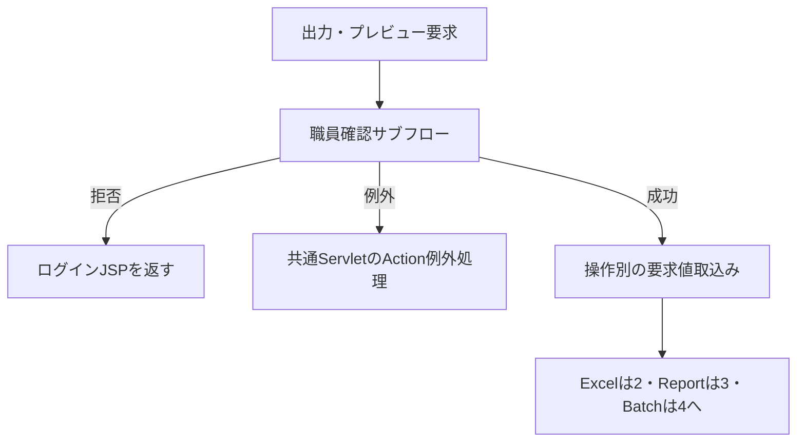

サブフロー2はExcelの条件拒否、0件、直接送信を分ける。

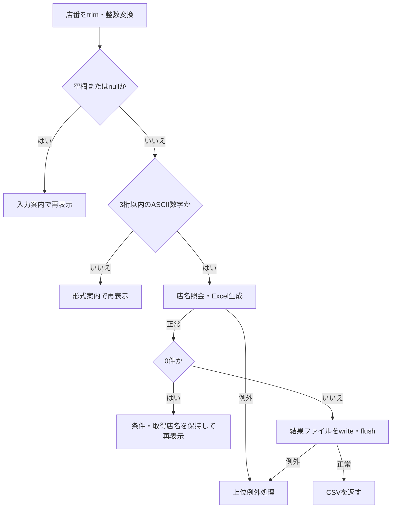

サブフロー3はReportの店舗条件とプレビュー成立を示す。

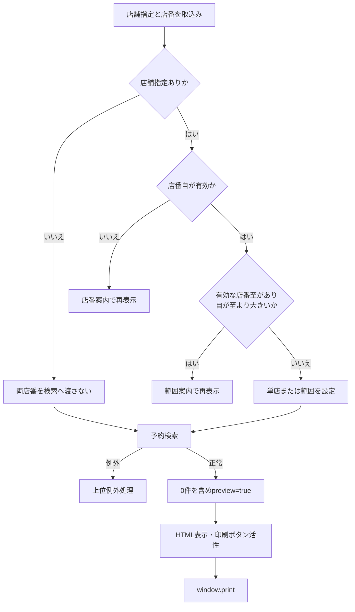

サブフロー4はBatchの検査順と個別catchの範囲を示す。サービス内の整理commitは、ファイル生成・送信と別の確定境界である。

```mermaid
flowchart TD
 A[要求Beanを作成] --> B{POST・CSRFが有効か}
 B -- いいえ --> C[不正要求案内で再表示]
 B -- はい --> D{区分を一つ以上選択したか}
 D -- いいえ --> E[区分案内で再表示]
 D -- はい --> F{職員番号が空欄<br/>または数字8桁以内か}
 F -- いいえ --> G[番号案内で再表示]
 F -- はい --> H[要求DTOでサービスを呼ぶ]
 H --> I[日付・期間検査<br/>整理commit・抽出・生成]
 I -- IllegalArgumentException --> J[個別catchで案内再表示]
 I -- その他の例外 --> X[上位例外処理]
 I -- 正常 --> K{出力内容があるか}
 K -- いいえ --> L[結果メッセージで再表示]
 K -- はい --> M[結果の名前・形式・内容を保持<br/>write・flush]
 M -- IllegalArgumentException --> J
 M -- その他の例外 --> X
 M -- 正常 --> N[CSVを返す]
```

#### SQL・テーブル関連（ER図）

活性切替、ブラウザー印刷、フォーム識別値変更はDB操作ではない。Excel・Reportは予約本表等を検索する。Batchは本表・削除明細の抽出前に削除明細を整理するため、処理全体を読取り専用とは扱わない。

```mermaid
flowchart LR
 A[Excel・Report] --> B[年金1_LKと表示名称の参照先]
 C[Batch] --> D[年金＿削除明細を整理・commit]
 D --> E[年金1_LKの新規・変更抽出]
 D --> F[年金＿削除明細の削除分抽出]
 E --> G[生成ファイル]
 F --> G
```

#### DB操作の詳細

| 操作 | 検索・更新への対応 | バインド・結果 |
| --- | --- | --- |
| Excel | 年金1_LKの店番一致。店名未取得でも出力検索を行う | 店番setInt。0件再表示、データあり直接出力 |
| Report・店舗指定なし | 店番条件なし。入力値を保持していても検索へ渡さない | 店番パラメータなし |
| Report・至なし | R.店番=? | 店番自setInt |
| Report・至あり | R.店番>=? AND R.店番<=? | 自、至の順でsetInt |
| Batch・新規／変更 | 年金1_LKの変更FLG=0／1、データ更新日の以上・以下、職員指定時だけ更新者一致 | 存在する条件を区分setInt、開始・終了setDate、更新者setIntの順 |
| Batch・削除 | 年金＿削除明細の日付範囲、職員指定時だけ更新者一致 | 変更FLG条件は付けず、日付・更新者を設定 |
| Batch・整理 | 年金＿削除明細のデータ更新日<=DELETE_CUTOFF_DATE | 基準日setDate。独立したcommit後に抽出・生成 |

Reportは店番至の変換失敗がnullとなり、単店検索へ進む場合がある。ORDER BYは店番を先頭に、1は担当者コード・顧客番号、2はふりがな・顧客番号、3は生年月日・顧客番号、4は請求予定日・顧客番号を続ける。結果は全件取得する。

Batchの日次は同じ対象日を開始・終了とし、月次は入力期間を使う。職員番号空欄は更新者条件なしである。サービス単体が受理するALL等を、Actionの数字検査を通る画面入力へ拡張しない。

#### 結果・例外時の扱い

BatchRunActionはサービス呼出し・ダウンロードを囲むIllegalArgumentExceptionだけを個別catchで再表示へ変換する。他のDB・生成・通信例外は共通側へ伝える。個別catchで処理した例外を、後段の未処理例外と重ねて分類しない。

整理commit後の生成失敗・送信失敗で、整理まで一体にrollbackする構成ではない。ダウンロード送信開始後の例外は、常に完全なエラーHTMLへ置換できるとは限らない。write・flushの正常終了から利用者の保存完了を確定せず、window.printから印刷完了を確定しない。

## 補足説明

### 日付の解析・表示契約

| 比較項目 | ブラウザー | Java DateUtil |
| --- | --- | --- |
| 前処理 | 全角数字を半角化、全角空白を半角へ置換、trim。入力全体のNFKCではない | nullを空文字化し、NFKC、trim、全角空白置換 |
| 主解析順 | 空白除去後の西暦8桁、元号連続形式、区切り付き西暦、区切り付き元号 | 元号形式、区切り付き西暦、西暦8桁 |
| 西暦形式 | 4桁年・1～2桁月日をハイフン・スラッシュ・ピリオドで区切る形式、または8桁 | 同じ桁構成の区切り形式、または8桁。形式判定は入力全体一致 |
| 元号 | 正式名、一文字漢字略称の明・大・昭・平・令、英字M・T・S・H・R。英字大小不問 | 正式名または英字M・T・S・H・R。英字大小不問。一文字漢字略称は定義なし |
| 元号年 | 元または1～2桁。連続形式の月日は各2桁 | 元または1～3桁。区切りなし和暦は定義なし |
| 和暦の区切り | 年・月・ピリオド・ハイフンをスラッシュ化し、日を除去、空白を整理して解析 | 年月区切りとしてピリオド・スラッシュ・ハイフン・年/月を許容し、末尾の日を許容 |
| 実在性 | UTC日付生成後に要求年月日との一致を検査。不正はnull | Locale.ROOTのSimpleDateFormat、setLenient(false)。不正はIllegalArgumentException |
| ISO補助解析 | 先頭yyyy-MM-ddを抽出し、末尾まで検査しない。表示整形・選択基準等で使用 | toIsoDateの形式正規表現は入力全体一致 |
| 空欄 | parseはnull、表示整形は空文字 | toIsoDateは空文字、isValidはfalse |
| 西暦表示 | yyyy/MM/dd | 正規化ISOのハイフンをスラッシュへ置換 |
| 和暦表示 | R 08/06/11等。年は最低2桁。明治開始前は西暦 | 同様の最低2桁表示。明治開始前の和暦変換は例外 |

ブラウザーの表示整形は、例えば`2026-10-15abc`をISO接頭辞から日付へ置き換え得る。未加工の同じ文字列をJavaへ直接渡すと、DateUtil.toIsoDateは受理しない。補助後の表示値と元のHTTP受信値は別に扱う。

| 元号 | 開始日 | 終了日 |
| --- | --- | --- |
| 明治 | 1868-09-08 | 1912-07-29 |
| 大正 | 1912-07-30 | 1926-12-24 |
| 昭和 | 1926-12-25 | 1989-01-07 |
| 平成 | 1989-01-08 | 2019-04-30 |
| 令和 | 2019-05-01 | 終了日指定なし |

両実装とも元号年0以下と元号範囲外を受理しない。カレンダー見出しは月初、選択日の表示はその日を基準に決まる。表示モードはwestern・gregorianだけを西暦とし、それ以外を和暦とする。

DateUtil.toAccessWarekiはR8.06.11形式を返す。JSPで使用するHtmlUtilは別のISO解析を行い、解析不能なら元文字列を返し、明治開始前は西暦へ戻す。HtmlUtilのISO解析には入力全体の形式一致検査がなく、入力検証器としては使わない。帳票用表示は和暦表示中のスラッシュを「. 」へ置き換える。

### 数字・日付の受信値とDB対応

ブラウザーmaxlengthはUTF-16コード単位による入力長の属性であり、数値最大値、バイト長、正規化後の業務上限、DB容量ではない。プログラムのvalue代入や直接HTTP要求まで同じ長さに制限する契約ではない。

| 対応値 | Javaの取込み・変換 | 保存列・収録DDL属性 | 共通記録内の順序・JDBC |
| --- | --- | --- | --- |
| BRANCH_NO | Stringから正数Integerまたはnull | 店番：H2 INTEGER／SQL Server INT、NULL可 | 1番目、setIntまたはTypes.INTEGERのsetNull |
| CUSTOMER_NO | Stringから正数Integerまたはnull | 顧客番号：BIGINT、NULL可。入力モデルはInteger | 2番目、setIntまたはTypes.INTEGERのsetNull |
| STAFF_CODE | Stringから正数Integerまたはnull | 担当者コード：INTEGER／INT、NULL可 | 3番目、setIntまたはTypes.INTEGERのsetNull |
| PLANNED_AGE | Stringから正数Integerまたはnull | 予定年齢：INTEGER／INT、NULL可 | 18番目、setIntまたはTypes.INTEGERのsetNull |
| BIRTH_DATE | trimしたStringからISOまたは空文字 | 生年月日：DATE、NULL可 | 9番目、setDateまたはTypes.DATEのsetNull |
| CLAIM_SCHEDULED_DATE | trimしたStringからISOまたは空文字 | 請求予定日：DATE、NULL可 | 17番目、setDateまたはTypes.DATEのsetNull |
| SPOUSE_BIRTH_DATE | trimしたStringからISOまたは空文字 | 配偶者生年月日：DATE、NULL可 | 20番目、setDateまたはTypes.DATEのsetNull |
| RESERVATION_REQUEST_DATE | trimしたStringからISOまたは空文字 | 予約徴求日：DATE、NULL可 | 22番目、setDateまたはTypes.DATEのsetNull |
| DATA_UPDATE_DATE | 要求Stringを取り込み、保存用コピーで当日へ上書き | データ更新日：DATE、NULL可 | 24番目、setDate |
| 日次・月次期間 | Bean・要求DTOのStringからISO期間へ変換 | 直接保存なし。本表・削除明細のデータ更新日を検索 | 開始・終了をsetDate |
| 日次月次STAFF_NO | StringをActionで検査し、抽出用更新者へ変換 | 直接保存なし。本表・削除明細の更新者を検索 | 条件指定時setInt |

順序はINSERT・UPDATEで共用する記録列内の位置である。これらのバインドに文字列サイズ引数はない。DDLのNULL可と操作上の必須は別に判定する。

Actionの予約キー比較はNFKC・trim・大文字化したフリガナとASCII数字抽出後の電話文字列を使う。Repositoryはフリガナの空白集約と電話の数値化も行うため、両者を同じ正規化としない。備考のWindows-31J変換可否・56バイト上限は別の保存検査であり、数字・日付補助で代替しない。

### 候補名称・表示変換・保持領域

性別・裁定請求・受給有無はJSP描画時に各コード表をコード順で取得し、先頭に空選択を置く。optionのvalueと表示に名称を使い、保存時に名称からコードを逆引きする。空名称はNULL、非空で名称が見つからなければSQLExceptionとなる。年金種類の表示ラベルも共有候補から取得する。

予約取得時の名称はLEFT JOIN結果である。マスターの保存列がNOT NULLでも、結合不成立なら取得名称はNULLになり得る。収録SQL Server DDLの店名NVARCHAR(80)、区分名NVARCHAR(10)、年金種類名NVARCHAR(120)はDB容量であり、名称更新側の業務上限ではない。職員名・顧客名も表示DTOから本番DB属性や業務上限を補わない。

| 保持場所 | 対象値 | 区別する責務 |
| --- | --- | --- |
| セッションViewBean | 予約・Excel・日次月次・印刷のモデル、条件、メッセージ | Actionが設定しJSPが参照する共通属性 |
| セッションSubWindowBean | 参照条件、件数、ページ、切出し候補 | 親のViewBeanとは別属性 |
| ブラウザーDOM | value、readonly、disabled、hidden、表示span | 送信入力と非送信名称を区別 |
| ブラウザーメモリ | lookupOpener、確認Promise、activeInput、表示年月 | セッション・DB列ではない |
| 出力用メモリ | 生成ファイルのbyte配列等 | 利用者の受領・保存完了を表さない |

HtmlUtil.escapeはnullを空文字にし、アンパサンド、大小記号、二重引用符、単一引用符をHTML用に変換する。valueはnullの空文字化だけを行う。checkedはtrue時だけchecked、selectedは一致時だけselected属性文字列を返す。

HtmlUtil.jsonはJSON文字列内容用であり、バックスラッシュ、引用符、改行等、制御文字、大小記号、U+2028・U+2029を処理する。JSONオブジェクト生成や業務入力検査ではない。予約確認と参照名称のDOM更新はtextContentを使う。

### 汎用helperの宣言と実接続

| helper・公開名 | 宣言された契約 | 対象画面との接続 |
| --- | --- | --- |
| nenkinApp.bind、bindDigitsOnly | root配下の対象へ一度ずつ接続 | 数字補助は項目一覧の入力で使用 |
| nenkinApp.toHalfWidthDigits、normalizeDigits | 全角数字変換、数字以外の除去 | 数字入力の加工で使用 |
| jsbrmsBindDigitsOnly | bindDigitsOnlyの互換名 | 公開名の存在を別機能の存在としない |
| data-trim、data-uppercase | input・textareaのblurでtrim、次に大文字化。変更時だけchange | 対象五JSPに属性なし。全入力の自動正規化とはしない |
| nenkinApp.openModal、closeModal | hidden・aria-hidden、modal-open、任意bodyクラスを操作 | 実際のlookupModal・messageBoxの固有関数には未接続 |
| data-modal-open、close、backdrop | 汎用開閉。WeakMapで起動元保持、初期要素へfocus、閉時に接続中の起動元へ復帰 | 予約・Excel参照へ未接続。EscapeはDOM順で最後の表示中data-modalを閉じる |
| data-print | clickからwindow.print | Reportはonclickから直接呼び、属性未使用 |
| nenkinEraDate、jsbrmsEraDate | 同一API。bind、format、formatDisplay、formatWestern、formatIsoDate、parse、syncDisplayForHidden | 日付接続と予定年齢計算で使用。公開parseは主解析のみ |
| data-era-hidden-input | ID指定のHTMLInputElementとの同期 | 対象JSPに属性なし。現行フォームへ別ISO hiddenを追加しない |

汎用モーダルは要素またはIDの解決に失敗するとfalseを返す。初期フォーカスはdata-modal-initial-focus、なければ最初の操作要素を選ぶ。これらの機能が予約・Excelの独自参照にも適用されるとは扱わない。

Staff.jspにはmaxlength=8、data-digits-only、autofocusの入力が残るが、StaffViewAction・StaffVerifyAction・StaffClearActionはMenuViewActionへ委譲する。旧JSPを根拠に通常ログイン後の職員番号再入力手順を追加しない。

### 共通レイアウト・入力ロック・重なり順

| 実DOM・セレクター | 適用する契約 |
| --- | --- |
| header.app-nav | 最小高さ48pxの横並び、濃色背景、タイトル、任意meta。予約は職員情報を表示 |
| main.app-shell | 幅100%、最大1440px。login-shell以外は上20px・左右18px・下52pxの余白 |
| section.screen.surface | 白背景、枠、角丸、影、内側18px。通常画面は後続の.screen:not(.lookup-screen-popup)で最大1180px・左右中央配置 |
| h1 | margin=0、font-size=1.45rem、font-weight=700、letter-spacing=0 |
| Excelのcompact-screen excel-screen | compact-screenの最大640pxより通常画面セレクターの詳細度が高く、最終最大幅は1180px。excel-export-screen用指定は別クラス |
| 予約のaccess-layout | 基本情報・予約情報の二列。pension-entry-form内は間隔36px、項目行はラベル128pxと残り幅 |
| input-reference、code-name-display | 入力・参照ボタン・名称の三列。名称は最小7em、改行なし |
| existing時のkanaName・phoneNumber | readonlyとaccess-key-lockedで赤文字。背景は詳細度の高い.form-control[readonly]が適用される |
| dataUpdateDate | readonly。access-readonly-display[readonly]で通常文字色・灰色背景 |
| sticky-actions | 登録・削除・クリア領域をbottom=0のsticky配置にする |
| .screen.batch-export-screen | 幅1120px、最小1040px |
| .screen.report-screen | 幅1180px、最小1080px |
| Lookupのpopup-page | 共有ヘッダーなし。lookup-popup-body・lookup-popup-main用規則は実DOMに一致しない |
| lookup-filter-row | 後続指定によりflex・折返し。狭幅のgrid-template-columnsだけではgridへ変わらない |
| lookup-modal | 固定配置、z-index=1000。パネル幅min(1120px,96vw)、高さmin(720px,90vh)、ヘッダーとiframe |
| message-box | 固定配置、z-index=1100。パネル幅min(440px,画面幅-32px) |
| era-calendar | 絶対配置、z-index=1200。JSが幅・位置を設定 |
| [hidden] | display:none !important。role・aria属性とは別に可視性を決める |

予約のロックは既存予約のキー二項目と更新日であり、予約情報全体を編集不可にするものではない。readonly・hiddenを受信値の本人性や不変性の保証とせず、サーバーで再検査する。

960px以下では予約全体を一列・間隔24pxにする。640px以下ではラベル・入力、年金種類checkbox-gridも一列にする。参照入力の名称列は最小6emになるが、code-name-display自身の最小7em指定は残る。日次月次・印刷の最小幅はこれらのメディア条件では解除しない。

form-control・form-select・ボタン等にはフォーカス枠がある。disabled・readonlyは背景を変更する。modal-open、lookup-modal-open、message-box-openは別クラスであり、予約参照はlookup-modal-openを操作する一方、showBoxはmessage-box-openを付けず、Excel参照も同じbodyクラス操作を持たない。role=dialog・aria-modal=trueからスクロール抑止やフォーカストラップを推定しない。

### 印刷時の表示

印刷CSSはA4横、余白8mm、白背景・黒文字を指定し、app-nav、app-footer、print-filter-screen、no-printを隠す。Reportの操作領域は実DOMのno-printで除外する。

Reportの固定幅・最小幅・枠・影を解除し、店舗別article.report-pageの後で改ページする。最後のarticleは改ページを解除する。report-ledgerのtheadはtable-header-group、明細行は分割回避とし、見出し各5mm、明細各5.2mmの二段構成へ変更する。タイトル15pt、付帯情報7pt、項目見出し6.7pt、明細6.6ptを使う。

report-cellのoverflow:hidden、text-overflow:ellipsis、nowrapは印刷時にも残るため、長い名称・住所・備考の全量印字を保証しない。印刷の.app-shellによるpadding=0より通常のmain.app-shell:not(.login-shell)の詳細度が高く、この指定だけでは通常main余白を解除しない。

### 要求・例外・応答の境界

/Action.doはcommon.ControlServletへ接続する。通常POSTではパラメータ読取り前にWindows-31Jを設定し、FUNCTION_IDを小文字化したパッケージと、VIEW_ID・COMMAND_IDを材料にActionを反射生成する。JSPのcontentType・pageEncoding宣言はUTF-8であり、フォーム指定、Servlet設定、JSP宣言を区別する。

| 段階 | 結果と捕捉範囲 |
| --- | --- |
| 識別値処理、共通ログイン・運用判定 | Action実行catchの外。識別値欠落等を同じ例外変換で保証しない。共通ログイン拒否は共通エラー先 |
| Action生成・perform | Exceptionを共通catchで記録し、共通エラー先を設定 |
| Action先頭の年金職員確認 | falseはログインJSP、例外はAction実行catchへ。拒否後の業務処理なし |
| Action内の個別検査・catch | 操作別Bean・案内・existing等を設定。処理済み例外を後段の一般例外へ含めない |
| 共通アクセス記録後のforward | Action実行catchの外。JSP描画失敗は同じcatchで処理しない |
| 予約JSP再表示 | 候補の追加DB読取があるため、入力拒否や成功Bean設定だけでは描画完了しない |
| Batch・ReportのJSP | 職員番号のInteger変換があり、Bean・セッション値によって描画途中の例外が生じ得る |
| ダウンロード開始後 | write・flush失敗時に受領状況や完全なエラー画面への置換を確定できない |

CSVというAction戻り値は、PDFと同様に共通Servletのforward抑止判定で使う。店舗別・日次月次の実ファイル形式をCSVとする意味ではない。入力拒否後の再表示、DB commit、応答送信、利用者の受領・印刷完了は別の状態である。

### 関連仕様の対応

次表は提示された文書計画上の対応であり、pathは文書ルートからの相対表記である。生成済みリンクとしては扱わない。

| 文書ID | 相対path | 本書との対応 |
| --- | --- | --- |
| COM-111 | 共通/共通仕様書_COM-111_年金業務共通処理.md | 職員確認、CSRF、要求値変換、権限、備考検査、ダウンロード |
| COM-012 | 共通/共通仕様書_COM-012_共通コントロールサーブレット.md | 共通認証、要求処理、Action実行catch、アクセス記録、forward |
| API-NENKIN | 共通/要求処理一覧.md | HTTP入口、識別値、フォーム・JSON・直接出力の応答契約 |
| DB-OPS | 共通/DB仕様書/DB操作仕様書.md | SQL全文、全設定列、JDBC、件数検査、commit・rollback |
| DET-SCR-016 | 詳細仕様書/詳細仕様書_SCR-016_店番参照／担当者参照／顧客参照.md | 参照条件、候補属性、ページ、返却項目 |
| DET-SCR-018 | 詳細仕様書/詳細仕様書_SCR-018_新規・変更・削除.md | 全予約項目、キー、権限、保存・削除 |
| DET-SCR-014 | 詳細仕様書/詳細仕様書_SCR-014_日次 _ 月次処理.md | 期間・区分・整理・生成・送信の処理境界 |
| DET-SCR-015 | 詳細仕様書/詳細仕様書_SCR-015_EXCEL出力.md | 店番検査、出力対象・列移送、0件・直接送信 |
| DET-SCR-019 | 詳細仕様書/詳細仕様書_SCR-019_登録内容印刷.md | 店舗範囲、並び順、明細と印刷 |
