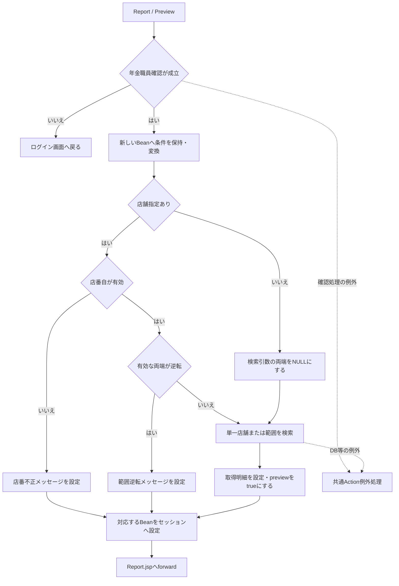
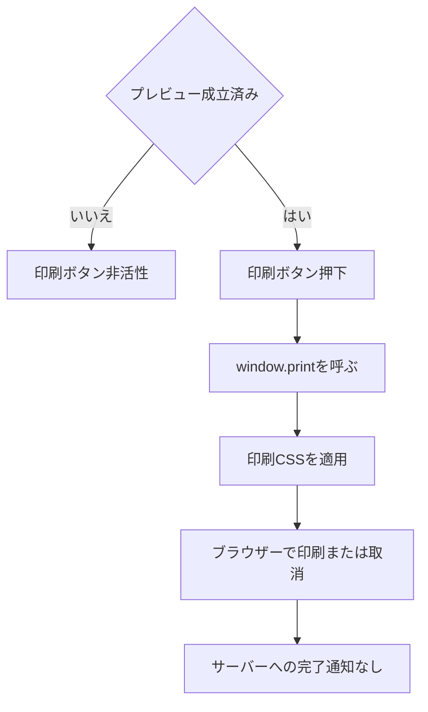
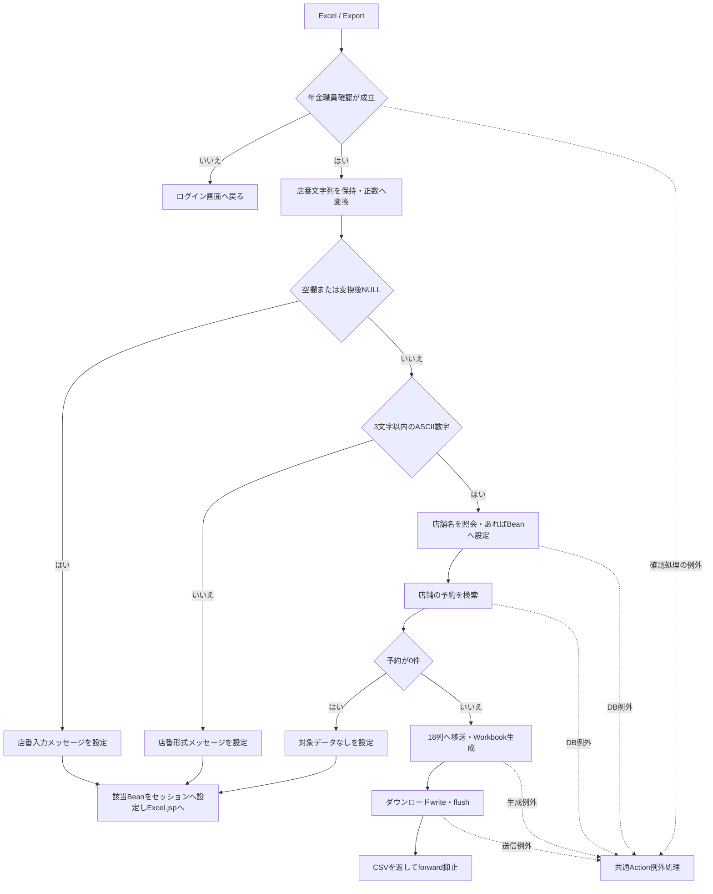
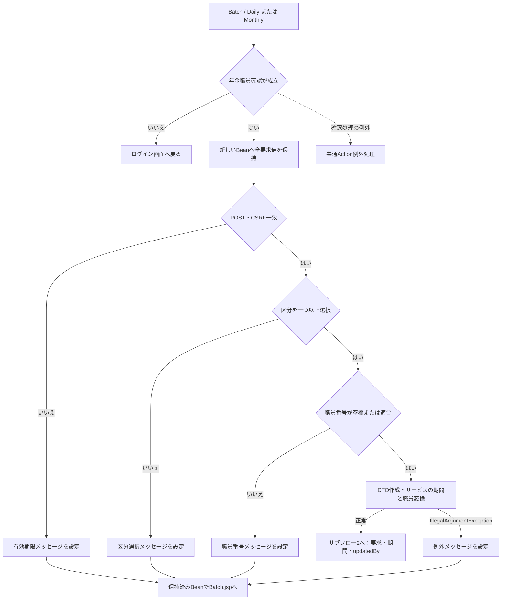
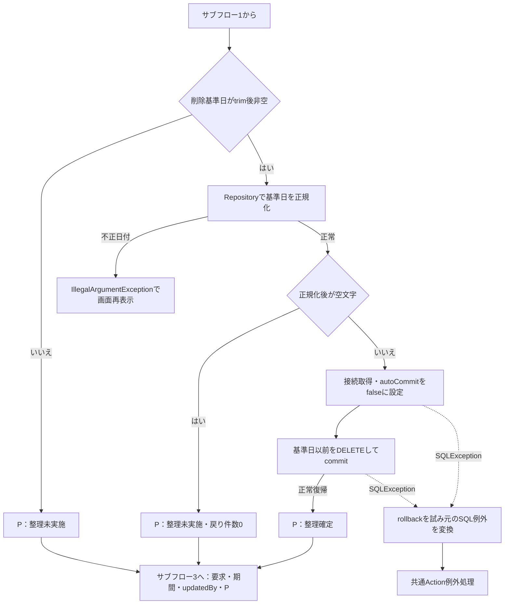
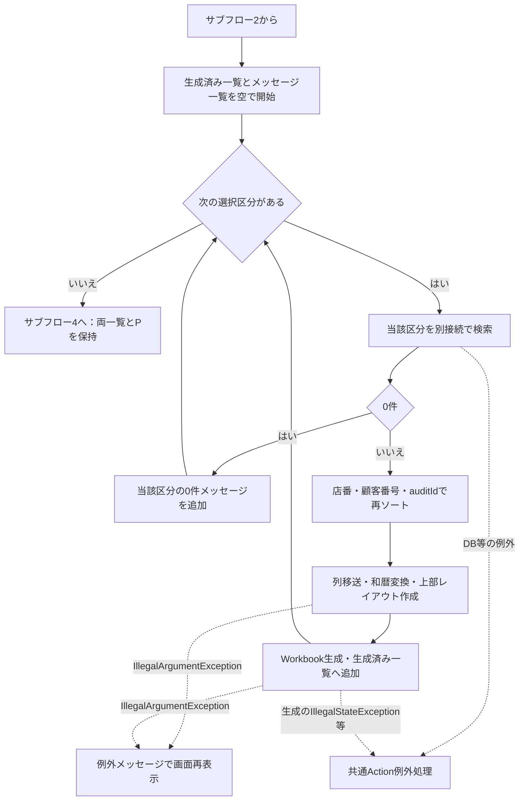
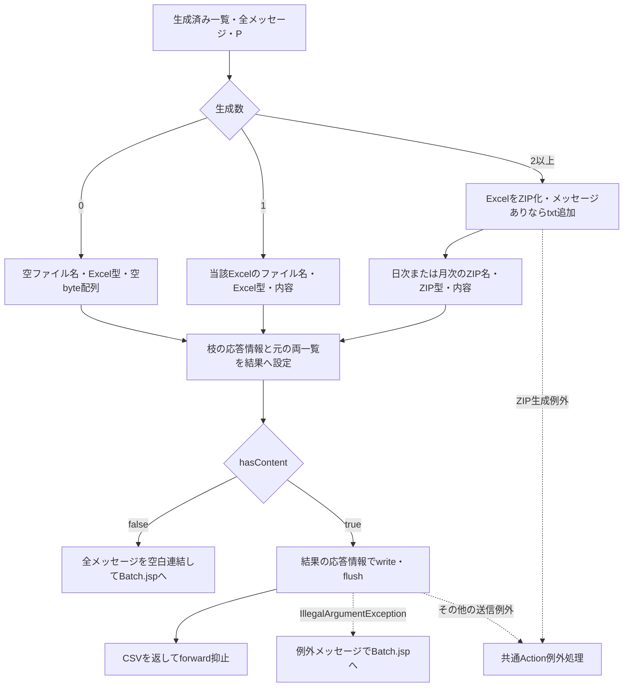
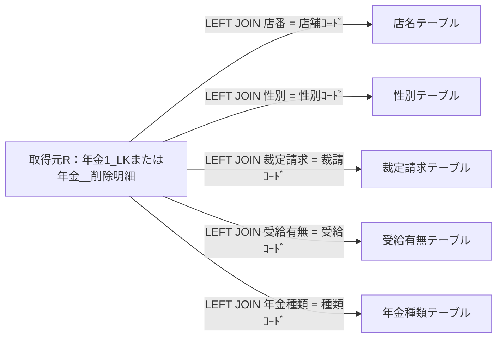

<!-- spec-meta: {"schema":"spec-md/1.0","documentId":"OUTPUT-NENKIN","version":"2.0","path":"共通/帳票一覧.md","sheets":[{"heading":"概要","kind":"GRID","sheet":"概要"},{"heading":"項目一覧","kind":"LIST","sheet":"項目一覧","key":["No"]},{"heading":"イベント仕様","kind":"GRID","sheet":"イベント仕様"},{"heading":"補足説明","kind":"GRID","sheet":"補足説明"}]} -->
# 年金帳票・出力ファイル仕様

| 属性 | 内容 |
| --- | --- |
| 文書種別 | 帳票・出力ファイル仕様書 |
| システム名 | 年金自動受取予約管理システム |
| 共通/文書ID | OUTPUT-NENKIN |
| 版 | 2.0 |
| 解析対象 | 登録内容印刷、店舗別Excel、日次・月次Excelおよび配布用ZIP |
| 基準日 | 2026-10-15 |

## 概要

本書は、予約内容をブラウザーで印刷する帳票と、予約データをExcelへ出力するファイルの契約を定める。取得対象、抽出条件、明細の移送、セル型、帳票上部の配置、ファイルの組合せおよび利用者へ返す結果を扱う。画面操作の詳細は各画面仕様の責務とし、本書では出力内容を決める条件と処理境界を説明する。

登録内容印刷と店舗別Excelは予約本表の現在値を参照する。日次・月次の新規分と変更分も同じ本表の現在値を参照し、削除分は削除明細を参照する。新規・変更の出力は、過去の保存操作を一件ずつ再現する完全な変更履歴ではない。

### 出力の対応

次の番号は本書内の整理番号であり、DBオブジェクト名ではない。

| No | 出力 | 起点 | 取得元・対象 | 提供形態 |
| --- | --- | --- | --- | --- |
| O01 | 年金自動受取予約明細表 | 登録内容印刷のプレビュー作成・印刷 | 年金1_LK。全店舗、単一店舗または店舗範囲 | JSPの明細をブラウザーから印刷 |
| O02 | 店舗別年金データ | EXCEL出力 | 年金1_LK。指定した一店舗 | 単独xlsx |
| O03 | 年金予約【新規】データ明細リスト | 日次・月次処理の新規分選択 | 年金1_LK。変更FLG=0、更新日範囲、任意の更新者 | 明細がある場合にxlsxを生成 |
| O04 | 年金予約【変更】データ明細リスト | 日次・月次処理の変更分選択 | 年金1_LK。変更FLG=1、更新日範囲、任意の更新者 | 明細がある場合にxlsxを生成 |
| O05 | 年金予約【削除】データ明細リスト | 日次・月次処理の削除分選択 | 年金＿削除明細。更新日範囲、任意の更新者 | 明細がある場合にxlsxを生成 |
| O06 | 日次・月次の配布用ZIP | O03～O05の生成済みExcelが二つ以上 | 生成済みExcelと、選択した区分の0件メッセージ | ZIP。メッセージがある場合だけ出力結果.txtを同梱 |

### 要求入口

通常画面からの要求先はコンテキスト配下の`/Action.do`、HTTP methodはPOST、`FUNCTION_ID`は`nenkin`である。共通Servletが識別値からActionを生成する。

| 操作 | VIEW_ID | COMMAND_ID | 接続する処理 | 戻り先・出力 |
| --- | --- | --- | --- | --- |
| 印刷条件の初期表示 | Report | View | ReportViewAction | Report.jsp |
| 明細プレビュー作成 | Report | Preview | ReportPreviewAction | Report.jsp |
| 店舗別Excel条件の初期表示 | Excel | View | ExcelViewAction | Excel.jsp |
| 店舗別Excel出力 | Excel | Export | ExcelExportAction | 入力拒否・0件はExcel.jsp、明細ありはxlsx |
| 日次・月次条件の初期表示 | Batch | View | BatchViewAction | Batch.jsp |
| 日次出力 | Batch | Daily | BatchDailyActionからBatchRunAction | 入力拒否・全区分0件はBatch.jsp、明細ありはxlsxまたはZIP |
| 月次出力 | Batch | Monthly | BatchMonthlyActionからBatchRunAction | 入力拒否・全区分0件はBatch.jsp、明細ありはxlsxまたはZIP |
| ブラウザー印刷 | ‐ | ‐ | window.print() | ブラウザーの印刷操作。サーバー要求なし |

共通ログイン確認に続き、各Actionは年金職員を確認する。既存の職員セッションを再利用できなければ、共通ログイン情報の職員番号を検査して職員名簿を照会する。職員確認を成立させられない場合は出力へ進まず、年金職員情報とCSRF情報を除去してログイン画面へ戻す。職員確認中のDB例外は、通常の職員不在による戻りとは別の経路である。

日次・月次の実行はPOSTとCSRF一致も検査する。登録内容プレビューと店舗別ExcelのActionには、この追加検査を行う呼出しがない。店舗別Excelの出力条件へ、予約更新用の店番75・役職による制限を追加しない。

## 項目一覧

| No | グループ | 項目名 | 種類 | 入出力 | DB連携項目 | 候補取得元 | 必須 | 形式・桁 | 説明 |
| --- | --- | --- | --- | --- | --- | --- | --- | --- | --- |
| I01 | 登録内容印刷 | 並び順 | ラジオボタン`SORT_TYPE` | I | ORDER BYの選択。直接保存なし | JSP固定値1～4 | 初期値・不正変換時は1 | 受信`String`から正数`int`へ変換 | 1は担当者コード、2はふりがな、3は生年月日、4は請求予定日を店舗内の主な順序にする。正数の未定義値は保持するが、検索と表示ラベルは担当者コード順になる |
| I02 | 登録内容印刷 | 店番を指定する | チェックボックス`useBranch`／`USE_BRANCH_RANGE` | I | 店番条件を適用する制御値。直接保存なし | なし | 選択任意 | 受信`String`から`boolean`へ変換 | 未選択は全店舗。選択時だけ店番自・至を検索へ渡す。欄の活性切替えでは入力値を消さない |
| I03 | 登録内容印刷 | 店番自 | テキスト`branchFrom`／`BRANCH_FROM` | I／O | 年金1_LK.店番の等価条件または下限 | なし | 店舗指定時に変換後の正数が必要 | ブラウザー`maxlength=3`。trim後`String`を`Integer`へ変換 | 店舗指定なしでは検索へ渡さない。Actionには3桁上限の明示検査がない |
| I04 | 登録内容印刷 | 店番至 | テキスト`branchTo`／`BRANCH_TO` | I／O | 年金1_LK.店番の上限 | なし | 任意 | ブラウザー`maxlength=3`。trim後`String`を`Integer`へ変換 | 空欄・変換失敗・0以下はNULLとなり、店舗指定時は店番自の一店舗を対象にする。有効な両端が逆転すれば拒否する |
| I05 | 店舗別Excel | 店番 | テキスト`excelBranch`／`BRANCH_NO` | I／O | 年金1_LK.店番の等価条件。名称照会では店名テーブル.店舗ｺｰﾄﾞ | 店番参照の選択結果、または直接入力 | 出力時必須 | ブラウザー`maxlength=3`。Actionでtrim後1～3文字のASCII数字かつ正数 | `String`をBeanへ保持し、変換した`Integer`をサービスの`int branchNo`へ渡す。保存処理ではない |
| I06 | 店舗別Excel | 店舗名 | 表示領域 | O | 店名テーブル.店名 | 店番参照、および出力時の店舗コード照会 | 出力可否の必須条件ではない | `String`。DB宣言はSQL Serverで`NVARCHAR(80) NOT NULL` | 画面の確認用名称。見つからなくても予約検索へ進む。店舗別Excelの明細列には含めない |
| I07 | 日次・月次 | 抽出対象の職員番号 | テキスト`batchStaff`／`STAFF_NO` | I／O | 年金1_LKまたは年金＿削除明細の更新者に対する等価条件 | なし | 任意。空欄は全職員 | ブラウザー`maxlength=8`。Actionでtrim後8文字以内のASCII数字 | 要求DTOでは`String staffNo`、検索では`Integer updatedBy`。明細の担当者コードを限定する値ではない。名簿存在確認は行わない |
| I08 | 日次・月次 | 新規分 | チェックボックス`INCLUDE_NEW` | I／O | 本表の変更FLG=0を選ぶ制御値。直接保存なし | なし | I08～I10のいずれか一つ以上 | `boolean includeNew` | 未選択の区分は検索せず、0件メッセージも作らない |
| I09 | 日次・月次 | 変更分 | チェックボックス`INCLUDE_CHANGED` | I／O | 本表の変更FLG=1を選ぶ制御値。直接保存なし | なし | I08～I10のいずれか一つ以上 | `boolean includeChanged` | 新規分とは別のSQL呼出しで現在値を取得する |
| I10 | 日次・月次 | 削除分 | チェックボックス`INCLUDE_DELETED` | I／O | 削除明細を取得元にする制御値。直接保存なし | なし | I08～I10のいずれか一つ以上 | `boolean includeDeleted` | 抽出前整理で削除された明細は取得対象に残らない |
| I11 | 日次 | 対象日 | テキスト`dailyDate`／`DAILY_DATE` | I／O | データ更新日の下限・上限に同じ日を指定 | westernモードのカレンダー補助 | 日次実行時に必須検査 | ブラウザー`maxlength=14`。`String`をISO日付へ正規化 | 初期値は当日。月次実行では抽出に使わない。正規化後空値の経路はイベント仕様に記載する |
| I12 | 月次 | 開始日 | テキスト`monthStart`／`MONTH_START` | I／O | データ更新日の下限 | westernモードのカレンダー補助 | 月次実行時に必須検査 | ブラウザー`maxlength=14`。`String`をISO日付へ正規化 | 初期値は当月月初。正常な日付範囲では当日を含む下限。実際の月初であることは検査しない |
| I13 | 月次 | 終了日 | テキスト`monthEnd`／`MONTH_END` | I／O | データ更新日の上限 | westernモードのカレンダー補助 | 月次実行時に必須検査 | ブラウザー`maxlength=14`。`String`をISO日付へ正規化 | 初期値は当月月末。正常な日付範囲では当日を含む上限。同一月・月末日・期間日数の上限は検査しない |
| I14 | 日次・月次制御 | 削除基準日 | hidden`DELETE_CUTOFF_DATE` | I／O | 年金＿削除明細.データ更新日以下を削除 | Batch/Viewで当日からCalendarの月を2減算 | 空欄時は整理省略 | `String deleteCutoffDate`。初期設定は`yyyy-MM-dd` | 要求値を再利用し、実行日の再計算値やセッションの基準日との一致を検査しない。月末固定の基準日ではない |
| I15 | 日次・月次制御 | CSRF照合値 | hidden`CSRF_TOKEN` | I | DB連携なし。セッション内のCSRF情報と照合 | 年金共通処理がセッションへ設定 | 日次・月次実行時に一致が必要 | 受信`String`を一致比較 | 値の実体は帳票・Excel・ZIPへ出力しない |
| I16 | 要求制御 | 機能・画面・コマンド識別値 | hidden`FUNCTION_ID`、`VIEW_ID`、`COMMAND_ID` | I | DB連携なし。Actionの選択に使用 | 各JSPの固定値・操作時の設定 | 共通要求処理の識別に使用 | 各要求値は`String` | 組合せは概要の入口表による。欠落時の例外を各出力Actionの入力拒否と同一視しない |

## イベント仕様

### 1. 登録内容プレビューの作成

#### 処理概要

店舗条件と並び順に従って予約本表を検索し、店舗単位の印刷明細をReport.jspへ表示する。条件と結果はセッションのReportViewBeanに保持する。検索が正常に終われば、取得件数が0でもプレビュー成立とする。

#### 処理手順

**1. 職員と要求値を確認する。**

　**1.1.** 年金職員確認に失敗した場合はログイン画面へ戻す。成立した場合に新しいReportViewBeanを作る。

　**1.2.** 店舗指定を`boolean`、店番自・至をtrim後の`String`として保持する。並び順は正数へ変換し、欠落・変換失敗・0以下なら1を設定する。

　**1.3.** 店番自・至を検索用の`Integer`へ変換する。空欄、数値変換失敗、0以下はNULLとなる。店舗指定ありで自がNULLなら「店番を正しく入力して下さい！」を設定する。有効な両端があり、自が至を超えれば「店番自は店番至以下を入力してください。」を設定する。

**2. 検索条件を確定して取得する。**

　**2.1.** 店舗指定なしでは、Beanに保持した店番文字列にかかわらず、両方の検索引数をNULLにする。店舗指定ありで至がNULLなら自の一店舗、有効な両端があれば両端を含む範囲を対象とする。

　**2.2.** `PensionRepository.search`で全結果を取得し、Beanへ明細リストを設定して`preview=true`にする。

**3. プレビュー状態を表示する。**

　**3.1.** 入力拒否の場合も新しいBeanをセッションへ設定する。このBeanは`preview=false`、明細空リストのため、以前のプレビューは引き継がない。

　**3.2.** 検索を行った場合はReport.jspが連続した同一店番をまとめる。NULL店番同士も同じグループとし、店舗ごとに帳票見出しと明細を出す。

#### 処理フロー

入力拒否枝のBeanは明細なし・未プレビュー、検索成功枝のBeanは取得済み明細・プレビュー成立を保持して合流する。JSP描画中の例外は、図の共通Action例外処理では捕捉しない。

#### SQL・テーブル関連（ER図）

取得元は年金1_LKであり、店舗名と四種類の名称を五つのマスターへLEFT JOINする。結合条件は補足説明の「取得列と検索上の関連」に示す。全表の関係は同節の検索関連図を使用する。

#### DB操作の詳細

共通取得列に、次の条件と並び順を組み合わせる。店番パラメータは存在する自、至の順に`setInt`で設定する。

| 店舗指定 | WHERE | バインド |
| --- | --- | --- |
| なし | `1 = 1` | なし |
| 自だけ有効 | `1 = 1 AND R.店番 = ?` | 1: 自、INTEGER |
| 自・至とも有効 | `1 = 1 AND R.店番 >= ? AND R.店番 <= ?` | 1: 自、2: 至、いずれもINTEGER |

| SORT_TYPE | ORDER BY | 画面・帳票の並び順表示 |
| --- | --- | --- |
| 1、および正数の未定義値 | `R.店番, R.担当者コード, R.顧客番号` | 担当者コード |
| 2 | `R.店番, R.ふりがな, R.顧客番号` | 顧客氏名 |
| 3 | `R.店番, R.生年月日, R.顧客番号` | 生年月日 |
| 4 | `R.店番, R.請求予定日, R.顧客番号` | 請求予定日 |

方向指定はいずれも昇順である。2の表示文言は「顧客氏名」だが、実際の検索順はふりがなである。正数の未定義値を保持した場合、1～4のラジオボタンはすべて未選択になる。

SQLページングと取得件数上限は設定しない。結果全件をメモリへ取り込み、読取後にResultSet、PreparedStatement、接続を閉じる。予約本表の更新は行わない。

#### 結果・例外時の扱い

Report/Viewの初期状態は店舗指定なし、店番自・至は空欄、並び順1、未プレビューであり、印刷ボタンは非活性となる。入力拒否でも未プレビューへ戻る。

検索0件は入力拒否とは異なる。`preview=true`となり、件数0、「対象データがありません」「印刷条件を変更してプレビューを作成してください。」を表示する。印刷ボタンはプレビュー成立を条件に活性となるため、0件でも押下できる。

ReportPreviewActionには個別catchがない。検索のDB例外等は共通ServletのAction実行catchへ伝播する。セッションBeanの型不一致やJSP内の表示処理で生じる例外は、その後のforward段階の問題として区別する。

### 2. 登録内容のブラウザー印刷

#### 処理概要

プレビュー済みのHTMLを、ブラウザーの印刷機能へ渡す。サーバーでPDFファイルを生成する処理ではない。

#### 処理手順

**1. 表示済みプレビューを印刷へ渡す。**

　**1.1.** プレビュー未成立ではボタンをdisabledとする。成立済みで押下すると`window.print()`を呼ぶ。

　**1.2.** 印刷CSSを適用し、共有ヘッダー、条件フォーム、メッセージ、画面操作部およびプレビューツールバーを非表示にする。帳票本文は店舗単位で改ページする。

**2. ブラウザーで印刷操作を行う。**

　**2.1.** 印刷の実行・取消はブラウザー側で行う。サーバーへ完了通知を送らず、印刷済み状態も保存しない。

条件欄を編集しただけでは既存の明細を再取得しない。新しい条件を帳票へ反映するにはプレビュー作成を再実行する。

#### 処理フロー

#### SQL・テーブル関連（ER図）

この操作ではSQLを実行しない。直前のプレビューで取得した明細から描画済みのDOMを使用するため、新たなER図は設けない。データ取得時の関係はイベント1と共通取得列の関連図による。

#### DB操作の詳細

印刷ボタンはサーバー要求を発生させず、業務DBを読み直さない。印刷用の保持領域はブラウザーの表示内容であり、元の条件と明細はセッションBeanにも保持されている。印刷操作の完了・取消をDBやセッションへ書き戻す処理はない。

#### 結果・例外時の扱い

サーバーは、印刷指示、ブラウザーでの印刷完了、紙の出力完了を確定しない。0件プレビューも同じ印刷入口へ進む。長文の紙面表示と改ページの設定は補足説明の帳票配置による。

### 3. 店舗別Excelの出力

#### 処理概要

一店舗の予約現在値を請求予定日の新しい順に取得し、18列の単一シートExcelを返す。店舗名は画面表示用に照会するが、名称の存在を出力可否の条件にはしない。

#### 処理手順

**1. 店番を受け付ける。**

　**1.1.** 職員確認後に新しいExcelViewBeanを作り、`BRANCH_NO`のtrim後文字列を保持する。その文字列を正数の`Integer`へ変換する。

　**1.2.** 空欄または変換後NULLなら「店番を入力してください。」で再表示する。正数へ変換できても、文字列が4文字以上またはASCII数字以外を含む場合は「店番は3桁以内の数字で入力してください。」で再表示する。変換検査が先のため、0や数値変換不能値は前者のメッセージとなる。

**2. 店舗名と予約を取得する。**

　**2.1.** 店名テーブルから店舗コードで照会し、取得できた場合だけBeanへ名称を設定する。店舗名なしでも処理を続ける。

　**2.2.** `buildByBranch(int branchNo)`が`listByBranch`を呼ぶ。0件ならWorkbookを生成せず、空ファイル名、空byte配列、`rowCount=0`を返す。

**3. 再表示またはファイル送信を行う。**

　**3.1.** 0件なら「入力された店番には対象データがありません。」を設定する。店番と取得できた名称をBeanに残してセッションへ設定し、Excel.jspへ戻す。

　**3.2.** 明細ありなら出力列へ移送し、ファイル名と単一シートWorkbookを生成する。完成済みbyte配列をダウンロード応答へ書き込み、flush後に`CSV`を返す。

#### 処理フロー

#### SQL・テーブル関連（ER図）

予約検索は年金1_LKと共通の五つのLEFT JOINを使用する。検索関連図は補足説明に示す。これとは別に、画面表示用店舗名を店名テーブルへ単独照会する。

#### DB操作の詳細

| 操作 | SQLの条件・順序 | JDBCバインド | 結果 |
| --- | --- | --- | --- |
| 表示用店舗名照会 | 店名テーブルの`店舗ｺｰﾄﾞ = ?` | 1: 店番、`setInt` | 対応名称、または名称なし |
| 店舗予約取得 | 共通取得列とJOIN。`WHERE R.店番 = ? ORDER BY R.請求予定日 DESC, R.担当者コード, R.顧客番号` | 1: 店番、`setInt` | 全件を`PensionReservation`リストへ格納 |

予約検索には変更FLG、データ更新日、ログイン職員、更新者の条件を追加しない。請求予定日以外の順序は昇順である。出力のための業務表更新、出力済みフラグ更新は行わない。

#### 結果・例外時の扱い

0件は画面再表示とし、空のExcelを送信しない。成功時は直接ダウンロードへ進み、Actionが作った新しいBeanを再表示用にセッションへ設定する処理は通らない。

このActionには個別catchがない。店舗名照会、予約検索、Workbook生成、応答送信の例外は共通ServletのAction実行catchへ伝播する。送信開始後の例外について、エラー画面への切替えや最終HTTP状態は一律には確定できない。

### 4. 日次・月次Excelの生成と配布

#### 処理概要

選択した新規・変更・削除を順に抽出し、明細のある区分だけExcelを作る。生成数が0なら画面へ戻り、1ならそのExcelを直接返し、2以上ならZIPを返す。抽出に先立ち、要求された削除基準日以前の削除明細を独立したトランザクションで整理する場合がある。

#### 処理手順

**1. 要求を保持し、実行入口を検査する。**

　**1.1.** 職員確認を行う。成立後に新しいBatchViewBeanを作り、職員番号、全日付、削除基準日をtrimして保持する。三つの区分は、受信値が`1`、大小文字を問わない`true`または`on`の場合だけtrueにする。

　**1.2.** POSTであり、受信したCSRF照合値がセッション情報と一致することを検査する。不成立なら「画面の有効期限が切れました。メニューから操作しなおしてください。」を設定して戻る。

　**1.3.** 区分全未選択なら「新規分、変更分、削除分のどれかを選択してから再度、実行ボタンを選択してください」で戻る。職員番号が非空で、ASCII数字以外を含むか8文字を超える場合は「職員番号は8桁以内の数字で入力してください」で戻る。全桁0はこの検査で拒否しない。

　**1.4.** 日次・月次のActionに対応する`runMode`と保持値を`PensionBatchExportRequest`へ移す。要求DTOの文字列setterはNULLを空文字へ変える。

**2. サービスで期間と職員条件を確定する。**

　**2.1.** サービスは要求NULL、区分全未選択、runMode=NULLを拒否する。日次は対象日を開始・終了の両方へ設定する。月次は開始日と終了日をそれぞれISO化し、開始が終了を超える場合に拒否する。使用しない側の期間欄は抽出条件へ採用しない。

　**2.2.** 日付はNFKCとtrimの後、西暦の区切り付き形式、`yyyyMMdd`、明治以降の和暦形式を受け付ける。和暦は元年または1～3桁の年を受け付け、存在しない日付、0以下の元号年、元号期間外を拒否する。正常結果は`yyyy-MM-dd`とする。

　**2.3.** 必須検査はNFKC前のtrimで行い、ISO化後の空文字を再検査しない。全角空白だけの対象日がサービスへ到達すると日次の両端が空になり、後段SQLで日付条件を付けない経路がある。月次も両端が空なら両条件を省き、開始だけ空なら下限を省く。開始が有効日で終了だけ空の場合は、文字列比較で開始が終了を超えるため拒否する。

　**2.4.** 職員番号の空欄は`updatedBy=NULL`にする。非空はInteger化し、担当者コードではなく更新者の条件に使用する。要求文字列の先頭0は検索値では失われるが、帳票上部の表示には元のtrim後文字列を使用する。

サービス単体の職員変換は`ALL`を指定なしとして扱い、8桁・正数の検査をしない。通常Actionは`ALL`や負号を先に拒否するため、この単体契約を通常画面の許容入力へ拡張しない。

**3. 削除明細を必要に応じて整理する。**

　**3.1.** 削除基準日のtrim後文字列が空なら呼出しを省く。非空ならRepositoryで日付を正規化し、正規化後空文字ならDELETEせず0を返す。不正日付はIllegalArgumentExceptionとなる。

　**3.2.** 有効な基準日なら接続を取得し、autoCommit=falseにして基準日以前の削除明細をDELETEする。件数を取得してcommitし、接続を終了する。整理は削除分の選択有無、抽出期間、指定職員に関係なく実行する。

　**3.3.** 整理件数は出力結果へ設定しない。整理後の抽出・生成・配布と一体のrollbackは行わない。

**4. 選択区分ごとに取得とWorkbook生成を行う。**

　**4.1.** 新規、変更、削除の順で選択済み区分を処理する。各区分で別に`findAuditRecords`を呼ぶ。

　**4.2.** 0件ならその区分のメッセージを追加し、Workbookとファイル結果は作らない。未選択区分のメッセージは追加しない。

　**4.3.** 明細ありなら店番、顧客番号、検索結果内のauditIdの順で再ソートする。店番・顧客番号のNULLは非NULLより前とする。No列は並べ替え後に、各ファイルで1から採番する。

　**4.4.** 区分別の列へ移送し、四つの日付を短い和暦文字列へ変換する。担当者コードは最低2桁の文字列にする。上部7行、結合範囲、倍率を設定してWorkbookを生成し、生成済み一覧へ加える。

**5. 生成数に応じて結果を返す。**

　**5.1.** 生成0件は空内容、生成1件はそのExcel、生成2件以上は各Excelを格納したZIPとする。どの枝も生成済みファイル一覧と全メッセージを結果へ引き継ぐ。

　**5.2.** ZIP生成時だけ、メッセージがあれば出力結果.txtを追加する。単独Excelへ他区分の0件メッセージを書き込む処理はない。

　**5.3.** Actionは`hasContent=false`ならメッセージを半角空白で連結し、保持済みBeanに設定してBatch.jspへ戻す。内容ありなら結果のファイル名、Content-Type、byte配列を送信し、`CSV`を返す。

#### 処理フロー

四つのサブフローで、要求値、抽出条件、整理状態、生成済みファイルとメッセージを引き継ぐ。図中の「画面再表示」は、その枝で設定したメッセージと保持済みBeanを使用する。

**サブフロー1：入口検査と抽出条件の確定**

サブフロー1の正常出口には、正規化後空文字の期間も到達し得る。後段で必ず両端DATEをバインドするという保証にはしない。

**サブフロー2：削除明細整理**

整理状態Pは説明上の状態であり、実装のDTO項目ではない。未呼出し・正規化後空文字はP=整理未実施、commitが正常復帰した枝はP=整理確定として後続へ渡す。

commit呼出しが例外となった枝のDB確定状態は、P=整理確定へ合流させない。rollback失敗は抑止して元のSQL例外を優先するが、状態の再照会は行わない。

**サブフロー3：区分別の検索と生成**

途中で例外となった場合、先にメモリ生成できたファイルだけを配布する結果は返さない。P=整理確定であれば、その削除を戻す処理も行わない。

**サブフロー4：応答の選択**

合流点Gは各枝のファイル名・Content-Type・内容を引き継ぎ、メッセージを一律に空へ置き換えない。整理状態Pは全枝で維持され、0件再表示でも既に整理確定している場合がある。

#### SQL・テーブル関連（ER図）

新規・変更は年金1_LK、削除は年金＿削除明細をRとする。両方とも共通の五つの名称マスターをLEFT JOINする。整理対象は年金＿削除明細のみであり、検索上の関連図は補足説明に示す。

新規・変更の区分は本表の変更FLGで判定する。通常の新規保存は0、既存更新は1を設定し、データ更新日・時刻・更新者を更新する。更新者には保存実行職員を使用し、明細の担当者コードとは区別する。

通常削除では、取得した既存予約を削除実行日・実行者とともに削除明細へ追加してから本表を削除し、同一トランザクションで確定する。削除分の名称は抽出時のマスターJOIN結果であり、名称自体の過去版をこの出力で復元する処理ではない。

#### DB操作の詳細

整理SQLは`DELETE FROM 年金＿削除明細 WHERE データ更新日 <= ?`である。1番に正規化した基準日を`java.sql.Date.valueOf`から`setDate`で設定する。抽出期間・更新者による限定はない。メソッドのsynchronizedは同じRepositoryインスタンスの整理呼出しを同期する範囲にとどまり、その後の抽出を保護しない。

区分別抽出は共通取得列に`R.データ更新日 AS AUDIT_DATE`、`R.更新時間 AS AUDIT_TIME`、`R.更新者 AS UPDATED_BY`を追加する。WHEREは`1 = 1`に次の条件を順に追加する。

| 順位 | 適用条件 | 追加述語 | パラメータと型 |
| --- | --- | --- | --- |
| 1 | 新規または変更 | `R.変更FLG = ?` | 新規0、変更1を`setInt`。削除では省略 |
| 2 | 正規化後開始日が非空 | `R.データ更新日 >= ?` | 開始日を`setDate`、DATE |
| 3 | 正規化後終了日が非空 | `R.データ更新日 <= ?` | 終了日を`setDate`、DATE |
| 4 | updatedByが非NULL | `R.更新者 = ?` | 職員番号を`setInt`、INTEGER |

実際のパラメータ番号は、存在する条件だけを上表の順に1から詰める。条件を省略した場合にNULLパラメータを置く方式ではない。正常な日次では同じ日を上下限にし、正常な月次では両端を含む。パラメータサイズの明示指定、SQLページング、取得上限、明示的な取消・タイムアウトは設定しない。

SQLの取得順は`R.データ更新日, R.更新時間, R.店番, R.顧客番号`の昇順である。取得行へ1からlongのauditIdを設定し、その後に手順4.3の再ソートを行う。auditIdは検索結果内の連番であり、永続監査IDではない。

整理と各区分の検索は別接続であり、全区分を同一時点のスナップショットに固定する共通トランザクションはない。出力済みフラグや消費状態を更新しないため、再実行はその時点のDB値で再抽出する。

#### 結果・例外時の扱い

生成数別の応答と0件メッセージの到達先は補足説明の結果表による。選択区分が三つでも生成できたExcelが一つなら単独Excelとなる。

BatchRunActionは、サービス呼出しから送信までのtryでIllegalArgumentExceptionを捕捉し、そのメッセージを保持済みBeanへ設定して再表示する。対象は入力期間・職員変換・削除基準日だけではなく、明細日付や帳票上部の和暦変換、Writerの引数検査等で後から生じる同型例外も含む。

DB例外のNenkinDataAccessException、Workbook・ZIP生成のIllegalStateException、通常の送信例外はこのcatchの対象外であり、共通ServletのAction実行catchへ伝播する。先にIllegalArgumentExceptionで処理した例外を、共通catchへ進む例外として重ねて分類しない。

再表示時の日付欄は、HtmlUtilが解析できれば西暦表示とし、解析できなければ元の文字列をHTMLエスケープして表示する。Actionのreturn後に行うJSPのBean参照・表示変換はAction実行catchの外側にあり、returnだけで再表示完了を確定しない。

## 補足説明

### 1. 取得列と検索上の関連

共通取得処理は、Rを予約本表または削除明細として次の値をPensionReservationへ移す。出力ごとの採否と列位置は後続の列順表による。取得した全項目を全帳票へ表示するわけではない。

本表・削除明細の下表対象列は、提供SQL Server用DDLではすべてNULL可である。文字列setterはNULLを空文字へ変える。数値のInteger項目は`getInt`と`wasNull`でNULLを保持する。

| モデル項目・Java型 | SELECT元・列別名 | SQL Server用DDLの型 | 出力上の意味 |
| --- | --- | --- | --- |
| branchNo・Integer | R.店番 AS BRANCH_NO | INT | 店舗識別、抽出・並べ替え・帳票グループ |
| branchName・String | B.店名 AS BRANCH_NAME | NVARCHAR(80)、マスター保存列はNOT NULL | 印刷の店舗見出し。Excel明細には出さない |
| customerNo・Integer | R.顧客番号 AS CUSTOMER_NO | BIGINT | 顧客番号。DB容量とJava読取範囲は一致しない |
| staffCode・Integer | R.担当者コード AS STAFF_CODE | INT | 明細の担当。抽出条件の更新者とは別 |
| customerName・String | R.顧客氏名 AS CUSTOMER_NAME | NVARCHAR(100) | 顧客氏名・漢字氏名 |
| kanaName・String | R.ふりがな AS KANA_NAME | NVARCHAR(100) | カナ氏名、印刷の並び順2 |
| gender・String | G.性別 AS GENDER | 名称NVARCHAR(10)、保存列はNOT NULL。R側コードはTINYINT | 性別名称 |
| address・String | R.住所 AS ADDRESS | NVARCHAR(300) | 住所 |
| phoneNumber・String | R.電話番号 AS PHONE_NUMBER | DECIMAL(15,0) | 読取時に加工した電話番号文字列 |
| birthDate・String | R.生年月日 AS BIRTH_DATE | DATE | 本人の生年月日 |
| claimStatus・String | C.裁定請求 AS CLAIM_STATUS | 名称NVARCHAR(10)、保存列はNOT NULL。R側コードはTINYINT | 裁定請求の名称 |
| claimScheduledDate・String | R.請求予定日 AS CLAIM_SCHEDULED_DATE | DATE | 請求予定日。店舗別Excelでは降順の第一条件 |
| plannedAge・Integer | R.予定年齢 AS PLANNED_AGE | INT | 予定年齢 |
| reservationRequestDate・String | R.予約徴求日 AS RESERVATION_REQUEST_DATE | DATE | 予約徴求日 |
| dataUpdateDate・String | R.データ更新日 AS DATA_UPDATE_DATE | DATE | 共通取得値。帳票の明細列には直接出さない |
| notes・String | R.備考 AS NOTES | NVARCHAR(400) | 備考 |
| spouseName・String | R.配偶者名 AS SPOUSE_NAME | NVARCHAR(100) | 配偶者名 |
| hasBenefit・String | H.受給有無 AS HAS_BENEFIT | 名称NVARCHAR(10)、保存列はNOT NULL。R側コードはTINYINT | 受給有無の名称 |
| spouseBirthDate・String | R.配偶者生年月日 AS SPOUSE_BIRTH_DATE | DATE | 配偶者の生年月日 |
| pensionType・String | P.年金種類 AS PENSION_TYPE | 名称NVARCHAR(120)、保存列はNOT NULL。R側コードはINT | 年金種類の名称 |
| nationalPension・boolean | R.種類：国民年金 AS NATIONAL_PENSION | BIT | 共通取得値。個別フラグとして帳票へ出さない |
| employeePension・boolean | R.種類：厚生年金 AS EMPLOYEE_PENSION | BIT | 共通取得値。個別フラグとして帳票へ出さない |
| mutualAidPension・boolean | R.種類：共済年金 AS MUTUAL_AID_PENSION | BIT | 共通取得値。個別フラグとして帳票へ出さない |
| employeePensionFund・boolean | R.種類：厚生年金基金 AS EMPLOYEE_PENSION_FUND | BIT | 共通取得値。個別フラグとして帳票へ出さない |
| nationalPensionFund・boolean | R.種類：国民年金基金 AS NATIONAL_PENSION_FUND | BIT | 共通取得値。個別フラグとして帳票へ出さない |
| sixMonthCheck・boolean | R.６ヶ月先確認 AS SIX_MONTH_CHECK | BIT | 対象Excelで確認済を「確」と表示 |

boolean項目は`getInt != 0`で読み取るため、DBのNULLもfalseとなる。確認欄ではNULLと未確認がともに空表示となる。IntegerのNULLは数値0に置き換えず、Writerでは空文字セルとする。

日次・月次の追加取得値は、データ更新日をAUDIT_DATEとしてString、更新時間をAUDIT_TIMEとしてString、更新者をUPDATED_BYとしてIntegerで保持する。DDLはそれぞれDATE、TIME(0)、INTでNULL可である。変更FLGはTINYINTでNULL可であり、新規・変更の等価条件に一致しないNULLはその区分で取得しない。

これはSQL上の検索関連図であり、FK制約や多重度を表すER図ではない。対応マスターがない場合もRの行を残し、名称の結合結果はNULLから空文字になる。名称保存列のNOT NULLを、結合後の名称が必ず存在する保証へ置き換えない。

ローカルH2用DDLは同じ業務列構成に対し、文字列をVARCHAR、BIT相当をBOOLEAN、INT相当をINTEGER、更新時間をTIMEで宣言する。宣言長はDB容量であり、画面上限や業務上限と同一ではない。名称マスターの維持管理入口と入力上限は本出力処理からは定まらない。予約本表・削除明細の非一意索引を、一意性保証として扱わない。

電話番号は保存時に数字を抽出してDECIMALとして設定する。読取時は数字以外と余分な先頭0を除き、9桁または10桁で先頭が0でない場合だけ0を一つ補う。元のハイフン配置や任意個数の先頭0を復元する処理ではない。NULLは空文字、数値0は「0」として区別し、各帳票はこの加工後文字列を使用する。

備考の通常保存ではWindows-31Jでの表現可否と56バイト以内を検査する。この制約はDBの宣言容量400と別であり、出力時には56バイトの再検査・切捨てを行わない。別経路で保存された長い備考を、通常保存の制約内とみなさない。

### 2. 登録内容印刷の構成と表示

連続した同じ店番を一つの`report-page`にまとめる。店舗見出しには「年金自動受取予約明細表」、出力日時、店番、グループ先頭明細の店舗名、並び順、店舗内件数を表示する。画面専用ツールバーには全体件数も表示する。

| 段 | 左からの表示順 |
| --- | --- |
| 上段 | 顧客番号、担当、顧客氏名、カナ氏名、性別、電話番号、生年月日、裁請、請求予定日、予齢、予約徴求日 |
| 下段 | 住所、配偶者氏名、受給、配偶者生年月日、年金種類、備考 |

担当はstaffCodeをそのまま数値表示し、担当者氏名や2桁ゼロ埋めを加えない。6ヶ月先確認はこの帳票には表示しない。氏名、カナ氏名、住所、配偶者名、年金種類、備考は全文をtitle属性にも保持する。

四つの明細日付には`HtmlUtil.formatReportDate`を使用する。ISO日付用の解析が成立した明治以降の日付は、例えば`R 08. 10. 15`のように元号後に空白、年を最低2桁、月日を2桁として表示する。明治開始前は西暦表示を使用する。最後に全体のスラッシュを「. 」へ置き換えるため、解析失敗で元文字列へ戻った場合にも、含まれるスラッシュは置換される。

出力日時はJSP描画時の当日和暦表示と`HH:mm`を組み合わせる。検索時刻をBeanへ保存した値ではない。

| 対象 | 画面・印刷の設定 |
| --- | --- |
| 明細配置 | `report-ledger-grid`で二段を構成。画面の明細行は各段25px |
| 用紙 | 印刷CSSでA4横、余白8mm |
| 店舗区切り | report-pageごとに改ページし、最終店舗の末尾改ページを解除 |
| ヘッダー | theadをtable-header-groupに設定し、ページ内の繰返し対象にする |
| 明細改ページ | tbodyの行内改ページを避ける |
| 印刷時の文字と行高 | 明細は6.6pt、二段それぞれ5.2mm。列見出しは6.7pt、二段それぞれ5mm |
| 長文 | report-cellのoverflow:hidden、white-space:nowrap等を維持。title属性の全文を紙へ自動展開しない |
| 印刷対象外 | 共有ナビゲーション、画面見出し・職員表示・戻る操作、条件フォーム、メッセージ、プレビューツールバー |

### 3. 店舗別Excelの列定義

ファイル名は`年金データ_店番_yyyyMMdd.xlsx`とする。店番は最低3桁まで先頭0を補い、日付は生成時の`DateUtil.todayIso()`からハイフンを除く。例えば店番1の名称部分は`001`となる。補完処理自体に長い値の切捨てはない。

シート名は`年金ﾃﾞｰﾀ`。タイトル先行行と結合セルは設けず、1行目がヘッダー、2行目以降が明細である。印刷倍率は100とする。下表の` `はヘッダー内の実改行を示す。

| 列 | ヘッダー | モデル項目 | セル型 | 移送・表示 |
| --- | --- | --- | --- | --- |
| A | 顧客番号 | customerNo | 数値、NULLは空文字 | Integer値 |
| B | 担 当 | staffCode | 数値、NULLは空文字 | ゼロ埋めなし |
| C | 顧客氏名 | customerName | 文字列 | 取得値 |
| D | ふりがな | kanaName | 文字列 | 取得値 |
| E | 性 別 | gender | 文字列 | JOINした名称 |
| F | 住所 | address | 文字列 | 取得値 |
| G | 電話番号 | phoneNumber | 文字列 | 読取時の加工後文字列 |
| H | 生年月日 | birthDate | 文字列 | DATE列をgetStringで取得した値 |
| I | 年金種類 | pensionType | 文字列 | JOINした名称 |
| J | 裁定 請求 | claimStatus | 文字列 | JOINした名称 |
| K | 受給 有無 | hasBenefit | 文字列 | JOINした名称 |
| L | 請求予定日 | claimScheduledDate | 文字列 | DATE列をgetStringで取得した値 |
| M | 予定 年齢 | plannedAge | 数値、NULLは空文字 | Integer値 |
| N | 配偶者名 | spouseName | 文字列 | 取得値 |
| O | 配偶者 生年月日 | spouseBirthDate | 文字列 | DATE列をgetStringで取得した値 |
| P | 予約徴求日 | reservationRequestDate | 文字列 | DATE列をgetStringで取得した値 |
| Q | 備考 | notes | 文字列 | 出力時の56バイト再検査なし |
| R | ６ヶ月先 確認 | sixMonthCheck | 文字列 | trueは「確」、falseは空文字 |

日付を和暦やExcelの日付シリアル値へ変換せず、サービスは受け取ったStringをそのままWriterへ渡す。電話番号も文字列のため、加工で補った先頭0を数値セルへ変換しない。

### 4. 日次・月次Excelの識別情報とファイル名

Q番号はサービスが組み立てる`queryName`の一部であり、実在する保存クエリーを呼ぶ名前ではない。検索はRepositoryのPreparedStatementで行う。

| 期間・職員条件 | 新規 | 変更 | 削除 |
| --- | --- | --- | --- |
| 日次・職員指定あり | Q010 | Q020 | Q030 |
| 日次・全職員 | Q040 | Q050 | Q060 |
| 月次・職員指定あり | Q070 | Q080 | Q090 |
| 月次・全職員 | Q100 | Q110 | Q120 |

識別文字列全体は`Q番号_Excel出力_年金予約_区分_データ明細リスト`とする。区分は「新規」「変更」「削除」。生成されたファイルについて、識別文字列、ファイル名、区分名、明細件数をPensionBatchExportFileResultへ保持する。

各Excelのファイル名は`年金予約【区分】データ明細リスト（範囲期間）.xlsx`である。範囲は職員指定ありで「担当者別」、指定なしで「全担当者」、期間は「日次」または「月次」とする。例えば全職員の日次新規分は`年金予約【新規】データ明細リスト（全担当者日次）.xlsx`となる。名称上は担当者別だが、実際の指定列は更新者である。対象日、職員番号そのもの、Q番号はファイル名へ含めない。

| 区分 | シート名 | タイトル |
| --- | --- | --- |
| 新規 | 新規分データ | 年金予約【新規】データ明細リスト |
| 変更 | 変更分データ | 年金予約【変更】データ明細リスト |
| 削除 | 削除分データ | 年金予約【削除】データ明細リスト |

### 5. 日次・月次Excelの列定義

日付文字列がNULLまたはtrim後空欄なら空表示とし、それ以外は`DateUtil.toAccessWareki`で、例えば`R8.10.15`へ変換する。元号後の空白と元号年の先頭0は付けない。担当者コードはNULLなら空文字、値ありなら`%02d`による最低2桁の文字列とし、3桁以上を切り捨てない。

明治開始前の西暦日付は入力のISO化を通過しても、和暦出力段階でIllegalArgumentExceptionとなり得る。抽出期間が正しくても、明細日付や帳票上部期間の変換まで成功するとは限らない。

#### 新規分の17列

| 列 | ヘッダー | 値・モデル項目 | セル型 | 変換 |
| --- | --- | --- | --- | --- |
| A | No | ファイル内の再採番 | 数値 | 再ソート後1から採番 |
| B | 予約徴求日 | reservationRequestDate | 文字列 | 短い和暦 |
| C | カナ氏名 | kanaName | 文字列 | 取得値 |
| D | 漢字氏名 | customerName | 文字列 | 取得値 |
| E | 性 別 | gender | 文字列 | JOINした名称 |
| F | 住所 | address | 文字列 | 取得値 |
| G | 生年月日 | birthDate | 文字列 | 短い和暦 |
| H | 電話番号 | phoneNumber | 文字列 | 読取時の加工後文字列 |
| I | 年金 種類 | pensionType | 文字列 | JOINした名称 |
| J | 予定 年齢 | plannedAge | 数値、NULLは空文字 | Integer値 |
| K | 請求予定日 | claimScheduledDate | 文字列 | 短い和暦 |
| L | 備考 | notes | 文字列 | 取得値 |
| M | 配偶者名 | spouseName | 文字列 | 取得値 |
| N | 配偶者 生年月日 | spouseBirthDate | 文字列 | 短い和暦 |
| O | 店番 | branchNo | 数値、NULLは空文字 | Integer値 |
| P | 顧客番号 | customerNo | 数値、NULLは空文字 | Integer値 |
| Q | 担 当 | staffCode | 文字列 | 最低2桁 |

裁定請求、受給有無、6ヶ月先確認は新規分の列に含めない。

#### 変更分・削除分の20列

| 列 | ヘッダー | 値・モデル項目 | セル型 | 変換 |
| --- | --- | --- | --- | --- |
| A | No | ファイル内の再採番 | 数値 | 再ソート後1から採番 |
| B | 店番 | branchNo | 数値、NULLは空文字 | Integer値 |
| C | 顧客番号 | customerNo | 数値、NULLは空文字 | Integer値 |
| D | 漢字氏名 | customerName | 文字列 | 取得値 |
| E | カナ氏名 | kanaName | 文字列 | 取得値 |
| F | 性 別 | gender | 文字列 | JOINした名称 |
| G | 住所 | address | 文字列 | 取得値 |
| H | 電話番号 | phoneNumber | 文字列 | 読取時の加工後文字列 |
| I | 生年月日 | birthDate | 文字列 | 短い和暦 |
| J | 年金 種類 | pensionType | 文字列 | JOINした名称 |
| K | 裁定 請求 | claimStatus | 文字列 | JOINした名称 |
| L | 請求予定日 | claimScheduledDate | 文字列 | 短い和暦 |
| M | 予定 年齢 | plannedAge | 数値、NULLは空文字 | Integer値 |
| N | 配偶者名 | spouseName | 文字列 | 取得値 |
| O | 配偶者 生年月日 | spouseBirthDate | 文字列 | 短い和暦 |
| P | 受給 有無 | hasBenefit | 文字列 | JOINした名称 |
| Q | 予約徴求日 | reservationRequestDate | 文字列 | 短い和暦 |
| R | 担 当 | staffCode | 文字列 | 最低2桁 |
| S | 備考 | notes | 文字列 | 取得値 |
| T | ６ヶ月 先確認 | sixMonthCheck | 文字列 | trueは「確」、falseは空文字 |

### 6. 日次・月次Excelの上部行と結合範囲

全区分で先行行を7行用意し、8行目を列ヘッダー、9行目以降を明細とする。上部行の非NULL値はすべて文字列セルとして出力する。

| 区分 | セル配置 | 結合範囲 | 印刷倍率 |
| --- | --- | --- | --- |
| 新規 | D1:タイトル、D5:「処理日」、F5:対象期間、J5:「職員番号」、L5:職員指定表示 | D1:M3、D5:E6、日次F5:H6または月次F5:I6、J5:K6、L5:M6 | 70 |
| 変更・削除 | E1:タイトル、E5:「処理日」、G5:対象期間、L5:「職員番号」、N5:職員指定表示 | E1:P3、E5:F6、日次G5:H6または月次G5:I6、L5:M6、N5:P6 | 60 |

「処理日」の値は生成日ではなく抽出対象期間である。日次は対象日の短い和暦、月次は開始日と終了日の短い和暦を「～」で結ぶ。

職員指定表示は要求職員番号のtrim後文字列とし、空欄なら`ALL`にする。検索時のInteger化と独立しているため、入力の先頭0を表示に残す。

### 7. 生成数別の応答と未出力区分の通知

| 生成済みExcel数 | 結果のファイル名・Content-Type・内容 | 画面メッセージ | 出力結果.txt | files・messages |
| --- | --- | --- | --- | --- |
| 0 | 空ファイル名、Excel型、空byte配列 | 全メッセージを半角空白で連結してBatch.jspへ表示 | 作成・送信しない | filesは空、messagesは選択区分の0件理由を保持 |
| 1 | 当該Excel名、Excel型、当該Workbook | ダウンロード時に画面メッセージを再設定しない | 作成しない | 当該ファイル情報と全messagesを保持。messagesは単独Excelへ書き込まない |
| 2以上 | 日次・月次のZIP名、application/zip、ZIP内容 | ダウンロード時に画面メッセージを再設定しない | messagesがある場合だけZIPへ追加 | 全生成ファイル情報と全messagesを保持 |

Excel型は`application/vnd.openxmlformats-officedocument.spreadsheetml.sheet`である。ZIP名は日次が`年金予約データ明細リスト（日次）.zip`、月次が`年金予約データ明細リスト（月次）.zip`となる。

未出力メッセージは、選択した区分が0件の場合だけ、次の規則で作る。区分には新規・変更・削除、期間には日次・月次を入れる。

| 条件 | メッセージ |
| --- | --- |
| 職員指定あり | 入力した担当者の【区分分（期間）】の該当明細はありませんでした |
| 全職員・日次 | 入力年月日の【区分分（日次）】の該当明細はありませんでした |
| 全職員・月次 | 入力年月の【区分分（月次）】の該当明細はありませんでした |

ZIP内のExcelは新規、変更、削除の生成順に格納する。出力結果.txtはメッセージごとに末尾CRLFを付け、UTF-8のbyte列として格納する。全選択区分に明細があれば、このテキストは入れない。例えば三区分選択で二区分に明細があれば二つのExcelと0件区分のテキスト、一区分だけに明細があればそのExcelだけを返す。

### 8. 共通Workbook生成契約

各ExcelはOpenXmlWorkbookWriterが単一シートのxlsxとしてメモリ生成する。外部テンプレート、サーバー上の出力保存先、保存済みファイルIDは使用しない。詳細な共通契約の計画対応先はCOM-150であり、本書では出力の読取りに必要な契約を示す。

| 対象 | 契約 |
| --- | --- |
| 入力検査 | headersがNULLまたは空、rowsがNULLならIllegalArgumentException |
| 明細セル | ObjectがNumberなら数値セル、それ以外はinlineStr。数式セルと日付専用セルは生成しない |
| 不足・余剰値 | NULL行、配列にない列、NULL要素は空文字セル。ヘッダー列数を超える配列要素は出力しない |
| 標準文字 | メイリオ10pt。文字列明細は罫線、数値明細は罫線・右揃え・上揃え |
| 列ヘッダー | 太字、黄色塗り、罫線、中央揃え、折返し、行高45 |
| 先行行 | 先頭行は22pt太字・行高28、その他の先行行文字は16pt。明細用の数値型判定を適用しない |
| 行固定 | ヘッダー行まで固定。店舗別は1行、日次・月次は8行 |
| フィルター | ヘッダーから最終明細行まで |
| 列幅 | ヘッダーと先頭最大100明細の表示長+2の最大値を5～40へ補正。ASCIIを1、それ以外のコードポイントを2と数える |
| 列幅に含めない値 | 先行タイトル・条件行、101件目以降の明細。実フォントの描画幅は測定しない |
| 文字処理 | XML非許容コードポイントを除去し、アンパサンド、大小記号、二重引用符、一重引用符をエスケープ |
| 空白保持 | 文字列の先頭・末尾が空白文字の場合はxml:space=preserveを設定 |
| シート名 | NULL・trim後空欄はSheet1。バックスラッシュ、スラッシュ、疑問符、アスタリスク、角括弧、コロンを下線へ置換 |
| シート名の長さ | Java String.lengthで31を超えれば先頭31 UTF-16コード単位へ切り詰める。31バイトや業務上の31文字制約とは区別 |
| Excel印刷 | 用紙サイズ9のA4縦、水平中央、左右余白0、上下0.3937、ヘッダー・フッター0.1181。余白値はOpen XMLのインチ値 |
| 倍率 | 10～400へ補正。実際の呼出値は店舗別100、新規70、変更・削除60 |
| 印刷の追加設定 | 印刷タイトル行、店舗別改ページの追加定義はない。ブラウザー印刷の横向き・店舗区切りとは別 |

xlsx内部は`[Content_Types].xml`、`_rels/.rels`、`xl/workbook.xml`、`xl/_rels/workbook.xml.rels`、`xl/styles.xml`、`xl/worksheets/sheet1.xml`の六部品で構成する。XMLはUTF-8で格納し、ZIPエントリーへsetTime(0L)を設定する。配布用ZIPも各エントリーへ同じ時刻設定を行う。

### 9. メモリ保持と応答の確定境界

抽出リスト、行配列、Workbook XML、Excel内容、配布ZIP、生成済み一覧は出力呼出し中のメモリで作る。PensionAuditRecordによる予約のコピーはメモリオブジェクトを分離するものであり、DB読取全体の同一時点性を保証しない。

PensionBatchExportResultはファイル名、Content-Type、内容byte配列、生成済みファイル一覧、メッセージ一覧を保持する。内容は構築時と取得時にcloneし、一覧はコピーして変更不可にする。店舗別Excel結果も内容をcloneする。`hasContent`はbyte数が正であることだけを示し、利用者の受領状態ではない。

ダウンロードは、ファイル名をUTF-8でURLエンコードし、空白に対応するプラスを`%20`へ置換してから、次の順で応答する。

1. response.resetを行う。
2. 結果のContent-Typeを設定する。
3. `Content-Disposition`に`attachment; filename=download; filename*=UTF-8''`とエンコード名を設定する。
4. byte配列長をContent-Lengthへ設定する。
5. OutputStreamへ全内容を書き込み、flushする。

Actionの戻り値`CSV`は共通Servletのforward抑止用識別値である。実際のファイルはxlsxまたはZIPであり、CSV生成を意味しない。

| 段階 | 確定するもの | 後段失敗との関係 |
| --- | --- | --- |
| 整理commitの正常復帰 | 基準日以前の削除明細整理 | 後続の0件、検索失敗、変換失敗、生成失敗、送信失敗で戻さない |
| Excel・ZIPの生成完了 | メモリ上の出力内容 | HTTPへの送信完了・利用者受領はまだ示さない |
| write・flushの正常復帰 | サーバー側送信処理の正常復帰 | 利用者の保存、開封、印刷を確認する通知・受領記録はない |
| ブラウザーの印刷操作 | 利用者側の印刷操作 | サーバーは完了結果を受け取らない |

整理のcommit自体が例外となった場合、DBで確定したかを再照会しない。応答送信中の失敗では、既に送信・確定した範囲によって部分ファイルや画面切替えの可否が異なる。

共通ServletはAction処理後に独立したアクセス記録を行い、ダウンロードの`CSV`戻りでもその処理を通る。これは機能・画面・操作等のアクセス記録であり、帳票受領記録ではない。業務表を更新しない出力でも、共通アクセス記録とは区別する。

識別値の処理はAction実行catchより前、JSPへのforwardはその後にある。識別値欠落、Action内の失敗、JSP描画の失敗、応答開始後の失敗を、すべて同じエラー画面や固定HTTP状態へ一般化しない。

### 10. 関連文書との責務分担

以下は文書計画上の対応であり、生成済み成果物の存在を示すものではない。パスはMarkdown納品ルートを基準とする。

| 文書ID | 計画上の相対パス | 対応する責務 |
| --- | --- | --- |
| SCR-019 | 基本設計書/基本設計書_SCR-019_登録内容印刷.md | 印刷条件と画面状態 |
| DET-SCR-019 | 詳細仕様書/詳細仕様書_SCR-019_登録内容印刷.md | 印刷画面の実コントロールとイベント |
| SCR-015 | 基本設計書/基本設計書_SCR-015_EXCEL出力.md | 店舗別出力の操作 |
| DET-SCR-015 | 詳細仕様書/詳細仕様書_SCR-015_EXCEL出力.md | 店番の変換、照会、直接応答 |
| SCR-014 | 基本設計書/基本設計書_SCR-014_日次 _ 月次処理.md | 日次・月次の条件と状態 |
| DET-SCR-014 | 詳細仕様書/詳細仕様書_SCR-014_日次 _ 月次処理.md | 要求保持、検査順、整理・抽出・配布 |
| COM-150 | 共通/共通仕様書_COM-150_外部ライブラリを使わず、単1シートの Open XML (.xlsx) を生成する.md | Writer全体の共通契約 |
| COM-111 | 共通/共通仕様書_COM-111_年金業務共通処理.md | 職員確認、変換、CSRF、ダウンロード |
| COM-012 | 共通/共通仕様書_COM-012_共通コントロールサーブレット.md | Action生成、例外、アクセス記録、forward |
| COM-151 | 共通/共通仕様書_COM-151_画面共通入力・通信制御.md | 数字入力・カレンダー補助と印刷CSS |
| API-NENKIN | 共通/要求処理一覧.md | HTTP入口と応答形式 |
| DATA-CONTRACTS | 共通/データオブジェクト定義書.md | 予約モデル、要求・結果DTO、保持領域 |
| DB-OPS | 共通/DB仕様書/DB操作仕様書.md | SQL・JDBC・トランザクション全体 |
| DB-PHYSICAL | 共通/DB仕様書/テーブル定義書.md | 全列の物理属性とDDL差 |

別冊解析報告の計画所在地は`agents/reverse-agent/report/20261015-nenkin-all-01`である。
