<!-- spec-meta: {"schema":"spec-md/1.0","documentId":"API-NENKIN","version":"2.0","path":"共通/要求処理一覧.md","sheets":[{"heading":"概要","kind":"GRID","sheet":"概要"},{"heading":"項目一覧","kind":"LIST","sheet":"項目一覧","key":["No"]},{"heading":"イベント仕様","kind":"GRID","sheet":"イベント仕様"},{"heading":"補足説明","kind":"GRID","sheet":"補足説明"}]} -->
# 年金要求入口・応答契約

| 属性 | 内容 |
| --- | --- |
| 文書種別 | 要求入口・応答仕様書 |
| システム名 | 年金自動受取予約管理システム |
| 共通/文書ID | API-NENKIN |
| 版 | 2.0（本仕様書の再生成版） |
| 解析対象 | 年金の要求フォーム、Action、および接続する共通要求制御・認証・応答処理 |
| 基準日 | 2026-10-15 |

## 概要

本書は、画面やクライアントが送る要求について、入口、操作識別値、受信項目、認証条件、呼出先、戻り先を定義する。通常の画面遷移、iframe内の参照画面、JSON照会、Excel・ZIPの直接出力を区別し、業務DBの確定とHTTP応答の確定を別々に説明する。

### 要求入口と操作識別

アプリケーションの要求入口は、コンテキストパスに続く`/Action.do`である。`web.xml`はこの入口を`common.ControlServlet`へ割り当てる。コンテキストルートのwelcome-fileは`JSP/MENU/Login.jsp`であり、`index.jsp`も同じログインJSPへforwardする。

特殊連携による識別値の置換を選ばない通常要求では、`FUNCTION_ID`、`VIEW_ID`、`COMMAND_ID`から次のクラス名を組み立て、反射生成したActionの`perform`を呼ぶ。識別値のtrimや、固定許可リストによるAction選別は行わない。

```text
生成クラス名 = FUNCTION_ID.toLowerCase() + "." + VIEW_ID + COMMAND_ID + "Action"
nenkin / Pension / Save   → nenkin.PensionSaveAction
nenkin / Login / 空文字   → nenkin.LoginAction
common / Logout / 空文字 → common.LogoutAction
```

Login・Logoutの`COMMAND_ID`に指定する空文字は、パラメータ欠落とは異なる。欠落時の例外段階はE01で定義する。

### HTTP methodと文字コード

| 入口 | 分岐・接続先 | 文字コードの設定順序 |
| --- | --- | --- |
| POST `/Action.do` | `doPost`が`process`を直接呼ぶ。通常フォームはこの入口を使う。 | `process`でWindows-31Jを設定してから識別値等を取得する。 |
| GET `/Action.do`でOPK・charCommonUIDがともに未設定 | 旧PDF処理を呼ぶ。FUNCTION_ID等の指定だけでは通常Actionへ接続しない。 | GET冒頭で両パラメータを先に取得する。 |
| GET `/Action.do`でOPK・charCommonUIDのいずれかが存在 | `process`を呼ぶ。この入口判定では空文字も存在に含む。 | 先行するGETのパラメータ取得後に、process内のWindows-31J設定へ到達する。 |
| `process`内の特殊連携 | 非空の連携値等に従い、通常フォームとは別の識別値設定を行う。 | GET入口の未設定判定とは別条件である。 |

`Otheflg`だけを付けたGETは、上表のGET入口判定を変更しない。特殊連携と旧PDFの詳細は共通制御の責務であり、年金の通常フォームへ条件を追加するものではない。

年金Actionの入力は`HttpServletRequest.getParameter`で取得する文字列である。要求JSONをDTOへデシリアライズする入口ではなく、JSONを返すPension/Lookupも要求パラメータを読む。

Login、Pension、Lookup、Batch、Excel、Reportの業務フォームと、参照iframe起動用の一時フォームは`accept-charset="Windows-31J"`を指定する。Menuのメニュー遷移フォームとログアウトフォームには、この指定がない。フォームの符号化指定、コンテナによる復号、Action内の型変換は別段階であり、特にGETの先行取得後の復号結果はコンテナ設定にも依存する。

### 操作別の要求一覧

表のmethodは付属画面の送信方法を示す。Action自身が追加するmethod検査とCSRF照合は「追加検査」欄に示す。年金の通常業務Actionには共通ログイン確認と年金職員確認が先行する。Loginは共通ログイン確認の除外対象であり、共通Logoutは年金職員確認を呼ばない。

| No | 操作 | method | FUNCTION_ID | VIEW_ID / COMMAND_ID | 生成されるAction | 追加検査 | 結果 |
| --- | --- | --- | --- | --- | --- | --- | --- |
| R01 | ログイン | POST | nenkin | Login / 空文字 | `nenkin.LoginAction` | CSRF照合なし | Menu.jsp、またはLogin.jsp |
| R02 | メニュー表示・戻る | POST | nenkin | Menu / View | `nenkin.MenuViewAction` | POST・CSRFの追加照合なし | Menu.jsp |
| R03 | 予約入力画面表示 | POST | nenkin | Pension / View | `nenkin.PensionViewAction` | POST・CSRFの追加照合なし | 新しい入力状態のPension.jsp |
| R04 | 予約・顧客読込み | POST | nenkin | Pension / Load | `nenkin.PensionLoadAction` | POST・CSRFの追加照合なし | 読込み結果または入力保持のPension.jsp |
| R05 | 登録・変更 | POST | nenkin | Pension / Save | `nenkin.PensionSaveAction` | POSTかつCSRF一致 | 拒否、既存提示、登録終了のPension.jsp |
| R06 | 削除 | POST | nenkin | Pension / Delete | `nenkin.PensionDeleteAction` | POSTかつCSRF一致 | 拒否、対象不在、削除終了のPension.jsp |
| R07 | 予約入力クリア | POST | nenkin | Pension / Clear | `nenkin.PensionClearAction` | POST・CSRFの追加照合なし | 空の入力状態のPension.jsp |
| R08 | 参照画面を開く | POST | nenkin | Lookup / View | `nenkin.LookupViewAction` | POST・CSRFの追加照合なし | iframe内のLookup.jsp |
| R09 | 参照検索・ページ移動・条件クリア | POST | nenkin | Lookup / Search | `nenkin.LookupSearchAction` | POST・CSRFの追加照合なし | iframe内のLookup.jsp |
| R10 | 日次・月次画面表示 | POST | nenkin | Batch / View | `nenkin.BatchViewAction` | POST・CSRFの追加照合なし | 初期条件のBatch.jsp |
| R11 | 日次出力 | POST | nenkin | Batch / Daily | `nenkin.BatchDailyAction` | POSTかつCSRF一致 | Batch.jsp、単独xlsx、またはZIP |
| R12 | 月次出力 | POST | nenkin | Batch / Monthly | `nenkin.BatchMonthlyAction` | POSTかつCSRF一致 | Batch.jsp、単独xlsx、またはZIP |
| R13 | 店舗別Excel画面表示 | POST | nenkin | Excel / View | `nenkin.ExcelViewAction` | POST・CSRFの追加照合なし | Excel.jsp |
| R14 | 店舗別Excel出力 | POST | nenkin | Excel / Export | `nenkin.ExcelExportAction` | POST・CSRFの追加照合なし | Excel.jsp、またはxlsx |
| R15 | 登録内容印刷画面表示 | POST | nenkin | Report / View | `nenkin.ReportViewAction` | POST・CSRFの追加照合なし | 未プレビューのReport.jsp |
| R16 | 印刷プレビュー作成 | POST | nenkin | Report / Preview | `nenkin.ReportPreviewAction` | POST・CSRFの追加照合なし | 入力拒否またはプレビュー付きReport.jsp |
| R17 | ログアウト | POST | common | Logout / 空文字 | `common.LogoutAction` | POST・CSRFの追加照合なし | Login.jsp |
| R18 | JSON照会 | 付属画面の呼出しなし | nenkin | Pension / Lookup | `nenkin.PensionLookupAction` | 職員確認後にPOSTを検査。CSRF照合なし | JSON、職員拒否のLogin.jsp、または到達した非POSTへの405 |

各業務画面の「戻る」は、フォームの識別値をMenu/Viewへ変更してPOSTする。元の業務項目が同送されても、MenuViewActionがその入力を業務表へ保存する処理はない。

### 戻り値と応答方式

| Actionの戻り値 | ControlServletの扱い | 用途 |
| --- | --- | --- |
| JSP相対パス | アクセス記録後にforwardする。 | 画面表示、入力拒否、0件再表示、共通エラー。リダイレクトではない。 |
| `CSV` | JSPへのforwardを抑止する。 | JSON、JSON入口の405、xlsx・ZIPの直接出力。CSVファイル生成を意味しない。 |
| `PDF` | JSPへのforwardを抑止する。 | 共通基盤の制御値。この値を受けてPDF生成を追加実行しない。 |
| `null` | JSPへのforwardを行わない。 | 本文やファイルを自動生成する処理はない。 |

年金の登録内容印刷はReport.jspのプレビューとブラウザー印刷であり、戻り値PDFやGETの旧PDF経路を利用する処理としては接続されていない。

## 項目一覧

| No | グループ | 項目名 | 種類 | 入出力 | DB連携項目 | 候補取得元 | 必須 | 形式・桁 | 説明 |
| --- | --- | --- | --- | --- | --- | --- | --- | --- | --- |
| 01 | 共通識別 | FUNCTION_ID | hidden・要求識別値 | I | アクセス記録の機能ＩＤ | ‐ | 通常振分けの成立に必要 | `String`。生成時に小文字化 | 年金はnenkin、ログアウトはcommon。欠落時はAction用catchより前で例外となり得る。 |
| 02 | 共通識別 | VIEW_ID | hidden・要求識別値 | I | アクセス記録の画面ＩＤ | ‐ | 通常振分けの成立に必要 | `String`。trimなし | Action名の前半と認証除外判定に使用する。欠落時はAction用catchより前で例外となり得る。 |
| 03 | 共通識別 | COMMAND_ID | hidden・要求識別値 | I | アクセス記録のコマンドＩＤ | ‐ | 操作に対応する指定が必要 | `String`。Login・Logoutは空文字 | 欠落時はクラス名連結に文字列nullが入る。空文字とは異なる。 |
| 04 | ログイン | APPL_NAME | hidden | I | 共通認証のアプリケーション条件等 | ‐ | 通常フォームの固定値 | `String`、unify | 通常認証では利用者条件への組替えにも使う。 |
| 05 | ログイン | UNIFY_FLG | hidden | I | 非DB。認証制御 | ‐ | 通常フォームの固定値 | `String`、0 | 共通認証へ渡す制御値である。 |
| 06 | ログイン | DWH_USER_ID | 職員番号入力 | I | 共通処理・年金処理の職員名簿条件 | ‐ | 認証・職員成立に必要 | 受信`String`。maxlength=8 | 共通側のゼロ埋め後に、年金側でASCII数字1～8桁を検査する。 |
| 07 | ログイン | DWH_PASS_WORD | 認証情報入力 | I | 共通認証の照合条件 | ‐ | 認証判定に使用 | 受信`String`。maxlength=20 | 認証照合へ移送する。実値は掲載しない。 |
| 08 | 操作制御 | CSRF_TOKEN | hidden | I | 非DB。セッション値と比較 | セッションNENKIN_CSRF_TOKEN | Save・Delete・Daily・Monthlyで一致が必要 | `String`。trimなし | 職員確認と要求値読取りの後に照合する。比較版ではない。 |
| 09 | 予約制御 | ORIGINAL_KANA | hidden | I | 年金1_LK.ふりがなの再検索 | 既存表示の予約値 | 既存変更・削除の整合確認に使用 | 受信`String`をRepositoryへ渡す | 元予約キーである。欠落時は元予約を取得できない経路となる。 |
| 10 | 予約制御 | ORIGINAL_PHONE | hidden | I | 年金1_LK.電話番号の再検索 | 既存表示の予約値 | 既存変更・削除の整合確認に使用 | 数字抽出後`BigDecimal` | 保存時の比較版や更新日時ではない。 |
| 11 | 読込み制御 | LOOKUP_KANA | hidden | I | 年金1_LK.ふりがなの検索 | キー入力・顧客選択通知 | Loadでは空欄可 | 未設定を空文字化してtrim | 空ならKANA_NAMEで個別補完する。直接保存しない。 |
| 12 | 読込み制御 | LOOKUP_PHONE | hidden | I | 年金1_LK.電話番号の検索 | キー入力・顧客選択通知 | Loadでは空欄可 | 未設定を空文字化してtrim | 空ならPHONE_NUMBERで個別補完する。直接保存しない。 |
| 13 | 予約・参照・出力 | BRANCH_NO | 店番入力・要求値 | I | 年金1_LK.店番、職員の所属店番、顧客の店舗コード | 店舗参照 | Save・Delete・Excelで必要。その他は操作別 | 正数`Integer`または`null`。予約・Excelのmaxlength=3 | 参照でnullなら店番条件なし。JSON顧客分岐でnullなら照会省略。ExcelはASCII数字3桁以下も検査する。 |
| 14 | 予約・顧客照会 | CUSTOMER_NO | 顧客番号入力・要求値 | I | 年金1_LK.顧客番号、顧客基本表.顧客番号 | 顧客参照 | Saveで独立必須検査なし。顧客照会では必要 | 正数`Integer`または`null`。予約maxlength=7 | 空・不正値はnull。予約キーのWHEREには使わず、顧客照会では店番と組み合わせる。 |
| 15 | 予約 | STAFF_CODE | input#staffCode | I | 年金1_LK.担当者コード | 職員参照 | Saveで独立必須検査なし | 正数`Integer`または`null`。maxlength=4 | 空・不正値はnullとして保存対象となる。ログイン職員の更新者とは別項目。 |
| 16 | 予約 | CUSTOMER_NAME | input#customerName | I | 年金1_LK.顧客氏名 | 顧客読込み | Saveで独立必須検査なし | trim後`String` | 未設定・空欄は空文字。氏名を直接保存する。 |
| 17 | 予約・キー照会 | KANA_NAME | input#kanaName・要求値 | I | 年金1_LK.ふりがな | 予約・顧客読込み | Save・Deleteで非空が必要 | Actionはtrim後`String`。Repositoryで別途正規化 | existing時はreadonly。正規化後の空値検査は入口検査と別に行う。 |
| 18 | 予約 | GENDER | select#gender | I | 年金1_LK.性別へコード逆引き | 性別テーブルの表示名称 | 空選択可 | trim後`String` | 送信値は名称。空なら保存コードNULL、非空で名称不在なら保存処理が失敗する。 |
| 19 | 予約 | ADDRESS | textarea#address | I | 年金1_LK.住所 | 顧客読込み | Saveで独立必須検査なし | trim後`String` | 未設定・空欄は空文字として保存対象となる。 |
| 20 | 予約・キー照会 | PHONE_NUMBER | input#phoneNumber・要求値 | I | 年金1_LK.電話番号 | 予約・顧客読込み | Save・Deleteで非空が必要 | Actionはtrim後`String`。検索・保存は数字抽出後`BigDecimal` | existing時はreadonly。表示文字列と数値キーを区別する。数字なしはRepositoryの再検査対象。 |
| 21 | 予約 | BIRTH_DATE | input#birthDate | I | 年金1_LK.生年月日 | 顧客読込み・カレンダー | Saveでは空欄可 | `String`からISO日付へ正規化。maxlength=14 | 空値はSQL NULL。日付不正は入力文言で再表示する。 |
| 22 | 予約 | CLAIM_STATUS | select#claimStatus | I | 年金1_LK.裁定請求へコード逆引き | 裁定請求テーブルの表示名称 | 空選択可 | trim後`String` | 空なら保存コードNULL。表示名称をコードとして直接保存しない。 |
| 23 | 予約 | CLAIM_SCHEDULED_DATE | input#claimDate | I | 年金1_LK.請求予定日 | カレンダー | Saveでは空欄可 | ISO日付へ正規化。maxlength=14 | 空値はSQL NULL。不正な非空日付は拒否する。 |
| 24 | 予約 | PLANNED_AGE | input#plannedAge | I | 年金1_LK.予定年齢 | 画面内計算・手入力 | Saveで独立必須検査なし | 正数`Integer`または`null`。maxlength=3 | 空・不正・ゼロ以下はnull。サーバーで年齢を再計算する入口ではない。 |
| 25 | 予約 | RESERVATION_REQUEST_DATE | input#requestDate | I | 年金1_LK.予約徴求日 | カレンダー | Saveでは空欄可 | ISO日付へ正規化。maxlength=14 | 空値はSQL NULL。 |
| 26 | 予約 | DATA_UPDATE_DATE | readonlyのinput#dataUpdateDate | I | 年金1_LK.データ更新日 | 表示中の予約値 | 保存時に受信値を採用しない | 読取り時はtrim後`String` | Repositoryの保存準備で当日に置き換える。readonlyは受信値保証ではない。 |
| 27 | 予約 | NOTES | textarea#notes | I | 年金1_LK.備考 | ‐ | 空欄可 | trim後`String`。Windows-31J変換可能かつ56バイト以下 | ActionとRepositoryで検査する。DB容量や文字数上限とは別制約。 |
| 28 | 予約 | SPOUSE_NAME | input#spouseName | I | 年金1_LK.配偶者名 | ‐ | Saveで独立必須検査なし | trim後`String` | 未設定・空欄は空文字として保存対象となる。 |
| 29 | 予約 | HAS_BENEFIT | select#hasBenefit | I | 年金1_LK.受給有無へコード逆引き | 受給有無テーブルの表示名称 | 空選択可 | trim後`String` | 空なら保存コードNULL。booleanではない。 |
| 30 | 予約 | SPOUSE_BIRTH_DATE | input#spouseBirthDate | I | 年金1_LK.配偶者生年月日 | カレンダー | Saveでは空欄可 | ISO日付へ正規化。maxlength=14 | 空値はSQL NULL。不正な非空日付は拒否する。 |
| 31 | 予約 | NATIONAL_PENSION | checkbox | I | 種類：国民年金、年金種類の合成値1 | 年金種類テーブルの表示ラベル | 個別必須でない | `boolean` | 未設定はfalse。5種類全未選択なら合成コードNULL。 |
| 32 | 予約 | EMPLOYEE_PENSION | checkbox | I | 種類：厚生年金、年金種類の合成値2 | 年金種類テーブルの表示ラベル | 個別必須でない | `boolean` | 受信値1、true、onを真として扱う。 |
| 33 | 予約 | MUTUAL_AID_PENSION | checkbox | I | 種類：共済年金、年金種類の合成値4 | 年金種類テーブルの表示ラベル | 個別必須でない | `boolean` | 非ゼロの合成コードはコード表の存在を確認する。 |
| 34 | 予約 | EMPLOYEE_PENSION_FUND | checkbox | I | 種類：厚生年金基金、年金種類の合成値8 | 年金種類テーブルの表示ラベル | 個別必須でない | `boolean` | 個別フラグと合成コードを保存する。 |
| 35 | 予約 | NATIONAL_PENSION_FUND | checkbox | I | 種類：国民年金基金、年金種類の合成値16 | 年金種類テーブルの表示ラベル | 個別必須でない | `boolean` | ラベル文字列を合成コードとして送信するものではない。 |
| 36 | 予約 | SIX_MONTH_CHECK | checkbox | I | 年金1_LK.６ヶ月先確認 | ‐ | 個別必須でない | `boolean` | 未設定はfalse。年金種類の合成には含めない。 |
| 37 | 参照 | TARGET | hidden | I | 非DB。検索モード選択 | 呼出元 | 未設定可 | trim後`String` | branch・staff以外はcustomer。予約の候補ボタンも顧客検索を開く。 |
| 38 | 参照 | KEYWORD | 検索入力 | I | 店舗コード・店名、職員のカナ氏名・漢字氏名 | ‐ | 空欄可 | trim後`String`から検索用正規化 | 正規化後空なら名称等の条件を付けない。 |
| 39 | 参照 | NAME_KEYWORD | 検索入力 | I | 顧客基本表の漢字氏名・カナ氏名 | 候補ボタンでフリガナを初期移送 | 空欄可 | NFKC・trim・空白集約・大文字化 | 正規化後空なら氏名条件なし。保存項目ではない。 |
| 40 | 参照 | PHONE_KEYWORD | 検索入力 | I | 顧客基本表の電話番号を文字列化して検索 | 候補ボタンで電話番号を初期移送 | 空欄可 | 数字抽出・先頭ゼロ整理後`String` | 数字が残らなければ電話条件なし。予約の数値キー検索とは異なる。 |
| 41 | 参照 | PAGE | hidden | I | 非DB。全結果のメモリ切出し | ページ操作 | 未設定可 | 正数`int`。変換不能時1 | 20件単位。切出し後に表示番号だけを上限補正する。演算上限検査はない。 |
| 42 | 参照 | POPUP | hidden | I | 非DB | 呼出元 | Actionでは判定しない | 通常送信値1 | LookupViewActionは読み取らない。 |
| 43 | 印刷 | USE_BRANCH_RANGE | checkbox | I | 店番WHEREの有無を制御 | ‐ | 個別必須でない | `boolean` | falseなら店番自・至を検索に渡さず全店舗。 |
| 44 | 印刷 | BRANCH_FROM | input#branchFrom | I | 年金1_LK.店番の等価・下限条件 | ‐ | 範囲使用時に正数化できる値が必要 | 保持`String`、検索`Integer`。maxlength=3 | Excelと同じASCII数字3桁検査はない。 |
| 45 | 印刷 | BRANCH_TO | input#branchTo | I | 年金1_LK.店番の上限条件 | ‐ | 空欄可 | 正数`Integer`または`null`。maxlength=3 | 空・変換不能なら店番自の単一店舗。有効値が店番自未満なら拒否。 |
| 46 | 印刷 | SORT_TYPE | radio | I | ORDER BY選択。直接保存なし | 画面の1～4 | 未設定可 | 正数`int`、変換不能時1 | 2・3・4以外は担当者順のSQL。範囲外正数を一律拒否しない。 |
| 47 | 日次・月次 | STAFF_NO | 職員番号入力 | I | 抽出元の更新者条件 | ‐ | 空欄可 | trim後`String`。非空ならASCII数字8桁以下 | 空欄は全職員。担当者コードの条件ではない。画面ActionはALLを拒否する。 |
| 48 | 日次・月次 | INCLUDE_NEW | checkbox | I | 年金1_LK.変更FLG=0の抽出選択 | ‐ | 3区分のいずれか一つ以上 | `boolean` | 単独必須ではない。現在の本表を抽出する。 |
| 49 | 日次・月次 | INCLUDE_CHANGED | checkbox | I | 年金1_LK.変更FLG=1の抽出選択 | ‐ | 3区分のいずれか一つ以上 | `boolean` | 完全な変更履歴の指定ではない。 |
| 50 | 日次・月次 | INCLUDE_DELETED | checkbox | I | 年金＿削除明細の抽出選択 | ‐ | 3区分のいずれか一つ以上 | `boolean` | 削除抽出には変更FLG条件を付けない。 |
| 51 | 日次・月次 | DAILY_DATE | 日付入力 | I | データ更新日の下限・上限条件 | 初期表示は当日 | 日次の正規化前必須検査対象 | 保持`String`。maxlength=14 | Java受信値がU+3000だけなら検査後に空文字となり、日付の両述語・両バインドなしで抽出へ進む。 |
| 52 | 日次・月次 | MONTH_START | 日付入力 | I | データ更新日の下限条件 | 初期表示は当月初日 | 月次の正規化前必須検査対象 | 保持`String`。maxlength=14 | 正規化後空なら下限述語を省略。終了が有効なら上限だけ、両方空なら期間条件なしで抽出する。 |
| 53 | 日次・月次 | MONTH_END | 日付入力 | I | データ更新日の上限条件 | 初期表示は当月末日 | 月次の正規化前必須検査対象 | 保持`String`。maxlength=14 | 正規化後空で開始が有効なら前後比較で拒否。両方空なら拒否されず、期間条件なしとなる。 |
| 54 | 日次・月次 | DELETE_CUTOFF_DATE | hidden | I | 年金＿削除明細.データ更新日の削除上限 | 表示時点の2か月前の日付 | 空欄可 | trim後`String`。Repositoryで再正規化 | trim後空なら呼出し省略。U+3000だけなら呼出すが、正規化後空として接続・DELETE・commitなしで戻る。 |
| 55 | JSON照会 | LOOKUP_MODE | 要求パラメータ | I | 予約キー・顧客基本表照会の選択 | 付属画面の使用なし | 未設定可 | 生の`String` | key完全一致だけ予約照会。それ以外は顧客分岐。trim・大小文字統一なし。 |
| 56 | JSON応答 | found | JSON属性 | O | 取得モデルの有無 | ‐ | 正常JSON本文に出力 | `boolean` | 照会省略とDB未検出はいずれもfalse。拒否・例外時にも必ずJSONを返す契約ではない。 |
| 57 | JSON応答 | reservation | JSON属性 | O | 予約または顧客基本情報のモデル | ‐ | found=true時だけ出力 | `object` | 全属性・型・取得元はE12で定義する。found=false時は属性自体を付けない。 |

## イベント仕様

### E01 共通要求振分け・応答後処理

#### 処理概要

ControlServletはHTTP入口を選び、識別値加工、共通ログイン確認、運用判定、Action生成・実行、アクセス記録、戻り値別の応答処理を順に行う。Actionの実行用catchは、この処理全体を囲んでいない。

#### 処理手順

**1. HTTP入口と識別値を決める。**

　**1.1.** POSTはprocessへ進む。GETは概要のOPK・charCommonUID条件で旧PDF処理とprocessを分ける。GET冒頭の両getParameterは、それぞれの呼出しを囲むcatchより前にある。

　**1.2.** processはWindows-31Jを設定し、特殊連携または通常要求の識別値を決める。通常要求ではFUNCTION_IDを小文字化し、後続でVIEW_IDをLoginと比較する。

　**1.3.** FUNCTION_ID欠落は小文字化で、VIEW_ID欠落はequals呼出しで例外となり得る。この段階には欠落を入力メッセージへ変換する検査がない。

**2. Action実行前の条件を確認する。**

　**2.1.** VIEW_IDがLogin以外の場合、セッションLoginBeanが存在し、ログイン可否がtrueであることを要求する。不成立ならErrorMsgへ時間切れ文言を設定し、共通エラーJSPを選ぶ。Actionは呼ばない。

　**2.2.** Logoutでは、属性除去前の職員番号をアクセス記録用へ退避する。

　**2.3.** OperatePermission.checkで運用可否を判定する。nenkinは運用状態表を読む業務分岐に含まれないが、判定前に共通接続を取得する。内部で捕捉した接続等のExceptionによりfalseとなった場合も、メンテナンス文言と共通エラーJSPを選ぶ。

**3. Actionを生成して実行する。**

　**3.1.** 識別値からクラス探索、インスタンス生成、CommonActionへのキャスト、perform呼出しを行う。

　**3.2.** この範囲から外へ出たExceptionは共通catchでログ出力し、ErrorMsgへアプリケーションエラー文言を設定して共通エラーJSPを選ぶ。HTTP 500やJSONエラー本文を設定する処理ではない。

**4. 記録と応答処理を行う。**

　**4.1.** Logout以外ではAction後のLoginBeanから取得できる職員番号を使う。Logoutでは退避済み番号を使う。

　**4.2.** 機能ID、画面ID、コマンドID、連結Action ID、利用者ID、戻り先をアクセス記録へ渡す。MESSAGE属性が存在する場合、記録するJSP名だけをSubMessage.jspへ置き換える。実forward先は変更しない。

　**4.3.** 戻り値がnull、PDF、CSVならforwardしない。それ以外はHTMLのContent-Typeとキャッシュ抑止ヘッダーを設定し、対象JSPへforwardする。この処理は手順3のcatch外である。

#### 処理フロー

サブフロー1はHTTP入口を決める。processを選んだ要求は、methodを保持してサブフロー2へ進む。

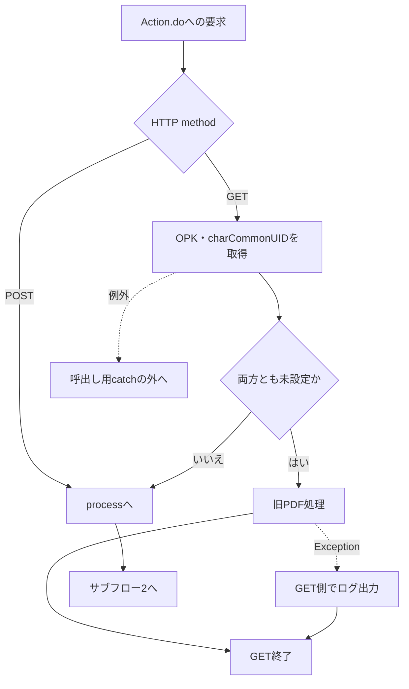

サブフロー2はAction実行前の拒否とAction実行結果を分ける。正常な各出口は、それぞれ選んだ戻り値をサブフロー3へ引き継ぐ。

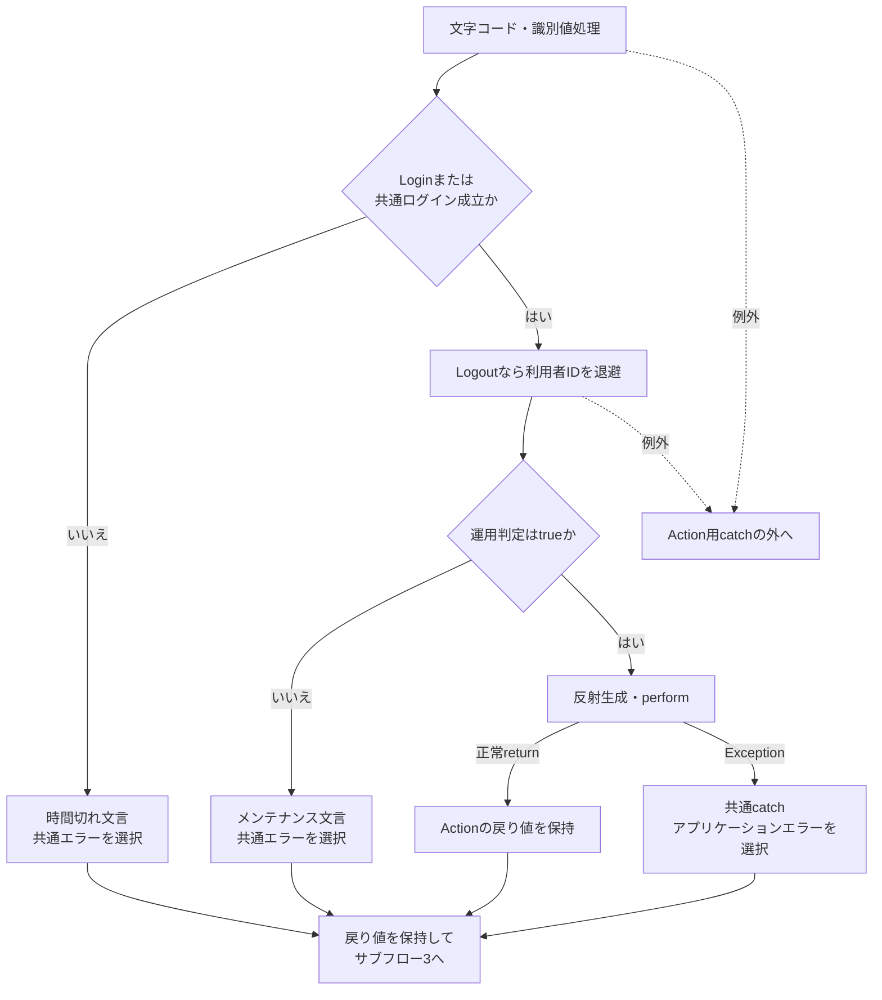

運用判定内部でExceptionをfalseへ変換する経路と、前処理から例外が外へ出る経路は異なる。共通ログイン確認のLoginBeanキャスト等もAction用catchの外にある。

サブフロー3は、各枝の戻り値を変更せず応答方式を決める。

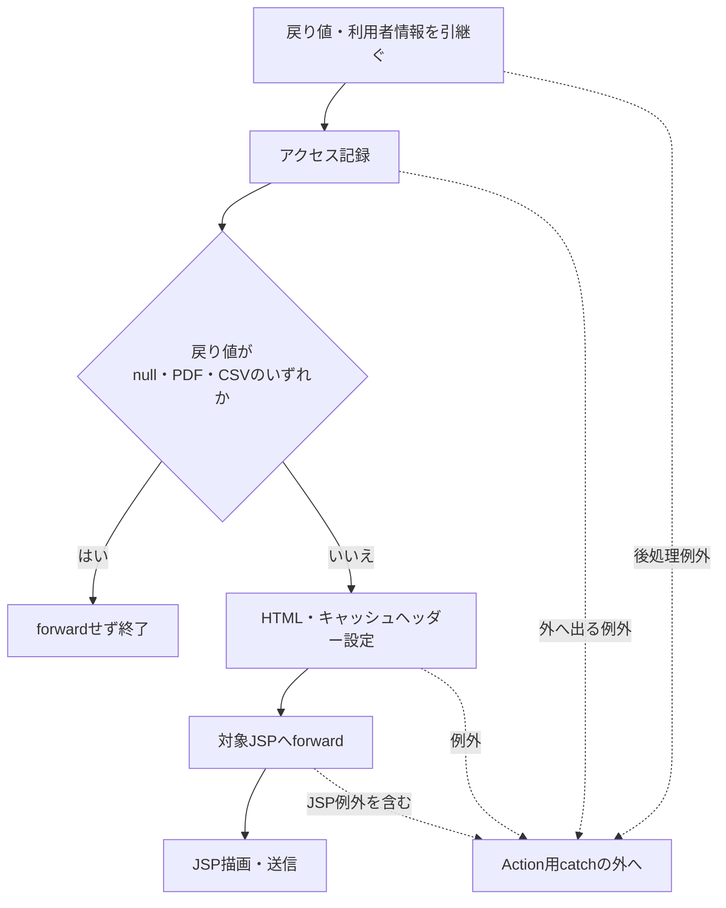

#### SQL・テーブル関連（ER図）

共通ログイン確認はセッション参照である。nenkinの運用判定では運用状態表を照会しないが、共通接続の取得は行う。アクセス記録はDB2.Ｕカウンターシフトへの単表INSERTであり、予約表とのFKや同一トランザクションを示すER関係はない。

Action固有のデータ参照関係は、各イベントと補足説明の関連図J1を参照する。

#### DB操作の詳細

アクセス記録は`jdbc/Oracle_SP2NM`の別接続を使用する。アクセス日付、アクセス時刻、機能ＩＤ、画面ＩＤ、コマンドＩＤ、アクションＩＤ、ＪＳＰ名、ユーザーＩＤをINSERTしてcommitする。

CounterShift内部のExceptionではrollbackを試み、記録失敗とrollback失敗をログへ出力する。捕捉したExceptionを通常は業務側へ再throwしない。記録処理は予約保存・削除・削除明細整理から独立し、JSON・ファイルを出力したActionの後にも実行する。

#### 結果・例外時の扱い

| 条件・段階 | 扱い |
| --- | --- |
| FUNCTION_ID欠落 | toLowerCaseでNullPointerExceptionとなり得る。Action用catchより前。 |
| VIEW_ID欠落 | viewID.equalsでNullPointerExceptionとなり得る。Action用catchより前。 |
| COMMAND_ID欠落 | クラス名へ文字列nullが入る。認証・運用判定通過後のクラス探索失敗はAction用catchで処理する。 |
| Login・LogoutのCOMMAND_IDが空文字 | 正常なAction名を生成する。 |
| LoginBeanの型不適合 | 前処理・後処理のキャストで例外となり得る。Action用catchでは捕捉しない。 |
| Action生成・performのException | 共通エラーの戻り先を選ぶ。 |
| JSPへのforward・描画の例外 | Action用catchでは捕捉しない。 |

POSTのdoPostにはprocess全体を囲むcatchがない。GETの旧PDF呼出しとprocess呼出しにはそれぞれException用catchがあるが、そこで行うのはログ出力であり、代替本文やHTTP状態を追加設定しない。コンテナへ伝わる例外と、GET側でログ出力して戻る例外を同じ応答へまとめない。

### E02 ログイン

#### 処理概要

通常フォームの認証要求を共通LoginActionへ渡し、共通認証後に年金の職員情報を成立させてメニューへ進む。共通認証成功と年金職員成立は二段階の判定である。

#### 処理手順

**1. ログイン要求を送る。**

　**1.1.** Login.jspはR01の識別値、APPL_NAME、UNIFY_FLG、DWH_USER_ID、DWH_PASS_WORDをPOSTする。CSRF_TOKENは送信しない。VIEW_ID=Loginでは既存の共通ログイン状態を要求しないが、運用判定は先行する。

**2. 共通認証を実行する。**

　**2.1.** nenkin.LoginActionは年金職員情報と年金CSRF保持値を除去してから、common.LoginActionを実行する。

　**2.2.** 通常のAPPL_NAME=unifyでは、共通認証用の利用者条件sUserへアプリケーション名を、sPassへ受信認証情報を移す。入力職員番号は別途名簿検索に使う。

　**2.3.** 共通処理がログインJSPを返した場合は、その戻り値を引き継ぐ。それ以外ではMenuViewActionを呼ぶ。

**3. 年金職員を確認する。**

　**3.1.** 年金職員情報がなければ、ログイン可のLoginBeanにある職員番号をtrimし、ASCII数字1～8桁を条件に名簿を確認する。

　**3.2.** 取得できればStaffContextとCSRF保持値を確保し、メニューBeanを設定する。番号不適合・名簿不在ではLoginBeanを除去し、拒否MESSAGEを設定して年金職員情報とCSRF保持値も除去する。

#### 処理フロー

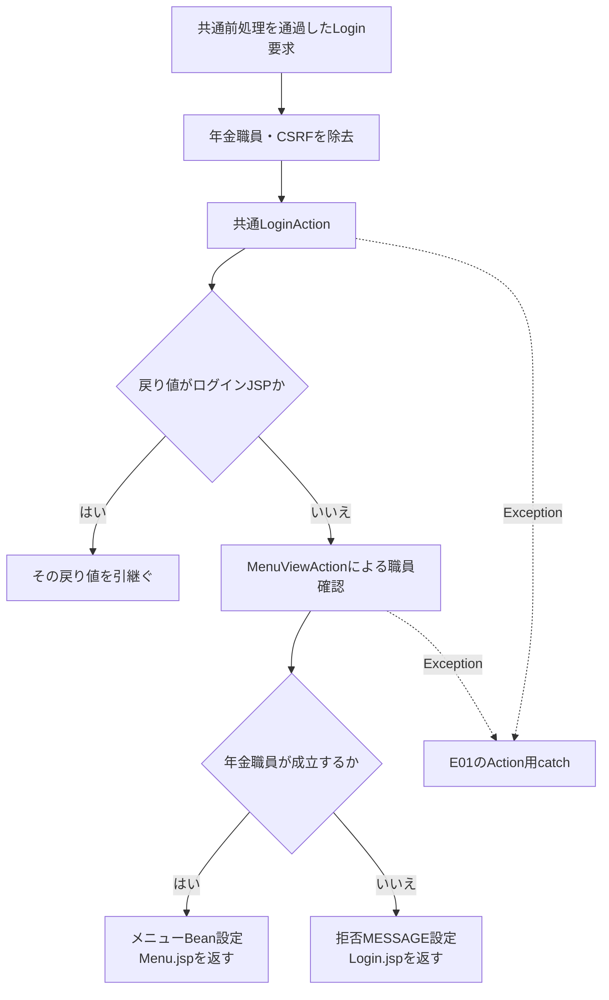

#### SQL・テーブル関連（ER図）

共通認証はログイン情報表と、職員名簿・所属・役職・事業所等の参照を使用する。年金側の追加職員確認はDB2.Ｕ職員名簿表を使用する。これらは予約本表への検索・更新とは別の処理である。

認証表の詳細な取得・設定契約はCOM-015、年金職員確認はCOM-111に対応する。本イベントでは両段階の引数と戻り分岐を定義する。

#### DB操作の詳細

共通認証のSearchLoginInfoBaseは、認証条件等をStatement用SQL文字列へ連結する。年金側の名簿確認は職員番号をPreparedStatementのsetIntで渡す。両者を同じバインド契約として扱わない。

共通側には、認証表取得後の職員番号Long変換失敗を捕捉して名簿結果なしとする枝がある。LoginInfoBeanへ設定する8桁ゼロ埋めは短い値を補う処理であり、長い値の切捨てや8桁上限検査ではない。

#### 結果・例外時の扱い

共通認証拒否ではLoginBeanとMESSAGEを保持してLogin.jspへ戻る。年金職員確認による拒否では、手順3.2の属性除去を行う。Login.jspは非空MESSAGE一覧をエスケープ表示し、表示後にMESSAGEを除去する。

共通認証や名簿取得からExceptionが外へ出た場合は、E01のAction用catchへ進む。認証拒否としてLogin.jspを返す枝と、処理例外として共通エラーを選ぶ枝は異なる。

### E03 メニュー・各業務画面の表示

#### 処理概要

表示要求に対応する新しいBeanをセッションViewBeanへ設定する。前画面の入力を継続保存する操作ではない。

#### 処理手順

**1. 表示対象を選ぶ。**

　**1.1.** Menu.jspのgo関数がVIEW_IDとCOMMAND_IDを変更し、Pension/View、Batch/View、Report/View、Excel/Viewへ送信する。メニュー再表示はMenu/Viewを使用する。

**2. 職員と初期状態を準備する。**

　**2.1.** 各Actionは職員確認を行う。StaffContextがあれば名簿を再照会せず再利用し、非空StringのCSRF保持値がなければ生成する。職員情報がなければLoginBeanを基に名簿確認する。

　**2.2.** 対象の新しいBeanを作る。予約は新しいPensionReservationを持つ状態、印刷はpreview=false、Excelは新しい条件状態とする。

　**2.3.** Batchは日次対象日を当日、月次開始・終了を当月初日・末日、削除整理基準日を表示時点の2か月前の日付にする。

**3. 表示先を返す。**

　**3.1.** BeanをViewBeanへ設定し、対応するMenu.jsp、Pension.jsp、Batch.jsp、Report.jsp、Excel.jspを返す。

#### 処理フロー

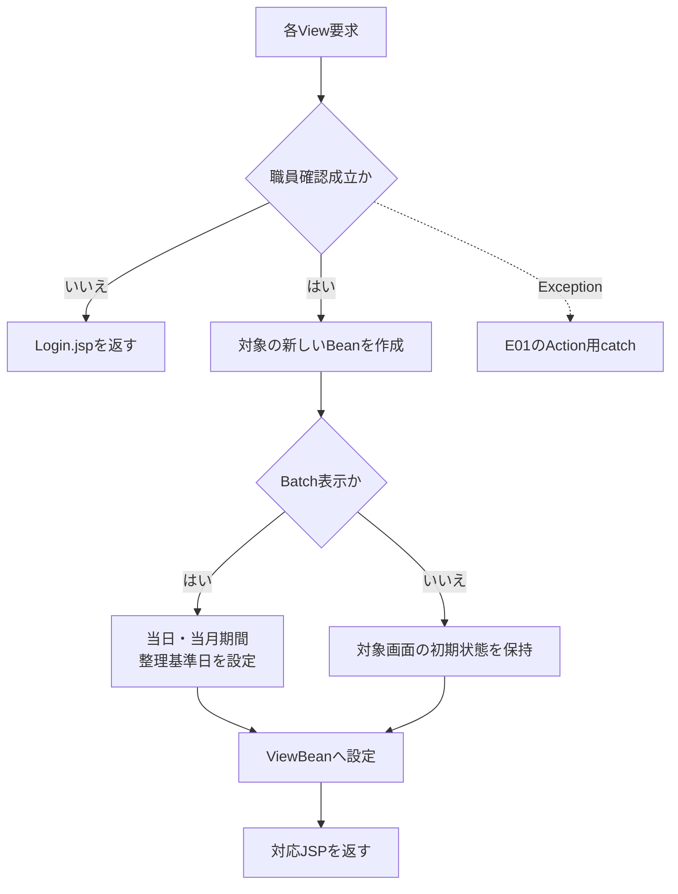

#### SQL・テーブル関連（ER図）

表示状態の保持領域はセッションである。職員情報の補完時は職員名簿を参照する。Pension.jspはforward後にコード候補を業務DBから取得するため、表示Actionが戻った時点では候補取得・画面描画まで完了していない。

候補と予約表の参照関係は関連図J1に示す。

#### DB操作の詳細

Pension.jspは性別、裁定請求、受給有無、年金種類の候補を取得する。表示要求による予約本表・削除明細の更新はない。共通アクセス記録はE01の独立処理である。

#### 結果・例外時の扱い

主画面は同じViewBean属性を使うため、複数画面・複数タブの状態を独立に保持する仕組みではない。職員確認のExceptionはAction用catchへ進み得るが、forward後の候補取得やJSPの属性型不一致はその外側で発生する。

### E04 ログアウト

#### 処理概要

common.LogoutActionで共通ログイン状態と主画面Beanを除去し、ログインJSPへ戻る。

#### 処理手順

**1. 要求と記録用識別を準備する。**

　**1.1.** メニューのログアウトフォームがR17をPOSTする。共通ログイン確認を通過した後、ControlServletは職員番号を退避して運用判定を行う。

**2. 属性を除去する。**

　**2.1.** LogoutActionはViewBeanとLoginBeanを除去する。

**3. ログイン画面へ戻す。**

　**3.1.** `./JSP/MENU/Login.jsp`を返す。ControlServletは退避した利用者IDでアクセス記録を行い、forwardする。

#### 処理フロー

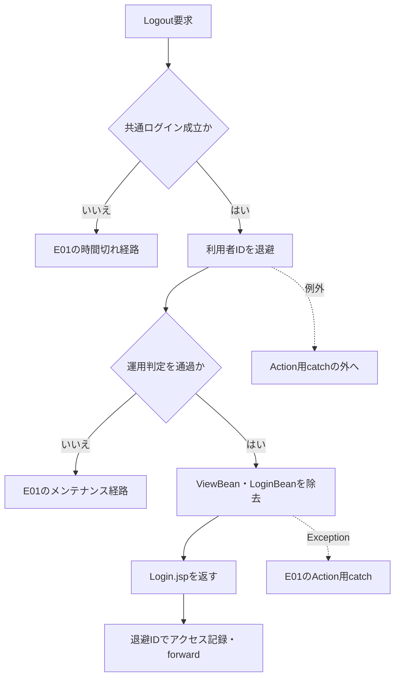

#### SQL・テーブル関連（ER図）

LogoutAction自体はセッション属性だけを操作する。業務DBを使わないためER図は該当しない。運用判定とアクセス記録はE01に従う。

#### DB操作の詳細

予約本表、削除明細、候補表の更新はない。アクセス記録は別接続で実行する。

#### 結果・例外時の扱い

セッション全体のinvalidateは行わない。SubWindowBean、NENKIN_STAFF_CONTEXT、NENKIN_CSRF_TOKENをこのActionで除去する処理はない。次の年金ログイン開始時に職員情報とCSRF保持値を除去する処理とは別である。

共通認証・運用判定による拒否ではLogoutActionに到達しないため、要求送信だけで属性除去完了とはならない。

### E05 予約読込み・クリア

#### 処理概要

Loadは予約キーで既存予約を優先し、未検出の場合だけ店番・顧客番号で顧客基本情報を取り込む。Clearは入力状態を作り直す。両操作にPOST・CSRFの追加照合はない。

#### 処理手順

**1. 操作と読込みキーを決める。**

　**1.1.** 職員確認後、Clearは継承元PensionViewActionの処理で空の予約状態を設定する。

　**1.2.** LoadはフォームをreadReservationで読み、LOOKUP_KANA・LOOKUP_PHONEを個別にtrimする。それぞれ空ならKANA_NAME・PHONE_NUMBERで補完する。

**2. 予約を優先して取得する。**

　**2.1.** 補完キーをfindByKanaAndPhoneへ渡す。取得ありなら、その予約と既存読込み文言をexisting=trueで設定する。

**3. 顧客情報または入力値を表示する。**

　**3.1.** 予約がない場合、正数化した店番・顧客番号の両方があるときだけfindByCustomerを呼ぶ。

　**3.2.** 顧客取得ありなら取得モデル、取得なしまたは照会省略なら元入力をexisting=falseで設定する。Pension.jspを返す。

#### 処理フロー

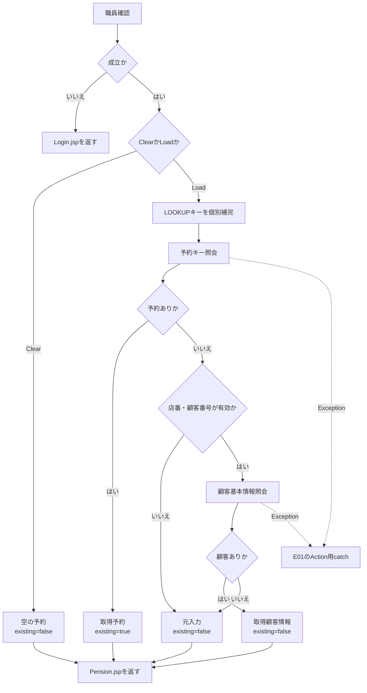

#### SQL・テーブル関連（ER図）

予約照会は年金1_LKと表示名称の5表を参照する。顧客照会はN2_SIGHT.Ｂ顧客基本表を読み、取得後に別接続で店名・性別名を補う。関連図J1はこの読取り関係を示す。

#### DB操作の詳細

予約キーの正規化、WHERE、setString・setBigDecimal、顧客照会のWHEREとsetIntはE12と共通である。ただしLoadは予約未検出から顧客照会へ進み、E12はLOOKUP_MODEで一方だけを選ぶ。

Load・Clearは業務行を更新・削除しない。

#### 結果・例外時の扱い

予約取得、顧客取得、元入力保持の各枝で、モデルとexistingが異なる。未取得枝の元入力を取得成功枝へ上書きしない。

正規化後のフリガナが空、または電話数字がない場合、予約照会は接続前にnullを返す。その結果、店番・顧客番号が有効なら顧客照会へ進む。Loadではキー不備を必ず入力エラーにする契約ではない。

### E06 予約登録・変更

#### 処理概要

要求検査、現在キーと元キーの照会、既存更新の権限判定を経て保存する。RepositoryはDB接続後にも存在を再確認し、INSERTとUPDATEを選ぶ。

#### 処理手順

**1. 職員と要求を確認する。**

　**1.1.** 職員確認後にreadReservationで受信モデルを作り、その後にPOST・CSRFを検査する。拒否時は受信モデル、期限切れ文言、existing=falseでPension.jspを返す。HTTP 403・405を設定する分岐ではない。

**2. 入力値を検査・正規化する。**

　**2.1.** 店番、フリガナ、電話番号の順に必須を確認する。続いて生年月日、配偶者生年月日、請求予定日、予約徴求日を空欄許容で正規化し、最後に備考を検査する。

　**2.2.** 入力エラー時も現在キーを検索し、取得有無をexistingへ設定して受信モデルと入力文言を返す。この照会が失敗すると入力再表示には到達しない。先に正規化済みの日付と、検査未到達の値が同じモデルへ残る場合がある。

**3. 既存状態と権限を確認する。**

　**3.1.** 正常検査後、現在キーとORIGINALキーを別々に検索する。Actionのキー比較は、trim後にNFKC・大文字化したフリガナと、trim・NFKC後にASCII数字だけを残した電話文字列を使う。Repositoryの空白集約・電話数値化とは異なる。

　**3.2.** 現在予約があり元予約とキー不一致なら、現在予約へ差し替え、内容確認後の再登録を求める。現在予約がなく元予約がある場合はキー変更を拒否し、元予約を返す。

　**3.3.** 現在予約ありの更新では、職員の店番が75で、役職コードが3000未満または数値化不能なら拒否する。取得済み予約をexisting=trueで返す。新規保存にはこの拒否を適用しない。

**4. 保存し、完了状態を準備する。**

　**4.1.** モデルとログイン職員番号をRepositoryへ渡す。Repositoryはコピーに対しキー、備考、日付を再検査し、データ更新日を当日へ置き換える。この準備はDB用tryより前に行う。

　**4.2.** 接続後に存在を再確認し、INSERTまたはUPDATEを実行する。件数1件とcommit復帰を経てActionへ戻る。

　**4.3.** Actionは空の予約、登録終了文言、existing=falseを設定し、Pension.jspを返す。

#### 処理フロー

サブフロー1は入力検査を行う。職員確認拒否はLogin.jspへ戻り、検査通過時だけサブフロー2へ進む。

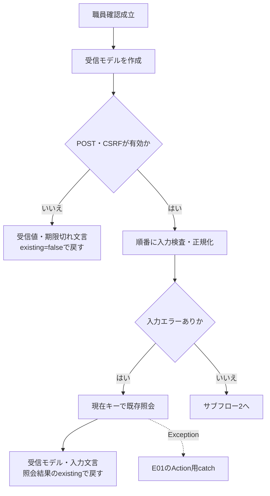

サブフロー2は、各拒否枝で取得したモデルを保持する。

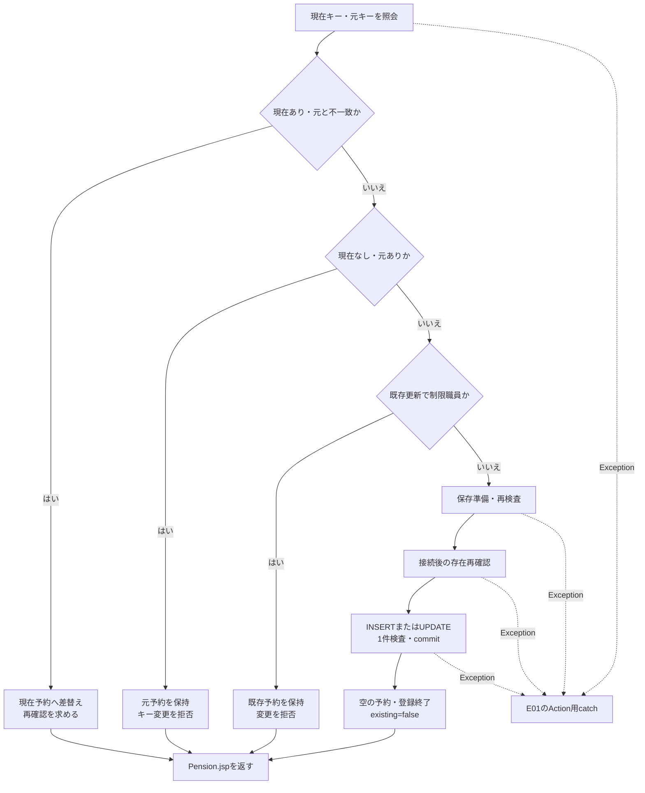

#### SQL・テーブル関連（ER図）

保存先は年金1_LKである。性別・裁定請求・受給有無は名称からコードを逆引きし、年金種類は5フラグの合成コードをコード表で確認する。店名は表示補完であり、店名文字列を予約表へ保存しない。関連図J1を参照する。

#### DB操作の詳細

現在キー・元キー・保存直前の存在確認は、フリガナ等価と電話番号等価を使う。パラメータは正規化フリガナのsetString、電話数値のsetBigDecimalの順である。

INSERT・UPDATEは補足説明の保存移送表にある28列を設定する。UPDATEのWHEREは`ふりがな = ? AND 電話番号 = ?`であり、設定値の後に29番のキー文字列、30番の電話数値を渡す。店番・顧客番号・比較版はWHEREへ追加しない。

性別等の非空表示名は、対応する名称列の等価条件へsetStringしてコードを取得する。名称不在はSQLExceptionとなる。年金種類は1・2・4・8・16を合成し、非ゼロなら種類コードの等価条件へsetIntして存在を確認する。全未選択なら合成コードNULLとする。

#### 結果・例外時の扱い

入口の非空検査を通過しても、Repositoryの正規化でフリガナが空、または電話数字なしとなればIllegalArgumentExceptionが発生する。SaveActionにはこれを入力再表示へ変える個別catchがなく、E01のAction用catchへ進む。

DB用try内ではException時にrollbackを試み、既存のデータアクセス例外は引き継ぎ、それ以外をデータアクセス例外で包む。比較版はなく、Repositoryインスタンスの同期をDB全体の排他保証とはしない。commit例外・rollback失敗時のDB状態をHTTPエラーから未保存と断定できない。

commit復帰後にもBean作成、アクセス記録、Pension.jspの候補取得・表示変換・送信が続く。登録終了状態を返すことと、利用者が完了画面を受領することは別である。

### E07 予約削除

#### 処理概要

現在キーと読込み時キーを再照会し、削除権限を確認する。Repositoryでは削除直前に再取得し、削除明細追加と本表削除を同じトランザクションで確定する。

#### 処理手順

**1. 要求を順に検査する。**

　**1.1.** 職員確認、モデル読取り、POST・CSRF、店番、フリガナ・電話番号の順に検査する。POST・CSRF拒否は受信値とexisting=false、店番不足は受信値とexisting=true、キー不足は受信値とexisting=falseで返す。

**2. 対象と権限を確認する。**

　**2.1.** 現在キーとORIGINALキーを検索する。現在予約なし、または元予約とキー不一致なら再読込みを求める。現在予約ありなら取得値とexisting=true、不在なら受信値とexisting=falseを返す。

　**2.2.** 店番75の制限職員なら、既存予約を保持して削除を拒否する。役職コードの条件はE06と同じである。

**3. Repositoryの削除結果を分ける。**

　**3.1.** キーとログイン職員番号を渡す。Repositoryは正規化後キーが無効ならfalseを返す。接続後の再取得で対象不在ならrollbackしてfalseを返す。

　**3.2.** 対象ありなら削除時の更新日・時刻・更新者を付けて削除明細へ追加し、本表を削除する。削除件数1件を確認してcommitし、trueを返す。

　**3.3.** trueなら空の予約、削除終了、existing=falseを設定する。falseなら受信値、対象不在、existing=trueを設定する。いずれもPension.jspを返す。

#### 処理フロー

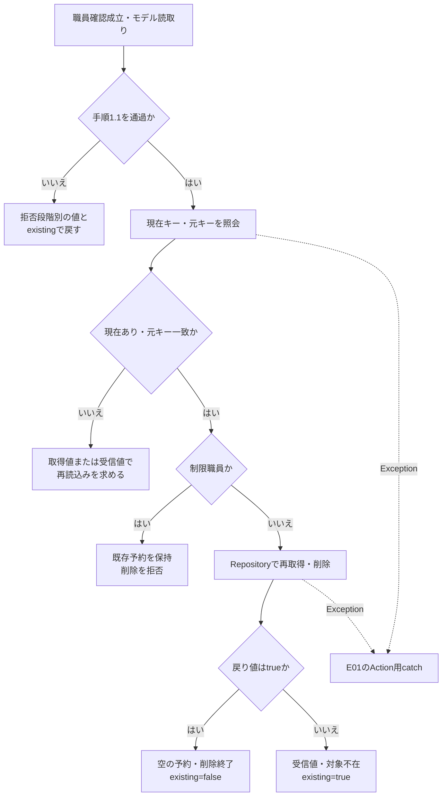

#### SQL・テーブル関連（ER図）

年金1_LKから取得した内容を年金＿削除明細へ移し、本表を削除する。これはデータ移送関係であり、FKや恒久的な1対1関係を宣言するものではない。再取得時の表示名称参照は関連図J1に従う。

#### DB操作の詳細

削除明細INSERTは保存移送表の28列を使い、変更FLGはNULLとする。本表DELETEは`WHERE ふりがな = ? AND 電話番号 = ?`で、setString、setBigDecimalの順に渡す。

明細追加と本表削除は同一接続で実行する。それぞれ1件を確認し、失敗時はrollbackを試みる。Action段階の読込み済み状態を比較版として使用しない。

#### 結果・例外時の扱い

Actionの対象確認後にRepositoryの再取得で消失した場合は、falseの結果となり得る。これを削除成功へ合流させず、受信値を保持した対象不在表示とする。

RepositoryのDB用try内のExceptionはrollbackを試みてデータアクセス例外となり、E01へ伝わる。commit・rollbackの不確定状態と、後続画面の受領不明は別に扱う。

### E08 店舗・職員・顧客参照

#### 処理概要

Lookup/ViewとLookup/Searchは同じ検索処理へ接続し、結果をSubWindowBeanへ保持してLookup.jspを返す。通常UIではiframeのHTML画面を使い、選択値をpostMessageで親画面へ返す。

#### 処理手順

**1. 参照要求を作る。**

　**1.1.** 予約画面は一時POSTフォームでTARGET、POPUP=1、現在店番、必要時の氏名・電話条件を送る。候補ボタンのcandidate指定はcustomerへ置き換え、現在フリガナ・電話番号を検索条件へ移す。

　**1.2.** Excel画面はTARGET=branch、POPUP=1で同じLookup/Viewを開く。

**2. 条件と表示ページを作る。**

　**2.1.** 職員確認後、trimしたTARGETがbranch・staff以外ならcustomerとする。各条件をtrim文字列で保持し、店番を正数Integerまたはnull、PAGEを正数intまたは1へ変換する。POPUPはActionで読まない。

　**2.2.** モード別に全件検索し、指定PAGEの20件を切り出す。その後、PAGEが最終ページを超えれば表示番号だけを補正する。

**3. 再検索または親への通知を行う。**

　**3.1.** 検索、ページ移動、条件クリアはLookup/Searchへ再POSTする。条件クリアは入力欄を空にしてPAGE=1とする。

　**3.2.** 選択・閉じるはsource=nenkin.lookupを付けてpostMessageする。親はoriginとsourceを確認する。

　**3.3.** 予約の店舗選択は店番・店名、職員選択は担当者コード・表示名を移す。顧客選択では店番・顧客番号・表示名・LOOKUPキーを移し、モーダルを閉じてPension/LoadをPOSTする。Excelは選択した店番・店名を移す。

#### 処理フロー

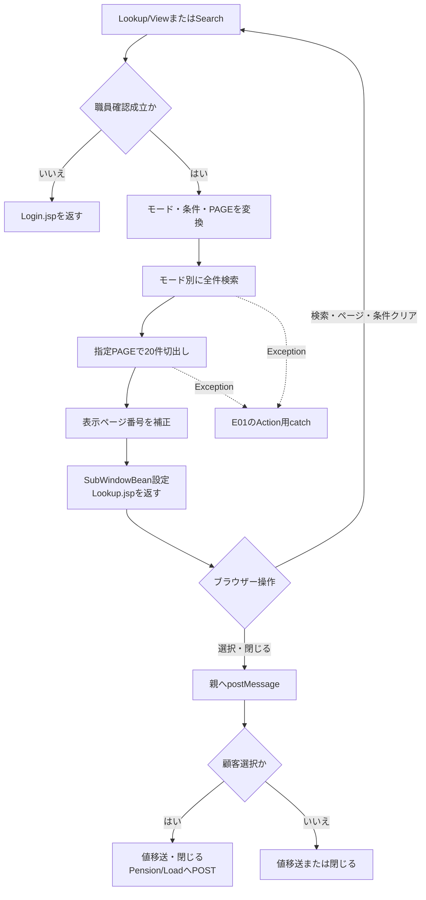

#### SQL・テーブル関連（ER図）

店舗は店名テーブル、職員はDB2.Ｕ職員名簿表、顧客はN2_SIGHT.Ｂ顧客基本表を検索する。職員・顧客の店舗表示名は、別接続の店名一覧とのメモリ突合せであり、職員・顧客検索SQLへの店名JOINではない。関連図J1を参照する。

#### DB操作の詳細

| モード | 条件と取得値 | バインド順序・並び順 |
| --- | --- | --- |
| branch | 店舗ｺｰﾄﾞ、店名を取得。正規化KEYWORDが非空なら、店舗コードのVARCHAR(20)化または大文字化した店名への部分一致。空ならWHEREなし。 | 同じLIKE値をsetStringで2個設定。店舗ｺｰﾄﾞ順。 |
| staff | 職員番号、漢字氏名、カナ氏名、所属店番、役職コードを取得。WHERE 1=1に、有効店番の等価条件、非空KEYWORDのカナ氏名または漢字氏名LIKEを追加。 | 存在する店番setInt、氏名setStringを2個。職員番号順。 |
| customer | 店舗コード、顧客番号、カナ氏名、漢字氏名、電話番号、生年月日、担当者コードを取得。有効店番、正規化後非空の氏名、数字整理後非空の電話だけを条件化。 | 店番setInt、漢字氏名・カナ氏名のOR条件へsetStringを2個、TO_CHAR電話番号LIKEへsetString。店舗コード・顧客番号・カナ氏名順。 |

文字列検索はNFKC、trim、空白集約、大文字化を行う。電話条件は数字抽出と先頭ゼロ整理を行う。LIKE値はバックスラッシュ、%、_、[、]をエスケープし、前後に%を付ける。SQL側にもESCAPE句がある。

SQLページングや取得件数の上限指定はなく、全件取得後にメモリで切り出す。変換後nullの店番は条件を付けないため、不正店番が必ず入力拒否となる契約ではない。

#### 結果・例外時の扱い

通常の範囲外ページでは空の切出し結果を作った後に表示番号だけが補正される。補正後ページで再切出ししない。極端な正数PAGEにはint演算の上限検査がなく、オーバーフロー時も通常の空結果になるとは保証できない。

検索0件、検索失敗、JSP描画失敗は別結果である。検索・切出しから外へ出るExceptionはAction用catchへ進む。forward後のJSP例外はその外側である。

### E09 登録内容印刷のプレビュー・ブラウザー印刷

#### 処理概要

印刷条件で予約を検索し、Report.jspにプレビューを作る。印刷はpreview成立時のボタンからwindow.printを呼ぶブラウザー内操作である。

#### 処理手順

**1. 条件を変換する。**

　**1.1.** 職員確認後、新しいReportViewBeanへ範囲使用フラグ、trimした店番自・至、変換したSORT_TYPEを保持する。検索用の店番は正数Integerまたはnullとする。

**2. 範囲と検索結果を設定する。**

　**2.1.** 範囲使用時に店番自がnullなら拒否する。有効な店番至が店番自未満の場合も拒否する。いずれもpreview=falseを保つ。

　**2.2.** 店番至が空・変換不能なら単一店舗検索とする。範囲不使用時は両店番をnullとして検索する。

　**2.3.** 検索が戻れば0件でもrowsを設定し、preview=trueとする。BeanをViewBeanへ設定してReport.jspを返す。

**3. プレビュー成立時だけ印刷を可能にする。**

　**3.1.** preview=falseの再表示は印刷ボタンをdisabledとする。preview=trueではボタンを有効にし、利用者の操作でwindow.printを呼ぶ。別のAction要求は送らない。

#### 処理フロー

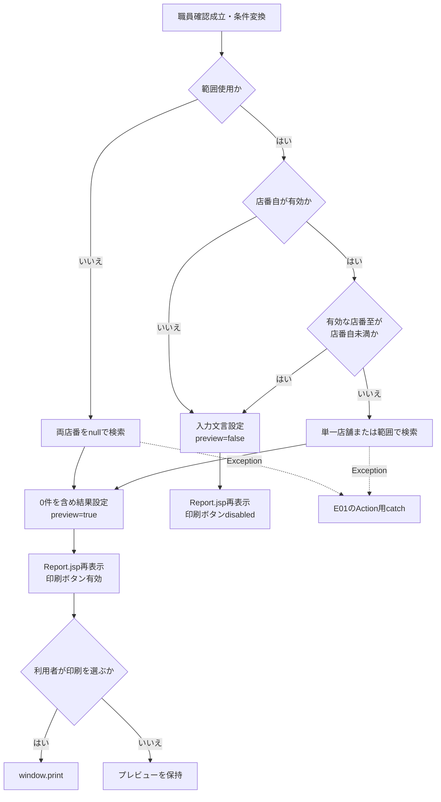

入力拒否の再表示Iから印刷Lへの接続はない。0件は入力拒否ではなく、preview=trueの結果に属する。

#### SQL・テーブル関連（ER図）

年金1_LKと表示名称の5表を使用する。関連図J1のLEFT JOINに従い、業務表を更新しない。

#### DB操作の詳細

共通SELECTとLEFT JOINにWHERE 1=1を付ける。単一店舗は`R.店番 = ?`、範囲は`R.店番 >= ? AND R.店番 <= ?`とし、存在する店番を下限・上限の順にsetIntする。全店舗では店番述語を付けない。

| SORT_TYPE | ORDER BY |
| --- | --- |
| 2 | 店番、ふりがな、顧客番号 |
| 3 | 店番、生年月日、顧客番号 |
| 4 | 店番、請求予定日、顧客番号 |
| その他 | 店番、担当者コード、顧客番号 |

全件取得でページングはない。画面の「顧客氏名」選択は、SQLではふりがな順に対応する。

#### 結果・例外時の扱い

0件でもプレビューは成立し、対象データなしを表示する。検索のExceptionはAction用catchへ進む。Report.jsp内の職員属性キャスト、職員番号変換、日付表示等の例外はforward側で発生する。

印刷ダイアログの取消やプリンターへの出力完了を、サーバーの戻り値から確定する処理はない。

### E10 店舗別Excel出力

#### 処理概要

指定店舗の予約を取得し、明細ありの場合に単一シートのxlsxをメモリ生成して直接送信する。店舗名の取得成功は出力の必須条件ではない。

#### 処理手順

**1. 店番を確認する。**

　**1.1.** 職員確認後、trimしたBRANCH_NOを新しいExcelViewBeanへ保持し、正数Integerへ変換する。空または変換後nullなら入力要求でExcel.jspを返す。

　**1.2.** 次にASCII数字だけで3桁以下かを検査する。不適合なら形式文言で再表示する。ブラウザーmaxlength=3とは別の検査である。

**2. 名称と明細を取得する。**

　**2.1.** 店名が取得できればBeanへ設定する。不在でも店舗別出力サービスを呼ぶ。

　**2.2.** サービスは明細0件なら空内容・件数0の結果を返し、Workbookを生成しない。Actionは店番と取得済み店名を保持して対象不在を再表示する。

**3. ファイルを送信する。**

　**3.1.** 明細ありなら18列の単一シート「年金ﾃﾞｰﾀ」を生成する。ファイル名は`年金データ_〈3桁店番〉_〈当日yyyyMMdd〉.xlsx`とする。

　**3.2.** Excel用Content-Type、ファイル名、内容をwriteDownloadへ渡す。write・flush復帰後にCSVを返す。

#### 処理フロー

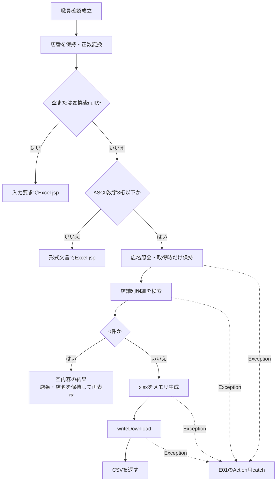

#### SQL・テーブル関連（ER図）

店名表示は店名テーブル、明細は年金1_LKと関連図J1の5参照表から取得する。店名不在でも本表の店番条件による明細検索へ進む。

#### DB操作の詳細

WHEREは`R.店番 = ?`で、setInt(1, branchNo)を使用する。ORDER BYは請求予定日DESC、担当者コード、顧客番号である。全件取得で、業務表の更新はない。

Content-Typeは`application/vnd.openxmlformats-officedocument.spreadsheetml.sheet`である。出力列・セル値はOUTPUT-NENKIN、Workbook構造はCOM-150に対応する。

#### 結果・例外時の扱い

入力拒否・0件では作成したBeanをViewBeanへ設定する。直接出力枝では、そのBeanを新たにセッションへ設定する処理を経ず送信する。

DB・Workbook生成・送信のExceptionを個別処理するcatchはなく、E01へ伝わる。出力開始後は、共通catchに入っても完全なエラーHTMLへ切り替えられるとは限らない。

### E11 日次・月次出力

#### 処理概要

出力区分、更新者、対象期間で抽出し、ファイル数に応じて画面再表示、単独xlsx、ZIPを返す。抽出前の削除明細整理は、後続の出力生成と独立したcommitを持つ。

日付は、受信後のJava trimによる必須検査と、DateUtilのNFKCを含む正規化を別々に行う。正規化後に必須を再検査しないため、日付が空文字となって検索範囲が変わる経路も現行契約に含まれる。

#### 処理手順

**1. 要求値を保持し、入口を検査する。**

　**1.1.** 職員確認後、STAFF_NO、区分フラグ、日次・月次日付、DELETE_CUTOFF_DATEを新しいBatchViewBeanへ保持する。

　**1.2.** POST・CSRF、3区分のいずれか一つ以上、非空職員番号のASCII数字8桁以下を、この順で検査する。拒否時は保持した条件と文言でBatch.jspを返す。

　**1.3.** DailyはDAILY、MonthlyはMONTHLYを要求DTOへ設定し、保持値を移送する。サービス単体のALL許容は画面の先行検査を通過しない。

**2. 抽出期間と更新者を決める。**

　**2.1.** サービスは要求・区分・実行モードを確認する。日次はDAILY_DATEをrequiredDateへ渡し、戻った値をfrom・toの両方へ設定する。月次はMONTH_START、MONTH_ENDの順にrequiredDateへ渡し、from.compareTo(to)>0なら拒否する。

　**2.2.** requiredDateはnullまたはJava trim後空文字を拒否してからDateUtil.toIsoDateを返す。DateUtilはNFKC後にtrimし、その結果が空なら空文字を返す。requiredDateはこの戻り値を再検査しない。

　**2.3.** STAFF_NO空欄はupdatedBy=nullとして更新者条件を付けない。画面を通過した非空値は数値化して更新者条件に使用する。

次表はJava受信文字列を前提とする。U+3000は全角空白を表し、HTTPからそのJava文字列が得られる境界とは分けて扱う。

| 実行条件 | 正規化後from / to | 前後比較と抽出条件 |
| --- | --- | --- |
| 日次の有効日付 | 同じISO日付 / 同じISO日付 | データ更新日の以上・以下を両方付ける。 |
| 日次のU+3000だけの値 | 空文字 / 空文字 | 日付の両述語と両JDBCバインドを省略し、区分・指定時の更新者だけで抽出する。 |
| 月次の有効な開始・終了 | 開始ISO日付 / 終了ISO日付 | 開始が終了以前なら両述語を付け、開始が後なら拒否する。 |
| 月次の開始・終了がともにU+3000だけ | 空文字 / 空文字 | 比較は同値で通過し、期間条件なしで抽出する。 |
| 月次の開始だけU+3000、終了は有効日付 | 空文字 / 終了ISO日付 | 前後比較を通過し、上限述語とそのsetDateだけを付ける。 |
| 月次の開始は有効日付、終了だけU+3000 | 開始ISO日付 / 空文字 | 開始が終了より大きいとしてIllegalArgumentExceptionとなり、整理・抽出前に再表示する。 |
| 必要日付が未設定・Java trim後空文字 | 必須検査で例外 | 整理・抽出前に再表示する。 |
| 非空値が日付として不正 | 正規化で例外 | 整理・抽出前に再表示する。 |

**3. 削除明細整理を分岐する。**

　**3.1.** DELETE_CUTOFF_DATEのJava trim後が空ならRepository呼出しを省略する。

　**3.2.** 非空ならpurgeDeletedAuditsThroughを呼ぶ。RepositoryはoptionalDateで再正規化し、結果が空なら接続取得・DELETE・commitを行わず0を返す。U+3000だけの値はこの枝に該当する。

　**3.3.** 有効な基準日なら、基準日以前の削除明細をDELETEして独立commitする。実行後の削除0件でもcommitする。サービスは戻り件数を使わず次へ進むため、戻り値0だけでは未実行と実行済み0件を区別できない。

**4. 区分別にファイルを生成する。**

　**4.1.** 選択した新規・変更・削除をこの順で処理する。各抽出では、正規化後非空のfrom・toだけを日付述語へ使う。空値はSQL NULLのバインドではなく、述語・パラメータ自体の省略となる。

　**4.2.** 0件区分はメッセージを保持し、明細あり区分は追加ソート、行変換、Workbook生成を行う。正規化後の空期間も後続へ引き継がれ、明細があれば生成へ進む。出力見出しの期間表示も、その空の端点を空文字として使う。

　**4.3.** 生成0ファイルなら空byte配列、1ファイルなら当該xlsxの名前・型・内容、複数なら日次・月次のZIP名とapplication/zipを結果へ設定する。ZIPには0件区分のメッセージがある場合だけUTF-8の出力結果.txtを含める。

**5. 画面または直接応答を返す。**

　**5.1.** 内容なしならメッセージを空白で連結し、条件保持BeanをViewBeanへ設定してBatch.jspを返す。

　**5.2.** 内容ありなら結果のファイル名・Content-Type・内容でwriteDownloadし、CSVを返す。

　**5.3.** buildとwriteDownloadを囲む個別catchはIllegalArgumentExceptionを先に処理する。条件保持Beanと例外文言でBatch.jspへ戻す。それ以外のExceptionはE01のAction用catchへ伝わる。

#### 処理フロー

サブフロー1は入口検査と期間決定である。出口にはfrom、to、updatedByを引き継ぐ。正規化後空文字を除く検査を図へ追加しない。

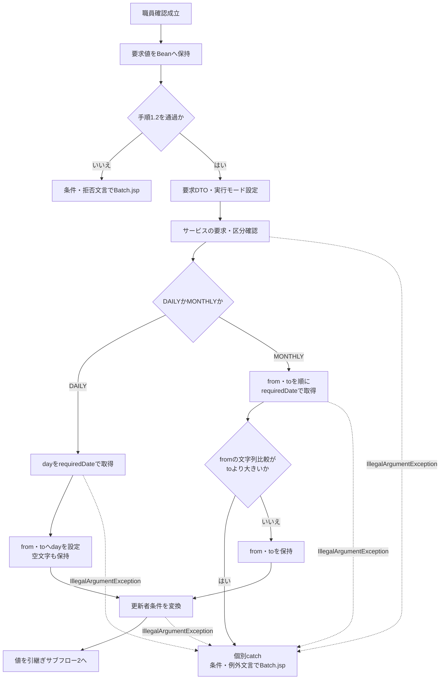

サブフロー2は整理の実行有無を分ける。S0～S2は説明上の状態区分であり、実装が専用の状態変数を保存するものではない。各枝の実際のDB状態を保持してサブフロー3へ進む。

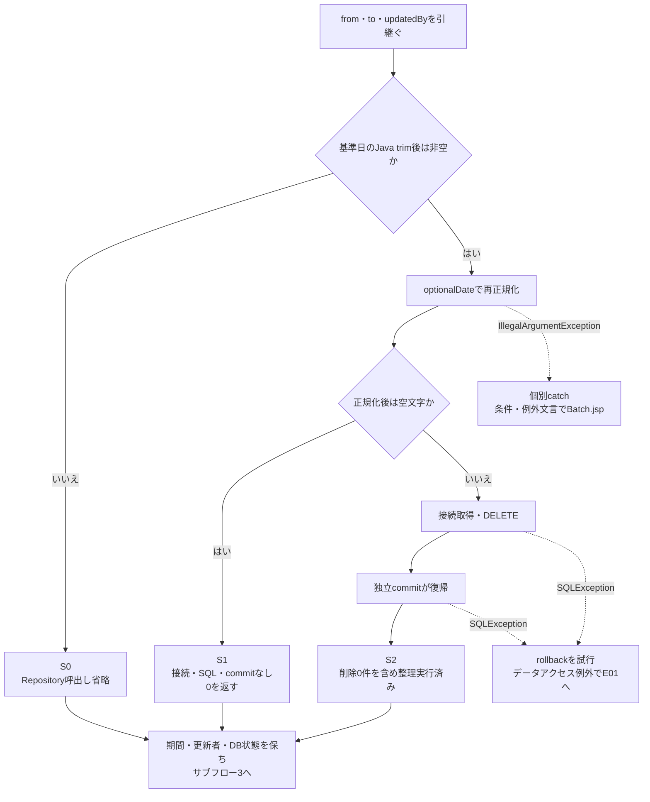

サブフロー3はファイル生成と応答を分ける。各結果枝のファイル名・型・内容を保持し、整理済み状態を後続失敗で未実行へ戻さない。

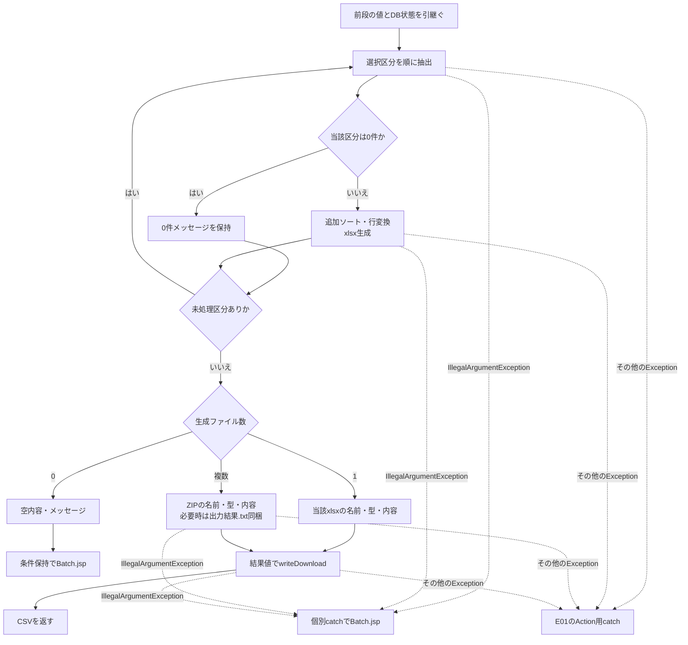

#### SQL・テーブル関連（ER図）

新規・変更は年金1_LK、削除抽出と整理は年金＿削除明細を対象とする。各抽出は関連図J1の5表をLEFT JOINして表示名称を取得する。新規・変更を完全な履歴表から取得する構成ではない。

#### DB操作の詳細

| 処理 | 条件・バインド | 順序・確定境界 |
| --- | --- | --- |
| 削除明細整理 | 正規化後非空の場合だけ、データ更新日以下の条件へ基準日をsetDate | DELETE後に独立commit。正規化後空なら接続も取得しない。 |
| 新規抽出 | WHERE 1=1、変更FLG=0、非空開始日の以上、非空終了日の以下、指定時の更新者等価 | 存在する変更FLGのsetInt、開始・終了setDate、更新者setIntの順。 |
| 変更抽出 | 新規と同じ条件形で変更FLG=1 | 同じバインド順序。 |
| 削除抽出 | WHERE 1=1、非空開始日の以上、非空終了日の以下、指定時の更新者等価。変更FLG条件なし | 存在する開始・終了setDate、更新者setIntの順。 |

開始・終了が空の枝では、対応する`R.データ更新日 >= ?`・`R.データ更新日 <= ?`とそのバインドを省く。期間条件なしの枝でも、新規・変更の変更FLG条件と、指定された更新者条件は残る。

SQLのORDER BYはデータ更新日、更新時間、店番、顧客番号である。全件取得時にauditIdを1始まりの読取り連番として付け、サービスで店番、顧客番号、auditId順へ追加ソートする。auditIdは永続監査IDではない。

期間・区分・職員指定は検索制御値であり、その要求値を保存列へ登録しない。検索用setDateには正規化した非空日付だけを渡す。パラメータサイズ、SQLページング、明示タイムアウト、取消機構は設定されていない。

#### 結果・例外時の扱い

| 生成結果 | 応答 | 0件区分のメッセージ |
| --- | --- | --- |
| 0ファイル | 条件保持のBatch.jsp | 空白で連結して画面へ渡す。 |
| 1ファイル | 当該区分の単独xlsx | 結果内に保持するが、別ファイルや本文として送らない。 |
| 複数ファイル | 年金予約データ明細リスト（日次）.zip、または年金予約データ明細リスト（月次）.zip | 存在するときだけ出力結果.txtへ格納する。 |

IllegalArgumentExceptionはBatchRunActionの個別catchが先に処理する。これを後段の共通catch対象へ重ねて分類しない。整理後の行変換等からこの例外が出た場合も、画面再表示は既存の整理commitを巻き戻さない。

データアクセス例外、Workbook・ZIPのIOExceptionを包むIllegalStateException、送信IOException等は個別catchの対象外である。共通catchへ到達した場合も、整理commitの状態、ファイル生成、HTTP送信、利用者受領を別々に扱う。

正規化後の空期間を再検査する処理は実装されていない。有効な日付を要求する画面の意図だけから、期間付き抽出が常に保証されるとはしない。

### E12 Pension/LookupのJSON照会

#### 処理概要

PensionLookupActionは反射規則で接続できるJSON入口である。付属JSP・JavaScriptからの呼出しは確認できず、通常UIの非同期照会とは位置付けない。通常UIはPension/Loadと、Lookup/View・Searchのiframe通信を使う。

#### 処理手順

**1. 前提条件とmethodを確認する。**

　**1.1.** 共通前処理で認証拒否となった場合はActionを呼ばず、共通エラーJSPへ進む。Action到達後は最初にrequireStaffを呼び、不成立ならLogin.jspを返す。

　**1.2.** 職員確認後にPOSTを検査する。POST以外ならsendError(405)を実行してCSVを返す。CSRF照合はない。単純なGETは旧PDF入口へ進むため、このmethod検査へ必ず到達するわけではない。

**2. 照会分岐を一つ選ぶ。**

　**2.1.** 生のLOOKUP_MODEがkeyと完全一致する場合、受信KANA_NAME・PHONE_NUMBERをそのままfindByKanaAndPhoneへ渡す。店番・顧客番号は使用しない。

　**2.2.** その他・空文字・未設定では、BRANCH_NO・CUSTOMER_NOを正数Integerへ変換する。一方でもnullなら照会せずvalue=null、両方有効ならfindByCustomerを呼ぶ。

**3. JSONを組み立てて出力する。**

　**3.1.** 取得処理が戻った後、UTF-8と`application/json; charset=UTF-8`を設定し、Writerを取得する。

　**3.2.** value=nullなら`{"found":false}`だけを書く。取得ありならfound=trueとreservationを組み立てて書く。

　**3.3.** flush後にCSVを返す。ControlServletはアクセス記録を行い、forwardせず終了する。

#### 処理フロー

サブフロー1はJSON出力前の拒否と照会結果を分ける。value=nullの枝と取得モデルの枝を区別して次へ渡す。

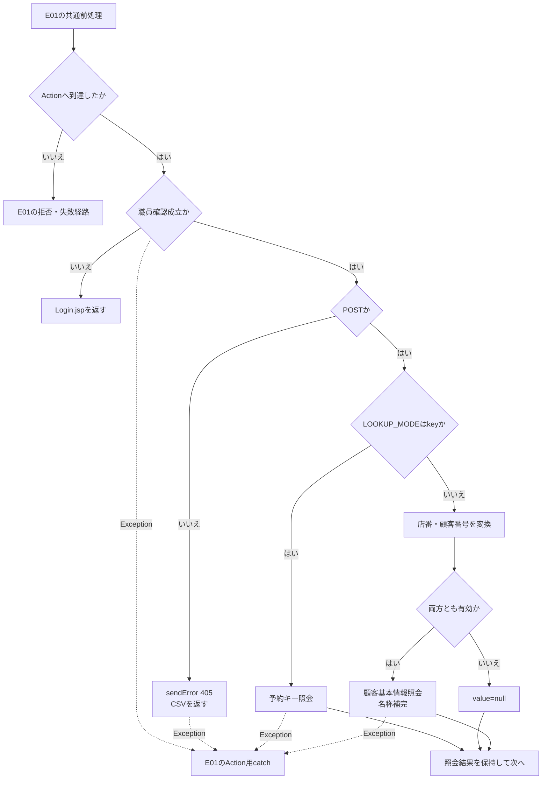

サブフロー2は取得済みモデルを保持してJSONを生成する。

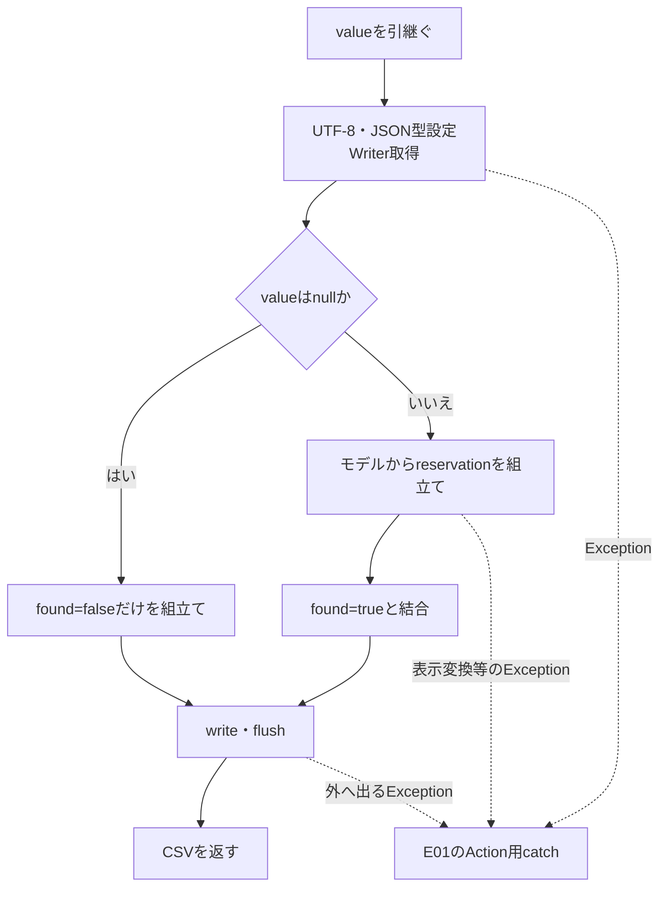

#### SQL・テーブル関連（ER図）

key分岐は年金1_LKと5参照表、顧客分岐はN2_SIGHT.Ｂ顧客基本表を使用する。顧客取得後の店名・性別名は業務接続で補う。関連図J1に従い、顧客分岐を予約本表の店番・顧客番号検索へ置き換えない。

#### DB操作の詳細

予約キー照会では、フリガナにNFKC、trim、空白集約、大文字化を行う。電話番号はJavaのchar単位で十進数字を抽出し、ASCII数字へ写してBigDecimalへ変換する。正規化後フリガナが空、または電話数字がなければ、接続取得前にnullを返す。

SQLは共通SELECT・LEFT JOINに`WHERE R.ふりがな = ? AND R.電話番号 = ?`を付ける。正規化フリガナをsetString、電話数値をsetBigDecimalで渡す。ORDER BY、ページング、複数件拒否はなく、先頭行をモデル化する。一意性の保証ではない。

顧客基本表照会では、店舗コード、顧客番号、担当者コード、漢字氏名、カナ氏名、性別コード、漢字住所、電話番号、生年月日を取得する。WHEREは`C.店舗コード = ? AND C.顧客番号 = ?`で、店番・顧客番号の順にsetIntする。ORDER BYや複数件拒否はなく、先頭行を使う。

顧客接続を閉じた後、取得ありの場合だけ業務接続で店名・性別表示名を補う。後段の照会失敗は未検出へ置き換えない。

正常JSONの外側は次の構造である。

| 条件 | 本文構造 |
| --- | --- |
| value=null | `{"found":false}`。reservation属性なし。 |
| valueあり | `{"found":true,"reservation":{…}}`。次表の全属性を出力。 |

次表のRは年金1_LK、Bは店名テーブル、Gは性別テーブル、Cは裁定請求テーブル、Hは受給有無テーブル、Pは年金種類テーブルを示す。顧客分岐の初期値は、顧客基本情報から設定しない予約固有項目の値である。

| JSON名 | JSON型 | key分岐の取得元・変換 | 顧客分岐の取得元・値 |
| --- | --- | --- | --- |
| branchNo | numberまたはnull | R.店番 | 店舗コード |
| branchName | string | B.店名 | 取得店番で店名を補完 |
| customerNo | numberまたはnull | R.顧客番号 | 顧客番号 |
| staffCode | numberまたはnull | R.担当者コード | 担当者コード |
| customerName | string | R.顧客氏名 | 漢字氏名 |
| kanaName | string | R.ふりがな | カナ氏名 |
| gender | string | G.性別 | 性別コードから名称を補完 |
| address | string | R.住所 | 漢字住所 |
| phoneNumber | string | R.電話番号の表示文字列 | 電話番号の表示文字列 |
| birthDate | string | R.生年月日 | 生年月日をISO日付化 |
| birthDateDisplay | string | 生年月日の和暦表示 | 同じ変換 |
| claimStatus | string | C.裁定請求 | 初期値の空文字 |
| claimScheduledDate | string | R.請求予定日 | 初期値の空文字 |
| claimScheduledDateDisplay | string | 請求予定日の西暦スラッシュ表示 | 空文字 |
| plannedAge | numberまたはnull | R.予定年齢 | 初期値のnull |
| reservationRequestDate | string | R.予約徴求日 | 初期値の空文字 |
| reservationRequestDateDisplay | string | 予約徴求日の西暦スラッシュ表示 | 空文字 |
| dataUpdateDate | string | R.データ更新日 | 初期値の空文字 |
| dataUpdateDateDisplay | string | データ更新日の西暦スラッシュ表示 | 空文字 |
| notes | string | R.備考 | 初期値の空文字 |
| spouseName | string | R.配偶者名 | 初期値の空文字 |
| hasBenefit | string | H.受給有無 | 初期値の空文字 |
| spouseBirthDate | string | R.配偶者生年月日 | 初期値の空文字 |
| spouseBirthDateDisplay | string | 配偶者生年月日の和暦表示 | 空文字 |
| pensionType | string | P.年金種類 | 初期値の空文字 |
| nationalPension | boolean | 種類：国民年金の非ゼロ判定 | false |
| employeePension | boolean | 種類：厚生年金の非ゼロ判定 | false |
| mutualAidPension | boolean | 種類：共済年金の非ゼロ判定 | false |
| employeePensionFund | boolean | 種類：厚生年金基金の非ゼロ判定 | false |
| nationalPensionFund | boolean | 種類：国民年金基金の非ゼロ判定 | false |
| sixMonthCheck | boolean | ６ヶ月先確認の非ゼロ判定 | false |

Integer属性はJDBCのwasNullを確認してnullを保つ。String setterはDB由来nullを空文字にするため、LEFT JOIN不成立の名称もJSON nullにはしない。6フラグはJSON booleanであり、hasBenefitは文字列である。

#### 結果・例外時の扱い

入力不適合による顧客照会省略とDB未検出は、正常出力へ到達すればfound=falseとなる。HTTP 400・404を設定しない。key未検出から顧客分岐へ自動フォールバックする処理もない。

電話表示は数字列の先頭ゼロを整理し、結果が9桁または10桁で0始まりでなければ0を補う。元の区切り記号を保持する値ではない。JSON文字列はHtmlUtil.jsonで引用符、バックスラッシュ、制御文字、山括弧等をエスケープする。

Writer取得後にtoJsonを評価するため、不正日付や明治開始前の日付の和暦表示等で例外となる場合がある。取得済みモデルがあることはfound=true本文の生成成功を意味しない。

正常枝ではHTTP status、Content-Disposition、Content-Lengthを明示設定しない。PrintWriter.checkErrorも呼ばない。CSV返却では共通forward用キャッシュヘッダーを設定しない。共通認証拒否、職員拒否、405、取得・変換例外を、固定のJSONエラー契約へまとめない。

## 補足説明

### 受信値・モデル・保存値の対応

項目一覧のI・Oは要求処理側から見た受信・送信方向である。入力欄へ初期表示した値でも、フォーム送信で受け取る項目はIに整理している。

年金共通のtrimは未設定を空文字にしてJavaのtrimを行う。integerOrNullは空、変換不能、int範囲外、ゼロ以下をnullにする。integerOrDefaultはそのnullを指定既定値へ置き換える。ASCII数字や桁数の追加検査はActionごとの条件であり、共通数値変換と同一ではない。

チェック値は未設定ならfalse、値1、または大小文字を区別しないtrue・onだけをtrueとする。値のtrimは行わない。モデルの初期値はIntegerがnull、Stringが空文字、booleanがfalseである。

次表は年金1_LKおよび削除明細への移送を示す。番号はbindRecordのパラメータ順であり、UPDATEでは後続にキー2項目を追加する。SQL Server用DDLでは対象28列はいずれもNULL可と宣言されるが、処理が実際に設定する値は列ごとに異なる。

| 順序 | 要求・内部値と対象列 | JDBC設定 | SQL Server用DDL宣言・補足 |
| --- | --- | --- | --- |
| 1～3 | BRANCH_NO→店番、CUSTOMER_NO→顧客番号、STAFF_CODE→担当者コード | setInt、nullはTypes.INTEGER | 店番・担当者はINT、顧客番号はBIGINT。要求モデルは顧客番号もInteger。 |
| 4～5 | CUSTOMER_NAME→顧客氏名、正規化KANA_NAME→ふりがな | setString | 各NVARCHAR(100)。通常の未設定文字列は空文字。 |
| 6 | GENDERの表示名から逆引きした性別コード→性別 | setInt、空選択はTypes.INTEGERのNULL | TINYINT。名称を直接保存しない。 |
| 7 | ADDRESS→住所 | setString | NVARCHAR(300)。 |
| 8 | PHONE_NUMBERの数字列→電話番号 | setBigDecimal。共通setterのnull指定型はTypes.DECIMAL | DECIMAL(15,0)。通常Saveは数字なしを保存前に拒否する。 |
| 9 | 正規化BIRTH_DATE→生年月日 | setDate、空はTypes.DATE | DATE。 |
| 10～14 | 国民年金、厚生年金、共済年金、厚生年金基金、国民年金基金→対応する種類別列 | setIntで各0・1 | 各BIT。 |
| 15 | 5フラグの合成コード→年金種類 | setInt、全未選択はTypes.INTEGERのNULL | INT。非ゼロは種類コード表で確認する。 |
| 16 | CLAIM_STATUSの名称から逆引き→裁定請求 | setInt、空選択はTypes.INTEGERのNULL | TINYINT。 |
| 17 | 正規化CLAIM_SCHEDULED_DATE→請求予定日 | setDate、空はTypes.DATE | DATE。 |
| 18 | PLANNED_AGE→予定年齢 | setInt、nullはTypes.INTEGER | INT。 |
| 19 | SPOUSE_NAME→配偶者名 | setString | NVARCHAR(100)。 |
| 20 | 正規化SPOUSE_BIRTH_DATE→配偶者生年月日 | setDate、空はTypes.DATE | DATE。 |
| 21 | HAS_BENEFITの名称から逆引き→受給有無 | setInt、空選択はTypes.INTEGERのNULL | TINYINT。 |
| 22 | 正規化RESERVATION_REQUEST_DATE→予約徴求日 | setDate、空はTypes.DATE | DATE。 |
| 23 | NOTES→備考 | setString | NVARCHAR(400)。別途Windows-31J変換可・56バイト以下を検査する。 |
| 24 | サーバー当日→データ更新日 | setDate | DATE。受信DATA_UPDATE_DATEは置き換える。 |
| 25 | サーバー時刻→更新時間 | setTime。設定用値が8文字未満ならTypes.TIMEのNULL | TIME(0)。通常の更新はサーバー生成値を使う。 |
| 26 | ログイン職員番号→更新者 | setInt、null指定時はTypes.INTEGER | INT。担当者コードとは異なる。 |
| 27 | SIX_MONTH_CHECK→６ヶ月先確認 | setIntで0・1 | BIT。 |
| 28 | 新規0、更新1、削除明細NULL→変更FLG | setIntまたはTypes.INTEGERのNULL | TINYINT。クライアントから受ける値ではない。 |
| 29～30 | UPDATEの正規化フリガナ・電話数値→WHERE | setString、setBigDecimal | 比較版を含まない。 |

PreparedStatementの設定に、文字列のサイズ引数は指定されない。ブラウザーmaxlength、業務検査、Javaの型範囲、DB容量は別制約である。NVARCHARの宣言値を備考の56バイト検査や未確認の名称業務上限へ置き換えない。

### 関連図J1：SQL参照・データ移送・メモリ突合せ

次図は処理上の参照関係を示す。FK、一意性、多重度を表すものではない。

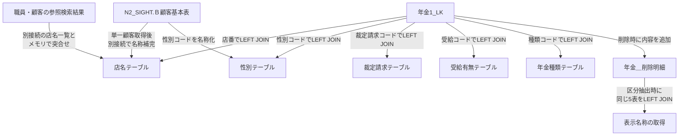

予約本表・削除明細抽出のJOIN条件は、店番=店舗ｺｰﾄﾞ、性別=性別ｺｰﾄﾞ、裁定請求=裁請ｺｰﾄﾞ、受給有無=受給ｺｰﾄﾞ、年金種類=種類ｺｰﾄﾞである。LEFT JOIN不成立による名称NULLと、マスター保存列のNOT NULL宣言は別の属性である。

マスターDDLの名称列は、店名NVARCHAR(80)、性別・裁定請求・受給有無NVARCHAR(10)、年金種類NVARCHAR(120)で、いずれもNOT NULLと宣言される。確認できる年金通常要求にはこれらの名称を登録・更新する入口がなく、名称の業務入力上限はこの容量から定めない。

### ダウンロード応答契約

writeDownloadは、ファイル名をUTF-8でURLエンコードし、+を%20へ置き換えた後、次の順で処理する。

1. response.resetで応答をリセットする。
2. 呼出元から受けたContent-Typeを設定する。
3. Content-Dispositionを設定する。
4. byte配列長をContent-Lengthへ設定する。
5. OutputStreamへwriteし、flushする。

Content-Dispositionは次の形式である。

```text
attachment; filename=download; filename*=UTF-8''〈符号化ファイル名〉
```

xlsx・ZIPはメモリ上のbyte配列を送信する。HTTP statusの明示設定や、利用者側の保存完了通知を受ける処理はない。CSVという制御戻り値を返す段階は、送信先での保存完了を示さない。

### JSP応答と失敗段階

ControlServletはforward直前に`text/html; charset=Windows-31J`とExpires、cache-control=no-store、Pragma=no-cacheを設定する。一方、対象JSPはUTF-8を宣言する。要求復号、共通応答設定、JSP出力宣言を単一の文字コード設定へまとめない。

| 失敗段階 | 捕捉・処理 | 応答と確定状態 |
| --- | --- | --- |
| 識別値加工・共通認証等の前処理 | Action用catchの外。POSTにはprocess全体のcatchなし。GETのprocess呼出しはログ用catchあり。 | 共通エラーや固定HTTP状態を選ぶ保証はない。 |
| Action生成・performから外へ出るException | E01の共通catch | 共通エラーを選ぶ。HTTP 500・JSON形式を設定する処理ではない。 |
| Batchのbuild・writeDownloadのIllegalArgumentException | 先にBatchRunActionの個別catch | 条件保持でBatch.jspへ戻る。共通catchへ重ねて分類しない。 |
| 業務DBのcommit・rollback | 各Repositoryの処理 | commit例外・rollback失敗時のDB状態をHTTP応答から逆算しない。 |
| アクセス記録 | CounterShift内部のException処理 | 業務commitとは独立。記録成功は業務成功・受領成功を示さない。 |
| JSPへのforward・候補取得・描画 | Action用catchの外 | 戻り先が確定しても描画成功とは限らない。 |
| ファイルwrite・flush | 個別catchで処理しないExceptionは共通catchへ伝わり得る | CSV返却前に失敗し得る。部分出力や確定済み応答の切替えは保証できない。 |
| JSONのWriter取得・表示変換・出力 | 外へ出るExceptionは共通catchへ伝わり得る | PrintWriterのcheckErrorは呼ばない。本文完成・送信・受領を分ける。 |

直接出力の失敗後、共通catchはisCommitted確認や失敗時resetをせず、共通エラーを選んで記録・forwardを試みる。既取得Writer・OutputStream、部分出力、応答確定後のforward失敗等があるため、共通catchへ入った全要求が完全なエラーHTMLで終わるとは定義しない。

入力拒否後のJSP再表示も、処理の終端ではない。Pension.jspは候補を再取得し、保持された日付等を表示変換する。Batch.jsp・Report.jspは職員属性の型や職員番号変換にも依存する。拒否前に検査されなかった不正値、別画面のViewBeanによる型不一致等で起きる二次例外は、Action用catchの外にある。

共通Error.jspはErrorMsg未設定時に既定文言、設定時にはその内容をエスケープ表示し、表示後に除去しない。復帰リンクはコンテキストルートへの移動であり、LogoutActionやセッション初期化を呼ぶ操作ではない。

### 保持領域・通常導線外の入口

主画面BeanはViewBean、参照画面BeanはSubWindowBean、共通ログイン情報はLoginBeanに保持する。年金職員情報とCSRF保持値は別のセッション属性である。これらをタブ別に分離するキーはない。

StaffViewAction、StaffVerifyAction、StaffClearActionはMenuViewActionへ委譲する互換クラスである。識別値を構成すれば反射生成の対象となり得るが、現在メニューに独立した職員番号再入力操作はない。RepositoryのsearchCandidates・findLatestAuditTypeも、通常画面経路からの呼出しが確認できない。候補ボタンは顧客参照を開く現行動作として扱う。

GETの旧PDF処理はセッションFcwAgent、コールバック、保持応答、タイマー等を使う共通処理である。FMPrintException・FMPropertyExceptionには例外のstatusCodeを引き継ぐエラー応答とタイマー再開の枝があり、FMSystemExceptionの再throwとは異なる。年金Report.jspのwindow.printと接続するものではない。

収録web.xmlにはfilter、security-constraint、error-pageの宣言がない。Action入口の認証処理が、JSPへの直接要求にも自動適用されるとは一般化しない。

### 接続先と関連文書

年金の業務接続はjdbc/RAROA_DB、職員接続はjdbc/Oracle_SP2NM、顧客接続はjdbc/Oracle_DWHである。年金側は通常名、java:comp/env/付き名の順に探索し、DataSourceをキャッシュする。取得時にautoCommitを変更せず、更新処理が明示的にfalseへ設定する。共通CommonUtilは通常名でlookupし、取得時にautoCommit=falseとする。

関連先は次の文書計画に対応する。相対パスは本書の配置先を基準とし、生成状態未確認のため生成済みリンクとしては扱わない。

| 文書ID | 本書からの相対パス | 責務 |
| --- | --- | --- |
| COM-012 | `共通仕様書_COM-012_共通コントロールサーブレット.md` | 特殊連携、運用判定、アクセス記録、旧PDFを含む共通要求制御。 |
| COM-015 | `共通仕様書_COM-015_ログイン処理.md` | 認証用値の組替え、共通認証SQL、ログイン情報設定。 |
| COM-111 | `共通仕様書_COM-111_年金業務共通処理.md` | 職員、CSRF、変換、入力・表示、ダウンロード共通契約。 |
| COM-150 | `共通仕様書_COM-150_外部ライブラリを使わず、単1シートの Open XML (.xlsx) を生成する.md` | Workbook構造、セル、印刷設定。 |
| COM-151 | `共通仕様書_COM-151_画面共通入力・通信制御.md` | 入力補助、カレンダー、iframe・ブラウザー通信。 |
| DATA-CONTRACTS | `データオブジェクト定義書.md` | ViewBean、予約モデル、要求・結果の型と保持領域。 |
| DB-OPS | `DB仕様書/DB操作仕様書.md` | SQL列・パラメータ、NULL、件数検査、トランザクションの詳細。 |
| DB-PHYSICAL | `DB仕様書/テーブル定義書.md` | DB型・容量・NULL・制約・索引の宣言。 |
| OUTPUT-NENKIN | `帳票一覧.md` | 印刷・xlsx・ZIPの列配置、値、ファイル形式。 |
| ENV-NENKIN | `設定・配置・依存仕様書.md` | Servlet登録、JNDI、配置・依存。 |
