<!-- spec-meta: {"schema":"spec-md/1.0","documentId":"ENV-NENKIN","version":"2.0","path":"共通/設定・配置・依存仕様書.md","sheets":[{"heading":"概要","kind":"GRID","sheet":"概要"},{"heading":"設定・配置一覧","kind":"LIST","sheet":"設定・配置一覧","key":["No"]},{"heading":"接続・データベース構成","kind":"GRID","sheet":"接続・DB構成"},{"heading":"イベント仕様","kind":"GRID","sheet":"イベント仕様"},{"heading":"補足説明","kind":"GRID","sheet":"補足説明"}]} -->
# 年金設定・配置・依存仕様

| 属性 | 内容 |
| --- | --- |
| 文書種別 | 設定・配置・依存仕様書 |
| システム名 | 年金自動受取予約管理システム |
| 共通/文書ID | ENV-NENKIN |
| 版 | 2.0 |
| 解析対象 | nenkinのWeb設定、接続取得、ローカルDB初期化、配置用スクリプト、および接続するn2framework共通処理 |
| 基準日 | 2026-10-15 |

## 概要

本書は、年金アプリケーションの入口、ログ、DB接続、配備物、ローカル起動・停止の契約を定める。業務用DB、職員参照先、顧客参照先を用途別に扱い、共通認証とアクセス記録が追加で必要とする接続・表も含める。

READMEが示す正式配備方針は、WebOTX環境でローカルDBを有効にせず、環境側のJNDIを利用する構成である。付属のローカル起動スクリプトはTomcatを起動し、H2初期化を有効にする。前者は資料に記された配備方針、後者はスクリプトに記述された構成であり、実際の配備先製品・版や接続設定の存在を表すものではない。

### Webアプリケーションの入口

| 対象 | 定義 | 役割 |
| --- | --- | --- |
| Web記述子 | Web Application 2.3 DTD | 実装はjavax.servlet系APIを使用する。DTDだけでは実コンテナーの製品・版を決めない。 |
| 表示名 | 年金自動受取予約管理システム | web.xmlのdisplay-name。URLのコンテキスト名とは別の属性。 |
| welcome-file | JSP/MENU/Login.jsp | コンテキストの既定入口。index.jspへの直接要求も同じJSPへforwardする。 |
| Servlet | common.ControlServlet | 登録名ControlServlet、load-on-startupは1、対応パスは/Action.do。 |
| Listener | nenkin.H2JndiSetupListener | コンテキストの初期化・終了に接続する。ローカルDB無効時には初期化を行わない。 |
| ローカル配備先 | .runtime/webapps/n2nenkin | 付属スクリプトによるコンテキスト名はn2nenkin。既定の確認先はhttp://127.0.0.1:8089/n2nenkin/。 |

web.xmlには接続先そのものを構築するresource-ref定義がない。通常配備では環境側のJNDI設定が必要であり、ローカル有効時にはListenerが同じH2 DataSourceを四つの名前へ登録する。

### ログの初期化と出力

ControlServlet.initはコンテキストパラメーターLOGGER_NAMEの値n2nenkinをFWLog.initLoggerへ渡す。FWLogはCommons LoggingのLogFactoryからn2nenkin用とerror用のLogを取得し、staticフィールドへ保持する。

debug、info、warnはアプリケーション用Logへ渡す。errorの各形式はerror用とアプリケーション用の双方へ渡し、Throwable形式では例外オブジェクトも渡す。二つのLogへの呼出しがあるため、最終的な出力回数はLogの割当てと設定に依存する。

付属log4j.propertiesはrootLoggerをINFO、出力先をstdoutというConsoleAppenderに設定する。PatternLayoutは次の形式で、日時・レベル・Logger名・メッセージを出力する。

```text
%d{yyyy-MM-dd HH:mm:ss} %-5p %c - %m%n
```

このプロパティにはファイルAppender、ローテーション、保存期間の指定がない。ローカル起動時のconsole.out.logとconsole.err.logは、起動スクリプトによる標準出力・標準エラーの転送先である。Listenerの初期化・終了ログはServletContext.logを使い、FWLogの呼出しとは別である。Commons Loggingが実際に選ぶ実装とコンテナー側ログの保存先は配備設定による。

## 設定・配置一覧

| No | 区分 | 識別子・配置 | 型・設定値 | 適用時点 | 条件・用途 |
| --- | --- | --- | --- | --- | --- |
| 1 | Web設定 | LOGGER_NAME | コンテキストパラメーター、n2nenkin | Servlet初期化 | FWLogのアプリケーション用Log名。 |
| 2 | JVM設定 | n2nenkin.localDb | Systemプロパティ文字列、未設定時false | Listener初期化、ログインJSP表示 | Boolean.parseBooleanで判定する。大文字小文字を区別しないtrueが有効で、trimは行わない。start.ps1の新規JVMにはtrueを設定する。 |
| 3 | JVM設定 | n2nenkin.db.path | Systemプロパティ文字列 | ローカルDB有効時 | 非NULLかつtrim後に空でなければtrim後のパスを絶対パス化する。未指定・空白時はWebアプリ内の既定位置を使う。 |
| 4 | DB配置 | WEB-INF/local-db/nenkin | ファイルDBの基準パス | ローカルDB有効時 | 上書きパス未指定時の位置。getRealPathで解決できる展開配備が必要。 |
| 5 | DB接続 | H2 JDBC URL | jdbc:h2:file:に絶対パスを連結 | DataSource準備 | パス区切りをスラッシュへ変換し、MODE=Oracle、DATABASE_TO_UPPER=TRUE、CASE_INSENSITIVE_IDENTIFIERS=FALSEを付ける。 |
| 6 | SQLリソース | WEB-INF/resources/db/schema.sql | UTF-8 | ローカルDB初期化 | data.sqlより先に読み、表・索引作成と旧代替表削除を処理する。 |
| 7 | SQLリソース | WEB-INF/resources/db/data.sql | UTF-8 | schema.sql正常終了後 | 有効な初期化のたびに処理する。既存DBを理由に省略しない。 |
| 8 | 本番DDL | WEB-INF/resources/db/schema-raroa-sqlserver.sql | SQL Server用SQL | READMEの正式配備方針では配備前 | 業務7表と4索引の作成定義。Listenerからは呼ばない。 |
| 9 | スクリプト引数 | RuntimeRoot | PowerShellのstring、既定空文字 | build・start・stop | NULLまたは空文字ならAppRootの親にあるruntimeをResolve-Pathする。空白だけの値を既定へ戻すtrim処理はない。 |
| 10 | スクリプト引数 | Port | PowerShellのint、既定8089 | start・stop | 起動確認・停止確認に使用する。startでは条件に一致するHTTP Connectorの置換にも使用する。明示した範囲検査はない。 |
| 11 | 入力配置 | AppRoot、OutputRoot、FrameworkRoot | toolsの親、その親、その配下のn2framework | build | AppRootが年金アプリルート。FrameworkRootの既存classとjarを使用する。 |
| 12 | ランタイム配置 | RuntimeRoot/jdk、RuntimeRoot/tomcat | 各配下で列挙した最初のディレクトリー | 各スクリプト | 製品版番号を比較して選ぶ処理はない。 |
| 13 | ビルド出力 | WEB-INF/classes、WEB-INF/lib | class・jar・設定 | build | classesは既存内容を削除して再作成する。lib全体の削除は行わない。 |
| 14 | ログ設定配置 | WEB-INF/classes/log4j.properties | resourcesの同名ファイルをコピー | コンパイル正常終了後 | SQLリソースのclassesへのコピーは行わない。 |
| 15 | 実行配置 | AppRoot/.runtime | CatalinaBase | start・stop | conf、logs、temp、work、webappsを使用する。confは未存在時だけTomcatからコピーする。 |
| 16 | ローカル配備 | .runtime/webapps/n2nenkin | AppRootへのWindows Junction | start | 未存在時だけ作成する。既存パスの参照先を検査・修正しない。 |
| 17 | ポート設定 | .runtime/conf/server.xml | shutdownポート8019、HTTPはPort引数 | startの待受確認前 | 置換は所定の属性並びとポート値に一致する表記だけが対象。 |
| 18 | 実行ログ | .runtime/logs/console.out.log、console.err.log | 標準出力・標準エラー | 新規JVM起動 | 新規起動したJavaプロセスの出力先。 |
| 19 | 実行情報 | .runtime/tomcat.pid | プロセスIDの文字列 | 新規JVM起動後 | startが保存する。stopは参照しない。 |

## 接続・データベース構成

### 用途別JNDIと接続先

| 用途 | 年金側入口 | 第1候補 | 第2候補 | 主な利用対象 |
| --- | --- | --- | --- | --- |
| 業務 | NenkinDataSource.openConnection | jdbc/RAROA_DB | java:comp/env/jdbc/RAROA_DB | 予約本表、削除明細、店舗名、各コード候補。 |
| 職員 | NenkinDataSource.openStaffConnection | jdbc/Oracle_SP2NM | java:comp/env/jdbc/Oracle_SP2NM | DB2.Ｕ職員名簿表による職員確認・参照。 |
| 顧客 | NenkinDataSource.openCustomerConnection | jdbc/Oracle_DWH | java:comp/env/jdbc/Oracle_DWH | N2_SIGHT.Ｂ顧客基本表の照会・読込み。 |
| 共通定数の追加名 | 年金側三入口には対応なし | jdbc/RAROA_SHARE | 年金側の候補配列にはなし | CommonConstに宣言され、ローカルListenerの登録対象にも含む。宣言・登録だけを年金の通常DB利用とは扱わない。 |

年金側は用途別のDataSourceをvolatile staticフィールドへ保持する。未取得の場合だけクラス単位のsynchronized内で再確認して探索する。接続を共有保持する構成ではなく、各呼出しでDataSource.getConnectionを呼ぶ。

取得済みDataSourceの消去・期限・JNDI変更通知への追従はない。最初の接続取得に失敗した場合も、lookupで採用済みならDataSourceは既にキャッシュされている。JNDIを再登録しただけでこのキャッシュが更新される契約はない。

共通側のCommonUtil.getConnectionは、渡されたInitialContextとJNDI名で直接lookupする。CommonActionの接続取得もこれへ委譲する。年金側の別名探索やキャッシュを共通認証・運用可否・アクセス記録へ適用してはならない。たとえばjava:comp/env付き名だけが利用できても、共通側が要求するjdbc/Oracle_SP2NMの直接参照まで成立するとは限らない。

### 接続をまたぐ参照依存

職員・顧客の参照検索は、先に業務接続から店名一覧を取得し、外部接続の検索結果へメモリ上で対応付ける。三つのDBを一つのSQL JOINで結合する処理ではない。業務接続が利用できなければ、外部名簿や顧客表だけが利用可能でも検索全体は成立しない。

予約画面の顧客基本情報読込みは順序が異なる。先に顧客接続で店番・顧客番号による照会を行って閉じ、対象があれば業務接続で店舗名・性別名を補う。後段の接続や表示値変換で失敗すれば、顧客表から取得できていても読込み成功にはならない。

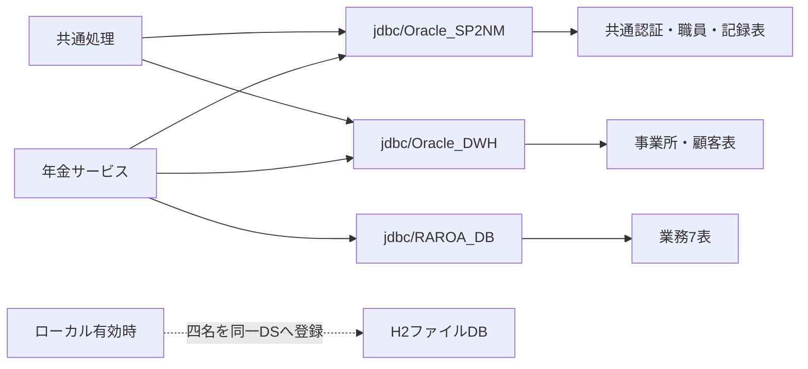

図の線は接続依存を示す。外部キーやDB間トランザクションを示すものではなく、ローカルではjdbc/RAROA_SHAREも同じH2へ登録する。

### autoCommitと確定範囲

| 処理 | 取得時の設定 | 処理側の設定・確定 | 境界 |
| --- | --- | --- | --- |
| CommonUtil経由 | 接続取得後にsetAutoCommit(false) | 呼出元が必要なcommit・rollbackを行う | 接続を返す前に設定する。設定に失敗した接続を同メソッドがcloseする処理はない。 |
| 年金の一般接続取得 | autoCommitを変更しない | 呼出元に依存する | 初期値をtrueまたはfalseと本書で固定しない。 |
| 予約保存・削除・削除明細整理 | 年金接続を取得 | 各処理がsetAutoCommit(false)、commit・rollbackを行う | 各処理の業務更新単位。 |
| 共通アクセス記録 | 別途CommonUtilで接続 | 記録INSERT後にcommit、失敗時rollbackを試行 | 年金更新と独立した接続・確定単位。 |
| H2初期化 | Listenerで接続を取得 | 明示したautoCommit変更・commit・rollbackがない | SQL適用とJNDI再登録を一括で戻す契約はない。 |

### 本番業務7表とローカル互換表

SQL Server用DDLの作成対象は次の7表である。業務表名はJava側でスキーマ未修飾、DDLではdbo指定となるため、実行ユーザーによる名前解決も配備条件になる。

| 安定ID | SQL Server作成対象 | 業務上の役割 |
| --- | --- | --- |
| TBL-NEN-001 | dbo.年金1_LK | 予約の保存、検索、印刷・出力対象。 |
| TBL-NEN-002 | dbo.年金＿削除明細 | 削除時の明細保存と削除区分出力・整理の対象。完全な変更履歴表ではない。 |
| TBL-NEN-003 | dbo.店名テーブル | 店番に対応する店舗名と店舗候補。 |
| TBL-NEN-004 | dbo.性別テーブル | 性別コードと表示名称。 |
| TBL-NEN-005 | dbo.裁定請求テーブル | 裁定請求コードと表示名称。 |
| TBL-NEN-006 | dbo.受給有無テーブル | 受給有無コードと表示名称。 |
| TBL-NEN-007 | dbo.年金種類テーブル | 年金種類の合成コードに対応する表示名称。 |

H2用DDLはこの7表に加え、次の8表をローカル互換定義として作る。DB2、N2_DWH、N2_SIGHT、NAVIの各スキーマを未存在時に作るが、NAVI配下の表定義はない。

| 安定ID | ローカル互換表 | 使用箇所 |
| --- | --- | --- |
| TBL-N2-001 | DB2.ＵＷＥＢログイン情報表 | 共通認証。認証値は本書の記載対象に含めない。 |
| TBL-N2-002 | DB2.Ｕ職員名簿表 | 共通ログイン情報と年金職員確認・参照。 |
| TBL-N2-003 | DB2.Ｕ職員所属課係一覧表 | 共通ログインでの所属課係取得。 |
| TBL-N2-004 | DB2.ＵＪＶ役職コード表 | 共通ログインでの役職取得。 |
| TBL-N2-005 | N2_DWH.Ｊ事業所コード表２ | 共通ログインでの所属店名取得。 |
| TBL-N2-006 | DB2.Ｕカウンターシフト | 共通アクセス記録の追加先。 |
| TBL-N2-007 | N2_SIGHT.Ｂ顧客基本表 | 顧客参照と基本情報読込み。 |
| TBL-N2-008 | DB2.ＵＤＢ管理ＤＢ | 共通基盤の運用状態表。年金は表照会分岐の対象外。 |

互換表の型・容量・NULL・制約はローカル向けの定義であり、本番外部表の物理属性を保証しない。SQL Server用DDLにはこれらの共通・外部表を作成する処理も、サンプルデータを投入する処理もない。

### DDLの存在判定と制約

SQL Server用DDLはANSI_NULLSとQUOTED_IDENTIFIERをONにし、各表をOBJECT_IDのユーザーテーブル存在判定がNULLの場合だけ作る。既存表のDROP・再作成や、列・制約を収録定義へ合わせるALTERは行わない。索引も対象表と索引名の存在を判定するだけで、同名索引の列構成を比較・修正しない。

H2用DDLも現行表をCREATE TABLE IF NOT EXISTSで作る。一方、末尾では旧Java専用代替表というコメントに続き、NENKIN_AUDIT、NENKIN_RESERVATION、NENKIN_BRANCH、NENKIN_STAFFをこの順にDROP TABLE IF EXISTSする。既存DBに対しても削除対象となるため、ローカル初期化は既存データを一切変更しない処理ではない。

両DDLはコード・店舗の5表にコード列のPK、名称列のNOT NULLを宣言する。予約本表と削除明細にはPK・一意制約・NOT NULLを宣言せず、業務7表間のFK宣言もない。次の4索引はいずれも非一意である。

| 対象・列順 | SQL Server索引名 | H2索引名 |
| --- | --- | --- |
| 年金1_LK：ふりがな、電話番号 | IX_年金1_LK_検索キー | IX_NENKIN1_KEY |
| 年金1_LK：店番、顧客番号 | IX_年金1_LK_顧客 | IX_NENKIN1_CUSTOMER |
| 年金1_LK：変更FLG、データ更新日、更新者 | IX_年金1_LK_更新区分 | IX_NENKIN1_UPDATE |
| 年金＿削除明細：データ更新日、更新者 | IX_年金削除明細_更新日 | IX_NENKIN_DELETE_UPDATE |

業務表の文字列はSQL ServerではNVARCHAR、H2ではVARCHAR、年金種別の個別フラグと６ヶ月先確認はBITとBOOLEAN、更新時間はTIME(0)とTIMEである。氏名・ふりがな・配偶者名100、住所300、備考400、店名80、年金種類名120という宣言長は各DB型の容量であり、画面やサービスの入力上限へ転用しない。全列の物理定義と入力・保存対応はDB-PHYSICAL、DATA-CONTRACTSの責務である。

### 初期データと正式配備の接続・権限

data.sqlはローカル向けの名簿、役職、事業所、運用状態、顧客基本情報、業務コード、店舗、予約、削除明細をKEY付きMERGEで投入する。予約本表ではふりがな・電話番号、削除明細ではそれらにデータ更新日を加えた値を投入キーにする。MERGEのKEY指定はテーブルのPK宣言ではない。

業務側の投入記述は、性別・裁定請求・受給有無が各2コード、店舗2件、年金種類コード1～31、予約本表2件、削除明細1件である。これはローカル用サンプルの定義数であり、本番のコード体系や現在件数を表さない。初回限定の適用ではなく、投入キーに一致する既存ローカル行の値が保持される保証もない。

正式配備ではREADMEの方針に従い、ローカル有効化オプションを付けず、jdbc/RAROA_DBの接続先へSQL Server用DDLを事前に適用し、コード表・店舗表の本番データをAccessリンク元から移行する。アプリケーション側の接続・権限依存は次のとおりである。

| 接続名 | 利用対象 | 必要なアクセスと条件 |
| --- | --- | --- |
| jdbc/RAROA_DB | 業務7表 | 業務処理に必要なDML。予約・削除明細の更新と、店舗・コード名称の参照を含む。 |
| jdbc/Oracle_SP2NM | DB2.ＵＷＥＢログイン情報表、Ｕ職員名簿表、Ｕ職員所属課係一覧表、ＵＪＶ役職コード表 | 共通認証・職員情報取得のSELECT。年金側の追加職員確認にも名簿のSELECTが必要。 |
| jdbc/Oracle_SP2NM | DB2.Ｕカウンターシフト | 共通アクセス記録のINSERTと独立したcommit・rollback。 |
| jdbc/Oracle_SP2NM | 運用可否判定の接続 | 年金では運用状態表を検索しないが、対象判定前の接続取得が必要。 |
| jdbc/Oracle_DWH | N2_DWH.Ｊ事業所コード表２ | 共通ログインで所属店番が取得できた場合の事業所名SELECT。 |
| jdbc/Oracle_DWH | N2_SIGHT.Ｂ顧客基本表 | 年金側の顧客参照・基本情報読込みのSELECT。 |

OperatePermissionは接続取得後に年金をチェック対象外としてtrueを返す。接続取得で例外になればログ出力後にfalseとなるため、運用状態表を照会しないことは職員側接続への非依存を意味しない。

アクセス記録はCounterShiftが別接続でINSERTしてcommitする。失敗時はrollbackを試み、元の例外とrollback失敗をログへ渡し、最後に接続closeを試みる。業務更新の成否とアクセス記録の確定は同一トランザクションにならない。

## イベント仕様

### ビルド準備・コンパイル

#### 処理概要

tools/build.ps1は既存のn2framework classをFW.jarに包装し、必要なjarを配置してから年金ソースをコンパイルする。共通ソースを再コンパイルする工程や、配備先DBへ接続する工程はない。

#### 処理手順

**1. 入出力先とランタイムを決定する。**

　**1.1.** toolsの親をAppRoot、その親をOutputRootとし、OutputRoot/n2frameworkをFrameworkRootとして解決する。RuntimeRootがNULLまたは空文字ならOutputRoot/runtimeを解決する。

　**1.2.** RuntimeRoot配下のjdkとtomcatで、それぞれ最初に列挙されたディレクトリーを選ぶ。出力先をAppRoot/WEB-INF/libとWEB-INF/classesにする。

**2. 出力を準備し、依存を配置する。**

　**2.1.** 既存classesを再帰削除し、libとclassesを準備する。libの既存内容全体は削除しないため、既存の追加jarも後のワイルドカードclasspathに入り得る。

　**2.2.** JDKのjar.exeでFrameworkRoot/WEB-INF/classes全体をFW.jarへ包装する。終了コードが非ゼロなら中断する。

　**2.3.** FrameworkRoot/WEB-INF/libからcommons-logging.jar、log4j.jar、itextpdf-5.3.4.jarを上書きコピーする。

　**2.4.** RuntimeRoot/downloads/h2-2.1.214.jarがなければMaven Centralのrepo1.maven.orgから取得する。存在済みの場合を含め、SHA-256が下記の期待値と一致することを確認し、一致時だけlibへコピーする。

```text
d623cdc0f61d218cf549a8d09f1c391ff91096116b22e2475475fce4fbe72bd0
```

**3. 年金ソースをコンパイルし、ログ設定を配置する。**

　**3.1.** WEB-INF/src以下の全.javaを列挙する。classpathは選択Tomcatのlib/servlet-api.jarと年金WEB-INF/libのワイルドカードで構成する。

　**3.2.** javacへ-encoding UTF-8、-source 1.7、-target 1.7、-Xlint:-optionsを渡し、classesへ出力する。終了コードが非ゼロなら中断する。

　**3.3.** resources/log4j.propertiesをclasses/log4j.propertiesへコピーし、生成class数を表示する。

#### 処理フロー

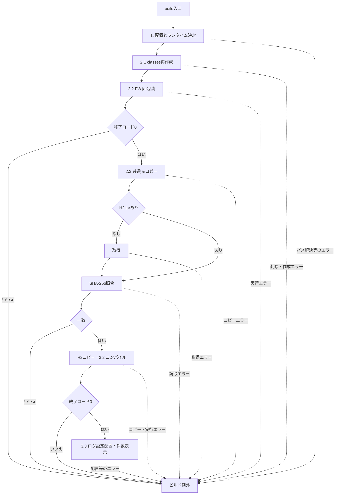

例外出口ではそれまでの削除・上書き結果を保持し、旧出力へ戻す処理はない。

#### SQL・テーブル関連（ER図）

DB非使用であり、対象表・ER図はない。入力はソース、既存class、jar、設定ファイル、出力はclassとjarおよびログ設定である。SQLファイルはビルド時に実行しない。

#### DB操作の詳細

該当しない。ローカルSQLはServletContext経由でWEB-INF/resources/dbから読むため、配備物にはclassesとlibに加え、JSP・web.xml・元のWebリソース配置が必要である。

#### 結果・例外時の扱い

PowerShellはErrorActionPreference=Stop、StrictMode=Latestで動作する。FW.jar包装失敗はFW.jar build failed.、ハッシュ不一致はH2 SHA-256 verification failed.、コンパイル失敗はApplication compilation failed.で中断する。後段の失敗に対し、削除前のclassesや上書き前jarを復元する処理はない。

class数の表示はコンパイル後の出力数である。共通ソースと既存classの一致、選択JDKと依存jarの実行互換性、Webアプリケーションの起動や業務処理の成立はこの表示の判定対象に含まれない。

### ローカル起動

#### 処理概要

tools/start.ps1はビルド、Tomcat実行領域準備、配置、必要時のJVM起動を行い、指定URLのHTTP 200を待つ。既に指定Portが待受中でも、その判定前のビルド・設定・配置準備は行う。

#### 処理手順

**1. ビルドと実行領域の準備を行う。**

　**1.1.** AppRoot、OutputRoot、RuntimeRootを解決し、build.ps1へRuntimeRootを渡して呼ぶ。以後の準備はビルドから正常に戻った場合に進む。

　**1.2.** JDKとTomcatを選び、CatalinaBaseをAppRoot/.runtimeにする。本体、logs、temp、work、webappsを不足時に作る。confがなければTomcatのconfを再帰コピーし、あれば既存confを使用する。

　**1.3.** server.xmlの、数字のport属性にshutdown属性が続く所定表記を8019へ置換する。HTTPはportが8080・8088・8089のいずれかでprotocol属性がHTTP/1.1として続く表記をPort引数へ置換する。BOMなしUTF-8で保存する。

　**1.4.** webapps/n2nenkinがなければAppRootへのJunctionを作る。存在する場合は参照先を調べず、そのまま使う。

**2. 待受状態に応じて新規起動する。**

　**2.1.** 指定PortのListenを調べる。既に待受があれば新規Javaプロセスを作らず、手順3へ進む。

　**2.2.** 待受がなければJDKのjava.exeからTomcat Bootstrap startを非表示で起動する。標準出力と標準エラーを別ファイルへ転送し、返されたプロセスIDをtomcat.pidへ保存する。

　**2.3.** 新規JVMにはJUL設定ファイル、ClassLoaderLogManager、jdk.tls.ephemeralDHKeySize=2048、java.protocol.handler.pkgs、n2nenkin.localDb=true、catalina.base、catalina.home、java.io.tmpdirを渡す。classpathはbootstrap.jarとtomcat-juli.jarとする。

**3. HTTPによる準備判定を行う。**

　**3.1.** 新規起動・既待受の両経路でhttp://127.0.0.1:{Port}/n2nenkin/を確認する。Invoke-WebRequestのTimeoutSecは2、最大80回とする。

　**3.2.** HTTP 200が返ればループを抜け、Application started.と状態コード、URLを表示する。200が得られない試行の例外は無視し、各未完了試行の後に500ミリ秒待つ。

　**3.3.** 上限まで200が得られなければconsole.err.log末尾100行の表示を試み、Application did not become ready.を投げる。HTTP試行時間も含むため、待機全体を固定40秒とはしない。

#### 処理フロー

サブフロー1は実行領域と配備先を準備する。正常出口ではPort、RuntimeRoot、JDK・Tomcatの選択値、CatalinaBaseをサブフロー2へ渡す。

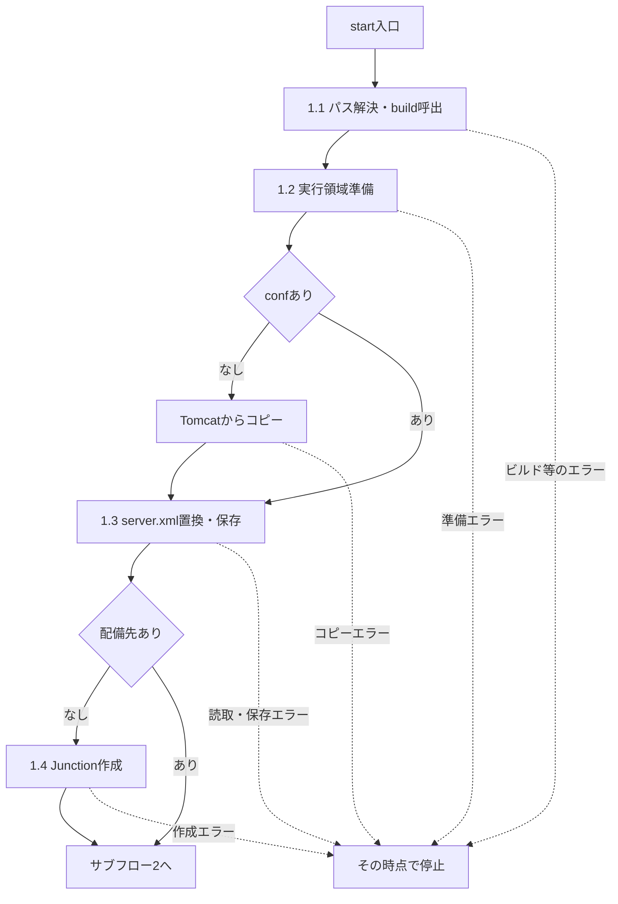

サブフロー2は待受判定と準備確認を行う。既待受経路では新規PID保存やJVMオプション設定を行わず、既存プロセスに対して同じHTTP確認だけを行う。

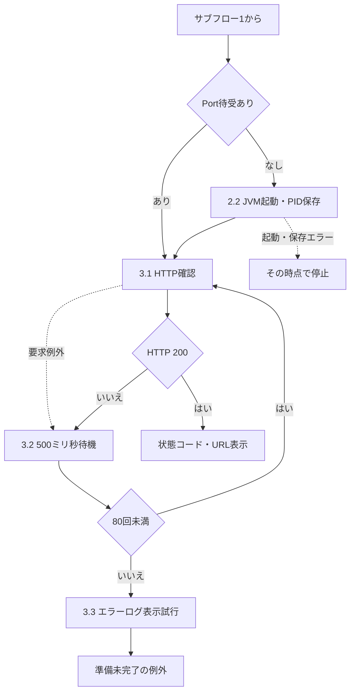

#### SQL・テーブル関連（ER図）

スクリプト自体はSQLを実行しない。新規JVMのコンテキスト初期化では、次イベントのListenerがH2と対象表を準備する。既待受経路でListenerが再実行されるという契約はない。

#### DB操作の詳細

新規JVMへローカルDB有効化を渡すところまでがスクリプトの責務である。DBファイルの決定、SQL適用、JNDI再登録はListenerの責務となる。HTTP 200確認では認証、職員確認、更新、Excel生成を検査しない。

#### 結果・例外時の扱い

server.xmlの置換は属性の並び・空白を含む所定文字列への一致に依存する。以前に別のカスタムポートへ変更したConnectorや異なる表記を一般的に補正する処理ではない。待受プロセスの同一性、保存PIDとの一致、既存Junctionの参照先も確認しない。

準備中エラーにはHTTP確認部の空catchを適用しない。HTTP確認が上限に達した場合も、起動済みプロセスの停止、書換え済み設定の復元、ビルド出力の復元は行わない。

### ローカルDB初期化・JNDI再登録

#### 処理概要

H2JndiSetupListener.contextInitializedはローカル有効時だけファイルDBを準備し、DDL、初期データ、JNDI登録の順に処理する。無効時は環境側JNDIを使う旨をコンテナーログへ出して戻る。

#### 処理手順

**1. 有効条件とDB配置先を決める。**

　**1.1.** n2nenkin.localDbを未設定時falseとして読み、Boolean.parseBooleanで判定する。falseならDB作成・SQL適用・JNDI再登録を行わない。

　**1.2.** 有効時はn2nenkin.db.pathのtrim後非空値を優先し、なければgetRealPathで得たWEB-INF/local-db配下のnenkinを基準パスにする。既定位置を実パスへ解決できなければ例外にする。

　**1.3.** 親ディレクトリーがなく、mkdirsにも失敗した場合は例外にする。JdbcDataSourceを準備してファイルURLを設定する。

**2. SQLを同じ接続へ順に適用する。**

　**2.1.** DataSourceから接続を取り、schema.sqlを先に処理する。正常終了後にdata.sqlを処理する。

　**2.2.** 各SQLをServletContext.getResourceAsStreamで取得する。未存在なら対象パスを含むIllegalStateExceptionとする。存在すればUTF-8のInputStreamReaderをH2のRunScript.executeへ渡す。

　**2.3.** 各SQL処理のfinallyでReaderを閉じ、Reader未生成ならStreamを閉じる。初期化処理のfinallyで接続を閉じる。closeの失敗も後続の正常進行にはしない。

**3. JNDIへ同じDataSourceを登録する。**

　**3.1.** InitialContextを生成してjdbcサブコンテキストの作成を試みる。NameAlreadyBoundExceptionだけは作成済みとして継続する。

　**3.2.** jdbc/Oracle_SP2NM、jdbc/Oracle_DWH、jdbc/RAROA_DB、jdbc/RAROA_SHAREの順に同じDataSourceをrebindする。java:comp/env付き名へ登録する処理はない。

　**3.3.** 全登録が正常終了した後にだけ、DB絶対パスを含む初期化完了ログを出す。

#### 処理フロー

サブフロー1は有効判定とSQL適用を行う。続きへ渡すのは、SQL適用・接続closeまで正常に完了し、Listenerに保持されたDataSourceである。

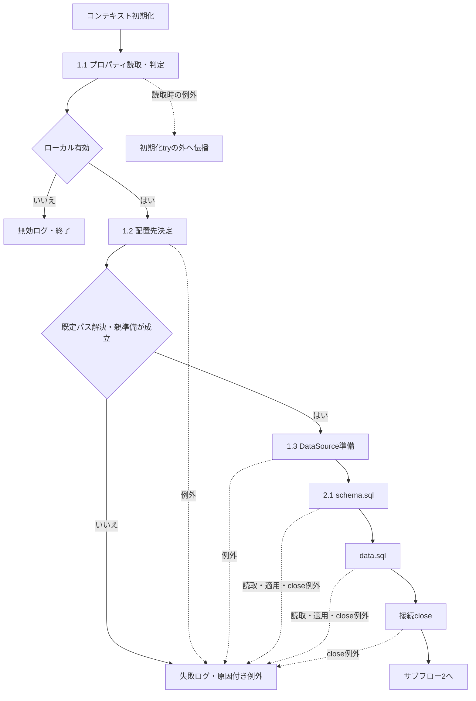

SQL処理で例外になった場合も手順2.3のfinallyを実施する。図の失敗出口は、そこで発生した例外やcloseによる例外が初期化側catchへ到達した場合を示す。

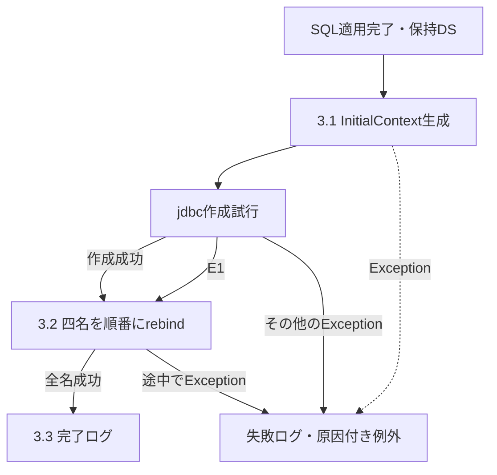

| 参照ID | 元の識別子・例外名 | 分岐の意味 |
| --- | --- | --- |
| E1 | `NameAlreadyBoundException` | 手順3.1の`jdbc`サブコンテキスト作成時に発生した場合だけ、作成済みとして継続し、手順3.2の四名の順次`rebind`へ進む。 |

#### SQL・テーブル関連（ER図）

対象は業務7表とローカル互換8表、および削除対象の旧代替4表である。関連は初期化の対象範囲を表し、FKを追加したER関係ではない。

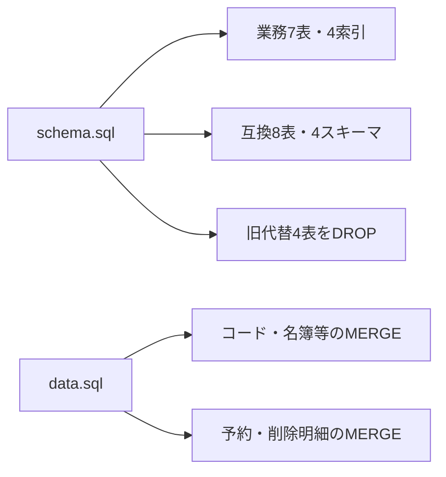

#### DB操作の詳細

同じConnectionへschema.sql、data.sqlの順で適用するが、autoCommit変更、明示commit、明示rollbackはない。既存DB判定によるdata.sqlの省略もない。DDLの存在判定、旧代替表DROP、MERGEキーと対象は「接続・データベース構成」の定義に従う。

SQL適用が完了しても、接続closeまたはJNDI再登録の失敗で初期化失敗となり得る。DB変更とJNDI登録を同時に確定・取消する仕組みはなく、途中まで反映した状態を元に戻す補償もない。

#### 結果・例外時の扱い

有効判定後のtry内で発生したExceptionは、ServletContext.logへ初期化失敗と例外を渡し、原因を保持したIllegalStateExceptionとして投げ直す。プロパティ読取りと有効判定はこのtryの前にあり、その段階の例外を同じcatchが処理するとはしない。

既存JNDI登録の退避・復元はなく、途中のrebind失敗で登録済み名を補償解除する処理もない。失敗時のDB・JNDI状態と、コンテナーが最終的に返すHTTP応答は、Listenerのログだけでは確定しない。MODE=OracleはH2への互換モード指定であり、本番Oracle・SQL Serverとの動作一致の保証ではない。

### DB接続取得

#### 処理概要

年金側は用途別のDataSourceを探索・再利用し、共通側は呼出元が指定した名前から直接接続を得る。返すものはConnectionであり、用途判定や接続取得だけで業務SQLの成功を確定しない。

#### 処理手順

**1. 年金側は用途別のキャッシュを確認する。**

　**1.1.** openConnection、openStaffConnection、openCustomerConnectionが対応するvolatile staticフィールドを読む。非NULLなら手順3へ進む。

　**1.2.** NULLならNenkinDataSource.classのsynchronizedへ入り、もう一度同じフィールドを読む。他の呼出しが設定済みならその値を使う。なおNULLの場合だけ手順2へ進む。

**2. 年金側は二つの候補名を順番に探索する。**

　**2.1.** 候補ごとにInitialContextを生成してlookupする。DataSourceであれば採用し、用途別キャッシュへ設定する。

　**2.2.** 結果がNULLを含むDataSource以外なら次候補へ進む。NamingExceptionの場合は最後の例外として保持して次候補へ進む。

　**2.3.** 全候補で採用できなければ用途別メッセージのSQLExceptionを投げる。NamingExceptionを保持していれば最後のものを原因にする。

**3. 採用済みDataSourceから接続を返す。**

　**3.1.** DataSource.getConnectionを呼んで返す。autoCommitは変更しない。

　**3.2.** 接続取得に失敗しても別候補のlookupへ戻らず、キャッシュの消去もしない。

**4. 共通側は指定名から直接接続を返す。**

　**4.1.** CommonUtil.getConnectionが引数InitialContextのlookup結果をDataSourceへ直接キャストする。

　**4.2.** getConnection後にsetAutoCommit(false)を行い、成功したConnectionを返す。別名探索とDataSourceキャッシュは行わない。

#### 処理フロー

年金側の正常合流点へ渡す値は、既存キャッシュ、同期中の再読取値、新規探索値のいずれかである。

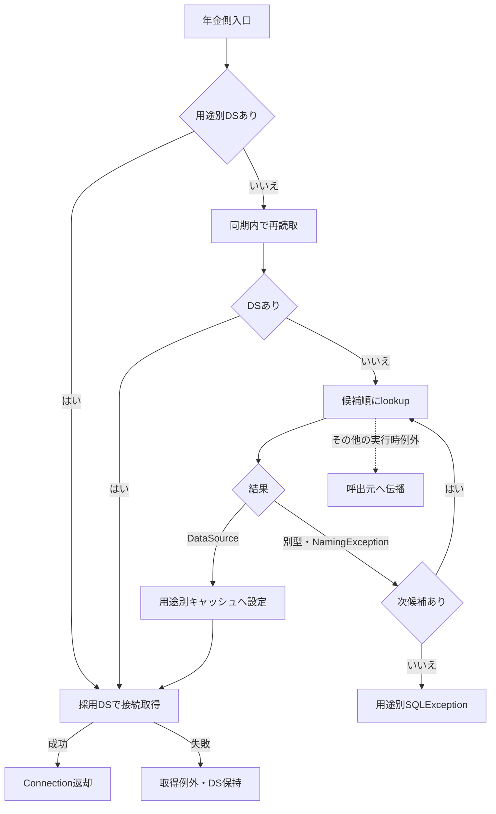

共通側は次の独立した経路となる。例外出口は一律の例外型へまとめない。

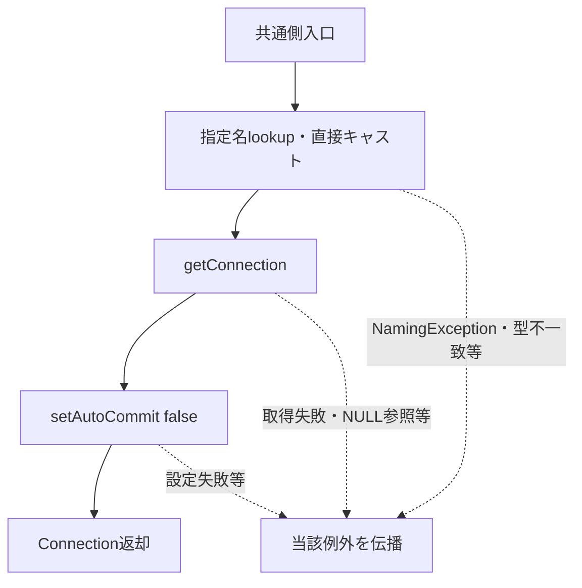

#### SQL・テーブル関連（ER図）

接続取得メソッド自身はSQLを発行しない。接続先と表の対応は「用途別JNDIと接続先」および「本番業務7表とローカル互換表」による。業務SQL上のJOINとFK制約は別の契約である。

#### DB操作の詳細

年金側の全候補失敗時メッセージは、業務用が「年金業務用JNDI DataSourceを取得できません。」、職員用が「N2職員名簿用JNDI DataSourceを取得できません。」、顧客用が「N2顧客基本表用JNDI DataSourceを取得できません。」となる。lookupが別型を返した場合だけなら、原因となるNamingExceptionは設定されない。

共通側は型検査による候補切替を行わない。lookup結果が別型ならClassCastException、NULLなら後続参照でNullPointerExceptionとなり得る。接続取得後にautoCommit設定で失敗した場合も、このメソッド自身に接続closeやrollbackはない。

#### 結果・例外時の扱い

年金側lookupが捕捉するのはNamingExceptionである。他の実行時例外を用途別SQLExceptionへ一括変換する処理はない。採用後の接続取得例外と、候補を使い尽くしたSQLExceptionを区別する。

取得メソッドはHTTP応答を決めない。年金Repository・参照サービスによる例外変換、Actionでの入力拒否・再表示、共通Servletの捕捉範囲は呼出元の契約に従う。接続取得時の状態だけを、その後のSQL・commit・画面描画の成功へ拡張しない。

### ローカル停止・コンテキスト終了

#### 処理概要

tools/stop.ps1はTomcat Bootstrap stopと指定ポートの待受消失で停止を判定する。H2終了は別のライフサイクル処理であり、コンテキスト終了時にListenerがJNDI解除とSHUTDOWNを試みる。

#### 処理手順

**1. 停止対象の設定と待受を確認する。**

　**1.1.** startと同じ規則でAppRoot、RuntimeRoot、JDK、Tomcat、CatalinaBaseを決める。

　**1.2.** 指定PortのListenがなければApplication is already stopped.を表示して終了コード0で終わる。Listenerを直接呼び出す処理はない。

**2. Tomcat停止を要求し、待受消失を待つ。**

　**2.1.** 待受があればJUL設定、ClassLoaderLogManager、catalina.base、catalina.home、java.io.tmpdir、Bootstrap用classpathを渡してjava.exeからBootstrap stopを実行する。停止先はCatalinaBaseの構成に依存し、Port引数をBootstrapへ直接渡さない。

　**2.2.** 最大40回、指定Portの待受を確認する。消失していればApplication stopped.を表示して終了コード0で終わる。残っていれば250ミリ秒待ち、上限後はApplication could not be stopped.を投げる。

**3. コンテキスト終了時にローカルDB資源を解放する。**

　**3.1.** contextDestroyedが呼ばれたとき、ListenerのDataSourceがNULLならそのまま戻る。非NULLならJNDI解除へ進む。初期化完了ログが出たかどうかを条件にしていない。

　**3.2.** InitialContextを生成し、初期化時と同じ四名を順番にunbindする。各unbindのNamingExceptionは無視して次の名前へ進む。InitialContext生成のNamingExceptionでは四名の解除を行わず、DB終了へ進む。

　**3.3.** 保持DataSourceから接続とStatementを取り、SHUTDOWNを実行する。ExceptionならH2 shutdown failed.と例外をServletContext.logへ渡し、再送出しない。

　**3.4.** finallyでStatement、Connectionの順に個別closeを試みる。各closeの例外は無視する。

#### 処理フロー

停止スクリプトの入口・出口は次のとおりである。待受消失による正常出口から、Listener内処理の成否までは引き継がない。

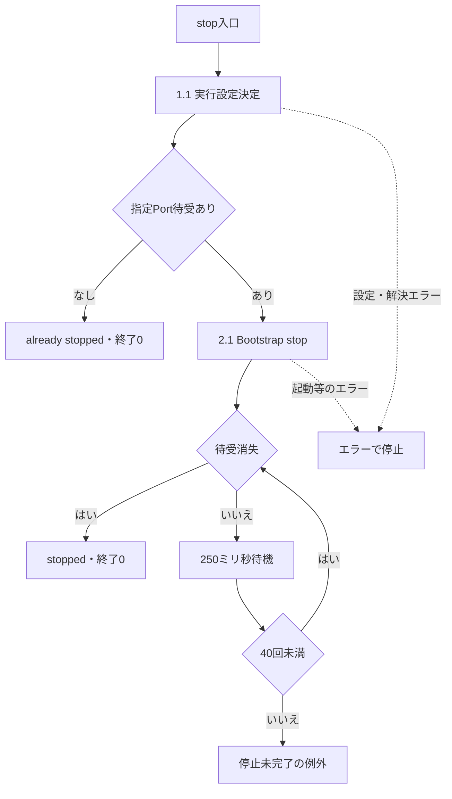

Listenerはコンテキスト終了通知を入口とする。初期化の途中失敗後でもDataSourceが保持されていれば、通知時には同じ解放経路へ入る。

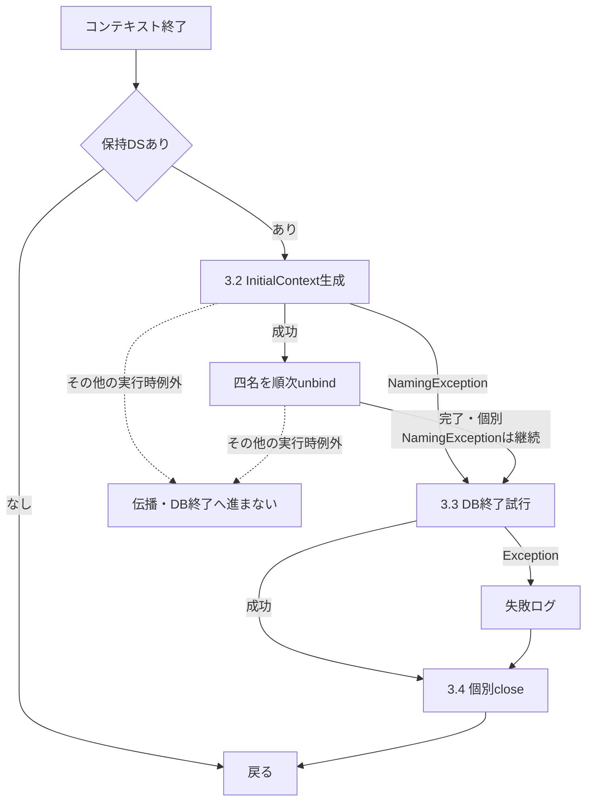

#### SQL・テーブル関連（ER図）

停止スクリプトにはテーブル操作がない。ListenerのSHUTDOWNは保持するH2 DB全体への終了要求であり、個別表のDELETEや初期データの削除ではない。JNDI解除は名前空間への操作である。

#### DB操作の詳細

Statement.executeにSHUTDOWNを渡す。成功・失敗にかかわらずStatementとConnectionのcloseをそれぞれ試みる。JNDI解除時のNamingExceptionを無視した後はDB終了を試みるが、退避した以前のJNDI登録を復元する処理はない。解除対象の登録先と保持DataSourceの一致や、当該初期化での登録完了を確認する処理もない。

#### 結果・例外時の扱い

stopはJavaの終了コードを明示検査せず、指定Portの待受消失で成功を判定する。tomcat.pidを読まず、PIDによる強制終了も行わない。指定Portの待受プロセスと、Bootstrapで停止を要求するTomcatの同一性を確認する処理もない。

Junction、実行領域、ログ、DB、PIDファイルを削除しない。停止成功の表示だけではListener通知の到達やH2終了成功は確定しない。Listenerが明示的に無視する解除例外はNamingExceptionである。解除中のその他の実行時例外はcontextDestroyedへ伝播し、後続のH2終了へ進まない場合がある。

## 補足説明

### 依存ライブラリと供給範囲

| 依存 | ソース上の用途・供給 | 版・境界 |
| --- | --- | --- |
| JDK | jar.exe、javac.exe、java.exe | 選択ディレクトリーによる。source/target=1.7は実JDK版の指定ではない。 |
| Servlet API | 選択Tomcatのlib/servlet-api.jar | ソースはjavax.servlet系。実コンテナーとの対応が必要。 |
| FW.jar | 既存n2framework/WEB-INF/classesを包装 | 共通ソースの再コンパイルをしないため、ソースとの一致は別の確認事項。 |
| Commons Logging | commons-logging.jarをコピー | 版番号と実際のLog実装はスクリプトだけでは確定しない。 |
| Log4j | log4j.jarをコピー | 版番号は不明。付属設定はConsoleAppender。 |
| iText | itextpdf-5.3.4.jarをコピー | ファイル名に5.3.4を含む。共通PDF処理が参照する。 |
| H2 | h2-2.1.214.jar | 期待SHA-256との照合後にコピー。ListenerとRunScriptが参照する。 |
| Canon系PDF型 | PDFUtil、FWSessionAgentがcom.canon.iw.fm系を参照 | 供給元・版・利用可能性は、上記三jarをコピーする工程からは確定しない。 |
| 本番JDBCドライバー・接続プール | 環境側JNDI DataSourceの実装に依存 | 収録設定から製品・版・接続特性を確定しない。 |
| Excel生成 | OpenXmlWorkbookWriter | Java標準のメモリ出力とZIP/XMLを使用する。生成実装からApache POI等の追加依存は導かれない。 |

H2以外のコピー対象三jarには、同じハッシュ照合工程がない。既存libを全削除しない構成も含め、配備物の実内容と供給版はビルド定義だけで固定されない。

### 年金印刷と共通PDF経路

共通ControlServletのGETにはPDFUtilへ接続する既存経路があり、iTextとCanon系型への依存がある。一方、年金の登録内容印刷はReportPreviewActionが取得結果をJSPへ渡し、Report.jspのボタンがwindow.print()を呼ぶ。年金のこの操作をサーバーPDF生成とする依存説明は行わない。

店舗別Excelと日次・月次ExcelはOpenXmlWorkbookWriterへ接続する。共通PDF経路の存在を、これらExcel出力やブラウザー印刷の実行条件として追加しない。

### 関連文書の責務

以下は提示された文書計画との対応である。パスはMarkdown正本のルート基準とし、生成済みファイルの存在を示すリンクにはしない。

| 文書ID | 計画上の相対パス | 本書から接続する責務 |
| --- | --- | --- |
| SYS-ARCHITECTURE | 共通/システム分析.md | 画面・Action・サービス、保持領域と三系統接続の全体構成。 |
| COM-012 | 共通/共通仕様書_COM-012_共通コントロールサーブレット.md | 運用可否、Action呼出し、アクセス記録、forwardと例外境界。 |
| COM-015 | 共通/共通仕様書_COM-015_ログイン処理.md | 認証、名簿・事業所等の取得とセッション設定。 |
| COM-111 | 共通/共通仕様書_COM-111_年金業務共通処理.md | 年金職員確認、CSRF、入力・表示変換、ダウンロード応答。 |
| DATA-CONTRACTS | 共通/データオブジェクト定義書.md | 要求値・モデル・表示値・保存値の型と移送。 |
| DB-INDEX | 共通/DBオブジェクト一覧.md | 業務7表と到達共通・外部8表の安定ID。 |
| DB-LOGICAL | 共通/DB仕様書/論理データ仕様書.md | 各列の業務上の用途と論理関係。 |
| DB-PHYSICAL | 共通/DB仕様書/テーブル定義書.md | 全列の実型・容量・NULL・PK・制約、およびH2とSQL Serverの差。 |
| DB-OPS | 共通/DB仕様書/DB操作仕様書.md | 呼出元、SQL、JDBCバインド、更新件数・commit・rollbackの詳細。 |
| COM-150 | 共通/共通仕様書_COM-150_外部ライブラリを使わず、単1シートの Open XML (.xlsx) を生成する.md | メモリ上の単一シートWorkbook生成。 |
| OUTPUT-NENKIN | 共通/帳票一覧.md | 印刷と各Excel・ZIPの対象、形式、出力結果。 |
