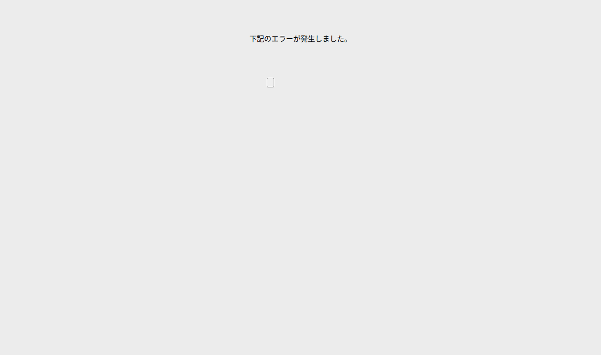

# エラーページ

## 表紙

| 項目 | 内容 |
| --- | --- |
| 文書名 | 基本設計書 |
| システム名 |  |
| 機能ID | SCR-008 |
| 画面名 | エラーページ |
| 会社名 |  |
| 作成日 |  |

## 概要

### 概要説明

エラーページの入力・表示・要求処理を行う。

| 情報 | 内容 |
| --- | --- |
| 対象種別 | screen |
| 開始契機 | 呼出元からの要求 |
| 処理対象 | 入力値・画面状態 |

### 画面レイアウト

原本HTML・CSSの静的再構成。実行時の表示条件・値は未実行（仮定 Q-00DBB03541）。

## 項目一覧

| No | グループ | 項目名 | 種類 | 入出力 | DB連携項目 | 候補取得元 | 必須 | 形式・桁 | 説明 |
| --- | --- | --- | --- | --- | --- | --- | --- | --- | --- |
| 1 | 画面操作 | 閉じる・メニューへ戻る | Button | ‐ | ‐ | ‐ | ‐ | ‐ | 「sitemap」の操作を受け付ける。業務結果はイベント仕様で確認する。 |

項目定義数：1項目。表示順と反復行の定義数を区別する。

## イベント仕様

本資料はデータ定義または共通構造を示す。操作イベントは関連機能の仕様を参照する。

## 補足説明

### 適用条件

各仮定のQA番号を確認する。静的に確認できた操作・条件を適用する。

