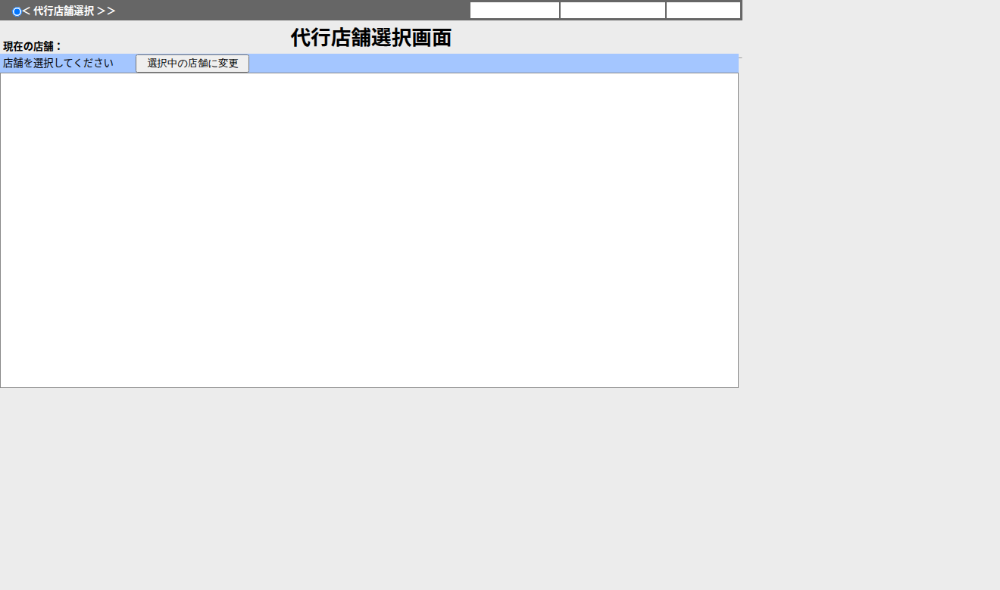

# 代行店舗選択

## 表紙

| 項目 | 内容 |
| --- | --- |
| 文書名 | 基本設計書 |
| システム名 |  |
| 機能ID | SCR-010 |
| 画面名 | 代行店舗選択 |
| 会社名 |  |
| 作成日 |  |

## 概要

### 概要説明

代行店舗選択の入力・表示・要求処理を行う。

| 情報 | 内容 |
| --- | --- |
| 対象種別 | screen |
| 開始契機 | 呼出元からの要求 |
| 処理対象 | 入力値・画面状態 |

### 画面レイアウト

原本HTML・CSSの静的再構成。実行時の表示条件・値は未実行（仮定 Q-623BAA9258）。

## 項目一覧

| No | グループ | 項目名 | 種類 | 入出力 | DB連携項目 | 候補取得元 | 必須 | 形式・桁 | 説明 |
| --- | --- | --- | --- | --- | --- | --- | --- | --- | --- |
| 1 | 見出し・説明 | 現在の店舗： | Label | O | ‐ | ‐ | ‐ | ‐ | 現在の店舗：を表示する。 |
| 2 | 画面操作 | 選択中の店舗に変更 | Button | ‐ | ‐ | ‐ | ‐ | ‐ | 「選択中の店舗に変更」の操作を受け付ける。業務結果はイベント仕様で確認する。 |
| 3 | 入力・選択項目 | 代行先店舗選択 | RadioButton | I | DB項目未確定（仮定 Q-8AE62E0BC9） | ‐ | 任意（仮定 Q-2F2201CF2F） | 選択／未選択 | RDO_IDOUを入力・選択する。 |
| 4 | 入力・選択項目 | 代行先店舗選択 | RadioButton | I | DB項目未確定（仮定 Q-F137BBB2E8） | ‐ | 任意（仮定 Q-491D269808） | 選択／未選択 | RDO_IDOUを入力・選択する。 |
| 5 | 入力・選択項目 | 代行先店舗選択 | RadioButton | I | DB項目未確定（仮定 Q-6322FBCF60） | ‐ | 任意（仮定 Q-A31A2FD04B） | 選択／未選択 | RDO_IDOUを入力・選択する。 |
| 6 | 入力・選択項目 | 代行先店舗選択 | RadioButton | I | DB項目未確定（仮定 Q-06DBDE8B86） | ‐ | 任意（仮定 Q-576DA74F07） | 選択／未選択 | RDO_IDOUを入力・選択する。 |
| 7 | 入力・選択項目 | 代行先店舗選択 | RadioButton | I | DB項目未確定（仮定 Q-5DBF9D86B3） | ‐ | 任意（仮定 Q-5C8CDBAE2F） | 選択／未選択 | RDO_IDOUを入力・選択する。 |
| 8 | 画面操作 | 終　了 | Button | ‐ | ‐ | ‐ | ‐ | ‐ | 「終　了」の操作を受け付ける。業務結果はイベント仕様で確認する。 |

項目定義数：8項目。表示順と反復行の定義数を区別する。

## イベント仕様

本資料はデータ定義または共通構造を示す。操作イベントは関連機能の仕様を参照する。

## 補足説明

### 適用条件

各仮定のQA番号を確認する。静的に確認できた操作・条件を適用する。

### 項目別DB連携備考

表示元と保存先は別方向の対応。DBから読み出した既存データの履歴保存は、画面入力の直接バインド先と区別する。同じ列の複数経路はイベントの実行条件に従う。

| No | 項目名 | 備考 |
| --- | --- | --- |
| 3 | 代行先店舗選択 | DB列への接続を原本から確定できていない。名称が似ている列へ自動接続しない。画面データ連携（仮定 Q-8AE62E0BC9） |
| 4 | 代行先店舗選択 | DB列への接続を原本から確定できていない。名称が似ている列へ自動接続しない。画面データ連携（仮定 Q-F137BBB2E8） |
| 5 | 代行先店舗選択 | DB列への接続を原本から確定できていない。名称が似ている列へ自動接続しない。画面データ連携（仮定 Q-6322FBCF60） |
| 6 | 代行先店舗選択 | DB列への接続を原本から確定できていない。名称が似ている列へ自動接続しない。画面データ連携（仮定 Q-06DBDE8B86） |
| 7 | 代行先店舗選択 | DB列への接続を原本から確定できていない。名称が似ている列へ自動接続しない。画面データ連携（仮定 Q-5DBF9D86B3） |

