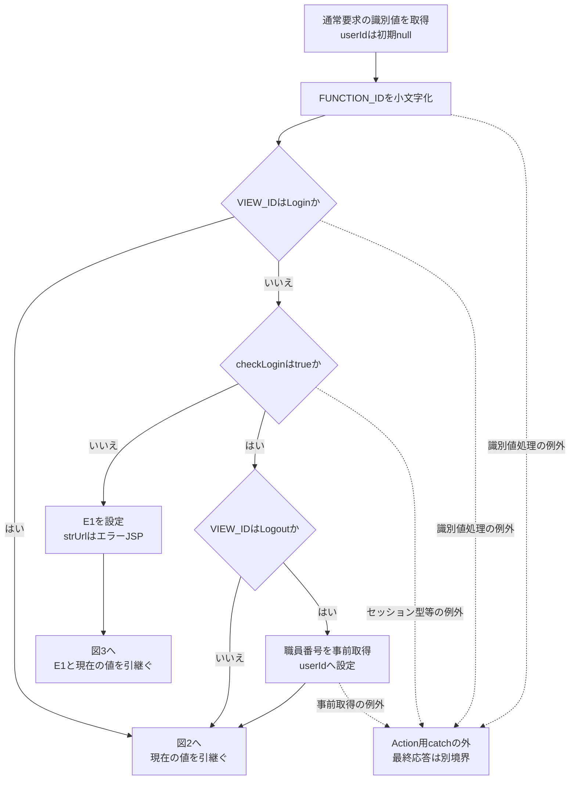
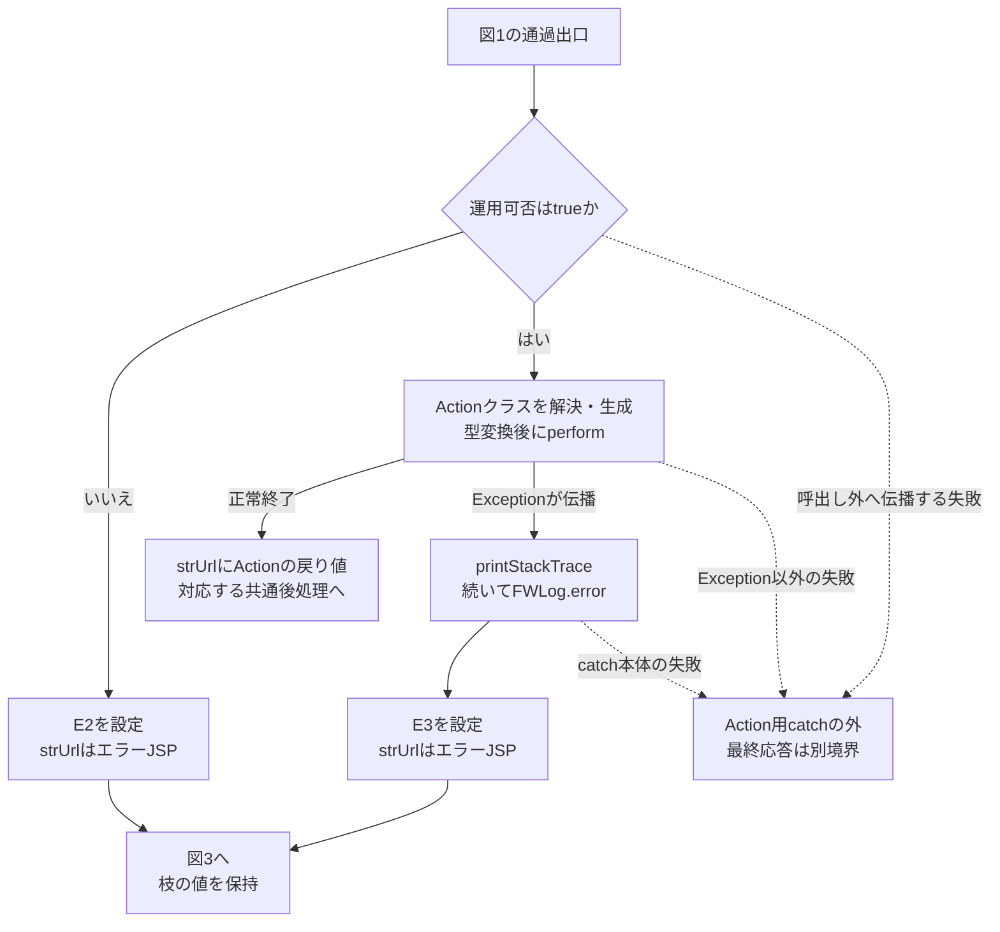
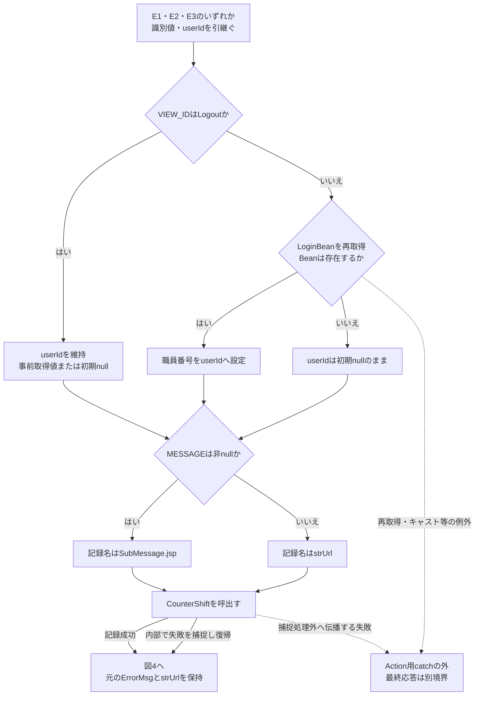
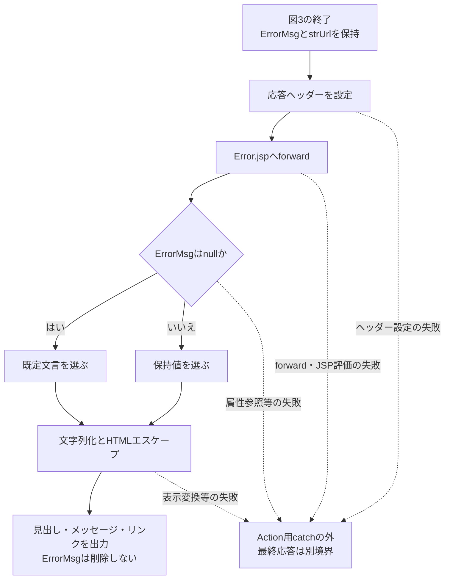
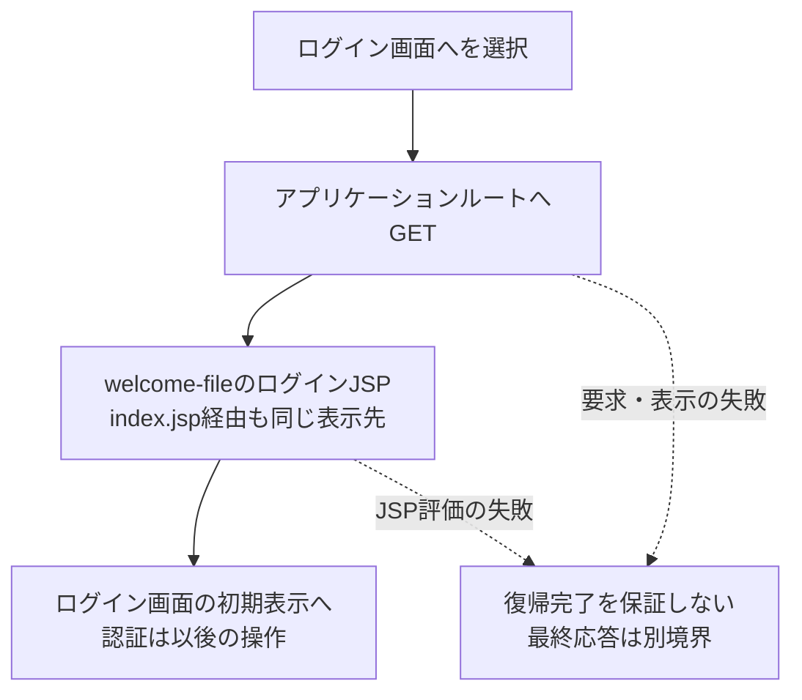

<!-- spec-meta: {"schema":"spec-md/1.0","documentId":"SCR-011","version":"2.0","path":"基本設計書/基本設計書_SCR-011_エラー.md","sheets":[{"heading":"概要","kind":"GRID","sheet":"概要"},{"heading":"項目一覧","kind":"LIST","sheet":"項目一覧","key":["No"]},{"heading":"イベント仕様","kind":"GRID","sheet":"イベント仕様"},{"heading":"補足説明","kind":"GRID","sheet":"補足説明"}]} -->
# エラー

| 属性 | 内容 |
| --- | --- |
| 文書種別 | 基本設計書 |
| システム名 | 年金自動受取予約管理システム |
| 機能ID | SCR-011 |
| 版 | 2.0（本文書の版。アプリケーションの版とは別） |
| 解析対象 | 年金側 `JSP/COMMON/Error.jsp` と、接続する共通要求処理・表示変換・共有CSS |
| 基準日 | 2026-10-15 |

## 概要

### 画面の役割と表示条件

共通エラー画面は、共通要求処理がログイン不可、運用可否の拒否、またはAction生成・実行中の例外を検出した場合に、処理を続けられない理由を表示し、ログイン画面への復帰口を提供する。表示先は年金アプリケーション内の `JSP/COMMON/Error.jsp` である。ブラウザータイトルは「エラー」、画面内の見出しは「処理エラー」とする。

共通Servletは通常の `POST /Action.do` を処理し、次の三経路でセッション属性 `ErrorMsg` に文字列を設定する。いずれも実遷移先 `strUrl` を `./JSP/COMMON/Error.jsp` とし、共通後処理の後にforwardする。エラー画面へのリダイレクトや、画面専用Actionの呼出しではない。

| 区分 | 表示先を選ぶ条件 | 設定するメッセージ | 利用者が読み取れる範囲 |
| --- | --- | --- | --- |
| E1：ログイン不可 | `VIEW_ID` が `Login` 以外で、`checkLogin(session)` がfalse | ログイン時間切れです。再度ログインしてください。 | 共通ログイン情報が存在しない、またはログイン可否がfalse。経過時間を計算した結果ではないため、未ログインも含む。 |
| E2：運用可否拒否 | ログイン確認通過または `Login` による確認省略後、`OperatePermission.check(actionPackage)` がfalse | 現在メンテナンス中のため画面を表示できません。 | 年金の運用状態表に停止指定があると断定できない。判定前の共通接続取得失敗等でもこの結果になり得る。 |
| E3：Action例外 | Actionクラスの解決・生成・型変換・`perform(req,res)` から伝播した `Exception` を共通catchで処理 | `アプリケーションエラーが発生しました。 システム管理者に連絡してください。` | 固定文言を表示する。例外自体のメッセージやスタックトレースを画面へ渡す処理ではない。 |

エラーメッセージ領域は、セッション属性の有無にかかわらず表示する。見出し、メッセージ領域、「ログイン画面へ」リンクの順序と構造は全状態で同じであり、権限別の表示切替えはない。

| メッセージの状態 | 表示内容 |
| --- | --- |
| `ErrorMsg` がnull | 「処理を完了できませんでした。」を表示する。 |
| `ErrorMsg` が空文字 | 空のメッセージ領域を出力する。既定文言へ置き換えない。 |
| 空白文字だけを保持 | trimせず表示処理へ渡す。通常のHTMLの空白表示に従い、既定文言にはしない。 |
| 値を保持 | 値を文字列化し、HTMLエスケープして表示する。E3の ` ` も改行タグにせず、文字列として表示する。 |

予約入力等の業務画面に戻して表示する入力エラーは、この画面の状態に含めない。また、年金職員確認の拒否によりログイン画面へ戻る経路も、共通ログイン確認によるE1とは区別する。

### 画面配置と静的投影

画面のDOMは `body > main.app-shell > section.screen.surface.compact-screen` であり、section内に `h1`、`div.message.error`、`a.access-button` を置く。共有ナビゲーションヘッダー、職員情報、フォーム、確認ダイアログは配置されていない。

共有CSSは背景を `#edf1f4`、本文色を `#18212a` とし、フォントをYu Gothic UI、Meiryo、Segoe UI、sans-serifの順に指定する。mainの最大幅は1440px、内側余白は上20px・左右18px・下52pxである。白いsectionには1px枠、角丸6px、影、内側余白18px、上余白28pxを適用する。

`compact-screen` の最大幅640pxより、後方の `.screen:not(.lookup-screen-popup)` が優先される。この画面のsectionに有効な最大幅は1180pxで、左右の余白はautoとなる。見出しの下に別のヘッダー用ラッパーや区切り線を追加しない。

次は `ErrorMsg` 未設定時の非実行HTMLである。実画面の撮影ではなく、表示構造と適用CSSを表した投影である。復帰リンクは文書内fragmentに置き換え、実装上の遷移先とHTTP methodをdata属性に保持する。他の状態は、上表に従ってメッセージ領域の文字列だけを差し替える。

<!DOCTYPE html>
<html lang="ja">
<head>
<meta charset="UTF-8">
<title>エラー</title>

</head>
<body>
<main class="app-shell"><section class="screen surface compact-screen">
<h1>処理エラー</h1>

処理を完了できませんでした。

<a class="access-button" href="#login" data-source-route="{contextPath}/" data-http-method="GET">ログイン画面へ</a>
</section></main>
</body>
</html>

## 項目一覧

| No | グループ | 項目名 | 種類 | 入出力 | DB連携項目 | 候補取得元 | 必須 | 形式・桁 | 説明 |
| --- | --- | --- | --- | --- | --- | --- | --- | --- | --- |
| 1 | 状態表示 | 処理エラー見出し | 固定見出し（`h1`） | O | 非DB項目。検索列・保存列・SQLパラメータなし。 | なし | 入力対象外 | 固定文字列「処理エラー」。文字サイズ1.45rem、太字。 | 全状態で先頭に表示する。id・name、要求DTO・入力変数はない。 |
| 2 | 状態表示 | エラーメッセージ | 表示領域（`div.message.error`） | O | 非DB項目。表示元はセッション属性 `ErrorMsg`。DB型・NULL制約・JDBCバインドは非該当。 | なし | 入力対象外。属性未設定でも領域を表示。 | `getAttribute` の戻り値は `Object`、共通Servletの設定値は `String`。HTMLエスケープを適用し、表示処理に長さ検査・切詰めはない。 | nullの場合だけ既定文言を使う。空文字・空白を既定文言へ置き換えない。要求パラメータ・DTOは使用せず、表示後も属性を残す。赤系文字・淡赤背景・枠で表示する。 |
| 3 | 復帰操作 | ログイン画面へ | リンク（`a.access-button`） | ‐ | 非DB操作。要求DTO・検索列・保存列・SQLパラメータなし。 | なし | 入力対象外。常時表示。 | 固定文言。最小高さ42px、太字、中央揃え、下線なし。 | 実装のhrefは `request.getContextPath() + "/"`。フォーム値・hidden識別値を送らず、アプリケーションルートへ通常のリンク遷移を行う。条件付き非表示・disabled・readonlyはない。 |

## イベント仕様

### 共通エラーを表示する

#### 処理概要

共通要求処理がE1・E2・E3のいずれかを選び、理由に対応する `ErrorMsg` と遷移先を保持したまま後処理へ進む。アクセス記録を呼び出した後、年金側Error.jspへforwardし、セッションのメッセージを表示する。表示処理は利用者からの入力値や候補一覧を要求しない。

共通エラーを選ぶ処理と、ブラウザーにエラーHTMLを表示できた状態は別である。Action用catchより前の処理、同catchの本体、後処理、JSP描画にはそれぞれ失敗境界がある。

#### 処理手順

**1. 要求を識別し、共通ログイン状態を確認する。**

　**1.1.** 共通processは要求文字コードをWindows-31Jに設定する。通常要求では `FUNCTION_ID`・`VIEW_ID`・`COMMAND_ID` を `getParameter` の文字列として取得する。`userId` の初期値はnullである。`FUNCTION_ID` だけを `toLowerCase()` でActionのパッケージ名に変換し、画面ID・コマンドIDにはこの小文字化を行わない。

　**1.2.** `VIEW_ID=Login` ならログイン確認を省略して手順2へ進む。それ以外ではセッションの `LoginBean` を `LoginInfoBean` へキャストし、Beanが存在し、かつログイン可否がtrueの場合だけ確認を通過する。確認結果がfalseならE1の文言とエラーJSPを設定し、Actionを呼ばず手順3へ進む。ログイン可否の初期値はfalseであり、この判定に経過時間の計算はない。

　**1.3.** 確認通過後の要求が `VIEW_ID=Logout` の場合、ログアウトActionより前に `LoginBean` の職員番号を `userId` へ取得する。識別値の欠落、セッション属性の型不一致、この事前取得等で生じる例外は、手順2.3のAction用catchの対象外である。

**2. 運用可否を確認し、必要な場合だけActionを実行する。**

　**2.1.** `OperatePermission.check(actionPackage)` を呼ぶ。この処理は最初に `jdbc/Oracle_SP2NM` の接続を取得し、その後に業務種別を判定する。`nenkin` は運用状態表の照会対象に含まれないため、先行処理が正常ならtrueとなる。接続取得等の `Exception` を内部で捕捉してfalseへ至る経路もある。

　**2.2.** 戻り値がfalseならE2の文言とエラーJSPを設定し、Actionを呼ばず手順3へ進む。trueなら `actionPackage + "." + viewID + commandID + "Action"` をクラス名として、クラス解決、インスタンス生成、`CommonAction` へのキャスト、`perform(req,res)` の順に実行する。正常終了時はActionの戻り値を `strUrl` として共通後処理へ渡し、E1～E3の文言を新たに設定しない。

　**2.3.** 手順2.2のAction生成・実行用tryから `Exception` が伝播した場合、`printStackTrace()`、`FWLog.error(e)` の順に処理し、その後でE3の文言とエラーJSPを設定する。これは `Exception` を対象とするcatchであり、すべての `Throwable` を捕捉する契約ではない。ログ出力等でcatch本体が失敗した場合も、その後の文言設定や表示完了を保証しない。

**3. メッセージと実遷移先を保持して共通後処理を行う。**

　**3.1.** `VIEW_ID` が `Logout` 以外なら `LoginBean` を再取得・キャストし、Beanがあれば職員番号で `userId` を設定する。Beanがなければ初期nullを維持する。`Logout` では再取得せず、手順1.3で取得できた値を維持する。ただしE1で手順1.3を通らなかった `Logout` 要求は初期nullのままである。ログイン拒否の枝を含め、存在するBeanから取得した職員番号を一律にnullへ置き換えない。

　**3.2.** アクセス記録へ機能ID、画面ID、コマンドID、画面IDとコマンドIDを連結したアクションID、ユーザーIDを渡す。セッションの `MESSAGE` が非nullなら記録用JSP名を `./JSP/COMMON/SubMessage.jsp` とし、nullなら `strUrl` を使う。この分岐では実遷移先 `strUrl` と `ErrorMsg` を変更しない。

　**3.3.** `CounterShift.countUp` を呼ぶ。記録が成功した場合も、内部catchで失敗を処理して呼出しが戻った場合も、保持していたエラー理由のまま手順4へ進む。記録の独立commit、rollback試行、ログ出力の契約は後述する。

**4. Error.jspへforwardし、表示値を出力する。**

　**4.1.** エラーJSPの `strUrl` はnull・`PDF`・`CSV` のいずれでもないため、ServletはContent-Typeとキャッシュ抑止ヘッダーを設定し、`RequestDispatcher.forward(req,res)` を呼ぶ。ここはAction用catchの外側である。

　**4.2.** Error.jspは `ErrorMsg` のnull判定により、既定文言または保持値を選ぶ。`HtmlUtil.escape(Object)` はnullを空文字、それ以外を `String.valueOf` で文字列化し、`&`、`<`、`>`、二重引用符、単一引用符の順に実体参照へ置換する。trim、文字数による切詰め、改行タグへの変換は行わない。

　**4.3.** 固定見出し、変換後のメッセージ、「ログイン画面へ」リンクを出力する。表示後に `ErrorMsg` を削除せず、ViewBeanの更新、セッション全体の破棄、業務データの巻戻しも行わない。

#### 処理フロー

各図は手順1～4に対応する。図間では識別値、現在の `userId`、枝ごとの `ErrorMsg`、`strUrl` を引き継ぐ。E1・E2・E3の完全な条件と文言は概要の表に定義し、合流時に一つの理由へ置き換えない。

図1は要求識別とログイン確認である。ログイン拒否は図3へ、確認通過または確認省略は図2へ進む。

図2は運用可否とAction実行である。運用可否処理自身の捕捉でfalseへ戻る場合と、呼出し外へ失敗が伝播する場合を区別する。

図3は共通後処理である。記録用JSP名を変更しても、図4へ渡す実遷移先とメッセージは元の枝の値を維持する。

図4はforwardとJSP描画である。既に応答送信を開始したActionから来る場合もあるため、forward失敗を表示完了へ合流させない。

#### SQL・テーブル関連（ER図）

エラーメッセージの表示元は `HttpSession.ErrorMsg` であり、予約本表・削除明細・候補マスターを参照しない。JSP自体にSQLやDBトランザクションはなく、この表示データにはER図の対象となる表間関係がない。

共通要求処理には、表示前のアクセス記録としてTBL-N2-006（`DB2.Ｕカウンターシフト`）へのINSERTがある。関連する記録表は一表のため、表間ER図は設けない。運用可否処理は年金について状態表のSELECTを行わず、接続取得が先行する点を区別する。接続・記録の共通契約はCOM-012、表の属性はDB定義の同一安定IDに対応する。

#### DB操作の詳細

| 操作・保持領域 | このイベントとの対応 | 確定・失敗の扱い |
| --- | --- | --- |
| セッション `ErrorMsg` | E1・E2・E3で上書きし、JSPが参照する。表示用の `Object` を取得し、文字列として描画する。 | DB保存ではない。表示後に属性を消費しないため、再表示時も残存値を利用し得る。 |
| 運用可否の共通接続 | Actionの前に `jdbc/Oracle_SP2NM` を取得する。年金は状態表照会対象外。 | 接続取得等の内部例外からfalseへ戻る場合はE2になる。メンテナンス設定の実在を表す結果とは限らない。 |
| アクセス記録INSERT | 別接続で `DB2.Ｕカウンターシフト` へアクセス日付・アクセス時刻・機能ＩＤ・画面ＩＤ・コマンドＩＤ・アクションＩＤ・ＪＳＰ名・ユーザーＩＤを追加する。 | 共通接続はautoCommit=falseであり、`CounterShift` 内で独立してcommitする。ErrorMsgを保存する処理ではない。 |

アクセス日付は `yyyyMMdd`、アクセス時刻は `HHmmssSSS` で記録用に生成する。識別情報と記録用JSP名は手順3の値を渡す。INSERTは文字列連結したSQLを `Statement.executeUpdate` に渡し、WHERE・JOIN・ORDER BY・ページングを伴わない。この経路にはPreparedStatementによるパラメータ型・サイズ指定はない。詳細な列対応は共通契約へ分離し、画面表示項目の保存先として扱わない。

記録処理は `Exception` を捕捉すると、接続があればrollbackを試みて元の例外をログへ出す。rollbackとcloseの `SQLException` もログへ出す。通常の捕捉経路は例外を再送出せず復帰するため、エラー画面へのforwardは続く。ただしログ出力等から別の失敗が伝播する場合まで、復帰を保証しない。既にcommitしたアクセス記録を、後続のJSP描画失敗によって取り消す処理はない。

#### 結果・例外時の扱い

| 段階・条件 | 結果と保証する範囲 |
| --- | --- |
| E1・E2を選択 | 各理由の文言とエラーJSPを保持して後処理へ進む。Actionは実行しない。 |
| Actionから伝播した `Exception` を共通catchで処理 | ログ出力後にE3を設定する。個別Actionで処理済みの入力エラーはこの経路へ入らない。 |
| 識別値欠落・型不一致等がAction用tryの前で発生 | 共通catchではエラー画面へ変換しない。`FUNCTION_ID` 欠落時の小文字化や `VIEW_ID` 欠落時のequalsが該当する。`COMMAND_ID` 欠落は連結でクラス名に取り込まれ得るため、同じ位置のnull参照エラーとして扱わない。 |
| Action用catchの本体、後処理、forward、JSP評価で失敗 | 同じAction用catchへ戻る構造ではない。Error.jspにも独自catchやerrorPage指定はなく、収録web.xmlにもerror-page・filter登録はない。最終応答はコンテナー等の別境界となる。 |
| `Exception` の対象外の失敗 | このcatchによるE3設定は保証しない。 |
| ダウンロード送信中の失敗がAction外へ伝播 | 共通catchがE3を選び得るが、既に送信した内容や確定済み応答を必ずエラーHTMLへ置き換えられるとはいえない。 |

共通Servletはforward前に `Content-Type: text/html; charset=Windows-31J`、`Expires: Sat, 01 Jan 2000 00:00:00 GMT`、`cache-control: no-store`、`Pragma: no-cache` を設定する。一方、年金側Error.jspのcontentType・pageEncoding・meta charsetはUTF-8である。要求復号、Servletの先行設定、JSPの出力宣言は別の契約であり、全経路の実HTTP文字コードを一方の値へ統一して説明しない。

エラー選択分岐とJSPは `setStatus`・`sendError` を呼ばない。そのため、共通エラー画面を選んだことだけからHTTP 500等の固定状態を定めない。HTMLの出力、クライアントへの到達、利用者による確認も同一の確定状態ではない。

### ログイン画面へ戻る

#### 処理概要

利用者が「ログイン画面へ」を選択すると、ブラウザーがアプリケーションルートへ通常のリンク遷移を行い、ログインJSPを表示先とする。これはログインをやり直すための画面移動であり、リンク自身が認証やログアウトを実行する処理ではない。

#### 処理手順

**1. 復帰リンクを選択する。**

　**1.1.** メッセージが未設定、空文字、設定済みのいずれの場合も、同じ `a.access-button` を表示する。確認ダイアログ、フォーム入力検査、JavaScript処理はない。

　**1.2.** ブラウザーは `request.getContextPath() + "/"` へGETで移動する。`Action.do` への `FUNCTION_ID`・`VIEW_ID`・`COMMAND_ID` 送信は行わない。

**2. ログイン画面の入口へ移動する。**

　**2.1.** アプリケーションルートのwelcome-fileは `JSP/MENU/Login.jsp` である。また、`index.jsp` が処理される場合も同じJSPへforwardする。

　**2.2.** 復帰先での入力とログイン実行はSCR-013およびCOM-015の責務となる。このリンク操作の結果に、再認証成功や年金職員セッションの再成立を含めない。

#### 処理フロー

この図の入口は利用者のリンク選択、出口はログインJSPへの移動である。認証情報やフォーム値を引き継ぐ処理はない。

#### SQL・テーブル関連（ER図）

リンク要素にDB呼出しはなく、フォーム送信やActionの識別値もない。関連する表間関係がないためER図は非該当である。ログイン画面を表示した後の認証表・職員名簿の検索を、この復帰操作のDB処理として追加しない。

#### DB操作の詳細

このリンク自身は検索・保存・削除、DBパラメータの設定、commit・rollbackを行わず、共通Servletのアクセス記録呼出しも含まない。復帰先の画面処理と、その後のログイン要求は別イベントである。

Error.jspとリンクには `ErrorMsg` の削除、セッションinvalidate、ViewBeanの更新がない。残存するセッション属性の寿命を、リンク選択による消去として定義しない。

#### 結果・例外時の扱い

正常に遷移・描画できた場合はログイン画面が表示される。リンク操作に固有の成功メッセージや、ログアウト完了の応答はない。ルートへの通信やログインJSP描画が失敗した場合、Error.jsp内の処理で再捕捉する構造はなく、その失敗を共通エラー表示の成功へ結び付けない。

## 補足説明

### メッセージと業務画面の責務

`ErrorMsg` は共通エラー表示用、`MESSAGE` は別のメッセージ属性である。Error.jspは `MESSAGE` を表示も削除もしない。`MESSAGE` が残っているとアクセス記録上のJSP名だけがSubMessage.jspになる場合があるため、記録名から実際のforward先を判断しない。

予約保存・削除でActionが処理した入力不正等はPensionViewBeanとPension.jsp、店舗別Excelの入力不正・0件はExcelViewBeanとExcel.jsp、印刷条件不正はReportViewBeanとReport.jsp、日次・月次の入力不正・0件はBatchViewBeanとBatch.jspで扱う。日次・月次ではサービス実行と送信を囲むtryの `IllegalArgumentException` も、個別catchでBeanのメッセージへ設定する。この先行catchで処理された例外を共通catchの対象へ重ねて分類しない。一方、再表示用Beanの作成やDB参照等で別の例外が生じる場合まで、元画面への表示完了を保証しない。

年金職員確認の `requireStaff` がfalseを返す場合、Actionは `STAFF_JSP` を返すが、その実値はログインJSPである。この拒否は `MESSAGE` を設定し、年金職員コンテキストとCSRF保持情報を除去する経路であり、ErrorMsgによるE1表示とは異なる。

年金側SubMessage.jspは「入力内容を確認してください」と `MESSAGE` の各要素を表示し、「戻る」でブラウザー履歴へ戻る別画面である。基盤側の旧SubMessage.jspにある番号付き表示・表示後削除・ウィンドウを閉じる動作も、本画面へ取り込まない。同名の基盤側Error.jspにある直接メッセージ出力や親ウィンドウに応じた復帰操作ではなく、本書は年金側のエスケープ表示と固定リンクを対象とする。

### 応答と画面外処理の境界

店舗別Excelおよび日次・月次のダウンロードは、応答reset、出力ヘッダー設定、byte配列のwrite・flushを行い、正常終了時に `CSV` を返してJSPへのforwardを抑止する。`CSV` はこの制御値であり、エラー画面やCSVファイル出力を意味しない。送信途中から共通catchへ例外が伝播した場合、共通catch側には応答resetがなく、後続forwardもそのcatchの外にある。業務DBの更新状態をエラー画面の表示有無から逆算しない。

`GET /Action.do` は復帰リンクの遷移先ではない。共通ServletのGETは、`OPK` と `charCommonUID` がともにnullなら旧PDF処理、それ以外なら共通processへ進む。GET側のcatchはログ出力を行うが、それ自体でErrorMsgを設定して共通エラーJSPへforwardする契約を追加しない。

### 表示の共通規則

メッセージ領域は文字色 `#6f1f1f`、背景 `#fff0f0`、枠色 `#ca8f8f` とし、内側余白10px・12px、下余白12px、角丸4pxを持つ。復帰リンクは通常時に本文色、灰色系背景 `#e8edf1` と枠 `#7b8792` を使い、hover・focus時は背景 `#dce5eb`、枠 `#1a75bb` へ変わる。focus-visibleでは2pxのoutlineと1pxのoffsetを表示する。

960px以下・640px以下の共有規則に、この画面のDOMを専用に変更する指定はない。JSPにもviewportメタや狭幅用の別DOMはない。共有印刷CSSにはA4横・余白8mm、html/bodyの白背景・黒文字指定があるが、本画面に印刷操作はない。また印刷用 `.app-shell` のpadding指定より通常の `main.app-shell:not(.login-shell)` の詳細度が高いため、mainの内側余白を一律に0としない。

### 関連文書

以下は納品ルートを基準とした文書計画上の対応先である。生成状況は未確認のため、生成済みリンクとしては扱わない。

| 文書ID | 計画上の相対パス | 本書との対応 |
| --- | --- | --- |
| DET-SCR-011 | `詳細仕様書/詳細仕様書_SCR-011_エラー.md` | ErrorMsgの実変数・表示変換、共通catchとJSP描画の詳細な境界。 |
| COM-012 | `共通/共通仕様書_COM-012_共通コントロールサーブレット.md` | 要求入口、Action生成、運用可否、アクセス記録、forwardの共通契約。 |
| API-NENKIN | `共通/要求処理一覧.md` | 識別パラメータと応答形、Action前後・送信開始後の境界。 |
| COM-111 | `共通/共通仕様書_COM-111_年金業務共通処理.md` | 年金職員確認、表示変換、ダウンロード応答。 |
| COM-151 | `共通/共通仕様書_COM-151_画面共通入力・通信制御.md` | 実DOMへ適用する共有CSSと画面共通制御。 |
| SCR-013 | `基本設計書/基本設計書_SCR-013_年金自動受取予約管理システム - ログイン.md` | 復帰先の画面と、その後のログイン操作。 |
