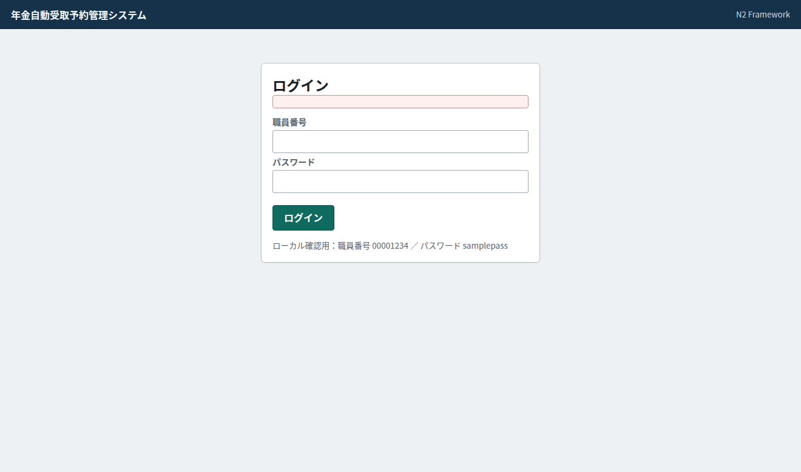
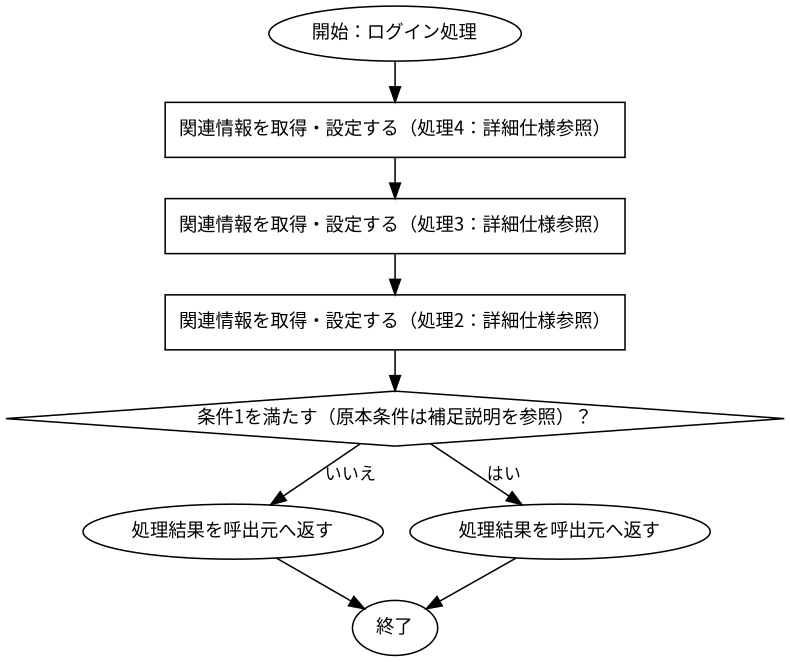

# 年金自動受取予約管理システム - ログイン

## 表紙

| 項目 | 内容 |
| --- | --- |
| 文書名 | 基本設計書 |
| システム名 |  |
| 機能ID | SCR-013 |
| 画面名 | 年金自動受取予約管理システム - ログイン |
| 会社名 |  |
| 作成日 |  |

## 概要

### 概要説明

年金自動受取予約管理システム - ログインの入力・表示・要求処理を行う。

| 情報 | 内容 |
| --- | --- |
| 対象種別 | screen |
| 開始契機 | 呼出元からの要求 |
| 処理対象 | DB2.Ｕ職員名簿表、DB2.ＵＪ科目、N2_SIGHT.Ｂ顧客基本表、NAVI.ＵＪ機能マスタ、NAVI.ＵＪ稼動店舗管理マスタ、NAVI.ＵＭオンラインＯＰマスタ、NAVI.ＵＭパス管理マスタ、NAVI.ＵＭ機能マスタ、NAVI.ＵＳパス管理ステータス、受給有無テーブル、年金1_LK、年金種類テーブル、年金＿削除明細、店名テーブル、性別テーブル、裁定請求テーブル |

### 画面レイアウト

原本HTML・CSSの静的再構成。実行時の表示条件・値は未実行（仮定 Q-56923C9126）。

## 項目一覧

| No | グループ | 項目名 | 種類 | 入出力 | DB連携項目 | 候補取得元 | 必須 | 形式・桁 | 説明 |
| --- | --- | --- | --- | --- | --- | --- | --- | --- | --- |
| 1 | 見出し・説明 | ログイン | Label | O | ‐ | ‐ | ‐ | ‐ | ログインを表示する。 |
| 2 | 入力・選択項目 | 職員番号 | TextBox | I | DB項目未確定（仮定 Q-8FD44B2FF6） | ‐ | 任意（仮定 Q-ED42041970） | 最大8文字 | 職員番号を入力・選択する。 |
| 3 | 入力・選択項目 | パスワード | PasswordBox | I | DB項目未確定（仮定 Q-E6B2F3A7AA） | ‐ | 任意（仮定 Q-2C437EEF63） | 最大20文字 | パスワードを入力・選択する。 |
| 4 | 画面操作 | ログイン | Button | ‐ | ‐ | ‐ | ‐ | ‐ | 「ログイン」の操作を受け付ける。業務結果はイベント仕様で確認する。 |

項目定義数：4項目。表示順と反復行の定義数を区別する。

## イベント仕様

### ログイン処理

#### 処理概要

年金自動受取予約管理システム - ログインで「ログイン処理」の要求を受け付ける。入力・確認・データ操作・応答の順と、条件が成立しない場合の処理を以下に示す。

#### 処理手順

1. 関連情報を取得・設定する（処理5：詳細仕様参照）。

2. 関連情報を取得・設定する（処理6：詳細仕様参照）。

3. 関連情報を取得・設定する（処理7：詳細仕様参照）。

4. 「条件8を満たす（原本条件は補足説明を参照）」に該当するか確認する。該当する場合に限り、次の分岐内手順を行う。該当しない場合は分岐の後へ進む。

4.1. 条件成立時：処理結果を呼出元へ返す。この経路の後続手順は実行しない。

5. 処理結果を呼出元へ返す。この経路の後続手順は実行しない。

#### 処理フロー

入口処理の順序・分岐を示す。呼出先の処理は別単位とし、SQLの対象と実行条件はDB操作の詳細へ記載する。例外線は範囲内で例外が発生した場合の経路で、各命令が必ず例外を送出する意味ではない。

#### 結果・例外時の扱い

| 到達条件 | 結果 |
| --- | --- |
| 条件9を満たす（原本条件は補足説明を参照） | 処理結果を呼出元へ返す |
| 条件10を満たす（原本条件は補足説明を参照） | 処理結果を呼出元へ返す |

## 補足説明

### 適用条件

各仮定のQA番号を確認する。静的に確認できた操作・条件を適用する。

### 項目別DB連携備考

表示元と保存先は別方向の対応。DBから読み出した既存データの履歴保存は、画面入力の直接バインド先と区別する。同じ列の複数経路はイベントの実行条件に従う。

| No | 項目名 | 備考 |
| --- | --- | --- |
| 2 | 職員番号 | DB列への接続を原本から確定できていない。名称が似ている列へ自動接続しない。画面データ連携（仮定 Q-8FD44B2FF6） |
| 3 | パスワード | DB列への接続を原本から確定できていない。名称が似ている列へ自動接続しない。画面データ連携（仮定 Q-E6B2F3A7AA） |

### 処理・条件の原本対応

文書内の条件番号・処理番号は次の原本表記に対応する。完全な業務用語への置換を行っていない箇所はQA・reportで確認する。

| イベント | 参照番号 | 原本条件・処理 |
| --- | --- | --- |
| ログイン処理 | 条件1 | "./JSP/MENU/Login.jsp".equals(next) |
| ログイン処理 | 処理2 | String next = super.perform(request, response) |
| ログイン処理 | 処理3 | request.getSession().removeAttribute(NenkinBaseAction.CSRF_TOKEN_KEY) |
| ログイン処理 | 処理4 | request.getSession().removeAttribute(NenkinBaseAction.STAFF_CONTEXT_KEY) |
| ログイン処理 | 処理5 | request.getSession().removeAttribute(NenkinBaseAction.STAFF_CONTEXT_KEY) |
| ログイン処理 | 処理6 | request.getSession().removeAttribute(NenkinBaseAction.CSRF_TOKEN_KEY) |
| ログイン処理 | 処理7 | String next = super.perform(request, response) |
| ログイン処理 | 条件8 | "./JSP/MENU/Login.jsp".equals(next) |
| ログイン処理 | 条件9 | "./JSP/MENU/Login.jsp".equals(next) |
| ログイン処理 | 条件10 | NOT ("./JSP/MENU/Login.jsp".equals(next)) |

