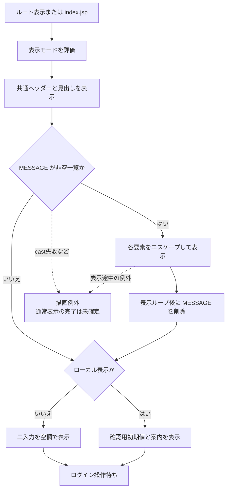
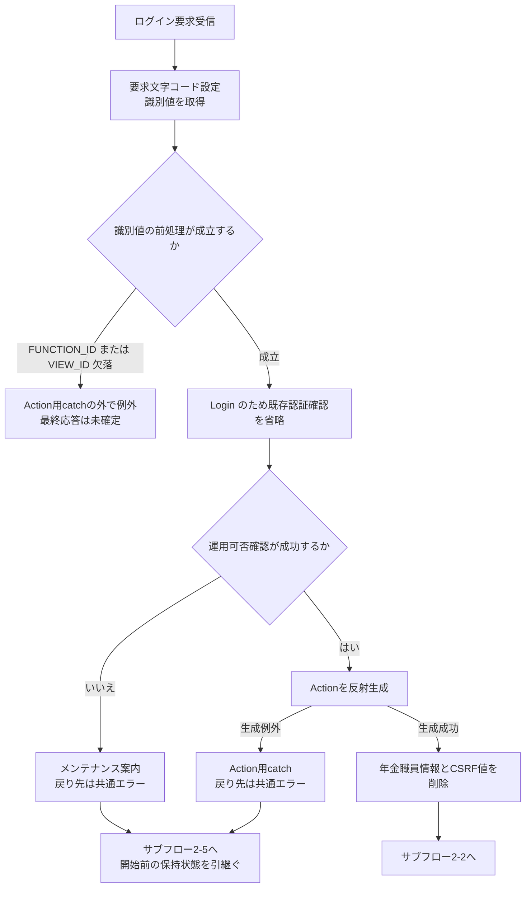
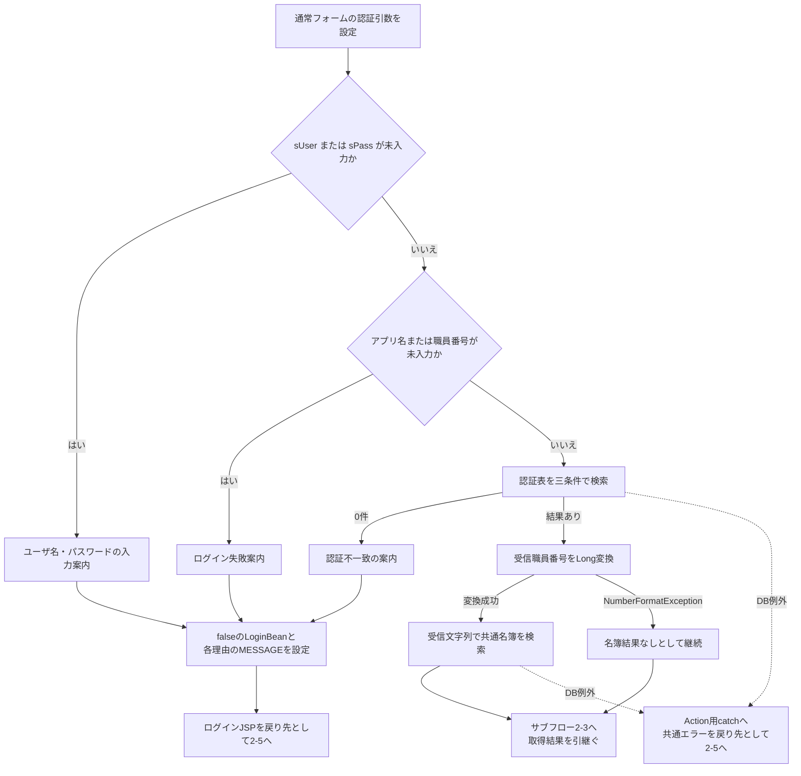
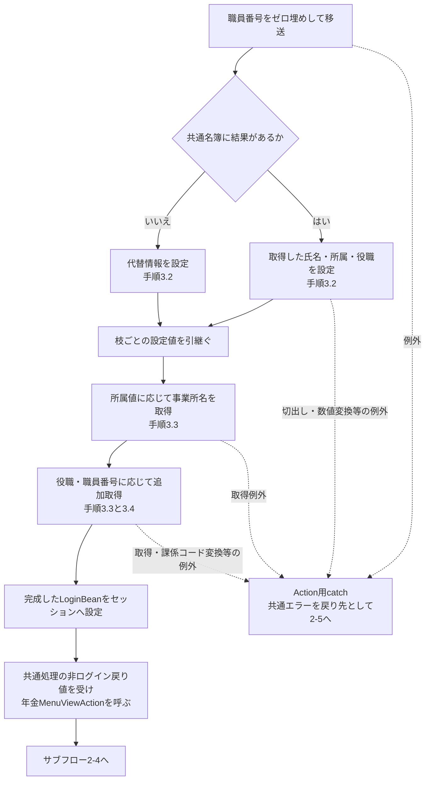
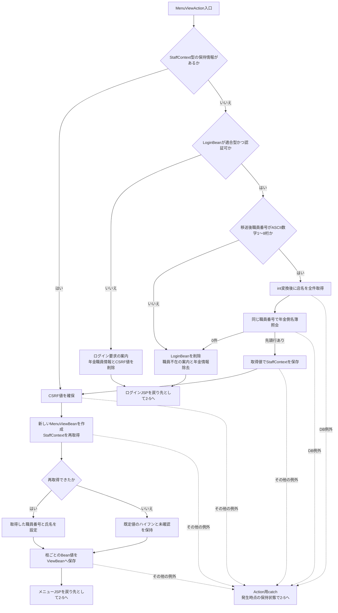
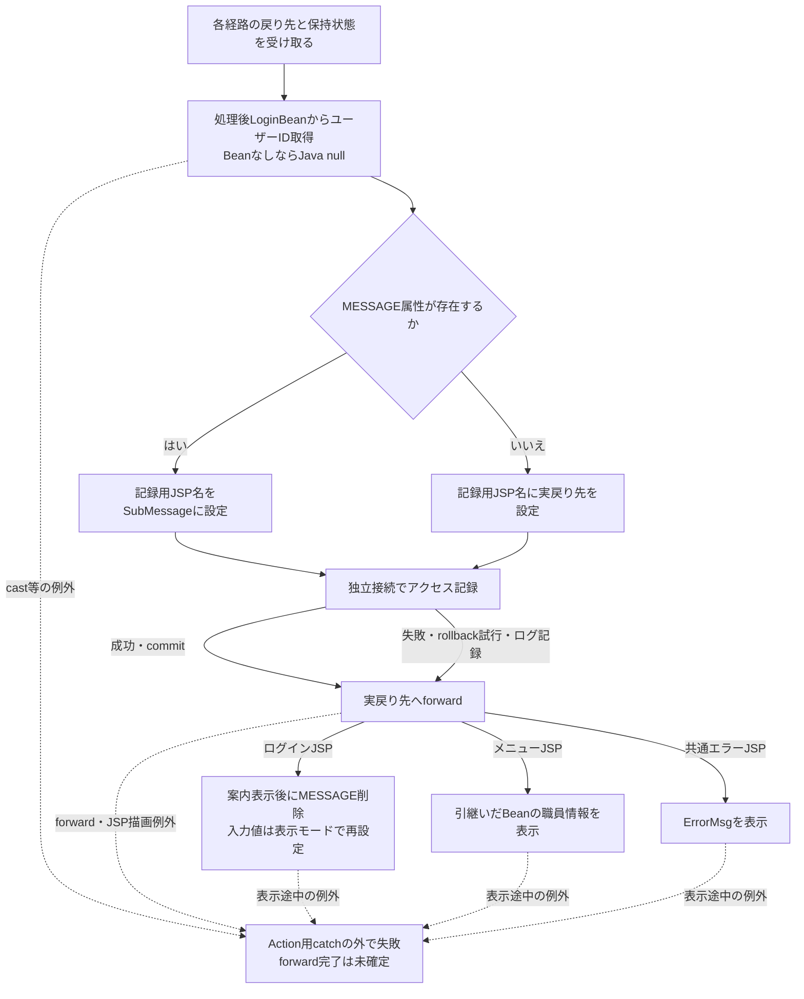
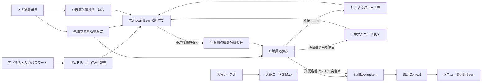
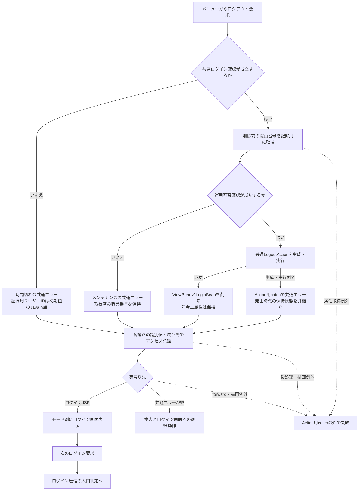

<!-- spec-meta: {"schema":"spec-md/1.0","documentId":"SCR-013","version":"2.0","path":"基本設計書/基本設計書_SCR-013_年金自動受取予約管理システム - ログイン.md","sheets":[{"heading":"概要","kind":"GRID","sheet":"概要"},{"heading":"項目一覧","kind":"LIST","sheet":"項目一覧","key":["No"]},{"heading":"イベント仕様","kind":"GRID","sheet":"イベント仕様"},{"heading":"補足説明","kind":"GRID","sheet":"補足説明"}]} -->
# 年金自動受取予約管理システム - ログイン

| 属性 | 内容 |
| --- | --- |
| 文書種別 | 基本設計書 |
| システム名 | 年金自動受取予約管理システム |
| 機能ID | SCR-013 |
| 版 | 2.0 |
| 解析対象 | ログイン画面、年金ログインAction、接続する共通認証、年金職員確認、メニュー表示まで |
| 基準日 | 2026-10-15 |

## 概要

### 機能の目的と利用の流れ

本機能は、職員番号とパスワードの入力を受け、共通認証と年金側の職員確認を経て、年金業務のメニューへ進める。通常の操作は、ログイン画面で二項目を入力し、「ログイン」を押すことで完結する。認証後に業務用の職員番号を別画面で再入力する手順はない。

通常フォームの共通認証では、アプリケーション名を認証表のアプリケーション名とユーザーＩＤの検索条件に使い、入力したパスワードをパスワード条件に使う。入力職員番号は、この認証表のユーザーＩＤ条件には渡さず、認証後の職員名簿照会に使う。

共通処理で認証できても、その時点では年金業務の利用者情報は成立していない。年金側は、共通ログイン情報へ移送された同じ職員番号を使って名簿を再照会し、職員番号・氏名・所属店番・役職コードを業務セッションへ保持する。その後、メニュー表示用の職員番号と氏名を組み立てる。

| 段階 | 利用者から見た動作 | 内部で確認・保持する内容 |
| --- | --- | --- |
| 初期表示 | 職員番号、パスワード、ログインボタンを表示する | この表示だけでは認証や名簿照会を行わない |
| 共通認証 | 入力不備や認証不一致ならログイン画面へ戻る | アプリケーション名と入力パスワードによる認証、職員番号による共通情報の取得 |
| 年金職員確認 | 名簿に該当職員がなければ案内を表示する | 共通ログイン情報の職員番号形式を検査し、年金側の職員情報を取得する |
| メニュー表示 | ログイン職員番号・氏名と四つの業務入口を表示する | 年金職員情報から表示用Beanを作る |
| 再ログイン | ログイン画面から再度送信する | 年金職員情報と業務用CSRF値を除去してから認証をやり直す |

ログイン後の四つの入口は「新規・変更・削除」「処理データ」「印刷」「EXCEL出力」である。メニューJSPには、役職等によってこれらを非表示にする条件はない。各入口から先の操作はSCR-017および各機能文書の責務とする。

### 画面と要求の入口

| 入口 | 接続先・固定値 | 本機能での扱い |
| --- | --- | --- |
| コンテキストルート | welcome-fileの`JSP/MENU/Login.jsp` | ログイン画面を直接表示する |
| `index.jsp` | ログインJSPへのforward | 同じログイン画面を表示する |
| ログインフォーム | コンテキストパス配下の`/Action.do`へ`POST` | `common.ControlServlet`から`nenkin.LoginAction`を呼ぶ |
| フォーム識別値 | `APPL_NAME=unify`、`FUNCTION_ID=nenkin`、`VIEW_ID=Login`、`COMMAND_ID`は空文字、`UNIFY_FLG=0` | 認証引数、Action選択、共通処理の戻り先判定に使う |
| 入力の受信 | フォームの`accept-charset`とServletの要求文字コード設定は`Windows-31J` | `getParameter`後の値はJavaの`String`として扱う |
| JSPの出力定義 | ログインJSPの`contentType`と`pageEncoding`は`UTF-8` | 要求の受信文字コードとは区別する |

### 通常時の静的画面投影

以下は、`n2nenkin.localDb`が未設定または偽の場合の画面構造と、適用される共有CSSをまとめた非実行のHTMLである。システム名と基盤名を上部に置き、その下へ白いログイン領域を上寄せで配置する。フォームの元の送信契約はdata属性に記載し、ボタンは送信しない表示用とする。

<!DOCTYPE html>
<html lang="ja">
<head>
<meta charset="UTF-8">
<meta name="viewport" content="width=device-width, initial-scale=1">
<title>年金自動受取予約管理システム - ログイン</title>

</head>
<body class="login-page">
<header class="app-nav">
年金自動受取予約管理システム

N2 Framework
</header>
<main class="login-shell">
<section class="screen surface login-card">
<h1>ログイン</h1>
<form name="form0" data-original-action="[contextPath]/Action.do" data-original-method="POST" accept-charset="Windows-31J">
<input type="hidden" name="APPL_NAME" value="unify">
<input type="hidden" name="FUNCTION_ID" value="nenkin">
<input type="hidden" name="VIEW_ID" value="Login">
<input type="hidden" name="COMMAND_ID" value="">
<input type="hidden" name="UNIFY_FLG" value="0">

<label for="loginUser">職員番号</label><input id="loginUser" class="form-control code-input" name="DWH_USER_ID" maxlength="8" value="" inputmode="numeric" autocomplete="username">

<label for="loginPassword">パスワード</label><input id="loginPassword" class="form-control" type="password" name="DWH_PASS_WORD" maxlength="20" value="" autocomplete="current-password">

<button class="access-button primary" type="button">ログイン</button>

</form>
</section>
</main>
</body>
</html>

職員番号には`form-control`と`code-input`の両クラスが適用され、後方の`.code-input`による`width:auto`が有効になる。パスワードと同じ幅へ統一する独自のラッパーやCSSは設けない。ログインJSPはJavaScriptを読み込まず、両入力に`required`や`data-digits-only`を指定していない。職員番号の`inputmode=numeric`は入力補助である。

### ローカルDB有効時の静的画面投影

`Boolean.parseBoolean(System.getProperty("n2nenkin.localDb","false"))`が真の場合は、二つの入力へ確認用の初期値を設定し、フォームの下に確認用案内を表示する。以下では実値を掲載せず、入力値を「（伏字）」、案内中の値を「［非掲載］」へ置き換えている。これらの代替文字の長さは、実値の長さを表さない。表示モードの切替だけでは、接続先DBの利用可能性や認証成功は決まらない。

<!DOCTYPE html>
<html lang="ja">
<head>
<meta charset="UTF-8">
<meta name="viewport" content="width=device-width, initial-scale=1">
<title>年金自動受取予約管理システム - ログイン</title>

</head>
<body class="login-page">
<header class="app-nav">
年金自動受取予約管理システム

N2 Framework
</header>
<main class="login-shell">
<section class="screen surface login-card">
<h1>ログイン</h1>
<form name="form0" data-original-action="[contextPath]/Action.do" data-original-method="POST" accept-charset="Windows-31J">
<input type="hidden" name="APPL_NAME" value="unify">
<input type="hidden" name="FUNCTION_ID" value="nenkin">
<input type="hidden" name="VIEW_ID" value="Login">
<input type="hidden" name="COMMAND_ID" value="">
<input type="hidden" name="UNIFY_FLG" value="0">

<label for="loginUser">職員番号</label><input id="loginUser" class="form-control code-input" name="DWH_USER_ID" maxlength="8" value="（伏字）" inputmode="numeric" autocomplete="username">

<label for="loginPassword">パスワード</label><input id="loginPassword" class="form-control" type="password" name="DWH_PASS_WORD" maxlength="20" value="（伏字）" autocomplete="current-password">

<button class="access-button primary" type="button">ログイン</button>

</form>

ローカル確認用：職員番号 ［非掲載］ ／ パスワード ［非掲載］

</section>
</main>
</body>
</html>

### 拒否後の表示差分

認証拒否や職員不在で戻った場合は、見出し「ログイン」の直後、フォームの前に`message error`領域を置く。例えば認証不一致では次の差分を表示する。

ログインに失敗しました。ユーザ名・パスワードを確認してください。

入力値は送信内容から復元しない。通常モードでは職員番号・パスワードとも空欄に戻り、ローカルモードでは所定の確認用初期値に戻る。拒否理由によって入力欄をreadonlyやdisabledにする処理はない。

## 項目一覧

| No | グループ | 項目名 | 種類 | 入出力 | DB連携項目 | 候補取得元 | 必須 | 形式・桁 | 説明 |
| --- | --- | --- | --- | --- | --- | --- | --- | --- | --- |
| 1 | 共通ヘッダー | システム名 | 固定表示 | O | なし | なし | ‐ | 固定文字列 | `header.app-nav`内の`div.app-nav__title`へシステム名を表示する。 |
| 2 | 共通ヘッダー | 基盤名 | 固定表示 | O | なし | なし | ‐ | `N2 Framework` | `div.app-nav__meta`へ表示する。 |
| 3 | 画面見出し | ログイン | 見出し | O | なし | なし | ‐ | 固定文字列 | ログイン領域の`h1`。 |
| 4 | 結果案内 | メッセージ | 条件付き表示 | O | なし。セッション`MESSAGE`を使用 | なし | ‐ | `List`の各要素をHTMLエスケープして表示 | 非空のメッセージ一覧がある場合に表示し、表示ループ後に属性を削除する。空の一覧はこの分岐で削除しない。 |
| 5 | ログイン入力 | 職員番号 | テキスト入力 | I | 共通・年金の`DB2.Ｕ職員名簿表.職員番号`、共通の`DB2.Ｕ職員所属課係一覧表.職員番号`の検索条件。名簿への保存は行わない | なし | ログイン送信時に必要。共通側で受信値のnull・空文字を拒否 | `id=loginUser`、`name=DWH_USER_ID`。受信型`String`。HTMLの`maxlength=8`、`inputmode=numeric`。移送後はASCII数字1～8桁を検査 | 共通側の最初の名簿照会には受信文字列を使う。年金側では共通保持値をtrimし、形式適合後に`int`へ変換して照会する。 |
| 6 | ログイン入力 | パスワード | パスワード入力 | I | `DB2.ＵＷＥＢログイン情報表.パスワード`の検索条件。保存は行わない | なし | ログイン送信時に必要。共通側で受信値のnull・空文字を拒否 | `id=loginPassword`、`name=DWH_PASS_WORD`、`type=password`。受信型`String`。HTMLの`maxlength=20` | 入力値を認証用引数へそのまま渡す。接続経路内にはtrim、ハッシュ化、20を上限とするサーバー側長さ検査の記述がない。実値は記載しない。 |
| 7 | 操作 | ログイン | ボタン | I | 認証・参照を開始。共通アクセス記録は別接続で追加 | なし | ‐ | 実画面は`type=submit`、`class=access-button primary` | `form0`を`POST`送信する。静的投影では`type=button`とする。 |
| 8 | ローカル案内 | 確認用案内 | 条件付き固定表示 | O | なし | なし | ‐ | `p.hint` | ローカルDB表示モードが真の場合だけ、確認用職員番号と認証情報の案内を表示する。本書では値を非掲載とする。 |
| 9 | 要求制御 | アプリケーション名 | hidden | I | 認証表の`アプリケーション名`と`ユーザーＩＤ`の検索条件 | なし | 通常フォームの固定値。共通認証の欠落検査対象 | `name=APPL_NAME`、`String`、値`unify` | 通常経路ではこの値を認証用`sUser`にも設定する。 |
| 10 | 要求制御 | 機能識別値 | hidden | I | 共通アクセス記録の`機能ＩＤ` | なし | 通常要求のAction選択に必要 | `name=FUNCTION_ID`、`String`、値`nenkin` | 小文字化した値をActionのパッケージ名に使う。欠落時の失敗はイベント仕様で区別する。 |
| 11 | 要求制御 | 画面識別値 | hidden | I | 共通アクセス記録の`画面ＩＤ` | なし | 通常要求のAction選択に必要 | `name=VIEW_ID`、`String`、値`Login` | Action名の組立てに使い、既存ログイン確認を省略する条件にもなる。 |
| 12 | 要求制御 | コマンド識別値 | hidden | I | 共通アクセス記録の`コマンドＩＤ`。画面識別値と組み合わせて`アクションＩＤ`にも使用 | なし | 空文字を送る。パラメータ欠落とは区別する | `name=COMMAND_ID`、`String`、値は空文字 | 通常フォームでは`nenkin.LoginAction`を選択するための空文字である。 |
| 13 | 要求制御 | 共通メニュー区分 | hidden | I | 直接保存なし | なし | 通常フォームの固定値 | `name=UNIFY_FLG`、`String`、値`0` | 共通処理の戻り先判定に使う。年金Actionは共通メニューへforwardせず、年金メニュー表示処理を呼ぶ。 |
| 14 | 遷移後表示 | ログイン職員番号 | メニュー表示 | O | 年金側で取得した`DB2.Ｕ職員名簿表.職員番号` | なし | 職員情報を取得できた場合に設定 | `StaffContext.staffNo`は`int`、`MenuViewBean.staffNo`は`String`。`%08d`で表示 | フォーム文字列を直接表示せず、年金職員情報から組み立てる。メニューBean設定時の再取得がnullなら既定表示は`-`。 |
| 15 | 遷移後表示 | ログイン職員氏名 | メニュー表示 | O | 年金側で取得した`DB2.Ｕ職員名簿表.漢字氏名` | なし | 職員情報を取得できた場合に設定 | `String`。本番の業務上限は未確定 | `StaffContext.staffName`から`MenuViewBean.staffName`へ移し、メニューJSPでHTMLエスケープする。Bean設定時の職員情報再取得がnullなら既定表示は`未確認`。 |

## イベント仕様

### 初期表示

#### 処理概要

コンテキストルートまたは`index.jsp`からログイン画面を表示する。共通認証と年金職員確認は、ログインボタンによる送信後に行う。ログイン画面を開くこと自体では、既存の共通ログイン情報や年金職員情報を除去しない。

#### 処理手順

**1. 表示モードを決定する。**

　**1.1.** システムプロパティ`n2nenkin.localDb`を、未設定時は文字列`false`として取得し、`Boolean.parseBoolean`で評価する。

　**1.2.** 共通ヘッダーとログイン見出しを表示する。

**2. 保持されている案内を表示する。**

　**2.1.** セッションの`MESSAGE`を`List`へキャストする。非nullかつ非空の場合は、各要素を`HtmlUtil.escape`で変換して表示する。

　**2.2.** 表示ループを終えた後で`MESSAGE`を削除する。属性が未設定の場合は案内を表示せず、空の一覧の場合は削除も行わない。

**3. 入力欄と操作を表示する。**

　**3.1.** 通常モードでは二つの入力値を空文字にする。ローカルモードでは所定の確認用初期値を設定する。

　**3.2.** 五つの固定識別値とログインボタンを表示する。ローカルモードの場合だけ、フォームの下へ確認用案内を表示する。

#### 処理フロー

この図は初回表示の処理を表す。送信後の拒否による再表示は、次イベントの結果処理から入る別の要求処理であり、認証結果を初期表示で再計算するものではない。

#### SQL・テーブル関連（ER図）

初期表示ではDBを参照しない。参照する保持領域はシステムプロパティとHTTPセッションであり、ER図の対象となるテーブル関連はない。

#### DB操作の詳細

認証表、職員名簿、予約表、アクセス記録へのSQLは、このJSPの直接表示では実行しない。`index.jsp`のforwardにもログインActionの呼出しはない。

#### 結果・例外時の扱い

正常に表示できた場合は、モードに応じた入力値で操作待ちとなる。認証済みかどうかを確認してメニューへ自動転送する処理は、このJSPにはない。

`MESSAGE`の型が`List`に適合しない場合や、表示処理で例外が起きた場合は、表示ループ後の属性削除まで到達しないことがある。直接JSP表示の例外をログインAction用のcatchで共通エラーへ変換する契約はない。

### ログイン送信・職員確認・メニュー表示

#### 処理概要

ログインフォームの要求を共通Servletで受け、年金ログインActionから共通認証を呼ぶ。共通処理がログインJSPを返した場合は再表示へ進み、それ以外の戻り値では年金メニュー表示処理を呼ぶ。年金メニュー表示処理は、共通認証結果と同じ職員番号を使った年金職員確認を行う。

この処理は、認証・名簿等の参照とセッション設定を行う。予約情報や職員名簿の登録・更新は行わない。共通Servletが行うアクセス記録は、独立したDB更新として扱う。

#### 処理手順

**1. 要求の受信とActionの選択を行う。**

　**1.1.** `ControlServlet`は要求文字コードを`Windows-31J`へ設定し、識別パラメータからActionのパッケージ名とクラス名を組み立てる。通常フォームの値では`nenkin.LoginAction`となる。

　**1.2.** `VIEW_ID=Login`では既存`LoginBean`のログイン可否確認を省略する。ただし、Action実行前の`OperatePermission.check`は行う。この処理は先に`jdbc/Oracle_SP2NM`へ接続し、その後で業務種別を判定する。`nenkin`は運用状態表の照会対象ではなく、接続取得後は対象外として許可する。接続取得等に失敗した場合はメンテナンス案内の共通エラーへ進み、年金ログインActionを呼ばない。

　**1.3.** 反射によるAction生成が成功すると、年金ログインActionは最初に`NENKIN_STAFF_CONTEXT`と`NENKIN_CSRF_TOKEN`を削除する。既存`LoginBean`や`ViewBean`の一括削除は行わない。その後に共通ログイン処理を呼ぶ。

**2. 共通認証を行う。**

　**2.1.** 通常フォームには特殊連携用の識別値がないため、`DWH_USER_ID`、`DWH_PASS_WORD`、`APPL_NAME`、`UNIFY_FLG`を要求から取得する。職員番号とパスワードはいずれも`String`で受ける。通常の`APPL_NAME=unify`分岐では、認証用`sUser`をアプリケーション名、`sPass`を入力パスワードとする。

　**2.2.** 最初に`sUser`または`sPass`がnull・空文字なら「ユーザ名・パスワードを入力してください。」を設定する。次に`applName`または`dwhUserId`がnull・空文字なら「ログインに失敗しました。」を設定する。この順序により、通常フォームでパスワードと職員番号の両方が欠落した場合は最初の案内となる。空白だけの文字列は、この空文字検査では拒否されない。

　**2.3.** 入力検査を通ると、認証表をアプリケーション名・ユーザーＩＤ・パスワードの三条件で照会する。通常経路の前二条件はアプリケーション名由来であり、第三条件が入力パスワードである。結果がnullまたは0件なら「ログインに失敗しました。ユーザ名・パスワードを確認してください。」を設定する。

　**2.4.** 認証表に結果があれば、受信職員番号を加工する前に`Long.parseLong(dwhUserId)`で確認し、その受信文字列を使って共通の職員名簿を検索する。この数値変換の`NumberFormatException`は名簿結果なしへ置き換え、共通認証可否はtrueとして次へ進む。名簿0件も、この段階のパスワード認証失敗には置き換えない。DB照会の失敗は数値変換用catchでは処理しない。

　**2.5.** 2.2または2.3で拒否した場合は、ログイン可否falseの`LoginInfoBean`を`LoginBean`へ、案内一覧を`MESSAGE`へ設定し、ログインJSPを返す。年金Actionはこの戻り先をそのまま返し、年金職員照会には進まない。

**3. 共通の職員関連情報を組み立てる。**

　**3.1.** 認証成功後は、職員番号を`getAdd0String(dwhUserId,8)`で共通ログイン情報へ移す。この補助処理は、nullおよび大文字小文字を無視した文字列`null`を空文字にし、それ以外をtrimする。空文字は空のまま返す。非空でJavaの`String.length()`が8未満なら先頭へゼロを追加し、8以上は切り捨てない。文字列`null`との比較はtrimより前に行われる。

　**3.2.** 共通名簿に結果がある場合は、先頭行から氏名・カナ氏名・性別・役職コード等を設定する。所属店番は4桁へゼロ埋めし、先頭2桁と後方2桁を詳細コード・枝番にする。数値が100未満なら共通所属店番を`010`、それ以外は先頭3桁とする。名簿結果がなければ、共通所属店番`999`、詳細コード・枝番`99`、氏名は受信職員番号、性別・役職コードは`0`等の代替情報を設定する。

　**3.3.** 元の所属店番を取得できた場合は、その分割結果で事業所名を検索する。0件または所属値なしでは所属店名を「該当なし」とする。役職コードがnull・空文字・`0`以外の場合は役職名を検索し、検索対象外または0件では「該当なし」とする。

　**3.4.** 受信職員番号の`Long`変換に成功すれば所属課係を検索する。この変換失敗は所属課係結果なしとして扱う。結果がある場合は先頭行のコードを保持し、数値10を「店長席」、100を一つの名称「融資Ｍ・リレーションＧ」、600を「事務グループ」、その他を「その他」に対応付ける。結果なしではコード`0`、名称空文字とする。

　**3.5.** これらの取得・変換を終えてから、共通ログイン情報をセッションの`LoginBean`へ設定する。通常フォームの`UNIFY_FLG=0`では共通処理は共通メニューJSP名を返すが、年金ActionはそのJSPへforwardせず、`MenuViewAction.perform`を呼ぶ。

共通名簿が0件の場合の代替情報と、名簿の取得行に不正・欠落した所属値がある場合は異なる。取得行の所属店番が空文字になれば、部分文字列の切出しや数値変換で例外が起こり得る。これらは職員番号の`Long`変換用catchの対象外である。

**4. 年金職員情報を成立させ、メニュー表示値を作る。**

　**4.1.** `MenuViewAction`は`requireStaff`を呼ぶ。`StaffContext`型の年金職員情報が保持されている場合は再照会せず、CSRF値を確保して利用する。ただし、通常のログイン送信では1.3で削除しているため、保持情報なしの分岐へ進む。

　**4.2.** 保持情報がない場合は、`LoginBean`が`LoginInfoBean`型でログイン可否trueであることを確認する。該当しなければ「ログインしてください。」を設定し、年金職員情報とCSRF値を削除してfalseを返す。この分岐では`LoginBean`自体を削除しない。

　**4.3.** 共通ログイン情報の職員番号をtrimし、`[0-9]{1,8}`に一致する場合だけ`Integer.parseInt`して`verifyStaff`へ渡す。ゼロを含む数字列も照会対象であり、正数限定の検査はない。形式不適合なら4.5の職員不在案内へ進む。

　**4.4.** 年金職員検索の前に、業務DBから店名テーブルを全件取得し、店舗コードをキーとするメモリ上のMapを作る。その後、職員参照接続で職員番号を条件に職員名簿を検索し、先頭1行を取得する。店名取得に失敗した場合は職員名簿照会へ到達しない。

　**4.5.** 職員名簿が0件の場合、または4.3の形式不適合の場合は、`LoginBean`を削除し、「ログイン職員番号が職員名簿に存在しません。管理者に確認してください。」を`MESSAGE`へ設定する。年金職員情報とCSRF値も削除し、falseを返す。`MenuViewAction`の戻り値は`STAFF_JSP`だが、その実値はログインJSPであり、別の職員番号入力画面には進まない。

　**4.6.** 職員を取得できた場合は、職員番号`int`、氏名`String`、所属店番`int`、役職コード`String`から`StaffContext`を作り、`NENKIN_STAFF_CONTEXT`へ保存する。所属店番には今回の名簿取得値を使い、共通情報の`010`置換や先頭3桁化した値は使わない。店舗名とカナ氏名は取得用オブジェクトにはあるが、`StaffContext`へは移さない。

　**4.7.** CSRF値が非空の`String`なら再利用し、それ以外では`UUID.randomUUID().toString()`を生成して保存する。通常の再ログインでは1.3で既存値を削除しているため、新規に確保する。ログインフォームには`CSRF_TOKEN`がなく、このログイン処理は業務更新用のPOST・トークン一致検査を呼ばない。

　**4.8.** `MenuViewAction`は新しい`MenuViewBean`を作り、セッションから職員情報を再取得する。取得できれば職員番号を`Locale.ROOT`の`%08d`で表示文字列へ変換し、氏名とともに設定する。この再取得がnullの場合は、Beanの既定値である職員番号`-`、氏名`未確認`を保持する。Beanをセッションの`ViewBean`へ保存し、`./JSP/NENKIN/Menu.jsp`を返す。

**5. アクセス記録と画面へのforwardを行う。**

　**5.1.** 共通ServletはAction処理後の`LoginBean`から記録用職員番号を取得する。認証拒否ではfalseのBean内の職員番号を取得し得る。年金職員不在でBeanを削除した場合は、記録用MapのユーザーIDがJavaのnullになる。既存Beanが型不適合であれば、この取得時のcastで例外が起こり得る。

　**5.2.** `MESSAGE`属性が存在する場合は、記録上のJSP名を`./JSP/COMMON/SubMessage.jsp`にする。属性がなければAction等が決めた戻り先を記録する。この判定では実際のforward先を変更しない。

　**5.3.** アクセス記録を独立接続で追加・commitし、実際の戻り先へforwardする。記録処理内の失敗はrollbackを試みてログへ記録し、呼出元へ再送出しない。記録用MapのJava nullは、記録SQLでは引用符付きの文字列`'null'`として組み立てられるため、SQL NULLとは区別する。

　**5.4.** ログインJSPへ戻った場合は、`MESSAGE`をエスケープ表示して表示ループ後に削除する。入力値は送信値から復元せず、通常モードでは空欄、ローカルモードでは所定の初期値に戻す。メニューJSPへ進んだ場合は、表示用Beanの職員番号と氏名をHTMLエスケープして表示する。

#### 処理フロー

**サブフロー2-1：入口判定と年金Action開始**

入口は通常フォームのPOST要求である。Action開始前に拒否された場合は、年金職員情報とCSRF値を削除する1.3へ到達しない。

`COMMAND_ID`の欠落は空文字と異なる。欠落時はnullがクラス名連結へ流れ、反射生成の失敗はAction用catch内で処理される。`FUNCTION_ID`の小文字化と`VIEW_ID`の比較は、そのcatchより前にある。

**サブフロー2-2：共通認証と最初の職員名簿照会**

入口では年金職員情報とCSRF値を除去済みである。共通認証拒否はfalseのBeanと個別理由を保持して2-5へ進む。認証成立時は、名簿結果の有無を区別したまま2-3へ渡す。

Rで保持する理由はR1・R2・R3のそれぞれの案内であり、一つの固定文言へ置き換えない。

**サブフロー2-3：共通情報の組立てと公開**

入口で受けた共通名簿結果に応じて、取得値または代替値を設定する。合流後も、それぞれの枝で設定した値を保持して追加照会へ進む。

事業所名・役職名の「該当なし」と所属課係のコード`0`・名称空文字は、手順3.3・3.4に記載した各条件で設定する。取得に成功した枝の名称を、結果なしの既定値で上書きする合流処理は設けない。

**サブフロー2-4：年金職員確認と表示用Beanの作成**

通常ログインからの入口では年金職員情報は未保持である。既存職員情報の再利用分岐は、メニュー再表示等から同じ確認処理へ入る場合の契約も示している。

R1では`LoginBean`自体の削除を行わず、R2では削除する。この違いは、後続のユーザーID取得とアクセス記録にも引き継ぐ。

**サブフロー2-5：戻り先と保持状態を引き継いだアクセス記録・表示**

入口では、各流入経路が決めた戻り先、`LoginBean`、`MESSAGE`、年金職員情報、CSRF値をそのまま引き継ぐ。共通エラーへの到達だけを理由に、これらを一括初期化しない。

記録処理の成功枝と失敗枝が合流しても、同じ記録結果になったことは意味しない。forward先と、記録までに成立した各セッション属性を引き継ぐ。記録済みデータをJSP描画失敗で巻き戻す処理はない。

#### SQL・テーブル関連（ER図）

ログインは複数の独立したSELECTとメモリ上の移送で構成される。次の図は検索引数と取得値の関連を表す。SQLのJOINやFKの多重度を表す図ではない。

共通認証、共通の追加情報取得、年金側の店名取得、年金側の職員取得は、別々の接続取得を伴う。各読取を一つの整合したスナップショットとして扱う処理はない。

アクセス記録の`DB2.Ｕカウンターシフト`は、上図の参照結果と要求識別値から記録用Mapを作って追加する。認証表や名簿とのSQL JOINは行わない。

#### DB操作の詳細

| No | 操作と接続先 | 対象・取得列 | 条件と引数 | 実行方式・結果の扱い |
| --- | --- | --- | --- | --- |
| 1 | 運用可否確認。`jdbc/Oracle_SP2NM` | 年金では運用状態表を照会しない | 業務種別判定より先に接続を取得する | 接続取得等の例外ではfalseとなる。年金ログインActionの開始前に拒否される |
| 2 | 共通認証。`jdbc/Oracle_SP2NM` | `DB2.ＵＷＥＢログイン情報表`の全列 | `アプリケーション名 = applName`、`ユーザーＩＤ = sUser`、`パスワード = sPass`のすべて | 値を引用符付きで連結したSQLを`Statement.executeQuery`へ渡す。通常経路の前二値はアプリ名由来。null・0件なら認証拒否 |
| 3 | 共通職員確認。認証表検索と同じ接続 | `DB2.Ｕ職員名簿表`の全列 | `職員番号 = dwhUserId` | `Long`変換に成功した受信文字列を数値リテラルとして連結する。全件を一覧化し、先頭行を共通情報設定に使用する |
| 4 | 共通所属店名取得。`jdbc/Oracle_DWH` | `N2_DWH.Ｊ事業所コード表２.事業所名` | `店舗コード = 詳細部室店コード`かつ`枝番 = 詳細部室店枝番` | 所属店番の分割値をSQLへ連結する。先頭行を使用し、0件は「該当なし」 |
| 5 | 共通役職名取得。再取得した`jdbc/Oracle_SP2NM`接続 | `DB2.ＵＪＶ役職コード表.役職` | `役職コード = 名簿から取得した役職コード` | null・空文字・`0`以外の場合にSQLへ数値条件として連結する。先頭行を使用し、対象外・0件は「該当なし」 |
| 6 | 共通所属課係取得。5と同じ接続 | `DB2.Ｕ職員所属課係一覧表`の全列 | `職員番号 = dwhUserId` | 受信値の`Long`変換後、数値条件として連結する。先頭行のコードを使用。変換失敗・0件はコード`0`、名称空文字 |
| 7 | 年金職員取得に先行する店名取得。`jdbc/RAROA_DB` | `店名テーブル.店舗ｺｰﾄﾞ`、`店名` | WHEREなし、引数なし | `PreparedStatement`で全件取得し、`Map<Integer, String>`へ格納する。店舗コードが重複した場合、Mapでは後から取得した値が同じキーを置き換える |
| 8 | 年金職員確認。`jdbc/Oracle_SP2NM` | `DB2.Ｕ職員名簿表`の職員番号、漢字氏名、カナ氏名、所属店番、役職コード | `S.職員番号 = ?`。`setInt(1, staffCode)` | `PreparedStatement`を使用する。最初の`results.next()`が真なら1行を変換し、偽ならnullを返す。複数行検査は行わない |
| 9 | 共通アクセス記録。独立した`jdbc/Oracle_SP2NM`接続 | `DB2.Ｕカウンターシフト`へアクセス日付・時刻・機能ＩＤ・画面ＩＤ・コマンドＩＤ・アクションＩＤ・ＪＳＰ名・ユーザーＩＤを追加 | 要求識別値、経路別JSP名、経路別ユーザーID | 文字列連結したINSERTを実行してcommitする。失敗時はrollbackを試み、例外をログへ記録して処理を戻す |

上記の検索には、JOIN、ORDER BY、ページング、在籍・停止区分や有効期限の追加条件はない。年金側の店名Mapも、並び順を指定せずに作る。SQLにない在籍判定や停止値の拒否をログイン条件へ追加しない。

共通検索ではPreparedStatementの型・サイズ付きバインドを行わない。年金職員検索のバインドは`setInt`の1件であり、文字列サイズ指定や`setNull`はない。接続された検索コードには、明示的な取得件数上限、クエリータイムアウト、取消処理の指定はない。

共通検索の結果変換は、全行を`List<Map>`へ格納し、DBのNULLを空文字、それ以外の取得文字列をtrim済み値にする。年金職員検索では職員番号・所属店番を`getInt`、氏名・カナ氏名・役職コードを`getString`で取得する。`getInt`後に`wasNull`を確認していないため、この取得結果ではDB NULLと数値0を区別する情報を保持しない。取得用オブジェクトはnullの文字列を空文字へ置換する。

共通接続取得は指定したJNDI名を直接lookupし、Connectionへ`autoCommit=false`を設定する。年金側は、業務用・職員用それぞれについて通常のJNDI名、その後に`java:comp/env/`付き名を探索し、DataSourceを種別別にキャッシュする。年金接続取得クラスではConnectionのautoCommitを設定しない。探索でDataSourceを得られなければ`SQLException`となる。

ログインに伴う参照には、保存対象のWHERE、比較版、更新件数検査、再確認用ロックはない。業務データの変更を伴うのは共通アクセス記録の追加であり、そのcommit・rollbackは認証やセッション設定を巻き戻さない。

#### 結果・例外時の扱い

| 条件・失敗段階 | 戻り先・案内 | 保持状態と後続処理 |
| --- | --- | --- |
| 通常の認証・年金職員確認が成立 | 年金メニューJSP | 共通`LoginBean`、年金`StaffContext`、CSRF値、表示用`ViewBean`を保持する |
| 認証用ユーザー値またはパスワードがnull・空文字 | ログインJSP。「ユーザ名・パスワードを入力してください。」 | falseの`LoginBean`と`MESSAGE`を設定。年金職員情報・CSRF値はログイン開始時に削除済み |
| 前行に該当せず、アプリ名または職員番号がnull・空文字 | ログインJSP。「ログインに失敗しました。」 | falseの`LoginBean`と`MESSAGE`を設定する |
| 認証表に該当なし | ログインJSP。「ログインに失敗しました。ユーザ名・パスワードを確認してください。」 | 年金職員確認へ進まない |
| 共通認証は成立したが、移送後職員番号が形式不適合、または年金名簿が0件 | ログインJSP。「ログイン職員番号が職員名簿に存在しません。管理者に確認してください。」 | `LoginBean`、年金職員情報、CSRF値を削除する。記録用MapのユーザーIDはJava nullになり得る |
| 年金職員情報なし、かつ共通ログイン情報が型不適合または認証不可 | `requireStaff`は「ログインしてください。」を設定してログインJSPを返す | 年金二属性を削除するが、`LoginBean`自体は削除しない。型不適合属性が残れば後続Servletのcastで失敗し、再表示まで到達しない場合がある |
| 運用可否確認に失敗 | 共通エラー。「現在メンテナンス中のため画面を表示できません。」 | 年金Action開始前のため、その開始時の年金二属性削除は行われない |
| 共通情報の公開前にDB取得・所属値切出し・数値変換等で例外 | Action用catchで共通エラーを選択 | 新しい`LoginBean`の設定前なら既存Beanが残る場合がある。年金二属性はログイン開始時に削除済み |
| 共通情報公開後、年金側の店名・職員取得で例外 | Action用catchで共通エラーを選択 | 認証可の`LoginBean`が残り、年金職員情報は未成立となり得る |
| 職員情報保存後のCSRF確保や表示用Bean作成等で例外 | Action用catchで共通エラーを選択 | 例外発生までに設定した属性を一括して戻す処理はない |
| アクセス記録内部で失敗 | 記録失敗をログへ残し、実戻り先への処理を続ける | rollbackも失敗する場合はその例外もログへ記録する。画面側の結果を記録成功へ置き換えない |
| Action処理後の属性cast、forward、JSP描画で失敗 | Action用catchの対象外 | 予定していた画面の表示完了やメッセージ削除まで到達したとは扱わない |

共通の職員番号`Long`変換用catchは、その変換失敗だけを名簿・所属課係結果なしへ変える。後続の所属店番の切出し、`Integer.parseInt`、所属課係コードの数値変換による例外を、認証不一致の案内へ変えるものではない。

共通検索はDB例外を再送出する。ResultSet・Statementのclose時の`SQLException`も送出され得る。共通ログイン側の接続close失敗はログへ記録する。年金の参照サービスは検索`SQLException`を`NenkinDataAccessException`へ変換し、終了時closeの例外は抑止する。年金ログインAction、メニューAction、職員確認処理には、これらを入力拒否へ変えるcatchがない。

反射生成とAction実行のcatchへ到達した例外は、`ErrorMsg`へ`アプリケーションエラーが発生しました。 システム管理者に連絡してください。`を設定して共通エラーJSPを選ぶ。エラーJSPはHTMLエスケープするため、この文字列中の` `も改行タグとしては解釈されない。Action用catchより前の識別値処理と、その後の属性取得・forward・JSP描画は、同catchによる変換範囲から外れる。

共通エラー画面の「ログイン画面へ」はコンテキストルートへ戻る操作である。エラーJSPは`LoginBean`、年金職員情報、CSRF値、`ErrorMsg`を削除しない。画面への復帰だけでセッション全体が初期化されたとは扱わず、再ログイン送信が年金Actionへ到達した時点で年金二属性を削除する。

認証可否や職員不在の結果ごとに、明示的なHTTP状態コードを設定する処理はない。Servletのforward前には`Windows-31J`のContent-Type指定があり、JSPはUTF-8を宣言する。これらの宣言と、コンテナによる最終応答の確定は区別する。

### ログアウト後の復帰・再ログイン

#### 処理概要

ログイン後のメニューからログアウトすると、共通ログイン情報と表示用Beanを削除してログイン画面へ戻る。年金職員情報とCSRF値は共通ログアウトActionでは削除しない。次のログイン送信で年金Actionに入ったとき、これらを削除して認証・職員確認をやり直す。

#### 処理手順

**1. メニューから共通ログアウトを要求する。**

　**1.1.** メニューのログアウトボタンは、`FUNCTION_ID=common`、`VIEW_ID=Logout`、`COMMAND_ID`空文字で`/Action.do`へPOSTする。

　**1.2.** 共通Servletはログイン状態を確認する。未ログインなら、ログイン時間切れの共通エラーを選び、ログアウトActionには進まない。

　**1.3.** ログイン確認後、共通Servletは削除前の`LoginBean`からアクセス記録用の職員番号を取得する。その後、運用可否確認を行い、許可された場合に`common.LogoutAction`を生成して呼ぶ。

**2. 共通属性を削除して画面へ戻る。**

　**2.1.** 共通ログアウトActionは`ViewBean`と`LoginBean`を削除し、ログインJSPを返す。`NENKIN_STAFF_CONTEXT`と`NENKIN_CSRF_TOKEN`はこのActionでは削除しない。セッション全体のinvalidateも行わない。

　**2.2.** 共通Servletは1.3で取得した職員番号を使ってアクセス記録へ進む。Actionが削除した後の`LoginBean`から取り直す処理ではない。

　**2.3.** ログインJSPはその時点の表示モードと`MESSAGE`に従って表示する。通常モードでは二入力とも空欄になる。

**3. 次のログイン送信を処理する。**

　**3.1.** 利用者が職員番号とパスワードを入力してログインを送信する。別の業務職員番号入力は要求しない。

　**3.2.** 年金ログインActionへ到達すると、その開始時に残存していた年金職員情報とCSRF値を削除し、前イベントの認証処理へ進む。開始前の運用可否確認等で拒否された場合は、この削除まで到達しない。

#### 処理フロー

アクセス記録内部で捕捉したDB例外はログへ記録して戻る。図の「後処理・描画例外」は、その内部で処理済みの例外を再び外側へ送る意味ではない。各経路で取得した記録用職員番号は、合流後も保持する。

#### SQL・テーブル関連（ER図）

共通ログアウトAction自身はDBを参照・更新しない。操作対象はHTTPセッションの二属性である。共通Servletの運用可否確認に伴う接続取得と、独立したアクセス記録が周辺処理として接続する。認証表や職員名簿との新しいER関連は生じない。

#### DB操作の詳細

ログアウト要求についても、共通Servletは運用可否確認で接続を取得する。`common`は対象業務の運用状態表照会分岐に含まれず、接続取得できれば対象外として許可される。

アクセス記録は削除前に取得した職員番号とログアウト要求の識別値を使う。追加・commit、失敗時のrollback試行と例外のログ記録は、ログイン送信イベントの記録契約と同じである。記録失敗によって、削除済みのセッション属性を復元する処理はない。

#### 結果・例外時の扱い

正常にログアウトActionを終えると、共通認証情報と表示用Beanを持たない状態でログイン画面へ戻る。年金職員情報とCSRF値は残るため、これをセッション全体の破棄や、すべての認証関連属性の除去として扱わない。

ログイン確認や運用可否確認で拒否された場合は、ログアウトActionの属性削除を行わない。生成・Action実行の例外は共通catchで共通エラーを選ぶが、削除前の利用者識別取得や最終forwardはそのcatchの範囲外である。

次のログイン処理では、年金Action開始時の二属性削除と新たな名簿確認によって、前回職員の保持情報を通常の再認証へ持ち越さない。セッションIDの再生成を行う呼出しは、このログイン・ログアウト経路にはない。

## 補足説明

### 入力・保持値・検索値の境界

| 対象 | ブラウザー・受信値 | 共通処理 | 年金処理・表示 |
| --- | --- | --- | --- |
| 職員番号 | テキスト入力の`maxlength=8`。`getParameter`後は`String`。null・空文字と空白だけの値は異なる | 最初の名簿・所属課係照会は受信値の`Long`変換後、受信文字列をSQLへ連結する。保持用にはtrimと先頭ゼロ付加を行うが、8以上を切り捨てない | 保持値をtrimし、ASCII数字1～8桁だけを`int`へ変換して照会する。取得後の職員番号を8桁表示へ変換する |
| パスワード | `type=password`、`maxlength=20`。受信値は`String` | null・空文字を拒否し、そのまま認証用引数へ移す。接続経路にtrim・ハッシュ化・サーバー側20桁検査はない | 年金職員情報やメニュー表示へは移さない |
| 所属店番 | ログイン画面から入力しない | 共通名簿取得値を4桁化し、詳細コード等へ分割して保持する | 年金側が再取得した名簿の`int`値を業務職員情報へ保持する。共通側で加工した所属値とは別である |
| 職員氏名 | ログイン画面から入力しない | 共通名簿の先頭行、または名簿結果なしの場合の代替値を共通情報へ設定する | 年金側で取得した漢字氏名を業務職員情報・表示用Beanへ移し、HTMLエスケープして表示する |
| CSRF値 | ログインフォームに送信項目なし | 共通認証の入力条件ではない | 年金職員情報成立時等にセッションへ確保する。ログイン要求自体ではトークン一致検査を行わない |

ブラウザーのmaxlength、Javaの文字列長を使うゼロ埋め、年金側のASCII数字の桁検査、DB列の容量は別の制約である。ゼロ埋めは数値形式の検査でも、受信値の上限検査でもない。

前後空白を含む職員番号は、加工前の共通`Long`変換で失敗しても、後段のtrim・ゼロ埋め後に年金側の形式検査を通る場合がある。この場合、共通名簿情報は代替値でも、年金側の名簿確認は実際の職員番号で成立し得る。共通側の名簿結果なしを、すべて最終的な職員不在へ直結させない。

### ローカル互換DDLで確認できる属性

次の属性はローカル互換定義のものである。本番の外部参照表の物理属性や、各マスターを登録・更新する業務の上限へ転用しない。

| 対象列 | ローカル型・容量 | NULL・キー | 本機能での意味 |
| --- | --- | --- | --- |
| 認証表のアプリケーション名 | `VARCHAR(20)` | NOT NULL。ユーザーＩＤとの複合PK | 固定識別値由来の検索条件 |
| 認証表のユーザーＩＤ | `VARCHAR(40)` | NOT NULL。アプリケーション名との複合PK | 通常フォームではアプリケーション名由来の検索条件 |
| 認証表のパスワード | `VARCHAR(100)` | NOT NULL | 入力パスワードとの等価検索対象。HTMLの20という制限とは別 |
| 職員名簿の職員番号 | `DECIMAL(18,0)` | NOT NULL、PK | 共通・年金両側の検索条件と、年金メニューの職員番号表示元 |
| 職員名簿の所属店番 | `DECIMAL(18,0)` | NULL可 | 共通所属情報の加工元、年金業務職員の所属値、店舗名Mapの照合キー |
| 職員名簿の漢字氏名・カナ氏名 | 各`VARCHAR(40)` | NULL可 | 共通情報と年金取得用情報に使用。メニューに表示するのは年金側の漢字氏名 |
| 職員名簿の役職コード | `DECIMAL(18,0)` | NULL可 | 共通役職名の検索条件、年金業務職員情報の役職コード |
| 店名テーブルの店舗ｺｰﾄﾞ | `INTEGER` | NOT NULL、PK | 職員取得前に作成する店舗名Mapのキー |
| 店名テーブルの店名 | `VARCHAR(80)` | NOT NULL | 職員取得用オブジェクトの店舗名。`StaffContext`や本メニューの職員氏名へは移さない |

氏名等の登録・更新側の業務上限は確認できていない。ローカルの`VARCHAR(40)`や`VARCHAR(80)`を、画面表示名称の業務上限として採用しない。検索コードは停止・在籍状態を条件にしないため、独立した停止値の拒否規則も本機能の条件として確定しない。

### セッションの保持と除去

| 属性 | 主な内容・型 | 設定・再利用 | 除去・残存の条件 |
| --- | --- | --- | --- |
| `LoginBean` | 共通`LoginInfoBean`。認証可否、職員番号、氏名・所属等 | 共通認証拒否ではfalseのBean、成功では追加情報取得後のBeanを設定 | 年金職員番号形式不適合・年金名簿不在、または共通ログアウトで削除。ログイン開始時には一括削除しない |
| `NENKIN_STAFF_CONTEXT` | 年金`StaffContext`。職員番号・氏名・所属店番・役職コード | 年金名簿確認で設定。後続の確認処理では適合型の保持情報を再照会せず利用 | 年金ログイン開始時、または`requireStaff`の拒否時に削除。共通ログアウトでは残る |
| `NENKIN_CSRF_TOKEN` | 業務用CSRF値の`String` | 非空文字列は再利用。それ以外はUUID文字列を生成 | 年金ログイン開始時、または職員確認拒否時に削除。共通ログアウトでは残る |
| `ViewBean` | メニューでは`MenuViewBean` | メニューActionが新規作成して保存 | 共通ログアウトで削除。ログイン拒否だけで過去の表示用Beanを必ず除去する処理ではない |
| `MESSAGE` | 入力拒否等の一覧 | 共通認証拒否・年金職員確認拒否等で設定 | ログインJSPが非空一覧を正常に表示した後で削除。空一覧は残る |
| `ErrorMsg` | 共通エラーの案内 | 運用可否拒否、Action用catch等で設定 | エラーJSPやその復帰操作では削除しない |

セッション属性の変更はDBトランザクションと一体ではなく、後段の例外で自動的に元へ戻らない。ログイン開始時の除去、共通情報公開、年金職員情報設定、表示用Bean設定は、それぞれ異なる時点で行う。

後続Actionで年金職員情報を再利用する場合、名簿を定期的に再照会する周期はこの処理には定義されていない。セッションの有効時間の具体値も、対象`web.xml`には定義されていない。

### 通常導線と互換資源

`Staff.jsp`には`STAFF_NO`の旧入力フォームが残るが、`StaffViewAction`、`StaffVerifyAction`、`StaffClearAction`はメニュー表示Actionへ委譲し、`STAFF_NO`を読み取らない。通常ログイン後に、この旧フォームの照合・クリア操作を追加しない。

通常のAction経由では、職員確認を終えてからメニュー表示用Beanを作る。一方、`Menu.jsp`自身はセッションの`MenuViewBean`を`jsp:useBean`で取得・生成し、JSP内から職員確認を呼ばない。直接JSPへ要求した場合にも通常Actionと同じ確認が行われる、という保証へは拡張しない。

### 関連文書との対応

次は文書計画上の対応であり、相対パスはMarkdown正本のルートを基準とする。参照先の生成状態を示す一覧ではない。

| 文書ID | 計画上の相対パス | 対応する責務 |
| --- | --- | --- |
| DET-SCR-013 | `詳細仕様書/詳細仕様書_SCR-013_年金自動受取予約管理システム - ログイン.md` | フォーム・変数・共通SQL・年金職員情報の詳細な移送対応 |
| SCR-017 | `基本設計書/基本設計書_SCR-017_年金自動受取予約管理システム.md` | ログイン後の職員表示と四つの入口、メニュー操作 |
| SCR-011 | `基本設計書/基本設計書_SCR-011_エラー.md` | 共通エラー画面とログイン画面への復帰操作 |
| COM-012 | `共通/共通仕様書_COM-012_共通コントロールサーブレット.md` | 要求振分け、Action用catch、アクセス記録、forwardの共通契約 |
| COM-015 | `共通/共通仕様書_COM-015_ログイン処理.md` | 共通認証引数、職員関連情報の取得、共通ログアウト |
| COM-111 | `共通/共通仕様書_COM-111_年金業務共通処理.md` | 職員セッションとCSRF値の生成・再利用・拒否 |
| ENV-NENKIN | `共通/設定・配置・依存仕様書.md` | JNDI探索、接続設定、ローカルDBモードと配置 |
| DB-OPS | `共通/DB仕様書/DB操作仕様書.md` | 認証・職員参照・アクセス記録のSQLと接続・確定境界 |
| DB-PHYSICAL | `共通/DB仕様書/テーブル定義書.md` | ローカル互換DDLと本番外部表の属性区分 |
