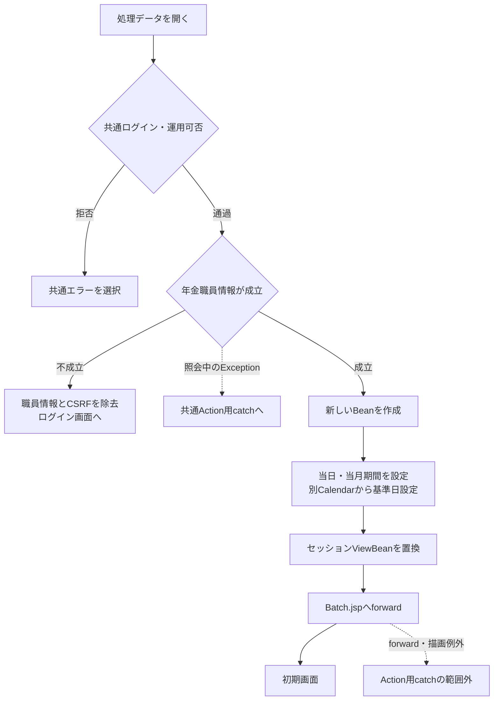
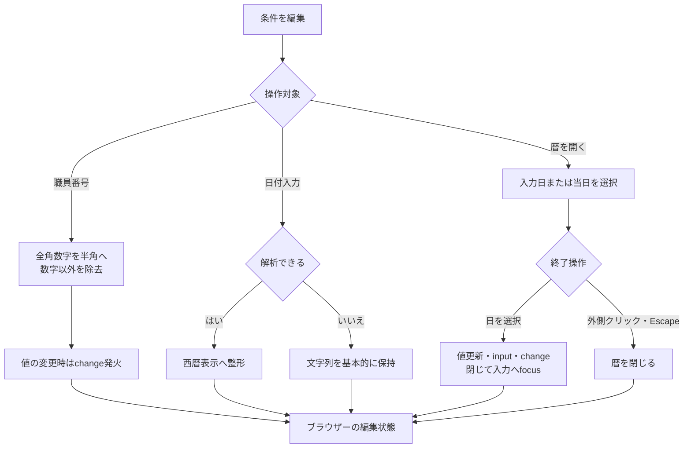
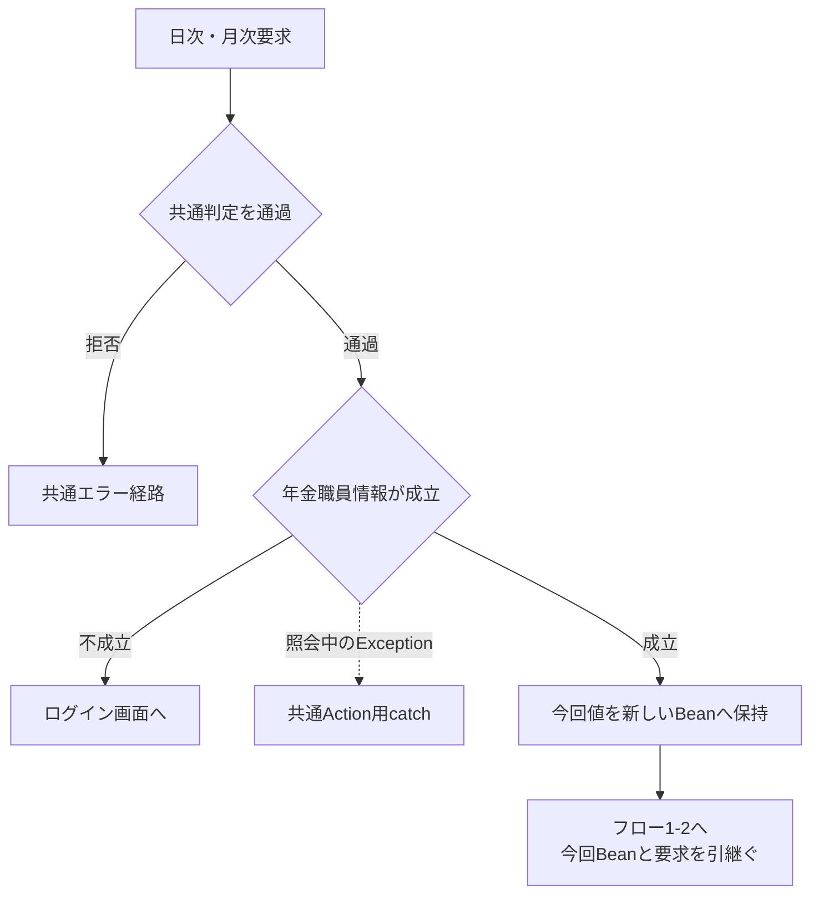
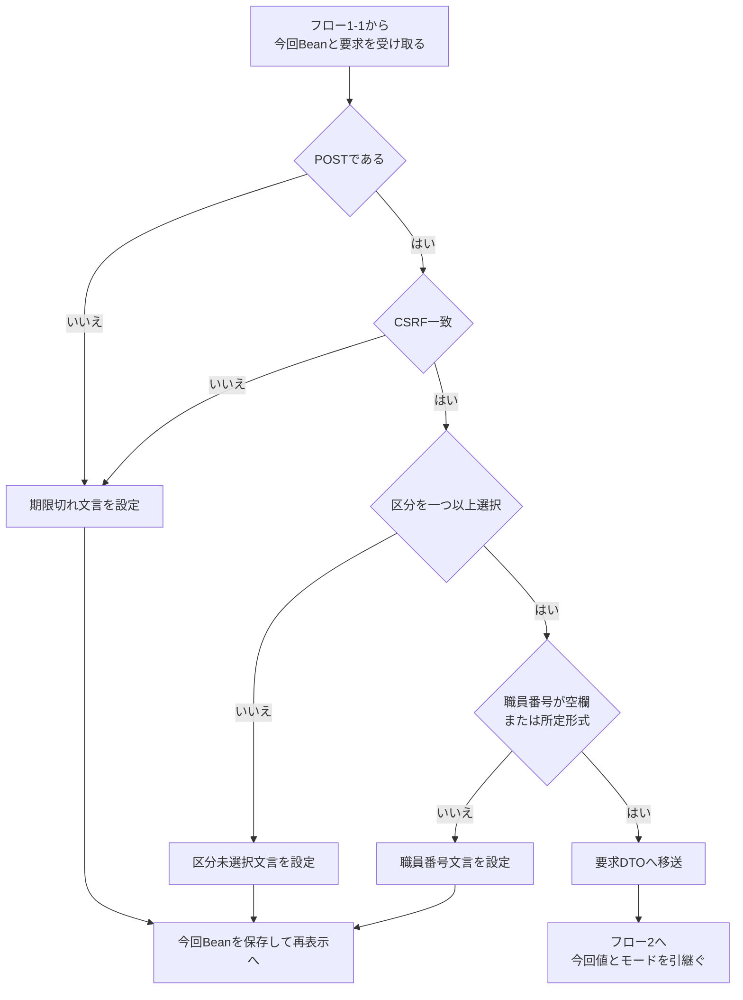
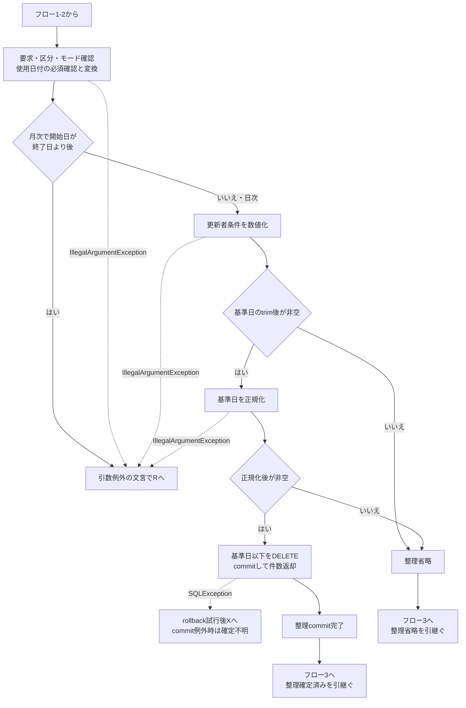
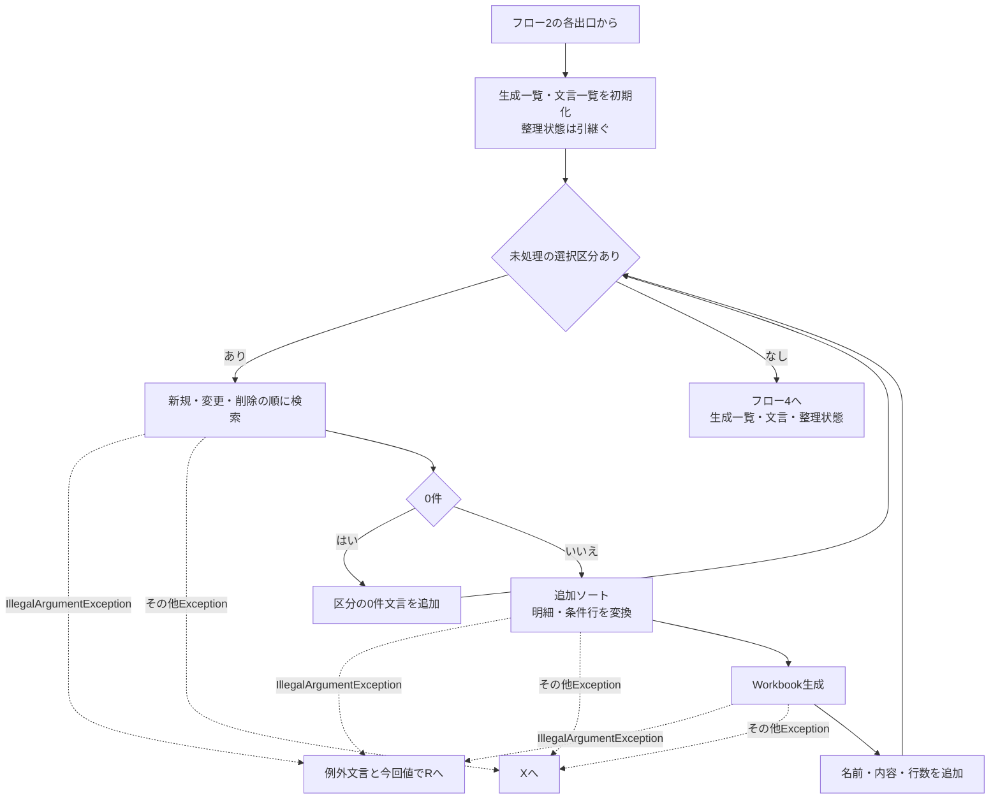
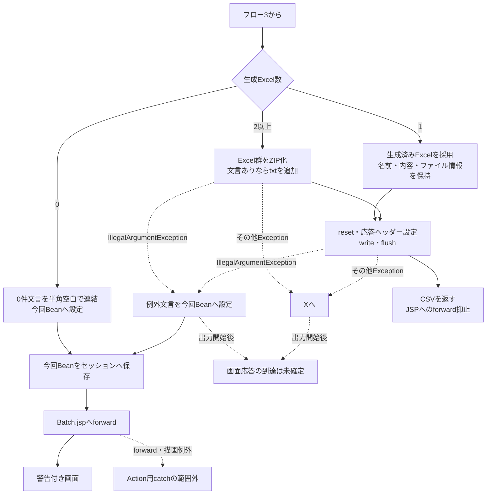
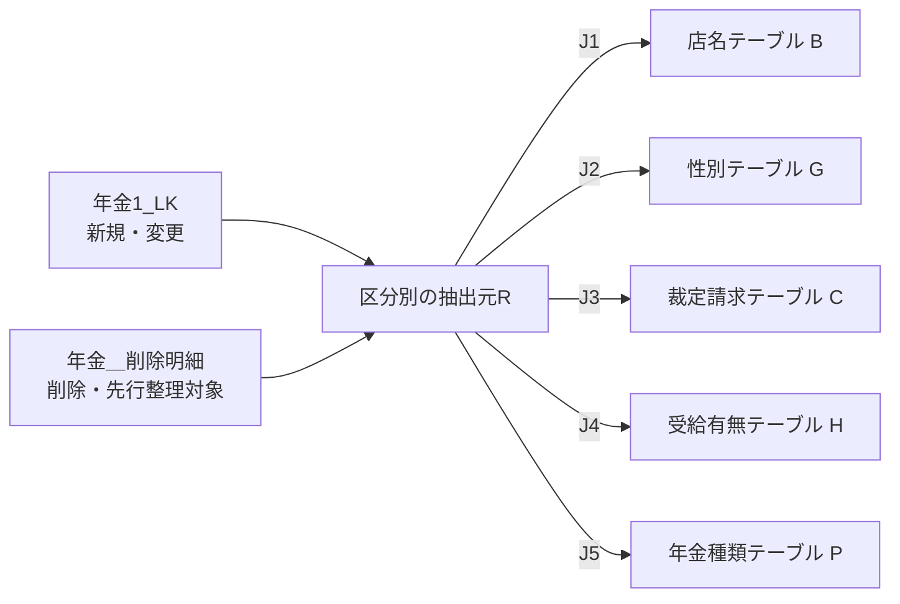
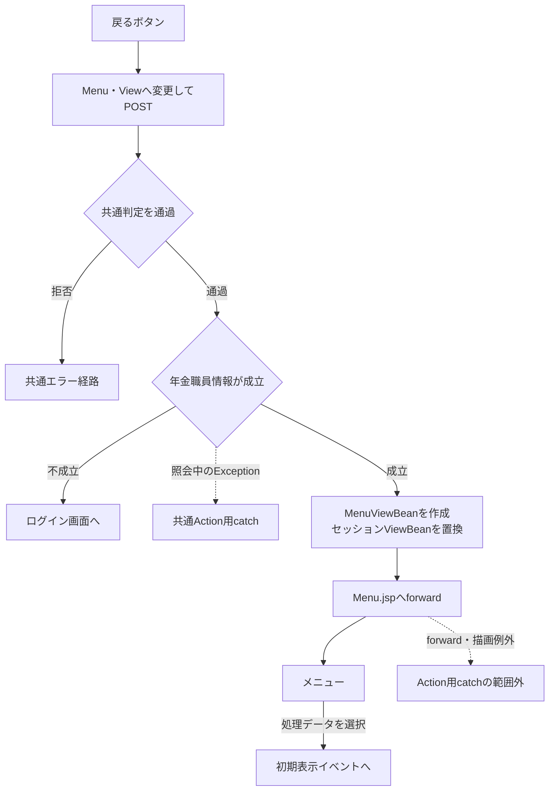

<!-- spec-meta: {"schema":"spec-md/1.0","documentId":"SCR-014","version":"2.0","path":"基本設計書/基本設計書_SCR-014_日次 _ 月次処理.md","sheets":[{"heading":"概要","kind":"GRID","sheet":"概要"},{"heading":"項目一覧","kind":"LIST","sheet":"項目一覧","key":["No"]},{"heading":"イベント仕様","kind":"GRID","sheet":"イベント仕様"},{"heading":"補足説明","kind":"GRID","sheet":"補足説明"}]} -->
# 日次 / 月次処理

| 属性 | 内容 |
| --- | --- |
| 文書種別 | 基本設計書 |
| システム名 | 年金自動受取予約管理システム |
| 機能ID | SCR-014 |
| 版 | 2.0 |
| 解析対象 | 日次・月次出力画面、接続するAction・出力サービス・Repository、および必要な共通処理 |
| 基準日 | 2026-10-15 |

## 概要

本機能は、メニューの「処理データ」から開き、年金予約の新規分・変更分・削除分を、職員と期間で絞り込んでExcelへ出力する。職員番号が空欄の場合は全職員を対象とする。出力区分は複数選択でき、日次・月次とも新規分・変更分・削除分のいずれか一つ以上を選択する。

日次では対象日の1日分を、月次では開始日から終了日までの両端を含む期間を抽出する。月次の期間は同月内に限定されず、月初日・月末日への一致も要求しない。開始日と終了日が同じ場合も実行できる。検索対象の日付は各抽出元のデータ更新日であり、予約徴求日や請求予定日ではない。

新規分と変更分は、予約本表に現在残っている行を変更FLGで分けたものである。変更前の内容を順次保存した履歴ではない。削除分は、予約を削除するときに本表から転記された削除明細を対象とする。

出力実行には削除明細の整理を伴う。有効な削除基準日が送信された場合、その日以前の削除明細を先に削除してcommitする。この整理は、指定職員、選択区分、抽出期間では絞り込まない。整理後の検索・Excel生成・ZIP生成・送信が失敗した場合や、全選択区分が0件で画面へ戻った場合でも、正常にcommitした整理は巻き戻らない。

### 利用条件と要求入口

共通ログインが成立し、年金の職員情報を利用できる利用者が操作する。Batch系Actionは、予約の変更・削除で使用する店番75と役職コードによる追加制限を呼び出していない。この画面では、その条件によるボタンの非表示や実行拒否を行わない。

| 操作 | HTTP入口 | 要求識別値と接続先 | 正常時の結果 |
| --- | --- | --- | --- |
| 処理データを開く | コンテキスト配下の `/Action.do` へPOST | FUNCTION_ID=nenkin、VIEW_ID=Batch、COMMAND_ID=View → BatchViewAction | Batch.jspを表示 |
| 日次データを出力 | 同上 | FUNCTION_ID=nenkin、VIEW_ID=Batch、COMMAND_ID=Daily → BatchDailyAction → BatchRunAction、モードDAILY | 条件・抽出結果により再表示または直接ダウンロード |
| 月次データを出力 | 同上 | FUNCTION_ID=nenkin、VIEW_ID=Batch、COMMAND_ID=Monthly → BatchMonthlyAction → BatchRunAction、モードMONTHLY | 条件・抽出結果により再表示または直接ダウンロード |
| 戻る | 同上 | FUNCTION_ID=nenkin、VIEW_ID=Menu、COMMAND_ID=View → MenuViewAction | Menu.jspを表示 |

Batch.jspの文字コード宣言はUTF-8で、フォームの送信文字コード指定はWindows-31Jである。共通サーブレットもパラメータ取得前にWindows-31Jを設定する。要求値をDTOへ自動バインドする構成ではなく、Actionが `getParameter` で取得し、画面状態と出力要求へ明示的に移す。

### 画面構成

共有システムヘッダーの下に、画面名と説明、ログイン職員情報、戻るボタンを配置する。警告がある場合は見出しとフォームの間へ表示し、その下に共通条件、日次カード、月次カードを並べる。ログイン職員番号は操作中の利用者を示し、抽出対象として入力する職員番号とは別の値である。

以下はサーバー日付を2026-10-15とした初期状態の静的投影である。職員表示は差替え位置を示す。実画面の撮影ではなく、送信処理や入力補助を接続しないHTMLとする。元の送信先・HTTP method・操作識別値はdata属性へ保持する。

<!DOCTYPE html>
<html lang='ja'>
<head>
<meta charset='UTF-8'>
<meta name='viewport' content='width=device-width, initial-scale=1'>
<title>日次 / 月次処理</title>

</head>
<body>
<header class='app-nav'>
年金自動受取予約管理システム
</header>
<main class='app-shell'>
<section class='screen surface batch-export-screen'>

<h1>日次 / 月次処理</h1>
出力条件と対象期間を指定して、年金予約データをExcelへ出力します。

ログイン職員<strong>職員番号8桁</strong>氏名
<button class='access-button secondary narrow' type='button' data-view-id='Menu' data-command-id='View'>戻る</button>

<form id='batchForm' accept-charset='Windows-31J' class='batch-export-form' data-original-action='{contextPath}/Action.do' data-http-method='POST'>
<input type='hidden' name='FUNCTION_ID' value='nenkin'>
<input id='batchView' type='hidden' name='VIEW_ID' value='Batch'>
<input id='batchCommand' type='hidden' name='COMMAND_ID' value='Daily'>
<input type='hidden' name='CSRF_TOKEN' value='' data-value-source='NENKIN_CSRF_TOKEN'>
<input type='hidden' name='DELETE_CUTOFF_DATE' value='2026-08-15'>
<section class='batch-condition-card' aria-labelledby='batchConditionTitle'>

<h2 id='batchConditionTitle'>共通の出力条件</h2>
日次・月次のどちらにも適用されます。

出力対象は複数選択できます

<label for='batchStaff'>抽出対象の職員番号</label>
<input id='batchStaff' name='STAFF_NO' value='' class='form-control code-input staff-code-input' maxlength='8' inputmode='numeric' autocomplete='off' data-digits-only>空欄：全職員

職員を限定する場合だけ8桁以内の職員番号を入力します。

<fieldset class='batch-target-fieldset'><legend>出力対象</legend>

<label class='checkbox-item'><input type='checkbox' name='INCLUDE_NEW' value='1'><strong>新規分</strong><small>新しく登録した明細</small></label>
<label class='checkbox-item'><input type='checkbox' name='INCLUDE_CHANGED' value='1'><strong>変更分</strong><small>内容を変更した明細</small></label>
<label class='checkbox-item'><input type='checkbox' name='INCLUDE_DELETED' value='1'><strong>削除分</strong><small>削除履歴の明細</small></label>

</fieldset>

</section>

<section class='batch-period-card batch-period-card--daily' aria-labelledby='dailyTitle'>

日
<h2 id='dailyTitle'>日次処理</h2>
指定した1日分のデータを出力

<label for='dailyDate'>対象日</label>
<input id='dailyDate' name='DAILY_DATE' value='2026/10/15' class='form-control' maxlength='14' autocomplete='off' data-era-calendar data-era-calendar-mode='western'><button class='era-calendar-button' type='button' data-era-calendar-toggle='dailyDate' aria-label='日付のカレンダーを開く' title='カレンダー'></button>

データ更新日が対象日と一致する明細を抽出します。

<button class='access-button primary batch-run-button' type='button' data-command-id='Daily'>日次データを出力</button>

</section>
<section class='batch-period-card batch-period-card--monthly' aria-labelledby='monthlyTitle'>

月
<h2 id='monthlyTitle'>月次処理</h2>
開始日から終了日までのデータを出力

<label for='monthStart'>開始日</label>
<input id='monthStart' name='MONTH_START' value='2026/10/01' class='form-control' maxlength='14' autocomplete='off' data-era-calendar data-era-calendar-mode='western'><button class='era-calendar-button' type='button' data-era-calendar-toggle='monthStart' aria-label='開始日のカレンダーを開く' title='カレンダー'></button>

～

<label for='monthEnd'>終了日</label>
<input id='monthEnd' name='MONTH_END' value='2026/10/31' class='form-control' maxlength='14' autocomplete='off' data-era-calendar data-era-calendar-mode='western'><button class='era-calendar-button' type='button' data-era-calendar-toggle='monthEnd' aria-label='終了日のカレンダーを開く' title='カレンダー'></button>

初期値は当月の月初日から月末日です。

<button class='access-button primary batch-run-button' type='button' data-command-id='Monthly'>月次データを出力</button>

</section>

</form>
</section>
</main>
</body>
</html>

初期状態では警告を表示せず、3区分とも未選択とする。入力拒否または全選択区分0件の場合は、同じ構成に今回の入力・選択状態を反映し、見出しとフォームの間へ警告を表示する。区分未選択時の差分は次のとおりである。

新規分、変更分、削除分のどれかを選択してから再度、実行ボタンを選択してください

チェックを保持する再表示では、trueの項目にだけ `checked` 属性を付ける。falseの項目には属性自体を出さない。入力拒否時にも日付入力や実行ボタンをdisabledにはしない。

外側の `main.app-shell:not(.login-shell)` は上20px・左右18px・下52pxの余白を持つ。画面sectionは幅1120px・最小幅1040pxで、内部に18pxの余白を持つ。職員条件320pxと区分領域を横に並べ、出力区分は3列、日次・月次カードは最小360px・610pxの2列とする。640px以下では見出しと月次の日付範囲が縦配置になるが、画面の最小幅と期間カード全体の2列は解除されない。

日付枠には `calendar-input` と `batch-date-control` の両classが適用される。後置の共通規則が日次枠の幅を `min(100%, 258px)` にし、月次枠は詳細度の高い `.batch-date-field .batch-date-control` により幅100%を保つ。コントロールのフォントは `button,input,select,textarea` の `font:inherit` により継承する。警告の `role=alert` は、外観を指定するclassとは別の属性である。

## 項目一覧

| No | グループ | 項目名 | 種類 | 入出力 | DB連携項目 | 候補取得元 | 必須 | 形式・桁 | 説明 |
| --- | --- | --- | --- | --- | --- | --- | --- | --- | --- |
| 1 | 共通表示 | システム名・画面名・説明 | 見出し・説明 | O | なし | なし。JSP固定文言 | ‐ | 画面名は日次 / 月次処理 | 共有ヘッダーと本機能の目的を表示する。 |
| 2 | 共通表示 | ログイン職員番号・氏名 | 情報表示 | O | 職員確認時にDB2.Ｕ職員名簿表を参照。出力対象条件とは別 | セッションのStaffContext | ‐ | 職員番号はJavaのintを最低8桁でゼロ埋め。氏名はString | 操作中の利用者を表示する。氏名の業務上限と本番DB属性は未確定。 |
| 3 | 共通操作 | 戻る | ボタン | I | 業務表更新なし | なし | ‐ | type=button | VIEW_IDをMenu、COMMAND_IDをViewに変更して送信する。 |
| 4 | 共通表示 | 警告・結果メッセージ | div.validation-summary | O | なし | BatchViewBean.message | ‐ | String。非空時だけ表示 | 入力拒否、引数例外、全選択区分0件の文言をHTMLエスケープして表示する。 |
| 5 | 共通条件 | 抽出対象の職員番号 | 文字入力 batchStaff | I／O | 抽出元R.更新者の検索条件。SQL Server定義はINT NULL。直接保存しない | 候補照会なし | 任意。空欄は全職員 | STAFF_NO → staffNoのString。maxlength=8。Actionのtrim後はASCII数字1～8桁 | サービスでIntegerへ変換しsetIntする。0も指定値。名簿存在確認や担当者コード検索には使用しない。 |
| 6 | 共通条件 | 新規分 | チェックボックス | I／O | 年金1_LKの変更FLG=0を選ぶ検索制御。列定義はTINYINT NULL | JSP固定区分 | 3区分のうち一つ以上 | INCLUDE_NEW、value=1 → includeNewのboolean | 初期false。選択時だけ新規分を検索し、受信値をDBへ保存しない。 |
| 7 | 共通条件 | 変更分 | チェックボックス | I／O | 年金1_LKの変更FLG=1を選ぶ検索制御。列定義はTINYINT NULL | JSP固定区分 | 3区分のうち一つ以上 | INCLUDE_CHANGED、value=1 → includeChangedのboolean | 初期false。選択時だけ変更分を検索する。 |
| 8 | 共通条件 | 削除分 | チェックボックス | I／O | 年金＿削除明細を抽出元にする。変更FLG条件なし | JSP固定区分 | 3区分のうち一つ以上 | INCLUDE_DELETED、value=1 → includeDeletedのboolean | 初期false。未選択でも、有効な削除基準日があれば先行整理は行う。 |
| 9 | 日次条件 | 対象日 | 文字入力 dailyDate | I／O | 抽出元R.データ更新日の上下限。DATE NULL。直接保存しない | 共通カレンダー | 日次実行時に必要。正規化後空値の経路は補足説明参照 | DAILY_DATE → dailyDateのString。maxlength=14。通常表示yyyy/MM/dd、検索値yyyy-MM-dd | 初期はサーバー当日。同じ日を下限・上限としてsetDateする。月次実行時は使わない。 |
| 10 | 月次条件 | 開始日 | 文字入力 monthStart | I／O | 抽出元R.データ更新日の下限。DATE NULL。直接保存しない | 共通カレンダー | 月次実行時に必要。正規化後空値の経路は補足説明参照 | MONTH_START → monthStartのString。maxlength=14 | 初期は当月1日。通常は開始日以上をsetDateで検索する。日次実行時は使わない。 |
| 11 | 月次条件 | 終了日 | 文字入力 monthEnd | I／O | 抽出元R.データ更新日の上限。DATE NULL。直接保存しない | 共通カレンダー | 月次実行時に必要。正規化後空値の経路は補足説明参照 | MONTH_END → monthEndのString。maxlength=14 | 初期は当月末日。通常は終了日以下をsetDateで検索する。終了日が開始日より前の場合だけ拒否し、同日は許可する。日次実行時は使わない。 |
| 12 | 日付操作 | 日付カレンダー | 3入力に付くボタン | I | なし | ブラウザー内で生成する暦 | ‐ | data-era-calendar-toggleでdailyDate、monthStart、monthEndに対応 | 西暦表示モード。選択日を対応入力へ反映する。ISO用の別hidden入力は持たない。 |
| 13 | 日次操作 | 日次データを出力 | ボタン | I | 先行整理と選択区分の抽出を起動 | なし | ‐ | COMMAND_ID=Daily | 対象日を使用し、確認ダイアログを挟まず送信する。 |
| 14 | 月次操作 | 月次データを出力 | ボタン | I | 先行整理と選択区分の抽出を起動 | なし | ‐ | COMMAND_ID=Monthly | 開始日・終了日を使用し、確認ダイアログを挟まず送信する。 |
| 15 | 要求制御 | 機能識別 | hidden | I／O | なし | JSP固定値 | 通常要求で送信 | FUNCTION_IDのString、nenkin | 共通サーブレットのAction選択に使用する。 |
| 16 | 要求制御 | 画面識別 | hidden batchView | I／O | なし | JSP初期値と戻る操作 | 通常要求で送信 | VIEW_IDのString、初期Batch | 戻る操作でMenuへ変更する。欠落時の失敗はAction内の入力拒否と異なる。 |
| 17 | 要求制御 | 操作識別 | hidden batchCommand | I／O | なし | JSP初期値と操作ボタン | 通常要求で送信 | COMMAND_IDのString、初期Daily | 日次はDaily、月次はMonthly、戻るはViewを設定する。 |
| 18 | 要求制御 | CSRFトークン | hidden | I／O | DB非保存 | セッションNENKIN_CSRF_TOKEN | 日次・月次実行時に一致が必要 | CSRF_TOKENのString | POST確認後、受信値とセッションのStringを完全一致で照合する。 |
| 19 | 整理制御 | 削除基準日 | hidden | I／O | 年金＿削除明細.データ更新日以下を削除する条件。DATE NULL | 初期表示時のCalendar計算、以後は受信値 | 欠落・trim後空欄なら整理省略 | DELETE_CUTOFF_DATE → deleteCutoffDateのString → ISO日付 → setDate | 初期表示時のCalendarから2か月戻した日。実行時の再計算・初期値との一致検査はなく、編集欄や整理確認もない。 |

## イベント仕様

### 初期表示

#### 処理概要

メニューから画面を開くたびに、利用可能な職員情報を確認して新しい画面状態を作る。前回の条件を復元する処理ではなく、対象日・期間・選択状態を初期化する。

#### 処理手順

**1. 共通入口と年金職員情報を確認する。**

　**1.1.** 共通サーブレットがログイン状態と運用可否を確認する。ログイン時間切れでは共通エラーを選ぶ。nenkinは運用状態表の照会対象外だが、運用可否処理はその判定前に共通接続を取得するため、接続取得等に失敗するとメンテナンス文言で拒否する。

　**1.2.** BatchViewActionが `requireStaff` を呼ぶ。既存のStaffContextがあれば再利用してCSRFを確保する。なければ、ログイン可否がtrueのLoginInfoBeanからtrim後1～8桁のASCII数字の職員番号を取り出し、名簿を照会する。

　**1.3.** 職員情報が成立しなければ年金職員情報とCSRFを除去し、ログイン画面へ戻す。認証済みログイン情報からの形式不正・名簿不在では、共通ログイン情報も除去して名簿不在のメッセージを設定する。照会中のExceptionは、この不成立の戻り値とは別経路となる。

**2. 初期条件を作成する。**

　**2.1.** 新しいBatchViewBeanを作り、抽出職員番号とメッセージを空文字、3区分をfalseにする。

　**2.2.** サーバー当日を対象日に設定し、その日から当月1日と当月末日を求める。日付計算には実行環境の既定タイムゾーンを使用する。

　**2.3.** 別に取得したCalendarを2か月戻して削除基準日にする。月初日への変更は行わず、月の日数差はCalendarの月計算に従う。

**3. 初期画面へ引き渡す。**

　**3.1.** Beanをセッション属性ViewBeanへ設定し、Batch.jspを返す。JSPは日付を表示用に整え、入力値と職員情報をHTMLエスケープして出力する。

#### 処理フロー

共通サーブレットの識別値処理など、Action用catchより前の境界は補足説明の共通応答境界に従う。

#### SQL・テーブル関連（ER図）

既存のStaffContextを利用する場合、画面初期化のために予約表を検索・更新しない。職員情報の自動生成が必要な場合は、業務接続で店名テーブルの店舗コード・店名を取得し、その後、別の職員接続でDB2.Ｕ職員名簿表を職員番号で検索する。店舗名はメモリで対応付ける。

ここで使用する職員番号はログイン情報の値であり、画面で指定する抽出対象職員番号ではない。予約データの複数表操作はないため、このイベントの業務ER図は省略する。

#### DB操作の詳細

職員名簿の職員番号条件は `職員番号 = ?` とし、setIntでバインドする。取得した職員番号・漢字氏名・所属店番・役職コードからStaffContextを作る。

初期表示では削除基準日を設定するだけで、削除明細の整理は呼び出さない。画面状態、職員情報、CSRFの保持先はセッションである。共通アクセス記録は、これらとは別接続・別commitで行う。

#### 結果・例外時の扱い

成立時は職員指定空欄、3区分未選択、対象日当日、期間当月の状態を表示する。職員情報の不成立ではログイン画面へ戻り、新しいバッチBeanは設定しない。

Action内から外へ出たExceptionは共通Action用catchの対象となる。ActionがBatch.jspを返した後のforwardやJSP描画はそのcatchの外であり、戻り値の決定だけでは表示完了は確定しない。

### 条件入力・カレンダー操作

#### 処理概要

職員番号には数字入力補助を、3つの日付には西暦表示モードのカレンダーを適用する。これらはブラウザー内の編集補助であり、サーバーの受理条件を代替しない。

#### 処理手順

**1. 職員番号の入力を補助する。**

　**1.1.** `data-digits-only` に接続する共通処理が、初期バインド・input・blurで全角数字を半角へ変換し、数字以外を除去する。値を変えた場合はchangeを発火する。編集中のカーソル位置も数字数に合わせる。

　**1.2.** 編集可能な非空入力へフォーカスした場合は値を選択する。これはブラウザー内の操作であり、直接送信した全角数字をActionが同様に変換する処理ではない。

**2. 日付を整え、暦から選択する。**

　**2.1.** 初期バインド・blur・changeで、解析できる日付をyyyy/MM/ddへ整える。解析できない文字列は基本的に保持する。

　**2.2.** カレンダーボタン、Alt＋下矢印、F4で暦を開く。入力日を解析できればその日を、できなければブラウザー当日を初期選択にする。

　**2.3.** 前月・翌月へ移動して日を選ぶと、対応入力の値を更新し、input、changeを発火して暦を閉じ、入力へフォーカスを戻す。外側クリックとEscapeでも閉じる。

**3. 編集状態を保持する。**

　**3.1.** 入力・選択状態はブラウザー内に保持する。カレンダー操作だけでは送信せず、DBやセッションのViewBeanを更新しない。Batch.jspには、別のISO用hidden入力へ同期する指定がない。

#### 処理フロー

#### SQL・テーブル関連（ER図）

ブラウザー内の入力補助であり、SQLと業務DBの関連はない。職員番号候補を取得する操作もない。3区分はJSP固定の選択肢、カレンダーの日付候補はブラウザー内で生成する値である。

#### DB操作の詳細

入力、blur、change、日選択によるDB接続・検索・保存は行わない。保持領域は各inputの値とチェック状態、およびカレンダー処理のブラウザー内状態である。

#### 結果・例外時の扱い

数字補助を通った全角数字と、直接送信されてActionへ届いた全角数字は扱いが異なる。後者はASCII数字の形式検査により拒否される。

日付もブラウザーとJavaで解析範囲が異なる。再表示時にはJSPの表示変換とブラウザー補助が順に働くため、Beanに保持した文字列と最終的な画面文字列が異なる場合がある。入力補助で整形できたことから、サーバー検査や後段の和暦出力の成功を保証しない。

### 日次・月次データ出力

#### 処理概要

操作に対応するモードで要求を確認し、期間と更新者条件を決める。有効な削除基準日があれば先行整理を確定し、選択区分を新規・変更・削除の順に抽出する。明細のある区分だけExcelを作り、生成数に応じて画面再表示、単独Excel、ZIPに分ける。

#### 処理手順

**1. 職員を確認して、今回の要求値を保持する。**

　**1.1.** 共通ログイン・運用可否を通過した後、年金職員情報を確認する。不成立ならログイン画面へ戻り、以降の要求値保持・整理・出力は行わない。職員照会中のExceptionは共通Action用catchへ進む。

　**1.2.** 新しいBatchViewBeanへ職員番号、3区分、対象日、開始日、終了日、削除基準日を移す。文字列は欠落を空文字へ変えてJavaのtrimを適用する。区分は受信値が1、大小文字を問わないtrueまたはonの場合だけtrueとし、欠落・その他はfalseとする。

**2. Actionの入口検査を行う。**

　**2.1.** POSTであることを先に確認し、POSTの場合にCSRF_TOKENをセッション値と完全一致で照合する。不成立なら期限切れ文言と今回値を保持して同画面へ戻る。

　**2.2.** 3区分のいずれか一つ以上が選択されていることを確認する。未選択なら区分選択を促す文言と今回値を保持して戻る。

　**2.3.** 職員番号が非空なら、ASCII数字のみで8桁以内であることを確認する。不正なら職員番号の入力文言と今回値を保持して戻る。名簿への存在確認は行わない。

　**2.4.** PensionBatchExportRequestへ値を移す。具象ActionがDAILYまたはMONTHLYを明示設定する。文字列setterはnullを空文字へ変えるが、日付正規化は行わない。

**3. サービスで期間と更新者条件を決める。**

　**3.1.** サービスは要求の存在、区分選択、実行モードを確認する。日次では対象日を上下限へ設定し、月次では開始日、終了日の順に処理する。使用しない側の日付は検査・検索に使わない。

　**3.2.** 使用する日付が正規化前のtrim後に空なら必須エラーとする。その後、DateUtilでNFKCを含む正規化、形式・実在性・元号範囲の検査を行い、ISO日付へ変換する。月次では変換後の開始日が終了日より後の場合だけ拒否する。変換後の再必須検査はなく、空文字になる経路は補足説明に示す。

　**3.3.** 職員番号をIntegerへ変換する。空欄なら更新者条件を付けず、それ以外は更新者の等価条件とする。先頭ゼロは検索値では失われる。0または00000000は更新者=0であり、全職員ではない。

**4. 削除明細を先に整理する。**

　**4.1.** 削除基準日のtrim後が空なら整理を省略する。非空ならRepositoryで日付正規化し、不正日付は接続取得前に引数例外とする。正規化後が空なら件数0で戻り、接続を取得しない。

　**4.2.** 有効な基準日があれば専用ConnectionでautoCommitをfalseにし、年金＿削除明細のデータ更新日が基準日以下の行をDELETEしてcommitする。職員、選択区分、抽出期間をこのDELETEの条件に加えない。

　**4.3.** 整理件数は戻るが、画面や出力結果には転記しない。実行時には受信したhidden値を採用し、2か月前への再計算、初期値との一致、過去日限定の検査を行わない。

**5. 区分ごとに抽出してExcelを作成する。**

　**5.1.** 選択区分を新規・変更・削除の順に処理する。未選択区分は検索しない。各区分は別Connectionで、期間と更新者条件によって全件取得する。

　**5.2.** 0件の区分はExcelを作らず、その区分の0件文言だけを蓄積する。未選択区分の文言は作らない。

　**5.3.** 明細がある場合は店番、顧客番号、検索結果内連番auditIdの昇順に並べ直す。店番・顧客番号のnullは非nullより前に置き、同じ店番・顧客番号では取得順を引き継ぐ。出力Noは並べ直した位置に1を加える。

　**5.4.** 区分別の列へ予約値を移し、日付を和暦、担当者コードを最低2桁の文字列へ変換する。帳票の処理日欄には実行日時ではなく抽出条件の日または期間を、職員番号欄にはtrim後の要求文字列、空欄ならALLを表示する。

　**5.5.** 単一シートのExcelをメモリ上で生成し、ファイル名・内容・識別情報・行数を保持する。生成一覧と0件文言一覧はループ前に一度作り、次区分でも前区分の結果を保持する。

**6. 生成Excel数で結果を組み立てる。**

　**6.1.** 生成数0では長さ0の内容を返す。Actionが0件文言を半角空白で連結し、今回のBeanをセッションへ設定してBatch.jspへ戻る。空Excelや文言だけのZIPは作らない。

　**6.2.** 生成数1では、生成済みExcelの名前と内容をそのまま返す。他の選択区分の0件文言が結果DTOに残っていても、画面や単独Excelには転記しない。

　**6.3.** 生成数2以上では、生成済みExcelを区分順にZIPへ格納する。0件文言がある場合だけ、UTF-8・各行末CRLFの出力結果.txtも追加する。

**7. 内容を直接ダウンロードする。**

　**7.1.** ファイル名をUTF-8でURLエンコードし、空白を%20へ置き換える。応答reset、Content-Type、attachmentのContent-Disposition、Content-Lengthの設定、全byteのwrite、flushの順に処理する。

　**7.2.** 正常復帰後は制御値CSVを返してJSPへのforwardを抑止する。実ファイル形式はxlsxまたはZIPである。この成功枝では今回のBeanをセッションへ設定しない。

#### 処理フロー

各図は同じ要求の続きである。Rは「今回値と経路固有の文言を保持する再表示経路」、Xは「先行する専用catchで処理されないExceptionの共通Action用catch」を表す。整理状態は説明用の区別であり、DTOへ追加する項目ではない。

**フロー1：Actionの入口検査（手順1～2）**

**フロー1-1：共通判定・職員確認と今回値保持（手順1）**

フロー1-1の正常出口では、今回のBeanと同じHTTP要求をフロー1-2へ引き継ぐ。具象Actionによる日次・月次のモードも保持する。共通判定拒否、職員不成立、照会中例外の各出口からは、フロー1-2へ進まない。

**フロー1-2：POST・CSRFと入力条件の確認（手順2）**

フロー1の拒否は整理前である。年金職員照会中の例外は、まだサービス呼出し用tryへ入っていないため、IllegalArgumentExceptionであってもActionの専用catchでは扱わない。

**フロー2：期間決定と先行整理（手順3～4）**

通常の日付では両端を含む範囲となる。正規化後に日付が空になる場合も、その結果を失わずフロー3へ渡す。フロー3へは、期間、更新者Integer、選択区分、要求文字列、および枝ごとの整理状態を引き継ぐ。

**フロー3：区分別検索と生成（手順5）**

一覧は区分ごとに初期化し直さない。整理commit完了から流入した場合は、0件・後段の引数例外・生成失敗でも整理確定済みの状態を保つ。WorkbookのIOExceptionはIllegalStateExceptionへ変換されるため、図の「その他Exception」からXへ進む。

**フロー4：結果の組立てと応答（手順6～7）**

単独Excelの枝では他区分の0件文言を送らず、ZIPの枝だけが必要なtxtを含む。0件文言と例外文言は、それぞれの枝で設定した内容を再表示へ引き継ぐ。すべての枝はフロー3からの整理状態を保持し、送信結果を理由に整理を未実施へ戻さない。

Rへ戻る各経路は、初期表示Actionを通さず今回のBeanを保存してBatch.jspを返す。再表示時のforward・描画と、出力開始後の応答制約は「結果・例外時の扱い」に従う。

#### SQL・テーブル関連（ER図）

新規・変更は年金1_LK、削除は年金＿削除明細を抽出元Rとする。名称は5表をLEFT JOINして取得する。次の図は検索上の関連を表し、FKや多重度を定義するER図ではない。

| 関連 | LEFT JOIN条件 | 取得値の用途 |
| --- | --- | --- |
| J1 | R.店番 = B.店舗ｺｰﾄﾞ | 店名を取得するが、今回の明細列には出力しない |
| J2 | R.性別 = G.性別ｺｰﾄﾞ | 性別名称を出力する |
| J3 | R.裁定請求 = C.裁請ｺｰﾄﾞ | 変更・削除の裁定請求名称を出力する |
| J4 | R.受給有無 = H.受給ｺｰﾄﾞ | 変更・削除の受給有無名称を出力する |
| J5 | R.年金種類 = P.種類ｺｰﾄﾞ | 保存済み合成コードの年金種類名称を出力する |

提供DDLに上記のFK宣言はない。名称保存列がNOT NULLでも、LEFT JOIN不成立の結果はNULLになり得る。モデルのString setterがNULLを空文字へ変えるため、出力名称は空表示となる。

#### DB操作の詳細

**削除明細整理**

実行する更新は `DELETE FROM 年金＿削除明細 WHERE データ更新日 <= ?` である。第1パラメータにISO日付から作ったjava.sql.DateをsetDateする。基準日当日を含み、データ更新日NULLの行はこの比較に該当しない。パラメータのサイズ指定はない。

専用ConnectionでautoCommit=false、executeUpdate、commit、件数返却の順に処理する。SQLExceptionではrollbackを試みてNenkinDataAccessExceptionへ変換し、rollback失敗は元例外を優先して抑制する。commit自体が例外の場合、例外の返却だけでは削除の確定有無を判断できない。

**区分別抽出**

WHEREは `1 = 1` を起点に、次の順で該当条件だけを追加する。バインドも同じ順であり、省略した条件の分だけ後続の位置が詰まる。

| 順序 | 条件を追加する場合 | 述語 | JDBCバインド |
| --- | --- | --- | --- |
| 1 | 新規・変更 | R.変更FLG = ? | setInt。新規0、変更1。削除には追加しない |
| 2 | 正規化後の開始日が非空 | R.データ更新日 >= ? | java.sql.DateをsetDate |
| 3 | 正規化後の終了日が非空 | R.データ更新日 <= ? | java.sql.DateをsetDate |
| 4 | 更新者Integerが非null | R.更新者 = ? | setInt |

空欄の職員条件はNULLバインドではなく述語省略である。日付も正規化後空文字なら述語を省略する。有効な日付条件がある通常検索ではデータ更新日NULLの行を抽出しないが、両日付述語が外れる経路ではその比較による除外もなくなる。

SQLのORDER BYは、R.データ更新日、R.更新時間、R.店番、R.顧客番号の昇順である。LIMIT、OFFSET、setMaxRowsを指定せず、ResultSetを最後まで読んで全件をメモリへ格納する。明示的なタイムアウト、取消処理、パラメータサイズ指定はない。同じORDER BY値を持つ行を一意に並べる永続IDも指定しない。

取得する予約値は、店番・店名・顧客番号・担当者コード、顧客氏名・ふりがな・性別名称・住所・電話番号、生年月日・裁定請求名称・請求予定日・予定年齢、予約徴求日・データ更新日・備考・配偶者名・受給有無名称・配偶者生年月日・年金種類名称、5種類の年金boolean・6か月先確認である。さらにデータ更新日をAUDIT_DATE、更新時間をAUDIT_TIME、更新者をUPDATED_BYとして取得する。検索結果に1からlongのauditIdを付け、区分と予約値をPensionAuditRecordへ保持する。auditIdはDBへ保存された監査IDではない。

店番・顧客番号・担当者コード・予定年齢・更新者はgetIntとwasNullでIntegerのnullを保持する。String setterはSQL NULLを空文字にし、boolean項目はgetIntの結果が0以外かで判定するためSQL NULLもfalseになる。電話番号はDBの数値から表示文字列へ変換する。提供SQL Server DDLの顧客番号はBIGINT NULLだが、取得先はIntegerであり、BIGINT全範囲を保持できる対応ではない。

整理と各区分検索は別Connectionで行う。整理メソッドのsynchronizedは共有Repositoryインスタンス内の同期で、build全体や区分検索を一括同期しない。複数区分を同一スナップショットで読む指定、比較版、明示的な行ロックはない。

#### 結果・例外時の扱い

| 発生段階・条件 | 結果と保持状態 | 削除明細整理の状態 |
| --- | --- | --- |
| POST・CSRF不成立 | 「画面の有効期限が切れました。メニューから操作しなおしてください。」を設定し、今回値を保持して再表示 | 未実行 |
| 区分未選択 | 区分選択を促す文言を設定し、今回値を保持して再表示 | 未実行 |
| 職員番号形式不正 | 「職員番号は8桁以内の数字で入力してください」を設定し、今回値を保持して再表示 | 未実行 |
| 日次対象日が空 | 「年月日を入力してください。」で再表示 | 未実行 |
| 月次開始日が空 | 「月初日を入力してください。」で再表示 | 未実行 |
| 月次終了日が空 | 「月末日を入力してください。」で再表示 | 未実行 |
| 月次開始日が終了日より後 | 「月初日は月末日以前で指定してください。」で再表示。同日は拒否しない | 未実行 |
| 使用日付・削除基準日の形式、実在性、元号範囲が不正 | 日付例外の文言と今回値を保持して再表示 | 当該整理は未実行 |
| 全選択区分0件 | 各0件文言を半角空白で連結して再表示。ダウンロードなし | 先行整理を正常commitしていれば確定済み |
| 生成Excelが1件 | 単独Excelを直接返す。他の選択区分の0件文言は送信しない | 同上 |
| 生成Excelが2件以上 | ZIPを返す。0件文言があれば出力結果.txtも格納 | 同上 |
| 整理後の明細・条件日の和暦変換などでIllegalArgumentException | 先行するAction専用catchで例外文言と今回Beanを設定し、同画面へ戻す | 正常commitした整理は維持 |
| 整理中のSQLException | rollback試行後、変換した例外を共通Action用catchへ伝える | commit例外時の確定有無は応答だけでは不明 |
| 専用catchで処理されない検索・生成等のException | 共通Action用catchがアプリケーションエラーを設定し、共通エラーJSPを選ぶ | 正常commitした整理は維持 |
| 出力開始後の失敗 | IllegalArgumentExceptionなら専用catch、それ以外のExceptionなら共通catchへ進む。既送信内容を復元せず、画面応答の到達は未確定 | 正常commitした整理は維持 |

ActionのIllegalArgumentException用catchは、サービス呼出しとwriteDownloadを囲むtryに適用される。したがって、同画面への復帰をすべて整理前の入力拒否とは扱わない。西暦として受理した明治開始前の日付が、整理後の明細または帳票条件の和暦変換で拒否される経路もある。

WorkbookのIOExceptionは「Excelファイルの生成に失敗しました。」、ZIPのIOExceptionは「ZIPファイルの生成に失敗しました。」を持つIllegalStateExceptionへ変換する。これらは専用catchの対象ではなく、共通Action用catchへ伝わる。途中まで作成した区分だけを部分応答として返す経路はない。

再表示は初期条件へ戻さず今回値を保持する。ただし日付はJSPとブラウザーの表示変換を受ける。JSPは値を表示用に整えてエスケープするが、再表示時のBean取得・キャスト・描画で生じた例外は共通Action用catchの外である。同画面を戻り値にしたことを、画面応答の完了とは扱わない。

### メニューへ戻る

#### 処理概要

現在のフォームをメニュー表示要求として送信し、セッションの画面状態をメニュー用に置き換える。

#### 処理手順

**1. メニュー表示を要求する。**

　**1.1.** 戻るボタンがVIEW_IDをMenu、COMMAND_IDをViewへ変更し、同じフォームをPOSTする。バッチの日付・区分検査や整理を先に行う処理ではない。

**2. メニュー用の状態へ切り替える。**

　**2.1.** 共通判定後、MenuViewActionが年金職員情報を確認する。成立すれば新しいMenuViewBeanへ職員番号・氏名を設定し、セッションのViewBeanを置き換えてMenu.jspを返す。

　**2.2.** バッチ条件を別属性へ退避しない。メニューから再度「処理データ」を開くと、初期表示イベントで当日・当月期間・未選択区分を作り直す。

#### 処理フロー

#### SQL・テーブル関連（ER図）

戻る操作では予約表・削除明細を検索更新しないため、バッチ用のER図は適用しない。職員情報の自動生成が必要な場合だけ、初期表示と同じ職員確認の参照が起こり得る。

#### DB操作の詳細

削除明細整理、区分別抽出、Excel生成を呼び出さない。状態変更先はセッションのViewBeanである。共通アクセス記録は独立した処理となる。

#### 結果・例外時の扱い

職員確認が成立すればメニューへ進む。バッチ入力を復元する別の保持領域は作らない。共通判定拒否、職員不成立、Action内例外、forward・描画例外の境界は初期表示と同じである。

## 補足説明

### 日付の受信・保持・検索

日付のブラウザーmaxlengthは14、職員番号は8であり、入力要素側の制約である。受信要求全体の上限保証ではない。Actionの職員番号検査は、trim後のASCII数字限定と8桁上限を併用する。Javaの文字列長はUTF-16コード単位である。日付サービスに14文字の受信上限検査はなく、形式・実在性・期間の検査とDBのDATE型を別の制約として扱う。

DateUtilはNFKC正規化とtrimを行い、4桁西暦の区切り付き年月日、8桁西暦、明治・大正・昭和・平成・令和の名称またはM/T/S/H/Rを受け付ける。和暦年は元年または1～3桁で、日付の実在性と元号の開始・終了範囲を検査する。不正時は「日付の形式または実在性が不正です: 」に入力を付けたIllegalArgumentExceptionとなる。

ブラウザーは元号の一文字略称や区切りなし和暦も解析する一方、和暦年は1～2桁である。ISO解析には末尾までの一致を要求しない経路もある。JSPの再表示も独自のSimpleDateFormat解析を行い、解析できればyyyy/MM/dd、できなければ保持文字列を表示する。このため、HTTPからの受信値、Bean保持値、JSP出力値、入力補助後の表示値を同一文字列として扱わない。

日付の必須検査はNFKCより前にある。getParameter以後へ全角空白U+3000だけのStringが届いた場合、Javaのtrimでは非空として通過し、後の正規化で空文字になる。正規化後に再び必須を確認しないため、次の検索経路が存在する。

| 正規化後の値 | 後続の処理 |
| --- | --- |
| 日次対象日が空 | 上下限とも空となり、日付述語を付けずに検索 |
| 月次開始日・終了日がともに空 | 大小比較を通過し、日付述語を付けずに検索 |
| 月次開始日だけ空、終了日は有効 | 大小比較を通過し、終了日以下だけの検索 |
| 月次開始日は有効、終了日だけ空 | 文字列比較で開始日が終了日より後となり、逆転文言で拒否 |
| 削除基準日が空 | 整理件数0で戻り、整理用接続を取得しない |

この説明は、該当Stringが受信後へ届く場合の実装上の分岐である。通常の日付必須という利用条件を、正規化後のすべての値に対する保証へ拡張しない。

### 抽出区分と職員番号の意味

通常保存は、既存予約の有無によりINSERTまたはUPDATEを選ぶ。INSERTでは変更FLG=0、UPDATEでは変更FLG=1を設定し、データ更新日を保存当日にして本表の内容を上書きする。そのため、同じ予約を繰り返し変更しても、本機能から過去の全変更内容を復元できるわけではない。

通常削除では既存予約を読み、データ更新日を削除当日に変えて削除明細へ追加し、本表から検索キーで削除する。追加と本表削除は同じ削除トランザクションでcommitする。本機能の出力前整理は、これとは別の後続要求・別トランザクションである。

抽出職員番号は更新者への検索条件である。通常の保存・削除はログインStaffContextの職員番号を更新者として渡す。一方、帳票の「担当」列は予約の担当者コードから作り、更新者番号を転記しない。

サービス単体は空欄または大小文字を問わないALLを全職員として扱うが、通常画面のActionはALL、符号付き数値、8桁超を先に拒否する。画面で全職員を指定する方法は空欄である。サービス単体の受理範囲を画面入力の許可範囲へ広げない。

出力成功後に変更FLGをクリアしたり、出力済みの印を保存したりする処理はない。対象行が残り、条件が同じなら再抽出の対象になり得る。

### 状態と0件文言

| 状態 | 条件・保持値 | 画面またはファイルの結果 |
| --- | --- | --- |
| 初期 | 職員空欄、全区分未選択、対象日当日、期間当月 | 警告なし。日次・月次の両実行ボタンを表示 |
| 入力拒否 | 今回値をBeanへ保持 | 警告付き再表示。当日・当月へ戻さない |
| 全選択区分0件 | 選択して検索した区分がすべて0件 | 全0件文言を画面へ表示。ダウンロードなし |
| 生成1件 | 明細のある区分が一つ | 単独Excel。他区分の0件文言は送信しない |
| 生成2件以上 | 明細のある区分が複数 | ZIP。0件文言がある場合だけ出力結果.txtを追加 |
| ダウンロード正常復帰 | write・flushまで復帰 | JSPへのforwardを抑止。今回Beanはセッションへ保存しない |
| メニューから再入場 | BatchViewActionを再実行 | 新しい当日・当月期間・未選択区分を設定 |

0件文言は、職員指定時に「入力した担当者の【新規分（日次）】の該当明細はありませんでした」の形式とし、区分と日次・月次を該当値へ置き換える。全職員では先頭が日次の「入力年月日の」、月次の「入力年月の」となる。月次の検索期間が月をまたいでも、文言は「入力年月の」のままである。

文言は、選択して検索した0件区分についてだけ、新規・変更・削除の順に蓄積する。未選択区分の文言や空Excelは作らない。

### 出力ファイルと明細

Excelのファイル名は「年金予約【区分】データ明細リスト（対象範囲＋処理種別）.xlsx」の構成とする。区分は新規・変更・削除、対象範囲は職員指定時の担当者別または空欄時の全担当者、処理種別は日次または月次で、対象範囲と処理種別を区切り文字なしで連結する。例えば全職員の新規日次は「年金予約【新規】データ明細リスト（全担当者日次）.xlsx」となる。日付や指定職員番号の実値はファイル名へ付けない。

シート名は新規分データ、変更分データ、削除分データとする。複数生成時のZIP名は「年金予約データ明細リスト（日次）.zip」または「年金予約データ明細リスト（月次）.zip」である。ExcelのContent-Typeは `application/vnd.openxmlformats-officedocument.spreadsheetml.sheet`、ZIPは `application/zip` を使用する。

新規分の17列は、No、予約徴求日、カナ氏名、漢字氏名、性別、住所、生年月日、電話番号、年金種類、予定年齢、請求予定日、備考、配偶者名、配偶者生年月日、店番、顧客番号、担当の順とする。予約値の対応元は、出力連番に続きreservationRequestDate、kanaName、customerName、gender、address、birthDate、phoneNumber、pensionType、plannedAge、claimScheduledDate、notes、spouseName、spouseBirthDate、branchNo、customerNo、staffCodeである。

変更分・削除分の20列は、No、店番、顧客番号、漢字氏名、カナ氏名、性別、住所、電話番号、生年月日、年金種類、裁定請求、請求予定日、予定年齢、配偶者名、配偶者生年月日、受給有無、予約徴求日、担当、備考、6か月先確認の順とする。名称はJOIN後のgender、pensionType、claimStatus、hasBenefitを使う。担当はstaffCode、確認欄はsixMonthCheckがtrueなら「確」、falseなら空文字とする。実際の見出しは性別・年金種類・予定年齢・担当などでセル内改行を含み、確認欄は「６ヶ月」と「先確認」を改行して表示する。

No・店番・顧客番号・予定年齢は数値セル、日付・電話番号・担当・名称等は文字列セルとする。数値項目のnullは空文字セルになる。担当者コードはnullなら空、それ以外は最低2桁のゼロ埋め文字列である。日付は空なら空文字、非空ならR8.06.11形式の和暦文字列にする。

電話番号はDB数値をgetStringで取得し、数字を抽出して先頭ゼロを除いた表示基礎値を作る。その長さが9または10で先頭0がなければ、0を一つ補う。その他はそのまま返し、数字がなければ空文字とする。Excelでは文字列として出力し、DBのDECIMAL(15,0)と表示文字列を区別する。

各Excelは先行7行、8行目の見出し、9行目以降の明細で構成する。処理日欄は抽出対象日または抽出期間であり、実行日時ではない。職員番号欄は要求文字列またはALLで、検索用Integerとは表示を分ける。

| 区分 | 結合範囲 | 印刷倍率 |
| --- | --- | --- |
| 新規 | D1:M3、D5:E6、日次F5:H6または月次F5:I6、J5:K6、L5:M6 | 70 |
| 変更・削除 | E1:P3、E5:F6、日次G5:H6または月次G5:I6、L5:M6、N5:P6 | 60 |

Workbook共通処理は8行目までを固定し、見出しから最終明細までにフィルターを付ける。A4縦・水平中央配置とし、倍率は共通処理で10～400に補正する。列幅は見出しと先頭100明細についてASCIIを1、それ以外を2とする長さを基に算定し、5～40に補正する。

文字列セルはinlineStrとし、XML不許可文字を除去して特殊文字をエスケープする。シート名の禁止文字をアンダースコアへ置き換え、31を超えるJava文字列長を切り詰める。この長さはUTF-16コード単位である。詳細なWorkbook共通契約はCOM-150に対応する。

Excelと外側ZIPはいずれもメモリ上で生成し、サーバー側ファイルへ保存しない。ZIPは生成Excelを区分順に格納し、必要な出力結果.txtを最後に追加する。各ZipEntryの時刻は0Lに設定する。

結果のQ番号はサービス内の識別情報であり、保存クエリーやDBオブジェクトではない。新規・変更・削除の順に、日次職員指定はQ010・Q020・Q030、日次全職員はQ040・Q050・Q060、月次職員指定はQ070・Q080・Q090、月次全職員はQ100・Q110・Q120となる。ファイル別結果は識別情報、ファイル名、区分名、実際の出力行数を保持する。

### 保持領域・DB属性・共通応答境界

画面状態はセッションのViewBean、職員情報はNENKIN_STAFF_CONTEXT、CSRFはNENKIN_CSRF_TOKENに保持する。サービスとRepositoryは共有インスタンスである。要求DTO、検索結果、変換行、Excel内容、ZIP内容は要求処理中のメモリに置き、出力実績や受領完了状態としてDBへ保存しない。

PensionBatchExportResultはファイル名・Content-Type・byte配列・ファイル別結果・文言一覧を保持する。内容は構築時とgetterでcloneし、一覧はコピーして変更不可にする。PensionAuditRecordも予約をコピーして保持・返却する。これらのコピーは処理中の値の保持契約であり、永続的な監査証跡を作るものではない。

業務接続はjdbc/RAROA_DB、次いでjava:comp/env/jdbc/RAROA_DBを探索してDataSourceをキャッシュし、各操作がConnectionを取得する。整理commit後に区分検索を始めるため、整理によって削除された行は後続の削除分抽出からも失われる。複数区分の検索中に他処理が更新した場合、全区分が同じ時点の内容になる保証はない。

提供SQL Server DDLでは、本表・削除明細のデータ更新日はDATE NULL、更新時間はTIME(0) NULL、更新者と担当者コードはINT NULL、変更FLGはTINYINT NULLである。両表にPK・一意制約・FKは宣言されず、検索キー等の索引は非一意である。DDLは表がない場合の作成定義であり、既存DBをこの定義へ変更する処理ではない。

出力名称の保存元はコード表である。予約保存時には性別・裁定請求・受給有無の名称からコードを逆引きし、年金種類は5つのbooleanを1・2・4・8・16で合成して存在確認する。コード表自体の名称維持は、この予約保存処理に含まれない。提供SQL Server DDLの名称容量は性別・裁定請求・受給有無がNVARCHAR(10)、店名がNVARCHAR(80)、年金種類がNVARCHAR(120)で各NOT NULLだが、これを業務上限へ置き換えない。

ローカル互換DDLのVARCHAR・BOOLEAN・TIMEと、SQL Server用のNVARCHAR・BIT・TIME(0)は区別する。外部職員名簿の本番物理定義は業務DDLの対象外であり、ローカル氏名列VARCHAR(40)をログイン職員表示の本番容量や業務上限へ転用しない。

共通サーブレットのAction用catchは、反射によるAction生成とperformを囲む。FUNCTION_IDのtoLowerCase、VIEW_IDのequals、共通ログイン・運用可否の判定はその前にある。FUNCTION_ID・VIEW_IDの欠落はAction呼出し前の例外になり得る。COMMAND_ID欠落はクラス名連結へnullが入る経路であり、同じ前段例外として一括しない。後続のアクセス記録とforwardもAction用catchの外である。

共通アクセス記録はAction後、forward前に、機能ID・画面ID・コマンドID・Action ID・JSP名・利用者IDをDB2.Ｕカウンターシフトへ別接続・別commitで記録する。Batchの入力拒否はBean.messageを使用するため、それだけでセッションMESSAGEの分岐には入らない。MESSAGEが存在する場合は記録上のJSP名がSubMessage.jspとなるが、実forward先にはActionの戻り値を使用する。記録内部の失敗はrollback試行とログ出力を行い、バッチ整理と同一トランザクションにはならない。

Batch系ActionはHTTP状態コードを明示設定しない。専用catch、共通catch、forward・JSP描画、出力開始後の失敗を、同じ画面や固定HTTP状態で終わる契約へまとめない。正常にwrite・flushが復帰したことと、ブラウザーで保存され利用者が受領したことも別であり、受領確認・再送管理は行わない。

### 関連仕様

以下は文書計画上の対応先であり、生成済み状態を示すものではない。相対パスは納品文書ルートを基準とする。

| 文書ID | 相対パス | 対応する責務 |
| --- | --- | --- |
| DET-SCR-014 | 詳細仕様書/詳細仕様書_SCR-014_日次 _ 月次処理.md | 実コントロール・要求値・DTO・SQL/JDBCと例外境界 |
| OUTPUT-NENKIN | 共通/帳票一覧.md | 出力列・ファイル名・帳票レイアウト |
| DB-OPS | 共通/DB仕様書/DB操作仕様書.md | 抽出・整理・接続・トランザクション |
| DB-PHYSICAL | 共通/DB仕様書/テーブル定義書.md | 対象列の物理定義と環境差 |
| COM-012 | 共通/共通仕様書_COM-012_共通コントロールサーブレット.md | 共通判定・Action呼出し・アクセス記録・forward |
| COM-111 | 共通/共通仕様書_COM-111_年金業務共通処理.md | 職員確認・CSRF・入力変換・ダウンロード応答 |
| COM-150 | 共通/共通仕様書_COM-150_外部ライブラリを使わず、単1シートの Open XML (.xlsx) を生成する.md | Workbook生成契約 |
| COM-151 | 共通/共通仕様書_COM-151_画面共通入力・通信制御.md | 数字入力補助・カレンダー・画面CSS |
| DATA-CONTRACTS | 共通/データオブジェクト定義書.md | ViewBean・要求結果・予約監査モデルの保持契約 |
