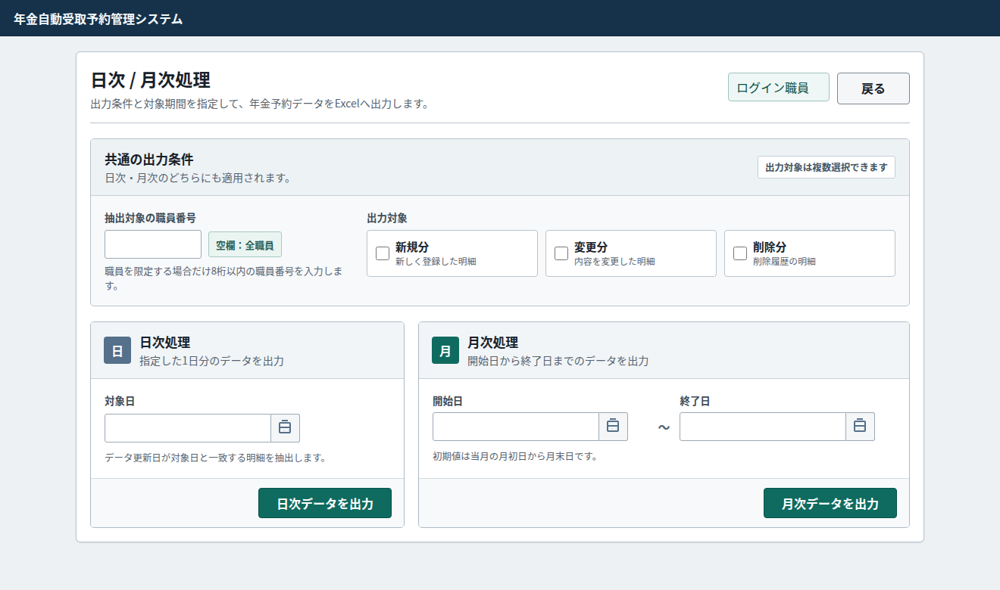
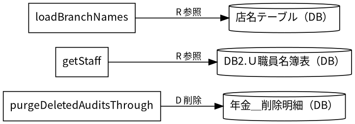
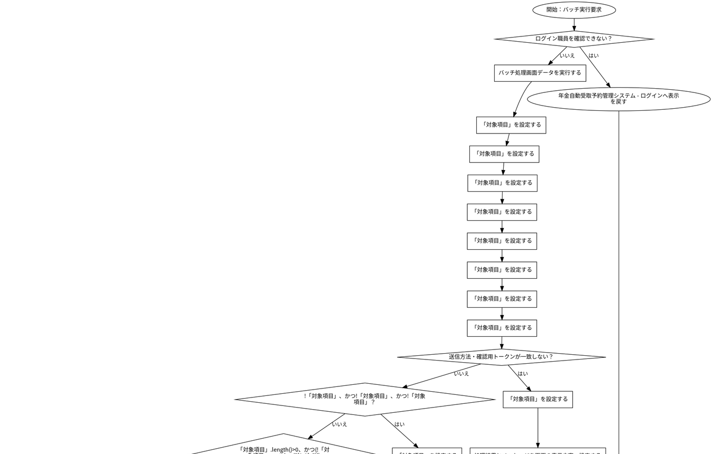
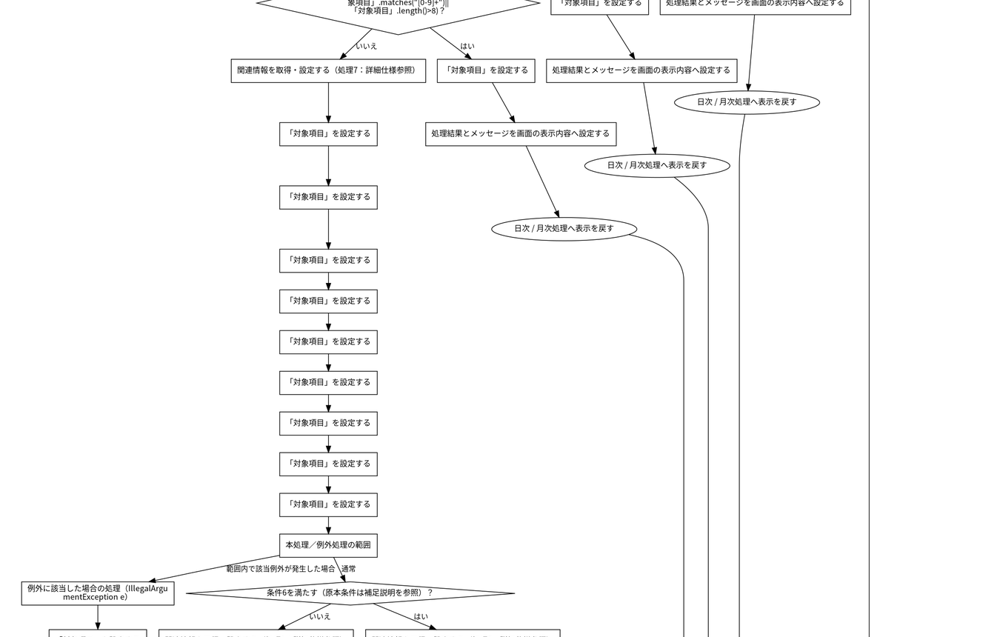
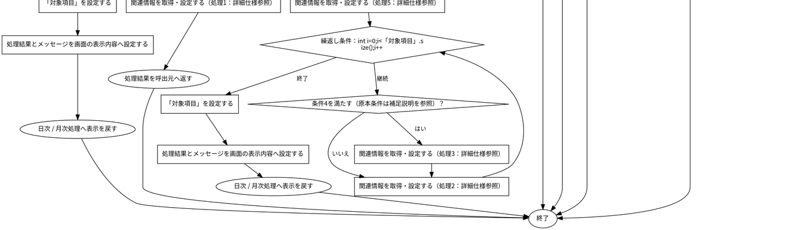
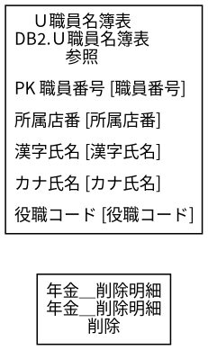
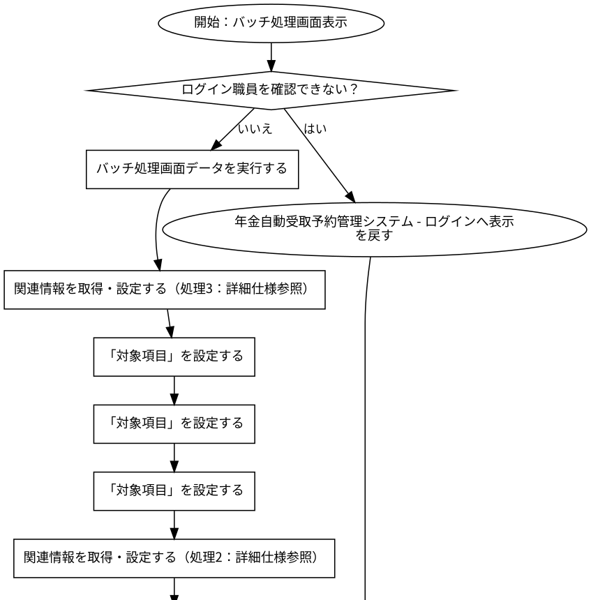
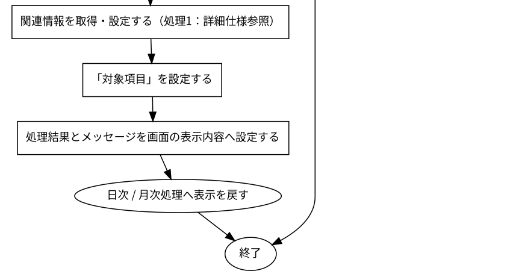

# 日次 / 月次処理

## 表紙

| 項目 | 内容 |
| --- | --- |
| 文書名 | 基本設計書 |
| システム名 |  |
| 機能ID | SCR-014 |
| 画面名 | 日次 / 月次処理 |
| 会社名 |  |
| 作成日 |  |

## 概要

### 概要説明

日次 / 月次処理の入力・表示・要求処理を行う。

| 情報 | 内容 |
| --- | --- |
| 対象種別 | screen |
| 開始契機 | 呼出元からの要求 |
| 処理対象 | DB2.Ｕ職員名簿表、DB2.ＵＪ科目、N2_SIGHT.Ｂ顧客基本表、NAVI.ＵＪ機能マスタ、NAVI.ＵＪ稼動店舗管理マスタ、NAVI.ＵＭオンラインＯＰマスタ、NAVI.ＵＭパス管理マスタ、NAVI.ＵＭ機能マスタ、NAVI.ＵＳパス管理ステータス、受給有無テーブル、年金1_LK、年金種類テーブル、年金＿削除明細、店名テーブル、性別テーブル、職員情報等（セッション）、裁定請求テーブル |

### 画面レイアウト

原本HTML・CSSの静的再構成。実行時の表示条件・値は未実行（仮定 Q-644C2740DA）。

### データ操作関連図

## 項目一覧

| No | グループ | 項目名 | 種類 | 入出力 | DB連携項目 | 候補取得元 | 必須 | 形式・桁 | 説明 |
| --- | --- | --- | --- | --- | --- | --- | --- | --- | --- |
| 1 | 見出し・説明 | 日次 / 月次処理 | Label | O | ‐ | ‐ | ‐ | ‐ | 日次 / 月次処理を表示する。 |
| 2 | 画面操作 | 戻る | Button | ‐ | ‐ | ‐ | ‐ | ‐ | 「戻る」の操作を受け付ける。業務結果はイベント仕様で確認する。 |
| 3 | 見出し・説明 | 共通の出力条件 | Label | O | ‐ | ‐ | ‐ | ‐ | 共通の出力条件を表示する。 |
| 4 | 入力・選択項目 | 抽出対象の職員番号 | TextBox | I | DB項目未確定（仮定 Q-17207EAAE6） | ‐ | 任意（仮定 Q-065F5C97A3） | 最大8文字 | 抽出対象の職員番号を入力・選択する。 |
| 5 | 見出し・説明 | 出力対象 | Label | O | ‐ | ‐ | ‐ | ‐ | 出力対象を表示する。 |
| 6 | 入力・選択項目 | 新規分 新しく登録した明細 | CheckBox | I | DB項目未確定（仮定 Q-19BB095982） | ‐ | 任意（仮定 Q-19C9B20FBE） | 選択／未選択 | 新規分 新しく登録した明細を入力・選択する。 |
| 7 | 入力・選択項目 | 変更分 内容を変更した明細 | CheckBox | I | DB項目未確定（仮定 Q-A01B21D95F） | ‐ | 任意（仮定 Q-CA82702A28） | 選択／未選択 | 変更分 内容を変更した明細を入力・選択する。 |
| 8 | 入力・選択項目 | 削除分 削除履歴の明細 | CheckBox | I | DB項目未確定（仮定 Q-3BC0603EEE） | ‐ | 任意（仮定 Q-E84563AA62） | 選択／未選択 | 削除分 削除履歴の明細を入力・選択する。 |
| 9 | 見出し・説明 | 日次処理 | Label | O | ‐ | ‐ | ‐ | ‐ | 日次処理を表示する。 |
| 10 | 入力・選択項目 | 対象日 | TextBox | I | DB項目未確定（仮定 Q-9436AE84BB） | ‐ | 任意（仮定 Q-3A81598633） | 最大14文字 | 対象日を入力・選択する。 |
| 11 | 画面操作 | 日付のカレンダーを開く | Button | ‐ | ‐ | ‐ | ‐ | ‐ | 「日付のカレンダーを開く」の操作を受け付ける。業務結果はイベント仕様で確認する。 |
| 12 | 画面操作 | 日次データを出力 | Button | ‐ | ‐ | ‐ | ‐ | ‐ | 「日次データを出力」の操作を受け付ける。業務結果はイベント仕様で確認する。 |
| 13 | 見出し・説明 | 月次処理 | Label | O | ‐ | ‐ | ‐ | ‐ | 月次処理を表示する。 |
| 14 | 入力・選択項目 | 開始日 | TextBox | I | DB項目未確定（仮定 Q-6D26B92300） | ‐ | 任意（仮定 Q-EC5F2EECEC） | 最大14文字 | 開始日を入力・選択する。 |
| 15 | 画面操作 | 開始日のカレンダーを開く | Button | ‐ | ‐ | ‐ | ‐ | ‐ | 「開始日のカレンダーを開く」の操作を受け付ける。業務結果はイベント仕様で確認する。 |
| 16 | 入力・選択項目 | 終了日 | TextBox | I | DB項目未確定（仮定 Q-DB2867B3B4） | ‐ | 任意（仮定 Q-F94785F741） | 最大14文字 | 終了日を入力・選択する。 |
| 17 | 画面操作 | 終了日のカレンダーを開く | Button | ‐ | ‐ | ‐ | ‐ | ‐ | 「終了日のカレンダーを開く」の操作を受け付ける。業務結果はイベント仕様で確認する。 |
| 18 | 画面操作 | 月次データを出力 | Button | ‐ | ‐ | ‐ | ‐ | ‐ | 「月次データを出力」の操作を受け付ける。業務結果はイベント仕様で確認する。 |

項目定義数：18項目。表示順と反復行の定義数を区別する。

## イベント仕様

### バッチ実行要求

#### 処理概要

日次 / 月次処理で「バッチ実行要求」の要求を受け付ける。入力・確認・データ操作・応答の順と、条件が成立しない場合の処理を以下に示す。

#### 処理手順

1. 「ログイン職員を確認できない」に該当するか確認する。該当する場合に限り、次の分岐内手順を行う。該当しない場合は分岐の後へ進む。

1.1. 条件成立時：年金自動受取予約管理システム - ログインへ表示を戻す。この経路の後続手順は実行しない。

2. バッチ処理画面データを実行する。

3. 「対象項目」を設定する。

4. 「対象項目」を設定する。

5. 「対象項目」を設定する。

6. 「対象項目」を設定する。

7. 「対象項目」を設定する。

8. 「対象項目」を設定する。

9. 「対象項目」を設定する。

10. 「対象項目」を設定する。

11. 「送信方法・確認用トークンが一致しない」に該当するか確認する。該当する場合に限り、次の分岐内手順を行う。該当しない場合は分岐の後へ進む。

11.1. 条件成立時：「対象項目」を設定する。

11.2. 条件成立時：処理結果とメッセージを画面の表示内容へ設定する。

11.3. 条件成立時：日次 / 月次処理へ表示を戻す。この経路の後続手順は実行しない。

12. 「!「対象項目」、かつ!「対象項目」、かつ!「対象項目」」に該当するか確認する。該当する場合に限り、次の分岐内手順を行う。該当しない場合は分岐の後へ進む。

12.1. 条件成立時：「対象項目」を設定する。

12.2. 条件成立時：処理結果とメッセージを画面の表示内容へ設定する。

12.3. 条件成立時：日次 / 月次処理へ表示を戻す。この経路の後続手順は実行しない。

13. 「「対象項目」.length()&gt;0、かつ(!「対象項目」.matches("[0-9]+")||「対象項目」.length()&gt;8)」に該当するか確認する。該当する場合に限り、次の分岐内手順を行う。該当しない場合は分岐の後へ進む。

13.1. 条件成立時：「対象項目」を設定する。

13.2. 条件成立時：処理結果とメッセージを画面の表示内容へ設定する。

13.3. 条件成立時：日次 / 月次処理へ表示を戻す。この経路の後続手順は実行しない。

14. 関連情報を取得・設定する（処理8：詳細仕様参照）。

15. 「対象項目」を設定する。

16. 「対象項目」を設定する。

17. 「対象項目」を設定する。

18. 「対象項目」を設定する。

19. 「対象項目」を設定する。

20. 「対象項目」を設定する。

21. 「対象項目」を設定する。

22. 「対象項目」を設定する。

23. 「対象項目」を設定する。

24. 通常処理と例外時の処理を区別して実行する。例外処理は対応する例外が発生した場合に限る。

24.1. 通常処理：「条件9を満たす（原本条件は補足説明を参照）」に該当するか確認する。該当する場合に限り、次の分岐内手順を行う。該当しない場合は分岐の後へ進む。

24.1.1. 条件成立時：関連情報を取得・設定する（処理10：詳細仕様参照）。

24.1.2. 条件成立時：繰返し条件「int i=0;i&lt;「対象項目」.size();i++」に従い、次の手順を繰り返す。条件を満たさなくなった場合は繰返しの後へ進む。

24.1.2.1. 繰返しの各回：「条件11を満たす（原本条件は補足説明を参照）」に該当するか確認する。該当する場合に限り、次の分岐内手順を行う。該当しない場合は分岐の後へ進む。

24.1.2.1.1. 条件成立時：関連情報を取得・設定する（処理12：詳細仕様参照）。

24.1.2.2. 繰返しの各回：関連情報を取得・設定する（処理13：詳細仕様参照）。

24.1.3. 条件成立時：「対象項目」を設定する。

24.1.4. 条件成立時：処理結果とメッセージを画面の表示内容へ設定する。

24.1.5. 条件成立時：日次 / 月次処理へ表示を戻す。この経路の後続手順は実行しない。

24.2. 通常処理：関連情報を取得・設定する（処理14：詳細仕様参照）。

24.3. 通常処理：処理結果を呼出元へ返す。この経路の後続手順は実行しない。

24-例外1. 例外条件「IllegalArgumentException e」に該当した場合に次の手順を行う。型名は原本の表記。

24-例外1.1. 例外発生時：「対象項目」を設定する。

24-例外1.2. 例外発生時：処理結果とメッセージを画面の表示内容へ設定する。

24-例外1.3. 例外発生時：日次 / 月次処理へ表示を戻す。この経路の後続手順は実行しない。

#### 処理フロー

入口処理の順序・分岐を示す。呼出先の処理は別単位とし、SQLの対象と実行条件はDB操作の詳細へ記載する。例外線は範囲内で例外が発生した場合の経路で、各命令が必ず例外を送出する意味ではない。

#### SQL・テーブル関連（ER図）

実線はSQLの結合条件。外部キー制約や多重度を断定しない。単独表は独立したエンティティで表す。

#### DB操作の詳細

#### DB操作 SQL-4F7E42ED747E

| 情報 | 内容 |
| --- | --- |
| 操作ID | SQL-4F7E42ED747E |
| 対象テーブル | 年金＿削除明細 |
| 操作 | 削除 |
| 処理説明 | 対象テーブルの条件に一致する行を削除する。設定項目・対象条件・確定取消は以下の定義に従う。 |
| 設定項目 | 当該SQL式の列指定・実行時引数を使用する。組立式と原本のパラメーター設定を参照。 |
| 対象条件 | 抽出・更新対象条件：データ更新日 &lt;= ? |
| 確定・取消 | 当該メソッド内で自動コミット設定・コミットを行う。例外時の処理順は詳細仕様の分岐に従う。 |
| 原本 | nenkin/WEB-INF/src/nenkin/service/PensionRepository.java:468 / purgeDeletedAuditsThrough@458 |

#### DB操作 SQL-D9F3500B923D

| 情報 | 内容 |
| --- | --- |
| 操作ID | SQL-D9F3500B923D |
| 対象テーブル | DB2.Ｕ職員名簿表 |
| 操作 | 参照 |
| 処理説明 | 対象テーブルの対象データを読み取る。設定項目・対象条件・確定取消は以下の定義に従う。 |
| 設定項目 | 当該SQL式の列指定・実行時引数を使用する。組立式と原本のパラメーター設定を参照。 |
| 対象条件 | 抽出・更新対象条件：S.職員番号 = ? |
| 確定・取消 | 呼出側または接続の設定に従う。当該メソッド単独でのコミット・ロールバック指定はない。 |
| 原本 | nenkin/WEB-INF/src/nenkin/service/ReferenceDataService.java:207 / getStaff@206 |

#### 結果・例外時の扱い

| 到達条件 | 結果 |
| --- | --- |
| ログイン職員を確認できない | 年金自動受取予約管理システム - ログインへ表示を戻す |
| 条件15を満たす（原本条件は補足説明を参照）・送信方法・確認用トークンが一致しない | 日次 / 月次処理へ表示を戻す |
| 条件16を満たす（原本条件は補足説明を参照）・条件17を満たす（原本条件は補足説明を参照）・!「対象項目」、かつ!「対象項目」、かつ!「対象項目」 | 日次 / 月次処理へ表示を戻す |
| 条件18を満たす（原本条件は補足説明を参照）・条件19を満たす（原本条件は補足説明を参照）・NOT (!「対象項目」&amp;&amp;!「対象項目」&amp;&amp;!「対象項目」)・「対象項目」.length()&gt;0、かつ(!「対象項目」.matches("[0-9]+")&#124;&#124;「対象項目」.length()&gt;8) | 日次 / 月次処理へ表示を戻す |
| 条件20を満たす（原本条件は補足説明を参照）・条件21を満たす（原本条件は補足説明を参照）・NOT (!「対象項目」&amp;&amp;!「対象項目」&amp;&amp;!「対象項目」)・NOT (「対象項目」.length()&gt;0&amp;&amp;(!「対象項目」.matches("[0-9]+")&#124;&#124;「対象項目」.length()&gt;8))・条件22を満たす（原本条件は補足説明を参照） | 日次 / 月次処理へ表示を戻す |
| 条件23を満たす（原本条件は補足説明を参照）・条件24を満たす（原本条件は補足説明を参照）・NOT (!「対象項目」&amp;&amp;!「対象項目」&amp;&amp;!「対象項目」)・NOT (「対象項目」.length()&gt;0&amp;&amp;(!「対象項目」.matches("[0-9]+")&#124;&#124;「対象項目」.length()&gt;8))・条件25を満たす（原本条件は補足説明を参照） | 処理結果を呼出元へ返す |
| 条件26を満たす（原本条件は補足説明を参照）・条件27を満たす（原本条件は補足説明を参照）・NOT (!「対象項目」&amp;&amp;!「対象項目」&amp;&amp;!「対象項目」)・NOT (「対象項目」.length()&gt;0&amp;&amp;(!「対象項目」.matches("[0-9]+")&#124;&#124;「対象項目」.length()&gt;8))・条件28を満たす（原本条件は補足説明を参照） | 日次 / 月次処理へ表示を戻す |

### バッチ処理画面表示

#### 処理概要

日次 / 月次処理で「バッチ処理画面表示」の要求を受け付ける。入力・確認・データ操作・応答の順と、条件が成立しない場合の処理を以下に示す。

#### 処理手順

1. 「ログイン職員を確認できない」に該当するか確認する。該当する場合に限り、次の分岐内手順を行う。該当しない場合は分岐の後へ進む。

1.1. 条件成立時：年金自動受取予約管理システム - ログインへ表示を戻す。この経路の後続手順は実行しない。

2. バッチ処理画面データを実行する。

3. 関連情報を取得・設定する（処理4：詳細仕様参照）。

4. 「対象項目」を設定する。

5. 「対象項目」を設定する。

6. 「対象項目」を設定する。

7. 関連情報を取得・設定する（処理5：詳細仕様参照）。

8. 関連情報を取得・設定する（処理6：詳細仕様参照）。

9. 「対象項目」を設定する。

10. 処理結果とメッセージを画面の表示内容へ設定する。

11. 日次 / 月次処理へ表示を戻す。この経路の後続手順は実行しない。

#### 処理フロー

入口処理の順序・分岐を示す。呼出先の処理は別単位とし、SQLの対象と実行条件はDB操作の詳細へ記載する。例外線は範囲内で例外が発生した場合の経路で、各命令が必ず例外を送出する意味ではない。

#### SQL・テーブル関連（ER図）

実線はSQLの結合条件。外部キー制約や多重度を断定しない。単独表は独立したエンティティで表す。

#### DB操作の詳細

#### DB操作 SQL-D9F3500B923D

| 情報 | 内容 |
| --- | --- |
| 操作ID | SQL-D9F3500B923D |
| 対象テーブル | DB2.Ｕ職員名簿表 |
| 操作 | 参照 |
| 処理説明 | 対象テーブルの対象データを読み取る。設定項目・対象条件・確定取消は以下の定義に従う。 |
| 設定項目 | 当該SQL式の列指定・実行時引数を使用する。組立式と原本のパラメーター設定を参照。 |
| 対象条件 | 抽出・更新対象条件：S.職員番号 = ? |
| 確定・取消 | 呼出側または接続の設定に従う。当該メソッド単独でのコミット・ロールバック指定はない。 |
| 原本 | nenkin/WEB-INF/src/nenkin/service/ReferenceDataService.java:207 / getStaff@206 |

#### DB操作 SQL-E0FD738666D8

| 情報 | 内容 |
| --- | --- |
| 操作ID | SQL-E0FD738666D8 |
| 対象テーブル | 店名テーブル |
| 操作 | 参照 |
| 処理説明 | 対象テーブルの対象データを読み取る。設定項目・対象条件・確定取消は以下の定義に従う。 |
| 設定項目 | 当該SQL式の列指定・実行時引数を使用する。組立式と原本のパラメーター設定を参照。 |
| 対象条件 | WHERE句による限定はこのSQL式にない。呼出条件・動的付加条件は原本を参照する。 |
| 確定・取消 | 呼出側または接続の設定に従う。当該メソッド単独でのコミット・ロールバック指定はない。 |
| 原本 | nenkin/WEB-INF/src/nenkin/service/ReferenceDataService.java:291 / loadBranchNames@289 |

#### 結果・例外時の扱い

| 到達条件 | 結果 |
| --- | --- |
| ログイン職員を確認できない | 年金自動受取予約管理システム - ログインへ表示を戻す |
| 条件7を満たす（原本条件は補足説明を参照） | 日次 / 月次処理へ表示を戻す |

### DB関連処理

## 補足説明

### 適用条件

各仮定のQA番号を確認する。静的に確認できた操作・条件を適用する。

### 項目別DB連携備考

表示元と保存先は別方向の対応。DBから読み出した既存データの履歴保存は、画面入力の直接バインド先と区別する。同じ列の複数経路はイベントの実行条件に従う。

| No | 項目名 | 備考 |
| --- | --- | --- |
| 4 | 抽出対象の職員番号 | DB列への接続を原本から確定できていない。名称が似ている列へ自動接続しない。画面データ連携（仮定 Q-17207EAAE6） |
| 6 | 新規分 新しく登録した明細 | DB列への接続を原本から確定できていない。名称が似ている列へ自動接続しない。画面データ連携（仮定 Q-19BB095982） |
| 7 | 変更分 内容を変更した明細 | DB列への接続を原本から確定できていない。名称が似ている列へ自動接続しない。画面データ連携（仮定 Q-A01B21D95F） |
| 8 | 削除分 削除履歴の明細 | DB列への接続を原本から確定できていない。名称が似ている列へ自動接続しない。画面データ連携（仮定 Q-3BC0603EEE） |
| 10 | 対象日 | DB列への接続を原本から確定できていない。名称が似ている列へ自動接続しない。画面データ連携（仮定 Q-9436AE84BB） |
| 14 | 開始日 | DB列への接続を原本から確定できていない。名称が似ている列へ自動接続しない。画面データ連携（仮定 Q-6D26B92300） |
| 16 | 終了日 | DB列への接続を原本から確定できていない。名称が似ている列へ自動接続しない。画面データ連携（仮定 Q-DB2867B3B4） |

### 処理・条件の原本対応

文書内の条件番号・処理番号は次の原本表記に対応する。完全な業務用語への置換を行っていない箇所はQA・reportで確認する。

| イベント | 参照番号 | 原本条件・処理 |
| --- | --- | --- |
| バッチ実行要求 | 処理1 | writeDownload(response,result.getFileName(),result.getContentType(),result.getContent()) |
| バッチ実行要求 | 処理2 | message.append(result.getMessages().get(i)) |
| バッチ実行要求 | 処理3 | message.append(' ') |
| バッチ実行要求 | 条件4 | i&gt;0 |
| バッチ実行要求 | 処理5 | StringBuilder message=new StringBuilder() |
| バッチ実行要求 | 条件6 | !result.hasContent() |
| バッチ実行要求 | 処理7 | PensionBatchExportRequest input=new PensionBatchExportRequest() |
| バッチ実行要求 | 処理8 | PensionBatchExportRequest input=new PensionBatchExportRequest() |
| バッチ実行要求 | 条件9 | !result.hasContent() |
| バッチ実行要求 | 処理10 | StringBuilder message=new StringBuilder() |
| バッチ実行要求 | 条件11 | i&gt;0 |
| バッチ実行要求 | 処理12 | message.append(' ') |
| バッチ実行要求 | 処理13 | message.append(result.getMessages().get(i)) |
| バッチ実行要求 | 処理14 | writeDownload(response,result.getFileName(),result.getContentType(),result.getContent()) |
| バッチ実行要求 | 条件15 | NOT (!requireStaff(request)) |
| バッチ実行要求 | 条件16 | NOT (!requireStaff(request)) |
| バッチ実行要求 | 条件17 | NOT (!isAuthorizedMutation(request)) |
| バッチ実行要求 | 条件18 | NOT (!requireStaff(request)) |
| バッチ実行要求 | 条件19 | NOT (!isAuthorizedMutation(request)) |
| バッチ実行要求 | 条件20 | NOT (!requireStaff(request)) |
| バッチ実行要求 | 条件21 | NOT (!isAuthorizedMutation(request)) |
| バッチ実行要求 | 条件22 | !result.hasContent() |
| バッチ実行要求 | 条件23 | NOT (!requireStaff(request)) |
| バッチ実行要求 | 条件24 | NOT (!isAuthorizedMutation(request)) |
| バッチ実行要求 | 条件25 | NOT (!result.hasContent()) |
| バッチ実行要求 | 条件26 | NOT (!requireStaff(request)) |
| バッチ実行要求 | 条件27 | NOT (!isAuthorizedMutation(request)) |
| バッチ実行要求 | 条件28 | IllegalArgumentException e |
| バッチ処理画面表示 | 処理1 | cutoff.add(Calendar.MONTH, -2) |
| バッチ処理画面表示 | 処理2 | Calendar cutoff = Calendar.getInstance(Locale.JAPAN) |
| バッチ処理画面表示 | 処理3 | String today = DateUtil.todayIso() |
| バッチ処理画面表示 | 処理4 | String today = DateUtil.todayIso() |
| バッチ処理画面表示 | 処理5 | Calendar cutoff = Calendar.getInstance(Locale.JAPAN) |
| バッチ処理画面表示 | 処理6 | cutoff.add(Calendar.MONTH, -2) |
| バッチ処理画面表示 | 条件7 | NOT (!requireStaff(request)) |

