<!-- spec-meta: {"schema":"spec-md/1.0","documentId":"SCR-015","version":"2.0","path":"基本設計書/基本設計書_SCR-015_EXCEL出力.md","sheets":[{"heading":"概要","kind":"GRID","sheet":"概要"},{"heading":"項目一覧","kind":"LIST","sheet":"項目一覧","key":["No"]},{"heading":"イベント仕様","kind":"GRID","sheet":"イベント仕様"},{"heading":"補足説明","kind":"GRID","sheet":"補足説明"}]} -->
# EXCEL出力

| 属性 | 内容 |
| --- | --- |
| 文書種別 | 基本設計書 |
| システム名 | 年金自動受取予約管理システム |
| 機能ID | SCR-015 |
| 版 | 2.0 |
| 解析対象 | 店舗別予約のExcel出力、および画面表示・店舗参照・メニュー復帰の接続処理 |
| 基準日 | 2026-10-15 |

## 概要

### 機能の目的と対象

本画面は、一店舗の現在の年金予約を検索し、18列の単一Excelファイルとして取得する画面である。利用者は店番を直接入力するか、店番参照で店舗を選択する。出力時の店番は必須であり、空欄を全店舗の指定には使用しない。

対象は `年金1_LK` の店番が指定値に一致する予約である。期間、更新者、新規・変更・削除区分、６ヶ月先確認による絞込みは行わない。ログイン職員の所属店を検索条件へ追加する処理もない。

店舗名は、指定店舗を確認するための表示情報である。出力条件は送信された店番から決定し、画面の店舗名は送信しない。出力時に店舗名が見つからなくても予約検索へ進む。ただし、店舗名照会のDB障害は名称不在とは区別し、例外として扱う。

本機能の業務処理は照会とファイル生成であり、予約本表や削除明細を更新しない。共通入口が行うアクセス記録は、これらの業務照会とは別のDB書込みである。

### 操作入口と遷移

通常の要求は、コンテキストパス配下の `/Action.do` へPOSTする。フォームの送信文字コードはWindows-31Jであり、共通入口もパラメータ取得前に同じ文字コードを設定する。

| 操作 | FUNCTION_ID | VIEW_ID | COMMAND_ID | 接続先 | 正常時の結果 |
| --- | --- | --- | --- | --- | --- |
| メニューから開く | `nenkin` | `Excel` | `View` | `ExcelViewAction.perform` | 空のExcel画面を表示 |
| EXCEL出力 | `nenkin` | `Excel` | `Export` | `ExcelExportAction.perform` | 入力拒否・0件は画面再表示、対象ありは.xlsxを直接応答 |
| 店番参照を開く | `nenkin` | `Lookup` | `View` | `LookupViewAction.perform` | iframe内に店舗候補を表示 |
| 店舗候補を検索・再表示する | `nenkin` | `Lookup` | `Search` | `LookupSearchAction` が継承する表示処理 | iframe内の候補を再表示 |
| 戻る | `nenkin` | `Menu` | `View` | `MenuViewAction.perform` | メニューを表示 |

店番参照の起動には `TARGET=branch`、`POPUP=1` を付ける。親画面の現在の店番、検索語、ページ番号は引き継がない。候補選択とモーダル終了はブラウザー内の操作であり、選択だけではExcel出力を要求しない。

### 要求前処理と共通の応答境界

以下を本書の「共通入口」とする。共通ログイン、運用判定、Action内の職員確認は、この順序で行う。

| 段階 | 確認・処理 | 拒否・失敗時の結果 |
| --- | --- | --- |
| 共通ログイン | 共通ログイン情報とログイン可否を確認する | Actionを呼ばず、「ログイン時間切れです。再度ログインしてください。」を共通エラーへ設定する |
| 運用判定 | 共通DB接続を取得する。`nenkin` は運用状態表を照会する分岐には含まれず、その後は判定を真として扱う | 接続取得等が判定処理内で失敗した場合は偽となり、メンテナンス中の共通エラーを選ぶ |
| Action生成・実行 | 識別値からActionを生成し、`perform` を呼ぶ | この範囲の `Exception` は共通catchでアプリケーションエラーへ変換する |
| 年金職員確認 | 各Actionの先頭で `requireStaff` を呼ぶ。既存の `StaffContext` があれば再利用する | 職員情報を成立させられなければログインJSPを返す。照会例外は共通Action用catchへ伝播する |
| Action後の処理 | 選択された戻り値を使って共通アクセス記録を行い、必要な場合にJSPへforwardする | 戻り値 `CSV` はforwardを抑止する。forward時の例外はAction用catchの外で発生する |

職員情報がない場合、共通ログインの職員番号をtrimし、半角数字1～8桁であることを確認して整数へ変換する。この職員番号には正数検査がなく、全桁ゼロも整数0として名簿照会へ渡り得る。職員が得られればセッションへ設定し、得られなければ `MESSAGE` を設定して年金職員情報とCSRF情報を除去する。共通ログインが成立していた側の拒否では、共通ログイン情報も除去する。

職員確認はCSRF情報を生成・再利用するが、`ExcelExportAction` はPOST・CSRF照合用の `isAuthorizedMutation` を呼ばない。店番75と役職コードによる更新制限も出力条件には接続されていない。通常フォームのPOST送信、職員確認、更新操作用の権限検査は別の契約である。

要求識別値を使用する一部の処理はAction生成前にあり、Action後の共通処理とforwardもAction用catchの外側にある。識別値欠落、Action内例外、JSP描画例外、送信開始後の失敗を、一つの応答結果やHTTP状態へまとめない。

### 画面状態

| 状態 | 店番・店舗名 | メッセージ・応答 | 操作と保持 |
| --- | --- | --- | --- |
| 初期表示 | 両方空欄 | メッセージなし | 新しいExcel用Beanを設定。参照モーダルは非表示 |
| 直接入力中 | 店番を編集。店舗名は以前の表示を保持し得る | 入力だけではメッセージを消さない | 自動照会・自動送信は行わない |
| 入力拒否 | サーバーはtrim後店番を保持し、店舗名は空欄 | 必須相当または形式のメッセージ | 出力・参照・戻るは操作可能 |
| 店番参照表示中 | 親の値を保持 | iframe内に候補と件数を表示 | 親モーダルを表示し、候補状態は別Beanに保持 |
| 店舗選択後 | 選択した店番と店名を表示 | 既存の親メッセージは選択だけでは消さない | モーダルを閉じる。出力要求は未送信 |
| 出力対象0件 | trim後店番と取得できた店舗名を保持。名称不在なら空欄 | 「入力された店番には対象データがありません。」 | ファイルを送らず、Excel画面を再表示 |
| ダウンロード処理の正常復帰 | ブラウザーの表示はそのまま | .xlsxを直接返す。完了画面は返さない | 今回作成したExcel用Beanはセッションへ設定しない |
| メニュー復帰 | メニュー側で店番を使用しない | メニューを表示 | `ViewBean` をメニュー用へ置換。再度開くと空欄から開始 |

入力拒否の再表示では、JSPが保持値をHTMLエスケープして出力した後、共通JavaScriptの数字入力補助が初期正規化を行う。そのため、サーバーが保持した不正文字列と、JavaScript適用後の表示値が異なる場合がある。

### 静的画面投影

以下は、原画面の配置と共有CSSを反映した非実行の表示である。原画面のform要素は、同じ位置・id・class・子要素を持つdivへ置き換え、inertを付ける。元の送信先・method・文字コードはdata属性と入口表へ保持し、すべてのボタンを `type=button` とする。参照用iframeも通常のdivへ置き換え、元要素の種類・name・titleをdata属性に保持する。スクリプト、実行ハンドラー、外部資源への参照は含めない。

画面にはシステム名のヘッダーがあり、職員バッジやログアウトフォームはない。`compact-screen` の最大幅640pxは、後方の `.screen:not(.lookup-screen-popup)` によって1180pxへ上書きされる。店番の外側は縦方向のグリッド、その内側は入力・参照・店舗名の3列である。原画面に付いていない `excel-export-screen` 等の専用classは使用しない。

初期状態を示す。参照モーダルはhiddenであり、参照フレーム相当のdivは空にする。

<!DOCTYPE html>
<html lang="ja">
<head>
<meta charset="UTF-8">
<meta name="viewport" content="width=device-width, initial-scale=1">
<title>EXCEL出力・初期状態</title>
<style>
:root{--bg:#edf1f4;--surface:#fff;--line:#b8c2cc;--text:#18212a;--muted:#566370;--nav:#16324a;--nav-text:#f4f8fb;--primary:#0f6b5f;--primary-dark:#0a5148;--button:#e8edf1;--button-border:#7b8792;--work-screen-width:1180px}*,*::before,*::after{box-sizing:border-box}[hidden]{display:none!important}html{min-height:100%}body{min-height:100vh;margin:0;color:var(--text);background:var(--bg);font-family:"Yu Gothic UI","Meiryo","Segoe UI",sans-serif}button,input{margin:0;font:inherit}button{cursor:pointer}.app-nav{display:flex;min-height:48px;align-items:center;justify-content:space-between;gap:12px;padding:7px 18px;color:var(--nav-text);background:var(--nav);border-bottom:1px solid #0c2236}.app-nav__title{color:var(--nav-text);font-weight:800;line-height:1.25}.app-shell{width:100%;max-width:1440px;margin-inline:auto}main.app-shell:not(.login-shell){padding:20px 18px 52px}.surface{background:var(--surface);border:1px solid var(--line);border-radius:6px;box-shadow:0 1px 2px rgba(16,32,48,.08)}.screen{padding:18px}.compact-screen{max-width:640px;margin-top:28px}.screen:not(.lookup-screen-popup){max-width:var(--work-screen-width);margin-right:auto;margin-left:auto}.screen-header{display:flex;gap:16px;align-items:flex-start;justify-content:space-between;margin-bottom:18px;padding-bottom:12px;border-bottom:1px solid var(--line)}h1{margin:0;font-size:1.45rem;font-weight:700;letter-spacing:0}.access-form{margin:0}.field-row{display:grid;grid-template-rows:auto 38px auto;gap:4px;min-width:0}.field-row label{color:var(--muted);font-size:.88rem;font-weight:700}.input-reference{display:inline-grid;grid-template-columns:minmax(0,auto) auto minmax(7em,auto);gap:6px;align-items:center;justify-content:start;min-width:0}.form-control{display:block;width:100%;min-height:38px;padding:6px 10px;color:var(--text);background:#fff;border:1px solid #9da9b4;border-radius:3px;line-height:1.4}.code-input{width:auto;box-sizing:border-box;font-variant-numeric:tabular-nums}.input-reference .form-control,.input-reference .code-input{width:100%}.short-input{max-width:110px}.code-name-display{min-width:7em;color:var(--text);font-size:.9rem;line-height:1.25;white-space:nowrap}.access-button{display:inline-flex;min-height:42px;align-items:center;justify-content:center;padding:8px 18px;color:var(--text);background:var(--button);border:1px solid var(--button-border);border-radius:4px;font-weight:700;text-decoration:none;line-height:1.2}.access-button.primary{color:#fff;background:var(--primary);border-color:var(--primary-dark)}.access-button.secondary{background:#f4f6f8}.access-button.narrow{min-width:96px}.lookup-button{display:inline-flex;min-height:38px;align-items:center;justify-content:center;padding:6px 10px;color:var(--text);background:#f4f6f8;border:1px solid var(--button-border);border-radius:3px;font-size:.88rem;font-weight:700;line-height:1.2}.button-row{display:flex;flex-wrap:wrap;gap:10px;align-items:center;margin-top:16px}@media(max-width:640px){.screen-header{display:grid}.short-input{max-width:100%}.input-reference{grid-template-columns:minmax(0,1fr) auto minmax(6em,auto);width:100%}}
</style>
</head>
<body>
<header class="app-nav"><div class="app-nav__title">年金自動受取予約管理システム</div></header>
<main class="app-shell"><section class="screen surface compact-screen excel-screen">
<div class="screen-header"><h1>EXCEL出力</h1><button class="access-button secondary narrow" type="button" data-original-view="Menu" data-original-command="View">戻る</button></div>
<div id="excelForm" class="access-form" inert data-original-element="form" data-original-action="/Action.do" data-original-method="post" data-original-charset="Windows-31J">
<input type="hidden" name="FUNCTION_ID" value="nenkin"><input id="excelView" type="hidden" name="VIEW_ID" value="Excel"><input id="excelCommand" type="hidden" name="COMMAND_ID" value="Export">
<div class="field-row"><label for="excelBranch">店番</label><div class="input-reference"><input id="excelBranch" name="BRANCH_NO" value="" class="form-control code-input short-input" maxlength="3" inputmode="numeric" data-digits-only><button class="lookup-button" type="button">参照</button><span id="excelBranchName" class="code-name-display"></span></div></div>
<div class="button-row"><button class="access-button primary" type="button">EXCEL出力</button><button class="access-button secondary" type="button" data-original-view="Menu" data-original-command="View">戻る</button></div>
</div>
<div id="lookupModal" class="lookup-modal" role="dialog" aria-modal="true" hidden><div class="lookup-modal__backdrop"></div><div class="lookup-modal__panel"><div class="lookup-modal__header"><h2>店番参照</h2><button class="lookup-modal__close" type="button">閉じる</button></div><div id="lookupFrame" class="lookup-modal__frame" data-source-element="iframe" data-source-name="lookupFrame" data-source-title="店番参照"></div></div></div>
</section></main>
</body>
</html>

次は店番空欄による入力拒否状態である。メッセージをフォーム相当領域の上に表示し、入力・参照・戻るの活性を保つ。形式拒否ではメッセージと保持店番が変わり、店舗名は空欄になる。対象0件では対象なしのメッセージとなり、照会で得た店舗名を保持する。

<!DOCTYPE html>
<html lang="ja">
<head>
<meta charset="UTF-8"><meta name="viewport" content="width=device-width, initial-scale=1"><title>EXCEL出力・入力拒否状態</title>
<style>
:root{--bg:#edf1f4;--surface:#fff;--line:#b8c2cc;--text:#18212a;--muted:#566370;--nav:#16324a;--nav-text:#f4f8fb;--primary:#0f6b5f;--primary-dark:#0a5148;--button:#e8edf1;--button-border:#7b8792;--work-screen-width:1180px}*,*::before,*::after{box-sizing:border-box}[hidden]{display:none!important}body{min-height:100vh;margin:0;color:var(--text);background:var(--bg);font-family:"Yu Gothic UI","Meiryo","Segoe UI",sans-serif}button,input{margin:0;font:inherit}button{cursor:pointer}.app-nav{display:flex;min-height:48px;align-items:center;justify-content:space-between;gap:12px;padding:7px 18px;color:var(--nav-text);background:var(--nav);border-bottom:1px solid #0c2236}.app-nav__title{color:var(--nav-text);font-weight:800;line-height:1.25}.app-shell{width:100%;max-width:1440px;margin-inline:auto}main.app-shell:not(.login-shell){padding:20px 18px 52px}.surface{background:var(--surface);border:1px solid var(--line);border-radius:6px;box-shadow:0 1px 2px rgba(16,32,48,.08)}.screen{padding:18px}.compact-screen{max-width:640px;margin-top:28px}.screen:not(.lookup-screen-popup){max-width:var(--work-screen-width);margin-right:auto;margin-left:auto}.screen-header{display:flex;gap:16px;align-items:flex-start;justify-content:space-between;margin-bottom:18px;padding-bottom:12px;border-bottom:1px solid var(--line)}h1{margin:0;font-size:1.45rem;font-weight:700;letter-spacing:0}.message{margin-bottom:12px;padding:10px 12px;background:#eef7f5;border:1px solid #9fc3bc;border-radius:4px}.message.error{color:#6f1f1f;background:#fff0f0;border-color:#ca8f8f}.access-form{margin:0}.field-row{display:grid;grid-template-rows:auto 38px auto;gap:4px;min-width:0}.field-row label{color:var(--muted);font-size:.88rem;font-weight:700}.input-reference{display:inline-grid;grid-template-columns:minmax(0,auto) auto minmax(7em,auto);gap:6px;align-items:center;justify-content:start;min-width:0}.form-control{display:block;width:100%;min-height:38px;padding:6px 10px;color:var(--text);background:#fff;border:1px solid #9da9b4;border-radius:3px;line-height:1.4}.code-input{width:auto;box-sizing:border-box;font-variant-numeric:tabular-nums}.input-reference .form-control,.input-reference .code-input{width:100%}.short-input{max-width:110px}.code-name-display{min-width:7em;color:var(--text);font-size:.9rem;line-height:1.25;white-space:nowrap}.access-button{display:inline-flex;min-height:42px;align-items:center;justify-content:center;padding:8px 18px;color:var(--text);background:var(--button);border:1px solid var(--button-border);border-radius:4px;font-weight:700;line-height:1.2}.access-button.primary{color:#fff;background:var(--primary);border-color:var(--primary-dark)}.access-button.secondary{background:#f4f6f8}.access-button.narrow{min-width:96px}.lookup-button{display:inline-flex;min-height:38px;align-items:center;justify-content:center;padding:6px 10px;color:var(--text);background:#f4f6f8;border:1px solid var(--button-border);border-radius:3px;font-size:.88rem;font-weight:700;line-height:1.2}.button-row{display:flex;flex-wrap:wrap;gap:10px;align-items:center;margin-top:16px}@media(max-width:640px){.screen-header{display:grid}.short-input{max-width:100%}.input-reference{grid-template-columns:minmax(0,1fr) auto minmax(6em,auto);width:100%}}
</style>
</head>
<body>
<header class="app-nav"><div class="app-nav__title">年金自動受取予約管理システム</div></header>
<main class="app-shell"><section class="screen surface compact-screen excel-screen">
<div class="screen-header"><h1>EXCEL出力</h1><button class="access-button secondary narrow" type="button" data-original-view="Menu" data-original-command="View">戻る</button></div>
<div class="message error">店番を入力してください。</div>
<div id="excelForm" class="access-form" inert data-original-element="form" data-original-action="/Action.do" data-original-method="post" data-original-charset="Windows-31J">
<input type="hidden" name="FUNCTION_ID" value="nenkin"><input id="excelView" type="hidden" name="VIEW_ID" value="Excel"><input id="excelCommand" type="hidden" name="COMMAND_ID" value="Export">
<div class="field-row"><label for="excelBranch">店番</label><div class="input-reference"><input id="excelBranch" name="BRANCH_NO" value="" class="form-control code-input short-input" maxlength="3" inputmode="numeric" data-digits-only><button class="lookup-button" type="button">参照</button><span id="excelBranchName" class="code-name-display"></span></div></div>
<div class="button-row"><button class="access-button primary" type="button">EXCEL出力</button><button class="access-button secondary" type="button" data-original-view="Menu" data-original-command="View">戻る</button></div>
</div>
<div id="lookupModal" class="lookup-modal" role="dialog" aria-modal="true" hidden><div class="lookup-modal__backdrop"></div><div class="lookup-modal__panel"><div class="lookup-modal__header"><h2>店番参照</h2><button class="lookup-modal__close" type="button">閉じる</button></div><div id="lookupFrame" class="lookup-modal__frame" data-source-element="iframe" data-source-name="lookupFrame" data-source-title="店番参照"></div></div></div>
</section></main>
</body>
</html>

次は店番参照を開いた状態である。親モーダルの見出し・閉じるボタンと、iframe内の見出し・閉じるボタンをそれぞれ保持する。子画面は候補0件の状態例であり、実データの件数を示すものではない。iframe相当のdiv内に子画面の静的HTMLを展開し、その領域を基準とする寸法とレスポンシブ条件へ対応付ける。子画面のフォーム相当領域もinertのdivとする。

<!DOCTYPE html>
<html lang="ja">
<head>
<meta charset="UTF-8"><meta name="viewport" content="width=device-width, initial-scale=1"><title>EXCEL出力・店番参照状態</title>
<style>
:root{--bg:#edf1f4;--surface:#fff;--line:#b8c2cc;--text:#18212a;--muted:#566370;--nav:#16324a;--nav-text:#f4f8fb;--primary:#0f6b5f;--primary-dark:#0a5148;--button:#e8edf1;--button-border:#7b8792;--work-screen-width:1180px}*,*::before,*::after{box-sizing:border-box}body{min-height:100vh;margin:0;color:var(--text);background:var(--bg);font-family:"Yu Gothic UI","Meiryo","Segoe UI",sans-serif}button,input{margin:0;font:inherit}button{cursor:pointer}.app-nav{display:flex;min-height:48px;align-items:center;justify-content:space-between;gap:12px;padding:7px 18px;color:var(--nav-text);background:var(--nav);border-bottom:1px solid #0c2236}.app-nav__title{color:var(--nav-text);font-weight:800;line-height:1.25}.app-shell{width:100%;max-width:1440px;margin-inline:auto}main.app-shell:not(.login-shell){padding:20px 18px 52px}.surface{background:var(--surface);border:1px solid var(--line);border-radius:6px;box-shadow:0 1px 2px rgba(16,32,48,.08)}.screen{padding:18px}.compact-screen{max-width:640px;margin-top:28px}.screen:not(.lookup-screen-popup){max-width:var(--work-screen-width);margin-right:auto;margin-left:auto}.screen-header{display:flex;gap:16px;align-items:flex-start;justify-content:space-between;margin-bottom:18px;padding-bottom:12px;border-bottom:1px solid var(--line)}h1{margin:0;font-size:1.45rem;font-weight:700;letter-spacing:0}.access-form{margin:0}.field-row{display:grid;grid-template-rows:auto 38px auto;gap:4px;min-width:0}.field-row label{color:var(--muted);font-size:.88rem;font-weight:700}.input-reference{display:inline-grid;grid-template-columns:minmax(0,auto) auto minmax(7em,auto);gap:6px;align-items:center;justify-content:start;min-width:0}.form-control{display:block;width:100%;min-height:38px;padding:6px 10px;color:var(--text);background:#fff;border:1px solid #9da9b4;border-radius:3px;line-height:1.4}.code-input{width:auto;box-sizing:border-box;font-variant-numeric:tabular-nums}.input-reference .form-control,.input-reference .code-input{width:100%}.short-input{max-width:110px}.code-name-display{min-width:7em;color:var(--text);font-size:.9rem;line-height:1.25;white-space:nowrap}.access-button{display:inline-flex;min-height:42px;align-items:center;justify-content:center;padding:8px 18px;color:var(--text);background:var(--button);border:1px solid var(--button-border);border-radius:4px;font-weight:700;line-height:1.2}.access-button.primary{color:#fff;background:var(--primary);border-color:var(--primary-dark)}.access-button.secondary{background:#f4f6f8}.access-button.narrow{min-width:96px}.lookup-button{display:inline-flex;min-height:38px;align-items:center;justify-content:center;padding:6px 10px;color:var(--text);background:#f4f6f8;border:1px solid var(--button-border);border-radius:3px;font-size:.88rem;font-weight:700;line-height:1.2}.button-row{display:flex;flex-wrap:wrap;gap:10px;align-items:center;margin-top:16px}.lookup-modal{position:fixed;inset:0;z-index:1000;display:grid;place-items:center;padding:24px}.lookup-modal__backdrop{position:absolute;inset:0;background:rgb(15 23 42 / 52%)}.lookup-modal__panel{position:relative;z-index:1;display:grid;grid-template-rows:auto minmax(0,1fr);width:min(1120px,96vw);height:min(720px,90vh);overflow:hidden;background:var(--surface);border:1px solid #7f8b96;border-radius:4px;box-shadow:0 18px 42px rgb(15 23 42 / 34%)}.lookup-modal__header{display:flex;gap:12px;align-items:center;justify-content:space-between;padding:12px 14px;background:#e8eef2;border-bottom:1px solid var(--line)}.lookup-modal__header h2{margin:0;color:var(--text);font-size:1rem;font-weight:800}.lookup-modal__close{min-height:34px;padding:5px 12px;color:var(--text);background:#fff;border:1px solid var(--button-border);border-radius:3px;font-size:.88rem;font-weight:700}.lookup-modal__frame{width:100%;height:100%;border:0;background:#f8fafb}@media(max-width:640px){.screen-header{display:grid}.short-input{max-width:100%}.input-reference{grid-template-columns:minmax(0,1fr) auto minmax(6em,auto);width:100%}}
#lookupFrame{overflow:auto;container-type:size}#lookupFrame .popup-page{min-height:100cqh;margin:0;color:var(--text);background:var(--bg);font-family:"Yu Gothic UI","Meiryo","Segoe UI",sans-serif}#lookupFrame button,#lookupFrame input{margin:0;font:inherit}#lookupFrame button{cursor:pointer}#lookupFrame .app-shell{width:100%;max-width:1440px;margin-inline:auto}#lookupFrame main.app-shell:not(.login-shell){padding:20px 18px 52px}#lookupFrame .surface{background:var(--surface);border:1px solid var(--line);border-radius:6px;box-shadow:0 1px 2px rgba(16,32,48,.08)}#lookupFrame .screen{padding:18px}#lookupFrame .lookup-screen{max-width:1180px}#lookupFrame .lookup-screen-popup{max-width:none;min-height:calc(100cqh - 24px);margin:0}#lookupFrame .screen-header{display:flex;gap:16px;align-items:flex-start;justify-content:space-between;margin-bottom:18px;padding-bottom:12px;border-bottom:1px solid var(--line)}#lookupFrame .screen-header.compact{margin-bottom:14px}#lookupFrame h1{margin:0;font-size:1.45rem;font-weight:700;letter-spacing:0}#lookupFrame .access-button{display:inline-flex;min-height:42px;align-items:center;justify-content:center;padding:8px 18px;color:var(--text);background:var(--button);border:1px solid var(--button-border);border-radius:4px;font-weight:700;line-height:1.2}#lookupFrame .access-button.primary{color:#fff;background:var(--primary);border-color:var(--primary-dark)}#lookupFrame .access-button.secondary{background:#f4f6f8}#lookupFrame .access-button.narrow{min-width:96px}#lookupFrame .lookup-filter{display:grid;grid-template-columns:max-content auto;gap:8px 12px;align-items:end;justify-content:start;margin:0 0 8px}#lookupFrame .lookup-filter-row{display:flex;flex-wrap:wrap;gap:8px;align-items:center}#lookupFrame .form-control{display:block;width:100%;min-height:38px;padding:6px 10px;color:var(--text);background:#fff;border:1px solid #9da9b4;border-radius:3px;line-height:1.4}#lookupFrame .lookup-filter-row .form-control{width:min(260px,100%)}#lookupFrame .lookup-pagination-top{display:flex;justify-content:flex-end;margin:8px 0 10px}#lookupFrame .table-wrap{overflow-x:auto}#lookupFrame .lookup-table-wrap{margin-top:12px}#lookupFrame .access-table{width:100%;border-collapse:collapse;font-size:.9rem}#lookupFrame .access-table th,#lookupFrame .access-table td{padding:6px 8px;border:1px solid var(--line);white-space:nowrap;vertical-align:top}#lookupFrame .access-table th{background:#e8edf1;font-weight:700}#lookupFrame .access-code-center{text-align:center;font-variant-numeric:tabular-nums}@container(max-width:640px){#lookupFrame .screen-header{display:grid}#lookupFrame .lookup-filter{grid-template-columns:1fr}#lookupFrame .lookup-filter-row{grid-template-columns:1fr}}
</style>
</head>
<body>
<header class="app-nav"><div class="app-nav__title">年金自動受取予約管理システム</div></header>
<main class="app-shell"><section class="screen surface compact-screen excel-screen">
<div class="screen-header"><h1>EXCEL出力</h1><button class="access-button secondary narrow" type="button" data-original-view="Menu" data-original-command="View">戻る</button></div>
<div id="excelForm" class="access-form" inert data-original-element="form" data-original-action="/Action.do" data-original-method="post" data-original-charset="Windows-31J"><input type="hidden" name="FUNCTION_ID" value="nenkin"><input id="excelView" type="hidden" name="VIEW_ID" value="Excel"><input id="excelCommand" type="hidden" name="COMMAND_ID" value="Export"><div class="field-row"><label for="excelBranch">店番</label><div class="input-reference"><input id="excelBranch" name="BRANCH_NO" value="" class="form-control code-input short-input" maxlength="3" inputmode="numeric" data-digits-only><button class="lookup-button" type="button">参照</button><span id="excelBranchName" class="code-name-display"></span></div></div><div class="button-row"><button class="access-button primary" type="button">EXCEL出力</button><button class="access-button secondary" type="button" data-original-view="Menu" data-original-command="View">戻る</button></div></div>
<div id="lookupModal" class="lookup-modal" role="dialog" aria-modal="true"><div class="lookup-modal__backdrop"></div><div class="lookup-modal__panel"><div class="lookup-modal__header"><h2>店番参照</h2><button class="lookup-modal__close" type="button">閉じる</button></div><div id="lookupFrame" class="lookup-modal__frame" data-source-element="iframe" data-source-name="lookupFrame" data-source-title="店番参照"><div class="popup-page" data-source-element="body"><main class="app-shell"><section class="screen surface lookup-screen lookup-screen-popup"><div class="screen-header compact"><h1>店番参照</h1><button class="access-button secondary narrow" type="button">閉じる</button></div><div id="lookupForm" class="lookup-filter" inert data-original-element="form" data-original-action="/Action.do" data-original-method="post" data-original-charset="Windows-31J"><input type="hidden" name="FUNCTION_ID" value="nenkin"><input type="hidden" name="VIEW_ID" value="Lookup"><input type="hidden" name="COMMAND_ID" value="Search"><input type="hidden" name="TARGET" value="branch"><input id="lookupPage" type="hidden" name="PAGE" value="1"><input type="hidden" name="POPUP" value="1"><div class="lookup-filter-row"><label for="lookupKeyword">検索</label><input id="lookupKeyword" name="KEYWORD" value="" class="form-control" placeholder="番号・店舗名で検索"><button class="access-button primary narrow" type="button">検索</button><button class="access-button narrow" type="button">クリア</button></div></div><div class="lookup-pagination-top"><span>0件中 0～0件</span></div><div class="table-wrap lookup-table-wrap"><table class="access-table"><thead><tr><th class="access-code-center">店番</th><th>店名</th><th></th></tr></thead><tbody></tbody></table></div></section></main></div></div></div></div>
</section></main>
</body>
</html>

候補がある場合は同じtbodyへ店番・店名・選択ボタンの行を繰り返す。総ページ数が2以上の場合だけ一覧下部にページ操作を表示する。先頭の「前へ」と末尾の「次へ」はそれぞれdisabled、現在のページ番号は `current` classとなる。

親モーダルの `role=dialog` はARIA上の役割であり、CSSのclassではない。子画面のbodyは `popup-page` であり、`.lookup-popup-body` や `.lookup-popup-main` の装飾は適用しない。iframe・form要素のdivへの置換とinertは投影を非実行にするための表現上の処置であり、実アプリのDOM・通信契約への変更を意味しない。

## 項目一覧

| No | グループ | 項目名 | 種類 | 入出力 | DB連携項目 | 候補取得元 | 必須 | 形式・桁 | 説明 |
| --- | --- | --- | --- | --- | --- | --- | --- | --- | --- |
| 1 | 出力条件 | 店番 | テキスト入力 `input#excelBranch` | I／O | 名称照会は `店名テーブル.店舗ｺｰﾄﾞ`、予約検索は `年金1_LK.店番`。保存しない | 店番参照の選択値 | 出力時必須。戻る操作では不要 | 要求 `BRANCH_NO:String`。ブラウザー `maxlength=3`。サーバーはtrim後、半角数字1～3コード単位かつ数値1～999 | `ExcelViewBean.branchNo:String` に保持し、正数の `Integer branch` を二つの照会へ渡す。空欄で全店舗にはしない |
| 2 | 出力条件 | 店舗名 | 表示 `span#excelBranchName` | O | `店名テーブル.店名`。保存しない | 店舗選択、または出力時の店番完全一致照会 | 出力可否の必須条件ではない | `ExcelViewBean.branchName:String`。NULLは空文字。DDL容量は補足説明に記載 | 名前付き送信項目ではない。店番の直接編集には自動照会・自動クリアを接続しない |
| 3 | 出力条件 | 参照 | ボタン `.lookup-button` | ‐ | 店舗候補のSELECTを開始 | `ReferenceDataService.searchBranches` | 該当なし | `type=button` | 親の店番を引き継がず、店番参照を開く |
| 4 | 実行 | EXCEL出力 | ボタン `.access-button.primary` | ‐ | 指定店番の予約と名称表を参照。業務更新なし | 該当なし | 店番の出力時検査を通過すること | 実画面は `type=submit` | `Excel/Export` を送信する。入力拒否後も無効化しない |
| 5 | 遷移 | 戻る | 見出し右側・下部の二つのボタン | ‐ | 送信された店番をメニュー側では使用しない | 該当なし | 店番は不要 | `type=button` | 両方とも `backMenu` を呼び、`Menu/View` に変更して送信する |
| 6 | 通知 | メッセージ | 表示 `.message.error` | O | 非DB項目 | `ExcelViewBean.message` | 非空のとき表示 | `String`。NULLは空文字 | 入力拒否と対象0件をHTMLエスケープして表示する |
| 7 | 要求制御 | 機能識別値 | hidden `FUNCTION_ID` | I | DB検索・保存値ではない | 固定値 `nenkin` | 通常要求に設定 | `String` | 共通入口がActionのパッケージ選択に使用する |
| 8 | 要求制御 | 画面識別値 | hidden `#excelView`・`VIEW_ID` | I | DB検索・保存値ではない | 初期値 `Excel` | 通常要求に設定 | `String` | 戻る操作で `Menu` へ変更する |
| 9 | 要求制御 | 操作識別値 | hidden `#excelCommand`・`COMMAND_ID` | I | DB検索・保存値ではない | 初期値 `Export` | 通常要求に設定 | `String` | 戻る操作で `View` へ変更する |
| 10 | 参照領域 | 店番参照モーダル | `div#lookupModal.lookup-modal` | O | 非DBの表示状態 | `openLookup`・`closeLookup` | 初期は非表示 | `hidden`、`role=dialog`、`aria-modal=true` | 背景と中央パネルを持ち、iframe内へ参照画面を表示する |
| 11 | 参照領域 | 参照フレーム | `iframe#lookupFrame` | O | 非DBの表示領域 | `Lookup/View`・`Lookup/Search` | 参照表示時に使用 | `name=lookupFrame` | 親とは別文書として表示し、実画面では閉じると `about:blank` に戻す |
| 12 | 参照条件 | 検索語 | テキスト入力 `input#lookupKeyword` | I／O | 店舗コードの文字列化と店名に対する部分一致。保存しない | 手入力 | 任意。正規化後空欄なら全店舗 | 要求・Beanとも `String`。接続された検索処理に長さ検査はない | Actionでtrimし、サービスでNFKC正規化・空白整理・大文字化する |
| 13 | 参照操作 | 検索 | ボタン `.access-button.primary.narrow` | ‐ | 店名テーブルを再照会 | 店舗候補検索 | 検索語は不要 | 実画面は `type=submit` | `Lookup/Search` を送信する |
| 14 | 参照操作 | クリア | ボタン `.access-button.narrow` | ‐ | 検索条件を空にして再照会。保存しない | 子フォームの入力値 | 該当なし | `type=button` | 子のテキスト入力を空にし、`PAGE=1` で送信する。親の選択値は消さない |
| 15 | 参照候補 | 店番 | 一覧セル `.access-code-center` | O | `店名テーブル.店舗ｺｰﾄﾞ` | 店舗候補SELECT | 取得行ごとに表示 | `BranchLookupItem.branchNo:int` の文字列表現 | 3桁ゼロ埋めはしない。候補検索には1～999の限定がない |
| 16 | 参照候補 | 店名 | 一覧セル | O | `店名テーブル.店名` | 店舗候補SELECT | 取得行ごとに表示 | `BranchLookupItem.branchName:String`。NULLは空文字 | エスケープして表示し、選択ボタンのdata属性にも設定する |
| 17 | 参照候補 | 選択 | 行ごとの `.table-action` ボタン | ‐ | DB更新なし | 行の `data-branch-no`・`data-branch-name` | 候補行がある場合に操作 | `type=button`、`data-choice-target=branch` | 店番と店名を親へ通知する。出力は開始しない |
| 18 | 参照件数 | 件数・表示範囲 | `.lookup-pagination-top` の表示 | O | 結果件数から算出する非DB項目 | `LookupViewBean` | 参照表示時に表示 | `totalCount:int`。1ページ20件 | 0件は0件中0～0件。総ページ数の最小値は1 |
| 19 | 参照ページ | 前へ・ページ番号・次へ | `.pagination` 内のボタン | ‐ | 検索結果のメモリ切出しを制御 | 検索件数と現在ページ | 総ページ数が2以上のとき表示 | `PAGE` を文字列で送信 | ページ番号は最大7個。先頭の前へ、末尾の次へを無効化する |
| 20 | 参照制御 | ページ番号 | hidden `input#lookupPage`・`PAGE` | I | 非DBの表示制御 | 初期値1、ページ操作、クリア | 通常参照要求に設定 | 受信 `String`、Beanは `int`。欠落・空欄・変換失敗・非正数は1 | 再表示フォームのhidden値は1。ページ操作時に対象番号へ書き換える |
| 21 | 参照制御 | 参照対象 | hidden `TARGET` | I | 検索モードの分岐制御。保存しない | 起動時固定値 `branch` | 本画面からは `branch` | `String` | Excel画面は店舗参照を呼び出す。担当者・顧客への切替操作はない |
| 22 | 参照制御 | ポップアップ識別値 | hidden `POPUP` | I | DB検索・保存値ではない | 起動時固定値1 | 通常参照要求に設定 | `String`、`1` | 店番や店名の移送値ではない |
| 23 | 参照制御 | 機能・画面・操作識別値 | 参照フォームの三つのhidden | I | DB検索・保存値ではない | `nenkin`・`Lookup`・`Search` | 通常参照要求に設定 | 各 `String` | 起動用の一時フォームでは操作識別値を `View` とする |
| 24 | 参照終了 | 閉じる・背景 | 親の閉じるボタン・背景、子の閉じるボタン | ‐ | DB操作なし | 親の `closeLookup`、子の終了通知 | 該当なし | 子の通知は `target=close` | 親の選択値を変えずモーダルを閉じる。Escape閉鎖用の汎用helperには未接続 |

## イベント仕様

### 1. 初期表示

#### 処理概要

メニューからExcel画面を開き、店番・店舗名・メッセージを空にする。前回の入力やエラーを初期値として再利用しない。

#### 処理手順

**1. 共通入口で要求を判定する。**

　**1.1.** `/Action.do` は要求文字コードを設定し、`nenkin/Excel/View` の識別値を取得する。

　**1.2.** 共通ログインが不成立なら時間切れの共通エラーを選ぶ。成立後に運用判定が偽ならメンテナンス中の共通エラーを選び、いずれもExcelのActionは呼ばない。

**2. 職員情報を確認して画面状態を作る。**

　**2.1.** `ExcelViewAction` は `requireStaff` を呼ぶ。既存の職員情報を再利用するか、共通ログインの職員番号で名簿を確認する。確認結果が偽ならログインJSPを返す。

　**2.2.** 確認できた場合は、新しい `ExcelViewBean` をセッションの `ViewBean` へ設定する。店番・店舗名・メッセージはいずれも空文字となる。

　**2.3.** `./JSP/NENKIN/Excel.jsp` を返す。共通アクセス記録の後にforwardし、モーダルをhiddenの状態で出力する。

#### 処理フロー

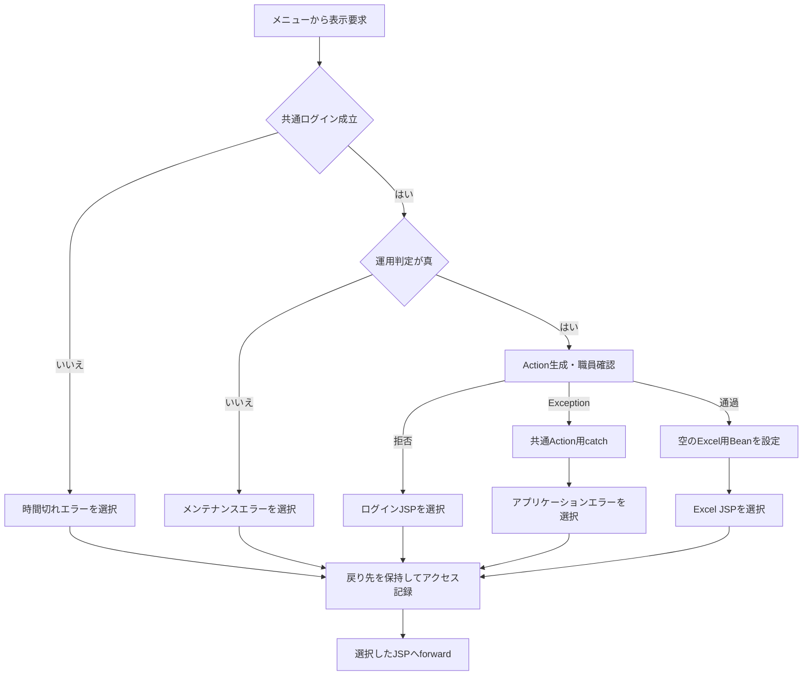

合流点は各枝の戻り先を引き継ぐ。forwardはAction用catchの外側であり、この図の戻り先決定は描画完了を表さない。

#### SQL・テーブル関連（ER図）

空の画面状態を作る処理は業務DBを使用しない。職員情報の自動生成が必要な場合は、共通の職員確認として店名テーブルと職員名簿を別接続で読む。次図は取得値の使用関係であり、二表間のFKやSQL JOINを示すものではない。

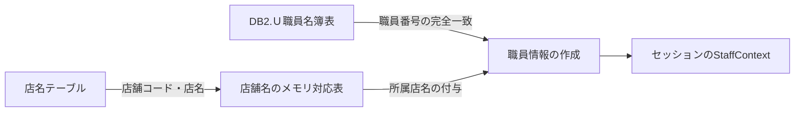

#### DB操作の詳細

職員自動確認では、先に業務DBから店舗コードと店名の一覧を取得する。続いて職員用接続で、`職員番号 = ?` を条件に職員番号・漢字氏名・カナ氏名・所属店番・役職コードを取得する。第1パラメータへ、半角数字1～8桁から整数変換した職員番号を `setInt` で設定する。整数0も照会引数になり得るため、その照会結果は名簿の内容に依存する。

本イベント固有の予約検索・更新はない。職員確認の詳細はCOM-111、共通入口とアクセス記録はCOM-012に対応する。

#### 結果・例外時の扱い

職員確認を通過すると、空のExcel画面を返す。職員確認の拒否はログイン画面、共通ログイン・運用判定の拒否はそれぞれの共通エラーとなる。職員照会の例外は、確認結果が偽である場合とは別に、共通Action用catchへ伝播する。

JSPはセッションの `ViewBean` をExcel用Beanとして参照する。型参照や描画中の例外はAction用catchの対象外であり、Beanの設定と戻り先決定だけでは画面表示完了は確定しない。

### 2. 店番の直接入力

#### 処理概要

利用者は店番を直接編集できる。数字入力補助は適用するが、入力に連動した店舗名照会・店舗名消去・サーバー送信は行わない。

#### 処理手順

**1. ブラウザーの入力補助を適用する。**

　**1.1.** 共通JavaScriptは `data-digits-only` のある店番欄へ、初期バインド時・input時・blur時の正規化を接続する。

　**1.2.** 全角数字を半角へ変換し、非数字を除く。値が変われば入力値を更新し、changeイベントを発火する。編集中の場合は、数字の位置に合わせてキャレットを調整する。

　**1.3.** 編集可能で非空の欄へフォーカスした場合は、入力内容を選択する。

**2. 編集値を親画面内に保持する。**

　**2.1.** 入力だけでは要求を送らず、セッションのBeanも更新しない。

　**2.2.** 店舗名表示は変更しない。店舗選択後に店番だけを変更すると、以前の店舗名が残り得る。出力時は送信された店番から名称を再照会する。

#### 処理フロー

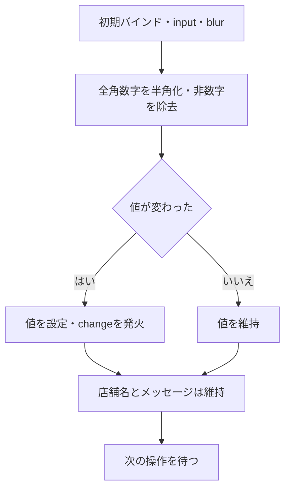

#### SQL・テーブル関連（ER図）

ブラウザー内の入力コントロールと表示テキストだけを扱うため、DBおよびER図は対象外である。

#### DB操作の詳細

店番の編集からSQLを呼ぶ処理はない。検索引数は、後続の出力要求で受信した `BRANCH_NO` をサーバーが変換・検査して決定する。

#### 結果・例外時の扱い

`maxlength=3` と数字入力補助はブラウザー上の制約であり、HTTP受信値の形式をサーバーへ保証しない。候補からプログラムで代入した値や直接要求した値も、出力時の検査対象となる。

入力拒否後の再表示にも初期正規化が適用される。不正文字が除かれても、自動再送やメッセージ消去は行わない。

### 3. 店舗参照の表示・検索・ページ移動・クリア

#### 処理概要

参照ボタンで店舗候補をiframe内に表示する。検索語は店舗コードまたは店舗名の部分一致に使用し、空欄なら全店舗を対象とする。候補は店舗コード順に全件取得した後、メモリ上で20件ずつ切り出す。

#### 処理手順

**1. 店舗参照を起動する。**

　**1.1.** `openLookup` は一時フォームを作り、送信先を `/Action.do`、methodをPOST、文字コードをWindows-31J、targetを `lookupFrame` とする。

　**1.2.** `FUNCTION_ID=nenkin`、`VIEW_ID=Lookup`、`COMMAND_ID=View`、`TARGET=branch`、`POPUP=1` を設定する。親の店番・検索語・ページ番号は渡さない。

　**1.3.** モーダルのhiddenを解除してフォームを送信し、一時フォームを削除する。親の店番・店舗名・メッセージは維持する。

**2. 要求条件を決めて店舗候補を検索する。**

　**2.1.** 共通入口を通過した後、LookupのActionで職員確認を行う。拒否時の戻り先も、この要求の送信先であるiframe内へ返す。

　**2.2.** `KEYWORD` のNULLを空文字へ置換してtrimし、新しい `LookupViewBean` に保持する。`PAGE` は正数へ変換し、欠落・空欄・変換失敗・非正数の場合は1とする。

　**2.3.** `ReferenceDataService.searchBranches` は、検索語をNFKC正規化し、trim、全角空白の半角化、連続する半角空白の集約、大文字化を行う。正規化後が空なら全店舗、非空なら店舗コードの文字列表現または店名の部分一致で検索する。

**3. 表示候補とページ情報を設定する。**

　**3.1.** 店舗コード昇順の全結果から総件数を設定し、要求ページとページサイズ20に基づいて候補を切り出す。

　**3.2.** 切出し後に、ページ番号が総ページ数を超えていれば番号だけを総ページ数へ補正する。補正後の番号で切り直す処理はない。

　**3.3.** Beanをセッションの `SubWindowBean` へ設定し、`Lookup.jsp` を返す。Excel画面の `ViewBean` は置き換えない。

**4. 検索・ページ移動・クリアを受け付ける。**

　**4.1.** 検索は `Lookup/Search` を送信する。再表示フォームのhidden `PAGE` は1である。

　**4.2.** ページ操作は `PAGE` を対象番号へ書き換えて送信する。表示する番号は現在ページの周辺を含む最大7個であり、総ページ数が2以上のときだけページ操作を表示する。

　**4.3.** クリアは子フォームのテキスト入力を空にし、`PAGE=1` で再送する。親の選択済み店番・店舗名は消さない。再要求はいずれも手順2.1の共通入口と職員確認を通る。

#### 処理フロー

参照フロー1は起動と要求判定を示す。検索・ページ移動・クリアの再要求も同じ判定へ入る。

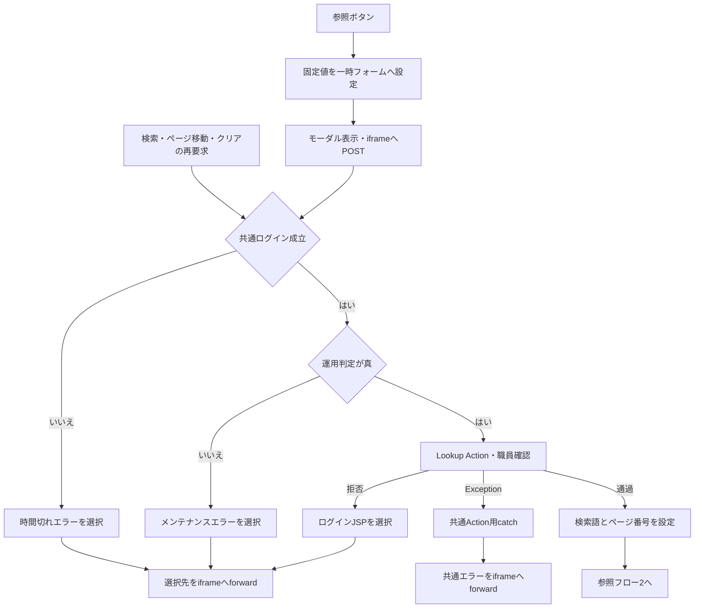

図のforward前には共通アクセス記録がある。forwardそのものはAction用catchの対象外である。

参照フロー2は検索語とページ番号を受け取り、候補とページ情報を返す。

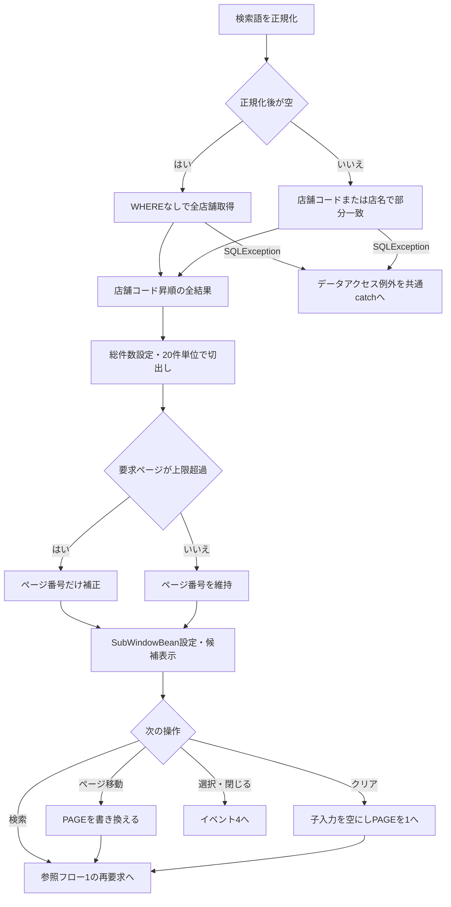

#### SQL・テーブル関連（ER図）

候補検索は `店名テーブル` 一表を使用する。店舗コードを選択キー、店名を表示名称とする。他表とのJOINがないためER図を省略する。

#### DB操作の詳細

正規化後の検索語が空の場合は、次のSQLで全店舗を取得する。

```sql
SELECT 店舗ｺｰﾄﾞ AS BRANCH_NO, 店名 AS BRANCH_NAME
FROM 店名テーブル
ORDER BY 店舗ｺｰﾄﾞ
```

検索語が非空の場合は、次の条件を使用する。

```sql
SELECT 店舗ｺｰﾄﾞ AS BRANCH_NO, 店名 AS BRANCH_NAME
FROM 店名テーブル
WHERE CAST(店舗ｺｰﾄﾞ AS VARCHAR(20)) LIKE ? ESCAPE '\'
   OR UPPER(店名) LIKE UPPER(?) ESCAPE '\'
ORDER BY 店舗ｺｰﾄﾞ
```

| パラメータ順 | 値 | JDBC設定 | 用途 |
| --- | --- | --- | --- |
| 1 | 正規化語をLIKE用にエスケープし、前後に `%` を付けたパターン | `setString(1, pattern)` | 店舗コードを文字列化した値への部分一致 |
| 2 | 第1パラメータと同じパターン | `setString(2, pattern)` | 店名の大文字化した値への部分一致 |

エスケープ対象はバックスラッシュ、`%`、`_`、左右の角括弧である。正規化後空欄のSQLにはパラメータを持たせない。`VARCHAR(20)` は検索時のCAST指定であり、店番の業務桁数や保存列の型ではない。文字列パラメータのサイズ指定はない。

結果の店舗コードは `getInt`、店名は `getString` で読み、`BranchLookupItem` へ移す。店舗コードを1～999に限定する条件、SQLページング、取得件数上限、照会タイムアウト、取消処理の指定はない。

接続は年金業務用DataSourceから取得する。終了時はResultSet、PreparedStatement、Connectionを閉じる。SQLExceptionは `NenkinDataAccessException` へ変換し、close時のExceptionで元の結果や例外を上書きしない。

#### 結果・例外時の扱い

0件では0件中0～0件を表示し、候補行とページ操作を作らない。総ページ数の最小値は1である。0件を理由に親の店番・店舗名を解除する通知は行わない。

通常のページ位置計算で上限超過ページを要求した場合、切出し済みの候補が空のまま、表示ページ番号だけ最終ページへ補正され得る。また、位置計算はintの乗算・加算であり、非常に大きい正数のPAGEに対する算術オーバーフロー防止検査はない。上限補正によって常に最終ページの候補が表示される契約ではない。

候補照会のDB例外は0件へ変換せず、共通Action用catchへ伝播する。JSP描画時の例外は、そのcatchの外で発生する。

### 4. 店舗の選択と参照の終了

#### 処理概要

候補の店番・店名を親画面へ移送し、参照モーダルを閉じる。選択せずに閉じた場合は、親画面の値を維持する。

#### 処理手順

**1. 子画面から通知する。**

　**1.1.** 選択ボタンは行のdata属性を読み、`target=branch`、`branchNo`、`branchName`、`source=nenkin.lookup` を、現在と同じoriginの親へ `postMessage` で送る。

　**1.2.** 子の閉じるボタンは、同じsourceと `target=close` を送る。

**2. 親画面で通知を確認して反映する。**

　**2.1.** 受信originが現在のoriginと等しいこと、dataが存在すること、`data.source` が `nenkin.lookup` であることを確認する。不成立なら通知を無視し、モーダルも閉じない。

　**2.2.** `target=branch` なら `excelBranch.value` と `excelBranchName.textContent` を更新する。通知値が偽相当の場合は空文字を設定する。

　**2.3.** 条件を通過した通知は、branch以外でも `closeLookup` へ進む。モーダルをhiddenにし、iframeのsrcを `about:blank` へ戻す。親のメッセージを消す処理は行わない。

**3. 親側から閉じる。**

　**3.1.** 親の閉じるボタンと背景クリックも `closeLookup` を使う。店番・店舗名は更新しない。

#### 処理フロー

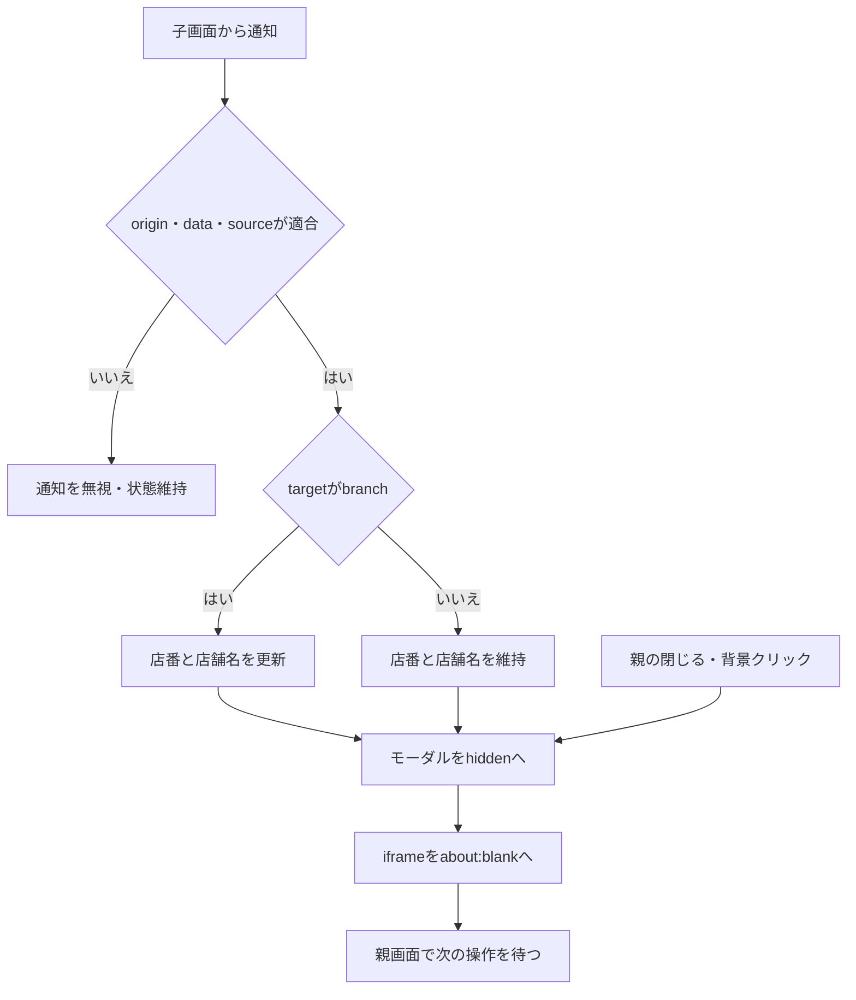

#### SQL・テーブル関連（ER図）

候補取得はイベント3で完了している。本イベントは行のdata属性から親のコントロールへ値を移すブラウザー内処理であり、DBおよびER図は対象外である。

#### DB操作の詳細

選択・終了から再照会、保存、削除は行わない。親の `ViewBean` を更新する要求も送らない。選択した店番は、後続の出力操作で初めてサーバーへ送信する。

#### 結果・例外時の扱い

店舗選択だけではExcel出力を開始しない。候補店番はintの文字列表現で、3桁ゼロ埋めはしない。候補検索にも正数3桁の制限がないため、選択値が出力検査を通過する保証はない。0、負数、4桁以上が候補に存在した場合も、出力時に同じ検査を受ける。

親の通知処理が確認するのはorigin・data・sourceであり、送信元ウィンドウと当該iframeの一致を照合する処理はない。

このモーダルは画面固有の開閉処理を使用する。汎用helper用のdata属性がないため、汎用helperが持つEscape閉鎖、初期フォーカス移動、起動ボタンへのフォーカス復帰、bodyへのモーダル状態設定は本イベントに接続されていない。

### 5. EXCEL出力

#### 処理概要

店番を二段階で検査し、表示用店舗名と出力対象予約を順に照会する。予約0件では画面へ戻り、1件以上では取得順を保った18列の.xlsxを生成して直接応答する。

#### 処理手順

**1. 利用条件と店番を確認する。**

　**1.1.** 共通ログイン・運用判定の後、`ExcelExportAction` の先頭で職員情報を確認する。拒否ならログインJSPを返し、店番処理は行わない。

　**1.2.** 新しい `ExcelViewBean` を作る。`getParameter("BRANCH_NO")` のNULLを空文字に置換してJavaのtrimを適用し、その `String text` をBeanへ保持する。

　**1.3.** `integerOrNull(text)` で整数へ変換し、正数だけを `Integer branch` とする。空文字、変換失敗、整数範囲超過、0以下はNULLとなる。

　**1.4.** textが空、またはbranchがNULLなら「店番を入力してください。」を設定し、今回のBeanをセッションへ置いてExcel JSPを返す。

　**1.5.** 先行検査を通過しても、textの長さが3を超えるか、半角数字の正規表現 `[0-9]+` に一致しなければ「店番は3桁以内の数字で入力してください。」を設定し、同じ方法で戻る。

**2. 店舗名と予約を照会する。**

　**2.1.** 検査済みbranchを `ReferenceDataService.getBranch(int)` へ渡す。該当する先頭行があれば、今回のBeanへ店名を設定する。

　**2.2.** 名称が見つからずNULLが返った場合は、店舗名を空文字のままにして続行する。照会自体の例外では続行せず、共通例外処理へ伝播する。

　**2.3.** 同じ店番を `PensionExcelExportService.buildByBranch(int)` へ渡し、`PensionRepository.listByBranch(int)` から予約を取得する。順序は請求予定日降順、担当者コード、顧客番号である。

**3. 件数に応じて再表示またはファイルを決定する。**

　**3.1.** 予約が空なら、サービスは空のファイル名・空byte配列・`rowCount=0` を返し、Workbookを生成しない。

　**3.2.** Actionは対象なしのメッセージを設定し、trim後店番と、手順2で取得できた店舗名を今回のBeanに保持してセッションへ設定する。その後Excel JSPを返す。

　**3.3.** 予約がある場合は、取得順のまま18列の明細配列を作る。店番を3桁に左0埋めし、生成時の日付を付けてファイル名を決める。

　**3.4.** シート名 `年金ﾃﾞｰﾀ` のWorkbookをメモリ上で生成し、ファイル名・内容配列・明細件数を結果へ格納する。

**4. ダウンロード応答を送る。**

　**4.1.** `writeDownload` はファイル名をUTF-8でURLエンコードした後、応答をresetする。

　**4.2.** Content-Type、attachment形式のContent-Disposition、内容配列長のContent-Lengthを設定し、出力ストリームへwrite・flushする。

　**4.3.** 正常復帰すると文字列 `CSV` を返す。これは共通入口のforward抑止値であり、生成形式は.xlsxである。

　**4.4.** この経路では今回のExcel用Beanをセッションへ設定せず、完了メッセージや画面再表示も返さない。共通アクセス記録は別に行う。

#### 処理フロー

出力フロー1は、要求判定から店番検査までを示す。入力拒否は店舗名照会前であるため、今回のBeanの店舗名は空文字となる。

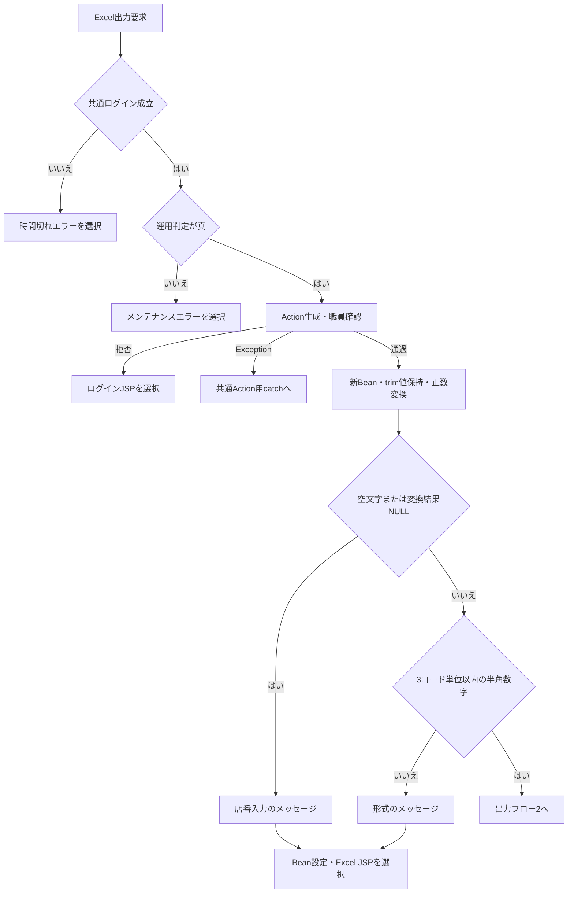

T・M・L・Kは、それぞれの戻り先を保持して共通アクセス記録とforwardへ進む。Xは共通アプリケーションエラーの戻り先を選ぶ。異なる拒否理由を一つの固定結果へまとめない。

出力フロー2は、検査済み店番と今回のBeanを受け取る。名称を得た枝はその値を保持し、名称不在の枝だけが空文字を維持する。

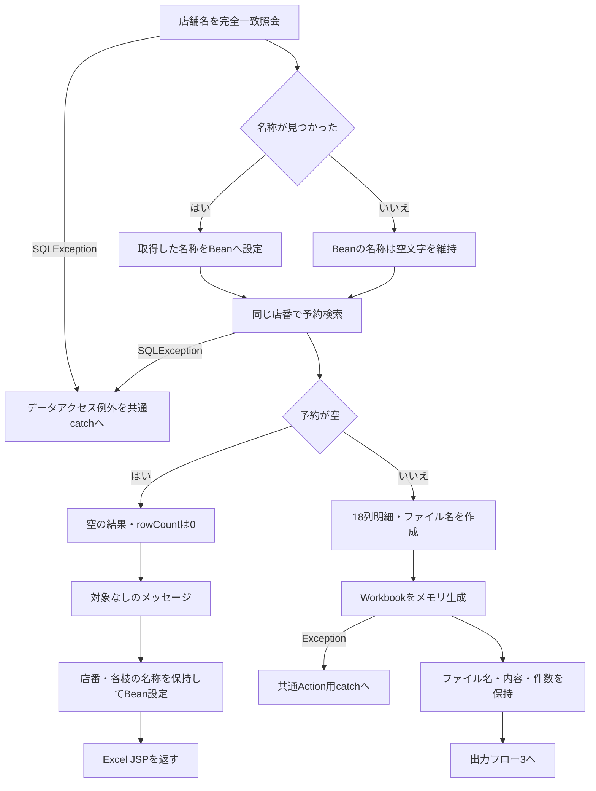

出力フロー3は、対象ありの出力結果を受け取り、HTTP応答を行う。

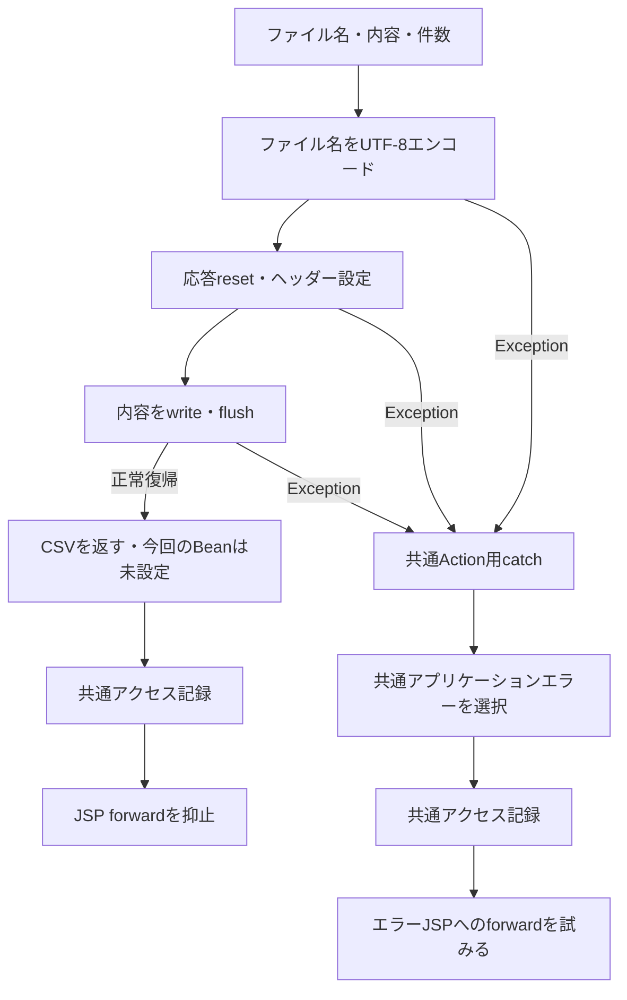

送信途中の失敗では応答が既に確定している場合がある。共通catchによる戻り先設定は、その後のエラーforwardやファイルの完全受領までを保証しない。

#### SQL・テーブル関連（ER図）

店舗名の事前照会は店名テーブル一表を使用する。予約検索は予約本表から五つの名称表をLEFT JOINする。次図はSQL上の関連を示し、FK制約や多重度を定義するものではない。

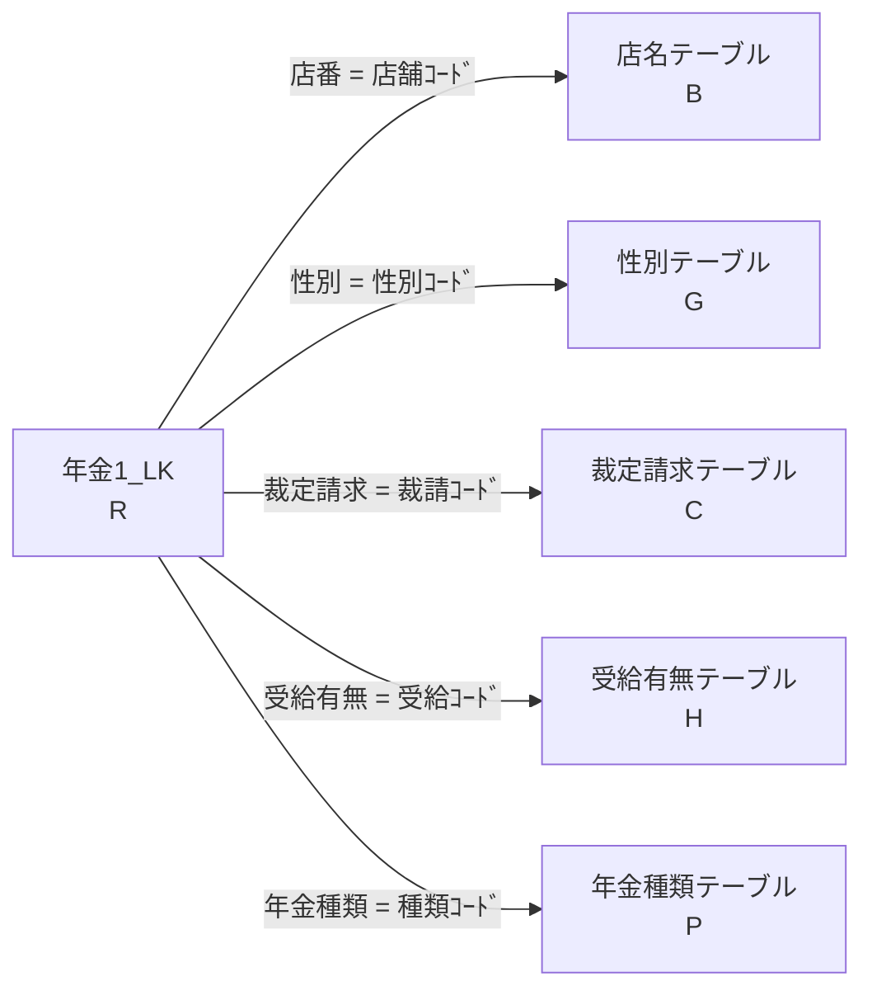

対応する名称行がなくても予約行は残る。名称のNULLはモデルで空文字となり、保存コードを代わりの名称として出力する処理はない。

#### DB操作の詳細

表示用店舗名は次のSQLで取得する。

```sql
SELECT 店舗ｺｰﾄﾞ AS BRANCH_NO, 店名 AS BRANCH_NAME
FROM 店名テーブル
WHERE 店舗ｺｰﾄﾞ = ?
```

予約検索は次のSELECT列・結合・条件・順序を使用する。

```sql
SELECT
    R.店番 AS BRANCH_NO,
    B.店名 AS BRANCH_NAME,
    R.顧客番号 AS CUSTOMER_NO,
    R.担当者コード AS STAFF_CODE,
    R.顧客氏名 AS CUSTOMER_NAME,
    R.ふりがな AS KANA_NAME,
    G.性別 AS GENDER,
    R.住所 AS ADDRESS,
    R.電話番号 AS PHONE_NUMBER,
    R.生年月日 AS BIRTH_DATE,
    C.裁定請求 AS CLAIM_STATUS,
    R.請求予定日 AS CLAIM_SCHEDULED_DATE,
    R.予定年齢 AS PLANNED_AGE,
    R.予約徴求日 AS RESERVATION_REQUEST_DATE,
    R.データ更新日 AS DATA_UPDATE_DATE,
    R.備考 AS NOTES,
    R.配偶者名 AS SPOUSE_NAME,
    H.受給有無 AS HAS_BENEFIT,
    R.配偶者生年月日 AS SPOUSE_BIRTH_DATE,
    P.年金種類 AS PENSION_TYPE,
    R."種類：国民年金" AS NATIONAL_PENSION,
    R."種類：厚生年金" AS EMPLOYEE_PENSION,
    R."種類：共済年金" AS MUTUAL_AID_PENSION,
    R."種類：厚生年金基金" AS EMPLOYEE_PENSION_FUND,
    R."種類：国民年金基金" AS NATIONAL_PENSION_FUND,
    R."６ヶ月先確認" AS SIX_MONTH_CHECK
FROM 年金1_LK R
LEFT JOIN 店名テーブル B ON R.店番 = B.店舗ｺｰﾄﾞ
LEFT JOIN 性別テーブル G ON R.性別 = G.性別ｺｰﾄﾞ
LEFT JOIN 裁定請求テーブル C ON R.裁定請求 = C.裁請ｺｰﾄﾞ
LEFT JOIN 受給有無テーブル H ON R.受給有無 = H.受給ｺｰﾄﾞ
LEFT JOIN 年金種類テーブル P ON R.年金種類 = P.種類ｺｰﾄﾞ
WHERE R.店番 = ?
ORDER BY R.請求予定日 DESC, R.担当者コード, R.顧客番号
```

| 操作 | 引数・バインド | 結果形 | 接続と終了処理 |
| --- | --- | --- | --- |
| 店舗名照会 | 検査済みbranchを第1パラメータへ `setInt` | 最初の行を `BranchLookupItem` にする。0件はNULL | 業務接続を取得し、ResultSet・PreparedStatement・Connectionを閉じる |
| 店舗別予約検索 | 同じ店番を第1パラメータへ `setInt` | 全行を `List<PensionReservation>` にする。0件は空リスト | 店舗名照会とは別に業務接続を取得し、同じ順で閉じる |

この経路でSQL NULLをバインドする処理はなく、文字列サイズ指定もない。予約検索には、ページング、取得件数上限、照会タイムアウト、取消処理の指定がない。

業務用DataSourceは `jdbc/RAROA_DB`、`java:comp/env/jdbc/RAROA_DB` の順に探索し、共有キャッシュへ置く。Connectionは照会ごとに取得する。二つの照会を同一接続・同一時点のトランザクションに固定する処理はない。

店番・顧客番号・担当者コード・予定年齢は `getInt` と `wasNull` により `Integer` またはNULLへ移す。文字列と日付は `getString` からモデルへ渡し、NULLを空文字へ変換する。電話番号には表示用変換を適用する。６ヶ月先確認は `getInt` の結果が0以外なら真となり、SQL NULLもこの読取りでは偽となる。

共通SELECTは、18列の出力項目に加え、店番・店舗名・データ更新日・五つの年金種類フラグを読み込む。これらを追加列として本ファイルへ出力する処理はない。

#### 結果・例外時の扱い

| 条件・発生段階 | 結果 | 保持・確定範囲 |
| --- | --- | --- |
| 欠落・空欄、0以下、整数変換失敗、整数範囲超過 | 「店番を入力してください。」でExcel JSPへ戻る | trim後店番とメッセージを今回のBeanへ設定。店舗名は空文字 |
| 正数変換後に3コード単位超過、または半角数字以外 | 「店番は3桁以内の数字で入力してください。」で戻る | 店舗名照会前に終了し、今回のBeanを設定 |
| 店舗名照会が0件 | 予約検索を継続 | 今回のBeanの店舗名は空文字 |
| 予約検索が0件 | 対象なしのメッセージで戻る | trim後店番と取得済み店舗名を設定。ファイル送信なし |
| 対象ありで送信処理が正常復帰 | .xlsxの直接応答、戻り値は `CSV` | 今回のBeanは未設定。利用者側の保存完了は記録しない |
| 店舗名・予約検索のSQLException | `NenkinDataAccessException` として共通Action用catchへ | 0件へ変換しない。今回のBeanを再表示用に設定する処理もない |
| Workbook生成中のIOException | `IllegalStateException` として共通Action用catchへ | 入力拒否メッセージには変換しない |
| 応答reset・write・flush等のException | 共通Action用catchへ | 応答確定状態によって後続のエラーforward可否が異なる |
| Action後のJSP描画例外 | Action用catchの外で発生 | 戻り先決定だけでは最終表示成功は確定しない |

検査順により、`000`、`-1`、`abc`、整数範囲を超える数値は先行メッセージとなる。正数変換できる `0001` と `+1` は後段の形式メッセージとなる。`001` は通過し、検索引数は整数1となる。

受信文字列全体の長さを先に制限する処理はない。長さ判定はtrim後のJava `String.length()`、すなわちUTF-16コード単位数で行う。ブラウザーのmaxlengthとは別の検査である。

照会処理はfinallyで資源を閉じ、close時のExceptionで元の結果や例外を上書きしない。Actionと出力サービスには、DB・生成・送信の例外を画面内メッセージへ変換する個別catchがない。共通catchは `Exception` を処理するが、前処理・Action後の共通処理・forwardまでを一括して囲むものではなく、各失敗に統一HTTP状態を設定する処理もない。

### 6. メニューへ戻る

#### 処理概要

画面右上または下部の戻るボタンからメニューへ移る。店番が空欄・不正でも、Excel出力の入力検査は呼ばない。

#### 処理手順

**1. 戻り先を設定して送信する。**

　**1.1.** 二つの戻るボタンはいずれも `backMenu` を呼び、`excelView` を `Menu`、`excelCommand` を `View` へ変更する。

　**1.2.** `excelForm` をPOSTする。店番はフォーム内に残って送信されるが、メニュー側は出力条件として使用しない。

**2. メニューの表示状態を作る。**

　**2.1.** 共通入口の後、`MenuViewAction` で職員確認を行う。拒否ならログインJSPを返す。

　**2.2.** 新しい `MenuViewBean` へ職員番号の8桁表示と職員名を設定し、セッションの `ViewBean` を置き換えてメニューJSPを返す。

　**2.3.** 再びExcel画面を開く場合はイベント1へ入り、新しい空のExcel用Beanを設定する。

#### 処理フロー

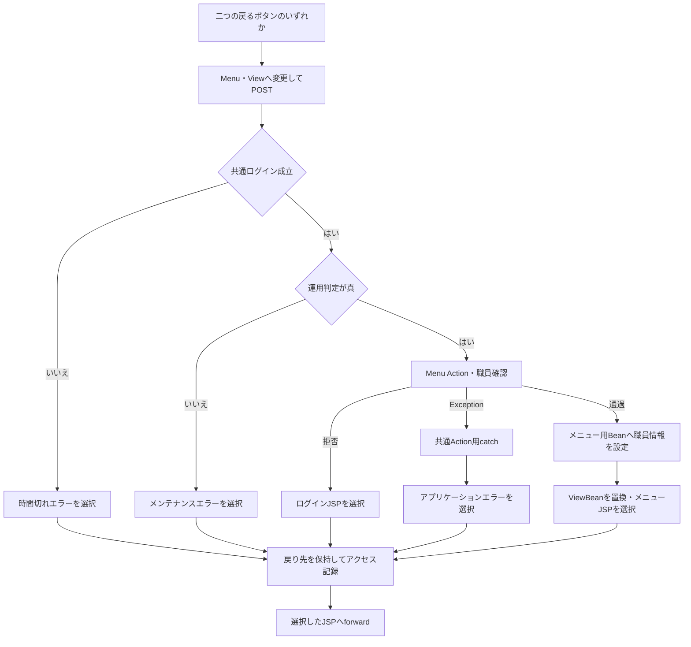

店番の必須・形式検査へ進む枝はない。メニューからExcelを再度開く操作は、新しい初期表示要求となる。

#### SQL・テーブル関連（ER図）

戻る操作固有の予約検索・名称検索はない。職員情報が既にあればセッション値を使う。職員自動確認が必要な場合の参照関係はイベント1と同じであり、本イベント固有のER図は省略する。

#### DB操作の詳細

`MenuViewAction` は受信した `BRANCH_NO` を予約検索・保存へ渡さない。職員自動確認と共通アクセス記録は、それぞれの共通契約に従う。

#### 結果・例外時の扱い

正常時はメニュー用Beanへ置き換えてメニューを表示する。Excelの店番を次回初期値として保存する処理ではない。職員確認拒否、照会例外、共通ログイン・運用判定の拒否、forward時の例外は、初期表示と同じ境界で扱う。

## 補足説明

### 入力・内部値・検索列の対応

| 段階 | 値・型 | 用途・制約 |
| --- | --- | --- |
| ブラウザー入力 | `input#excelBranch` のvalue | maxlengthは3。数字入力補助はブラウザー内での加工 |
| Servlet APIの取得値 | `BRANCH_NO:String` またはNULL | `getParameter` からActionへ渡る受信値 |
| Actionの保持値 | NULL置換・trim後の `text:String` | 入力拒否・0件時の再表示値。長さをUTF-16コード単位で判定 |
| サービス引数 | 正数 `branch:Integer` から取り出す `int` | 店舗名完全一致照会と予約検索の双方へ渡す |
| 店舗名照会列 | `店名テーブル.店舗ｺｰﾄﾞ` | SQL Serverは `INT NOT NULL` のPK、H2は `INTEGER NOT NULL` のPK |
| 予約検索列 | `年金1_LK.店番` | SQL Serverは `INT NULL`、H2はNULLを許す `INTEGER` |
| JDBC設定 | 各SQLの第1パラメータへ `setInt` | 文字列サイズ指定なし。この操作から列への保存は行わない |

Javaのtrimと、候補検索で使用するNFKC正規化・空白集約は別処理である。出力Actionは候補検索と同じ正規化を店番へ適用しない。

店舗名の保存列は、SQL Serverで `NVARCHAR(80) NOT NULL`、H2で `VARCHAR(80) NOT NULL` と宣言される。これはDB容量であり、店舗名を保守するときの業務上限を定めるものではない。予約検索の店舗名はLEFT JOINの結果なので、保存列がNOT NULLでも結合結果はNULLになり得る。

画面の店番必須条件、出力時の1～999、候補検索の店舗コード、予約表のNULL許容は、それぞれ異なる制約である。

### Excel明細の列と値

次の18列を出力する。型・容量は収録DDLの宣言であり、括弧内の型引数を業務上の許容文字数へ置き換えない。予約本表の対象列はすべてNULLを許す。名称マスターの名称列はNOT NULLだが、結合結果はNULLになり得る。

| 列 | ヘッダー | 取得元・モデル項目 | Java値・セル型 | SQL Server／H2の宣言 | 意味・加工 |
| --- | --- | --- | --- | --- | --- |
| A | 顧客番号 | `R.顧客番号` → `customerNo` | `Integer`、非NULLは数値 | 両方 `BIGINT NULL` | 顧客番号。取得は `getInt` であり、BIGINT全範囲をそのまま表現する構造ではない |
| B | 担<br>当 | `R.担当者コード` → `staffCode` | `Integer`、非NULLは数値 | `INT NULL`／`INTEGER` | 担当者コード。2桁表示文字列には変換しない |
| C | 顧客氏名 | `R.顧客氏名` → `customerName` | `String`、文字列 | `NVARCHAR(100) NULL`／`VARCHAR(100)` | 登録された顧客氏名 |
| D | ふりがな | `R.ふりがな` → `kanaName` | `String`、文字列 | `NVARCHAR(100) NULL`／`VARCHAR(100)` | 登録されたふりがな |
| E | 性<br>別 | `G.性別` → `gender` | `String`、文字列 | 名称 `NVARCHAR(10)`／`VARCHAR(10)`、いずれもNOT NULL | `R.性別:TINYINT NULL` に対応する名称。結合不成立は空文字 |
| F | 住所 | `R.住所` → `address` | `String`、文字列 | `NVARCHAR(300) NULL`／`VARCHAR(300)` | 登録された住所 |
| G | 電話番号 | `R.電話番号` → `phoneNumber` | 表示用 `String`、文字列 | 両方 `DECIMAL(15,0) NULL` | 数字抽出と先頭0の整理・補完を行う。ハイフン整形はしない |
| H | 生年月日 | `R.生年月日` → `birthDate` | `getString` の値、文字列 | 両方 `DATE NULL` | 取得文字列を使用し、和暦変換しない |
| I | 年金種類 | `P.年金種類` → `pensionType` | `String`、文字列 | 名称 `NVARCHAR(120)`／`VARCHAR(120)`、いずれもNOT NULL | `R.年金種類:INT/INTEGER NULL` の合成コードに対応する名称 |
| J | 裁定<br>請求 | `C.裁定請求` → `claimStatus` | `String`、文字列 | 名称 `NVARCHAR(10)`／`VARCHAR(10)`、いずれもNOT NULL | `R.裁定請求:TINYINT NULL` に対応する名称 |
| K | 受給<br>有無 | `H.受給有無` → `hasBenefit` | `String`、文字列 | 名称 `NVARCHAR(10)`／`VARCHAR(10)`、いずれもNOT NULL | `R.受給有無:TINYINT NULL` に対応する名称 |
| L | 請求予定日 | `R.請求予定日` → `claimScheduledDate` | `getString` の値、文字列 | 両方 `DATE NULL` | 第一並び順の降順キー。和暦変換しない |
| M | 予定<br>年齢 | `R.予定年齢` → `plannedAge` | `Integer`、非NULLは数値 | `INT NULL`／`INTEGER` | 登録された予定年齢 |
| N | 配偶者名 | `R.配偶者名` → `spouseName` | `String`、文字列 | `NVARCHAR(100) NULL`／`VARCHAR(100)` | 登録された配偶者名 |
| O | 配偶者<br>生年月日 | `R.配偶者生年月日` → `spouseBirthDate` | `getString` の値、文字列 | 両方 `DATE NULL` | 和暦変換しない |
| P | 予約徴求日 | `R.予約徴求日` → `reservationRequestDate` | `getString` の値、文字列 | 両方 `DATE NULL` | 和暦変換しない |
| Q | 備考 | `R.備考` → `notes` | `String`、文字列 | `NVARCHAR(400) NULL`／`VARCHAR(400)` | 取得した備考。出力時に予約入力用の業務検査を再実行しない |
| R | ６ヶ月先<br>確認 | `R.６ヶ月先確認` → `sixMonthCheck` | `boolean` から `String`、文字列 | `BIT NULL`／`BOOLEAN` | 真は「確」。偽と、この読取りでのSQL NULLは空文字 |

数値項目のNULLは0に置き換えず、空の文字列セルとする。文字列のNULLも空文字となる。店番・店舗名・データ更新日と五つの年金種類フラグは読み込むが、この18列には含めない。

電話番号はDBから文字列で読み、数字を抽出して半角数字へ揃える。先頭に連続する0は、一つの数字が残る範囲まで取り除く。その結果が9桁または10桁で先頭が0でなければ、0を一つ補う。全桁0の値を一律に空文字にする処理ではない。

日付列は `getString` の結果を明細へ渡す。店舗別出力ではISO形式への再変換、入力日付検査、Excel日付数値への変換、和暦変換を行わない。モデルのコメントだけから、それらの処理が実行されるとは扱わない。

名称は保存コードからのJOIN結果である。性別・裁定請求・受給有無・年金種類についても、名称列のDB容量と保守時の業務上限を区別する。本画面はこれらの名称を保存・更新しない。

### ファイルとWorkbookの形式

| 項目 | 内容 |
| --- | --- |
| ファイル名 | `年金データ_{店番3桁}_{yyyyMMdd}.xlsx`。数値化した店番を左0埋めする |
| ファイル名の日付 | `DateUtil.todayIso()` からハイフンを除いた生成時の日付。JVM既定タイムゾーンを使用する |
| シート | `年金ﾃﾞｰﾀ` の1シート |
| 行構成 | 1行目が18列のヘッダー、2行目以降が明細。先行タイトル行・結合範囲は渡さない |
| 固定位置 | ヘッダー行を固定し、固定部の下の開始セルは `A2` |
| フィルター | `A1` からR列の最終明細行まで |
| 列幅 | ヘッダーと先頭100件までを調べ、ASCIIを1、それ以外のコードポイントを2として数えた長さに2を加え、5～40へ補正する |
| 印刷 | A4縦、倍率100、水平中央。左右余白0、上下余白0.3937インチ、ヘッダー・フッター余白0.1181インチ |
| 内容生成 | 明細配列、XML、ZIP、完成byte配列をメモリ上で構築する |
| 応答Content-Type | `application/vnd.openxmlformats-officedocument.spreadsheetml.sheet` |
| ダウンロード指定 | `attachment; filename=download` と、UTF-8でURLエンコードした `filename*` を設定する |

列幅は表示上の算定値であり、入力やDB項目の業務上限ではない。文字列セルはinlineStrとして生成し、XMLに使用できない文字を除去して特殊文字をエスケープする。電話番号と日付は文字列セルを維持する。

WorkbookはOpen XML用のXML群をZIPへ格納して作る。この内部構造と、複数ファイルを利用者へまとめて返す.zip形式は別である。本画面の返却物は単独の.xlsxであり、`PensionExcelExportResult` は内容配列を構築時・取得時にcloneする。

### 保持領域と確定境界

| 保持領域 | 内容と使用範囲 |
| --- | --- |
| 親画面のDOM | 直接入力・候補選択後の店番と店舗名、既存メッセージ、モーダルの表示状態。編集だけではサーバーへ同期しない |
| セッションの `ViewBean` | 初期表示・入力拒否・予約0件でExcel用Beanを設定する。戻るとメニュー用Beanへ置換する |
| セッションの `SubWindowBean` | 店舗参照の条件・ページ・件数・候補。親のBeanとは別の保持領域 |
| 職員セッション | `StaffContext` とCSRF情報。各Actionの職員確認で再利用・生成・除去する |
| 要求内メモリ | 今回のExcel用Bean、予約リスト、明細配列、ファイル名、内容配列。対象ありの正常経路では新Beanをセッションへ設定しない |
| 共有DataSourceキャッシュ | 業務用・職員用の接続取得元。Connectionと照会結果は各処理で取得する |

業務照会には、比較版による検査、出力済み状態の保存、予約の消費処理はない。店舗名照会と予約検索は別接続であり、同一時点のスナップショットを固定する処理ではない。

共通入口はAction後に `DB2.Ｕカウンターシフト` へのアクセス記録を別接続で追加し、commitする。記録失敗時はrollbackを試み、ログへ出力する。この記録は予約の業務更新やファイル受領完了の記録とは異なる。

入力拒否と0件のAction内結果は、Beanの設定とJSP戻り先の決定である。JSPは店番・店舗名・メッセージをエスケープして表示するが、描画は共通Action用catchの外側で行う。ダウンロード経路はwrite・flushの正常復帰までを扱い、利用者側の保存完了を返す仕組みはない。

### 日次・月次出力との関係

店舗別Excelは一店舗の予約本表を対象とし、18列を単一ファイルへ出力する。日次・月次処理は期間・更新者・区分による別の抽出であり、新規17列、変更・削除20列、和暦日付、担当者2桁表示を使用する。

日次・月次にはヘッダー前7行、タイトル等の結合範囲、印刷倍率70または60、複数ファイル時のZIP化がある。削除明細整理を含むこれらの処理は、店舗別Excelの前処理・書式・返却形式には接続されていない。

### 関連文書

以下は文書計画上の対応先であり、生成状態は未確認である。本画面の入力検査、名称不在時の継続、0件再表示、送信の確定境界は本書内にも記載している。

| 文書ID | 対応先 | 関連する責務 |
| --- | --- | --- |
| DET-SCR-015 | [EXCEL出力詳細仕様](../詳細仕様書/詳細仕様書_SCR-015_EXCEL出力.md) | 実コントロール・変数・SQL/JDBC・18列移送の詳細 |
| SCR-016 | [店番参照／担当者参照／顧客参照](基本設計書_SCR-016_店番参照／担当者参照／顧客参照.md) | 三つの参照モードと呼出元別の値移送 |
| SCR-017 | [年金メニュー](基本設計書_SCR-017_年金自動受取予約管理システム.md) | 本画面の起動元と戻り先 |
| SCR-014 | [日次／月次処理](<基本設計書_SCR-014_日次 _ 月次処理.md>) | 期間・区分別出力との責務分担 |
| OUTPUT-NENKIN | [年金帳票・出力ファイル仕様](../共通/帳票一覧.md) | 出力条件・列・ファイル形式の横断整理 |
| COM-150 | [Open XML生成共通仕様](<../共通/共通仕様書_COM-150_外部ライブラリを使わず、単1シートの Open XML (.xlsx) を生成する.md>) | 単一シート生成・セル型・XML処理・印刷設定 |
| API-NENKIN | [年金要求入口・応答契約](../共通/要求処理一覧.md) | 要求識別値と直接応答・forwardの区別 |
| COM-012 | [共通コントロールサーブレット](../共通/共通仕様書_COM-012_共通コントロールサーブレット.md) | 共通判定・Action例外・アクセス記録・forward |
| COM-111 | [年金業務共通処理](../共通/共通仕様書_COM-111_年金業務共通処理.md) | 職員確認・入力変換・ダウンロード応答 |
| COM-151 | [画面共通入力・通信制御](../共通/共通仕様書_COM-151_画面共通入力・通信制御.md) | 数字入力補助・共有CSS・モーダルhelperの接続範囲 |
| DB-OPS | [DB操作仕様書](../共通/DB仕様書/DB操作仕様書.md) | 接続・SQL・JDBC設定・例外・資源解放 |
| DB-PHYSICAL | [テーブル定義書](../共通/DB仕様書/テーブル定義書.md) | 予約・店舗・名称表のDDLと物理属性 |
