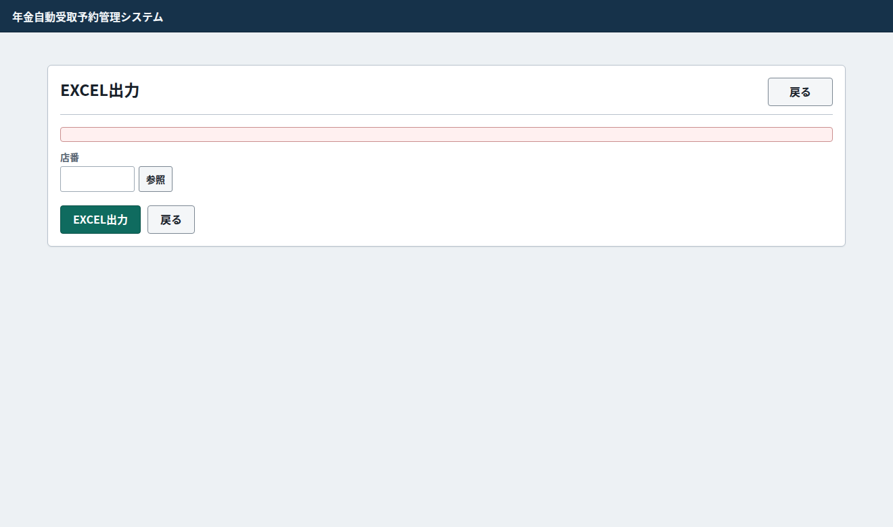
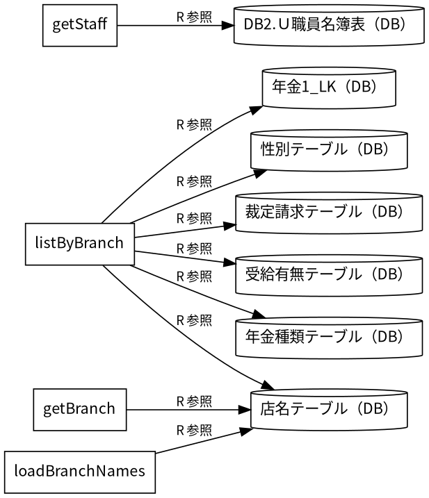
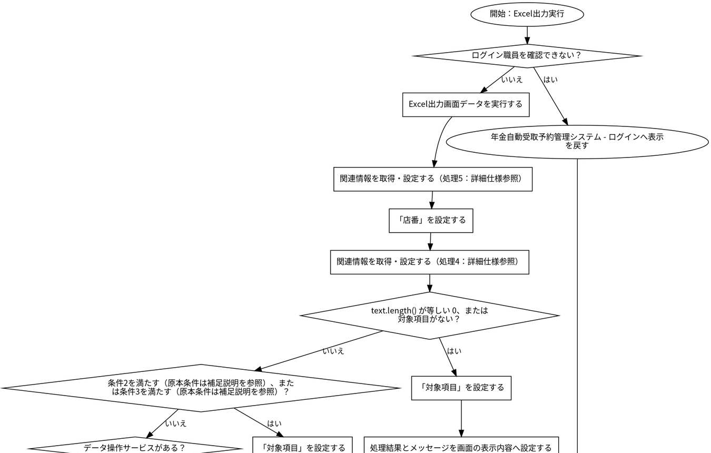
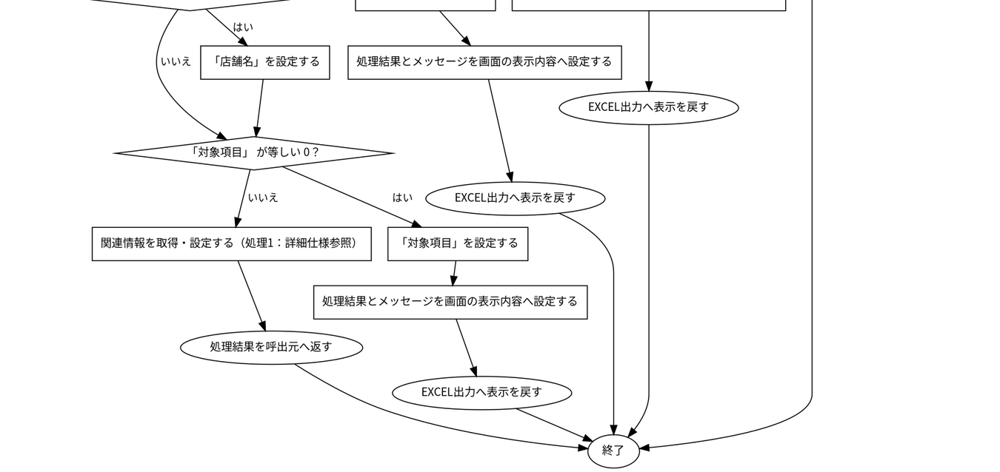
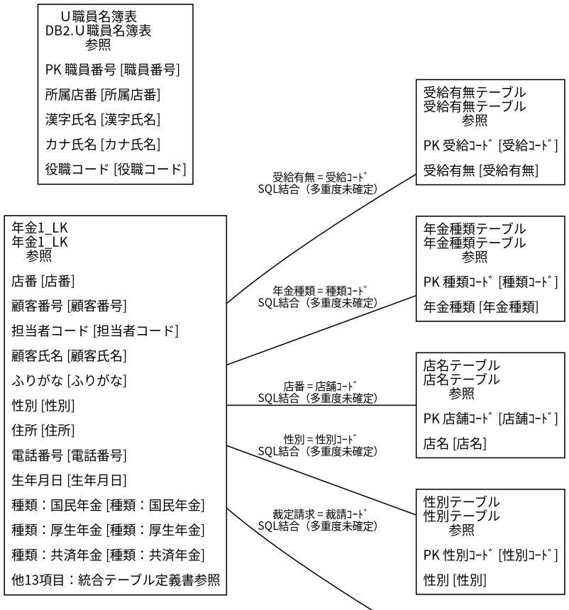
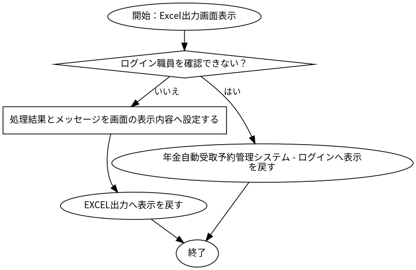

# EXCEL出力

## 表紙

| 項目 | 内容 |
| --- | --- |
| 文書名 | 基本設計書 |
| システム名 |  |
| 機能ID | SCR-015 |
| 画面名 | EXCEL出力 |
| 会社名 |  |
| 作成日 |  |

## 概要

### 概要説明

EXCEL出力の入力・表示・要求処理を行う。

| 情報 | 内容 |
| --- | --- |
| 対象種別 | screen |
| 開始契機 | 呼出元からの要求 |
| 処理対象 | DB2.Ｕ職員名簿表、DB2.ＵＪ科目、N2_SIGHT.Ｂ顧客基本表、NAVI.ＵＪ機能マスタ、NAVI.ＵＪ稼動店舗管理マスタ、NAVI.ＵＭオンラインＯＰマスタ、NAVI.ＵＭパス管理マスタ、NAVI.ＵＭ機能マスタ、NAVI.ＵＳパス管理ステータス、受給有無テーブル、年金1_LK、年金種類テーブル、年金＿削除明細、店名テーブル、性別テーブル、職員情報等（セッション）、裁定請求テーブル |

### 画面レイアウト

原本HTML・CSSの静的再構成。実行時の表示条件・値は未実行（仮定 Q-8E46E78B23）。

### データ操作関連図

## 項目一覧

| No | グループ | 項目名 | 種類 | 入出力 | DB連携項目 | 候補取得元 | 必須 | 形式・桁 | 説明 |
| --- | --- | --- | --- | --- | --- | --- | --- | --- | --- |
| 1 | 見出し・説明 | EXCEL出力 | Label | O | ‐ | ‐ | ‐ | ‐ | EXCEL出力を表示する。 |
| 2 | 画面操作 | 戻る | Button | ‐ | ‐ | ‐ | ‐ | ‐ | 「戻る」の操作を受け付ける。業務結果はイベント仕様で確認する。 |
| 3 | 入力・選択項目 | 店番 | TextBox | I | 表示：年金1_LK・店番 | ‐ | 任意（仮定 Q-1924B1A1E7） | 最大3文字 | 店番を入力・選択する。 DB対応の経由・加工は項目別DB連携備考を参照。 |
| 4 | 画面操作 | 参照 | Button | ‐ | ‐ | ‐ | ‐ | ‐ | 「参照」の操作を受け付ける。業務結果はイベント仕様で確認する。 |
| 5 | 画面操作 | EXCEL出力 | Button | ‐ | ‐ | ‐ | ‐ | ‐ | 「EXCEL出力」の操作を受け付ける。業務結果はイベント仕様で確認する。 |
| 6 | 画面操作 | 戻る | Button | ‐ | ‐ | ‐ | ‐ | ‐ | 「戻る」の操作を受け付ける。業務結果はイベント仕様で確認する。 |
| 7 | 見出し・説明 | 店番参照 | Label | O | ‐ | ‐ | ‐ | ‐ | 店番参照を表示する。 |
| 8 | 画面操作 | 閉じる | Button | ‐ | ‐ | ‐ | ‐ | ‐ | 「閉じる」の操作を受け付ける。業務結果はイベント仕様で確認する。 |

項目定義数：8項目。表示順と反復行の定義数を区別する。

## イベント仕様

### Excel出力実行

#### 処理概要

EXCEL出力で「Excel出力実行」の要求を受け付ける。入力・確認・データ操作・応答の順と、条件が成立しない場合の処理を以下に示す。

#### 処理手順

1. 「ログイン職員を確認できない」に該当するか確認する。該当する場合に限り、次の分岐内手順を行う。該当しない場合は分岐の後へ進む。

1.1. 条件成立時：年金自動受取予約管理システム - ログインへ表示を戻す。この経路の後続手順は実行しない。

2. Excel出力画面データを実行する。

3. 関連情報を取得・設定する（処理6：詳細仕様参照）。

4. 「店番」を設定する。

5. 関連情報を取得・設定する（処理7：詳細仕様参照）。

6. 「text.length() が等しい 0、または対象項目がない」に該当するか確認する。該当する場合に限り、次の分岐内手順を行う。該当しない場合は分岐の後へ進む。

6.1. 条件成立時：「対象項目」を設定する。

6.2. 条件成立時：処理結果とメッセージを画面の表示内容へ設定する。

6.3. 条件成立時：EXCEL出力へ表示を戻す。この経路の後続手順は実行しない。

7. 「条件8を満たす（原本条件は補足説明を参照）、または条件9を満たす（原本条件は補足説明を参照）」に該当するか確認する。該当する場合に限り、次の分岐内手順を行う。該当しない場合は分岐の後へ進む。

7.1. 条件成立時：「対象項目」を設定する。

7.2. 条件成立時：処理結果とメッセージを画面の表示内容へ設定する。

7.3. 条件成立時：EXCEL出力へ表示を戻す。この経路の後続手順は実行しない。

8. 「データ操作サービスがある」に該当するか確認する。該当する場合に限り、次の分岐内手順を行う。該当しない場合は分岐の後へ進む。

8.1. 条件成立時：「店舗名」を設定する。

9. 「「対象項目」 が等しい 0」に該当するか確認する。該当する場合に限り、次の分岐内手順を行う。該当しない場合は分岐の後へ進む。

9.1. 条件成立時：「対象項目」を設定する。

9.2. 条件成立時：処理結果とメッセージを画面の表示内容へ設定する。

9.3. 条件成立時：EXCEL出力へ表示を戻す。この経路の後続手順は実行しない。

10. 関連情報を取得・設定する（処理10：詳細仕様参照）。

11. 処理結果を呼出元へ返す。この経路の後続手順は実行しない。

#### 処理フロー

入口処理の順序・分岐を示す。呼出先の処理は別単位とし、SQLの対象と実行条件はDB操作の詳細へ記載する。例外線は範囲内で例外が発生した場合の経路で、各命令が必ず例外を送出する意味ではない。

#### SQL・テーブル関連（ER図）

実線はSQLの結合条件。外部キー制約や多重度を断定しない。単独表は独立したエンティティで表す。

#### DB操作の詳細

#### DB操作 SQL-1CC29D9EDFFF

| 情報 | 内容 |
| --- | --- |
| 操作ID | SQL-1CC29D9EDFFF |
| 対象テーブル | 年金1_LK |
| 操作 | 参照 |
| 処理説明 | 対象テーブルの対象データを読み取る。設定項目・対象条件・確定取消は以下の定義に従う。 |
| 設定項目 | 当該SQL式の列指定・実行時引数を使用する。組立式と原本のパラメーター設定を参照。 |
| 対象条件 | 抽出・更新対象条件：R.店番 = ? |
| 確定・取消 | 呼出側または接続の設定に従う。当該メソッド単独でのコミット・ロールバック指定はない。 同じ原本に明示トランザクションの呼出元があり、経路別の確定・取消範囲は関連処理で確認する。 |
| 原本 | nenkin/WEB-INF/src/nenkin/service/PensionRepository.java:224 / listByBranch@223 |

#### DB操作 SQL-28470D010AFF

| 情報 | 内容 |
| --- | --- |
| 操作ID | SQL-28470D010AFF |
| 対象テーブル | 店名テーブル |
| 操作 | 参照 |
| 処理説明 | 対象テーブルの対象データを読み取る。設定項目・対象条件・確定取消は以下の定義に従う。 |
| 設定項目 | 当該SQL式の列指定・実行時引数を使用する。組立式と原本のパラメーター設定を参照。 |
| 対象条件 | 抽出・更新対象条件：R.店番 = ? |
| 確定・取消 | 呼出側または接続の設定に従う。当該メソッド単独でのコミット・ロールバック指定はない。 同じ原本に明示トランザクションの呼出元があり、経路別の確定・取消範囲は関連処理で確認する。 |
| 原本 | nenkin/WEB-INF/src/nenkin/service/PensionRepository.java:224 / listByBranch@223 |

#### DB操作 SQL-0F5F7D3D4469

| 情報 | 内容 |
| --- | --- |
| 操作ID | SQL-0F5F7D3D4469 |
| 対象テーブル | 性別テーブル |
| 操作 | 参照 |
| 処理説明 | 対象テーブルの対象データを読み取る。設定項目・対象条件・確定取消は以下の定義に従う。 |
| 設定項目 | 当該SQL式の列指定・実行時引数を使用する。組立式と原本のパラメーター設定を参照。 |
| 対象条件 | 抽出・更新対象条件：R.店番 = ? |
| 確定・取消 | 呼出側または接続の設定に従う。当該メソッド単独でのコミット・ロールバック指定はない。 同じ原本に明示トランザクションの呼出元があり、経路別の確定・取消範囲は関連処理で確認する。 |
| 原本 | nenkin/WEB-INF/src/nenkin/service/PensionRepository.java:224 / listByBranch@223 |

#### DB操作 SQL-0E90141F3DE0

| 情報 | 内容 |
| --- | --- |
| 操作ID | SQL-0E90141F3DE0 |
| 対象テーブル | 裁定請求テーブル |
| 操作 | 参照 |
| 処理説明 | 対象テーブルの対象データを読み取る。設定項目・対象条件・確定取消は以下の定義に従う。 |
| 設定項目 | 当該SQL式の列指定・実行時引数を使用する。組立式と原本のパラメーター設定を参照。 |
| 対象条件 | 抽出・更新対象条件：R.店番 = ? |
| 確定・取消 | 呼出側または接続の設定に従う。当該メソッド単独でのコミット・ロールバック指定はない。 同じ原本に明示トランザクションの呼出元があり、経路別の確定・取消範囲は関連処理で確認する。 |
| 原本 | nenkin/WEB-INF/src/nenkin/service/PensionRepository.java:224 / listByBranch@223 |

#### DB操作 SQL-6597FFB0C483

| 情報 | 内容 |
| --- | --- |
| 操作ID | SQL-6597FFB0C483 |
| 対象テーブル | 受給有無テーブル |
| 操作 | 参照 |
| 処理説明 | 対象テーブルの対象データを読み取る。設定項目・対象条件・確定取消は以下の定義に従う。 |
| 設定項目 | 当該SQL式の列指定・実行時引数を使用する。組立式と原本のパラメーター設定を参照。 |
| 対象条件 | 抽出・更新対象条件：R.店番 = ? |
| 確定・取消 | 呼出側または接続の設定に従う。当該メソッド単独でのコミット・ロールバック指定はない。 同じ原本に明示トランザクションの呼出元があり、経路別の確定・取消範囲は関連処理で確認する。 |
| 原本 | nenkin/WEB-INF/src/nenkin/service/PensionRepository.java:224 / listByBranch@223 |

#### DB操作 SQL-87035C2BB1E0

| 情報 | 内容 |
| --- | --- |
| 操作ID | SQL-87035C2BB1E0 |
| 対象テーブル | 年金種類テーブル |
| 操作 | 参照 |
| 処理説明 | 対象テーブルの対象データを読み取る。設定項目・対象条件・確定取消は以下の定義に従う。 |
| 設定項目 | 当該SQL式の列指定・実行時引数を使用する。組立式と原本のパラメーター設定を参照。 |
| 対象条件 | 抽出・更新対象条件：R.店番 = ? |
| 確定・取消 | 呼出側または接続の設定に従う。当該メソッド単独でのコミット・ロールバック指定はない。 同じ原本に明示トランザクションの呼出元があり、経路別の確定・取消範囲は関連処理で確認する。 |
| 原本 | nenkin/WEB-INF/src/nenkin/service/PensionRepository.java:224 / listByBranch@223 |

#### DB操作 SQL-2CF7CA976867

| 情報 | 内容 |
| --- | --- |
| 操作ID | SQL-2CF7CA976867 |
| 対象テーブル | 店名テーブル |
| 操作 | 参照 |
| 処理説明 | 対象テーブルの対象データを読み取る。設定項目・対象条件・確定取消は以下の定義に従う。 |
| 設定項目 | 当該SQL式の列指定・実行時引数を使用する。組立式と原本のパラメーター設定を参照。 |
| 対象条件 | 抽出・更新対象条件：店舗ｺｰﾄﾞ = ? |
| 確定・取消 | 呼出側または接続の設定に従う。当該メソッド単独でのコミット・ロールバック指定はない。 |
| 原本 | nenkin/WEB-INF/src/nenkin/service/ReferenceDataService.java:185 / getBranch@184 |

#### DB操作 SQL-D9F3500B923D

| 情報 | 内容 |
| --- | --- |
| 操作ID | SQL-D9F3500B923D |
| 対象テーブル | DB2.Ｕ職員名簿表 |
| 操作 | 参照 |
| 処理説明 | 対象テーブルの対象データを読み取る。設定項目・対象条件・確定取消は以下の定義に従う。 |
| 設定項目 | 当該SQL式の列指定・実行時引数を使用する。組立式と原本のパラメーター設定を参照。 |
| 対象条件 | 抽出・更新対象条件：S.職員番号 = ? |
| 確定・取消 | 呼出側または接続の設定に従う。当該メソッド単独でのコミット・ロールバック指定はない。 |
| 原本 | nenkin/WEB-INF/src/nenkin/service/ReferenceDataService.java:207 / getStaff@206 |

#### DB操作 SQL-E0FD738666D8

| 情報 | 内容 |
| --- | --- |
| 操作ID | SQL-E0FD738666D8 |
| 対象テーブル | 店名テーブル |
| 操作 | 参照 |
| 処理説明 | 対象テーブルの対象データを読み取る。設定項目・対象条件・確定取消は以下の定義に従う。 |
| 設定項目 | 当該SQL式の列指定・実行時引数を使用する。組立式と原本のパラメーター設定を参照。 |
| 対象条件 | WHERE句による限定はこのSQL式にない。呼出条件・動的付加条件は原本を参照する。 |
| 確定・取消 | 呼出側または接続の設定に従う。当該メソッド単独でのコミット・ロールバック指定はない。 |
| 原本 | nenkin/WEB-INF/src/nenkin/service/ReferenceDataService.java:291 / loadBranchNames@289 |

#### 結果・例外時の扱い

| 到達条件 | 結果 |
| --- | --- |
| ログイン職員を確認できない | 年金自動受取予約管理システム - ログインへ表示を戻す |
| 条件11を満たす（原本条件は補足説明を参照）・text.length() が等しい 0、または対象項目がない | EXCEL出力へ表示を戻す |
| 条件12を満たす（原本条件は補足説明を参照）・NOT (text.length() が等しい 0&#124;&#124;branch が等しい 未設定)・条件13を満たす（原本条件は補足説明を参照）、または条件14を満たす（原本条件は補足説明を参照） | EXCEL出力へ表示を戻す |
| 条件15を満たす（原本条件は補足説明を参照）・NOT (text.length() が等しい 0&#124;&#124;branch が等しい 未設定)・条件16を満たす（原本条件は補足説明を参照）・「対象項目」 が等しい 0 | EXCEL出力へ表示を戻す |
| 条件17を満たす（原本条件は補足説明を参照）・NOT (text.length() が等しい 0&#124;&#124;branch が等しい 未設定)・条件18を満たす（原本条件は補足説明を参照）・NOT (「対象項目」 が等しい 0) | 処理結果を呼出元へ返す |

### Excel出力画面表示

#### 処理概要

EXCEL出力で「Excel出力画面表示」の要求を受け付ける。入力・確認・データ操作・応答の順と、条件が成立しない場合の処理を以下に示す。

#### 処理手順

1. 「ログイン職員を確認できない」に該当するか確認する。該当する場合に限り、次の分岐内手順を行う。該当しない場合は分岐の後へ進む。

1.1. 条件成立時：年金自動受取予約管理システム - ログインへ表示を戻す。この経路の後続手順は実行しない。

2. 処理結果とメッセージを画面の表示内容へ設定する。

3. EXCEL出力へ表示を戻す。この経路の後続手順は実行しない。

#### 処理フロー

入口処理の順序・分岐を示す。呼出先の処理は別単位とし、SQLの対象と実行条件はDB操作の詳細へ記載する。例外線は範囲内で例外が発生した場合の経路で、各命令が必ず例外を送出する意味ではない。

#### SQL・テーブル関連（ER図）

実線はSQLの結合条件。外部キー制約や多重度を断定しない。単独表は独立したエンティティで表す。

#### DB操作の詳細

#### DB操作 SQL-D9F3500B923D

| 情報 | 内容 |
| --- | --- |
| 操作ID | SQL-D9F3500B923D |
| 対象テーブル | DB2.Ｕ職員名簿表 |
| 操作 | 参照 |
| 処理説明 | 対象テーブルの対象データを読み取る。設定項目・対象条件・確定取消は以下の定義に従う。 |
| 設定項目 | 当該SQL式の列指定・実行時引数を使用する。組立式と原本のパラメーター設定を参照。 |
| 対象条件 | 抽出・更新対象条件：S.職員番号 = ? |
| 確定・取消 | 呼出側または接続の設定に従う。当該メソッド単独でのコミット・ロールバック指定はない。 |
| 原本 | nenkin/WEB-INF/src/nenkin/service/ReferenceDataService.java:207 / getStaff@206 |

#### DB操作 SQL-E0FD738666D8

| 情報 | 内容 |
| --- | --- |
| 操作ID | SQL-E0FD738666D8 |
| 対象テーブル | 店名テーブル |
| 操作 | 参照 |
| 処理説明 | 対象テーブルの対象データを読み取る。設定項目・対象条件・確定取消は以下の定義に従う。 |
| 設定項目 | 当該SQL式の列指定・実行時引数を使用する。組立式と原本のパラメーター設定を参照。 |
| 対象条件 | WHERE句による限定はこのSQL式にない。呼出条件・動的付加条件は原本を参照する。 |
| 確定・取消 | 呼出側または接続の設定に従う。当該メソッド単独でのコミット・ロールバック指定はない。 |
| 原本 | nenkin/WEB-INF/src/nenkin/service/ReferenceDataService.java:291 / loadBranchNames@289 |

#### 結果・例外時の扱い

| 到達条件 | 結果 |
| --- | --- |
| ログイン職員を確認できない | 年金自動受取予約管理システム - ログインへ表示を戻す |
| 条件1を満たす（原本条件は補足説明を参照） | EXCEL出力へ表示を戻す |

### DB関連処理

## 補足説明

### 適用条件

各仮定のQA番号を確認する。静的に確認できた操作・条件を適用する。

### 項目別DB連携備考

表示元と保存先は別方向の対応。DBから読み出した既存データの履歴保存は、画面入力の直接バインド先と区別する。同じ列の複数経路はイベントの実行条件に従う。

| No | 項目名 | 備考 |
| --- | --- | --- |
| 3 | 店番 | 表示元：年金1_LK.店番。経由：BRANCH_NO → PensionReservation.branchNo。加工・変換式：nullableInteger(results, "BRANCH_NO")。処理：listByBranch@223。 |

### 処理・条件の原本対応

文書内の条件番号・処理番号は次の原本表記に対応する。完全な業務用語への置換を行っていない箇所はQA・reportで確認する。

| イベント | 参照番号 | 原本条件・処理 |
| --- | --- | --- |
| Excel出力実行 | 処理1 | writeDownload(response,result.getFileName(),CONTENT_TYPE,result.getContent()) |
| Excel出力実行 | 条件2 | text.length()&gt;3 |
| Excel出力実行 | 条件3 | !text.matches("[0-9]+") |
| Excel出力実行 | 処理4 | Integer branch=integerOrNull(text) |
| Excel出力実行 | 処理5 | String text=trim(request.getParameter("BRANCH_NO")) |
| Excel出力実行 | 処理6 | String text=trim(request.getParameter("BRANCH_NO")) |
| Excel出力実行 | 処理7 | Integer branch=integerOrNull(text) |
| Excel出力実行 | 条件8 | text.length()&gt;3 |
| Excel出力実行 | 条件9 | !text.matches("[0-9]+") |
| Excel出力実行 | 処理10 | writeDownload(response,result.getFileName(),CONTENT_TYPE,result.getContent()) |
| Excel出力実行 | 条件11 | NOT (!requireStaff(request)) |
| Excel出力実行 | 条件12 | NOT (!requireStaff(request)) |
| Excel出力実行 | 条件13 | text.length()&gt;3 |
| Excel出力実行 | 条件14 | !text.matches("[0-9]+") |
| Excel出力実行 | 条件15 | NOT (!requireStaff(request)) |
| Excel出力実行 | 条件16 | NOT (text.length()&gt;3&#124;&#124;!text.matches("[0-9]+")) |
| Excel出力実行 | 条件17 | NOT (!requireStaff(request)) |
| Excel出力実行 | 条件18 | NOT (text.length()&gt;3&#124;&#124;!text.matches("[0-9]+")) |
| Excel出力画面表示 | 条件1 | NOT (!requireStaff(request)) |

