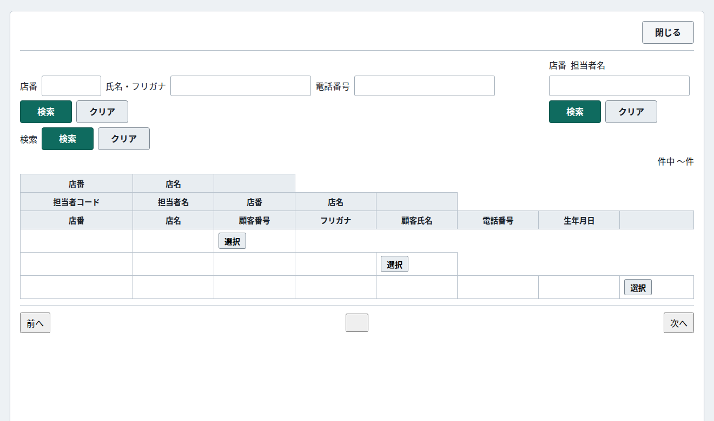
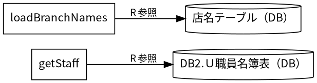
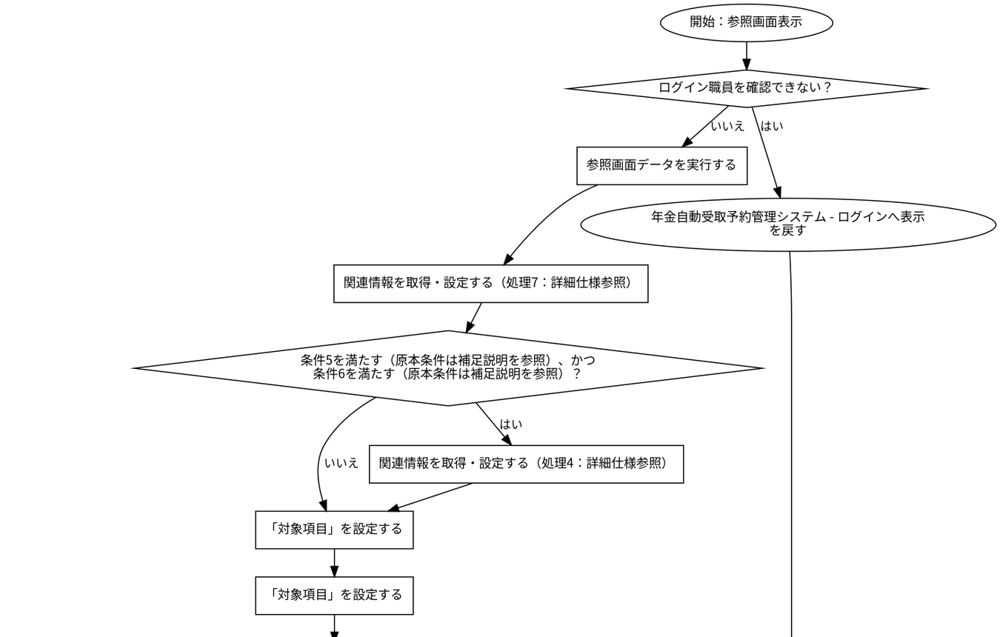
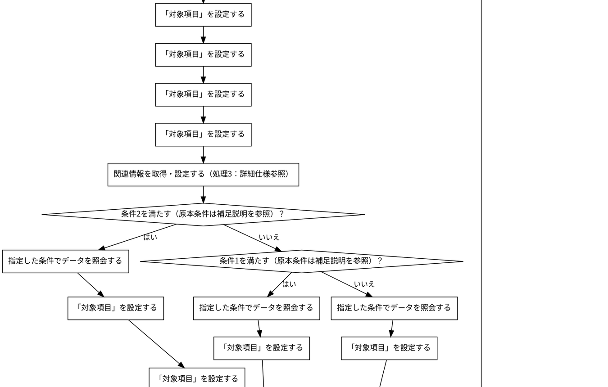
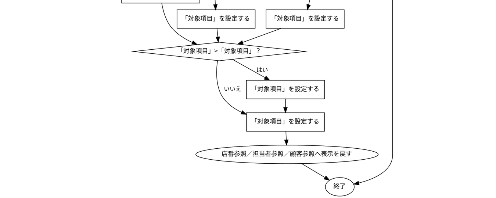

# 店番参照／担当者参照／顧客参照

## 表紙

| 項目 | 内容 |
| --- | --- |
| 文書名 | 基本設計書 |
| システム名 |  |
| 機能ID | SCR-016 |
| 画面名 | 店番参照／担当者参照／顧客参照 |
| 会社名 |  |
| 作成日 |  |

## 概要

### 概要説明

店番参照／担当者参照／顧客参照の入力・表示・要求処理を行う。

| 情報 | 内容 |
| --- | --- |
| 対象種別 | screen |
| 開始契機 | 呼出元からの要求 |
| 処理対象 | DB2.Ｕ職員名簿表、DB2.ＵＪ科目、N2_SIGHT.Ｂ顧客基本表、NAVI.ＵＪ機能マスタ、NAVI.ＵＪ稼動店舗管理マスタ、NAVI.ＵＭオンラインＯＰマスタ、NAVI.ＵＭパス管理マスタ、NAVI.ＵＭ機能マスタ、NAVI.ＵＳパス管理ステータス、受給有無テーブル、年金1_LK、年金種類テーブル、年金＿削除明細、店名テーブル、性別テーブル、職員情報等（セッション）、裁定請求テーブル |

### 画面レイアウト

原本HTML・CSSの静的再構成。実行時の表示条件・値は未実行（仮定 Q-63C448F854）。

### データ操作関連図

## 項目一覧

| No | グループ | 項目名 | 種類 | 入出力 | DB連携項目 | 候補取得元 | 必須 | 形式・桁 | 説明 |
| --- | --- | --- | --- | --- | --- | --- | --- | --- | --- |
| 1 | 見出し・説明 | 店番参照／担当者参照／顧客参照 | Label | O | ‐ | ‐ | ‐ | ‐ | 店番参照／担当者参照／顧客参照を表示する。 |
| 2 | 画面操作 | 閉じる | Button | ‐ | ‐ | ‐ | ‐ | ‐ | 「閉じる」の操作を受け付ける。業務結果はイベント仕様で確認する。 |
| 3 | 入力・選択項目 | 店番 | TextBox | I | DB項目未確定（仮定 Q-D77A6E9882） | ‐ | 任意（仮定 Q-17F75916B4） | 最大3文字 | 店番を入力・選択する。 |
| 4 | 入力・選択項目 | 氏名・フリガナ | TextBox | I | DB項目未確定（仮定 Q-3A16F48C5B） | ‐ | 任意（仮定 Q-788FD962F9） | 制限指定なし（仮定 Q-13BF5BDF0C） | 氏名・フリガナを入力・選択する。 |
| 5 | 入力・選択項目 | 電話番号 | TextBox | I | DB項目未確定（仮定 Q-ABA1E3BFAF） | ‐ | 任意（仮定 Q-90A0D9000F） | 制限指定なし（仮定 Q-9D6232D933） | 電話番号を入力・選択する。 |
| 6 | 画面操作 | 検索 | Button | ‐ | ‐ | ‐ | ‐ | ‐ | 「検索」の操作を受け付ける。業務結果はイベント仕様で確認する。 |
| 7 | 画面操作 | クリア | Button | ‐ | ‐ | ‐ | ‐ | ‐ | 「クリア」の操作を受け付ける。業務結果はイベント仕様で確認する。 |
| 8 | 入力・選択項目 | 店番 | TextBox | I | DB項目未確定（仮定 Q-55E6C46140） | ‐ | 任意（仮定 Q-A08A48BA91） | 最大3文字 | 店番を入力・選択する。 |
| 9 | 入力・選択項目 | 検索 | TextBox | I | DB項目未確定（仮定 Q-3FE676BDD7） | ‐ | 任意（仮定 Q-EB6B39FCDA） | 制限指定なし（仮定 Q-153BB95FFA） | 検索を入力・選択する。 |
| 10 | 画面操作 | 検索 | Button | ‐ | ‐ | ‐ | ‐ | ‐ | 「検索」の操作を受け付ける。業務結果はイベント仕様で確認する。 |
| 11 | 画面操作 | クリア | Button | ‐ | ‐ | ‐ | ‐ | ‐ | 「クリア」の操作を受け付ける。業務結果はイベント仕様で確認する。 |
| 12 | 入力・選択項目 | 検索 | TextBox | I | DB項目未確定（仮定 Q-99BA642C2A） | ‐ | 任意（仮定 Q-1274FD3A2D） | 制限指定なし（仮定 Q-CEE5EA8507） | 検索を入力・選択する。 |
| 13 | 画面操作 | 検索 | Button | ‐ | ‐ | ‐ | ‐ | ‐ | 「検索」の操作を受け付ける。業務結果はイベント仕様で確認する。 |
| 14 | 画面操作 | クリア | Button | ‐ | ‐ | ‐ | ‐ | ‐ | 「クリア」の操作を受け付ける。業務結果はイベント仕様で確認する。 |
| 15 | 見出し・説明 | 店番 | Label | O | ‐ | ‐ | ‐ | ‐ | 店番を表示する。 |
| 16 | 見出し・説明 | 店名 | Label | O | ‐ | ‐ | ‐ | ‐ | 店名を表示する。 |
| 17 | 見出し・説明 | 担当者コード | Label | O | ‐ | ‐ | ‐ | ‐ | 担当者コードを表示する。 |
| 18 | 見出し・説明 | 担当者名 | Label | O | ‐ | ‐ | ‐ | ‐ | 担当者名を表示する。 |
| 19 | 見出し・説明 | 店番 | Label | O | ‐ | ‐ | ‐ | ‐ | 店番を表示する。 |
| 20 | 見出し・説明 | 店名 | Label | O | ‐ | ‐ | ‐ | ‐ | 店名を表示する。 |
| 21 | 見出し・説明 | 店番 | Label | O | ‐ | ‐ | ‐ | ‐ | 店番を表示する。 |
| 22 | 見出し・説明 | 店名 | Label | O | ‐ | ‐ | ‐ | ‐ | 店名を表示する。 |
| 23 | 見出し・説明 | 顧客番号 | Label | O | ‐ | ‐ | ‐ | ‐ | 顧客番号を表示する。 |
| 24 | 見出し・説明 | フリガナ | Label | O | ‐ | ‐ | ‐ | ‐ | フリガナを表示する。 |
| 25 | 見出し・説明 | 顧客氏名 | Label | O | ‐ | ‐ | ‐ | ‐ | 顧客氏名を表示する。 |
| 26 | 見出し・説明 | 電話番号 | Label | O | ‐ | ‐ | ‐ | ‐ | 電話番号を表示する。 |
| 27 | 見出し・説明 | 生年月日 | Label | O | ‐ | ‐ | ‐ | ‐ | 生年月日を表示する。 |
| 28 | 画面操作 | 選択 | Button | ‐ | ‐ | ‐ | ‐ | ‐ | 「選択」の操作を受け付ける。業務結果はイベント仕様で確認する。 |
| 29 | 画面操作 | 選択 | Button | ‐ | ‐ | ‐ | ‐ | ‐ | 「選択」の操作を受け付ける。業務結果はイベント仕様で確認する。 |
| 30 | 画面操作 | 選択 | Button | ‐ | ‐ | ‐ | ‐ | ‐ | 「選択」の操作を受け付ける。業務結果はイベント仕様で確認する。 |
| 31 | 画面操作 | 前へ | Button | ‐ | ‐ | ‐ | ‐ | ‐ | 「前へ」の操作を受け付ける。業務結果はイベント仕様で確認する。 |
| 32 | 画面操作 | ページ番号選択 | Button | ‐ | ‐ | ‐ | ‐ | ‐ | 「ページ番号選択」の操作を受け付ける。業務結果はイベント仕様で確認する。 |
| 33 | 画面操作 | 次へ | Button | ‐ | ‐ | ‐ | ‐ | ‐ | 「次へ」の操作を受け付ける。業務結果はイベント仕様で確認する。 |

項目定義数：33項目。表示順と反復行の定義数を区別する。

## イベント仕様

### 参照画面表示

#### 処理概要

店番参照／担当者参照／顧客参照で「参照画面表示」の要求を受け付ける。入力・確認・データ操作・応答の順と、条件が成立しない場合の処理を以下に示す。

#### 処理手順

1. 「ログイン職員を確認できない」に該当するか確認する。該当する場合に限り、次の分岐内手順を行う。該当しない場合は分岐の後へ進む。

1.1. 条件成立時：年金自動受取予約管理システム - ログインへ表示を戻す。この経路の後続手順は実行しない。

2. 参照画面データを実行する。

3. 関連情報を取得・設定する（処理8：詳細仕様参照）。

4. 「条件9を満たす（原本条件は補足説明を参照）、かつ条件10を満たす（原本条件は補足説明を参照）」に該当するか確認する。該当する場合に限り、次の分岐内手順を行う。該当しない場合は分岐の後へ進む。

4.1. 条件成立時：関連情報を取得・設定する（処理11：詳細仕様参照）。

5. 「対象項目」を設定する。

6. 「対象項目」を設定する。

7. 「対象項目」を設定する。

8. 「対象項目」を設定する。

9. 「対象項目」を設定する。

10. 「対象項目」を設定する。

11. 関連情報を取得・設定する（処理12：詳細仕様参照）。

12. 「条件13を満たす（原本条件は補足説明を参照）」に該当するか確認する。成立時と不成立時の手順を分けて行う。

12.1. 条件成立時：指定した条件でデータを照会する。

12.2. 条件成立時：「対象項目」を設定する。

12.3. 条件成立時：「対象項目」を設定する。

12-別.1. 条件不成立時：「条件14を満たす（原本条件は補足説明を参照）」に該当するか確認する。成立時と不成立時の手順を分けて行う。

12-別.1.1. 条件成立時：指定した条件でデータを照会する。

12-別.1.2. 条件成立時：「対象項目」を設定する。

12-別.1.3. 条件成立時：「対象項目」を設定する。

12-別.1-別.1. 条件不成立時：指定した条件でデータを照会する。

12-別.1-別.2. 条件不成立時：「対象項目」を設定する。

12-別.1-別.3. 条件不成立時：「対象項目」を設定する。

13. 「「対象項目」&gt;「対象項目」」に該当するか確認する。該当する場合に限り、次の分岐内手順を行う。該当しない場合は分岐の後へ進む。

13.1. 条件成立時：「対象項目」を設定する。

14. 「対象項目」を設定する。

15. 店番参照／担当者参照／顧客参照へ表示を戻す。この経路の後続手順は実行しない。

#### 処理フロー

入口処理の順序・分岐を示す。呼出先の処理は別単位とし、SQLの対象と実行条件はDB操作の詳細へ記載する。例外線は範囲内で例外が発生した場合の経路で、各命令が必ず例外を送出する意味ではない。

#### SQL・テーブル関連（ER図）

実線はSQLの結合条件。外部キー制約や多重度を断定しない。単独表は独立したエンティティで表す。

#### DB操作の詳細

#### DB操作 SQL-D9F3500B923D

| 情報 | 内容 |
| --- | --- |
| 操作ID | SQL-D9F3500B923D |
| 対象テーブル | DB2.Ｕ職員名簿表 |
| 操作 | 参照 |
| 処理説明 | 対象テーブルの対象データを読み取る。設定項目・対象条件・確定取消は以下の定義に従う。 |
| 設定項目 | 当該SQL式の列指定・実行時引数を使用する。組立式と原本のパラメーター設定を参照。 |
| 対象条件 | 抽出・更新対象条件：S.職員番号 = ? |
| 確定・取消 | 呼出側または接続の設定に従う。当該メソッド単独でのコミット・ロールバック指定はない。 |
| 原本 | nenkin/WEB-INF/src/nenkin/service/ReferenceDataService.java:207 / getStaff@206 |

#### DB操作 SQL-E0FD738666D8

| 情報 | 内容 |
| --- | --- |
| 操作ID | SQL-E0FD738666D8 |
| 対象テーブル | 店名テーブル |
| 操作 | 参照 |
| 処理説明 | 対象テーブルの対象データを読み取る。設定項目・対象条件・確定取消は以下の定義に従う。 |
| 設定項目 | 当該SQL式の列指定・実行時引数を使用する。組立式と原本のパラメーター設定を参照。 |
| 対象条件 | WHERE句による限定はこのSQL式にない。呼出条件・動的付加条件は原本を参照する。 |
| 確定・取消 | 呼出側または接続の設定に従う。当該メソッド単独でのコミット・ロールバック指定はない。 |
| 原本 | nenkin/WEB-INF/src/nenkin/service/ReferenceDataService.java:291 / loadBranchNames@289 |

#### 結果・例外時の扱い

| 到達条件 | 結果 |
| --- | --- |
| ログイン職員を確認できない | 年金自動受取予約管理システム - ログインへ表示を戻す |
| 条件15を満たす（原本条件は補足説明を参照） | 店番参照／担当者参照／顧客参照へ表示を戻す |

### DB関連処理

## 補足説明

### 適用条件

各仮定のQA番号を確認する。静的に確認できた操作・条件を適用する。

### 項目別DB連携備考

表示元と保存先は別方向の対応。DBから読み出した既存データの履歴保存は、画面入力の直接バインド先と区別する。同じ列の複数経路はイベントの実行条件に従う。

| No | 項目名 | 備考 |
| --- | --- | --- |
| 3 | 店番 | DB列への接続を原本から確定できていない。名称が似ている列へ自動接続しない。画面データ連携（仮定 Q-D77A6E9882） |
| 4 | 氏名・フリガナ | DB列への接続を原本から確定できていない。名称が似ている列へ自動接続しない。画面データ連携（仮定 Q-3A16F48C5B） |
| 5 | 電話番号 | DB列への接続を原本から確定できていない。名称が似ている列へ自動接続しない。画面データ連携（仮定 Q-ABA1E3BFAF） |
| 8 | 店番 | DB列への接続を原本から確定できていない。名称が似ている列へ自動接続しない。画面データ連携（仮定 Q-55E6C46140） |
| 9 | 検索 | DB列への接続を原本から確定できていない。名称が似ている列へ自動接続しない。画面データ連携（仮定 Q-3FE676BDD7） |
| 12 | 検索 | DB列への接続を原本から確定できていない。名称が似ている列へ自動接続しない。画面データ連携（仮定 Q-99BA642C2A） |

### 処理・条件の原本対応

文書内の条件番号・処理番号は次の原本表記に対応する。完全な業務用語への置換を行っていない箇所はQA・reportで確認する。

| イベント | 参照番号 | 原本条件・処理 |
| --- | --- | --- |
| 参照画面表示 | 条件1 | "staff".equals(target) |
| 参照画面表示 | 条件2 | "branch".equals(target) |
| 参照画面表示 | 処理3 | Integer branch=integerOrNull(bean.getBranchNo()) |
| 参照画面表示 | 処理4 | target="customer" |
| 参照画面表示 | 条件5 | !"branch".equals(target) |
| 参照画面表示 | 条件6 | !"staff".equals(target) |
| 参照画面表示 | 処理7 | String target=trim(request.getParameter("TARGET")) |
| 参照画面表示 | 処理8 | String target=trim(request.getParameter("TARGET")) |
| 参照画面表示 | 条件9 | !"branch".equals(target) |
| 参照画面表示 | 条件10 | !"staff".equals(target) |
| 参照画面表示 | 処理11 | target="customer" |
| 参照画面表示 | 処理12 | Integer branch=integerOrNull(bean.getBranchNo()) |
| 参照画面表示 | 条件13 | "branch".equals(target) |
| 参照画面表示 | 条件14 | "staff".equals(target) |
| 参照画面表示 | 条件15 | NOT (!requireStaff(request)) |

