<!-- spec-meta: {"schema":"spec-md/1.0","documentId":"SCR-016","version":"2.0","path":"基本設計書/基本設計書_SCR-016_店番参照／担当者参照／顧客参照.md","sheets":[{"heading":"概要","kind":"GRID","sheet":"概要"},{"heading":"項目一覧","kind":"LIST","sheet":"項目一覧","key":["No"]},{"heading":"イベント仕様","kind":"GRID","sheet":"イベント仕様"},{"heading":"補足説明","kind":"GRID","sheet":"補足説明"}]} -->
# 店番参照／担当者参照／顧客参照

| 属性 | 内容 |
| --- | --- |
| 文書種別 | 基本設計書 |
| システム名 | 年金自動受取予約管理システム |
| 機能ID | SCR-016 |
| 版 | 2.0 |
| 解析対象 | Lookup.jsp、参照起動・選択受付を行うPension.jsp／Excel.jsp、接続するAction・参照サービス・予約読込み・共通処理 |
| 基準日 | 2026-10-15 |

## 概要

### 目的と処理範囲

店番、担当者、顧客を一覧から選び、呼出元画面の入力を補助する。三つの参照は同じLookup.jspを使用し、親画面内のモーダルにあるiframeへ表示する。検索条件の変更、検索条件のクリア、20件単位のページ移動、行の選択、参照を閉じる操作を提供する。

店番・担当者の選択は親画面のコード入力と名称表示を変更する。予約画面で顧客を選択した場合は、その後に予約読込みを要求する。参照行の選択だけでは予約を登録・変更せず、Excelファイルも出力しない。

| モード | TARGET | 取得元 | 検索条件と空欄時の対象 | 一覧の順序 |
| --- | --- | --- | --- | --- |
| 店番参照 | branch | 業務DBの店名テーブル | 検索文字列で店番の文字列表現または店名を部分一致検索する。正規化後に空なら全店舗。BRANCH_NOはこのモードの条件に使用しない。 | 店舗ｺｰﾄﾞ昇順 |
| 担当者参照 | staff | 職員DBのDB2.Ｕ職員名簿表 | 有効な店番で所属店を限定し、担当者名でカナ氏名または漢字氏名を部分一致検索する。店番空欄は全店舗、担当者名空欄は名称を限定しない。両方空なら全職員。 | 職員番号昇順 |
| 顧客参照 | customer | 顧客DBのN2_SIGHT.Ｂ顧客基本表 | 有効な店番、氏名・フリガナ、電話番号の各条件をANDで組み合わせる。空になった条件は省略する。全条件空なら全顧客。顧客番号による検索条件はない。 | 店舗コード、顧客番号、カナ氏名の各昇順 |

担当者・顧客の一覧に表示する店名は、業務DBから別に取得した店名テーブルをメモリ上で突き合わせて補う。職員・顧客検索のSQLで店名テーブルをJOINする構成ではない。店名が見つからなくても対象行は一覧に残る。

### 呼出元と初期条件

| 呼出元の操作 | 開くモード | 初期条件として渡す値 | 呼出し時に保持する親画面の状態 |
| --- | --- | --- | --- |
| 予約画面の店番「参照」 | 店番参照 | 現在の店番もBRANCH_NOとして送るが、店番検索には使用しない。KEYWORDは送らない。 | 親フォームを送信せず、入力値と元キーを保持する。 |
| 予約画面の担当者コード「参照」 | 担当者参照 | 現在の店番。担当者名の初期条件はない。 | 担当者コードを含む親入力を保持する。 |
| 予約画面の顧客番号「参照」 | 顧客参照 | 現在の店番。氏名・フリガナと電話番号は空で送る。入力済み顧客番号は検索条件として送らない。 | 顧客番号を含む親入力を保持する。 |
| 予約画面の電話番号横「候補」 | 顧客参照 | 現在の店番、フリガナをNAME_KEYWORD、電話番号をPHONE_KEYWORDとして送る。 | 親入力を保持したまま顧客基本表の候補を検索する。 |
| Excel画面の店番「参照」 | 店番参照 | 現在のexcelBranchは送らず、検索文字列も送らない。 | 店番入力とその他の親画面状態を保持する。 |

予約画面の「候補」は、内部のcandidate指定をcustomerへ置き換えて顧客参照を開く。年金予約表の候補一覧を表示する操作ではない。

参照を開くたびに新しいLookupViewBeanを作る。以前の参照で指定した条件やページをセッションから復元する処理はない。

### 要求入口と保持領域

| 操作 | 通常の要求 | 識別値 | 正常時の応答 |
| --- | --- | --- | --- |
| 参照起動 | 親画面が一時フォームを作り、Action.doへPOST。送信先はlookupFrame。 | FUNCTION_ID=nenkin、VIEW_ID=Lookup、COMMAND_ID=View、POPUP=1、モード別TARGET | LookupViewActionがLookup.jspへの戻り先を返し、共通処理がforwardする。 |
| 検索・ページ移動・条件クリア | lookupFormからAction.doへPOST | FUNCTION_ID=nenkin、VIEW_ID=Lookup、COMMAND_ID=Search、POPUP=1、TARGET、条件、PAGE | LookupSearchActionを経由して同じ表示処理を行う。 |
| 予約画面での顧客選択後 | 親フォーム全体をAction.doへPOST | FUNCTION_ID=nenkin、VIEW_ID=Pension、COMMAND_ID=Load、親フォームの入力・hidden項目 | 予約優先の再照会後、Pension.jspへforwardする。 |

LookupSearchActionはLookupViewActionを継承し、検索処理を追加していない。参照検索の応答はJSP画面であり、検索結果JSONではない。フォームの送信文字コード指定と共通POST処理の受信文字コード設定はいずれもWindows-31Jである。

参照用のLookupViewBeanはセッションのSubWindowBeanへ設定する。予約・Excel画面用のViewBeanとは別の属性である。参照検索はSubWindowBeanを置き換えるが、親画面のViewBeanを直接書き換えない。POPUPは通常の起動要求に含めるものの、参照Actionの処理分岐には使用しない。

### 画面配置と静的投影

親画面はシステムヘッダーを持ち、その上に参照モーダルを重ねる。予約画面のヘッダーには職員番号・氏名があり、Excel画面にはシステム名がある。参照iframe内にはこの共有ヘッダーを複製しない。iframe内の上段にモード名と「閉じる」、続いて検索条件、件数範囲、結果表、必要な場合だけページ操作を置く。

以下は顧客参照で検索結果が0件の場合の静的投影である。実画面の撮影ではない。実アプリへの送信先はdata属性へ記録し、操作ボタンには実行処理を接続していない。

<!DOCTYPE html>
<html lang="ja">
<head>
<meta charset="UTF-8">
<meta name="viewport" content="width=device-width, initial-scale=1">
<title>顧客参照</title>

</head>
<body class="popup-page">
<main class="app-shell">
<section class="screen surface lookup-screen lookup-screen-popup">

<h1>顧客参照</h1><button class="access-button secondary narrow" type="button">閉じる</button>

<form id="lookupForm" class="lookup-filter" accept-charset="Windows-31J" data-source-action="Action.do" data-source-method="POST">
<input type="hidden" name="FUNCTION_ID" value="nenkin"><input type="hidden" name="VIEW_ID" value="Lookup"><input type="hidden" name="COMMAND_ID" value="Search"><input type="hidden" name="TARGET" value="customer"><input id="lookupPage" type="hidden" name="PAGE" value="1"><input type="hidden" name="POPUP" value="1">

<label for="lookupBranch">店番</label><input id="lookupBranch" name="BRANCH_NO" value="" class="form-control code-input short-input" maxlength="3" inputmode="numeric" data-digits-only><label for="lookupName">氏名・フリガナ</label><input id="lookupName" name="NAME_KEYWORD" value="" class="form-control"><label for="lookupPhone">電話番号</label><input id="lookupPhone" name="PHONE_KEYWORD" value="" class="form-control"><button class="access-button primary narrow" type="button">検索</button><button class="access-button narrow" type="button">クリア</button>

</form>

0件中 0～0件

<table class="access-table"><thead><tr><th class="access-code-center">店番</th><th>店名</th><th class="access-code-center">顧客番号</th><th>フリガナ</th><th>顧客氏名</th><th>電話番号</th><th>生年月日</th><th></th></tr></thead><tbody></tbody></table>

</section>
</main>
</body>
</html>

他モードへの切替差分は次のとおりである。同じ画面内に三モードの条件や結果列を同時表示しない。

| 投影箇所 | 店番参照 | 担当者参照 | 顧客参照 |
| --- | --- | --- | --- |
| title・h1・TARGET | 店番参照・branch | 担当者参照・staff | 顧客参照・customer |
| 検索行 | 「検索」ラベル、lookupKeyword／KEYWORD、placeholder「番号・店舗名で検索」、検索、クリア | 店番lookupBranch／BRANCH_NO、担当者名lookupKeyword／KEYWORD、検索、クリア | 上記HTMLの三条件、検索、クリア |
| 結果の列順 | 店番、店名、選択ボタンの列 | 担当者コード、担当者名、店番、店名、選択ボタンの列 | 上記HTMLの列順。末尾は選択ボタンの列。 |
| 数値の中央寄せ | 店番 | 担当者コード、店番 | 店番、顧客番号 |
| 0件の場合 | tbodyに明細を生成しない。ページ操作なし。 | tbodyに明細を生成しない。ページ操作なし。 | 上記HTMLの状態。 |

複数ページがある場合は結果表の下に前へ、最大7個のページ番号、次へを並べる。例えば35件の1ページ目では、前へをdisabledとし、ページ番号1にcurrentを付ける。最終ページでは次へをdisabledとする。現在のページ番号ボタンは表示を強調するが、disabledにはしない。

親モーダルの実要素はlookupModalで、classはlookup-modal、roleはdialog、aria-modalはtrueである。閉じているときにhidden属性があり、開くと取り除く。背景、モード名と閉じるボタンを持つヘッダー、lookupFrameの順に構成し、パネルの幅はmin(1120px,96vw)、高さはmin(720px,90vh)である。予約画面のaria-labelledbyはlookupTitleを参照し、Excel画面には同じ指定がない。

参照画面の検索行は、後から適用されるCSSにより折返し可能なflexとなる。640px以下でgrid-template-columnsが指定されても、この検索行のdisplayはflexのままである。結果表のセルは折り返さず、table-wrapを横スクロールさせる。bodyのpopup-page、mainのapp-shellには、別名のlookup-popup-body／lookup-popup-main用規則を適用しない。

## 項目一覧

| No | グループ | 項目名 | 種類 | 入出力 | DB連携項目 | 候補取得元 | 必須 | 形式・桁 | 説明 |
| --- | --- | --- | --- | --- | --- | --- | --- | --- | --- |
| 01 | 制御 | 参照モード | hidden：TARGET | I | DB保存なし。検索処理の選択に使用。 | 呼出元の操作 | 通常起動時に設定。欠落時も顧客モードになる。 | 受信・BeanはString。branch、staff以外はcustomer。 | trim後の値でモードを決定する。 |
| 02 | 店番参照条件 | 検索 | テキスト：lookupKeyword／KEYWORD | I／O | 検索：店名テーブル.店舗ｺｰﾄﾞの文字列表現、店名。直接保存なし。 | ‐ | 任意。正規化後空欄なら全店舗。 | String。画面maxlengthとサービスの文字数上限検査の記述なし。 | 番号または店舗名の部分一致条件。VARCHAR(20)へのCASTは入力20文字制限ではない。 |
| 03 | 担当者・顧客条件 | 店番 | テキスト：lookupBranch／BRANCH_NO | I／O | 担当者検索：Ｕ職員名簿表.所属店番。顧客検索：Ｂ顧客基本表.店舗コード。直接保存なし。 | 親予約画面の店番を初期設定可能 | 任意。空欄・正数変換不可なら店舗条件を付けない。 | BeanはString、検索引数はInteger。ブラウザーmaxlength=3。 | 数字入力補助あり。サーバーでは正数intへの変換で判断し、3桁検査は行わない。 |
| 04 | 担当者参照条件 | 担当者名 | テキスト：lookupKeyword／KEYWORD | I／O | 検索：Ｕ職員名簿表.カナ氏名、漢字氏名。直接保存なし。 | ‐ | 任意。正規化後空欄なら名称を限定しない。 | String。業務上限未確定。 | 両氏名のいずれかに部分一致する職員を検索する。 |
| 05 | 顧客参照条件 | 氏名・フリガナ | テキスト：lookupName／NAME_KEYWORD | I／O | 検索：Ｂ顧客基本表.漢字氏名、カナ氏名。直接保存なし。 | 候補起動時だけ親のkanaNameを初期設定 | 任意。正規化後空欄なら氏名条件なし。 | String。業務上限未確定。 | 漢字氏名またはカナ氏名の部分一致条件。電話条件が有効ならANDで併用する。 |
| 06 | 顧客参照条件 | 電話番号 | テキスト：lookupPhone／PHONE_KEYWORD | I／O | 検索：TO_CHARしたＢ顧客基本表.電話番号。直接保存なし。 | 候補起動時だけ親のphoneNumberを初期設定 | 任意。数字抽出後空なら電話条件なし。 | String。画面maxlengthとサービスの文字数上限検査の記述なし。 | 数字抽出・先頭0除去後の部分一致検索。0だけの入力は0を残す。 |
| 07 | 操作 | 検索 | ボタン | I | モード別SELECT | ReferenceDataService | ‐ | 通常画面ではsubmit | 現在の条件を送信する。再表示時のhidden PAGEは1。 |
| 08 | 操作 | クリア | ボタン | I | 条件を消したモード別SELECT | ReferenceDataService | ‐ | type=button | 参照画面のテキスト条件だけを消して再検索する。親入力は消さない。 |
| 09 | 一覧共通 | 件数・表示範囲 | テキスト表示 | O | モード別検索の全取得件数から算出 | LookupViewBean | ‐ | totalCount、page、pageSizeはint。pageSize=20。 | 0件時は0件中0～0件。要求ページの補正順序による表示差はイベントE01に記載する。 |
| 10 | 一覧共通 | 店番 | 表セル、選択用data属性 | O | 店舗候補：店名テーブル.店舗ｺｰﾄﾞ。担当者：所属店番。顧客：店舗コード。 | 各モードの検索結果 | ‐ | 候補モデルはint。通知時はString。 | ゼロ埋めせず表示する。担当者選択通知の店番は予約画面の店番へ反映しない。 |
| 11 | 一覧共通 | 店名 | 表セル、店番・顧客選択用data属性 | O | 店名テーブル.店名。職員・顧客一覧では店番とのメモリ突合せ。予約への直接保存なし。 | 業務DBの店名テーブル | ‐ | String。NULL・突合せ不成立は空表示。 | 担当者一覧でも表示するが、担当者選択通知には店名を含めない。 |
| 12 | 担当者結果 | 担当者コード | 表セル、data-staff-code | O | Ｕ職員名簿表.職員番号 | 職員名簿検索結果 | ‐ | StaffLookupItem.staffCodeはint。通知時はString。 | 予約画面のstaffCodeへ移す。候補番号を4桁へ切り捨てる処理はない。 |
| 13 | 担当者結果 | 担当者名 | 表セル、data-staff-name | O | Ｕ職員名簿表.漢字氏名 | 職員名簿検索結果 | ‐ | StaffLookupItem.staffNameはString。 | 予約画面のstaffNameDisplayへ表示する。フォーム送信項目ではない。 |
| 14 | 担当者内部 | カナ氏名・役職コード | 非表示の取得値 | ‐ | Ｕ職員名簿表.カナ氏名、役職コード | 職員名簿検索結果 | ‐ | staffKanaName、roleCodeはString。 | カナ氏名は検索にも使用する。両値とも一覧列・選択通知には出さない。 |
| 15 | 顧客結果 | 顧客番号 | 表セル、data-customer-no | O | Ｂ顧客基本表.顧客番号 | 顧客基本表検索結果 | ‐ | CustomerLookupItem.customerNoはint。通知時はString。 | 選択後の顧客基本表再照会に使用する。参照一覧の検索条件には使用しない。 |
| 16 | 顧客結果 | フリガナ | 表セル、data-kana-name | O | Ｂ顧客基本表.カナ氏名 | 顧客基本表検索結果 | ‐ | CustomerLookupItem.kanaNameはString。 | 選択通知ではLOOKUP_KANAへ移し、予約優先検索の材料とする。 |
| 17 | 顧客結果 | 顧客氏名 | 表セル、data-customer-name | O | Ｂ顧客基本表.漢字氏名 | 顧客基本表検索結果 | ‐ | CustomerLookupItem.customerNameはString。 | 選択直後はcustomerNameDisplayへ表示する。顧客氏名入力を直接上書きしない。 |
| 18 | 顧客結果 | 電話番号 | 表セル、data-phone-number | O | Ｂ顧客基本表.電話番号から表示変換 | 顧客基本表検索結果 | ‐ | CustomerLookupItem.phoneNumberはString。 | 数字化・先頭0調整後の表示値。選択通知ではLOOKUP_PHONEへ移す。 |
| 19 | 顧客結果 | 生年月日 | 表セル | O | Ｂ顧客基本表.生年月日から日付変換 | 顧客基本表検索結果 | ‐ | モデルはISO日付のString、一覧は和暦等の表示文字列。 | 選択通知には含めない。親画面の最終値はLoadで再取得する。 |
| 20 | 顧客内部 | 担当者コード | 非表示のdata-staff-code | O | Ｂ顧客基本表.担当者コード | 顧客基本表検索結果 | ‐ | モデルはint。SQL NULLは0。通知時はString。 | 顧客選択通知には含むが、親画面はこの値をstaffCodeへ直接代入しない。 |
| 21 | 一覧操作 | 選択 | 行ボタン | I | 選択自体のDB更新なし | 当該ページの一覧行 | ‐ | type=button | data属性を読み、同一originの親へ選択通知を送る。 |
| 22 | ページ操作 | 前へ・ページ番号・次へ | ボタン | I | 移動ごとにモード別SELECTを再実行 | 総件数から生成 | ‐ | 20件単位、番号は最大7個表示 | 総ページ数が2以上の場合だけ表示。先頭の前へ、末尾の次へをdisabledにする。 |
| 23 | 制御 | 要求ページ | hidden：lookupPage／PAGE | I | DB保存なし。メモリ切出し位置に使用。 | 初期値1、ページ操作で変更 | 欠落・不正時は1。 | 受信Stringから正数Integerを経てint。 | 正数int以外を1にする。総ページ数上限の補正は明細切出し後。 |
| 24 | 制御 | 要求識別・ポップアップ指定 | hidden：FUNCTION_ID、VIEW_ID、COMMAND_ID、POPUP | I | DB保存なし | 呼出元・lookupFormの固定値 | 通常導線で設定 | String。値は概要の入口表参照。 | POPUP=1を送るが、参照Actionはこの値で分岐しない。 |
| 25 | 操作 | 閉じる | 子画面ボタン・親モーダル操作 | I | DB操作なし | ‐ | ‐ | type=button、または背景クリック | 親入力を保持してモーダルを閉じる。SubWindowBeanの削除要求は送らない。 |

## イベント仕様

### E01 参照起動・検索・ページ移動

#### 処理概要

呼出元に応じた初期条件、または参照画面で入力した条件を受け、対象マスターの一致行をすべて取得する。その結果を20件単位に切り出し、参照画面を表示する。ページ移動も新しい検索要求として扱い、前回取得した全件リストを使い回さない。

#### 処理手順

**1. 要求を組み立てる。**

　**1.1.** 親画面からの起動では、概要の呼出元表に従う条件を一時フォームへ設定し、COMMAND_ID=ViewでlookupFrameへ送る。親フォーム自体はこの時点で送信しない。

　**1.2.** 検索ボタンではlookupFormをCOMMAND_ID=Searchで送る。画面を再表示するたびにhidden PAGEを1として生成するため、通常の検索は1ページ目から始める。

　**1.3.** ページボタンではhidden PAGEへ移動先を設定し、現在の条件とともに同じフォームを送る。検索条件を編集してからページボタンを押した場合も、編集後の条件で再検索する。

**2. 共通確認と年金職員確認を行う。**

　**2.1.** 共通処理は要求識別値を処理し、ログイン確認、運用可否判定、Action生成の順に進む。ログイン不成立は「ログイン時間切れです。再度ログインしてください。」、運用判定不成立は「現在メンテナンス中のため画面を表示できません。」を共通エラー画面へ渡す。nenkinは運用状態表の照会対象分岐には含まれないが、その判定処理は先に共通接続を取得するため、接続失敗でも運用判定が不成立になり得る。

　**2.2.** Actionの先頭で年金職員を確認する。NENKIN_STAFF_CONTEXTがあれば再利用する。なければログイン情報の職員番号をtrimし、1～8桁の数字であることを確認して職員名簿を照会する。成立時は職員情報をセッションへ設定する。職員番号不正・名簿不在では「ログイン職員番号が職員名簿に存在しません。管理者に確認してください。」、有効なログイン情報がない場合は「ログインしてください。」を設定し、年金職員情報とCSRF情報を除去してLogin.jspへの戻り先を返す。

　**2.3.** 職員成立時はCSRF情報を必要に応じて作るが、この参照Actionは更新用のPOST・CSRF照合を呼ばない。店番75・役職による更新制限も参照には適用せず、検索対象をログイン職員の所属店に固定しない。

**3. 要求値を保持し、検索用の値を作る。**

　**3.1.** 新しいLookupViewBeanを作り、TARGET、KEYWORD、BRANCH_NO、NAME_KEYWORD、PHONE_KEYWORDを受信する。各値はNULLを空文字へ変えてtrimする。TARGETはbranchとstaffだけを明示的に採用し、それ以外をcustomerとする。

　**3.2.** PAGEはtrim後に正数intへ変換し、欠落・空欄・変換失敗・0以下を1とする。BRANCH_NOも正数Integerへ変換するが、変換できない場合はnullとする。Bean内の店番文字列と検索引数のIntegerは別に保持する。

　**3.3.** 名称系の条件はサービスでNFKC正規化、trim、全角空白の半角化、連続半角空白の集約、大文字化を行う。LIKE条件ではバックスラッシュ、%、_、角括弧をエスケープして前後に%を付ける。SQL側の名称列にはUPPERを適用するが、格納値そのものをNFKC変換するSQLではない。

　**3.4.** 顧客の電話条件は数字をASCII数字へ抽出し、先頭0を最後の1桁まで除去する。数字がなければ電話条件を付けない。0だけなら検索値0を残す。

**4. モード別に一致行を全件取得する。**

　**4.1.** 店番参照は店名テーブルを検索する。担当者・顧客参照では、先に業務DBから店名全件を取得してMapを作り、その後に職員DBまたは顧客DBを検索する。

　**4.2.** 担当者・顧客の行に含まれる店番でMapを引き、表示用の店名を補う。店名不在またはNULLは空文字とし、対象行を除外しない。

　**4.3.** 各モードの検索結果を候補モデルのリストへ格納する。検索条件、取得列、順序、バインドは後述のDB操作表による。

**5. 表示ページを切り出す。**

　**5.1.** 全取得件数をtotalCountへ設定する。pageSizeは20、総ページ数は少なくとも1とする。

　**5.2.** 要求ページを使って開始位置をmax(0,(page−1)×20)、終了位置をmin(全件数,開始位置+20)として明細を切り出す。開始位置が全件数以上なら空の明細リストにする。

　**5.3.** 切出し後に、pageが総ページ数を超えていればpageだけを最終ページへ補正する。補正したページで明細を切り直さない。このため、範囲外ページの要求では、ページ表示・件数範囲と空明細が併存することがある。

**6. 参照用の状態を保存して表示する。**

　**6.1.** 検索が完了したBeanをセッションのSubWindowBeanへ設定し、Lookup.jspへの戻り先を返す。検索途中の例外では、この新Beanの設定まで到達しない。

　**6.2.** 共通処理はアクセス記録を行い、その後にJSPへforwardする。Lookup.jspは候補をHTMLエスケープして出力し、各行の選択用data属性も生成する。

　**6.3.** 0件では「0件中 0～0件」と表見出しを表示し、明細・ページ操作を生成しない。総ページ数が2以上ならページ操作を生成する。

#### 処理フロー

サブフロー1は要求入口から検索準備までを示す。成立時はモード・条件・要求ページをサブフロー2へ渡す。拒否時は選択通知を送らない。

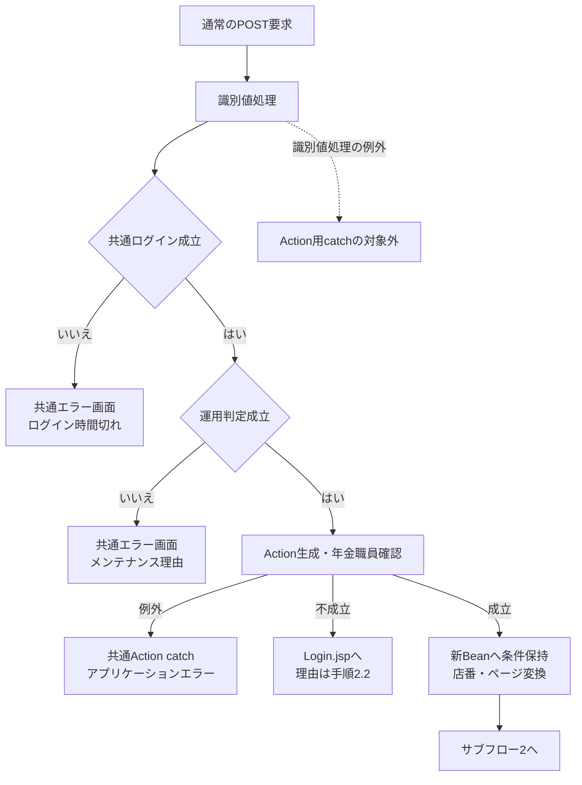

サブフロー2は全件検索からページ状態の保存までを示す。0件と、総件数が正数の範囲外ページを別の状態として扱う。

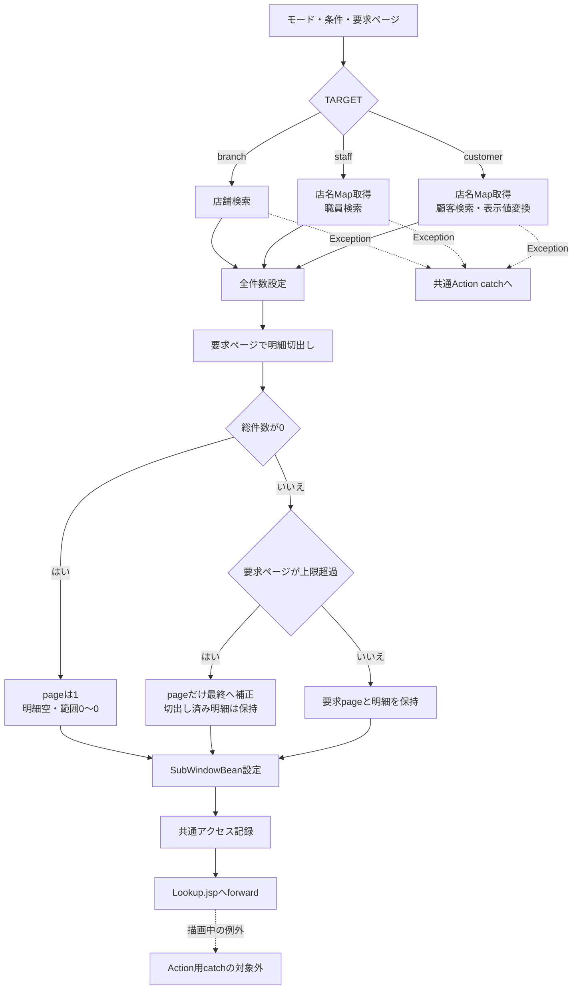

切出しの位置計算はintである。任意の大きな正数PAGEに対し、最終ページの明細が安全に返るという契約にはならない。

#### SQL・テーブル関連（ER図）

以下は検索とメモリ突合せの関連図であり、FK制約や保証された多重度を示すER図ではない。

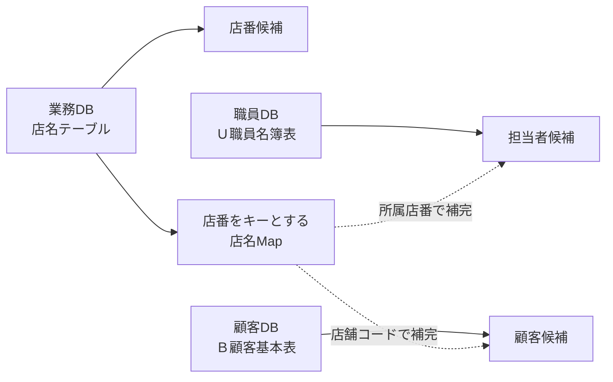

業務接続はjdbc/RAROA_DB、職員接続はjdbc/Oracle_SP2NM、顧客接続はjdbc/Oracle_DWHを使用する。それぞれ通常名の後にjava:comp/env/を付けた名前を探索する。DataSourceは系統別にキャッシュし、Connectionは検索ごとに取得する。

#### DB操作の詳細

| 操作 | 取得列 | 抽出条件 | 並び順・結果 | JDBC設定 |
| --- | --- | --- | --- | --- |
| 店舗検索 | 店舗ｺｰﾄﾞ→BRANCH_NO、店名→BRANCH_NAME | 正規化後KEYWORDが非空の場合だけ、CAST(店舗ｺｰﾄﾞ AS VARCHAR(20))のLIKE、またはUPPER(店名)とUPPER(?)のLIKEをORで結ぶ。双方にESCAPEを指定。空ならWHEREなし。 | ORDER BY 店舗ｺｰﾄﾞ。全一致行を取得。 | 同じエスケープ済み部分一致文字列をsetString(1)、setString(2)。空条件時はパラメータなし。 |
| 店名Map取得 | 店舗ｺｰﾄﾞ→BRANCH_NO、店名→BRANCH_NAME | WHEREなし。担当者・顧客検索に先行する。 | ORDER BYなし。Mapへ全件設定。同一キーが複数返る場合は後の代入が残る。 | パラメータなし。 |
| 担当者検索 | S.職員番号、漢字氏名、カナ氏名、所属店番、役職コード | WHERE 1=1に、有効店番ならS.所属店番=?を追加。正規化後KEYWORDが非空なら、UPPER(S.カナ氏名)のLIKEまたはUPPER(S.漢字氏名)のLIKEを括弧でまとめ、ANDで追加。各LIKEにESCAPE指定。 | ORDER BY S.職員番号。全一致行を取得。在籍状態・役職による追加条件なし。 | 存在する条件だけ、店番setInt、カナ氏名の部分一致setString、漢字氏名の部分一致setStringの順に1から詰める。 |
| 顧客検索 | C.店舗コード、顧客番号、カナ氏名、漢字氏名、電話番号、生年月日、担当者コード | WHERE 1=1に、有効店番ならC.店舗コード=?を追加。正規化後氏名が非空なら漢字氏名またはカナ氏名のLIKEを括弧でまとめてAND追加。数字加工後電話が非空ならTO_CHAR(C.電話番号)のLIKEをAND追加。各LIKEにESCAPE指定。 | ORDER BY C.店舗コード, C.顧客番号, C.カナ氏名。全一致行を取得。 | 存在する条件だけ、店番setInt、漢字氏名setString、カナ氏名setString、電話setStringの順に1から詰める。 |

LIKEのパラメータはエスケープ済み検索値を%で囲んだ文字列であり、利用者が入力した%や_を検索用ワイルドカードとして直接使用しない。任意条件が無効な場合は述語自体を付けず、そのパラメータへSQL NULLを設定する構成ではない。文字列パラメータのサイズ指定はない。

参照サービスはSQLページング、取得件数上限、検索タイムアウト、取消要求を設定しない。commit・rollbackとautoCommit変更も行わない。職員・顧客と店名は別接続で読むため、一つのトランザクションの同時点データとしては扱わない。

#### 結果・例外時の扱い

不正な店番は入力エラーとして拒否せず、店舗条件を省略する。例えば直接要求のBRANCH_NOが12xなら、店番を限定しない検索になる。再表示後にブラウザーの数字入力補助が表示値を12へ変更する場合があるが、その補助だけでは再検索しない。表示された入力値と、その一覧を取得した条件が一致しない状態になり得る。

35件でPAGE=3を要求した場合、切出し明細は空となり、その後pageだけが2へ補正される。件数表示は35件中21～35件になる一方、明細行は空のままである。これは検索結果0件の状態とは異なる。

サービスのSQLExceptionはNenkinDataAccessExceptionへ変換する。店舗検索は「店舗の検索」、職員検索は「職員の検索」、顧客検索は「顧客の検索」の失敗として伝える。担当者・顧客検索に先行する店名Map取得の失敗は「店舗名の取得」の例外となり、後段の検索失敗へ包み直さない。ResultSet、Statement、Connectionはfinallyで閉じ、close時のExceptionは無視する。

顧客生年月日が不正な場合のIllegalArgumentExceptionは、サービスのSQLException用catchでは捕捉しない。一行を除外して検索を続ける処理もなく、Actionの外へ伝わる。

LookupのAction実行中に発生したExceptionは共通Action catchがアプリケーションエラーのメッセージとError.jspへの戻り先へ変換する。識別値のtoLowerCase・equals等の処理はそのcatchより前、JSPへのforwardはcatchより後にあるため、そこで発生する例外まで同じ応答に一般化しない。この経路に失敗時HTTP状態を一律の数値へ設定する処理はない。

### E02 検索条件クリア

#### 処理概要

参照画面のテキスト検索条件をすべて消し、同じモードで1ページ目を検索する。親画面の入力や選択済み情報を解除する操作ではない。

#### 処理手順

**1. 画面内の条件を消す。**

　**1.1.** lookupForm内のtype未指定inputとtype=textのinputを空文字にする。店番参照では検索文字列、担当者参照では店番と担当者名、顧客参照では店番・氏名／フリガナ・電話番号が対象となる。

　**1.2.** TARGET、要求識別値、POPUP等のhiddenは保持し、PAGEだけを1へ設定する。

**2. 同じモードで再検索する。**

　**2.1.** lookupFormを送信し、E01の共通確認・検索・表示処理へ進む。担当者・顧客の店番も空になるため、ログイン職員の所属店や起動時の店番に限定しない検索となる。

#### 処理フロー

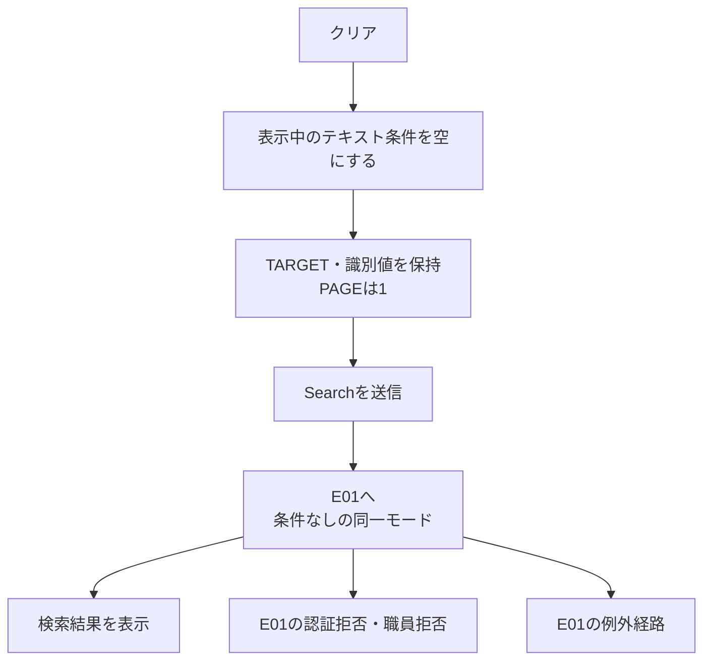

#### SQL・テーブル関連（ER図）

対象表と店名Mapの関連はE01と同じである。クリア専用の保存表はない。変更する一時情報はブラウザーの条件入力とPAGEで、送信後に新しいSubWindowBeanを作る。

#### DB操作の詳細

空になった条件をE01の検索へ渡す。店番参照は全店舗、担当者参照は全店舗の全職員、顧客参照は全顧客が検索対象になる。SQLで20件に限定せず、全件取得後に1ページ目を切り出す。クリア操作による業務表の更新・削除はない。

#### 結果・例外時の扱い

結果件数はマスターの内容により決まり、クリアしたことを0件や成功の保証としない。拒否・検索例外・描画例外はE01と同じ範囲で扱う。親画面へクリア通知は送らず、親の店番、担当者、顧客、読込み済み予約を変更しない。

### E03 店番・担当者の選択

#### 処理概要

選択行のコードと名称を親画面へ通知する。親画面は通知の受付条件を確認して、呼出元とtargetに対応する入力・表示だけを変更し、参照を閉じる。

#### 処理手順

**1. 選択行から通知を作る。**

　**1.1.** 子画面はボタンのdatasetを読み、店番選択ではtarget=branch、branchNo、branchNameを、担当者選択ではtarget=staff、staffCode、staffName、branchNoを設定する。これらの値はdata属性から取得した文字列である。

　**1.2.** source=nenkin.lookupを加え、送信先originをlocation.originに限定してwindow.parentへpostMessageする。

**2. 親画面で受付と移送を行う。**

　**2.1.** 親は受信originが自画面と一致し、dataが存在し、sourceがnenkin.lookupである場合だけ処理する。不一致なら入力変更と終了処理を行わない。event.sourceとlookupFrame.contentWindowの一致確認は行わない。

　**2.2.** 次表の対応先を変更する。通知値がない場合は空文字を設定する。

| 呼出元・選択 | 変更する入力 | 変更する表示 | 保持する値・後続動作 |
| --- | --- | --- | --- |
| 予約画面・店番 | branchNo／BRANCH_NO | branchName | 顧客番号、担当者コード・表示名、フリガナ、電話番号、その他の入力、元キーを保持する。Loadは送らない。 |
| 予約画面・担当者 | staffCode／STAFF_CODE | staffNameDisplay | 通知のbranchNoは採用しない。親の店番・店名、顧客、予約入力、元キーを保持する。Loadは送らない。 |
| Excel画面・店番 | excelBranch／BRANCH_NO | excelBranchName | 参照を閉じるだけでEXCEL出力は送らない。 |
| Excel画面・担当者等の未対応target | 変更なし | 変更なし | 受付条件を満たす通知なら参照を閉じる。 |

　**2.3.** E05の親側終了処理を行う。店番を変えたことによる担当者・顧客選択の自動解除は行わない。

#### 処理フロー

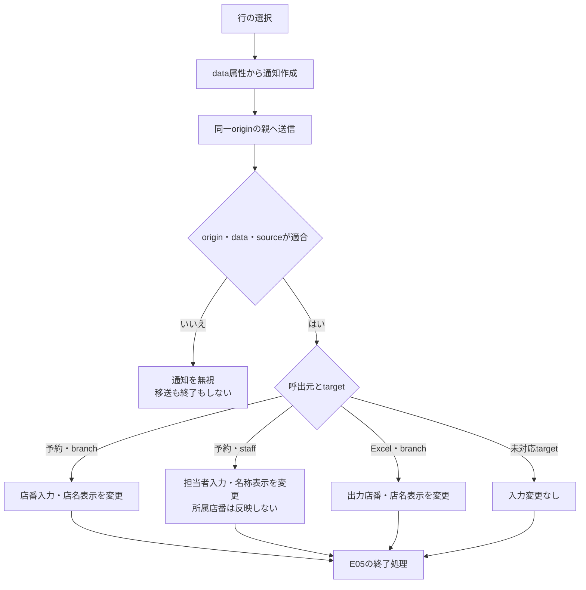

#### SQL・テーブル関連（ER図）

この選択イベントはDBを使用しない。子画面の描画済みdata属性から親画面のDOMへ値を移す。参照時に取得済みの候補と、ブラウザー内の親入力との対応であり、DB表間の関係ではない。

#### DB操作の詳細

選択通知と親の代入だけではHTTP要求を送らず、マスターの再検証、予約保存、Excel検索を行わない。予約表へ保存する際のコード対応は補足説明に示すが、このイベントからその保存処理は呼ばない。

Excel画面では、後に利用者がEXCEL出力を押した時点でActionが店番を読み直し、形式・桁を検査して店名と対象予約を照会する。店番候補の選択は出力可否や対象件数の確認を兼ねない。

#### 結果・例外時の扱い

予約画面の担当者表示名はstaffNameDisplayというspanであり、フォーム項目ではない。選択直後は表示するが、予約画面をサーバーで再描画するとこのspanは空で生成される。店名等の表示spanも、画面上の表示とフォーム送信値を区別する。

候補のコードは文字列としてvalueへ設定し、親入力のmaxlengthに合わせて切り捨てない。選択値を受け取ったことだけでは、後続Actionの正数変換や操作別検査を通過したことにならない。

### E04 顧客選択・予約読込み

#### 処理概要

顧客選択通知を受けた予約画面は、店番・顧客番号と照会用のフリガナ・電話番号を設定してLoadを送る。Loadはフリガナ・電話番号に一致する既存予約を優先し、予約がない場合だけ店番・顧客番号で顧客基本表を再取得する。

一覧で選んだ顧客の表示情報を一式そのまま親へ確定する処理ではない。既存予約が見つかった場合は、その予約全体が最終表示モデルになる。

#### 処理手順

**1. 顧客選択通知を送る。**

　**1.1.** 子画面はtarget=customer、branchNo、customerNo、branchName、customerName、staffCode、kanaName、phoneNumberをdatasetから取得し、source=nenkin.lookupを付けて同一originの親へ送る。生年月日、住所、性別は送らない。

　**1.2.** 予約画面はE03と同じorigin・data・sourceの条件で受け付ける。Excel画面には顧客の移送処理がなく、受付条件を満たす通知なら入力を変更せず閉じる。

**2. 予約画面でLoadの材料を設定する。**

　**2.1.** branchNoとcustomerNoの入力、branchNameとcustomerNameDisplayの表示を変更し、kanaNameとphoneNumberの通知値をhiddenのLOOKUP_KANAとLOOKUP_PHONEへ設定する。

　**2.2.** 通知されたstaffCodeは担当者入力へ直接設定しない。顧客氏名入力customerName、フリガナ入力kanaName、電話番号入力phoneNumber、生年月日も、この通知受付では直接上書きしない。

　**2.3.** 参照を閉じ、親フォーム全体をVIEW_ID=Pension、COMMAND_ID=Loadで送る。顧客選択からのLoadには、後述する入力change用のreadonly・元キー・空欄判定を適用しない。

**3. Loadで要求を読み直す。**

　**3.1.** 共通ログイン確認・運用判定の後、Loadの先頭で年金職員を確認する。拒否理由と戻り先はE01の手順2に従う。Loadも更新用POST・CSRF照合は呼ばない。

　**3.2.** 親フォームから新しいPensionReservationを作る。店番・顧客番号・担当者コード等は正数Integerへ変換し、文字列はNULLを空文字へ変えてtrimする。表示spanの店名・顧客表示名はフォーム値として読まない。

　**3.3.** LOOKUP_KANAとLOOKUP_PHONEを個別にtrimする。それぞれが空の場合だけ、その項目を親フォームのKANA_NAMEまたはPHONE_NUMBERで補う。片方だけ空なら片方だけ旧入力を採用するため、選択顧客のキーと以前の親入力が混在する場合がある。

**4. 既存予約を優先して照会する。**

　**4.1.** フリガナをNFKC・空白集約・大文字化し、電話番号から数字を抽出してBigDecimalへ変換する。正規化後フリガナが空、または電話に数字がない場合は、予約DBを照会せず予約なしとして扱う。

　**4.2.** 有効なキーなら年金1_LKをふりがな・電話番号の等価条件で照会する。店番・顧客番号を条件に含めず、最初の一行を採用する。ORIGINAL_KANA／ORIGINAL_PHONEとの一致検査や、選択した店番・顧客番号との同一性検査は行わない。

　**4.3.** 予約が見つかれば、その予約全体を採用する。店舗・顧客・担当者、顧客基本情報、年金種類、裁定請求、請求予定、配偶者、受給有無、予約徴求日、備考、更新日、確認済等の表示は取得した予約に従う。

**5. 予約がない場合だけ顧客基本表を再取得する。**

　**5.1.** BRANCH_NOとCUSTOMER_NOを正数Integerへ変換し直す。両方がある場合だけ、顧客基本表を店番・顧客番号の等価条件で検索する。片方でも無効なら顧客検索を省略する。

　**5.2.** 顧客があれば新しいPensionReservationへ店番・顧客番号・担当者コード・漢字氏名・カナ氏名・性別コード・住所・電話番号・生年月日を取得する。顧客接続を閉じた後、業務接続で店名と性別名称を補う。選択通知の名称・担当者コードを確定値として使用しない。

　**5.3.** 顧客モデルを採用する場合、以前の予約情報をそのモデルへ併合しない。顧客もなければ、手順3.2で親フォームから作ったinputを採用する。

**6. 枝ごとのモデルと状態を設定して再表示する。**

| 到達条件 | ViewBeanに設定する予約モデル | existing | メッセージ | 元キー・入力ロック |
| --- | --- | --- | --- | --- |
| 予約あり | 取得した既存予約found | true | 既存データを読み込みました。 | 取得予約のフリガナ・電話番号を元キーへ設定し、両入力をreadonlyにする。 |
| 予約なし・顧客あり | 再取得した顧客モデルmaster | false | 顧客基本表から読み込みました。 | 元キーは空。フリガナ・電話番号は新規状態の入力。 |
| 予約なし・顧客なし、または顧客照会用識別値不足 | 親フォームから読み直したinput | false | 空文字 | 元キーは空。フォーム由来の値を再表示する。 |

　**6.1.** 選定したモデル、メッセージ、existingを持つPensionViewBeanをセッションのViewBeanへ設定し、Pension.jspへの戻り先を返す。三つの枝で取得モデルやメッセージを共通の固定値へ置き換えない。

　**6.2.** Pension.jspは再表示の冒頭で性別・裁定請求・受給有無・年金種類の候補をDBから取得する。ViewBean設定後にも描画時のDB例外が起こり得る。

**7. 親入力のchangeから接続する関連導線を扱う。**

　**7.1.** 顧客番号のchangeでは、店番と顧客番号が非空、かつORIGINAL_KANAが空なら通常の顧客参照を開く。この場合も顧客番号自体を参照検索条件へ渡さない。

　**7.2.** フリガナまたは電話番号のchangeでは、ORIGINAL_KANAがある、どちらかのキー入力がreadonly、trim後のどちらかが空、のいずれかなら自動読込みしない。それ以外は両入力をLOOKUPキーへ設定し、手順3以降のLoadへ進む。

#### 処理フロー

サブフロー1は顧客選択通知からLoad要求までを示す。引継値は親フォーム全体、選択した店番・顧客番号、LOOKUP_KANA、LOOKUP_PHONEである。

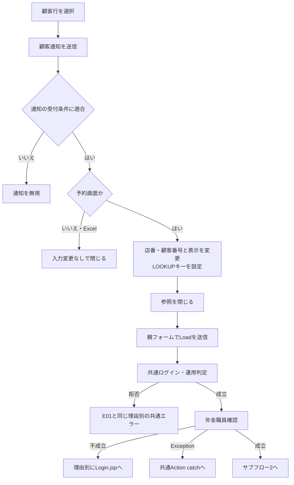

サブフロー2はサーバーでの優先検索と表示モデルの選定を示す。合流後も、各枝のモデル・existing・メッセージを引き継ぐ。

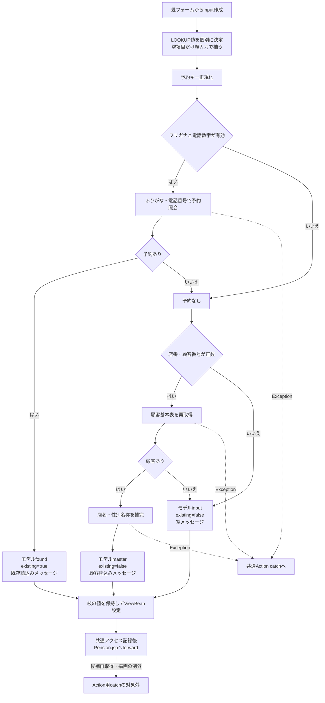

関連する自動導線は次の条件で分かれる。

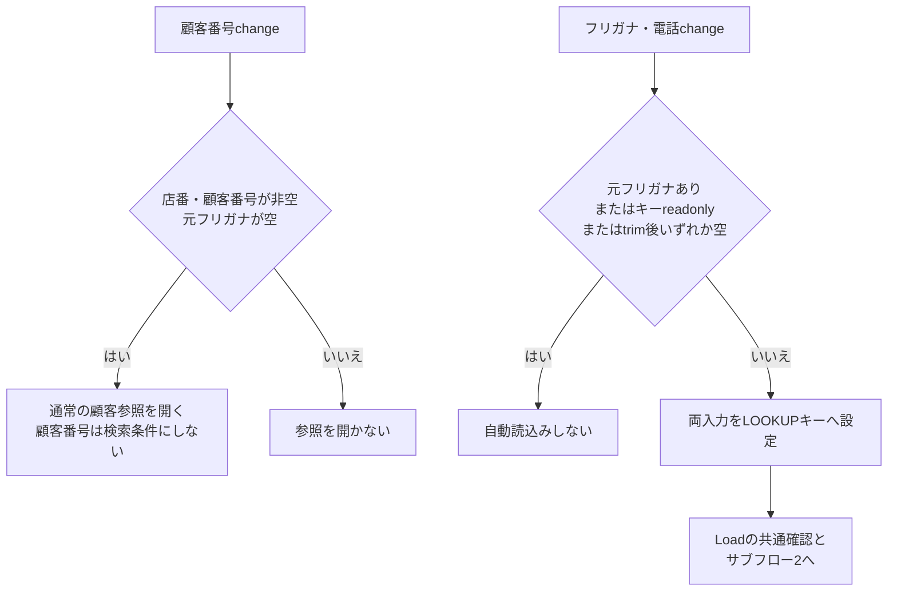

#### SQL・テーブル関連（ER図）

既存予約検索では、予約に保存されたコードから表示名称をLEFT JOINで取得する。以下の線はSQL上の参照条件であり、FKや多重度の宣言ではない。

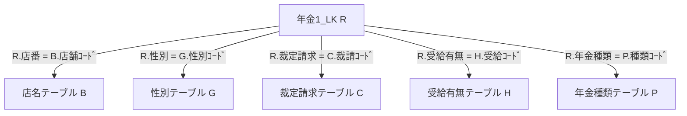

顧客基本表へのフォールバックは別の取得経路である。

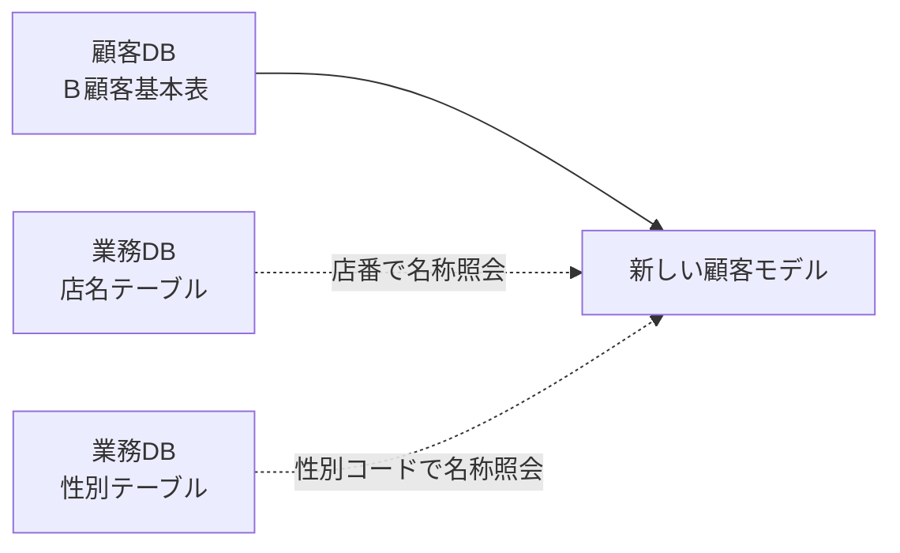

#### DB操作の詳細

| 操作 | 条件・バインド | 取得結果と採用方法 |
| --- | --- | --- |
| 既存予約検索 | WHERE R.ふりがな=? AND R.電話番号=?。1は正規化フリガナをsetString、2は数字抽出後の電話をsetBigDecimal。 | 予約本表の表示対象列と各コード表の名称を取得する。ORDER BY・複数件検査なしで最初の一行を採用。店番・顧客番号の照合なし。 |
| 顧客基本表再取得 | WHERE C.店舗コード=? AND C.顧客番号=?。setInt(1)、setInt(2)。 | 店番、顧客番号、担当者コード、漢字氏名、カナ氏名、性別コード、住所、電話番号、生年月日を取得する。最初の一行を採用し、なければnull。 |
| 顧客モデルの店名補完 | SELECT 店名 FROM 店名テーブル WHERE 店舗ｺｰﾄﾞ=?。setInt(1)。 | 店番がNULLなら照会せず空の代替値。該当なし・名称NULLも空文字。 |
| 顧客モデルの性別名称補完 | SELECT 性別 FROM 性別テーブル WHERE 性別ｺｰﾄﾞ=?。setInt(1)。 | 性別コード文字列をIntegerへ変換できなければ照会しない。該当なし・名称NULLは空文字。 |

予約検索キーの索引は非一意であり、同じフリガナ・電話番号の予約が一件だけである保証はない。複数一致時の先頭行はSQLの並び順で固定されていない。

選択した顧客が予約検索時に存在し続けることや、選択した店番・顧客番号と採用した予約が一致することを再確認する処理はない。顧客基本表、店名、性別名称も別接続・別照会であり、一覧時点の値や版と比較しない。LoadはSELECTのみを行い、予約を保存・削除しない。

#### 結果・例外時の扱い

既存予約あり、顧客基本表あり、入力保持の三結果は手順6の表に従う。顧客モデルを採用した場合、旧入力の予約情報を保持するとは扱わない。inputを採用した場合も、表示spanはフォームに含まれないため、選択直後に表示した店名・顧客表示名がそのまま再現される保証はない。

既存予約状態ではフリガナと電話番号をreadonlyにするが、参照ボタンをexistingによってdisabledにする条件はない。したがって既存状態からも顧客参照を開き、選択後Loadを要求できる。これは入力changeによる自動Loadの抑止条件とは異なる。

予約取得・顧客基本表取得・名称補完のSQLExceptionは、それぞれの操作名を持つデータアクセス例外となる。日付変換等のIllegalArgumentExceptionもLoadに個別catchがないため、Action実行中に発生すれば共通Action catchへ伝わる。後から行うJSPの候補取得・描画はそのcatch外であり、ViewBean設定をもって再表示完了とはしない。

### E05 参照を閉じる

#### 処理概要

参照モーダルを非表示にし、iframeを空ページへ切り替える。選択せず閉じた場合は親入力を変更しない。参照検索条件のクリアや、親予約画面のクリアとは別の操作である。

#### 処理手順

**1. 終了操作を受け付ける。**

　**1.1.** 子画面の「閉じる」はsource=nenkin.lookup、target=closeの通知を親へ送る。親はE03と同じ受付条件を確認する。

　**1.2.** 親モーダルの「閉じる」または背景クリックは、通知を経由せず親のcloseLookupを呼ぶ。予約画面のEscapeは、確認ダイアログが表示中ならその取消を優先し、確認ダイアログがなく参照モーダルが表示中なら参照を閉じる。Excel画面には同じEscape処理の記述がない。

**2. 親側で終了状態へ変更する。**

　**2.1.** lookupModalをhiddenにし、lookupFrameのsrcをabout:blankへ変更する。

　**2.2.** 予約画面ではbodyのlookup-modal-openを除去し、起動時に記録した要素へフォーカスを戻す。Excel画面には同じbodyクラス操作とフォーカス復元処理がない。

　**2.3.** 親入力を消さず、SubWindowBeanを削除するHTTP要求も送らない。再度開く場合はE01により新Beanを作って検索する。

#### 処理フロー

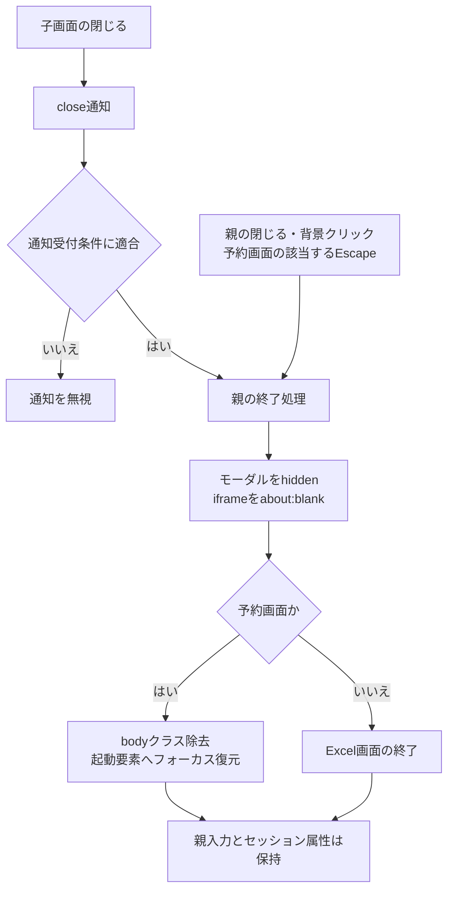

#### SQL・テーブル関連（ER図）

DB非使用のイベントである。保持領域はブラウザーの親画面DOM、予約画面のlookupOpener、セッション内のSubWindowBeanである。DB表の関連図は該当しない。

#### DB操作の詳細

終了操作自体はHTTP要求を送らず、SELECT・保存・削除・commit・rollbackを行わない。iframeの表示先変更を、サーバーで実行中のSQLに対する明示的な取消要求とは扱わない。

#### 結果・例外時の扱い

選択せず閉じた場合は、親画面の店番・担当者・顧客・予約入力を保持する。選択後に閉じる場合は、その選択イベントで変更した値を保持する。顧客選択の後続LoadはE04が制御し、closeLookup自体がLoadを送るわけではない。

親は受付条件を満たすclose通知や未対応targetでも終了処理へ進む。終了時にサーバーの参照状態を破棄したことや、検索処理を取り消したことを示す応答は受け取らない。

## 補足説明

### 検索値・表示値・NULLの扱い

検索条件として保持する文字列と、サービスで正規化した検索値は区別する。例えば電話番号の入力欄にはtrim後の要求値を再表示する一方、SQLへ渡す条件は数字抽出と先頭0除去後の値である。

検索結果の電話番号も数字抽出・先頭0除去を行い、9桁または10桁で先頭0がなければ0を一個補って表示する。NULLは空文字で、元のハイフンや入力表記を復元しない。この表示用文字列を参照操作でDBへ保存する処理はない。

顧客生年月日は文字列として取得し、NULL、trim後空文字、文字列0を空にする。それ以外は小数点以降を除き、日付として解析してISO値へ変換する。一覧ではR・H・S・T・Mを使う年／月／日形式にし、明治開始より前は西暦で表示する。不正日付を空表示へ置き換えて検索を続行する実装ではない。

候補モデルの名称等のStringはNULLを空文字へ変換する。職員番号・所属店番、顧客の店舗コード・顧客番号はgetIntで読み、SQL NULLと0を区別するモデルではない。顧客の担当者コードもSQL NULLを0へ変換する。候補の0や負数を選択した場合、親の後続フォーム読取りでは正数Integerへの変換によりnullになる場合があり、一覧表示可能であることと後続操作の有効値であることは一致しない。

### DB属性と業務上限

| 対象・列 | 収録されている属性 | この機能での意味・使用先 | 属性の適用範囲 |
| --- | --- | --- | --- |
| 店名テーブル.店舗ｺｰﾄﾞ | ローカルINTEGER、SQL Server向けINT。いずれもNOT NULL・PK。 | 店舗候補のキー、担当者・顧客の店名補完キー。 | 収録DDLの宣言。実配備DBの一致を意味しない。 |
| 店名テーブル.店名 | ローカルVARCHAR(80)、SQL Server向けNVARCHAR(80)。いずれもNOT NULL。 | 店舗検索、一覧、親画面の名称表示。予約の保存列ではない。 | 80はDB容量指定。名称保守の業務上限は未確定。 |
| Ｕ職員名簿表.職員番号 | ローカル互換DDLはDECIMAL(18,0)、NOT NULL・PK。 | 担当者コード候補。Javaではintとして取得する。 | 本番外部マスターの物理属性は未確定。18桁をJavaの受入桁数としない。 |
| Ｕ職員名簿表.所属店番 | ローカル互換DDLはDECIMAL(18,0)、NULL可。 | 店舗による絞込みと店名補完。選択通知にも含むが親店番へ反映しない。 | 本番属性は未確定。取得モデルではNULLと0を区別しない。 |
| Ｕ職員名簿表.漢字氏名・カナ氏名 | ローカル互換DDLは各VARCHAR(40)、NULL可。 | 両方を名称検索し、漢字氏名を表示・通知する。 | 本番容量・NULLと保守側の業務上限は未確定。 |
| Ｕ職員名簿表.役職コード | ローカル互換DDLはDECIMAL(18,0)、NULL可。 | 担当者モデルへ取得する。この一覧の抽出条件や通知には使用しない。 | 本番属性は未確定。モデルではString。 |
| Ｂ顧客基本表.店舗コード・顧客番号 | ローカル互換DDLは各DECIMAL(18,0)、NOT NULL・複合PK。 | 店舗絞込み、一覧キー、選択後の顧客再取得。 | 本番の型・PK・一意性を証明する定義ではない。モデルではint。 |
| Ｂ顧客基本表.カナ氏名・漢字氏名 | ローカル互換DDLはVARCHAR(48)・VARCHAR(96)、NULL可。 | 両方を検索・表示する。カナ氏名は選択後の予約キー候補にも使う。 | 本番属性・保守側の業務上限は未確定。 |
| Ｂ顧客基本表.担当者コード | ローカル互換DDLはDECIMAL(18,0)、NULL可。 | 選択通知に含む内部値。Loadでは再取得した値をモデルへ設定する。 | 本番属性は未確定。一覧モデルのNULLは0。 |
| Ｂ顧客基本表.電話番号・生年月日 | ローカル互換DDLは各DECIMAL(18,0)、NULL可。 | 電話は検索・表示・予約キー候補、生年月日は表示とLoadでの再取得に使用する。 | 本番属性は未確定。表示DTOのStringからDB型を推測しない。 |
| Ｂ顧客基本表.漢字住所・性別コード | ローカル互換DDLはVARCHAR(160)・VARCHAR(1)、NULL可。 | 顧客一覧には出さず、Loadの顧客再取得で取り込む。 | 本番属性は未確定。住所・性別は選択通知に含まれない。 |

店名・職員氏名・顧客氏名を保守する接続済み画面や書込み処理は特定できていない。そのため、検索・表示項目の業務上限をローカル互換DDLの容量で代用しない。また、名称の参照元列がNOT NULLでも、LEFT JOINや店名Mapの突合せが不成立になる場合の表示は空となる。

### 親入力と将来の保存先の対応

| 移送対象 | 親コントロール・要求名 | フォーム読取り後の型 | 予約を別途保存する場合の列 | 保存時のJDBC設定 |
| --- | --- | --- | --- | --- |
| 店番 | branchNo／BRANCH_NO | 正数Integer、変換不可はnull | 年金1_LK.店番。SQL Server向けINT NULL。 | 非NULLはsetInt、NULLはTypes.INTEGERのsetNull。 |
| 顧客番号 | customerNo／CUSTOMER_NO | 正数Integer、変換不可はnull | 年金1_LK.顧客番号。SQL Server向けBIGINT NULL。 | 非NULLはsetInt、NULLはTypes.INTEGERのsetNull。DB容量へJava側の範囲を拡張しない。 |
| 担当者コード | staffCode／STAFF_CODE | 正数Integer、変換不可はnull | 年金1_LK.担当者コード。SQL Server向けINT NULL。 | 非NULLはsetInt、NULLはTypes.INTEGERのsetNull。 |
| 店名・担当者表示名・顧客表示名 | branchName、staffNameDisplay、customerNameDisplayのspan | フォーム項目として受信しない | 名称表示をそのまま保存する列対応はない。 | 参照選択から保存バインドを呼ばない。 |
| 照会用フリガナ・電話 | hidden LOOKUP_KANA、LOOKUP_PHONE | trim後String。空項目だけ親入力で補う。 | Loadの検索制御値。hiddenをそのまま保存する列ではない。 | 予約検索ではsetString、setBigDecimalへ変換する。 |

親予約画面のブラウザーmaxlengthは店番3、顧客番号7、担当者コード4である。参照候補の代入時にこの桁へ切り捨てず、フォーム読取りもこれらの桁数を検査する処理ではない。Excel出力は別操作としてtrim後店番の3文字以内・ASCII数字等を検査する。同じ店番でも、ブラウザー、参照検索、選択移送、Load、Excel出力で適用する条件を分ける。

TARGET、PAGE、KEYWORD、NAME_KEYWORD、PHONE_KEYWORDは参照モード・検索・ページ制御の値であり、予約表の保存項目ではない。参照用のBRANCH_NOも検索条件として使う値であり、親予約画面へ返した後に同名の保存候補値として使われることと区別する。

### 状態別の確認事項

| 状態・条件 | 現行動作 |
| --- | --- |
| 初めて参照を開く | 呼出元の初期条件で新しいBeanを作り、通常は1ページ目を表示する。以前の条件・ページを復元しない。 |
| 職員の権限差 | 参照Actionに店番75・役職による検索制限はない。ログインと年金職員成立は必要。 |
| 担当者・顧客の店番が空欄または変換不可 | 店舗条件を省略する。他の有効条件は保持する。 |
| 顧客の名称・電話がともに有効 | 名称の内部OR条件と電話条件をANDで組み合わせる。 |
| 電話が数字を含まない | 電話条件を省略する。名称等が空なら対象が全顧客へ広がる。 |
| 検索結果0件 | 件数範囲0～0、明細なし、ページ操作なし。親入力は変更しない。 |
| ページ移動前に条件編集、または検索対象件数が変化 | 新しい条件・時点で全件を再検索する。要求ページが範囲外になる場合がある。 |
| 範囲外ページ | 切出し後にページ番号だけを上限補正する。0件と同一の表示状態にはならない。 |
| 店名が見つからない | 店名は空表示。担当者・顧客行は除外しない。 |
| 店番を選び直す | 店番と店名だけを変更する。既存の担当者・顧客入力を自動解除しない。 |
| 在籍・停止等の既存値 | 担当者検索には在籍・停止状態による追加抽出がない。収録された検索条件以外の有効性を保証しない。 |
| 一覧取得後にマスター・予約が更新される | 顧客選択後のLoadで再取得した結果を使用する。選択時の版・内容との比較はなく、同じ内容を保証しない。 |
| 検索・Load中の失敗 | 成功の選択通知や成功モデルへ置き換えない。Action内例外とforward後の描画例外は捕捉範囲が異なる。 |

参照検索とLoadは業務表の更新を行わないが、HTTP要求の共通処理にはカウンターシフトのアクセス記録がある。記録は別接続でINSERT・commitし、失敗時はrollbackとログ出力を試みる。検索と同じトランザクションではない。画面内だけで完結する選択・閉じるには、追加HTTP要求による同じ記録入口はない。顧客選択後のLoad要求には共通処理が適用される。

### 接続されていない資源との区別

PensionRepository.searchCandidatesには年金1_LKをフリガナ・電話の部分一致で検索する処理が宣言されているが、収録Javaでは定義以外の呼出元を確認できない。通常の「候補」をこの処理へ接続した機能として説明しない。

PensionLookupActionにはPOST用のJSON入口が存在するが、対象画面の通常導線はLookupのiframe表示とPension／Loadである。反射でActionを生成し得ることと、通常画面から呼び出していることを区別する。

### 関連文書

次のID・パスは全体計画上の対応先であり、生成状態は未確認である。パスは計画の索引を基準とする。

| 文書ID | 計画相対パス | 関連する責務 |
| --- | --- | --- |
| DET-SCR-016 | 詳細仕様書/詳細仕様書_SCR-016_店番参照／担当者参照／顧客参照.md | 要求名、モデル、正規化、JDBC、data属性、通知、ページ計算の詳細。 |
| SCR-018 | 基本設計書/基本設計書_SCR-018_新規・変更・削除.md | 取込み後の予約入力、登録・変更・削除、クリア。 |
| DET-SCR-018 | 詳細仕様書/詳細仕様書_SCR-018_新規・変更・削除.md | Load後の保存検査、キー、権限、全保存列、排他・確定境界。 |
| SCR-015 | 基本設計書/基本設計書_SCR-015_EXCEL出力.md | 店番選択後に利用者が開始する店舗別出力。 |
| DET-SCR-015 | 詳細仕様書/詳細仕様書_SCR-015_EXCEL出力.md | 出力時の店番検査、再照会、出力結果・例外。 |
| COM-111 | 共通/共通仕様書_COM-111_年金業務共通処理.md | 年金職員状態、フォーム変換、表示変換、操作別検査。 |
| COM-151 | 共通/共通仕様書_COM-151_画面共通入力・通信制御.md | 数字入力補助、iframe通信、モーダル、共有CSS。 |
| COM-012 | 共通/共通仕様書_COM-012_共通コントロールサーブレット.md | 共通認証確認、Action生成、例外変換、アクセス記録、forward。 |
| API-NENKIN | 共通/要求処理一覧.md | View・Search・LoadとJSON入口の要求・応答契約。 |
| DATA-CONTRACTS | 共通/データオブジェクト定義書.md | 候補モデル、ViewBean、予約モデル、保持領域の定義。 |
| DB-OPS | 共通/DB仕様書/DB操作仕様書.md | 参照SQL、予約優先検索、顧客再取得、名称補完。 |
| DB-PHYSICAL | 共通/DB仕様書/テーブル定義書.md | 業務表と外部マスターの物理属性、ローカル互換定義との差。 |
