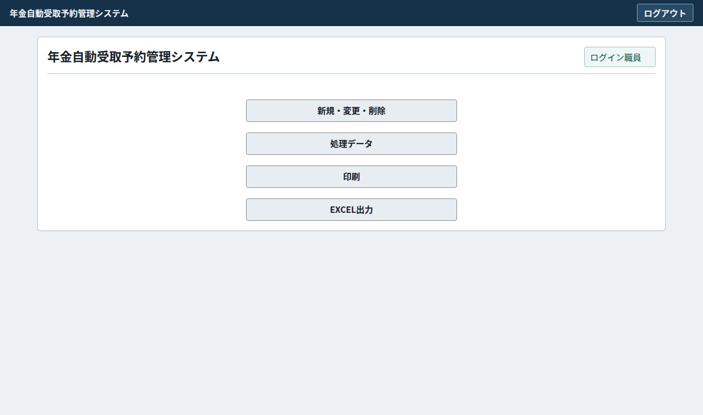
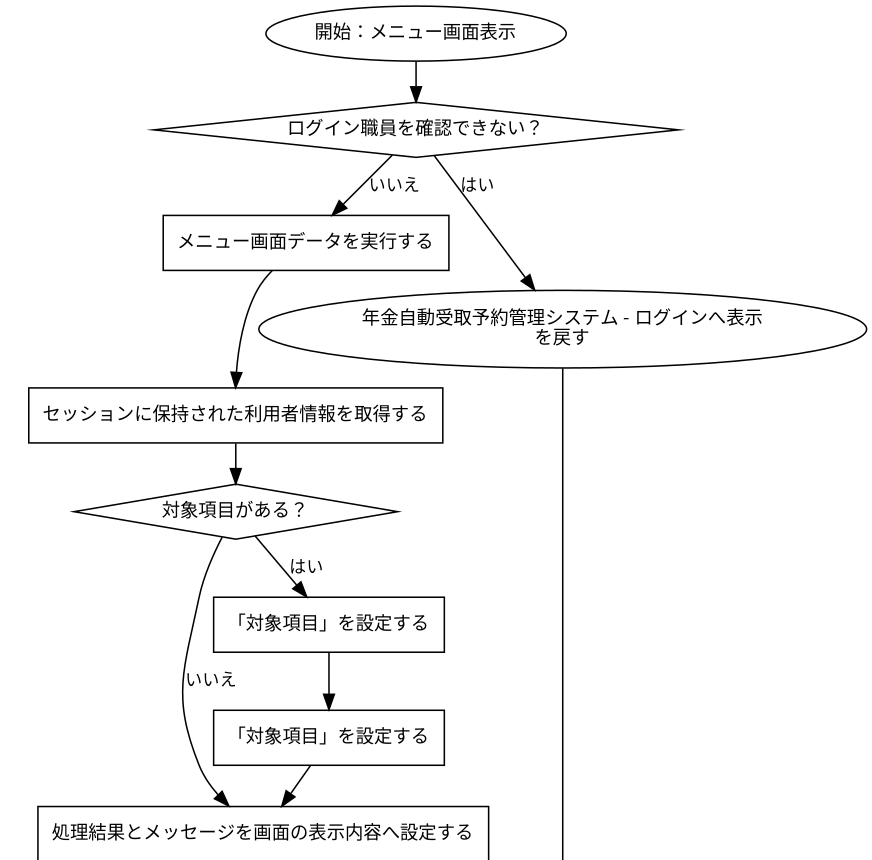
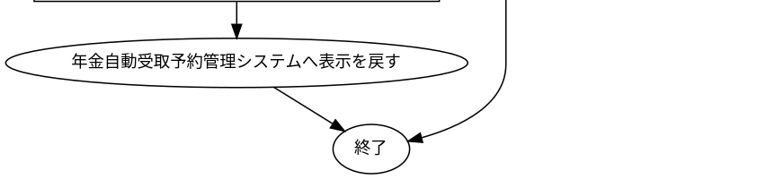

# 年金自動受取予約管理システム

## 表紙

| 項目 | 内容 |
| --- | --- |
| 文書名 | 基本設計書 |
| システム名 |  |
| 機能ID | SCR-017 |
| 画面名 | 年金自動受取予約管理システム |
| 会社名 |  |
| 作成日 |  |

## 概要

### 概要説明

年金自動受取予約管理システムの入力・表示・要求処理を行う。

| 情報 | 内容 |
| --- | --- |
| 対象種別 | screen |
| 開始契機 | 呼出元からの要求 |
| 処理対象 | DB2.Ｕ職員名簿表、DB2.ＵＪ科目、N2_SIGHT.Ｂ顧客基本表、NAVI.ＵＪ機能マスタ、NAVI.ＵＪ稼動店舗管理マスタ、NAVI.ＵＭオンラインＯＰマスタ、NAVI.ＵＭパス管理マスタ、NAVI.ＵＭ機能マスタ、NAVI.ＵＳパス管理ステータス、受給有無テーブル、年金1_LK、年金種類テーブル、年金＿削除明細、店名テーブル、性別テーブル、職員情報等（セッション）、裁定請求テーブル |

### 画面レイアウト

原本HTML・CSSの静的再構成。実行時の表示条件・値は未実行（仮定 Q-EC46AC7032）。

### データ操作関連図

## 項目一覧

| No | グループ | 項目名 | 種類 | 入出力 | DB連携項目 | 候補取得元 | 必須 | 形式・桁 | 説明 |
| --- | --- | --- | --- | --- | --- | --- | --- | --- | --- |
| 1 | 画面操作 | ログアウト | Button | ‐ | ‐ | ‐ | ‐ | ‐ | 「ログアウト」の操作を受け付ける。業務結果はイベント仕様で確認する。 |
| 2 | 見出し・説明 | 年金自動受取予約管理システム | Label | O | ‐ | ‐ | ‐ | ‐ | 年金自動受取予約管理システムを表示する。 |
| 3 | 画面操作 | 新規・変更・削除 | Button | ‐ | ‐ | ‐ | ‐ | ‐ | 「新規・変更・削除」の操作を受け付ける。業務結果はイベント仕様で確認する。 |
| 4 | 画面操作 | 処理データ | Button | ‐ | ‐ | ‐ | ‐ | ‐ | 「処理データ」の操作を受け付ける。業務結果はイベント仕様で確認する。 |
| 5 | 画面操作 | 印刷 | Button | ‐ | ‐ | ‐ | ‐ | ‐ | 「印刷」の操作を受け付ける。業務結果はイベント仕様で確認する。 |
| 6 | 画面操作 | EXCEL出力 | Button | ‐ | ‐ | ‐ | ‐ | ‐ | 「EXCEL出力」の操作を受け付ける。業務結果はイベント仕様で確認する。 |

項目定義数：6項目。表示順と反復行の定義数を区別する。

## イベント仕様

### メニュー画面表示

#### 処理概要

年金自動受取予約管理システムで「メニュー画面表示」の要求を受け付ける。入力・確認・データ操作・応答の順と、条件が成立しない場合の処理を以下に示す。

#### 処理手順

1. 「ログイン職員を確認できない」に該当するか確認する。該当する場合に限り、次の分岐内手順を行う。該当しない場合は分岐の後へ進む。

1.1. 条件成立時：年金自動受取予約管理システム - ログインへ表示を戻す。この経路の後続手順は実行しない。

2. メニュー画面データを実行する。

3. セッションに保持された利用者情報を取得する。

4. 「対象項目がある」に該当するか確認する。該当する場合に限り、次の分岐内手順を行う。該当しない場合は分岐の後へ進む。

4.1. 条件成立時：「対象項目」を設定する。

4.2. 条件成立時：「対象項目」を設定する。

5. 処理結果とメッセージを画面の表示内容へ設定する。

6. 年金自動受取予約管理システムへ表示を戻す。この経路の後続手順は実行しない。

#### 処理フロー

入口処理の順序・分岐を示す。呼出先の処理は別単位とし、SQLの対象と実行条件はDB操作の詳細へ記載する。例外線は範囲内で例外が発生した場合の経路で、各命令が必ず例外を送出する意味ではない。

#### SQL・テーブル関連（ER図）

実線はSQLの結合条件。外部キー制約や多重度を断定しない。単独表は独立したエンティティで表す。

#### DB操作の詳細

#### DB操作 SQL-D9F3500B923D

| 情報 | 内容 |
| --- | --- |
| 操作ID | SQL-D9F3500B923D |
| 対象テーブル | DB2.Ｕ職員名簿表 |
| 操作 | 参照 |
| 処理説明 | 対象テーブルの対象データを読み取る。設定項目・対象条件・確定取消は以下の定義に従う。 |
| 設定項目 | 当該SQL式の列指定・実行時引数を使用する。組立式と原本のパラメーター設定を参照。 |
| 対象条件 | 抽出・更新対象条件：S.職員番号 = ? |
| 確定・取消 | 呼出側または接続の設定に従う。当該メソッド単独でのコミット・ロールバック指定はない。 |
| 原本 | nenkin/WEB-INF/src/nenkin/service/ReferenceDataService.java:207 / getStaff@206 |

#### DB操作 SQL-E0FD738666D8

| 情報 | 内容 |
| --- | --- |
| 操作ID | SQL-E0FD738666D8 |
| 対象テーブル | 店名テーブル |
| 操作 | 参照 |
| 処理説明 | 対象テーブルの対象データを読み取る。設定項目・対象条件・確定取消は以下の定義に従う。 |
| 設定項目 | 当該SQL式の列指定・実行時引数を使用する。組立式と原本のパラメーター設定を参照。 |
| 対象条件 | WHERE句による限定はこのSQL式にない。呼出条件・動的付加条件は原本を参照する。 |
| 確定・取消 | 呼出側または接続の設定に従う。当該メソッド単独でのコミット・ロールバック指定はない。 |
| 原本 | nenkin/WEB-INF/src/nenkin/service/ReferenceDataService.java:291 / loadBranchNames@289 |

#### 結果・例外時の扱い

| 到達条件 | 結果 |
| --- | --- |
| ログイン職員を確認できない | 年金自動受取予約管理システム - ログインへ表示を戻す |
| 条件1を満たす（原本条件は補足説明を参照） | 年金自動受取予約管理システムへ表示を戻す |

### DB関連処理

## 補足説明

### 適用条件

各仮定のQA番号を確認する。静的に確認できた操作・条件を適用する。

### 処理・条件の原本対応

文書内の条件番号・処理番号は次の原本表記に対応する。完全な業務用語への置換を行っていない箇所はQA・reportで確認する。

| イベント | 参照番号 | 原本条件・処理 |
| --- | --- | --- |
| メニュー画面表示 | 条件1 | NOT (!requireStaff(request)) |

