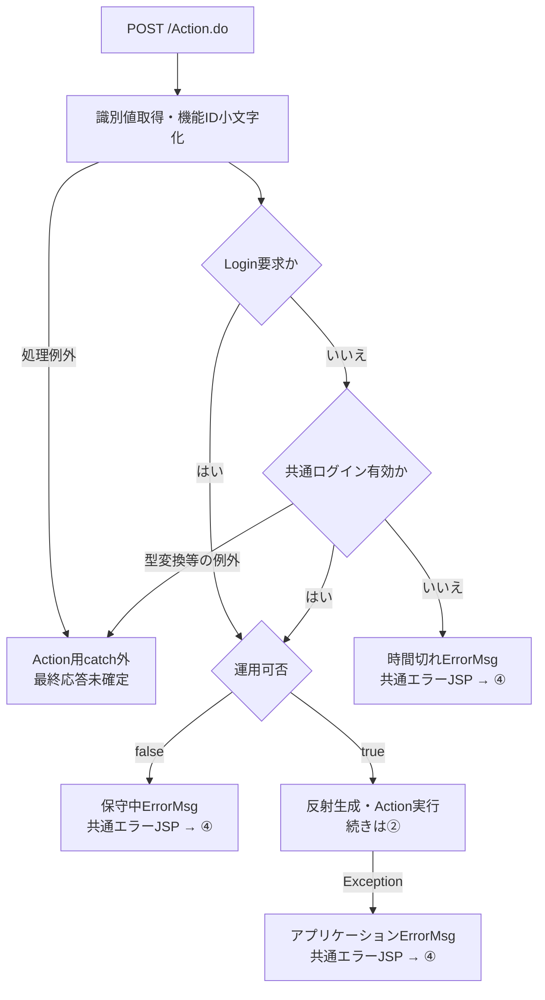
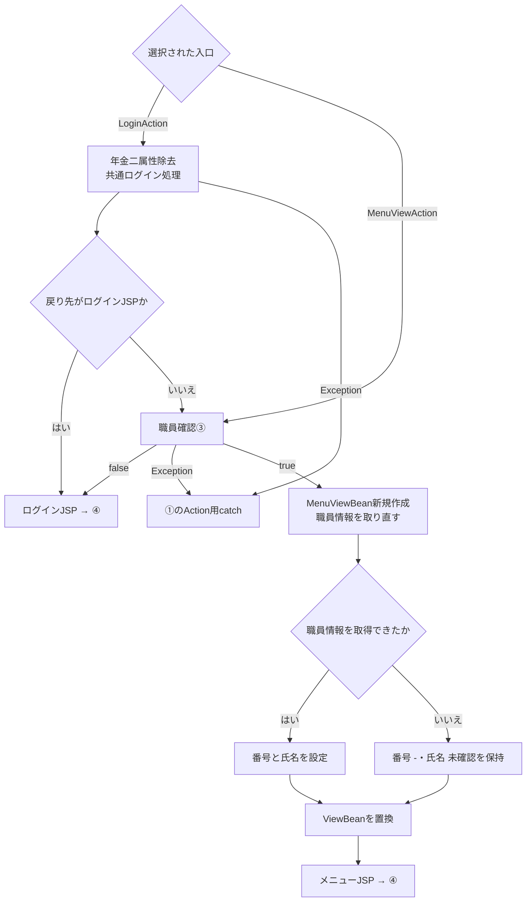
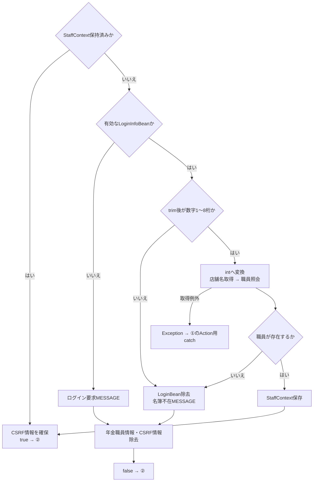
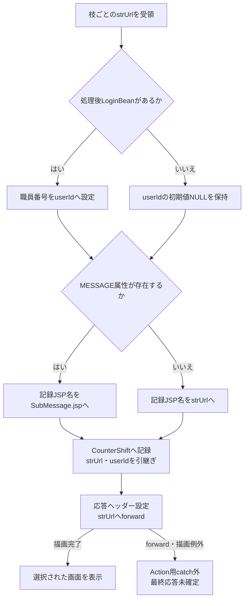
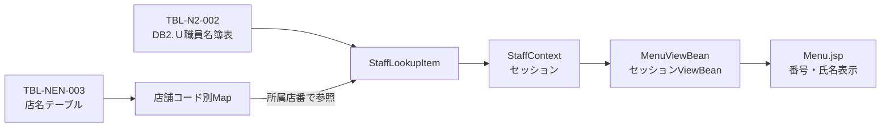
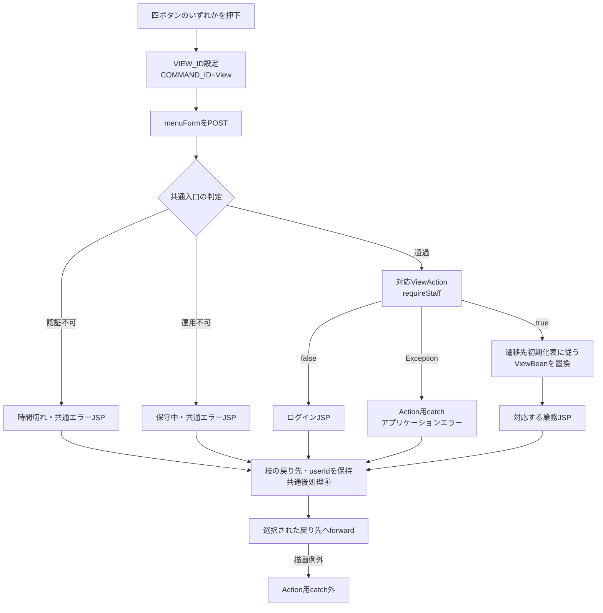
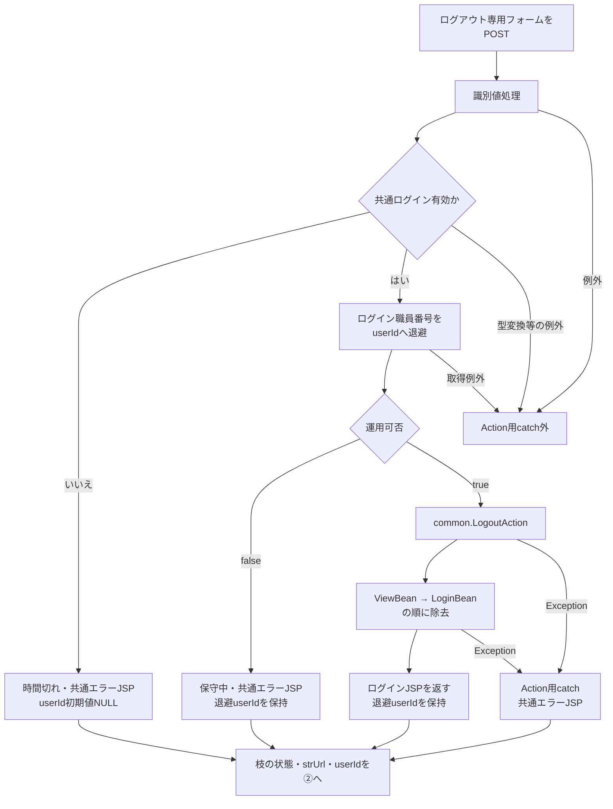
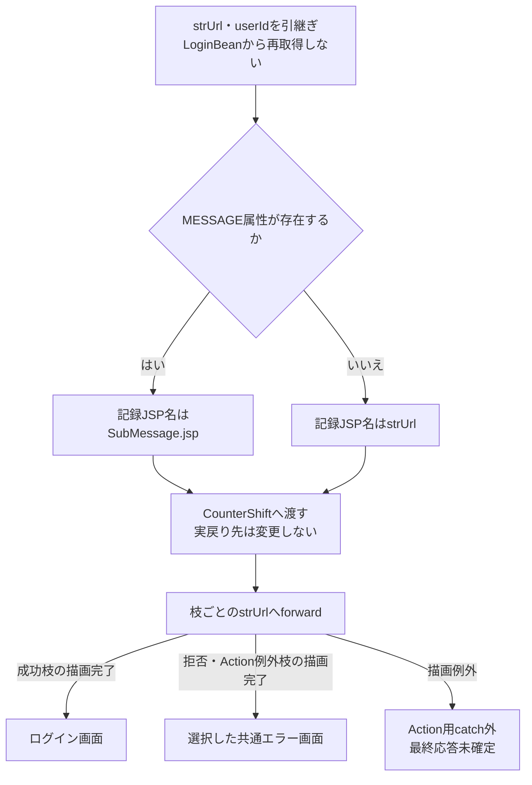

<!-- spec-meta: {"schema":"spec-md/1.0","documentId":"SCR-017","version":"2.0","path":"基本設計書/基本設計書_SCR-017_年金自動受取予約管理システム.md","sheets":[{"heading":"概要","kind":"GRID","sheet":"概要"},{"heading":"項目一覧","kind":"LIST","sheet":"項目一覧","key":["No"]},{"heading":"イベント仕様","kind":"GRID","sheet":"イベント仕様"},{"heading":"補足説明","kind":"GRID","sheet":"補足説明"}]} -->
# 年金自動受取予約管理システム

| 属性 | 内容 |
| --- | --- |
| 文書種別 | 基本設計書 |
| システム名 | 年金自動受取予約管理システム |
| 機能ID | SCR-017 |
| 版 | 2.0 |
| 解析対象 | メニュー画面、職員確認、四つの業務入口、共通ログアウト |
| 基準日 | 2026-10-15 |

## 概要

本画面は、ログイン職員の番号と氏名を確認し、予約の新規・変更・削除、日次・月次の処理データ出力、登録内容印刷、店舗別EXCEL出力へ進むためのメニューである。共有ヘッダーにシステム名とログアウトを置き、本文には画面見出し、ログイン職員表示、四つの業務ボタンを配置する。予約明細の入力や検索結果の表示は、遷移先画面が担当する。

通常の画面要求は、コンテキストパス配下の `/Action.do` へPOSTし、`common.ControlServlet` を経由する。ログイン処理から初めてメニューへ進む場合と、業務画面の「戻る」から再表示する場合では入口が異なるが、メニュー表示時は `MenuViewAction` が職員情報を確認し、新しい表示Beanを作る。

職員確認に成功したメニューでは、四つのボタンをすべて表示し、いずれも操作可能とする。所属店番や役職によるメニューの非表示・非活性の分岐はない。更新・削除の可否判定は、その操作の責務である。メニューのボタン押下時点では、予約更新、日次・月次処理、印刷、Excel生成を実行しない。

### 画面構成と表示状態

| 状態 | 職員表示と操作 | 次の状態 |
| --- | --- | --- |
| ログイン処理後の初期表示 | 共通ログイン処理の戻り先がログイン画面以外なら職員確認へ進む。名簿から職員情報を生成できた場合、番号・氏名と四ボタンを表示する | メニュー |
| 業務画面からの再表示 | `nenkin / Menu / View` を再要求する。保持済み職員情報を再利用し、表示Beanを作り直す | メニュー |
| 共通ログイン不成立 | 通常のメニュー要求はAction実行前に拒否する。年金職員情報だけが残っていても通過しない | 時間切れメッセージを伴う共通エラー画面 |
| 年金職員情報が未成立 | 共通ログイン情報から自動補完を試みる。職員番号不適合・名簿0件なら共通ログイン情報と年金二属性を除去する | 名簿不在メッセージを伴うログイン画面 |
| 運用可否判定がfalse | メニューActionを実行しない | メンテナンスメッセージを伴う共通エラー画面 |
| 職員情報の取得例外 | 名簿0件として処理せず、Action実行の共通catchへ伝播する | アプリケーションエラーの共通画面を選択 |
| ログアウト成功 | 共通の表示Beanとログイン情報を除去する | ログイン画面 |

職員番号は `int` から最小幅8桁のゼロ埋め文字列へ変換する。8桁を超える値を切り捨てる処理ではない。氏名は年金職員情報から取得し、番号とともにHTMLエスケープして表示する。

### 静的画面投影

以下は通常表示の配置を示す非実行HTMLである。職員番号・氏名の括弧付き文字列は差込位置を表す。送信先と要求識別値はdata属性へ保持し、実送信のaction、JavaScript、送信ボタンを置かない。

ヘッダーは `header.app-nav` の直下にタイトルとログアウトフォームを置く。ヘッダー内に `.app-shell` のラッパーはない。本文は `main.app-shell`、`section.screen.surface.menu-screen`、見出し領域、メニューフォームの構造を保つ。

<!DOCTYPE html>
<html lang="ja">
<head>
<meta charset="UTF-8">
<meta name="viewport" content="width=device-width, initial-scale=1">
<title>年金自動受取予約管理システム</title>
<style>
:root{--bg:#edf1f4;--surface:#ffffff;--line:#b8c2cc;--text:#18212a;--nav:#16324a;--nav-text:#f4f8fb;--primary-dark:#0a5148;--button:#e8edf1;--button-border:#7b8792;--focus:#1a75bb;--work-screen-width:1180px}
*,*::before,*::after{box-sizing:border-box}
button,input{margin:0;font:inherit}button,[type="button"]{cursor:pointer}
button:focus-visible{outline:2px solid var(--focus);outline-offset:1px}
html{min-height:100%}
body{min-height:100vh;margin:0;color:var(--text);background:var(--bg);font-family:"Yu Gothic UI","Meiryo","Segoe UI",sans-serif}
.app-shell{width:100%;max-width:1440px;margin-inline:auto}
.app-nav{display:flex;min-height:48px;align-items:center;justify-content:space-between;gap:12px;padding:7px 18px;color:var(--nav-text);background:var(--nav);border-bottom:1px solid #0c2236}
.app-nav__title{color:var(--nav-text);font-weight:800;line-height:1.25}
.nav-button{min-height:32px;padding:4px 12px;color:var(--nav-text);background:#294a64;border:1px solid #8da3b5;border-radius:3px;font-weight:700}
.nav-button:hover,.nav-button:focus{background:#365f7d;border-color:#ffffff}
main.app-shell:not(.login-shell){padding:20px 18px 52px}
.surface{background:var(--surface);border:1px solid var(--line);border-radius:6px;box-shadow:0 1px 2px rgba(16,32,48,.08)}
.screen{padding:18px}
.screen:not(.lookup-screen-popup){max-width:var(--work-screen-width);margin-right:auto;margin-left:auto}
.screen-header{display:flex;gap:16px;align-items:flex-start;justify-content:space-between;margin-bottom:18px;padding-bottom:12px;border-bottom:1px solid var(--line)}
.screen-header-actions{display:flex;flex-wrap:wrap;gap:10px;align-items:flex-start;justify-content:flex-end}
h1{margin:0;font-size:1.45rem;font-weight:700;letter-spacing:0}
.staff-badge{display:grid;grid-template-columns:auto auto auto;gap:8px;align-items:center;min-height:34px;padding:6px 10px;background:#eef7f5;border:1px solid #9fc3bc;border-radius:4px;color:var(--primary-dark)}
.staff-badge strong{font-variant-numeric:tabular-nums}
.menu-grid{display:grid;grid-template-columns:minmax(260px,396px);gap:20px;align-items:stretch;justify-content:center;max-width:396px;margin:48px auto 0}
.access-button{display:inline-flex;min-height:42px;align-items:center;justify-content:center;padding:8px 18px;color:var(--text);background:var(--button);border:1px solid var(--button-border);border-radius:4px;font-weight:700;text-decoration:none;line-height:1.2}
.access-button:hover,.access-button:focus{color:var(--text);background:#dce5eb;border-color:var(--focus)}
@media(max-width:960px){.menu-grid{grid-template-columns:1fr 1fr}}
@media(max-width:640px){.screen-header{display:grid}.menu-grid{grid-template-columns:1fr}}
</style>
</head>
<body>
<header class="app-nav">
<div class="app-nav__title">年金自動受取予約管理システム</div>
<form data-action="{contextPath}/Action.do" data-http-method="POST">
<input type="hidden" name="FUNCTION_ID" value="common">
<input type="hidden" name="VIEW_ID" value="Logout">
<input type="hidden" name="COMMAND_ID" value="">
<button class="nav-button" type="button">ログアウト</button>
</form>
</header>
<main class="app-shell">
<section class="screen surface menu-screen">
<div class="screen-header">
<h1>年金自動受取予約管理システム</h1>
<div class="screen-header-actions"><div class="staff-badge">
<span>ログイン職員</span><strong>〈職員番号表示値〉</strong><span>〈職員氏名表示値〉</span>
</div></div>
</div>
<form id="menuForm" data-action="{contextPath}/Action.do" data-http-method="POST">
<input type="hidden" name="FUNCTION_ID" value="nenkin">
<input id="menuView" type="hidden" name="VIEW_ID" value="Menu">
<input id="menuCommand" type="hidden" name="COMMAND_ID" value="View">
<div class="menu-grid">
<button class="access-button" type="button" data-view-id="Pension" data-command-id="View">新規・変更・削除</button>
<button class="access-button" type="button" data-view-id="Batch" data-command-id="View">処理データ</button>
<button class="access-button" type="button" data-view-id="Report" data-command-id="View">印刷</button>
<button class="access-button" type="button" data-view-id="Excel" data-command-id="View">EXCEL出力</button>
</div>
</form>
</section>
</main>
</body>
</html>

本文の外枠は最大1440px、画面枠は最大1180pxで中央に置く。通常のボタン群は最大396pxの一列で、上余白48px、ボタン間隔20pxである。画面幅が640px超960px以下では二列、640px以下では一列になる。640px以下では見出し領域もgrid配置へ変わる。職員表示は「ログイン職員」「番号」「氏名」の三列で、四ボタンのクラスはいずれも `access-button` である。

## 項目一覧

| No | グループ | 項目名 | 種類 | 入出力 | DB連携項目 | 候補取得元 | 必須 | 形式・桁 | 説明 |
| --- | --- | --- | --- | --- | --- | --- | --- | --- | --- |
| 1 | 共有ヘッダー | システム名 | `div.app-nav__title` | O | ‐ | ‐ | ‐ | 固定文字列 | 年金自動受取予約管理システムを表示する |
| 2 | 共有ヘッダー | ログアウト | `button.nav-button` | I | 予約保存なし。共通アクセス記録は別処理 | ‐ | ‐（操作） | 原画面は専用フォームのsubmit | 共通ログアウトを要求する |
| 3 | 画面見出し | 画面名 | `h1` | O | ‐ | ‐ | ‐ | 固定文字列 | ヘッダーと同じシステム名を表示する |
| 4 | 職員情報 | 職員番号 | `.staff-badge strong` | O | 表示元は職員名簿の職員番号。メニューから保存しない | 選択候補なし。保持済み職員情報または名簿再照会 | ‐（表示） | `StaffContext.staffNo:int` → `MenuViewBean.staffNo:String`。最小幅8桁 | `%08d` のゼロ埋め表示。受信項目ではない |
| 5 | 職員情報 | 職員氏名 | `.staff-badge span` | O | 表示元は職員名簿の漢字氏名。メニューから保存しない | 選択候補なし。保持済み職員情報または名簿再照会 | ‐（表示） | `StaffContext.staffName:String` → `MenuViewBean.staffName:String`。業務上限は未確認 | 共通LoginBeanの氏名を直接表示せず、年金職員情報の氏名をHTMLエスケープする |
| 6 | 業務入口 | 新規・変更・削除 | `button.access-button` | I | この操作で予約を保存しない | ‐ | ‐（操作） | `go('Pension','View')` | 空の予約入力画面を開く |
| 7 | 業務入口 | 処理データ | `button.access-button` | I | この操作で削除明細を整理しない | ‐ | ‐（操作） | `go('Batch','View')` | 日次・月次処理の条件画面を開く |
| 8 | 業務入口 | 印刷 | `button.access-button` | I | この操作でプレビュー検索をしない | ‐ | ‐（操作） | `go('Report','View')` | 登録内容印刷の条件画面を開く |
| 9 | 業務入口 | EXCEL出力 | `button.access-button` | I | この操作で店舗別予約を抽出しない | ‐ | ‐（操作） | `go('Excel','View')` | 店舗別出力の条件画面を開く |
| 10 | 業務要求制御 | 機能ID | `menuForm` 内hidden、name=`FUNCTION_ID` | I | Action選択用。保存列ではない | ‐ | 通常要求で設定 | 受信型 `String`、固定値 `nenkin` | ボタン押下後も値を保持する |
| 11 | 業務要求制御 | 画面ID | hidden、id=`menuView`、name=`VIEW_ID` | I | Action選択用。保存列ではない | ‐ | 通常要求で設定 | 受信型 `String`、初期値 `Menu` | 選択により `Pension`、`Batch`、`Report`、`Excel` へ変更する |
| 12 | 業務要求制御 | コマンドID | hidden、id=`menuCommand`、name=`COMMAND_ID` | I | Action選択用。保存列ではない | ‐ | 通常要求で設定 | 受信型 `String`、`View` | 選択時に `View` を設定する |
| 13 | ログアウト要求制御 | 機能ID | 専用フォーム内hidden、name=`FUNCTION_ID` | I | Action選択用。保存列ではない | ‐ | 通常要求で設定 | 受信型 `String`、固定値 `common` | 業務遷移フォームとは別に送信する |
| 14 | ログアウト要求制御 | 画面ID | 専用フォーム内hidden、name=`VIEW_ID` | I | Action選択用。保存列ではない | ‐ | 通常要求で設定 | 受信型 `String`、固定値 `Logout` | `common.LogoutAction` を選択する |
| 15 | ログアウト要求制御 | コマンドID | 専用フォーム内hidden、name=`COMMAND_ID` | I | Action選択用。保存列ではない | ‐ | 空文字を明示設定 | 受信型 `String`、空文字 | 欠落によるNULLとは異なる。クラス名に追加するコマンド名を持たない |

## イベント仕様

### 初期表示・メニュー再表示

#### 処理概要

ログイン処理からの委譲、または `nenkin / Menu / View` の要求を受け、年金業務で使用する職員情報を確認してメニューを表示する。職員情報の保持済み・未成立を分け、未成立時だけ共通ログイン情報から名簿を照会する。

新規・変更・削除、処理データ、印刷、EXCEL出力の各画面にある「戻る」は、その画面のフォームの `VIEW_ID` を `Menu`、`COMMAND_ID` を `View` に変更してPOSTする。戻る際にも本イベントを実行し、遷移元の表示Beanをメニュー用に置き換える。

#### 処理手順

**1. 共通入口で要求を受け付ける。**

　**1.1.** `ControlServlet` はパラメータ取得前に要求文字コードをWindows-31Jへ設定する。通常フォームの三識別値を取得し、機能IDを小文字化してActionのパッケージ名に使う。

　**1.2.** `VIEW_ID=Login` 以外は `LoginBean` を取得し、ログイン可否を確認する。不成立なら `ErrorMsg` へ「ログイン時間切れです。再度ログインしてください。」を設定し、共通エラーJSPを選ぶ。メニューActionは呼ばない。

　**1.3.** 認証を通過した要求とログイン要求は運用可否を確認する。年金とcommonは運用状態表を照会する対象ではないが、判定前に共通接続を取得する。接続取得等の失敗でfalseになった場合は「現在メンテナンス中のため画面を表示できません。」を設定して共通エラーJSPを選ぶ。

　**1.4.** 通過時は `パッケージ名.VIEW_IDCOMMAND_IDAction` を反射生成する。`nenkin / Menu / View` は `nenkin.MenuViewAction` になる。クラス生成と `perform` のExceptionは共通catchでアプリケーションエラーへ変換する。

**2. 初期入口を処理し、年金職員情報を確認する。**

　**2.1.** 初期ログインの `nenkin.LoginAction` は年金職員情報と年金CSRF情報を除去して共通ログイン処理を呼ぶ。戻り先が `./JSP/MENU/Login.jsp` ならそのまま返す。それ以外の場合は `MenuViewAction.perform` へ委譲する。この戻り値分岐だけで年金職員情報の成立を保証しない。

　**2.2.** `MenuViewAction` は `requireStaff` を呼ぶ。`NENKIN_STAFF_CONTEXT` が `StaffContext` なら再利用し、CSRF情報の存在を確保する。この枝では名簿、所属店番、役職を再取得せず、共通LoginBeanとの職員番号比較もしない。

　**2.3.** 職員情報がないか別型なら、有効な `LoginInfoBean` の職員番号を取り出す。NULLは空文字にし、trim後にASCII数字1～8桁であることを確認する。適合した文字列を `Integer.parseInt` で `int` にして `verifyStaff` へ渡す。正数限定の検査はなく、ゼロも照会対象になり得る。

　**2.4.** 名簿確認では、先に業務用接続で店舗名を全件取得し、その後に職員用接続で該当職員を照会する。取得できた場合は職員番号・氏名・所属店番・役職コードを `StaffContext` に移し、セッションへ保存する。カナ氏名と店舗名は職員情報へ引き継がない。

　**2.5.** 有効な共通ログイン情報があるが、番号形式不適合または名簿0件の場合は `LoginBean` を除去し、`MESSAGE` に「ログイン職員番号が職員名簿に存在しません。管理者に確認してください。」を設定する。有効な共通ログイン情報がない枝では「ログインしてください。」を設定する。両枝とも年金職員情報とCSRF情報を除去してfalseを返し、ActionはログインJSPを返す。後者は通常の共通認証より後の再確認における枝である。

**3. メニューの表示情報を作り直す。**

　**3.1.** 職員確認がtrueなら `MenuViewBean` を新しく生成する。その後でセッションの職員情報を取り直し、取得できれば番号を `String.format(Locale.ROOT,"%08d",...)` で変換し、氏名とともにBeanへ設定する。

　**3.2.** 取り直した職員情報がNULLなら設定を省略し、Bean初期値の番号「-」、氏名「未確認」を保持する。確認時と取り直し時の二回の読取りを一体として保護する排他はない。

　**3.3.** 共通セッション属性 `ViewBean` を新しいメニューBeanへ置き換え、`./JSP/NENKIN/Menu.jsp` を返す。JSPは番号・氏名のHTML特殊文字を変換して出力する。

**4. 共通後処理から選択済み画面へ転送する。**

　**4.1.** 非ログアウト要求では、処理後の `LoginBean` があれば職員番号をアクセス記録用 `userId` に設定する。手順2.5で除去した枝では取得できず、初期値NULLが残る。正常枝の取得済み識別値をNULLへ置き換えない。

　**4.2.** `MESSAGE` が存在すればアクセス記録上のJSP名を `./JSP/COMMON/SubMessage.jsp` にし、それ以外は選択済み戻り先を記録する。この分岐で実際の戻り先は変更しない。

　**4.3.** 共通アクセス記録を実行した後、選択済みJSPへforwardする。名簿不在のログイン画面では、非空の `MESSAGE` をエスケープして表示した後、その属性を除去する。

#### 処理フロー

**① 共通入口：手順1。** 初期ログイン要求と通常のメニュー要求を区別する。正常時は②へ進み、拒否・Action用catchの結果は理由と戻り先を保持して④へ渡す。



**② 初期入口と表示決定：手順2.1、3。** `requireStaff` の詳細は③である。③の拒否と例外は異なる出口を持つ。



**③ 職員確認：手順2.2～2.5。** 成功時は②へtrueを返す。SQL取得例外では拒否時の属性除去を行う箇所へ到達しない。



**④ 共通後処理：手順4。** 各枝の `strUrl` を引き継ぐ。ここではメニュー・ログイン・共通エラーのいずれかを固定しない。



④での `LoginBean` の型変換など、アクセス記録呼出し前の例外もAction用catchの外である。`CounterShift` 内で捕捉した記録例外は業務戻り先を変更せず、記録処理終了後は同じ `strUrl` で転送へ進む。

#### SQL・テーブル関連（ER図）

職員情報を補完する場合だけ、店舗名と職員名簿を読み取る。二表は別接続で取得し、所属店番によってメモリ上のMapを参照する。以下はデータ移送の関連図であり、表間のFKや多重度を定義するER図ではない。



共通アクセス記録は独立して `TBL-N2-006：DB2.Ｕカウンターシフト` に追加する。メニューの固有処理は予約本表・削除明細を更新しない。

#### DB操作の詳細

| 操作 | 接続・対象 | 抽出・設定内容 | 結果と境界 |
| --- | --- | --- | --- |
| 店舗名取得 | 業務用接続、店名テーブル | 店舗ｺｰﾄﾞ・店名を条件なしで全件取得。パラメータ・ORDER BYなし | `Integer` キーのMapに格納する。職員照会のtryより先に実行する |
| 職員照会 | 職員用接続、DB2.Ｕ職員名簿表 | 職員番号・漢字氏名・カナ氏名・所属店番・役職コードを取得。`WHERE S.職員番号 = ?`、パラメータ1は `setInt` | 最初の1行を使い、0件はNULL。複数件の検査、ORDER BY、ページング、件数上限、タイムアウト・取消設定はない |
| 共通アクセス記録 | 共通接続、DB2.Ｕカウンターシフト | アクセス日付・時刻、機能ID、画面ID、コマンドID、Action ID、記録用JSP名、利用者識別をINSERT | 独立commit。捕捉Exceptionでrollbackを試みる。画面セッション変更は戻さない |

職員照会SQLの全体は次のとおりである。入力はメニューの画面項目ではなく、共通ログイン情報から変換した職員番号である。

```sql
SELECT S.職員番号 AS STAFF_NO, S.漢字氏名 AS STAFF_NAME,
       S.カナ氏名 AS STAFF_KANA_NAME, S.所属店番 AS BRANCH_NO,
       S.役職コード AS ROLE_CODE
FROM DB2.Ｕ職員名簿表 S
WHERE S.職員番号 = ?
```

店舗名取得は `SELECT 店舗ｺｰﾄﾞ AS BRANCH_NO, 店名 AS BRANCH_NAME FROM 店名テーブル` である。両照会にSQLのJOINはない。職員番号はJavaの `int` をJDBCの `setInt` に渡すため、NULLバインドや文字列サイズ指定は行わない。

業務用DataSourceは `jdbc/RAROA_DB`、`java:comp/env/jdbc/RAROA_DB` の順に探索し、職員用は `jdbc/Oracle_SP2NM`、`java:comp/env/jdbc/Oracle_SP2NM` の順に探索する。用途別にDataSourceを共有キャッシュし、照会ごとに接続を得る。年金の接続取得処理自体はautoCommitを設定せず、二つの読取りを単一トランザクションとして扱う実装もない。

共通アクセス記録はautoCommit=falseの別接続で行う。SQL文字列を組み立て、Statementで実行する。空のコマンドIDはSQL NULLにし、Javaの `userId` がNULLの場合は引用符付き文字列 `'null'` を組み立てるため、両者の保存表現は異なる。記録失敗時のrollback・closeのSQLExceptionはログへ出力する。commit呼出しの例外だけから記録が未確定・未保存のどちらかを断定しない。

#### 結果・例外時の扱い

| 条件 | セッション・戻り先 | 表示・応答の扱い |
| --- | --- | --- |
| 職員確認成功 | 新しいMenuViewBeanを `ViewBean` へ設定し、メニューJSPを返す | 番号・氏名と全四ボタンを表示する |
| 番号形式不適合、名簿0件 | `LoginBean`、年金職員情報、CSRF情報を除去し、名簿不在MESSAGEを設定する | ログイン画面でメッセージを表示後、非空のMESSAGEを除去する |
| requireStaff内で共通情報不成立 | ログイン要求MESSAGEを設定し、年金二属性を除去する。この枝自体は `LoginBean` を除去しない | ログインJSPを返す。通常のAction入口の時間切れ拒否とは別の分岐 |
| 店舗名のSQLException | 「店舗名の取得に失敗しました。」の `NenkinDataAccessException` を送出する | 職員取得のcatchへ入らず、Action用共通catchへ伝播する |
| 職員照会のSQLException | 「職員の取得に失敗しました。」の `NenkinDataAccessException` を送出する | 名簿0件とは扱わず、Action用共通catchへ伝播する |
| Action実行範囲のException | ログ出力し、`ErrorMsg` にアプリケーションエラーを設定する | 共通エラーJSPを選ぶ。既に行ったセッション変更の復元処理はない |
| 識別値処理・共通認証・後処理・JSP描画の例外 | Action用catchの外 | 同じ共通エラー画面や特定HTTP状態への変換は保証しない |

各照会は自身のfinallyでResultSet、文、接続を閉じ、close時のExceptionを無視する。店舗名取得は職員取得処理のtryより前であり、二種類の取得失敗を一つの例外理由へまとめない。取得例外が発生した場合、`requireStaff` の拒否メッセージ設定と属性除去までは進まない。

### 業務画面の選択（四ボタン共通）

#### 処理概要

業務ボタン押下を `go(view,command)` で受け、共通のメニューフォームを送信する。四ボタンは遷移先のView処理を選ぶ。業務の実行要求は、開いた画面で別途行う。

#### 処理手順

**1. 押下したボタンから要求を組み立てる。**

　**1.1.** `menuView.value` に遷移先の画面ID、`menuCommand.value` に `View` を設定する。`FUNCTION_ID=nenkin` は保持する。

　**1.2.** `menuForm.submit()` で `/Action.do` へPOSTする。メニュー内の業務入力検査や確認ダイアログはない。

**2. 遷移先を初期化する。**

　**2.1.** 共通ログイン確認、運用可否、反射生成を経て、次表のActionを呼ぶ。各Actionも `requireStaff` を実行する。職員確認falseならログインJSPを返し、取得例外等のExceptionならAction用共通catchへ進む。

　**2.2.** 職員確認trueなら、選択先の新しいBeanを共通の `ViewBean` に設定する。以前の入力内容を保持する遷移ではない。

| 押下ボタン | VIEW_ID・COMMAND_ID | 呼出入口 | 初期表示として設定する状態 | 成功時の戻り先 |
| --- | --- | --- | --- | --- |
| 新規・変更・削除 | `Pension / View` | `nenkin.PensionViewAction` | 空の予約モデル、既存フラグfalse、空メッセージ。職員情報があれば番号・氏名を設定する。空モデル生成時に所属店番を予約へ設定しない | `./JSP/NENKIN/Pension.jsp` |
| 処理データ | `Batch / View` | `nenkin.BatchViewAction` | 対象日を当日、月次開始・終了を当月初日・末日、削除基準日を現在日時から2か月戻した日とする。対象職員番号は空文字、出力三区分はすべてfalse | `./JSP/NENKIN/Batch.jsp` |
| 印刷 | `Report / View` | `nenkin.ReportViewAction` | 店舗範囲指定false、開始・終了店番は空文字、並び順1、プレビューfalse、明細空リスト | `./JSP/NENKIN/Report.jsp` |
| EXCEL出力 | `Excel / View` | `nenkin.ExcelViewAction` | 店番・店舗名・メッセージは空文字 | `./JSP/NENKIN/Excel.jsp` |

**3. 選択先画面を表示する。**

　**3.1.** 共通後処理へ、各Actionの戻り先と処理後に取得できた利用者識別を引き継ぐ。アクセス記録後、そのJSPへforwardする。

　**3.2.** 新規・変更・削除のJSPでは、表示時に性別、裁定請求、受給有無、年金種類の候補を取得する。ViewActionが空モデルを作成できたことだけで、JSPの描画完了までは保証しない。

#### 処理フロー

入口判定と共通後処理の詳細は、表示イベントの①・④に対応する。以下の「遷移先初期化」は上表の行ごとに異なるBeanと戻り先を作る。



識別値処理等のcatch外例外は表示イベント①と同じ境界を持つ。反射生成やViewAction内の初期化でExceptionが生じた場合は、①のAction用catchへ進む。正常枝の戻り先を、拒否枝のログインJSPや共通エラーJSPに置き換えて合流させない。

#### SQL・テーブル関連（ER図）

メニュー送信と四つのViewActionには予約のINSERT・UPDATE・DELETEがない。職員情報を補完する場合の二表読取りは、表示イベントのデータ移送図と同じである。さらに予約画面のJSP描画ではコード候補の読取りがある。

四画面の業務実行時に使用する予約、削除明細、出力対象の関係は遷移先の責務である。本イベントの表間関連として追加のFK・多重度は定義しない。

#### DB操作の詳細

四つのViewActionは、空モデルや初期条件のBeanを作成する。`PensionRepository.createEmpty(StaffContext)` も新しい予約モデルを返すだけであり、既存予約の検索はしない。処理データの削除整理、印刷のプレビュー検索、店舗別Excelの対象検索は、このView要求には接続されていない。

職員補完が必要なら表示イベントの店舗名取得・職員照会を行い、共通後処理ではアクセス記録を行う。予約JSPの候補取得はforward後の画面描画に属する。候補の抽出条件と保存コードへの対応はSCR-018の説明範囲であり、メニューのボタン値を候補や保存コードとして扱わない。

#### 結果・例外時の扱い

正常時は、選択した条件・入力画面を初期状態で表示する。「印刷」を押しても印刷完了にはならず、「EXCEL出力」を押してもファイル受領完了にはならない。

共通認証不成立、運用不可、職員確認false、ActionのExceptionの結果は、表示イベントに定めた別々の理由・戻り先を引き継ぐ。JSP描画はAction用catchの外であり、予約画面の候補取得失敗を同catchが共通エラーへ変換するとは限らない。共通ViewBeanの置換は既に行われ得る。

### ログアウト

#### 処理概要

共有ヘッダーの専用フォームから `common / Logout / 空文字` をPOSTし、共通の表示情報とログイン情報を除去してログイン画面へ戻る。年金職員情報・CSRF情報の全消去を行う操作ではない。

#### 処理手順

**1. 共通入口で実行可否を確認する。**

　**1.1.** ログアウトフォームが `FUNCTION_ID=common`、`VIEW_ID=Logout`、空の `COMMAND_ID` を `/Action.do` へ送る。原画面のボタンはsubmitであり、業務遷移用の `go` を使用しない。

　**1.2.** 共通ログイン確認を行う。不成立なら時間切れの共通エラーJSPを選び、LogoutActionを実行しない。

　**1.3.** 通過したら、Action実行前の `LoginBean` から職員番号をアクセス記録用 `userId` へ退避する。その後に運用可否を確認する。falseなら保守中の共通エラーJSPを選び、属性除去は行わない。

**2. 共通ログアウトを実行する。**

　**2.1.** `common.LogoutAction` を反射生成して `perform` を呼ぶ。同Actionは `ViewBean`、`LoginBean` の順にセッション属性を除去する。

　**2.2.** `./JSP/MENU/Login.jsp` を返す。セッションのinvalidate、年金職員情報・CSRF情報・SubWindowBean・MESSAGEの除去、CSRF情報の更新は、このActionでは行わない。

**3. 記録してログイン画面へ転送する。**

　**3.1.** 処理後の `LoginBean` から職員番号を取り直さず、手順1.3の `userId` を保持する。認証拒否で退避していない枝では初期値NULLのままである。

　**3.2.** 共通アクセス記録へ渡すJSP名はMESSAGEの有無で選ぶが、実際の戻り先は各枝の値を保つ。アクセス記録の後、成功枝はログインJSPへforwardする。

#### 処理フロー

**① 実行前判定と属性除去：手順1・2。** 三つの出口で保持する状態が異なる。



**② 共通後処理：手順3。** 入口は①で決めた戻り先と利用者識別である。ここで `userId=NULL` を共通代入しない。



#### SQL・テーブル関連（ER図）

LogoutAction自身はDBを使用せず、操作対象はセッション内の `ViewBean` と `LoginBean` である。関連するDB更新は共通アクセス記録の単一表 `DB2.Ｕカウンターシフト` へのINSERTであり、表間ER図を設ける対象ではない。

運用可否確認では共通接続を取得するが、commonは運用状態表の照会対象外である。ログアウトで予約本表や削除明細を削除する処理はない。

#### DB操作の詳細

アクセス記録のSQL組立てと独立commit・rollbackは、表示イベントの共通アクセス記録契約と同じである。成功時の利用者識別は、ログアウト前に退避した職員番号を渡す。空のコマンドIDのSQL NULL化と、未取得userIdから組み立てる文字列 `'null'` は区別する。

セッション属性除去とアクセス記録は一体のDBトランザクションではない。記録処理が失敗しても、除去済みのログイン情報を復元する処理はない。

#### 結果・例外時の扱い

| 経路 | ViewBean・LoginBean | 年金職員情報・CSRF情報 | 戻り先と記録用利用者識別 |
| --- | --- | --- | --- |
| 正常にLogoutAction完了 | 両方を除去 | 同Actionでは保持 | ログインJSP、事前退避した職員番号 |
| 共通認証拒否 | LogoutActionによる除去に到達しない | 同Actionによる変更なし | 時間切れの共通エラーJSP、userId初期値NULL |
| 運用可否false | LogoutActionによる除去に到達しない | 同Actionによる変更なし | 保守中の共通エラーJSP、事前退避値を保持 |
| 反射生成・Action実行のException | 実行済み変更を戻す処理なし | 同Actionによる明示除去なし | アプリケーションエラーの共通JSP、事前退避値を保持 |
| forward・描画例外 | それ以前のセッション変更は成立し得る | 直前の状態を保持し得る | 最終HTTP状態・表示結果はAction用catchでは確定しない |

ログアウト後に年金職員情報が残っていても、次の通常Action要求は共通LoginBeanの確認を通過できない。通常の再ログインでは、年金LoginActionの開始時に年金職員情報とCSRF情報を除去する。ログインJSPで非空のMESSAGEが表示された場合の属性除去は、LogoutActionの除去処理とは別である。

## 補足説明

### 表示値・内部値・DB属性の対応

| 対象 | 値の移送・変換 | 物理属性と制約の位置付け |
| --- | --- | --- |
| 職員照会キー | `LoginInfoBean.職員番号:String` → NULLを空文字化・trim → ASCII数字1～8桁検査 → `int` → `verifyStaff` → `getStaff` → `setInt(1,...)` → 名簿の職員番号 | ローカル互換DDLは `DECIMAL(18,0) NOT NULL PRIMARY KEY`。本番外部名簿のDDL保証ではない |
| メニューの職員番号 | 名簿の職員番号を `getInt`（`wasNull` 判定なし）→ `StaffLookupItem` → `StaffContext.staffNo` → 最小幅8桁の `String` → `strong` | 照会前の1～8桁条件、表示の最小幅、DBの容量は別の制約。表示値を保存しない |
| メニューの職員氏名 | 漢字氏名を `getString` → モデルでNULLを空文字へ変換 → `StaffContext.staffName` → `MenuViewBean.staffName` → `span` | ローカル互換DDLはNULL許容の `VARCHAR(40)`。本番属性と氏名の業務上限、登録・更新側の検査は未確認 |
| 所属店番・役職コード | 所属店番は `getInt`、役職は `getString` で取得し職員情報へ保持する。メニューには表示しない | ローカル互換DDLはいずれもNULL許容の `DECIMAL(18,0)`。所属店番の読取りには `wasNull` 判定がなく、SQL NULLとゼロをモデル上で区別しない |
| 店舗名・カナ氏名 | 店舗名は所属店番でMapを参照し、不在・NULLは空文字。カナ氏名もNULLは空文字になる | 職員照会モデルには含むが、`verifyStaff` が生成するStaffContextへは移さず、メニュー表示に用いない |
| 要求識別値 | hiddenの文字列をServletが `getParameter` で受信し、Action名を構成する | DBの検索・保存パラメータではない。共通アクセス記録には識別情報として使う |

名簿の漢字氏名がNULLの場合、モデルのNULL変換で空文字となり、メニューの氏名は空表示になる。`MenuViewBean` の初期値「未確認」へ戻す経路ではない。一方、Beanのsetter自体はNULLに対して番号「-」、氏名「未確認」を設定する。

番号・氏名は `HtmlUtil.escape` により、アンパサンド、小なり・大なり、二重引用符、単一引用符を実体参照へ変換する。氏名の業務上限をローカルDB容量から設定したり、メニューへ氏名入力のmaxlengthを追加したりしない。

### 保持情報と確認境界

| 保持領域 | 属性・型 | 本画面での役割 |
| --- | --- | --- |
| セッション | `LoginBean / LoginInfoBean` | 共通ログイン可否の確認と、職員情報補完時の照会番号。ログアウト時に除去する |
| セッション | `NENKIN_STAFF_CONTEXT / StaffContext` | 年金用の職員番号・氏名・所属店番・役職を保持する。通常の再表示では再利用する |
| セッション | `ViewBean / MenuViewBean` | メニュー表示用の番号・氏名。各業務画面と保存キーを共有するため、画面遷移ごとに型と値が置き換わる |
| セッション | `NENKIN_CSRF_TOKEN / String` | 職員確認成功時に既存の非空文字列を再利用し、なければ生成する |
| セッション | `MESSAGE / List`、`ErrorMsg` | 職員確認拒否のログイン画面内表示と、共通エラー表示を区別して保持する |
| 要求処理内メモリ | 店舗名Map、照会モデル、記録用 `userId`・`strUrl` | 職員情報移送、利用者識別、選択済み戻り先に使う。予約データの一時保存領域ではない |

メニューの二つのフォームに `CSRF_TOKEN` 項目はなく、MenuViewActionとLogoutActionは `isAuthorizedMutation` を呼ばない。職員確認時にCSRF情報を確保することと、この二操作で照合することは別である。

hidden値は通常フォームが送る既定値であり、改変・欠落の排除保証ではない。`FUNCTION_ID=NULL` は小文字化、`VIEW_ID=NULL` は比較時に、Action用tryの前で例外となり得る。`COMMAND_ID=NULL` はクラス名に文字列 `null` が入り、空文字のログアウト要求とは異なる。認証・運用判定を通過してクラス取得へ進み、そこで失敗した場合はAction用catchの範囲となる。

共通Servletは要求と通常JSP転送時のContent-TypeにWindows-31Jを設定し、Menu.jspはcontentType・pageEncoding・meta charsetにUTF-8を宣言する。メニューフォームにはaccept-charsetの明示がない。最終的に使用される応答文字コードとブラウザーの送信結果は、この併存した設定だけから確定しない。通常のJSP転送ではExpires、cache-control=no-store、Pragma=no-cacheも設定する。

### 再表示・互換入口・並行要求

再表示のたびにメニュー用Beanを生成するが、保持済み職員情報の名簿再照会は行わない。名簿側の氏名・所属・役職変更を毎回反映する動作ではない。

`StaffViewAction`、`StaffVerifyAction`、`StaffClearAction` はMenuViewActionへ委譲する互換入口である。通常メニューには職員番号の手入力・確認・クリアを行うボタンはない。

Menu.jsp自身はセッションのViewBeanをMenuViewBeanとして使用し、共通認証や職員確認を呼ばない。Beanの既定表示は、未認証者への通常メニュー表示を定めたものではない。JSP直接要求の追加制御や、別型ViewBeanが残る状態の描画結果は、通常のAction経由の契約と区別する。

同一セッションの並行要求について、職員確認から表示情報の取り直し、ViewBean設定、JSP描画までを保護する排他や比較版はない。確認後の属性消失と、別画面によるViewBean置換を同じ状態として扱わず、既定値保持や描画例外が起こり得る境界を残す。

### 関連文書

次表は文書計画上の対応であり、参照先の生成状態は未確認である。メニューで選択する引数・初期状態・拒否経路は本書で定義し、遷移後の業務実行と共通処理の詳細を各責務へ対応付ける。

| 文書ID | 計画上の参照先 | 対応する責務 |
| --- | --- | --- |
| DET-SCR-017 | [年金メニュー詳細仕様](../詳細仕様書/詳細仕様書_SCR-017_年金自動受取予約管理システム.md) | 実変数、Bean設定、Action、ログアウト前後の属性 |
| SCR-018 | [新規・変更・削除](基本設計書_SCR-018_新規・変更・削除.md) | 予約の読込み・候補・入力・登録・変更・削除 |
| SCR-014 | [日次・月次処理](<基本設計書_SCR-014_日次 _ 月次処理.md>) | 区分・期間指定、削除整理、日次・月次出力 |
| SCR-019 | [登録内容印刷](基本設計書_SCR-019_登録内容印刷.md) | 条件指定、プレビュー、ブラウザー印刷 |
| SCR-015 | [EXCEL出力](基本設計書_SCR-015_EXCEL出力.md) | 店舗指定、参照、対象抽出、ファイル応答 |
| COM-012 | [共通コントロールサーブレット](../共通/共通仕様書_COM-012_共通コントロールサーブレット.md) | 識別値、認証、Action用catch、アクセス記録、forward |
| COM-015 | [ログイン処理](../共通/共通仕様書_COM-015_ログイン処理.md) | 共通認証情報の成立と共通ログアウト |
| COM-111 | [年金業務共通処理](../共通/共通仕様書_COM-111_年金業務共通処理.md) | 職員セッション、CSRF、操作別権限制限 |
| COM-151 | [画面共通入力・通信制御](../共通/共通仕様書_COM-151_画面共通入力・通信制御.md) | 共通ヘッダー、CSS、画面幅・表示条件 |
| DATA-CONTRACTS | [データオブジェクト定義](../共通/データオブジェクト定義書.md) | 職員情報・表示Bean・保持領域 |
| DB-OPS | [DB操作仕様](../共通/DB仕様書/DB操作仕様書.md) | 職員・店舗照会と共通記録SQL |
| ENV-NENKIN | [設定・配置・依存仕様](../共通/設定・配置・依存仕様書.md) | Servlet登録、JNDI、外部DBとの接続境界 |
