<!-- spec-meta: {"schema":"spec-md/1.0","documentId":"SCR-018","version":"2.0","path":"基本設計書/基本設計書_SCR-018_新規・変更・削除.md","sheets":[{"heading":"概要","kind":"GRID","sheet":"概要"},{"heading":"項目一覧","kind":"LIST","sheet":"項目一覧","key":["No"]},{"heading":"イベント仕様","kind":"GRID","sheet":"イベント仕様"},{"heading":"補足説明","kind":"GRID","sheet":"補足説明"}]} -->
# 新規・変更・削除

| 属性 | 内容 |
| --- | --- |
| 文書種別 | 基本設計書 |
| システム名 | 年金自動受取予約管理システム |
| 機能ID | SCR-018 |
| 版 | 2.0 |
| 解析対象 | 予約入力画面、接続するAction、予約Repository、候補参照、共通入力・表示処理 |
| 基準日 | 2026-10-15 |

## 概要

### 目的と画面の責務

本画面は、年金自動受取予約の新規入力、既存予約の読込み、変更、削除を行う。顧客基本情報を取り込んだ場合も、利用者が内容を確認して「登録」を実行するまで予約は保存しない。「クリア」は入力状態を作り直す操作であり、保存済み予約を削除する操作ではない。

新規登録と変更は同じ「登録」ボタンを使う。Actionが入力、現在キーの予約、読込元キーの予約、操作権限を確認し、Repositoryが保存時点の存在を再確認してINSERTまたはUPDATEを選択する。予約を検索・更新・削除するキーはフリガナと電話番号の組であり、店番はそのWHERE条件に含めない。収録DDLでは、この組にPK・一意制約を宣言していない。

顧客基本情報の取込みには店番と顧客番号を使う。ただし、Loadはフリガナ・電話番号による予約照会を先に行う。顧客参照から選択した場合も、予約が見つかれば予約全体を優先し、顧客基本情報を合成しない。

画面状態はセッション属性`ViewBean`の`PensionViewBean`に保持する。入力・表示内容は`PensionReservation`、既存状態は`existing`、操作案内は`message`で管理する。初期表示、クリア、登録・削除の正常終了では空モデルに切り替える。ログイン職員の店番・担当者コードや当日を入力欄へ初期設定する処理はない。

### 要求入口と画面間の関係

| 操作 | 要求入口 | 主な結果 |
| --- | --- | --- |
| メニューから開く | `POST /Action.do`、`FUNCTION_ID=nenkin`、`VIEW_ID=Pension`、`COMMAND_ID=View` | 空の予約入力を表示 |
| 予約・顧客基本情報の読込み | 同じ機能・画面、`COMMAND_ID=Load` | 予約を優先し、不在なら顧客基本情報を取込み |
| 新規登録・変更 | 同じ機能・画面、`COMMAND_ID=Save` | 正常commit後、空入力と「登録終了！」を設定 |
| 削除 | 同じ機能・画面、`COMMAND_ID=Delete` | 削除明細追加・本表削除の正常commit後、空入力と「削除終了！」を設定 |
| クリア | 同じ機能・画面、`COMMAND_ID=Clear` | 入力と既存状態を初期化 |
| 店番・担当者・顧客参照 | `POST /Action.do`、`FUNCTION_ID=nenkin`、`VIEW_ID=Lookup`、`COMMAND_ID=View`、`POPUP=1` | iframe内に入力補助を表示 |
| 戻る | `POST /Action.do`、`FUNCTION_ID=nenkin`、`VIEW_ID=Menu`、`COMMAND_ID=View` | メニューを表示 |

`/Action.do`はアプリケーションのコンテキスト配下に置かれ、`common.ControlServlet`へ接続する。実フォームは`Windows-31J`で送信する指定を持ち、共通Servletも通常POSTのパラメータ処理前に同じ文字コードを設定する。Actionは`getParameter`の文字列を明示的に変換してモデルへ移す。HTTPの受信文字列、変換後のJavaモデル、Repositoryの引数、DB保存値は別の段階である。

通常要求は共通ログイン確認、運用判定、Action生成・実行の順に進む。共通ログイン不成立は「ログイン時間切れです。再度ログインしてください。」の共通エラーとなる。年金は運用状態表を検索する業務分岐に含まれないが、その分岐前に共通DB接続を取得するため、接続取得失敗では運用不可の案内へ進み得る。

各予約Actionは最初に年金職員情報を確認する。セッションに`StaffContext`があれば再利用し、なければ有効な共通ログイン情報の職員番号をtrimし、1～8桁のASCII数字であることを確認して職員名簿を照会する。成立時は職員情報とCSRF照合用情報を確保する。確認不能では職員情報・CSRF情報を除去してログイン画面へ戻し、有効な共通ログインからの確認不能では共通ログイン情報も除去する。名簿照会例外は職員不在へ置き換えない。

次図の入口Gは、各Actionが年金職員確認を通過した状態を表す。イベント図で入口Gを使用する場合も、この図の拒否経路を含む。

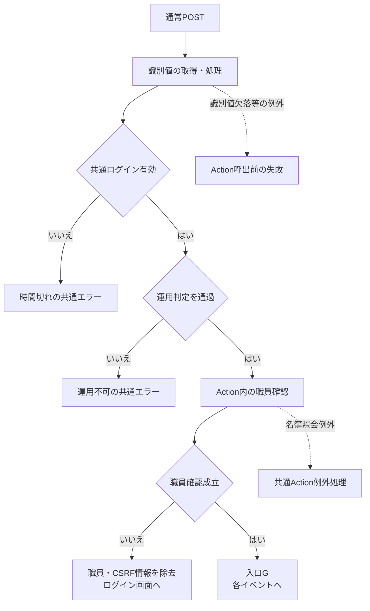

Actionが正常に戻った後には、独立したアクセス記録とJSPへのforwardが続く。予約JSPは表示のたびにコード候補を再取得するため、入力拒否後や業務commit後にも表示用照会が失敗し得る。本書の「予約画面へ」は再表示用モデル・状態の設定を意味し、ブラウザーでの表示完了を意味しない。

### 静的画面投影

以下は初期状態を表す非実行HTMLである。角括弧内は職員表示・候補名称の差込み位置を表し、候補の実データを定義するものではない。原画面の項目順、ID、class、共有ヘッダー、参照領域、確認領域を保持する。

投影では、送信用formを同じ位置・ID・classのdivへ、参照iframeを同じ位置・ID・classの空のdivへ置き換える。階層を追加せず、接続先、送信属性、スクリプト、イベントハンドラーを持たせない。全ボタンは`type=button`とする。実画面での送信先・method・コマンドは前掲の入口表による。この置換は文書表示のためのものであり、実装画面のDOM変更仕様ではない。

<!DOCTYPE html>
<html lang="ja">
<head>
<meta charset="UTF-8">
<meta name="viewport" content="width=device-width, initial-scale=1">
<title>新規・変更・削除</title>

</head>
<body>
<header class="app-nav">
年金自動受取予約管理システム

職員番号 <strong>［8桁の職員番号］</strong>　［職員氏名］
</header>
<main class="app-shell"><section class="screen surface pension-screen">

<h1>新規・変更・削除　画面</h1><button class="access-button secondary narrow" type="button">戻る</button>

<input type="hidden" name="FUNCTION_ID" value="nenkin"><input id="pensionView" type="hidden" name="VIEW_ID" value="Pension"><input id="pensionCommand" type="hidden" name="COMMAND_ID" value="Save"><input type="hidden" name="CSRF_TOKEN" value=""><input id="originalKana" type="hidden" name="ORIGINAL_KANA" value=""><input id="originalPhone" type="hidden" name="ORIGINAL_PHONE" value=""><input id="lookupKana" type="hidden" name="LOOKUP_KANA" value=""><input id="lookupPhone" type="hidden" name="LOOKUP_PHONE" value="">

<h2>基本情報</h2>

<label for="branchNo">店番</label>
<input id="branchNo" name="BRANCH_NO" value="" class="form-control code-input short-input" maxlength="3" inputmode="numeric" data-digits-only><button class="lookup-button" type="button">参照</button>

<label for="customerNo">顧客番号</label>
<input id="customerNo" name="CUSTOMER_NO" value="" class="form-control code-input medium-input" maxlength="7" inputmode="numeric" data-digits-only><button class="lookup-button" type="button">参照</button>

<label for="staffCode">担当者コード</label>
<input id="staffCode" name="STAFF_CODE" value="" class="form-control code-input short-input" maxlength="4" inputmode="numeric" data-digits-only><button class="lookup-button" type="button">参照</button>

<label class="access-red-label" for="kanaName">フリガナ</label><input id="kanaName" name="KANA_NAME" value="" class="form-control">

<label for="customerName">顧客氏名</label><input id="customerName" name="CUSTOMER_NAME" value="" class="form-control">

<label for="gender">性別</label><select id="gender" name="GENDER" class="form-select short-input"><option value=""></option><option value="［性別名称］">［性別名称］</option></select>

<label for="address">住所</label><textarea id="address" name="ADDRESS" class="form-control" rows="3"></textarea>

<label class="access-red-label" for="phoneNumber">電話番号</label>
<input id="phoneNumber" name="PHONE_NUMBER" value="" class="form-control"><button class="lookup-button" type="button">候補</button>

<label for="birthDate">生年月日</label>
<input id="birthDate" name="BIRTH_DATE" value="" class="form-control medium-input" maxlength="14" data-era-calendar data-era-calendar-mode="japanese"><button class="era-calendar-button" type="button" data-era-calendar-toggle="birthDate" aria-label="生年月日のカレンダーを開く"></button>

<label for="dataUpdateDate">データ更新日</label><input id="dataUpdateDate" name="DATA_UPDATE_DATE" value="" class="form-control medium-input access-readonly-display" readonly>

<h2>予約情報</h2>

<label>年金種類</label>
<label><input type="checkbox" name="NATIONAL_PENSION" value="1"> ［コード1の名称］</label><label><input type="checkbox" name="EMPLOYEE_PENSION_FUND" value="1"> ［コード8の名称］</label><label><input type="checkbox" name="EMPLOYEE_PENSION" value="1"> ［コード2の名称］</label><label><input type="checkbox" name="NATIONAL_PENSION_FUND" value="1"> ［コード16の名称］</label><label><input type="checkbox" name="MUTUAL_AID_PENSION" value="1"> ［コード4の名称］</label>

<label for="claimStatus">裁定請求書徴収</label><select id="claimStatus" name="CLAIM_STATUS" class="form-select short-input"><option value=""></option><option value="［裁定請求名称］">［裁定請求名称］</option></select>

<label for="claimDate">請求予定日</label>
<input id="claimDate" name="CLAIM_SCHEDULED_DATE" value="" class="form-control medium-input" maxlength="14" data-era-calendar data-era-calendar-mode="western"><button class="era-calendar-button" type="button" data-era-calendar-toggle="claimDate" aria-label="請求予定日のカレンダーを開く"></button>

<label for="plannedAge">予定年齢</label><input id="plannedAge" name="PLANNED_AGE" value="" class="form-control short-input" maxlength="3" inputmode="numeric" data-digits-only>

<label for="spouseName">配偶者名</label><input id="spouseName" name="SPOUSE_NAME" value="" class="form-control">

<label for="spouseBirthDate">配偶者生年月日</label>
<input id="spouseBirthDate" name="SPOUSE_BIRTH_DATE" value="" class="form-control medium-input" maxlength="14" data-era-calendar data-era-calendar-mode="japanese"><button class="era-calendar-button" type="button" data-era-calendar-toggle="spouseBirthDate" aria-label="配偶者生年月日のカレンダーを開く"></button>

<label for="hasBenefit">受給有無</label><select id="hasBenefit" name="HAS_BENEFIT" class="form-select short-input"><option value=""></option><option value="［受給有無名称］">［受給有無名称］</option></select>

<label for="requestDate">予約徴求日</label>
<input id="requestDate" name="RESERVATION_REQUEST_DATE" value="" class="form-control medium-input" maxlength="14" data-era-calendar data-era-calendar-mode="western"><button class="era-calendar-button" type="button" data-era-calendar-toggle="requestDate" aria-label="予約徴求日のカレンダーを開く"></button>

<label for="notes">備考</label><textarea id="notes" name="NOTES" class="form-control" rows="3"></textarea>

<label>６ヶ月先確認</label><label class="single-check"><input type="checkbox" name="SIX_MONTH_CHECK" value="1"> 確認済</label>

<button class="access-button primary" type="button">登録</button><button class="access-button danger" type="button">削除</button><button class="access-button secondary" type="button">クリア</button>

</section></main>

<h2 id="lookupTitle">入力補助</h2><button id="lookupClose" class="lookup-modal__close" type="button">閉じる</button>

<h2 id="messageTitle">確認</h2>

?

<button id="messageOk" class="access-button primary" type="button">OK</button><button id="messageCancel" class="access-button" type="button">キャンセル</button>

</body>
</html>

通常幅では画面最大幅1180px、基本情報と予約情報を幅比1対1.15・間隔36pxで並べる。入力行はラベル128pxと残余入力列、列間10pxで構成する。960px以下では領域を1列・間隔24pxにし、640px以下では入力行も1列、短幅・中幅入力の最大幅を100%、参照領域を幅100%、チェックを1列にする。名称表示の`white-space:nowrap`は維持される。住所・備考は最小高さ92pxで、縦方向にサイズ変更できる。

### 初期・既存・拒否時の投影差分

次表の各行を、前掲HTMLに対する独立した状態差分として適用する。互いに異なる状態を同時には適用しない。どの状態でも共有ヘッダー、基本情報・予約情報、参照領域、確認領域、下部3ボタンを保持する。役職や既存状態によって登録・削除・クリアを非表示・disabledにする分岐はない。

既存状態では`kanaName`と`phoneNumber`に`readonly`を付け、classを`form-control access-key-locked`とする。両キーは赤文字となり、背景には詳細度の高い`.form-control[readonly]`の`#edf0f2`が適用される。更新日は常にreadonlyで、`.access-readonly-display[readonly]`により通常文字色・背景`#f1f3f5`となる。

| 状態 | 表示モデル | キーとhidden値 | ステータス表示 |
| --- | --- | --- | --- |
| 初期・クリア後 | IntegerはNULLを空表示、文字列は空、チェックは未選択 | `existing=false`。キー編集可。ORIGINAL・LOOKUPは空 | hidden |
| 既存予約読込み | 取得した予約全体。店名・顧客氏名を表示し、担当者名は空 | `existing=true`。両キーreadonly。ORIGINALは表示モデルのキー、LOOKUPは空 | 「既存データを読み込みました。」、`message error` |
| 顧客基本情報取込み | 顧客由来の新モデル。従前の予約情報は合成しない | `existing=false`。キー編集可。ORIGINAL・LOOKUPは空 | 「顧客基本表から読み込みました。」、`message error` |
| 読込み0件 | 変換後の受信モデルを保持 | `existing=false`。キー編集可。ORIGINAL・LOOKUPは空 | hidden |
| 登録の入力拒否 | 変換・検査途中の受信モデル。店名・担当者名は空、顧客番号横には受信氏名 | 現在予約の存在有無を`existing`へ設定。存在時は受信モデルのキーをreadonly・ORIGINALにする | 最初の入力エラー、`message error` |
| POST・CSRF拒否 | 読取り済み受信モデル | `existing=false`。キー編集可。ORIGINALは空 | 有効期限案内、`message error` |
| 重複キー読込み | 現在キーで取得した予約全体 | `existing=true`。キーreadonly、ORIGINAL再設定 | 内容確認を要求、`message error` |
| キー変更拒否 | 元キーで取得した予約全体 | `existing=true`。キーreadonly、ORIGINAL再設定 | クリア後の新規入力を要求、`message error` |
| 変更・削除の権限拒否 | 現在キーで取得した予約全体 | `existing=true`。キーreadonly、ORIGINAL再設定 | 推進役以上による操作を要求、`message error` |
| 削除の店番不足 | 対象を照会せず受信モデルを保持 | `existing=true`。キーreadonly、ORIGINAL再設定 | 「店番は必ず入力してください」、`message error` |
| 削除のキー不足 | 受信モデル | `existing=false`。キー編集可 | 既存レコードの読込みを要求、`message error` |
| 削除の入口対象不一致 | 現在予約ありなら取得予約、不在なら受信モデル | 現在予約の有無を`existing`へ設定 | 再読込みを要求、`message error` |
| 削除内の再取得で対象不在 | 受信モデル | `existing=true`。キーreadonly、ORIGINAL再設定 | 「削除対象が見つかりません。」、`message error` |
| 登録・削除正常終了 | 空モデル | `existing=false`。キー編集可。ORIGINAL・LOOKUPは空 | 終了文言、`message success`。描画後に完了案内 |

メッセージが空ならステータスをhiddenにする。非空で「終了」を含む場合はsuccess、それ以外は読込み案内もerrorになる。`role=status`は属性であり、実DOMにない`.status-message`クラスの規則は適用しない。

| ダイアログ状態 | 前掲HTMLからの表示差分 | 操作結果 |
| --- | --- | --- |
| 参照中 | `lookupModal`のhiddenを除去し、タイトルを店番参照・担当者参照・顧客参照へ変更。bodyに`lookup-modal-open`を設定 | 親の閉じる・背景クリック・子の閉じる通知で終了 |
| 登録確認 | `messageBox`を表示。タイトル「確認」、本文「登録します。よろしいですか？」、アイコン「?」、OK・キャンセルを表示 | OKでSave。取消は送信せず入力保持 |
| 削除確認 | タイトル「削除確認」、本文「表示しているレコードを削除します。よろしいですか？」、アイコン「?」、OK・キャンセルを表示 | OKでDelete。取消は送信せず入力保持 |
| 入力案内・完了 | `messageBox`を表示。アイコン「!」、対象文言を本文に設定し、キャンセルにhiddenを付ける | OKで閉じる。背景クリックによる終了処理はない |

実画面の参照パネルは幅`min(1120px,96vw)`、高さ`min(720px,90vh)`、重なり順1000である。確認パネルは幅`min(440px,calc(100vw - 32px))`、重なり順1100で、本文の改行を保持する。

親文書がEscapeを受けると、確認領域が開いていればキャンセルボタンのclickを呼ぶ。それ以外で参照領域が開いていれば参照を閉じる。iframe内のキーイベントを親へ通知する処理はないため、iframe内のEscapeによる親モーダル終了は保証しない。

### データ関連と属性の範囲

D-01は予約表示SQLの関連を示す。すべてLEFT JOINであり、辺は検索条件を表す。FK制約や多重度を定義する図ではない。

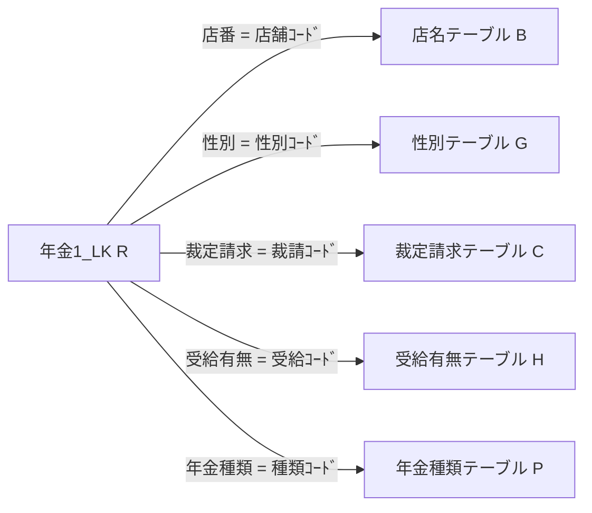

予約・コード・店名は`jdbc/RAROA_DB`、職員は`jdbc/Oracle_SP2NM`、顧客は`jdbc/Oracle_DWH`を第一候補とし、各系統は`java:comp/env`配下の同名も探索する。DataSourceは系統別に共有し、Connectionは各処理で取得する。職員・顧客候補の店名は、業務接続で取得したMapとのメモリ突合せで補う。

項目一覧の「本表」は`年金1_LK`を指す。DB型・NULLはSQL Server用DDLの宣言であり、配備済みDBの実測属性ではない。本表と削除明細の28列はいずれもNULL可である。ローカルH2定義では文字列をVARCHAR、整数をINTEGER、チェックをBOOLEAN、時刻をTIMEで宣言し、SQL ServerのNVARCHAR・INT・BIT・TIME(0)と区別する。

## 項目一覧

| No | グループ | 項目名 | 種類 | 入出力 | DB連携項目 | 候補取得元 | 必須 | 形式・桁 | 説明 |
| --- | --- | --- | --- | --- | --- | --- | --- | --- | --- |
| 1 | ヘッダー | ログイン職員 | 表示 | O | 職員名簿の職員番号・漢字氏名を職員セッション経由で表示 | ‐ | 画面利用には職員確認が必要 | `app-nav__meta`。職員番号8桁ゼロ埋め | 入力担当者とは別。保存・削除の更新者識別元 |
| 2 | 基本情報 | 店番 | テキスト・参照 | I／O | 本表.店番、`INT NULL`。顧客取込み検索は顧客基本表.店舗コード | 店名テーブル | 登録・削除は変換後非NULL。顧客取込みは顧客番号も必要 | `branchNo`／`BRANCH_NO`、`Integer branchNo`。maxlength=3、数字補助 | 正数を保存。予約キーのWHEREには使わない。店舗実在を保存必須条件とする検査はない |
| 3 | 基本情報 | 店名 | 表示 | O | 店名テーブル.店名、`NVARCHAR(80) NOT NULL`。本表への名称保存なし | 店番参照、予約LEFT JOIN、顧客取込み後の照会 | 入力対象外 | `branchName`、`String branchName` | 不在・JOIN不成立は空表示。フォームからモデルへ移さない。保守入力の業務上限は未確定 |
| 4 | 基本情報 | 顧客番号 | テキスト・参照 | I／O | 本表.顧客番号、`BIGINT NULL`。取込み検索は顧客基本表.顧客番号 | 顧客基本表 | 登録は空欄可。顧客取込みは店番も必要 | `customerNo`／`CUSTOMER_NO`、`Integer customerNo`。maxlength=7、数字補助 | 空欄・正数変換不能はNULL。getInt・setIntを使うためBIGINT全範囲の取扱いは保証しない |
| 5 | 基本情報 | 顧客番号横の氏名 | 表示 | O | 予約モデル.顧客氏名、または顧客基本表.漢字氏名。独立保存列なし | 顧客参照、再描画時の予約モデル | 入力対象外 | `customerNameDisplay`、文字列 | 氏名入力の手編集と常時同期しない |
| 6 | 基本情報 | 担当者コード | テキスト・参照 | I／O | 本表.担当者コード、`INT NULL` | 職員名簿.職員番号 | 登録は空欄可 | `staffCode`／`STAFF_CODE`、`Integer staffCode`。maxlength=4、数字補助 | 空欄・正数変換不能はNULL。保存時に候補・職員名簿との一致を再検証しない |
| 7 | 基本情報 | 担当者名 | 表示 | O | 外部職員名簿.漢字氏名。本表への名称保存なし | 担当者参照 | 入力対象外 | `staffNameDisplay`。候補の`String staffName` | 選択時に設定し、JSP再描画時は空。本番物理容量・保守業務上限は未確定 |
| 8 | 基本情報 | フリガナ | テキスト | I／O | 本表.ふりがな、`NVARCHAR(100) NULL`。検索・更新・削除キー | 顧客参照、顧客基本情報取込み、予約読込み | 登録・削除の入口でtrim後非空。保存はRepository正規化後も非空 | `kanaName`／`KANA_NAME`、`String kanaName`。maxlength・カナ文字種検査なし | 正規化後を検索・保存。既存状態はreadonly。DB容量100を業務上限として検査する処理はない |
| 9 | 基本情報 | 顧客氏名 | テキスト | I／O | 本表.顧客氏名、`NVARCHAR(100) NULL` | 顧客基本情報取込み、予約読込み | 登録は空欄可 | `customerName`／`CUSTOMER_NAME`、`String customerName`。maxlengthなし | trim後を保存し、空欄は空文字。接続された業務文字数検査はない |
| 10 | 基本情報 | 性別 | 選択 | I／O | 本表.性別、`TINYINT NULL`。名称から性別ｺｰﾄﾞへ逆引き | 性別テーブル.性別、性別ｺｰﾄﾞ昇順 | 登録は空選択可 | `gender`／`GENDER`、`String gender`。名称列`NVARCHAR(10) NOT NULL` | optionの値・表示は名称。空選択はNULLコード。保持は名称一致 |
| 11 | 基本情報 | 住所 | 複数行テキスト | I／O | 本表.住所、`NVARCHAR(300) NULL` | 顧客基本情報取込み、予約読込み | 登録は空欄可 | `address`／`ADDRESS`、`String address`。rows=3、maxlengthなし | trim後を保存し、空欄は空文字。接続された業務文字数検査はない |
| 12 | 基本情報 | 電話番号 | テキスト・候補 | I／O | 本表.電話番号、`DECIMAL(15,0) NULL`。検索・更新・削除キー | 顧客参照、顧客基本情報取込み、予約読込み | 登録・削除の入口でtrim後非空。保存は数字抽出結果も必要 | `phoneNumber`／`PHONE_NUMBER`、`String phoneNumber`。maxlength・15桁の明示的上限検査なし | 数字列からBigDecimalを作り検索・保存。既存状態はreadonly。「候補」は顧客参照を開く |
| 13 | 基本情報 | 生年月日 | 日付入力 | I／O | 本表.生年月日、`DATE NULL` | 顧客基本情報取込み、予約読込み、カレンダー | 登録は空欄可。非空は有効日付 | `birthDate`／`BIRTH_DATE`、`String birthDate`。maxlength=14、和暦表示 | 保存前ISO化。空欄はDB NULL。予定年齢補助にも使用 |
| 14 | 基本情報 | データ更新日 | readonlyテキスト | I／O | 本表.データ更新日、`DATE NULL` | 予約読込み、保存時サーバー日付 | 利用者入力対象外 | `dataUpdateDate`／`DATA_UPDATE_DATE`、`String dataUpdateDate`。表示`yyyy/MM/dd` | 要求値も読み取るが、保存時は当日に上書き |
| 15 | 予約情報 | 国民年金 | チェック | I／O | 本表.種類：国民年金、`BIT NULL`。合成値に1を加算 | 年金種類テーブル、種類ｺｰﾄﾞ=1の名称 | 未選択可 | `NATIONAL_PENSION`、`boolean nationalPension`、value=1 | 未送信はfalse、保存0。画面順1番目。名称列は`NVARCHAR(120) NOT NULL` |
| 16 | 予約情報 | 厚生年金基金 | チェック | I／O | 本表.種類：厚生年金基金、`BIT NULL`。合成値に8を加算 | 年金種類テーブル、種類ｺｰﾄﾞ=8の名称 | 未選択可 | `EMPLOYEE_PENSION_FUND`、`boolean employeePensionFund`、value=1 | 未送信はfalse、保存0。画面順2番目。名称列は`NVARCHAR(120) NOT NULL` |
| 17 | 予約情報 | 厚生年金 | チェック | I／O | 本表.種類：厚生年金、`BIT NULL`。合成値に2を加算 | 年金種類テーブル、種類ｺｰﾄﾞ=2の名称 | 未選択可 | `EMPLOYEE_PENSION`、`boolean employeePension`、value=1 | 未送信はfalse、保存0。画面順3番目。名称列は`NVARCHAR(120) NOT NULL` |
| 18 | 予約情報 | 国民年金基金 | チェック | I／O | 本表.種類：国民年金基金、`BIT NULL`。合成値に16を加算 | 年金種類テーブル、種類ｺｰﾄﾞ=16の名称 | 未選択可 | `NATIONAL_PENSION_FUND`、`boolean nationalPensionFund`、value=1 | 未送信はfalse、保存0。画面順4番目。名称列は`NVARCHAR(120) NOT NULL` |
| 19 | 予約情報 | 共済年金 | チェック | I／O | 本表.種類：共済年金、`BIT NULL`。合成値に4を加算 | 年金種類テーブル、種類ｺｰﾄﾞ=4の名称 | 未選択可 | `MUTUAL_AID_PENSION`、`boolean mutualAidPension`、value=1 | 未送信はfalse、保存0。画面順5番目。名称列は`NVARCHAR(120) NOT NULL` |
| 20 | 予約情報 | 裁定請求書徴収 | 選択 | I／O | 本表.裁定請求、`TINYINT NULL`。名称から裁請ｺｰﾄﾞへ逆引き | 裁定請求テーブル.裁定請求、裁請ｺｰﾄﾞ昇順 | 登録は空選択可 | `claimStatus`／`CLAIM_STATUS`、`String claimStatus`。名称列`NVARCHAR(10) NOT NULL` | 名称を送信し、空選択はNULLコード |
| 21 | 予約情報 | 請求予定日 | 日付入力 | I／O | 本表.請求予定日、`DATE NULL` | 予約読込み、カレンダー | 登録は空欄可。非空は有効日付 | `claimDate`／`CLAIM_SCHEDULED_DATE`、`String claimScheduledDate`。maxlength=14、表示`yyyy/MM/dd` | 空欄はDB NULL。出生年との年差で予定年齢を補助入力 |
| 22 | 予約情報 | 予定年齢 | テキスト | I／O | 本表.予定年齢、`INT NULL` | 生年月日・請求予定日の年差計算、予約読込み | 登録は空欄可 | `plannedAge`／`PLANNED_AGE`、`Integer plannedAge`。maxlength=3、数字補助 | 空・ゼロ・負数・不正数値等はNULL。サーバーで年齢を再計算しない |
| 23 | 予約情報 | 配偶者名 | テキスト | I／O | 本表.配偶者名、`NVARCHAR(100) NULL` | 予約読込み | 登録は空欄可 | `spouseName`／`SPOUSE_NAME`、`String spouseName`。maxlengthなし | trim後を保存し、空欄は空文字。配偶者生年月日との相互必須検査なし |
| 24 | 予約情報 | 配偶者生年月日 | 日付入力 | I／O | 本表.配偶者生年月日、`DATE NULL` | 予約読込み、カレンダー | 登録は空欄可。非空は有効日付 | `spouseBirthDate`／`SPOUSE_BIRTH_DATE`、`String spouseBirthDate`。maxlength=14、和暦表示 | 空欄はDB NULL。配偶者名が空でも日付単独を拒否しない |
| 25 | 予約情報 | 受給有無 | 選択 | I／O | 本表.受給有無、`TINYINT NULL`。名称から受給ｺｰﾄﾞへ逆引き | 受給有無テーブル.受給有無、受給ｺｰﾄﾞ昇順 | 登録は空選択可 | `hasBenefit`／`HAS_BENEFIT`、`String hasBenefit`。名称列`NVARCHAR(10) NOT NULL` | 名称を送信し、空選択はNULLコード |
| 26 | 予約情報 | 予約徴求日 | 日付入力 | I／O | 本表.予約徴求日、`DATE NULL` | 予約読込み、カレンダー | 登録は空欄可。非空は有効日付 | `requestDate`／`RESERVATION_REQUEST_DATE`、`String reservationRequestDate`。maxlength=14、表示`yyyy/MM/dd` | 空欄はDB NULL。初期表示で当日を設定しない |
| 27 | 予約情報 | 備考 | 複数行テキスト | I／O | 本表.備考、`NVARCHAR(400) NULL` | 予約読込み | 登録は空欄可。非空は変換可能かつ56バイト以下 | `notes`／`NOTES`、`String notes`。rows=3、maxlengthなし | trim後をWindows-31Jに変換して検査。空欄は空文字。切詰めなし |
| 28 | 予約情報 | ６ヶ月先確認 | チェック | I／O | 本表.６ヶ月先確認、`BIT NULL` | 予約読込み | 未選択可 | `SIX_MONTH_CHECK`、`boolean sixMonthCheck`、value=1 | 未送信はfalse、保存0。DB NULLも読込み時false |
| 29 | 内部値 | 年金種類合成コード | 算出 | ‐ | 本表.年金種類、`INT NULL` | 年金種類テーブル.種類ｺｰﾄﾞの存在確認 | 全未選択可。非ゼロは対応コード行が必要 | 5フラグの1・2・4・8・16を加算 | 全未選択はNULL。直接入力・hidden送信はしない |
| 30 | 内部値 | 更新時間・更新者・変更区分 | 保存制御 | ‐ | 本表.更新時間`TIME(0) NULL`、更新者`INT NULL`、変更FLG`TINYINT NULL` | サーバー時刻、ログイン職員、保存時存在判定 | 利用者入力なし | 時刻先頭8文字をJDBC TIMEへ変換 | 更新者は入力担当者と別。変更FLGは新規0、変更1、削除明細NULL |
| 31 | 要求制御 | 機能・画面・コマンド | hidden | I／O | DBへ直接保存しない | 初期値、操作ボタン | Action振分けに必要 | `FUNCTION_ID`、`VIEW_ID`、`COMMAND_ID`、受信`String` | Pensionの各操作、またはMenu Viewを指定 |
| 32 | 要求制御 | CSRF照合値 | hidden | I／O | DB保存なし。セッション`NENKIN_CSRF_TOKEN`と照合 | 職員確認時に確保する情報 | Save・DeleteでPOSTかつ一致が必要 | `CSRF_TOKEN`、受信`String` | 欠落・不一致は更新せず非既存状態へ戻す。経過時間の期限検査なし |
| 33 | 要求制御 | 読込元キー | hidden 2項目 | I／O | 本表キーの照会に使用。直接保存しない | 既存状態の表示モデル | 変更・削除の対象確認に使用 | `originalKana`／`ORIGINAL_KANA`、`originalPhone`／`ORIGINAL_PHONE`、受信`String` | 非既存状態は空。比較版やサーバー保持の元予約識別子ではない |
| 34 | 要求制御 | 読込み指定キー | hidden 2項目 | I／O | 本表.ふりがな・電話番号の検索に使用。直接保存しない | キー変更、顧客選択 | 各空欄をフォームの対応キーで補完 | `lookupKana`／`LOOKUP_KANA`、`lookupPhone`／`LOOKUP_PHONE`、受信`String` | 描画時は空。顧客選択時は候補キーを優先してLoadへ渡す |
| 35 | 状態表示 | 操作メッセージ | 表示 | O | DB保存なし。ViewBeanで保持 | 各Action | 入力対象外 | `pensionStatusMessage`、`String message` | 空はhidden。「終了」を含む場合はsuccess、その他はerror |
| 36 | 操作 | 登録 | ボタン | I | 本表INSERTまたはUPDATE | ‐ | 操作時に店番・キー・日付・備考等を検査 | `type=button`、Save | 確認OK後に送信。新規・変更で共通 |
| 37 | 操作 | 削除 | ボタン | I | 削除明細INSERT、本表DELETE | ‐ | 店番・キー・読込元一致・権限を検査 | `type=button`、Delete | フォームの非キー編集値を削除明細へ移さない |
| 38 | 操作 | クリア | ボタン | I | 予約更新なし | ‐ | 入力条件なし。職員確認あり | `type=button`、Clear | 確認なしで空モデルへ切替え |
| 39 | 操作 | 戻る | ボタン | I | 予約更新なし | ‐ | 職員確認あり | `type=button`、Menu View | 破棄確認なしでメニューへ戻る |
| 40 | 入力補助 | 参照領域 | モーダル・iframe | I／O | 店名テーブル、職員名簿、顧客基本表を参照 | Lookup画面 | 開く際に親の登録必須検査はしない | `lookupModal`、`lookupFrame` | 選択値を親へ移送。顧客選択だけLoadへ進む |
| 41 | 確認 | 確認・案内領域 | ダイアログ | I／O | DB非使用 | ブラウザー検査、操作確認、終了文言 | 登録・削除は確認OK時だけ送信 | `messageBox`、`messageOk`、`messageCancel` | 確認はOK・キャンセル、案内・完了はOKだけ |
| 42 | 入力補助 | 日付選択・数字整形 | 入力イベント・ボタン | I／O | ブラウザー内の入力値。操作だけでは保存しない | カレンダー、数字入力補助 | 利用は任意 | 日付4項目、数字補助4項目 | 送信後はサーバーが別途変換・検査 |

## イベント仕様

### 初期表示・クリア

#### 処理概要

メニューから開く操作と「クリア」は、同じ画面作成処理で空の予約入力を用意する。既存予約を表示中でも、クリアはDBを変更せず画面の入力・既存状態を初期化する。

#### 処理手順

**1. 職員と空入力を準備する。**

　**1.1.** 共通入口Gを通過する。職員確認不能ならログイン画面へ戻す。

　**1.2.** `createEmpty`で新しい予約を作る。IntegerはNULL、文字列は空、チェックはfalseとなる。職員引数から店番・担当者等を移さない。

**2. 画面状態を置き換える。**

　**2.1.** 空モデル、空メッセージ、`existing=false`、職員表示を新しいViewBeanへ設定し、セッションのViewBeanを置き換える。

　**2.2.** 予約JSPへ戻す。JSPが候補を取得し、キー編集可能な初期画面を構成する。

#### 処理フロー

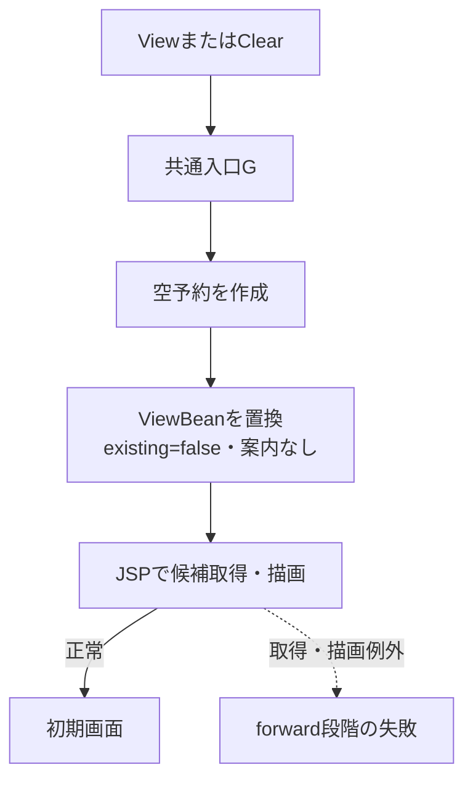

#### SQL・テーブル関連（ER図）

本表・削除明細への書込みはない。職員セッション未成立時の名簿確認と、JSPによるコード候補照会は行い得る。候補は独立して取得するため、このイベント固有のER図は省略する。予約との検索関連はD-01による。

#### DB操作の詳細

| 候補 | SELECTするコード・名称 | ORDER BY |
| --- | --- | --- |
| 性別 | 性別テーブル.性別ｺｰﾄﾞ・性別 | 性別ｺｰﾄﾞ昇順 |
| 裁定請求 | 裁定請求テーブル.裁請ｺｰﾄﾞ・裁定請求 | 裁請ｺｰﾄﾞ昇順 |
| 受給有無 | 受給有無テーブル.受給ｺｰﾄﾞ・受給有無 | 受給ｺｰﾄﾞ昇順 |
| 年金種類 | 年金種類テーブル.種類ｺｰﾄﾞ・年金種類 | 種類ｺｰﾄﾞ昇順 |

いずれも全件取得で、WHERE、停止条件、有効期間、ページング、SQLパラメータはない。年金種類は`Map<Integer,String>`へ移し、コード1・8・2・16・4を画面のチェックラベルに使う。

#### 結果・例外時の扱い

ClearはViewActionを継承する。専用の確認ダイアログと、Save・Delete用のPOST・CSRF照合は行わない。職員確認中の例外は共通Action例外処理へ伝播する。空モデルを設定できても、その後の候補取得・描画に失敗すれば初期画面の表示は完了しない。

### 店番・担当者・顧客の参照

#### 処理概要

入力補助をiframeで開き、選択結果を親フォームへ移す。「候補」は現在のフリガナ・電話番号を検索条件として顧客参照を開く操作であり、予約本表の候補検索を呼ばない。

#### 処理手順

**1. 参照対象と条件を決める。**

　**1.1.** 店番は`TARGET=branch`、担当者は`staff`、顧客参照と候補は`customer`としてLookup ViewへPOSTする。共通識別値、`POPUP=1`、現在店番を渡す。

　**1.2.** 候補ボタンだけ現在フリガナを`NAME_KEYWORD`、電話番号を`PHONE_KEYWORD`へ渡す。通常の顧客参照は両条件を空にする。

　**1.3.** モーダルを表示して親の閉じるボタンへフォーカスする。顧客番号changeでも、店番・顧客番号が非空でORIGINAL_KANAが空なら顧客参照を開く。この分岐は顧客番号そのものを検索条件として送らない。

**2. 候補を検索・表示する。**

　**2.1.** Lookup側で職員確認後に要求条件を保持する。TARGETがbranch・staff以外ならcustomerとして扱う。店番が正数Integerへ変換できなければNULLとし、店番条件を付けない。

　**2.2.** モード別に全件検索し、Actionが20件ずつメモリで切り出す。一覧状態は親のViewBeanとは別のセッション属性`SubWindowBean`に保持する。

**3. 選択結果を親へ移す。**

　**3.1.** 子画面は`source=nenkin.lookup`を付け、`location.origin`を宛先にpostMessageする。親は同一origin、dataの存在、sourceを確認する。送信元windowとlookupFrameの一致は検査しない。

　**3.2.** 店番選択では店番・店名、担当者選択では担当者コード・担当者名だけを更新する。担当者候補の所属店番は移さない。店番変更で他項目を自動解除する処理もない。

　**3.3.** 顧客選択では店番・顧客番号・表示店名・表示顧客氏名・LOOKUPキーを設定し、参照を閉じてLoadへ進む。候補の担当者コードを親で直接移さず、Loadの取得結果で最終入力を決める。

**4. 参照を終了する。**

　**4.1.** 親の閉じる、背景クリック、子からの閉じる通知で終了する。親がEscapeを受け、確認領域が開いていなければ同じ終了処理を行う。

　**4.2.** モーダルを隠し、実画面のiframeを`about:blank`へ戻し、スクロール抑止を解除して呼出元へフォーカスを戻す。選択なしで閉じた場合は親入力を保持する。

#### 処理フロー

**フロー1：参照開始・検索。** 選択通知を受けた場合は通知データをフロー2へ渡す。

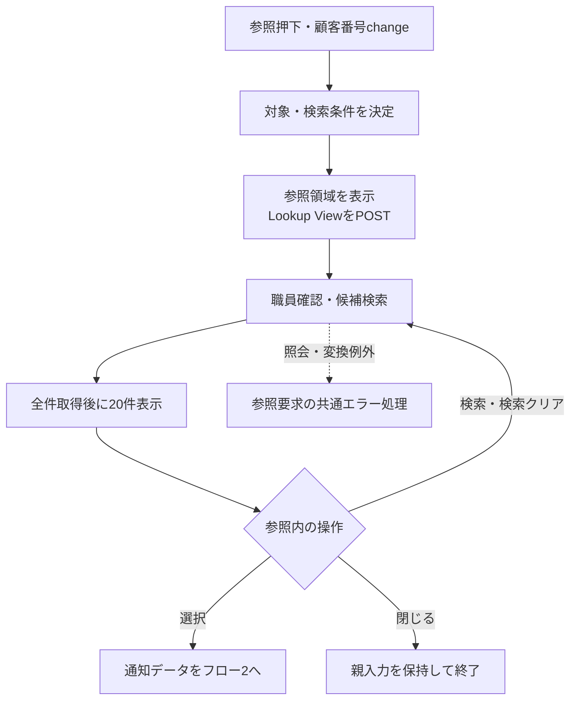

**フロー2：通知受付・値の移送。** 顧客選択の出口は、LOOKUPキーと店番・顧客番号を読込みイベントへ引き継ぐ。

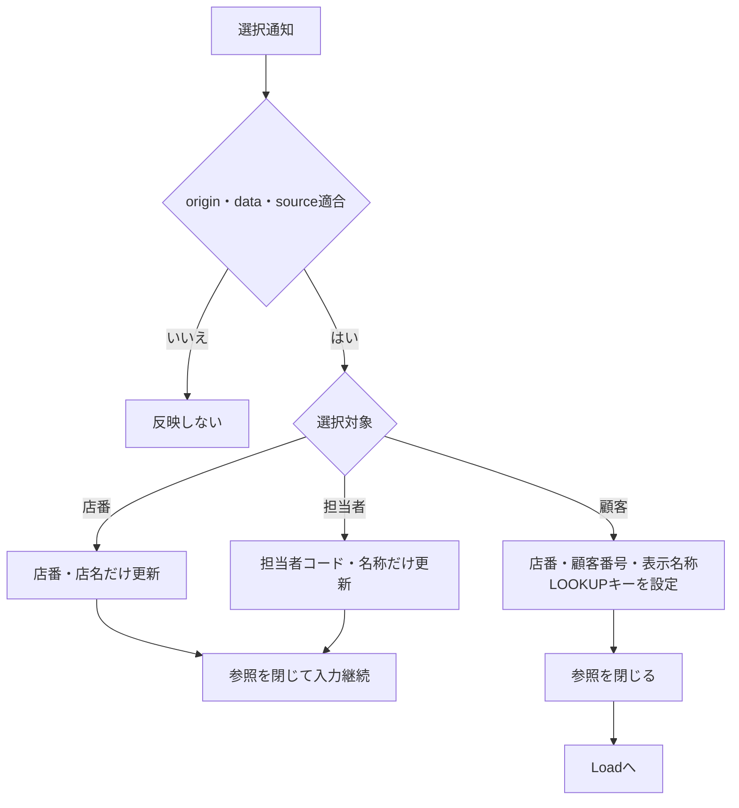

親文書のEscape処理は確認領域を優先する。確認領域が開いていればその取消を呼び、それ以外で参照が開いていれば閉じる。iframe内のEscapeには、親を閉じる通知処理がない。

#### SQL・テーブル関連（ER図）

店舗は業務接続、職員は職員接続、顧客は顧客接続から取得する。外部表と業務表のDB JOINは行わず、職員・顧客候補の店名をメモリで補う。

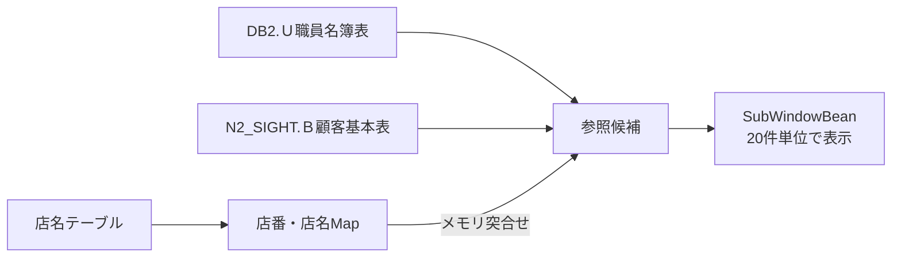

#### DB操作の詳細

| 対象 | 抽出条件・JDBCバインド | 取得内容・順序 |
| --- | --- | --- |
| 店番 | 検索語非空時、`CAST(店舗ｺｰﾄﾞ AS VARCHAR(20)) LIKE ?`と`UPPER(店名) LIKE UPPER(?)`をOR結合。同じ部分一致値をsetStringで2回設定 | 店舗ｺｰﾄﾞ・店名。店舗ｺｰﾄﾞ昇順 |
| 担当者 | `WHERE 1 = 1`へ、指定時だけ`S.所属店番 = ?`、カナ氏名または漢字氏名の大文字化LIKEをAND追加。店番setInt、氏名setString2回の順 | 職員番号・漢字氏名・カナ氏名・所属店番・役職コード。職員番号昇順 |
| 顧客 | `WHERE 1 = 1`へ、指定時だけ`C.店舗コード = ?`、漢字氏名またはカナ氏名の大文字化LIKE、`TO_CHAR(C.電話番号) LIKE ?`をAND追加。店番setInt、氏名setString2回、電話setStringの順 | 店舗コード・顧客番号・カナ氏名・漢字氏名・電話番号・生年月日・担当者コード。店舗コード・顧客番号・カナ氏名昇順 |

検索語はNFKC、trim、全角空白置換、連続半角空白集約、大文字化を行う。LIKE値はバックスラッシュ、%、_、角括弧をエスケープして前後に%を付け、SQLの各LIKEにESCAPE指定を付ける。

顧客電話条件は数字抽出・先頭ゼロ除去後を使う。空条件、数字を得られない電話条件は、その項目で絞り込まない。店番が正数Integerにならなければ店番条件を付けないため、空欄・変換不能時には他の検索条件に従う範囲を対象とする。

SQL上のページングはなく、全件取得後にメモリで切り出す。検索語・ページ・対象区分は検索制御値であり、予約の保存列へ直接書き込まない。参照検索と親子通信の詳細責務はSCR-016・DET-SCR-016に対応する。

#### 結果・例外時の扱い

0件では選択行を作らない。ページ上限補正は切出し後に行うため、範囲外ページでは表示番号を補正しても、その要求の一覧は空になり得る。

参照内のクリアは検索条件を空にして再検索する操作であり、親の選択済値を解除しない。照会・顧客日付変換等の例外は参照要求から共通側へ伝播する。候補選択だけでは予約を保存しない。

### 予約読込み・顧客基本情報取込み

#### 処理概要

新規状態でのキー変更、または顧客選択を契機にLoadを実行する。予約があれば予約全体を表示し、不在の場合だけ店番・顧客番号による顧客基本情報取込みへ進む。

#### 処理手順

**1. 読込みキーを受け取る。**

　**1.1.** フリガナ・電話番号changeでは、ORIGINAL_KANAが空、両キーがreadonlyでない、両入力のJavaScript trim結果が非空という条件をすべて満たす場合に、現在キーをLOOKUPへ設定してLoadを送る。

　**1.2.** 顧客選択からは候補のLOOKUPキーでLoadを送る。入口Gを通過後、フォームをモデルへ変換する。

　**1.3.** LOOKUP_KANA・LOOKUP_PHONEをそれぞれtrimし、空の項目だけフォームの対応キーで補う。Save・Delete用のPOST・CSRF照合は呼ばない。

**2. 予約を先に照会する。**

　**2.1.** Repositoryがフリガナを正規化し、電話を数値化する。正規化後フリガナが空、または電話の数字がなければ、接続取得前に不在を返す。

　**2.2.** 予約ありなら取得予約全体、`existing=true`、「既存データを読み込みました。」を設定する。

**3. 予約不在時に顧客を照会する。**

　**3.1.** 店番・顧客番号がともに正数Integerの場合だけ顧客基本表を照会する。

　**3.2.** 顧客ありなら新しい予約モデルへ基本情報を移し、電話と生年月日を変換する。顧客接続を閉じた後、別の業務接続で店名・性別名称を補う。

　**3.3.** 顧客由来の新モデル、`existing=false`、「顧客基本表から読み込みました。」を設定する。従前の年金種類・配偶者・備考等は引き継がない。

　**3.4.** 顧客照会を省略した場合、または顧客不在なら、受信モデルを`existing=false`・案内空で保持する。

#### 処理フロー

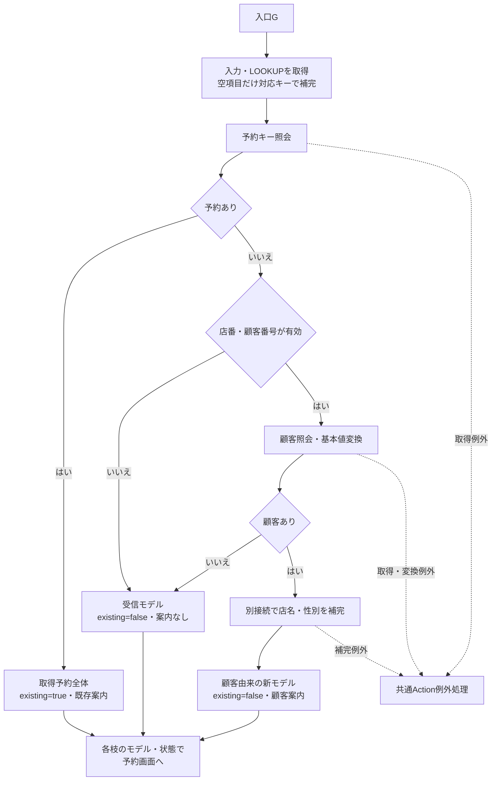

#### SQL・テーブル関連（ER図）

予約照会はD-01のLEFT JOINを使用する。顧客取込みは外部顧客表の単表照会であり、店名・性別名称の補完は別接続で行う。顧客照会と名称補完を一体のトランザクションとして扱わない。

#### DB操作の詳細

| 照会 | 全検索条件・パラメータ | 取得結果 |
| --- | --- | --- |
| 予約 | `R.ふりがな = ? AND R.電話番号 = ?`。正規化フリガナsetString、電話BigDecimalをsetBigDecimal | 店番・店名、顧客番号・担当者、氏名・フリガナ・住所・電話、性別・裁定請求・受給有無・年金種類の名称、4業務日付・更新日、予定年齢・配偶者名・備考、5年金フラグ・確認フラグ |
| 顧客 | `C.店舗コード = ? AND C.顧客番号 = ?`。両方setInt | 店舗コード・顧客番号・担当者コード・漢字氏名・カナ氏名・性別コード・漢字住所・電話番号・生年月日 |
| 店名 | `店舗ｺｰﾄﾞ = ?`、setInt | 店名。不在は空の代替値 |
| 性別名称 | `性別ｺｰﾄﾞ = ?`、setInt | 性別名称。コードまたは名称不在は空 |

各単件照会は先頭1行を使い、ORDER BY、明示的取得上限、複数行の件数検査はない。予約照会は店番を条件にせず、更新時間・更新者・変更FLG・比較版を画面モデルへ取得しない。

欠落したORIGINAL等のNULL文字列は、Repositoryの文字列処理で空として扱う。正規化後フリガナ空、または電話数字なしなら、明示判定で照会不在となる。キー欠落をSQLのNULL等価比較へ渡す方式ではない。

#### 結果・例外時の扱い

予約読込み後はキーreadonly、顧客取込み後は編集可能となる。予約・顧客とも不在なら受信モデルを保持し、0件を入力初期化に置き換えない。

顧客生年月日はtrim後の空または文字列0なら空、小数点以降があれば除いて日付変換する。日付変換のIllegalArgumentExceptionはSQLException用catchの対象ではなく、正常な顧客不在にはならない。予約照会・顧客照会・名称補完の例外は共通Action例外処理へ伝播する。予約JSPの候補再取得・描画はその後の別段階である。

### 数字・日付入力と予定年齢の補助

#### 処理概要

数字整形、日付カレンダー、予定年齢の年差計算で入力を補助する。保持先はブラウザー内のinput値とカレンダー状態であり、補助操作自体はDBを更新しない。

#### 処理手順

**1. 数字入力を整える。**

　**1.1.** 店番・顧客番号・担当者コード・予定年齢の`data-digits-only`に対し、初回バインド、input、blurで全角数字を半角化し、非数字を除く。

　**1.2.** 値が変わった場合だけchangeを発火し、編集中のカーソル位置を数字数に応じて補正する。編集可能な非空入力はfocus時に全選択する。顧客番号changeは条件により顧客参照へつながる。

**2. 日付を選択・整形する。**

　**2.1.** 生年月日2項目はjapanese、請求予定日・予約徴求日はwesternモードで開く。解析可能な入力日を表示月の基準とし、なければ当日を使う。開くだけでは当日を入力しない。

　**2.2.** 前月・翌月で表示月を変える。日選択では表示値を設定し、input、changeを順に発火して閉じ、入力へフォーカスを戻す。

　**2.3.** blur・changeでも解析可能値を整形する。画面外クリックとEscapeでカレンダーを閉じ、resize・scroll時に位置を調整する。本画面は日付別ISO hiddenを指定していない。

**3. 予定年齢を補助入力する。**

　**3.1.** 生年月日・請求予定日のinputまたはchangeで両日を解析できれば、請求年から出生年を引いて予定年齢へ設定する。誕生日の到来は調べない。

　**3.2.** 片方が空・解析不能なら従前の予定年齢を保持する。負の年差が設定される場合もあるが、サーバーの正数変換ではNULLとなる。

#### 処理フロー

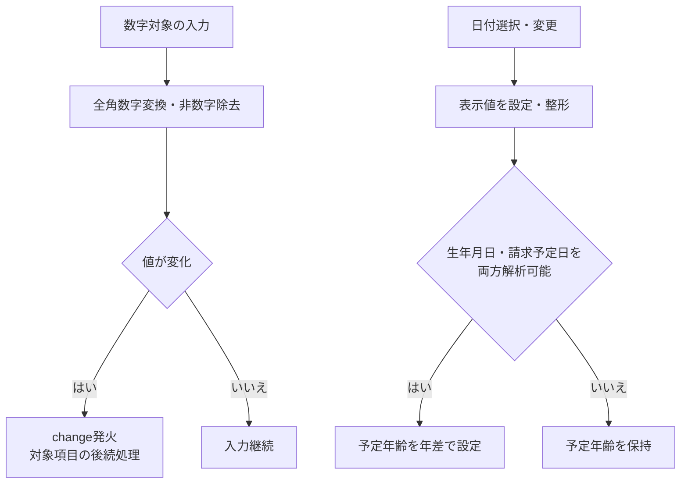

カレンダーを開く際の表示月決定と、日を選択した際の値設定は別処理である。表示月に当日を用いたことを、当日の入力確定として扱わない。

#### SQL・テーブル関連（ER図）

補助自体はDBを使わないためER図は非該当である。保持領域はブラウザー内の入力値・カレンダー状態である。送信後の保存列対応は項目一覧による。

#### DB操作の詳細

補助中のSELECT・DMLはない。補助から発火したchangeで顧客参照やLoadが始まった場合は、それぞれのイベントの照会を行う。数字補助の汎用処理と、JSP固有の確認・参照処理は別である。

#### 結果・例外時の扱い

ブラウザーとJavaの日付解析器は受理形式が異なる。ブラウザーで解析できた値をサーバーでも必ず受理するとは扱わない。予定年齢はサーバーで満年齢や日付との整合を再計算せず、要求から変換した正数を保存する。

### 登録・変更

#### 処理概要

利用者の確認後、サーバーが入力、現在キー、読込元キー、役職を順に確認する。保存内では入力を再検査し、同一業務接続での存在再確認によりINSERTまたはUPDATEを選び、全28列を設定する。

#### 処理手順

**1. ブラウザーで送信を確認する。**

　**1.1.** 店番の非空、次にフリガナ・電話番号の非空を確認する。不足時はOKだけの案内で止める。この段階はtrim・整数変換を行わない。

　**1.2.** 「登録します。よろしいですか？」を表示する。OKでSaveを送り、取消では送信せず入力を保持する。親文書がEscapeを受けた場合も確認取消となる。

**2. サーバーで要求と入力を検査する。**

　**2.1.** 入口Gの後、要求をモデルへ変換する。欠落文字列は空文字としてtrimする。店番・顧客番号・担当者コード・予定年齢は正数Integerだけを残し、空・ゼロ・負数・不正数値・int範囲外はNULLにする。チェックは1、大小文字を問わないtrue・onだけをtrueとする。

　**2.2.** POSTかつCSRF一致を確認する。不適合なら受信モデル、`existing=false`、「画面の有効期限が切れました。メニューから操作しなおしてください。」で戻す。

　**2.3.** 店番NULL、フリガナ空、電話番号空、生年月日、配偶者生年月日、請求予定日、予約徴求日、備考の順に調べ、最初の不正で止める。各日付は検査成功直後にモデルをISO文字列へ更新する。

　**2.4.** 入力エラーでも現在キーで予約を照会し、存在有無を`existing`へ設定する。表示モデルは取得予約へ置き換えず、変換・検査途中の受信モデルを保持する。この照会例外は共通Action例外処理へ進む。

**3. 対象と権限を確認する。**

　**3.1.** 現在キー、ORIGINALキーの順に予約を取得する。同一キー判定は両予約が存在することを前提とし、Action用のフリガナ・電話比較を行う。

　**3.2.** 現在予約があり、元予約と同じキーと確認できなければ、現在予約全体を既存表示し、「同じフリガナと電話番号の既存データを読み込みました。内容を確認してから登録してください。」で止める。

　**3.3.** 現在予約がなく元予約だけあれば、元予約を既存表示し、「キー項目は変更できません。クリア後に新規データとして入力してください。」で止める。現在キーが別予約を指す場合は3.2が先となる。

　**3.4.** 現在予約がある場合だけ役職を確認する。ログイン職員の所属店番が75で、trim後役職コードを整数化できないか3000未満なら、現在予約を既存表示して変更を拒否する。入力店番・対象予約店番はこの判定に使わない。

　**3.5.** 現在予約・元予約がともに不在なら、ORIGINALが送られていても新規保存へ進む。

**4. 保存内で再確認して確定する。**

　**4.1.** 入力をコピーし、フリガナ正規化、電話の数字有無、備考、日付を再検査する。日付順は生年月日、請求予定日、予約徴求日、配偶者生年月日である。更新日を当日にする。ここまでは接続取得・保存tryの前に行う。

　**4.2.** 業務接続を取得してautoCommit=falseとし、店名補完、同一接続でのキー存在再確認を行う。

　**4.3.** 保存時に存在すれば変更FLG=1で全列UPDATE、なければ0でINSERTする。名称からのコード逆引き、年金種類合成コードの存在確認、28列バインド、実行件数1件の検査を行う。

　**4.4.** commit正常終了後にCHANGEDまたはNEWを返す。Actionは区分で表示を分けず、空モデル、`existing=false`、「登録終了！」へ切り替える。

#### 処理フロー

**フロー1：送信確認と入力検査。** 通過時は変換・日付検査後のモデルをフロー2へ渡す。

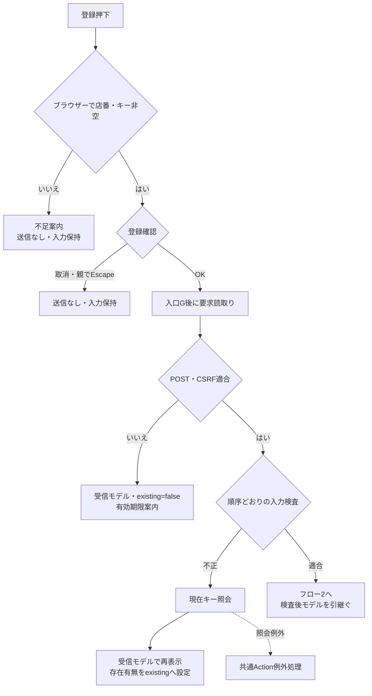

**フロー2：対象と権限の確認。** 保存枝は入力モデルとログイン職員番号をフロー3へ渡す。

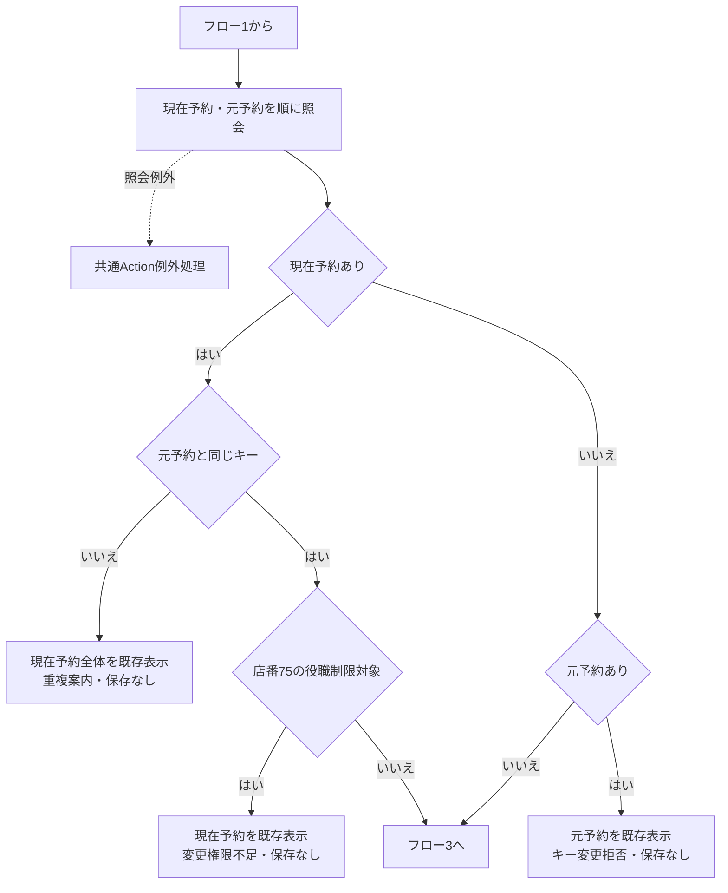

**フロー3：保存内の再確認・DML・確定。** エラー出口Eは、その時点の例外をフロー4へ渡す。

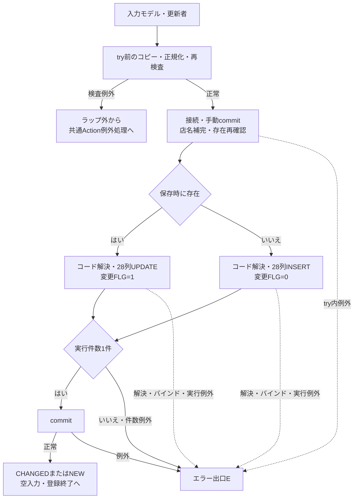

**フロー4：保存try内例外の処理。** try前の検査例外はこの図へ入らない。

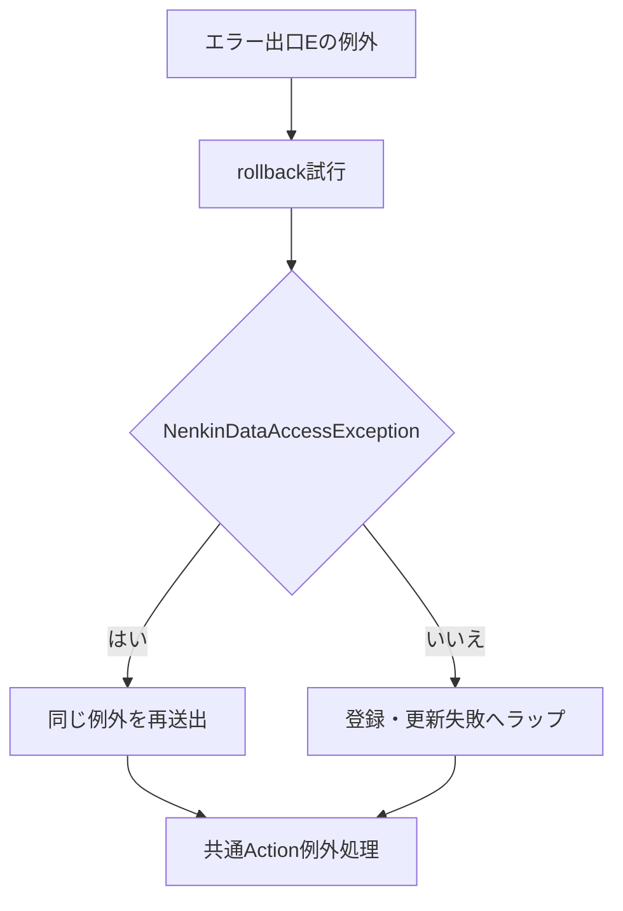

#### SQL・テーブル関連（ER図）

Actionの予約照会はD-01による。保存内の存在確認は本表だけを検索する。名称選択はコード表の逆引き、年金種類は合成コードの行確認を経て保存する。

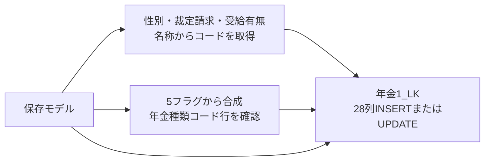

#### DB操作の詳細

存在再確認は`SELECT 1 FROM 年金1_LK WHERE ふりがな = ? AND 電話番号 = ?`で、setString・setBigDecimalの順に設定し、先頭行の有無を使う。UPDATEのWHEREも同じ2項目であり、店番・ORIGINAL・比較版を含めない。

INSERT列とUPDATEのSETは次の28列で共通であり、差分だけの更新ではない。

| 位置 | 保存列 | JDBC設定・値 |
| --- | --- | --- |
| 1～3 | 店番・顧客番号・担当者コード | setInt。NULLはTypes.INTEGER |
| 4・5 | 顧客氏名・ふりがな | setString。フリガナはRepository正規化後 |
| 6 | 性別 | 名称から性別ｺｰﾄﾞを逆引きしてsetInt。空名称はTypes.INTEGERのNULL |
| 7 | 住所 | setString。空欄は空文字 |
| 8 | 電話番号 | 数字列から作るBigDecimalをsetBigDecimal。helperの値なし型はTypes.DECIMALだが、保存前検査で数字なしを拒否 |
| 9 | 生年月日 | setDate。空欄はTypes.DATEのNULL |
| 10～14 | 種類：国民年金・種類：厚生年金・種類：共済年金・種類：厚生年金基金・種類：国民年金基金 | この順にsetIntで0または1 |
| 15 | 年金種類 | 1・2・4・8・16の合成値。非ゼロはコード行確認後setInt。全未選択はTypes.INTEGERのNULL |
| 16 | 裁定請求 | 名称から裁請ｺｰﾄﾞを逆引きしてsetInt。空名称はTypes.INTEGERのNULL |
| 17 | 請求予定日 | setDate。空欄はTypes.DATEのNULL |
| 18 | 予定年齢 | setInt。NULLはTypes.INTEGER |
| 19 | 配偶者名 | setString。空欄は空文字 |
| 20 | 配偶者生年月日 | setDate。空欄はTypes.DATEのNULL |
| 21 | 受給有無 | 名称から受給ｺｰﾄﾞを逆引きしてsetInt。空名称はTypes.INTEGERのNULL |
| 22 | 予約徴求日 | setDate。空欄はTypes.DATEのNULL |
| 23 | 備考 | 検査済み文字列をsetString。空欄は空文字 |
| 24 | データ更新日 | サーバー当日のISO文字列をJDBC DATEへ変換してsetDate |
| 25 | 更新時間 | サーバー時刻の先頭8文字をsetTime。helperは8文字未満ならTypes.TIMEのNULL |
| 26 | 更新者 | ログイン職員番号をsetInt。helperのNULL型はTypes.INTEGER |
| 27 | ６ヶ月先確認 | setIntで0または1 |
| 28 | 変更FLG | INSERTはsetIntで0、UPDATEは1 |
| UPDATEの29・30 | WHEREのふりがな・電話番号 | setString、setBigDecimal |

性別・裁定請求・受給有無の逆引きは、対応する名称列を`= ?`で照会し、trim後名称をsetStringする。空名称は照会せずNULLコードとする。非空名称で該当行がなければSQLExceptionとなる。先頭コードを使い、ORDER BYや名称重複の件数検査はない。

年金種類は`SELECT 年金種類 FROM 年金種類テーブル WHERE 種類ｺｰﾄﾞ = ?`へ合成値をsetIntする。全未選択は照会せずNULL、非ゼロで行がなければSQLExceptionとなる。逆引きと合成コード確認はbindRecord内で行うため、DML実行前にも失敗し得る。

文字列のパラメータサイズ指定、setNString、SQLタイムアウト、取消呼出しは対象処理にない。DDL上のNVARCHAR・BIGINT・TINYINT・BITと、実際のsetString・setInt等を区別する。

#### 結果・例外時の扱い

入力拒否後に表示するのは変換後モデルである。不正数値はNULL、文字列はtrim済みとなり、後の項目で日付エラーになると、先の項目だけISO化済みの場合がある。現在予約があれば、受信モデルのキーをreadonly・ORIGINALにする。

全角空白だけのフリガナや数字のない電話番号は、Actionの非空検査を通ってもRepositoryのtry前検査でIllegalArgumentExceptionとなり得る。SaveActionに個別catchはなく、画面内案内へ戻らず共通Action例外処理へ進む。

保存try内のExceptionではrollbackを試みる。その後、NenkinDataAccessExceptionなら同じ例外を再送出し、それ以外だけを「年金予約の登録・更新に失敗しました。」へ包む。commit例外もこのcatchへ進む。try前検査はこのラップの外である。正常commitと完了画面の受領は別の境界となる。

### 削除

#### 処理概要

現在キーと読込元キーを照合し、役職を確認してから、削除明細追加と本表削除を同一業務トランザクションで行う。明細に使うのは削除内で再取得したDB由来モデルである。

#### 処理手順

**1. ブラウザーで削除を確認する。**

　**1.1.** 店番の非空、次にフリガナ・電話番号の非空を確認する。不足時は削除用案内で止める。trim・整数変換は行わない。

　**1.2.** 「表示しているレコードを削除します。よろしいですか？」を表示し、OKだけでDeleteを送る。取消、または親文書が受けたEscapeでは送信せず入力を保持する。

**2. サーバーで対象と権限を確認する。**

　**2.1.** 入口Gの後、フォームをモデルへ変換し、POST・CSRFを照合する。不適合なら受信モデル、`existing=false`、有効期限案内で戻す。

　**2.2.** 店番NULLなら対象を照会せず、受信モデル、`existing=true`、「店番は必ず入力してください」で戻す。次にキー空を調べ、不足なら受信モデル、`existing=false`で既存レコードの読込みを求める。

　**2.3.** 現在キー、ORIGINALキーの順に予約を取得する。現在不在または同一キー未確認なら、「削除対象を参照画面またはキー入力から読み込んでください。」で止める。現在予約ありなら取得予約・既存状態、不在なら受信モデル・非既存状態とする。

　**2.4.** 対象一致後、ログイン職員の所属店番75・役職コードによる制限を確認する。制限対象なら取得予約を既存表示し、推進役以上による削除を求める。

**3. 削除内で再取得して更新する。**

　**3.1.** 受信キーとログイン職員番号をRepositoryへ渡す。正規化後フリガナ空、または電話数字なしなら接続前にfalseを返す。

　**3.2.** 有効キーなら業務接続をautoCommit=falseにして、同一接続で対象を再取得する。不在なら明示rollbackの正常終了後にfalseを返す。

　**3.3.** 再取得モデルの更新日を当日にし、削除時刻・ログイン職員番号・変更FLG=NULLで削除明細へ追加する。追加件数1件を確認する。

　**3.4.** 本表をキー2項目で削除し、削除件数1件を確認してcommitする。正常終了後にtrueを返す。

**4. 戻り値別に画面を設定する。**

　**4.1.** trueなら空モデル、`existing=false`、「削除終了！」とする。

　**4.2.** falseなら受信モデル、`existing=true`、「削除対象が見つかりません。」とする。Action確認後に対象が消えた場合も、受信キーをreadonly・ORIGINALに再設定する。

#### 処理フロー

**フロー1：削除受付と入力検査。** 通過時は受信モデルをフロー2へ渡す。

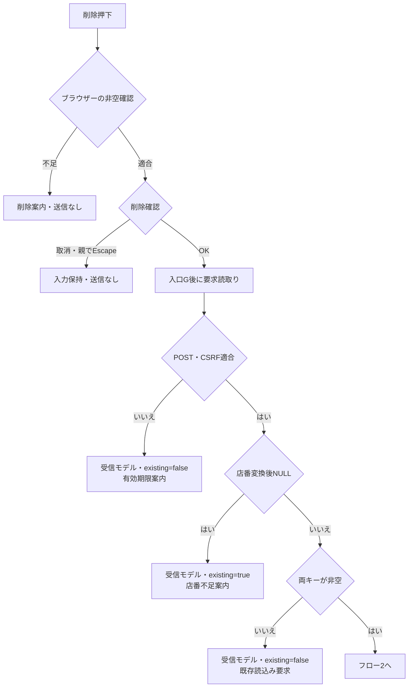

**フロー2：読込元と役職の確認。** 通過時だけ受信キーとログイン職員番号をフロー3へ渡す。

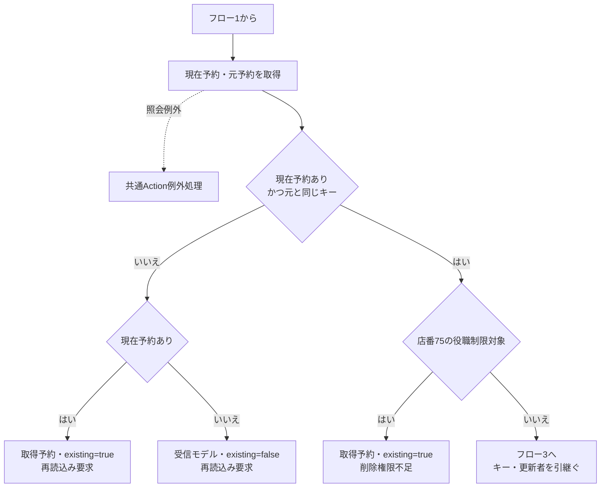

**フロー3：削除内の再確認と更新。** false・trueはフロー4の別出口へ接続する。エラー出口Eは例外を引き継ぐ。

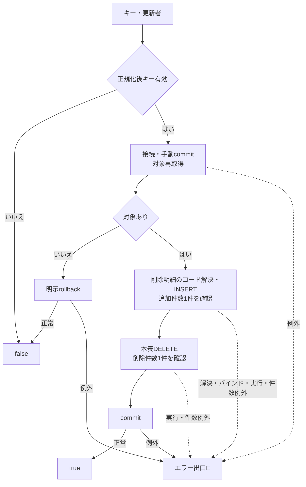

**フロー4：戻り値・例外別の結果。** 入口照会で不在だったフロー2の出口と、Repositoryがfalseを返す出口を混同しない。

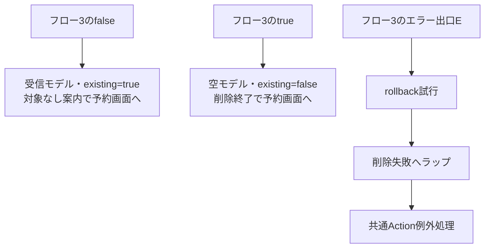

#### SQL・テーブル関連（ER図）

再取得はD-01の表示関連を使う。削除明細追加と本表削除は同一接続で行う。

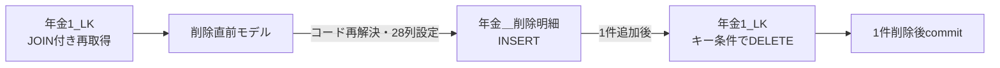

#### DB操作の詳細

対象再取得はD-01のSELECT列・LEFT JOINに`R.ふりがな = ? AND R.電話番号 = ?`を付け、setString・setBigDecimalの順に設定する。ORDER BY、取得上限、複数件検査はなく先頭行を使う。

本表DELETEも`ふりがな = ? AND 電話番号 = ?`を条件とし、setString・setBigDecimalの順に設定する。店番・ORIGINAL・役職・比較版はWHEREに含めない。

削除明細は本表の生行をSQLで直接複写しない。JOIN付き再取得モデルを登録と同じ28列バインドへ渡し、性別・裁定請求・受給有無を名称から再逆引きし、年金種類を5フラグから再合成する。全設定列・JDBC対応は登録の表による。更新日・時刻・更新者は削除時の値、変更FLGはTypes.INTEGERのNULLとなる。

JOIN先不在で名称が空なら逆引きはNULLコードを返すため、元コードを保持する保証はない。DBのチェックNULLをfalseとして読んだ値も、明細には0を設定する。非空名称の逆引き不能、非ゼロ合成コード不在、追加件数不一致は削除失敗となる。

#### 結果・例外時の扱い

削除はSave用の日付・備考入力検査を呼ばず、フォームの非キー編集値を明細に使わない。ただし、再取得結果の変換・コード再解決・バインド・DML・件数検査は失敗し得る。

削除try内のExceptionではrollbackを試み、「年金予約の削除に失敗しました。」を持つNenkinDataAccessExceptionへ包む。不在時の明示rollbackが失敗した場合も、このcatchへ進み、falseの正常戻りにはならない。DeleteActionに個別catchはない。

入口照会で現在予約がない場合は受信モデル・`existing=false`、削除内の再取得で不在の場合は受信モデル・`existing=true`となる。同じ対象不在でも画面状態をまとめない。

### メニューへ戻る

#### 処理概要

戻る操作は、同じフォームの識別値をMenu Viewへ変更してメニューを表示する。予約保存と入力破棄確認は行わない。

#### 処理手順

**1. メニュー要求を送る。**

　**1.1.** VIEW_IDをMenu、COMMAND_IDをViewへ変更してPOSTする。

　**1.2.** 共通入口とMenuViewActionの職員確認を通過する。

**2. 表示モデルを切り替える。**

　**2.1.** 職員番号8桁表示・氏名を持つMenuViewBeanでセッションのViewBeanを置き換え、メニューJSPへ戻す。

　**2.2.** 再び予約画面を開くと、PensionViewActionが空モデルを作る。戻る前の入力は復元しない。

#### 処理フロー

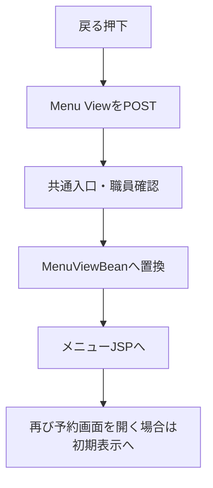

#### SQL・テーブル関連（ER図）

予約本表・削除明細は使わない。職員セッションの再作成が必要なら名簿照会を行い得る。遷移先の保持領域はセッションViewBeanであり、この操作固有の業務ER図は非該当である。

#### DB操作の詳細

本遷移から予約のSELECT・INSERT・UPDATE・DELETEを呼ばない。共通アクセス記録は別契約で行う。

#### 結果・例外時の扱い

職員確認不能ではログイン画面へ戻す。職員照会例外は共通Action例外処理へ伝播する。メニュー遷移の成功は予約保存を意味しない。

## 補足説明

### 受信値・検索キー・保存値

要求文字列のJava trimとRepositoryの正規化は別処理である。RepositoryのフリガナはNULLを空文字にし、NFKC、trim、全角空白置換、連続半角空白の集約、Locale.JAPANによる大文字化を行う。検索・保存にはこの正規化後の文字列を使う。

Actionの同一キー比較は、両予約が存在する場合だけ行う。フリガナはtrim・NFKC・Locale.ROOT大文字化で比較し、連続空白の集約はしない。電話はtrim・NFKC後のASCII数字列で比較し、BigDecimalによる数値比較ではない。ORIGINALのhiddenが存在するだけでは、既存対象と認定しない。

Repositoryの電話処理は各charに対してCharacter.isDigit・Character.digitを使って数字列を作り、BigDecimalへ変換する。保存値に先頭ゼロ・区切り文字は残らない。取得表示では数字抽出後、末尾1桁を残して先頭ゼロを除き、9桁または10桁で先頭が0でなければ0を一つ補う。任意の入力書式を往復復元する契約ではない。

数値4項目はInteger.parseIntで解釈できる正数だけを保持する。ブラウザーの数字補助やmaxlengthを、HTTP受信値の保証として扱わない。不正値をNULLへ変換した後、店番は登録・削除で拒否する一方、任意の顧客番号・担当者コード・予定年齢はNULLのまま保存し得る。

### 日付・備考と容量の区別

Javaの日付正規化はNFKC後の区切り付き4桁西暦、8桁西暦、正式元号名またはM・T・S・H・Rと元年または1～3桁年を持つ区切り形式を扱う。実在日と元号期間を確認してISOへ変換する。ブラウザーは明・大・昭・平・令の短名、区切りなし和暦、元年または1～2桁の元号年も扱うため、受理形式は同一ではない。

JSPの表示変換は保存用検査とは別である。ISO日付として解析できれば西暦または和暦に整形し、解析できなければモデル文字列を返してHTMLエスケープする。不正日付を保持した再表示で、サーバーが予定年齢の算術を行う処理はない。

備考の56バイトは、trim後文字列をWindows-31Jへ変換した結果の長さである。文字数、JavaのUTF-16コード単位数、DBのNVARCHAR(400)とは異なる。変換不能と上限超過はActionでともに「Excel出力した際、文字が途中で切れてしまいます。編集しなおしてください」と案内し、切り詰めて保存しない。Repositoryでも再検査する。

ブラウザーmaxlengthは店番3、顧客番号7、担当者4、予定年齢3、日付14であり、サーバーの受信前raw長検査ではない。フリガナ100、顧客氏名100、住所300、配偶者名100等のNVARCHAR宣言長も、接続された業務入力上限検査とは別である。NVARCHARの容量を、補助文字を含む任意文字列の文字数保証へ置き換えない。

### 候補・名称・既存値の表示

性別・裁定請求・受給有無は名称を選択・送信し、保存時にコードへ逆引きする。JSPの選択保持は、現在候補名称とモデル名称のString.equalsによる。候補外名称を追加optionとして表示する処理はない。保存時のSQL等価判定はDB照合規則に依存し、Javaの一致判定と同じとは限らない。

各候補はコード昇順で全件取得する。選択項目の先頭には空optionを置き、空選択はNULLコードとして保存する。停止・廃止・有効期間を判定する抽出条件はない。既存コードのJOIN先がなければモデル名称が空になり得るため、候補表の名称列NOT NULLは結合結果の非NULL保証ではない。

年金種類名称は種類ｺｰﾄﾞをキーとするMapから取得する。表示名称は`CodeLookupItem`の`String label`を経由する。画面順1・8・2・16・4と、保存フラグ順1・2・4・8・16は異なる。該当ラベルがなければ空表示となり、保存時は非ゼロの合成コードに対応する行の存在を別途確認する。

店名・各コード名称について、本画面から接続する保守入力処理はない。店名NVARCHAR(80)、性別・裁定請求・受給有無名称NVARCHAR(10)、年金種類名称NVARCHAR(120)のDDL容量は確認できるが、保守時の業務上限や名称変更・停止の運用は確定していない。担当者名・顧客由来名称・住所の本番物理属性へ、ローカル互換DDLの長さを転用しない。

店番参照から選んだ店名、担当者参照から選んだ担当者名は表示補助であり、名称を本表へ保存しない。特に担当者名は再描画で空となり、担当者コードから復元しない。顧客番号横の氏名と氏名入力欄も独立した要素である。

### 競合・排他と対象の確定

保存・削除のsynchronizedは、同一JVMの共有Repositoryインスタンスを同期する。Actionの事前照会は同期範囲外であり、他JVM・別経路の書込みを排除しない。UPDATE・DELETEには比較版、更新日時比較、明示的行ロックがなく、検索キー索引は非一意である。

Actionで新規と判断した後に行が追加され、RepositoryがUPDATEを選ぶ場合や、その逆があり得る。Repositoryは役職を再確認しないため、Action時点の新規判定を競合下の最終更新権限保証へ拡張できない。実行件数1件の検査は、DBの一意制約や楽観ロックではない。

SQL Server用DDLは本表・削除明細にPK・一意制約・FK・DEFAULTを宣言していない。また、表不在時だけ作成する構成である。同一キー複数行がある場合、順序・複数件検査のない照会で取得する対象は一意に確定しない。UPDATE・DELETEが複数行に作用すれば件数検査で例外となり、rollbackを試みる。

### 例外処理と確定境界

| 段階 | 現行処理 | 確定する範囲 |
| --- | --- | --- |
| ブラウザー確認取消 | 送信せず入力保持 | その操作のサーバー更新を開始しない |
| Actionの入力・対象・権限拒否 | 枝別モデル・existingで予約画面へ戻す | 保存・削除Repositoryを呼ばない。入力エラー時の存在照会と再表示照会は残る |
| 保存try前の検査例外 | ラップ外から共通Action例外処理へ伝播 | 当該保存の業務接続取得前 |
| 保存・削除try内例外 | rollbackを試行して例外を返す | commit例外・rollback失敗を含め、未更新を一律に断定しない |
| commit正常終了 | 保存区分または削除trueを返す | 業務トランザクションの正常commit |
| 共通アクセス記録失敗 | 別接続のrollbackとログ出力 | 業務commitを巻き戻さない |
| JSP候補照会・描画・通信失敗 | Action後のforward段階等で発生し得る | Action戻り値だけでは完了画面受領・最終HTTP応答を確定しない |

保存catchはNenkinDataAccessExceptionを同じ例外のまま再送出し、それ以外を登録・更新失敗へ包む。削除catchは削除失敗へ包む。rollback helperのSQLExceptionとcloseのExceptionは元の結果を上書きしない。commit例外後のrollback試行だけでは、DB未更新の証明にならない。

共通ServletのAction用catchは、反射によるAction生成とperformを囲むExceptionを共通エラーへ変換する。識別値処理、共通ログイン確認、運用判定はその前、アクセス記録とforwardはその後にある。識別値欠落、入力拒否後の候補照会失敗、JSP描画失敗を一つのcatch済み結果へまとめない。画面内拒否のActionはJSPパスを返し、HTTPエラー状態を明示設定しない。

共通アクセス記録は職員系の別ConnectionでINSERT・commitする。MESSAGE属性がある場合に記録するJSP名はSubMessage.jspとなるが、実forward先は返却されたstrUrlを使う。予約更新とは独立した処理である。完了ダイアログは終了文言を描画した後に開くため、業務commit、Action戻り、ブラウザーでの完了案内受領は別の境界となる。

### 履歴と通常導線の範囲

新規・変更は本表の現在行を保存し、変更前の各版を積み上げない。更新日・時刻・更新者・変更FLGは最新保存で置き換わる。削除時だけ削除明細を追加するため、完全な変更監査履歴ではない。

本画面の候補操作はLookup customerのiframe検索、選択後はPension Loadを使う。`PensionLookupAction`のJSON入口とRepositoryの`searchCandidates`は宣言があるが、この通常導線から呼ばない。宣言や反射経由の到達可能性を、通常UIの非同期予約候補機能として扱わない。

### 関連文書

次表は文書計画上の対応であり、各文書の生成状態を表さない。パスは納品Markdownルートを基準とする。未生成文書への参照を、この画面の条件・結果説明の代わりには用いない。

| 文書ID | 計画上の相対パス | 対応する責務 |
| --- | --- | --- |
| DET-SCR-018 | 詳細仕様書/詳細仕様書_SCR-018_新規・変更・削除.md | コントロール・変数・SQL/JDBC・例外境界の詳細 |
| SCR-016 | 基本設計書/基本設計書_SCR-016_店番参照／担当者参照／顧客参照.md | 参照モードと業務操作 |
| DET-SCR-016 | 詳細仕様書/詳細仕様書_SCR-016_店番参照／担当者参照／顧客参照.md | 参照検索・ページング・親子通信 |
| SCR-017 | 基本設計書/基本設計書_SCR-017_年金自動受取予約管理システム.md | 本画面への入口と戻り先メニュー |
| COM-111 | 共通/共通仕様書_COM-111_年金業務共通処理.md | 職員確認、CSRF、役職制限、入力変換、備考検査 |
| COM-151 | 共通/共通仕様書_COM-151_画面共通入力・通信制御.md | 数字・日付補助、共通CSS |
| COM-012 | 共通/共通仕様書_COM-012_共通コントロールサーブレット.md | 要求振分け、catch、アクセス記録、forward |
| API-NENKIN | 共通/要求処理一覧.md | 操作別要求・応答と通常導線外の入口 |
| DATA-CONTRACTS | 共通/データオブジェクト定義書.md | 予約・ViewBean・候補・職員情報の型と保持領域 |
| DB-OPS | 共通/DB仕様書/DB操作仕様書.md | 接続別SQL、バインド、トランザクション |
| DB-PHYSICAL | 共通/DB仕様書/テーブル定義書.md | 業務表・候補表・外部表の物理属性の範囲 |
| DB-LOGICAL | 共通/DB仕様書/論理データ仕様書.md | 予約キー、保存コード、削除明細等の業務上の意味 |
| CODE-NENKIN | 共通/コード一覧.md | 名称と保存コード、年金種類合成、変更区分 |
