# 新規・変更・削除

## 表紙

| 項目 | 内容 |
| --- | --- |
| 文書名 | 基本設計書 |
| システム名 |  |
| 機能ID | SCR-018 |
| 画面名 | 新規・変更・削除 |
| 会社名 |  |
| 作成日 |  |

## 概要

### 概要説明

新規・変更・削除の入力・表示・要求処理を行う。

| 情報 | 内容 |
| --- | --- |
| 対象種別 | screen |
| 開始契機 | 呼出元からの要求 |
| 処理対象 | DB2.Ｕ職員名簿表、DB2.ＵＪ科目、N2_SIGHT.Ｂ顧客基本表、NAVI.ＵＪ機能マスタ、NAVI.ＵＪ稼動店舗管理マスタ、NAVI.ＵＭオンラインＯＰマスタ、NAVI.ＵＭパス管理マスタ、NAVI.ＵＭ機能マスタ、NAVI.ＵＳパス管理ステータス、受給有無テーブル、年金1_LK、年金種類テーブル、年金＿削除明細、店名テーブル、性別テーブル、職員情報等（セッション）、裁定請求テーブル |

### 画面レイアウト

原本HTML・CSSの静的再構成。実行時の表示条件・値は未実行（仮定 Q-34082CC3A6）。

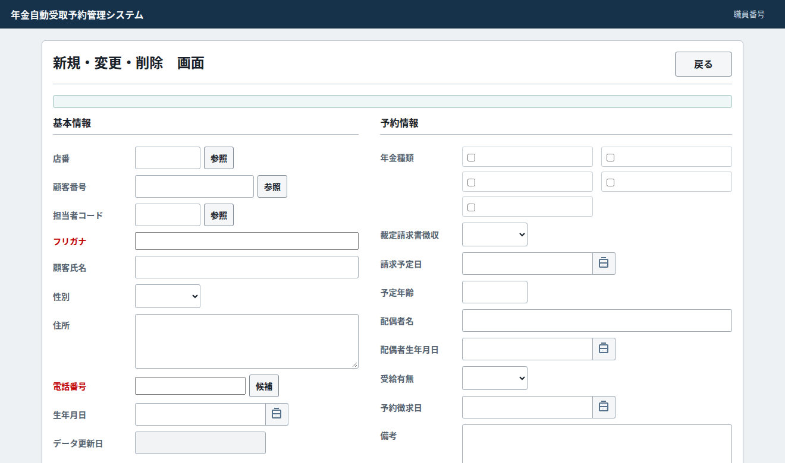

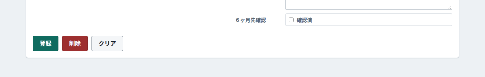

### データ操作関連図

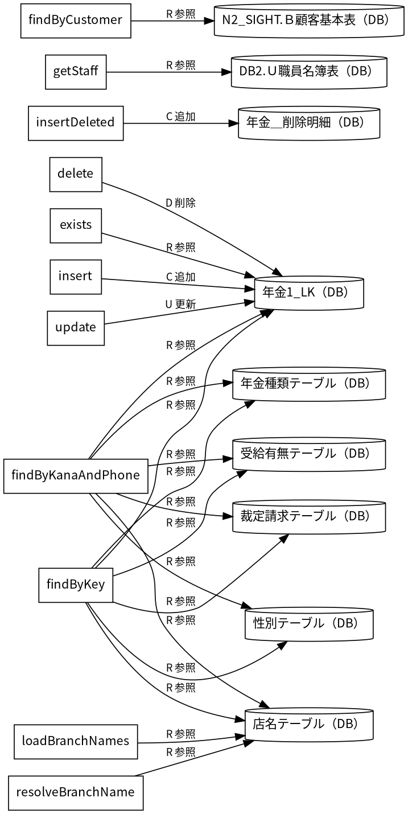

## 項目一覧

| No | グループ | 項目名 | 種類 | 入出力 | DB連携項目 | 候補取得元 | 必須 | 形式・桁 | 説明 |
| --- | --- | --- | --- | --- | --- | --- | --- | --- | --- |
| 1 | 見出し・説明 | 新規・変更・削除 画面 | Label | O | ‐ | ‐ | ‐ | ‐ | 新規・変更・削除 画面を表示する。 |
| 2 | 画面操作 | 戻る | Button | ‐ | ‐ | ‐ | ‐ | ‐ | 「戻る」の操作を受け付ける。業務結果はイベント仕様で確認する。 |
| 3 | 見出し・説明 | 基本情報 | Label | O | ‐ | ‐ | ‐ | ‐ | 基本情報を表示する。 |
| 4 | 入力・選択項目 | 店番 | TextBox | I | 表示：Ｂ顧客基本表・店舗コード／年金1_LK・店番；保存：年金1_LK・店番 | ‐ | 任意（仮定 Q-8CB84E1D06） | 最大3文字 | 店番を入力・選択する。 DB対応の経由・加工は項目別DB連携備考を参照。 |
| 5 | 画面操作 | 参照 | Button | ‐ | ‐ | ‐ | ‐ | ‐ | 「参照」の操作を受け付ける。業務結果はイベント仕様で確認する。 |
| 6 | 入力・選択項目 | 顧客番号 | TextBox | I | 表示：Ｂ顧客基本表・顧客番号／年金1_LK・顧客番号；保存：年金1_LK・顧客番号 | ‐ | 任意（仮定 Q-397B31A998） | 最大7文字 | 顧客番号を入力・選択する。 DB対応の経由・加工は項目別DB連携備考を参照。 |
| 7 | 画面操作 | 参照 | Button | ‐ | ‐ | ‐ | ‐ | ‐ | 「参照」の操作を受け付ける。業務結果はイベント仕様で確認する。 |
| 8 | 入力・選択項目 | 担当者コード | TextBox | I | 表示：Ｂ顧客基本表・担当者コード／年金1_LK・担当者コード；保存：年金1_LK・担当者コード | ‐ | 任意（仮定 Q-58DFB658D8） | 最大4文字 | 担当者コードを入力・選択する。 DB対応の経由・加工は項目別DB連携備考を参照。 |
| 9 | 画面操作 | 参照 | Button | ‐ | ‐ | ‐ | ‐ | ‐ | 「参照」の操作を受け付ける。業務結果はイベント仕様で確認する。 |
| 10 | 入力・選択項目 | フリガナ | TextBox | I | 表示：Ｂ顧客基本表・カナ氏名／年金1_LK・ふりがな；保存：年金1_LK・ふりがな | ‐ | 任意（仮定 Q-A778A2ADC4） | 制限指定なし（仮定 Q-D7E0B28F78） | フリガナを入力・選択する。 DB対応の経由・加工は項目別DB連携備考を参照。 |
| 11 | 入力・選択項目 | 顧客氏名 | TextBox | I | 表示：Ｂ顧客基本表・漢字氏名／年金1_LK・顧客氏名；保存：年金1_LK・顧客氏名 | ‐ | 任意（仮定 Q-BB2DC700E2） | 制限指定なし（仮定 Q-DFC61EEF63） | 顧客氏名を入力・選択する。 DB対応の経由・加工は項目別DB連携備考を参照。 |
| 12 | 入力・選択項目 | 性別 | ComboBox | I | 表示：性別テーブル・性別；保存：年金1_LK・性別 | 固定候補：／ | 任意（仮定 Q-A80F4614CA） | 制限指定なし（仮定 Q-C5F19F5CB1） | 性別を入力・選択する。 DB対応の経由・加工は項目別DB連携備考を参照。 |
| 13 | 入力・選択項目 | 住所 | TextArea | I | 表示：Ｂ顧客基本表・漢字住所／年金1_LK・住所；保存：年金1_LK・住所 | ‐ | 任意（仮定 Q-3B8CA820D3） | 制限指定なし（仮定 Q-F1B62D7558） | 住所を入力・選択する。 DB対応の経由・加工は項目別DB連携備考を参照。 |
| 14 | 入力・選択項目 | 電話番号 | TextBox | I | 表示：Ｂ顧客基本表・電話番号／年金1_LK・電話番号；保存：年金1_LK・電話番号 | ‐ | 任意（仮定 Q-00C2057FF4） | 制限指定なし（仮定 Q-EF8735F95A） | 電話番号を入力・選択する。 DB対応の経由・加工は項目別DB連携備考を参照。 |
| 15 | 画面操作 | 候補 | Button | ‐ | ‐ | ‐ | ‐ | ‐ | 「候補」の操作を受け付ける。業務結果はイベント仕様で確認する。 |
| 16 | 入力・選択項目 | 生年月日 | TextBox | I | 表示：Ｂ顧客基本表・生年月日／年金1_LK・生年月日；保存：年金1_LK・生年月日 | ‐ | 任意（仮定 Q-4EBC7CA624） | 最大14文字 | 生年月日を入力・選択する。 DB対応の経由・加工は項目別DB連携備考を参照。 |
| 17 | 画面操作 | 生年月日のカレンダーを開く | Button | ‐ | ‐ | ‐ | ‐ | ‐ | 「生年月日のカレンダーを開く」の操作を受け付ける。業務結果はイベント仕様で確認する。 |
| 18 | 表示項目 | データ更新日 | TextBox | O | 表示：年金1_LK・データ更新日；保存：年金1_LK・データ更新日 | ‐ | ‐ | 制限指定なし（仮定 Q-5E57FE895A） | データ更新日を表示する。 画面からは編集できない。 DB対応の経由・加工は項目別DB連携備考を参照。 |
| 19 | 見出し・説明 | 予約情報 | Label | O | ‐ | ‐ | ‐ | ‐ | 予約情報を表示する。 |
| 20 | 入力・選択項目 | 国民年金 | CheckBox | I | 表示：年金1_LK・種類：国民年金；保存：年金1_LK・種類：国民年金／年金1_LK・年金種類 | ‐ | 任意（仮定 Q-7C086AE36D） | 選択／未選択 | NATIONAL_PENSIONを入力・選択する。 DB対応の経由・加工は項目別DB連携備考を参照。 |
| 21 | 入力・選択項目 | 厚生年金基金 | CheckBox | I | 表示：年金1_LK・種類：厚生年金基金；保存：年金1_LK・種類：厚生年金基金／年金1_LK・年金種類 | ‐ | 任意（仮定 Q-CD424A98D6） | 選択／未選択 | EMPLOYEE_PENSION_FUNDを入力・選択する。 DB対応の経由・加工は項目別DB連携備考を参照。 |
| 22 | 入力・選択項目 | 厚生年金 | CheckBox | I | 表示：年金1_LK・種類：厚生年金；保存：年金1_LK・種類：厚生年金／年金1_LK・年金種類 | ‐ | 任意（仮定 Q-8283B0766F） | 選択／未選択 | EMPLOYEE_PENSIONを入力・選択する。 DB対応の経由・加工は項目別DB連携備考を参照。 |
| 23 | 入力・選択項目 | 国民年金基金 | CheckBox | I | 表示：年金1_LK・種類：国民年金基金；保存：年金1_LK・種類：国民年金基金／年金1_LK・年金種類 | ‐ | 任意（仮定 Q-C075CF5257） | 選択／未選択 | NATIONAL_PENSION_FUNDを入力・選択する。 DB対応の経由・加工は項目別DB連携備考を参照。 |
| 24 | 入力・選択項目 | 共済年金 | CheckBox | I | 表示：年金1_LK・種類：共済年金；保存：年金1_LK・種類：共済年金／年金1_LK・年金種類 | ‐ | 任意（仮定 Q-90F84196D5） | 選択／未選択 | MUTUAL_AID_PENSIONを入力・選択する。 DB対応の経由・加工は項目別DB連携備考を参照。 |
| 25 | 入力・選択項目 | 裁定請求書徴収 | ComboBox | I | 表示：裁定請求テーブル・裁定請求；保存：年金1_LK・裁定請求 | 固定候補：／ | 任意（仮定 Q-10271563A4） | 制限指定なし（仮定 Q-7C28640743） | 裁定請求書徴収を入力・選択する。 DB対応の経由・加工は項目別DB連携備考を参照。 |
| 26 | 入力・選択項目 | 請求予定日 | TextBox | I | 表示：年金1_LK・請求予定日；保存：年金1_LK・請求予定日 | ‐ | 任意（仮定 Q-AEEB9839DD） | 最大14文字 | 請求予定日を入力・選択する。 DB対応の経由・加工は項目別DB連携備考を参照。 |
| 27 | 画面操作 | 請求予定日のカレンダーを開く | Button | ‐ | ‐ | ‐ | ‐ | ‐ | 「請求予定日のカレンダーを開く」の操作を受け付ける。業務結果はイベント仕様で確認する。 |
| 28 | 入力・選択項目 | 予定年齢 | TextBox | I | 表示：年金1_LK・予定年齢；保存：年金1_LK・予定年齢 | ‐ | 任意（仮定 Q-32977AE1C4） | 最大3文字 | 予定年齢を入力・選択する。 DB対応の経由・加工は項目別DB連携備考を参照。 |
| 29 | 入力・選択項目 | 配偶者名 | TextBox | I | 表示：年金1_LK・配偶者名；保存：年金1_LK・配偶者名 | ‐ | 任意（仮定 Q-437CA58B71） | 制限指定なし（仮定 Q-1BE62D3673） | 配偶者名を入力・選択する。 DB対応の経由・加工は項目別DB連携備考を参照。 |
| 30 | 入力・選択項目 | 配偶者生年月日 | TextBox | I | 表示：年金1_LK・配偶者生年月日；保存：年金1_LK・配偶者生年月日 | ‐ | 任意（仮定 Q-B0F3D42731） | 最大14文字 | 配偶者生年月日を入力・選択する。 DB対応の経由・加工は項目別DB連携備考を参照。 |
| 31 | 画面操作 | 配偶者生年月日のカレンダーを開く | Button | ‐ | ‐ | ‐ | ‐ | ‐ | 「配偶者生年月日のカレンダーを開く」の操作を受け付ける。業務結果はイベント仕様で確認する。 |
| 32 | 入力・選択項目 | 受給有無 | ComboBox | I | 表示：受給有無テーブル・受給有無；保存：年金1_LK・受給有無 | 固定候補：／ | 任意（仮定 Q-2AE1E0EC61） | 制限指定なし（仮定 Q-6319D12887） | 受給有無を入力・選択する。 DB対応の経由・加工は項目別DB連携備考を参照。 |
| 33 | 入力・選択項目 | 予約徴求日 | TextBox | I | 表示：年金1_LK・予約徴求日；保存：年金1_LK・予約徴求日 | ‐ | 任意（仮定 Q-D836E12CD8） | 最大14文字 | 予約徴求日を入力・選択する。 DB対応の経由・加工は項目別DB連携備考を参照。 |
| 34 | 画面操作 | 予約徴求日のカレンダーを開く | Button | ‐ | ‐ | ‐ | ‐ | ‐ | 「予約徴求日のカレンダーを開く」の操作を受け付ける。業務結果はイベント仕様で確認する。 |
| 35 | 入力・選択項目 | 備考 | TextArea | I | 表示：年金1_LK・備考；保存：年金1_LK・備考 | ‐ | 任意（仮定 Q-FE605AC2AB） | 制限指定なし（仮定 Q-C12E10E645） | 備考を入力・選択する。 DB対応の経由・加工は項目別DB連携備考を参照。 |
| 36 | 入力・選択項目 | 確認済 | CheckBox | I | 表示：年金1_LK・６ヶ月先確認；保存：年金1_LK・６ヶ月先確認 | ‐ | 任意（仮定 Q-6ED8D1C7C4） | 選択／未選択 | 確認済を入力・選択する。 DB対応の経由・加工は項目別DB連携備考を参照。 |
| 37 | 画面操作 | 登録 | Button | ‐ | ‐ | ‐ | ‐ | ‐ | 「登録」の操作を受け付ける。業務結果はイベント仕様で確認する。 |
| 38 | 画面操作 | 削除 | Button | ‐ | ‐ | ‐ | ‐ | ‐ | 「削除」の操作を受け付ける。業務結果はイベント仕様で確認する。 |
| 39 | 画面操作 | クリア | Button | ‐ | ‐ | ‐ | ‐ | ‐ | 「クリア」の操作を受け付ける。業務結果はイベント仕様で確認する。 |
| 40 | 見出し・説明 | 入力補助 | Label | O | ‐ | ‐ | ‐ | ‐ | 入力補助を表示する。 |
| 41 | 画面操作 | 閉じる | Button | ‐ | ‐ | ‐ | ‐ | ‐ | 「閉じる」の操作を受け付ける。業務結果はイベント仕様で確認する。 |
| 42 | 見出し・説明 | 確認 | Label | O | ‐ | ‐ | ‐ | ‐ | 確認を表示する。 |
| 43 | 画面操作 | 確認 | Button | ‐ | ‐ | ‐ | ‐ | ‐ | 「OK」の操作を受け付ける。業務結果はイベント仕様で確認する。 |
| 44 | 画面操作 | キャンセル | Button | ‐ | ‐ | ‐ | ‐ | ‐ | 「キャンセル」の操作を受け付ける。業務結果はイベント仕様で確認する。 |

項目定義数：44項目。表示順と反復行の定義数を区別する。

## イベント仕様

### 年金予約削除

#### 処理概要

新規・変更・削除で「年金予約削除」の要求を受け付ける。入力・確認・データ操作・応答の順と、条件が成立しない場合の処理を以下に示す。

#### 処理手順

1. 「ログイン職員を確認できない」に該当するか確認する。該当する場合に限り、次の分岐内手順を行う。該当しない場合は分岐の後へ進む。

1.1. 条件成立時：年金自動受取予約管理システム - ログインへ表示を戻す。この経路の後続手順は実行しない。

2. 画面の入力値を読み取り、処理用データへ設定する。

3. 「送信方法・確認用トークンが一致しない」に該当するか確認する。該当する場合に限り、次の分岐内手順を行う。該当しない場合は分岐の後へ進む。

3.1. 条件成立時：表示内容を設定し、「画面の有効期限が切れました。メニューから操作しなおしてください。」を表示する。

3.2. 条件成立時：新規・変更・削除へ表示を戻す。この経路の後続手順は実行しない。

4. 「「店番」が未設定」に該当するか確認する。該当する場合に限り、次の分岐内手順を行う。該当しない場合は分岐の後へ進む。

4.1. 条件成立時：表示内容を設定し、「店番は必ず入力してください」を表示する。

4.2. 条件成立時：新規・変更・削除へ表示を戻す。この経路の後続手順は実行しない。

5. 「「フリガナ」が空、または「電話番号」が空」に該当するか確認する。該当する場合に限り、次の分岐内手順を行う。該当しない場合は分岐の後へ進む。

5.1. 条件成立時：表示内容を設定し、「削除対象がありません。既存レコードを読み込んでから削除してください。」を表示する。

5.2. 条件成立時：新規・変更・削除へ表示を戻す。この経路の後続手順は実行しない。

6. フリガナ・電話番号を条件にデータを照会する（照会結果1）。

7. 指定した条件でデータを照会する（照会結果2）。

8. 「照会結果1がない、または照合キーが一致しない」に該当するか確認する。該当する場合に限り、次の分岐内手順を行う。該当しない場合は分岐の後へ進む。

8.1. 条件成立時：表示内容を設定し、「削除対象を参照画面またはキー入力から読み込んでください。」を表示する。

8.2. 条件成立時：新規・変更・削除へ表示を戻す。この経路の後続手順は実行しない。

9. セッションに保持された利用者情報を取得する。

10. 「操作権限が制限される」に該当するか確認する。該当する場合に限り、次の分岐内手順を行う。該当しない場合は分岐の後へ進む。

10.1. 条件成立時：表示内容を設定し、「権限が不足しています。削除を行う場合には／推進役以上の方が削除してください。」を表示する。

10.2. 条件成立時：新規・変更・削除へ表示を戻す。この経路の後続手順は実行しない。

11. 対象データを削除する。

12. 「削除対象が見つかりません。」を設定する。

13. 処理結果とメッセージを画面の表示内容へ設定する。

14. 新規・変更・削除へ表示を戻す。この経路の後続手順は実行しない。

#### 処理フロー

入口処理の順序・分岐を示す。呼出先の処理は別単位とし、SQLの対象と実行条件はDB操作の詳細へ記載する。例外線は範囲内で例外が発生した場合の経路で、各命令が必ず例外を送出する意味ではない。

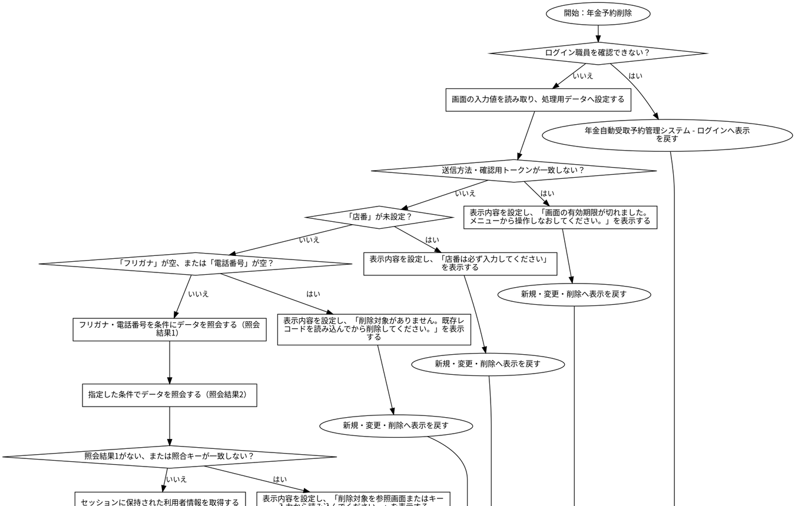

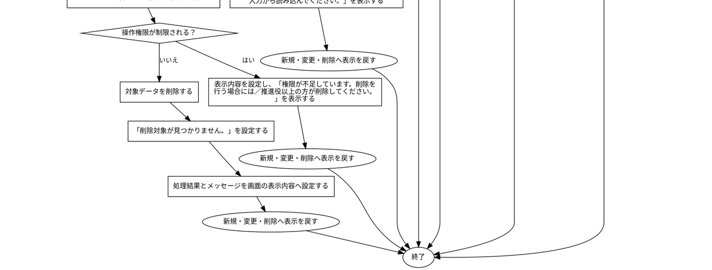

#### SQL・テーブル関連（ER図）

実線はSQLの結合条件。外部キー制約や多重度を断定しない。単独表は独立したエンティティで表す。

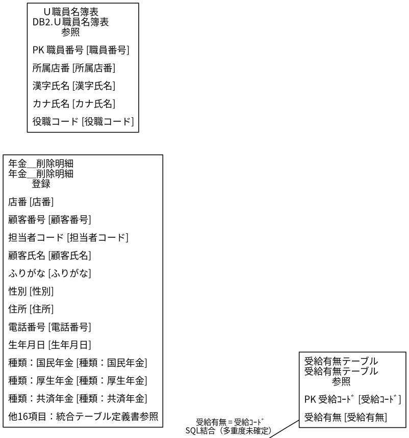

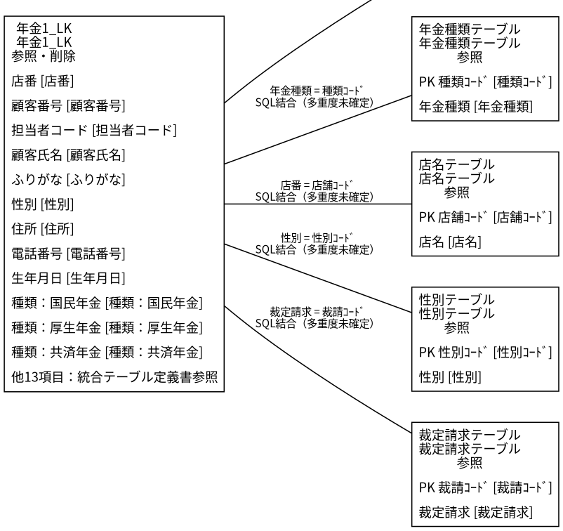

#### DB操作の詳細

#### DB操作 SQL-BE29DD398BAD

| 情報 | 内容 |
| --- | --- |
| 操作ID | SQL-BE29DD398BAD |
| 対象テーブル | 年金1_LK |
| 操作 | 参照 |
| 処理説明 | 対象テーブルの対象データを読み取る。設定項目・対象条件・確定取消は以下の定義に従う。 |
| 設定項目 | 当該SQL式の列指定・実行時引数を使用する。組立式と原本のパラメーター設定を参照。 |
| 対象条件 | 抽出・更新対象条件：R.ふりがな = ? AND R.電話番号 = ? |
| 確定・取消 | 呼出側または接続の設定に従う。当該メソッド単独でのコミット・ロールバック指定はない。 同じ原本に明示トランザクションの呼出元があり、経路別の確定・取消範囲は関連処理で確認する。 |
| 原本 | nenkin/WEB-INF/src/nenkin/service/PensionRepository.java:150 / findByKanaAndPhone@144 |

#### DB操作 SQL-98675681E706

| 情報 | 内容 |
| --- | --- |
| 操作ID | SQL-98675681E706 |
| 対象テーブル | 店名テーブル |
| 操作 | 参照 |
| 処理説明 | 対象テーブルの対象データを読み取る。設定項目・対象条件・確定取消は以下の定義に従う。 |
| 設定項目 | 当該SQL式の列指定・実行時引数を使用する。組立式と原本のパラメーター設定を参照。 |
| 対象条件 | 抽出・更新対象条件：R.ふりがな = ? AND R.電話番号 = ? |
| 確定・取消 | 呼出側または接続の設定に従う。当該メソッド単独でのコミット・ロールバック指定はない。 同じ原本に明示トランザクションの呼出元があり、経路別の確定・取消範囲は関連処理で確認する。 |
| 原本 | nenkin/WEB-INF/src/nenkin/service/PensionRepository.java:150 / findByKanaAndPhone@144 |

#### DB操作 SQL-935A991E07F4

| 情報 | 内容 |
| --- | --- |
| 操作ID | SQL-935A991E07F4 |
| 対象テーブル | 性別テーブル |
| 操作 | 参照 |
| 処理説明 | 対象テーブルの対象データを読み取る。設定項目・対象条件・確定取消は以下の定義に従う。 |
| 設定項目 | 当該SQL式の列指定・実行時引数を使用する。組立式と原本のパラメーター設定を参照。 |
| 対象条件 | 抽出・更新対象条件：R.ふりがな = ? AND R.電話番号 = ? |
| 確定・取消 | 呼出側または接続の設定に従う。当該メソッド単独でのコミット・ロールバック指定はない。 同じ原本に明示トランザクションの呼出元があり、経路別の確定・取消範囲は関連処理で確認する。 |
| 原本 | nenkin/WEB-INF/src/nenkin/service/PensionRepository.java:150 / findByKanaAndPhone@144 |

#### DB操作 SQL-A0A469ECF2C0

| 情報 | 内容 |
| --- | --- |
| 操作ID | SQL-A0A469ECF2C0 |
| 対象テーブル | 裁定請求テーブル |
| 操作 | 参照 |
| 処理説明 | 対象テーブルの対象データを読み取る。設定項目・対象条件・確定取消は以下の定義に従う。 |
| 設定項目 | 当該SQL式の列指定・実行時引数を使用する。組立式と原本のパラメーター設定を参照。 |
| 対象条件 | 抽出・更新対象条件：R.ふりがな = ? AND R.電話番号 = ? |
| 確定・取消 | 呼出側または接続の設定に従う。当該メソッド単独でのコミット・ロールバック指定はない。 同じ原本に明示トランザクションの呼出元があり、経路別の確定・取消範囲は関連処理で確認する。 |
| 原本 | nenkin/WEB-INF/src/nenkin/service/PensionRepository.java:150 / findByKanaAndPhone@144 |

#### DB操作 SQL-F2C97CD89E50

| 情報 | 内容 |
| --- | --- |
| 操作ID | SQL-F2C97CD89E50 |
| 対象テーブル | 受給有無テーブル |
| 操作 | 参照 |
| 処理説明 | 対象テーブルの対象データを読み取る。設定項目・対象条件・確定取消は以下の定義に従う。 |
| 設定項目 | 当該SQL式の列指定・実行時引数を使用する。組立式と原本のパラメーター設定を参照。 |
| 対象条件 | 抽出・更新対象条件：R.ふりがな = ? AND R.電話番号 = ? |
| 確定・取消 | 呼出側または接続の設定に従う。当該メソッド単独でのコミット・ロールバック指定はない。 同じ原本に明示トランザクションの呼出元があり、経路別の確定・取消範囲は関連処理で確認する。 |
| 原本 | nenkin/WEB-INF/src/nenkin/service/PensionRepository.java:150 / findByKanaAndPhone@144 |

#### DB操作 SQL-CD804AC01D11

| 情報 | 内容 |
| --- | --- |
| 操作ID | SQL-CD804AC01D11 |
| 対象テーブル | 年金種類テーブル |
| 操作 | 参照 |
| 処理説明 | 対象テーブルの対象データを読み取る。設定項目・対象条件・確定取消は以下の定義に従う。 |
| 設定項目 | 当該SQL式の列指定・実行時引数を使用する。組立式と原本のパラメーター設定を参照。 |
| 対象条件 | 抽出・更新対象条件：R.ふりがな = ? AND R.電話番号 = ? |
| 確定・取消 | 呼出側または接続の設定に従う。当該メソッド単独でのコミット・ロールバック指定はない。 同じ原本に明示トランザクションの呼出元があり、経路別の確定・取消範囲は関連処理で確認する。 |
| 原本 | nenkin/WEB-INF/src/nenkin/service/PensionRepository.java:150 / findByKanaAndPhone@144 |

#### DB操作 SQL-F9D3BB2927F4

| 情報 | 内容 |
| --- | --- |
| 操作ID | SQL-F9D3BB2927F4 |
| 対象テーブル | 年金1_LK |
| 操作 | 削除 |
| 処理説明 | 対象テーブルの条件に一致する行を削除する。設定項目・対象条件・確定取消は以下の定義に従う。 |
| 設定項目 | 当該SQL式の列指定・実行時引数を使用する。組立式と原本のパラメーター設定を参照。 |
| 対象条件 | 抽出・更新対象条件：ふりがな = ? AND 電話番号 = ? |
| 確定・取消 | 当該メソッド内で自動コミット設定・コミット・ロールバックを行う。例外時の処理順は詳細仕様の分岐に従う。 |
| 原本 | nenkin/WEB-INF/src/nenkin/service/PensionRepository.java:334 / delete@315 |

#### DB操作 SQL-EC6FD30BE7CE

| 情報 | 内容 |
| --- | --- |
| 操作ID | SQL-EC6FD30BE7CE |
| 対象テーブル | 年金1_LK |
| 操作 | 参照 |
| 処理説明 | 対象テーブルの対象データを読み取る。設定項目・対象条件・確定取消は以下の定義に従う。 |
| 設定項目 | 当該SQL式の列指定・実行時引数を使用する。組立式と原本のパラメーター設定を参照。 |
| 対象条件 | 抽出・更新対象条件：R.ふりがな = ? AND R.電話番号 = ? |
| 確定・取消 | 呼出側または接続の設定に従う。当該メソッド単独でのコミット・ロールバック指定はない。 同じ原本に明示トランザクションの呼出元があり、経路別の確定・取消範囲は関連処理で確認する。 |
| 原本 | nenkin/WEB-INF/src/nenkin/service/PensionRepository.java:645 / findByKey@640 |

#### DB操作 SQL-B8CFB512D81A

| 情報 | 内容 |
| --- | --- |
| 操作ID | SQL-B8CFB512D81A |
| 対象テーブル | 店名テーブル |
| 操作 | 参照 |
| 処理説明 | 対象テーブルの対象データを読み取る。設定項目・対象条件・確定取消は以下の定義に従う。 |
| 設定項目 | 当該SQL式の列指定・実行時引数を使用する。組立式と原本のパラメーター設定を参照。 |
| 対象条件 | 抽出・更新対象条件：R.ふりがな = ? AND R.電話番号 = ? |
| 確定・取消 | 呼出側または接続の設定に従う。当該メソッド単独でのコミット・ロールバック指定はない。 同じ原本に明示トランザクションの呼出元があり、経路別の確定・取消範囲は関連処理で確認する。 |
| 原本 | nenkin/WEB-INF/src/nenkin/service/PensionRepository.java:645 / findByKey@640 |

#### DB操作 SQL-B3BD08EC9265

| 情報 | 内容 |
| --- | --- |
| 操作ID | SQL-B3BD08EC9265 |
| 対象テーブル | 性別テーブル |
| 操作 | 参照 |
| 処理説明 | 対象テーブルの対象データを読み取る。設定項目・対象条件・確定取消は以下の定義に従う。 |
| 設定項目 | 当該SQL式の列指定・実行時引数を使用する。組立式と原本のパラメーター設定を参照。 |
| 対象条件 | 抽出・更新対象条件：R.ふりがな = ? AND R.電話番号 = ? |
| 確定・取消 | 呼出側または接続の設定に従う。当該メソッド単独でのコミット・ロールバック指定はない。 同じ原本に明示トランザクションの呼出元があり、経路別の確定・取消範囲は関連処理で確認する。 |
| 原本 | nenkin/WEB-INF/src/nenkin/service/PensionRepository.java:645 / findByKey@640 |

#### DB操作 SQL-47BAF2E0D129

| 情報 | 内容 |
| --- | --- |
| 操作ID | SQL-47BAF2E0D129 |
| 対象テーブル | 裁定請求テーブル |
| 操作 | 参照 |
| 処理説明 | 対象テーブルの対象データを読み取る。設定項目・対象条件・確定取消は以下の定義に従う。 |
| 設定項目 | 当該SQL式の列指定・実行時引数を使用する。組立式と原本のパラメーター設定を参照。 |
| 対象条件 | 抽出・更新対象条件：R.ふりがな = ? AND R.電話番号 = ? |
| 確定・取消 | 呼出側または接続の設定に従う。当該メソッド単独でのコミット・ロールバック指定はない。 同じ原本に明示トランザクションの呼出元があり、経路別の確定・取消範囲は関連処理で確認する。 |
| 原本 | nenkin/WEB-INF/src/nenkin/service/PensionRepository.java:645 / findByKey@640 |

#### DB操作 SQL-C66BA4DBA955

| 情報 | 内容 |
| --- | --- |
| 操作ID | SQL-C66BA4DBA955 |
| 対象テーブル | 受給有無テーブル |
| 操作 | 参照 |
| 処理説明 | 対象テーブルの対象データを読み取る。設定項目・対象条件・確定取消は以下の定義に従う。 |
| 設定項目 | 当該SQL式の列指定・実行時引数を使用する。組立式と原本のパラメーター設定を参照。 |
| 対象条件 | 抽出・更新対象条件：R.ふりがな = ? AND R.電話番号 = ? |
| 確定・取消 | 呼出側または接続の設定に従う。当該メソッド単独でのコミット・ロールバック指定はない。 同じ原本に明示トランザクションの呼出元があり、経路別の確定・取消範囲は関連処理で確認する。 |
| 原本 | nenkin/WEB-INF/src/nenkin/service/PensionRepository.java:645 / findByKey@640 |

#### DB操作 SQL-E2E89DE2FC84

| 情報 | 内容 |
| --- | --- |
| 操作ID | SQL-E2E89DE2FC84 |
| 対象テーブル | 年金種類テーブル |
| 操作 | 参照 |
| 処理説明 | 対象テーブルの対象データを読み取る。設定項目・対象条件・確定取消は以下の定義に従う。 |
| 設定項目 | 当該SQL式の列指定・実行時引数を使用する。組立式と原本のパラメーター設定を参照。 |
| 対象条件 | 抽出・更新対象条件：R.ふりがな = ? AND R.電話番号 = ? |
| 確定・取消 | 呼出側または接続の設定に従う。当該メソッド単独でのコミット・ロールバック指定はない。 同じ原本に明示トランザクションの呼出元があり、経路別の確定・取消範囲は関連処理で確認する。 |
| 原本 | nenkin/WEB-INF/src/nenkin/service/PensionRepository.java:645 / findByKey@640 |

#### DB操作 SQL-D7ADE1A915C2

| 情報 | 内容 |
| --- | --- |
| 操作ID | SQL-D7ADE1A915C2 |
| 対象テーブル | 年金＿削除明細 |
| 操作 | 挿入 |
| 処理説明 | 対象テーブルの新しい行を登録する。設定項目・対象条件・確定取消は以下の定義に従う。 |
| 設定項目 | 店番 ← バインド引数1（PreparedStatementまたは呼出側の設定順序）／顧客番号 ← バインド引数2（PreparedStatementまたは呼出側の設定順序）／担当者コード ← バインド引数3（PreparedStatementまたは呼出側の設定順序）／顧客氏名 ← バインド引数4（PreparedStatementまたは呼出側の設定順序）／ふりがな ← バインド引数5（PreparedStatementまたは呼出側の設定順序）／性別 ← バインド引数6（PreparedStatementまたは呼出側の設定順序）／住所 ← バインド引数7（PreparedStatementまたは呼出側の設定順序）／電話番号 ← バインド引数8（PreparedStatementまたは呼出側の設定順序）／生年月日 ← バインド引数9（PreparedStatementまたは呼出側の設定順序）／種類：国民年金 ← バインド引数10（PreparedStatementまたは呼出側の設定順序）／種類：厚生年金 ← バインド引数11（PreparedStatementまたは呼出側の設定順序）／種類：共済年金 ← バインド引数12（PreparedStatementまたは呼出側の設定順序）／種類：厚生年金基金 ← バインド引数13（PreparedStatementまたは呼出側の設定順序）／種類：国民年金基金 ← バインド引数14（PreparedStatementまたは呼出側の設定順序）／年金種類 ← バインド引数15（PreparedStatementまたは呼出側の設定順序）／裁定請求 ← バインド引数16（PreparedStatementまたは呼出側の設定順序）／請求予定日 ← バインド引数17（PreparedStatementまたは呼出側の設定順序）／予定年齢 ← バインド引数18（PreparedStatementまたは呼出側の設定順序）／配偶者名 ← バインド引数19（PreparedStatementまたは呼出側の設定順序）／配偶者生年月日 ← バインド引数20（PreparedStatementまたは呼出側の設定順序）／受給有無 ← バインド引数21（PreparedStatementまたは呼出側の設定順序）／予約徴求日 ← バインド引数22（PreparedStatementまたは呼出側の設定順序）／備考 ← バインド引数23（PreparedStatementまたは呼出側の設定順序）／データ更新日 ← バインド引数24（PreparedStatementまたは呼出側の設定順序）／更新時間 ← バインド引数25（PreparedStatementまたは呼出側の設定順序）／更新者 ← バインド引数26（PreparedStatementまたは呼出側の設定順序）／６ヶ月先確認 ← バインド引数27（PreparedStatementまたは呼出側の設定順序）／変更FLG ← バインド引数28（PreparedStatementまたは呼出側の設定順序） |
| 対象条件 | 新しい行を挿入する。重複や採番の扱いは呼出元および列制約に従う。 |
| 確定・取消 | 呼出側または接続の設定に従う。当該メソッド単独でのコミット・ロールバック指定はない。 同じ原本に明示トランザクションの呼出元があり、経路別の確定・取消範囲は関連処理で確認する。 |
| 原本 | nenkin/WEB-INF/src/nenkin/service/PensionRepository.java:694 / insertDeleted@690 |

| 設定先のDB項目 | バインド順 | 値の設定・変換（原本） |
| --- | --- | --- |
| 店番 | 1 | setInteger(statement, 1, value.getBranchNo()) |
| 顧客番号 | 2 | setInteger(statement, 2, value.getCustomerNo()) |
| 担当者コード | 3 | setInteger(statement, 3, value.getStaffCode()) |
| 顧客氏名 | 4 | value.getCustomerName() |
| ふりがな | 5 | value.getKanaName() |
| 性別 | 6 | setInteger(statement, 6, resolveCode(connection, GENDER_TABLE,                 "性別ｺｰﾄﾞ", "性別", value.getGender())) |
| 住所 | 7 | value.getAddress() |
| 電話番号 | 8 | setPhone(statement, 8, value.getPhoneNumber()) |
| 生年月日 | 9 | setDate(statement, 9, value.getBirthDate()) |
| 種類：国民年金 | 10 | value.isNationalPension() ? 1 : 0 |
| 種類：厚生年金 | 11 | value.isEmployeePension() ? 1 : 0 |
| 種類：共済年金 | 12 | value.isMutualAidPension() ? 1 : 0 |
| 種類：厚生年金基金 | 13 | value.isEmployeePensionFund() ? 1 : 0 |
| 種類：国民年金基金 | 14 | value.isNationalPensionFund() ? 1 : 0 |
| 年金種類 | 15 | setInteger(statement, 15, resolvePensionTypeCode(connection, value)) |
| 裁定請求 | 16 | setInteger(statement, 16, resolveCode(connection, CLAIM_TABLE,                 "裁請ｺｰﾄﾞ", "裁定請求", value.getClaimStatus())) |
| 請求予定日 | 17 | setDate(statement, 17, value.getClaimScheduledDate()) |
| 予定年齢 | 18 | setInteger(statement, 18, value.getPlannedAge()) |
| 配偶者名 | 19 | value.getSpouseName() |
| 配偶者生年月日 | 20 | setDate(statement, 20, value.getSpouseBirthDate()) |
| 受給有無 | 21 | setInteger(statement, 21, resolveCode(connection, BENEFIT_TABLE,                 "受給ｺｰﾄﾞ", "受給有無", value.getHasBenefit())) |
| 予約徴求日 | 22 | setDate(statement, 22, value.getReservationRequestDate()) |
| 備考 | 23 | value.getNotes() |
| データ更新日 | 24 | setDate(statement, 24, value.getDataUpdateDate()) |
| 更新時間 | 25 | setTime(statement, 25, updateTime) |
| 更新者 | 26 | setInteger(statement, 26, updatedBy) |
| ６ヶ月先確認 | 27 | value.isSixMonthCheck() ? 1 : 0 |
| 変更FLG | 28 | setInteger(statement, 28, null) |

#### DB操作 SQL-D9F3500B923D

| 情報 | 内容 |
| --- | --- |
| 操作ID | SQL-D9F3500B923D |
| 対象テーブル | DB2.Ｕ職員名簿表 |
| 操作 | 参照 |
| 処理説明 | 対象テーブルの対象データを読み取る。設定項目・対象条件・確定取消は以下の定義に従う。 |
| 設定項目 | 当該SQL式の列指定・実行時引数を使用する。組立式と原本のパラメーター設定を参照。 |
| 対象条件 | 抽出・更新対象条件：S.職員番号 = ? |
| 確定・取消 | 呼出側または接続の設定に従う。当該メソッド単独でのコミット・ロールバック指定はない。 |
| 原本 | nenkin/WEB-INF/src/nenkin/service/ReferenceDataService.java:207 / getStaff@206 |

#### 結果・例外時の扱い

| 到達条件 | 結果 |
| --- | --- |
| ログイン職員を確認できない | 年金自動受取予約管理システム - ログインへ表示を戻す |
| 条件1を満たす（原本条件は補足説明を参照）・送信方法・確認用トークンが一致しない | 新規・変更・削除へ表示を戻す |
| 条件2を満たす（原本条件は補足説明を参照）・条件3を満たす（原本条件は補足説明を参照）・「店番」が未設定 | 新規・変更・削除へ表示を戻す |
| 条件4を満たす（原本条件は補足説明を参照）・条件5を満たす（原本条件は補足説明を参照）・NOT (「店番」  が等しい  未設定)・「フリガナ」が空、または「電話番号」が空 | 新規・変更・削除へ表示を戻す |
| 条件6を満たす（原本条件は補足説明を参照）・条件7を満たす（原本条件は補足説明を参照）・NOT (「店番」  が等しい  未設定)・NOT (「フリガナ」.length()  が等しい  0 &#124;&#124; 「電話番号」.length()  が等しい  0)・照会結果1がない、または照合キーが一致しない | 新規・変更・削除へ表示を戻す |
| 条件8を満たす（原本条件は補足説明を参照）・条件9を満たす（原本条件は補足説明を参照）・NOT (「店番」  が等しい  未設定)・NOT (「フリガナ」.length()  が等しい  0 &#124;&#124; 「電話番号」.length()  が等しい  0)・NOT (existing  が等しい  未設定 &#124;&#124; !sameReservationKey(existing, original))・操作権限が制限される | 新規・変更・削除へ表示を戻す |
| 条件10を満たす（原本条件は補足説明を参照）・条件11を満たす（原本条件は補足説明を参照）・NOT (「店番」  が等しい  未設定)・NOT (「フリガナ」.length()  が等しい  0 &#124;&#124; 「電話番号」.length()  が等しい  0)・NOT (existing  が等しい  未設定 &#124;&#124; !sameReservationKey(existing, original))・条件12を満たす（原本条件は補足説明を参照） | 新規・変更・削除へ表示を戻す |

### フリガナ+電話番号の正規化キーで、選択した予約を確実に読み込む

#### 処理概要

新規・変更・削除で「フリガナ+電話番号の正規化キーで、選択した予約を確実に読み込む」の要求を受け付ける。入力・確認・データ操作・応答の順と、条件が成立しない場合の処理を以下に示す。

#### 処理手順

1. 「ログイン職員を確認できない」に該当するか確認する。該当する場合に限り、次の分岐内手順を行う。該当しない場合は分岐の後へ進む。

1.1. 条件成立時：年金自動受取予約管理システム - ログインへ表示を戻す。この経路の後続手順は実行しない。

2. 画面の入力値を読み取り、処理用データへ設定する。

3. 関連情報を取得・設定する（処理7：詳細仕様参照）。

4. 関連情報を取得・設定する（処理8：詳細仕様参照）。

5. 「kana.length()  が等しい  0」に該当するか確認する。該当する場合に限り、次の分岐内手順を行う。該当しない場合は分岐の後へ進む。

5.1. 条件成立時：関連情報を取得・設定する（処理9：詳細仕様参照）。

6. 「phone.length()  が等しい  0」に該当するか確認する。該当する場合に限り、次の分岐内手順を行う。該当しない場合は分岐の後へ進む。

6.1. 条件成立時：関連情報を取得・設定する（処理10：詳細仕様参照）。

7. 指定した条件でデータを照会する（照会結果1）。

8. 「照会結果1がない」に該当するか確認する。成立時と不成立時の手順を分けて行う。

8.1. 条件成立時：関連情報を取得・設定する（処理11：詳細仕様参照）。

8.2. 条件成立時：関連情報を取得・設定する（処理12：詳細仕様参照）。

8.3. 条件成立時：指定した条件でデータを照会する（照会結果2）。

8.4. 条件成立時：表示内容を設定し、「顧客基本表から読み込みました。」を表示する。

8-別.1. 条件不成立時：表示内容を設定し、「既存データを読み込みました。」を表示する。

9. 新規・変更・削除へ表示を戻す。この経路の後続手順は実行しない。

#### 処理フロー

入口処理の順序・分岐を示す。呼出先の処理は別単位とし、SQLの対象と実行条件はDB操作の詳細へ記載する。例外線は範囲内で例外が発生した場合の経路で、各命令が必ず例外を送出する意味ではない。

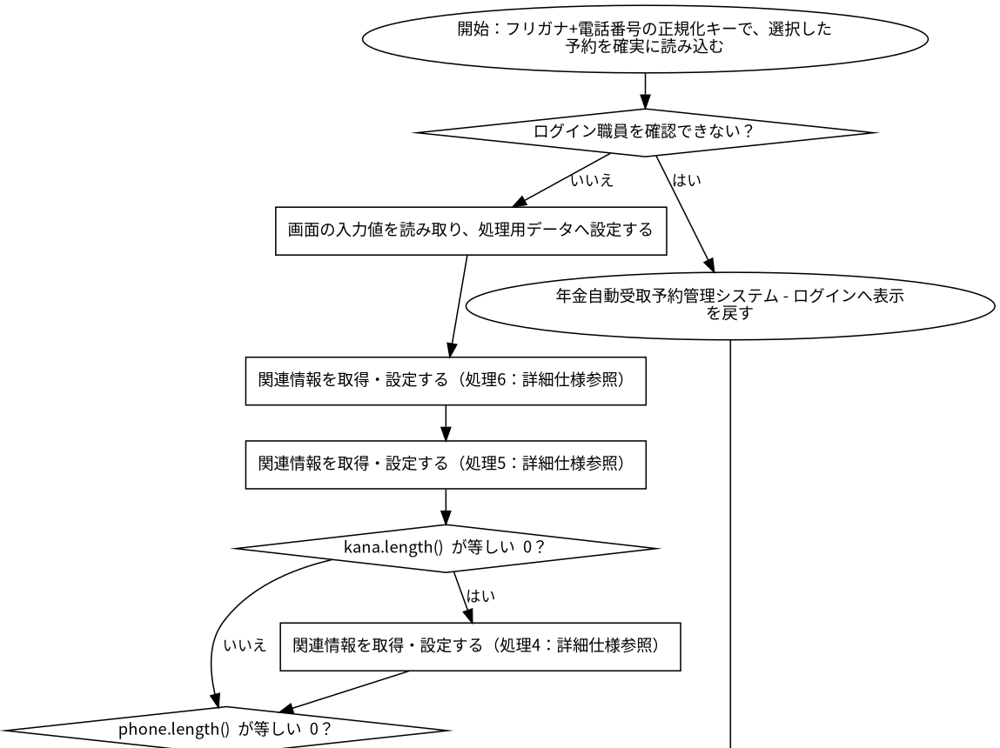

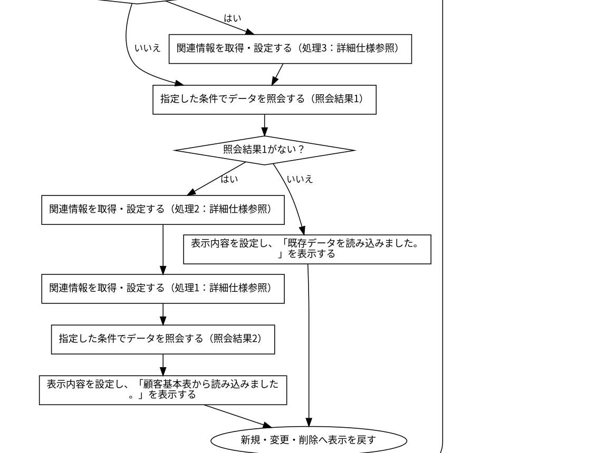

#### SQL・テーブル関連（ER図）

実線はSQLの結合条件。外部キー制約や多重度を断定しない。単独表は独立したエンティティで表す。

#### DB操作の詳細

#### DB操作 SQL-26B9F21A0A7B

| 情報 | 内容 |
| --- | --- |
| 操作ID | SQL-26B9F21A0A7B |
| 対象テーブル | N2_SIGHT.Ｂ顧客基本表 |
| 操作 | 参照 |
| 処理説明 | 対象テーブルの対象データを読み取る。設定項目・対象条件・確定取消は以下の定義に従う。 |
| 設定項目 | 当該SQL式の列指定・実行時引数を使用する。組立式と原本のパラメーター設定を参照。 |
| 対象条件 | 抽出・更新対象条件：C.店舗コード = ? AND C.顧客番号 = ? |
| 確定・取消 | 呼出側または接続の設定に従う。当該メソッド単独でのコミット・ロールバック指定はない。 同じ原本に明示トランザクションの呼出元があり、経路別の確定・取消範囲は関連処理で確認する。 |
| 原本 | nenkin/WEB-INF/src/nenkin/service/PensionRepository.java:88 / findByCustomer@87 |

#### DB操作 SQL-BE29DD398BAD

| 情報 | 内容 |
| --- | --- |
| 操作ID | SQL-BE29DD398BAD |
| 対象テーブル | 年金1_LK |
| 操作 | 参照 |
| 処理説明 | 対象テーブルの対象データを読み取る。設定項目・対象条件・確定取消は以下の定義に従う。 |
| 設定項目 | 当該SQL式の列指定・実行時引数を使用する。組立式と原本のパラメーター設定を参照。 |
| 対象条件 | 抽出・更新対象条件：R.ふりがな = ? AND R.電話番号 = ? |
| 確定・取消 | 呼出側または接続の設定に従う。当該メソッド単独でのコミット・ロールバック指定はない。 同じ原本に明示トランザクションの呼出元があり、経路別の確定・取消範囲は関連処理で確認する。 |
| 原本 | nenkin/WEB-INF/src/nenkin/service/PensionRepository.java:150 / findByKanaAndPhone@144 |

#### DB操作 SQL-98675681E706

| 情報 | 内容 |
| --- | --- |
| 操作ID | SQL-98675681E706 |
| 対象テーブル | 店名テーブル |
| 操作 | 参照 |
| 処理説明 | 対象テーブルの対象データを読み取る。設定項目・対象条件・確定取消は以下の定義に従う。 |
| 設定項目 | 当該SQL式の列指定・実行時引数を使用する。組立式と原本のパラメーター設定を参照。 |
| 対象条件 | 抽出・更新対象条件：R.ふりがな = ? AND R.電話番号 = ? |
| 確定・取消 | 呼出側または接続の設定に従う。当該メソッド単独でのコミット・ロールバック指定はない。 同じ原本に明示トランザクションの呼出元があり、経路別の確定・取消範囲は関連処理で確認する。 |
| 原本 | nenkin/WEB-INF/src/nenkin/service/PensionRepository.java:150 / findByKanaAndPhone@144 |

#### DB操作 SQL-935A991E07F4

| 情報 | 内容 |
| --- | --- |
| 操作ID | SQL-935A991E07F4 |
| 対象テーブル | 性別テーブル |
| 操作 | 参照 |
| 処理説明 | 対象テーブルの対象データを読み取る。設定項目・対象条件・確定取消は以下の定義に従う。 |
| 設定項目 | 当該SQL式の列指定・実行時引数を使用する。組立式と原本のパラメーター設定を参照。 |
| 対象条件 | 抽出・更新対象条件：R.ふりがな = ? AND R.電話番号 = ? |
| 確定・取消 | 呼出側または接続の設定に従う。当該メソッド単独でのコミット・ロールバック指定はない。 同じ原本に明示トランザクションの呼出元があり、経路別の確定・取消範囲は関連処理で確認する。 |
| 原本 | nenkin/WEB-INF/src/nenkin/service/PensionRepository.java:150 / findByKanaAndPhone@144 |

#### DB操作 SQL-A0A469ECF2C0

| 情報 | 内容 |
| --- | --- |
| 操作ID | SQL-A0A469ECF2C0 |
| 対象テーブル | 裁定請求テーブル |
| 操作 | 参照 |
| 処理説明 | 対象テーブルの対象データを読み取る。設定項目・対象条件・確定取消は以下の定義に従う。 |
| 設定項目 | 当該SQL式の列指定・実行時引数を使用する。組立式と原本のパラメーター設定を参照。 |
| 対象条件 | 抽出・更新対象条件：R.ふりがな = ? AND R.電話番号 = ? |
| 確定・取消 | 呼出側または接続の設定に従う。当該メソッド単独でのコミット・ロールバック指定はない。 同じ原本に明示トランザクションの呼出元があり、経路別の確定・取消範囲は関連処理で確認する。 |
| 原本 | nenkin/WEB-INF/src/nenkin/service/PensionRepository.java:150 / findByKanaAndPhone@144 |

#### DB操作 SQL-F2C97CD89E50

| 情報 | 内容 |
| --- | --- |
| 操作ID | SQL-F2C97CD89E50 |
| 対象テーブル | 受給有無テーブル |
| 操作 | 参照 |
| 処理説明 | 対象テーブルの対象データを読み取る。設定項目・対象条件・確定取消は以下の定義に従う。 |
| 設定項目 | 当該SQL式の列指定・実行時引数を使用する。組立式と原本のパラメーター設定を参照。 |
| 対象条件 | 抽出・更新対象条件：R.ふりがな = ? AND R.電話番号 = ? |
| 確定・取消 | 呼出側または接続の設定に従う。当該メソッド単独でのコミット・ロールバック指定はない。 同じ原本に明示トランザクションの呼出元があり、経路別の確定・取消範囲は関連処理で確認する。 |
| 原本 | nenkin/WEB-INF/src/nenkin/service/PensionRepository.java:150 / findByKanaAndPhone@144 |

#### DB操作 SQL-CD804AC01D11

| 情報 | 内容 |
| --- | --- |
| 操作ID | SQL-CD804AC01D11 |
| 対象テーブル | 年金種類テーブル |
| 操作 | 参照 |
| 処理説明 | 対象テーブルの対象データを読み取る。設定項目・対象条件・確定取消は以下の定義に従う。 |
| 設定項目 | 当該SQL式の列指定・実行時引数を使用する。組立式と原本のパラメーター設定を参照。 |
| 対象条件 | 抽出・更新対象条件：R.ふりがな = ? AND R.電話番号 = ? |
| 確定・取消 | 呼出側または接続の設定に従う。当該メソッド単独でのコミット・ロールバック指定はない。 同じ原本に明示トランザクションの呼出元があり、経路別の確定・取消範囲は関連処理で確認する。 |
| 原本 | nenkin/WEB-INF/src/nenkin/service/PensionRepository.java:150 / findByKanaAndPhone@144 |

#### DB操作 SQL-22BD3A50DAE5

| 情報 | 内容 |
| --- | --- |
| 操作ID | SQL-22BD3A50DAE5 |
| 対象テーブル | 店名テーブル |
| 操作 | 参照 |
| 処理説明 | 対象テーブルの対象データを読み取る。設定項目・対象条件・確定取消は以下の定義に従う。 |
| 設定項目 | 当該SQL式の列指定・実行時引数を使用する。組立式と原本のパラメーター設定を参照。 |
| 対象条件 | 抽出・更新対象条件：店舗ｺｰﾄﾞ = ? |
| 確定・取消 | 呼出側または接続の設定に従う。当該メソッド単独でのコミット・ロールバック指定はない。 同じ原本に明示トランザクションの呼出元があり、経路別の確定・取消範囲は関連処理で確認する。 |
| 原本 | nenkin/WEB-INF/src/nenkin/service/PensionRepository.java:543 / resolveBranchName@535 |

#### DB操作 SQL-D9F3500B923D

| 情報 | 内容 |
| --- | --- |
| 操作ID | SQL-D9F3500B923D |
| 対象テーブル | DB2.Ｕ職員名簿表 |
| 操作 | 参照 |
| 処理説明 | 対象テーブルの対象データを読み取る。設定項目・対象条件・確定取消は以下の定義に従う。 |
| 設定項目 | 当該SQL式の列指定・実行時引数を使用する。組立式と原本のパラメーター設定を参照。 |
| 対象条件 | 抽出・更新対象条件：S.職員番号 = ? |
| 確定・取消 | 呼出側または接続の設定に従う。当該メソッド単独でのコミット・ロールバック指定はない。 |
| 原本 | nenkin/WEB-INF/src/nenkin/service/ReferenceDataService.java:207 / getStaff@206 |

#### DB操作 SQL-E0FD738666D8

| 情報 | 内容 |
| --- | --- |
| 操作ID | SQL-E0FD738666D8 |
| 対象テーブル | 店名テーブル |
| 操作 | 参照 |
| 処理説明 | 対象テーブルの対象データを読み取る。設定項目・対象条件・確定取消は以下の定義に従う。 |
| 設定項目 | 当該SQL式の列指定・実行時引数を使用する。組立式と原本のパラメーター設定を参照。 |
| 対象条件 | WHERE句による限定はこのSQL式にない。呼出条件・動的付加条件は原本を参照する。 |
| 確定・取消 | 呼出側または接続の設定に従う。当該メソッド単独でのコミット・ロールバック指定はない。 |
| 原本 | nenkin/WEB-INF/src/nenkin/service/ReferenceDataService.java:291 / loadBranchNames@289 |

#### 結果・例外時の扱い

| 到達条件 | 結果 |
| --- | --- |
| ログイン職員を確認できない | 年金自動受取予約管理システム - ログインへ表示を戻す |
| 条件13を満たす（原本条件は補足説明を参照） | 新規・変更・削除へ表示を戻す |

### 年金予約照会

#### 処理概要

新規・変更・削除で「年金予約照会」の要求を受け付ける。入力・確認・データ操作・応答の順と、条件が成立しない場合の処理を以下に示す。

#### 処理手順

1. 「ログイン職員を確認できない」に該当するか確認する。該当する場合に限り、次の分岐内手順を行う。該当しない場合は分岐の後へ進む。

1.1. 条件成立時：年金自動受取予約管理システム - ログインへ表示を戻す。この経路の後続手順は実行しない。

2. 「!"POST".equalsIgnoreCase(「対象項目」)」に該当するか確認する。該当する場合に限り、次の分岐内手順を行う。該当しない場合は分岐の後へ進む。

2.1. 条件成立時：関連情報を取得・設定する（処理8：詳細仕様参照）。

2.2. 条件成立時：処理結果を呼出元へ返す。この経路の後続手順は実行しない。

3. 関連情報を取得・設定する（処理9：詳細仕様参照）。

4. 「条件10を満たす（原本条件は補足説明を参照）」に該当するか確認する。成立時と不成立時の手順を分けて行う。

4.1. 条件成立時：指定した条件でデータを照会する。

4-別.1. 条件不成立時：関連情報を取得・設定する（処理11：詳細仕様参照）。

4-別.2. 条件不成立時：指定した条件でデータを照会する。

5. 「対象項目」を設定する。

6. 「対象項目」を設定する。

7. 関連情報を取得・設定する（処理12：詳細仕様参照）。

8. 関連情報を取得・設定する（処理13：詳細仕様参照）。

9. 関連情報を取得・設定する（処理14：詳細仕様参照）。

10. 処理結果を呼出元へ返す。この経路の後続手順は実行しない。

#### 処理フロー

入口処理の順序・分岐を示す。呼出先の処理は別単位とし、SQLの対象と実行条件はDB操作の詳細へ記載する。例外線は範囲内で例外が発生した場合の経路で、各命令が必ず例外を送出する意味ではない。

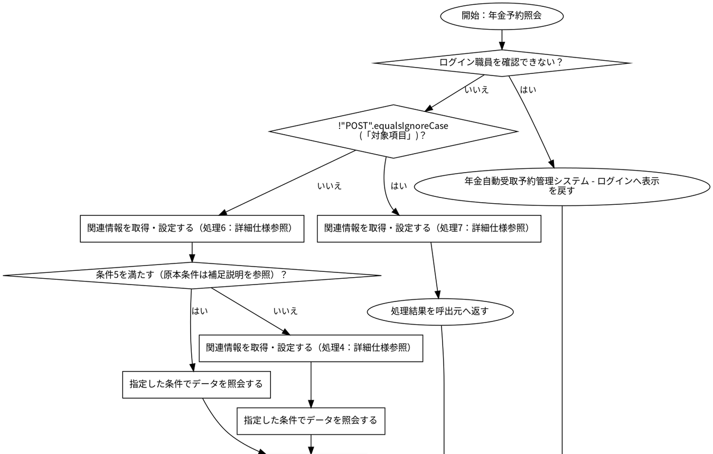

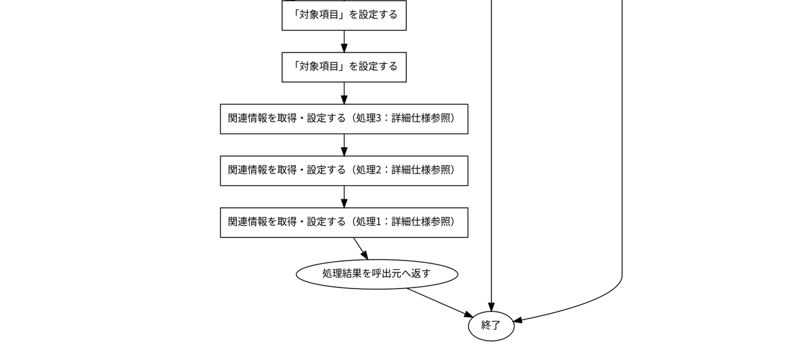

#### SQL・テーブル関連（ER図）

実線はSQLの結合条件。外部キー制約や多重度を断定しない。単独表は独立したエンティティで表す。

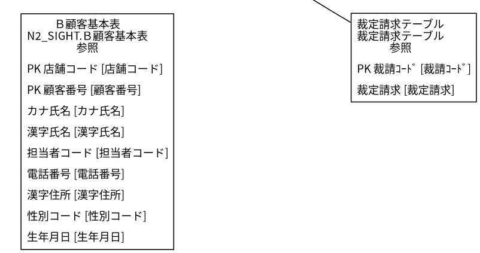

#### DB操作の詳細

#### DB操作 SQL-26B9F21A0A7B

| 情報 | 内容 |
| --- | --- |
| 操作ID | SQL-26B9F21A0A7B |
| 対象テーブル | N2_SIGHT.Ｂ顧客基本表 |
| 操作 | 参照 |
| 処理説明 | 対象テーブルの対象データを読み取る。設定項目・対象条件・確定取消は以下の定義に従う。 |
| 設定項目 | 当該SQL式の列指定・実行時引数を使用する。組立式と原本のパラメーター設定を参照。 |
| 対象条件 | 抽出・更新対象条件：C.店舗コード = ? AND C.顧客番号 = ? |
| 確定・取消 | 呼出側または接続の設定に従う。当該メソッド単独でのコミット・ロールバック指定はない。 同じ原本に明示トランザクションの呼出元があり、経路別の確定・取消範囲は関連処理で確認する。 |
| 原本 | nenkin/WEB-INF/src/nenkin/service/PensionRepository.java:88 / findByCustomer@87 |

#### DB操作 SQL-BE29DD398BAD

| 情報 | 内容 |
| --- | --- |
| 操作ID | SQL-BE29DD398BAD |
| 対象テーブル | 年金1_LK |
| 操作 | 参照 |
| 処理説明 | 対象テーブルの対象データを読み取る。設定項目・対象条件・確定取消は以下の定義に従う。 |
| 設定項目 | 当該SQL式の列指定・実行時引数を使用する。組立式と原本のパラメーター設定を参照。 |
| 対象条件 | 抽出・更新対象条件：R.ふりがな = ? AND R.電話番号 = ? |
| 確定・取消 | 呼出側または接続の設定に従う。当該メソッド単独でのコミット・ロールバック指定はない。 同じ原本に明示トランザクションの呼出元があり、経路別の確定・取消範囲は関連処理で確認する。 |
| 原本 | nenkin/WEB-INF/src/nenkin/service/PensionRepository.java:150 / findByKanaAndPhone@144 |

#### DB操作 SQL-98675681E706

| 情報 | 内容 |
| --- | --- |
| 操作ID | SQL-98675681E706 |
| 対象テーブル | 店名テーブル |
| 操作 | 参照 |
| 処理説明 | 対象テーブルの対象データを読み取る。設定項目・対象条件・確定取消は以下の定義に従う。 |
| 設定項目 | 当該SQL式の列指定・実行時引数を使用する。組立式と原本のパラメーター設定を参照。 |
| 対象条件 | 抽出・更新対象条件：R.ふりがな = ? AND R.電話番号 = ? |
| 確定・取消 | 呼出側または接続の設定に従う。当該メソッド単独でのコミット・ロールバック指定はない。 同じ原本に明示トランザクションの呼出元があり、経路別の確定・取消範囲は関連処理で確認する。 |
| 原本 | nenkin/WEB-INF/src/nenkin/service/PensionRepository.java:150 / findByKanaAndPhone@144 |

#### DB操作 SQL-935A991E07F4

| 情報 | 内容 |
| --- | --- |
| 操作ID | SQL-935A991E07F4 |
| 対象テーブル | 性別テーブル |
| 操作 | 参照 |
| 処理説明 | 対象テーブルの対象データを読み取る。設定項目・対象条件・確定取消は以下の定義に従う。 |
| 設定項目 | 当該SQL式の列指定・実行時引数を使用する。組立式と原本のパラメーター設定を参照。 |
| 対象条件 | 抽出・更新対象条件：R.ふりがな = ? AND R.電話番号 = ? |
| 確定・取消 | 呼出側または接続の設定に従う。当該メソッド単独でのコミット・ロールバック指定はない。 同じ原本に明示トランザクションの呼出元があり、経路別の確定・取消範囲は関連処理で確認する。 |
| 原本 | nenkin/WEB-INF/src/nenkin/service/PensionRepository.java:150 / findByKanaAndPhone@144 |

#### DB操作 SQL-A0A469ECF2C0

| 情報 | 内容 |
| --- | --- |
| 操作ID | SQL-A0A469ECF2C0 |
| 対象テーブル | 裁定請求テーブル |
| 操作 | 参照 |
| 処理説明 | 対象テーブルの対象データを読み取る。設定項目・対象条件・確定取消は以下の定義に従う。 |
| 設定項目 | 当該SQL式の列指定・実行時引数を使用する。組立式と原本のパラメーター設定を参照。 |
| 対象条件 | 抽出・更新対象条件：R.ふりがな = ? AND R.電話番号 = ? |
| 確定・取消 | 呼出側または接続の設定に従う。当該メソッド単独でのコミット・ロールバック指定はない。 同じ原本に明示トランザクションの呼出元があり、経路別の確定・取消範囲は関連処理で確認する。 |
| 原本 | nenkin/WEB-INF/src/nenkin/service/PensionRepository.java:150 / findByKanaAndPhone@144 |

#### DB操作 SQL-F2C97CD89E50

| 情報 | 内容 |
| --- | --- |
| 操作ID | SQL-F2C97CD89E50 |
| 対象テーブル | 受給有無テーブル |
| 操作 | 参照 |
| 処理説明 | 対象テーブルの対象データを読み取る。設定項目・対象条件・確定取消は以下の定義に従う。 |
| 設定項目 | 当該SQL式の列指定・実行時引数を使用する。組立式と原本のパラメーター設定を参照。 |
| 対象条件 | 抽出・更新対象条件：R.ふりがな = ? AND R.電話番号 = ? |
| 確定・取消 | 呼出側または接続の設定に従う。当該メソッド単独でのコミット・ロールバック指定はない。 同じ原本に明示トランザクションの呼出元があり、経路別の確定・取消範囲は関連処理で確認する。 |
| 原本 | nenkin/WEB-INF/src/nenkin/service/PensionRepository.java:150 / findByKanaAndPhone@144 |

#### DB操作 SQL-CD804AC01D11

| 情報 | 内容 |
| --- | --- |
| 操作ID | SQL-CD804AC01D11 |
| 対象テーブル | 年金種類テーブル |
| 操作 | 参照 |
| 処理説明 | 対象テーブルの対象データを読み取る。設定項目・対象条件・確定取消は以下の定義に従う。 |
| 設定項目 | 当該SQL式の列指定・実行時引数を使用する。組立式と原本のパラメーター設定を参照。 |
| 対象条件 | 抽出・更新対象条件：R.ふりがな = ? AND R.電話番号 = ? |
| 確定・取消 | 呼出側または接続の設定に従う。当該メソッド単独でのコミット・ロールバック指定はない。 同じ原本に明示トランザクションの呼出元があり、経路別の確定・取消範囲は関連処理で確認する。 |
| 原本 | nenkin/WEB-INF/src/nenkin/service/PensionRepository.java:150 / findByKanaAndPhone@144 |

#### DB操作 SQL-22BD3A50DAE5

| 情報 | 内容 |
| --- | --- |
| 操作ID | SQL-22BD3A50DAE5 |
| 対象テーブル | 店名テーブル |
| 操作 | 参照 |
| 処理説明 | 対象テーブルの対象データを読み取る。設定項目・対象条件・確定取消は以下の定義に従う。 |
| 設定項目 | 当該SQL式の列指定・実行時引数を使用する。組立式と原本のパラメーター設定を参照。 |
| 対象条件 | 抽出・更新対象条件：店舗ｺｰﾄﾞ = ? |
| 確定・取消 | 呼出側または接続の設定に従う。当該メソッド単独でのコミット・ロールバック指定はない。 同じ原本に明示トランザクションの呼出元があり、経路別の確定・取消範囲は関連処理で確認する。 |
| 原本 | nenkin/WEB-INF/src/nenkin/service/PensionRepository.java:543 / resolveBranchName@535 |

#### DB操作 SQL-D9F3500B923D

| 情報 | 内容 |
| --- | --- |
| 操作ID | SQL-D9F3500B923D |
| 対象テーブル | DB2.Ｕ職員名簿表 |
| 操作 | 参照 |
| 処理説明 | 対象テーブルの対象データを読み取る。設定項目・対象条件・確定取消は以下の定義に従う。 |
| 設定項目 | 当該SQL式の列指定・実行時引数を使用する。組立式と原本のパラメーター設定を参照。 |
| 対象条件 | 抽出・更新対象条件：S.職員番号 = ? |
| 確定・取消 | 呼出側または接続の設定に従う。当該メソッド単独でのコミット・ロールバック指定はない。 |
| 原本 | nenkin/WEB-INF/src/nenkin/service/ReferenceDataService.java:207 / getStaff@206 |

#### 結果・例外時の扱い

| 到達条件 | 結果 |
| --- | --- |
| ログイン職員を確認できない | 年金自動受取予約管理システム - ログインへ表示を戻す |
| 条件15を満たす（原本条件は補足説明を参照）・!"POST".equalsIgnoreCase(「対象項目」) | 処理結果を呼出元へ返す |
| 条件16を満たす（原本条件は補足説明を参照）・NOT (!"POST".equalsIgnoreCase(「対象項目」)) | 処理結果を呼出元へ返す |

### 年金予約登録・変更

#### 処理概要

新規・変更・削除で「年金予約登録・変更」の要求を受け付ける。入力・確認・データ操作・応答の順と、条件が成立しない場合の処理を以下に示す。

#### 処理手順

1. 「ログイン職員を確認できない」に該当するか確認する。該当する場合に限り、次の分岐内手順を行う。該当しない場合は分岐の後へ進む。

1.1. 条件成立時：年金自動受取予約管理システム - ログインへ表示を戻す。この経路の後続手順は実行しない。

2. 画面の入力値を読み取り、処理用データへ設定する。

3. 「送信方法・確認用トークンが一致しない」に該当するか確認する。該当する場合に限り、次の分岐内手順を行う。該当しない場合は分岐の後へ進む。

3.1. 条件成立時：表示内容を設定し、「画面の有効期限が切れました。メニューから操作しなおしてください。」を表示する。

3.2. 条件成立時：新規・変更・削除へ表示を戻す。この経路の後続手順は実行しない。

4. 入力値の制約と変換結果を確認する。

5. 「入力エラーがある」に該当するか確認する。該当する場合に限り、次の分岐内手順を行う。該当しない場合は分岐の後へ進む。

5.1. 条件成立時：フリガナ・電話番号を条件にデータを照会する（照会結果2）。

5.2. 条件成立時：処理結果とメッセージを画面の表示内容へ設定する。

5.3. 条件成立時：新規・変更・削除へ表示を戻す。この経路の後続手順は実行しない。

6. フリガナ・電話番号を条件にデータを照会する（照会結果2）。

7. 指定した条件でデータを照会する（照会結果3）。

8. 「照会結果2がある、かつ照合キーが一致しない」に該当するか確認する。該当する場合に限り、次の分岐内手順を行う。該当しない場合は分岐の後へ進む。

8.1. 条件成立時：表示内容を設定し、「同じフリガナと電話番号の既存データを読み込みました。内容を確認してから登録してください。」を表示する。

8.2. 条件成立時：新規・変更・削除へ表示を戻す。この経路の後続手順は実行しない。

9. 「照会結果2がない、かつ照会結果3がある」に該当するか確認する。該当する場合に限り、次の分岐内手順を行う。該当しない場合は分岐の後へ進む。

9.1. 条件成立時：表示内容を設定し、「キー項目は変更できません。クリア後に新規データとして入力してください。」を表示する。

9.2. 条件成立時：新規・変更・削除へ表示を戻す。この経路の後続手順は実行しない。

10. セッションに保持された利用者情報を取得する。

11. 「照会結果2がある、かつ操作権限が制限される」に該当するか確認する。該当する場合に限り、次の分岐内手順を行う。該当しない場合は分岐の後へ進む。

11.1. 条件成立時：表示内容を設定し、「権限が不足しています。変更を行う場合には／推進役以上の方が変更してください。」を表示する。

11.2. 条件成立時：新規・変更・削除へ表示を戻す。この経路の後続手順は実行しない。

12. 入力内容を保存する（対象・実行条件はDB操作の詳細を参照）。

13. 表示内容を設定し、「登録終了！」を表示する。

14. 新規・変更・削除へ表示を戻す。この経路の後続手順は実行しない。

#### 処理フロー

入口処理の順序・分岐を示す。呼出先の処理は別単位とし、SQLの対象と実行条件はDB操作の詳細へ記載する。例外線は範囲内で例外が発生した場合の経路で、各命令が必ず例外を送出する意味ではない。

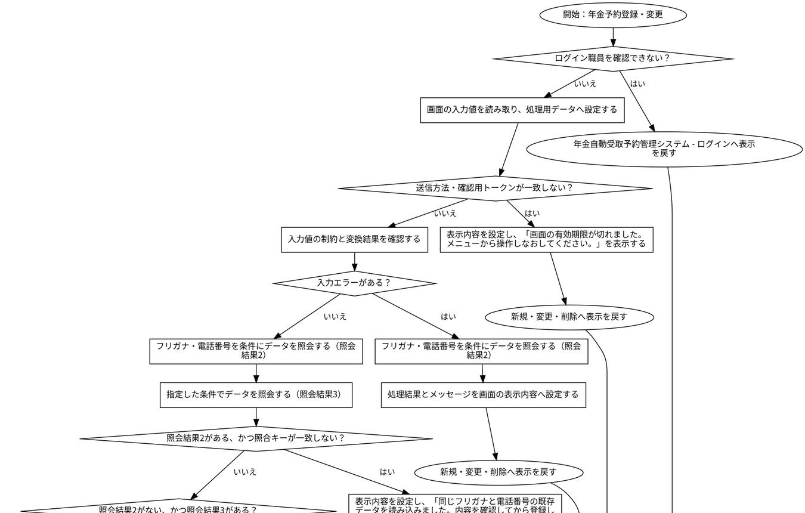

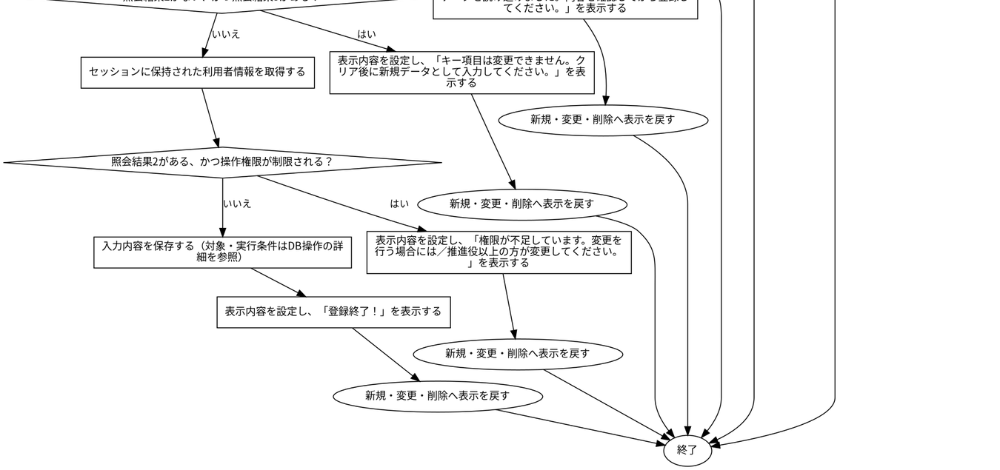

#### SQL・テーブル関連（ER図）

実線はSQLの結合条件。外部キー制約や多重度を断定しない。単独表は独立したエンティティで表す。

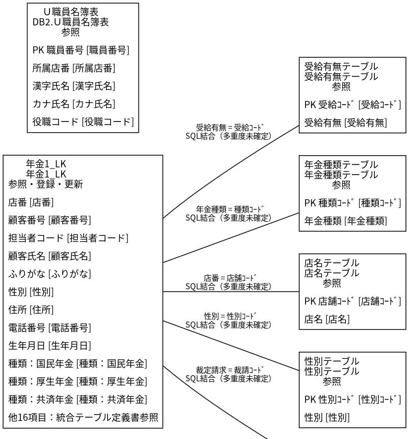

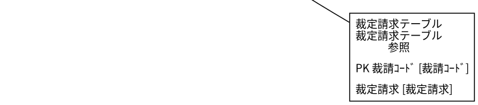

#### DB操作の詳細

#### DB操作 SQL-BE29DD398BAD

| 情報 | 内容 |
| --- | --- |
| 操作ID | SQL-BE29DD398BAD |
| 対象テーブル | 年金1_LK |
| 操作 | 参照 |
| 処理説明 | 対象テーブルの対象データを読み取る。設定項目・対象条件・確定取消は以下の定義に従う。 |
| 設定項目 | 当該SQL式の列指定・実行時引数を使用する。組立式と原本のパラメーター設定を参照。 |
| 対象条件 | 抽出・更新対象条件：R.ふりがな = ? AND R.電話番号 = ? |
| 確定・取消 | 呼出側または接続の設定に従う。当該メソッド単独でのコミット・ロールバック指定はない。 同じ原本に明示トランザクションの呼出元があり、経路別の確定・取消範囲は関連処理で確認する。 |
| 原本 | nenkin/WEB-INF/src/nenkin/service/PensionRepository.java:150 / findByKanaAndPhone@144 |

#### DB操作 SQL-98675681E706

| 情報 | 内容 |
| --- | --- |
| 操作ID | SQL-98675681E706 |
| 対象テーブル | 店名テーブル |
| 操作 | 参照 |
| 処理説明 | 対象テーブルの対象データを読み取る。設定項目・対象条件・確定取消は以下の定義に従う。 |
| 設定項目 | 当該SQL式の列指定・実行時引数を使用する。組立式と原本のパラメーター設定を参照。 |
| 対象条件 | 抽出・更新対象条件：R.ふりがな = ? AND R.電話番号 = ? |
| 確定・取消 | 呼出側または接続の設定に従う。当該メソッド単独でのコミット・ロールバック指定はない。 同じ原本に明示トランザクションの呼出元があり、経路別の確定・取消範囲は関連処理で確認する。 |
| 原本 | nenkin/WEB-INF/src/nenkin/service/PensionRepository.java:150 / findByKanaAndPhone@144 |

#### DB操作 SQL-935A991E07F4

| 情報 | 内容 |
| --- | --- |
| 操作ID | SQL-935A991E07F4 |
| 対象テーブル | 性別テーブル |
| 操作 | 参照 |
| 処理説明 | 対象テーブルの対象データを読み取る。設定項目・対象条件・確定取消は以下の定義に従う。 |
| 設定項目 | 当該SQL式の列指定・実行時引数を使用する。組立式と原本のパラメーター設定を参照。 |
| 対象条件 | 抽出・更新対象条件：R.ふりがな = ? AND R.電話番号 = ? |
| 確定・取消 | 呼出側または接続の設定に従う。当該メソッド単独でのコミット・ロールバック指定はない。 同じ原本に明示トランザクションの呼出元があり、経路別の確定・取消範囲は関連処理で確認する。 |
| 原本 | nenkin/WEB-INF/src/nenkin/service/PensionRepository.java:150 / findByKanaAndPhone@144 |

#### DB操作 SQL-A0A469ECF2C0

| 情報 | 内容 |
| --- | --- |
| 操作ID | SQL-A0A469ECF2C0 |
| 対象テーブル | 裁定請求テーブル |
| 操作 | 参照 |
| 処理説明 | 対象テーブルの対象データを読み取る。設定項目・対象条件・確定取消は以下の定義に従う。 |
| 設定項目 | 当該SQL式の列指定・実行時引数を使用する。組立式と原本のパラメーター設定を参照。 |
| 対象条件 | 抽出・更新対象条件：R.ふりがな = ? AND R.電話番号 = ? |
| 確定・取消 | 呼出側または接続の設定に従う。当該メソッド単独でのコミット・ロールバック指定はない。 同じ原本に明示トランザクションの呼出元があり、経路別の確定・取消範囲は関連処理で確認する。 |
| 原本 | nenkin/WEB-INF/src/nenkin/service/PensionRepository.java:150 / findByKanaAndPhone@144 |

#### DB操作 SQL-F2C97CD89E50

| 情報 | 内容 |
| --- | --- |
| 操作ID | SQL-F2C97CD89E50 |
| 対象テーブル | 受給有無テーブル |
| 操作 | 参照 |
| 処理説明 | 対象テーブルの対象データを読み取る。設定項目・対象条件・確定取消は以下の定義に従う。 |
| 設定項目 | 当該SQL式の列指定・実行時引数を使用する。組立式と原本のパラメーター設定を参照。 |
| 対象条件 | 抽出・更新対象条件：R.ふりがな = ? AND R.電話番号 = ? |
| 確定・取消 | 呼出側または接続の設定に従う。当該メソッド単独でのコミット・ロールバック指定はない。 同じ原本に明示トランザクションの呼出元があり、経路別の確定・取消範囲は関連処理で確認する。 |
| 原本 | nenkin/WEB-INF/src/nenkin/service/PensionRepository.java:150 / findByKanaAndPhone@144 |

#### DB操作 SQL-CD804AC01D11

| 情報 | 内容 |
| --- | --- |
| 操作ID | SQL-CD804AC01D11 |
| 対象テーブル | 年金種類テーブル |
| 操作 | 参照 |
| 処理説明 | 対象テーブルの対象データを読み取る。設定項目・対象条件・確定取消は以下の定義に従う。 |
| 設定項目 | 当該SQL式の列指定・実行時引数を使用する。組立式と原本のパラメーター設定を参照。 |
| 対象条件 | 抽出・更新対象条件：R.ふりがな = ? AND R.電話番号 = ? |
| 確定・取消 | 呼出側または接続の設定に従う。当該メソッド単独でのコミット・ロールバック指定はない。 同じ原本に明示トランザクションの呼出元があり、経路別の確定・取消範囲は関連処理で確認する。 |
| 原本 | nenkin/WEB-INF/src/nenkin/service/PensionRepository.java:150 / findByKanaAndPhone@144 |

#### DB操作 SQL-22BD3A50DAE5

| 情報 | 内容 |
| --- | --- |
| 操作ID | SQL-22BD3A50DAE5 |
| 対象テーブル | 店名テーブル |
| 操作 | 参照 |
| 処理説明 | 対象テーブルの対象データを読み取る。設定項目・対象条件・確定取消は以下の定義に従う。 |
| 設定項目 | 当該SQL式の列指定・実行時引数を使用する。組立式と原本のパラメーター設定を参照。 |
| 対象条件 | 抽出・更新対象条件：店舗ｺｰﾄﾞ = ? |
| 確定・取消 | 呼出側または接続の設定に従う。当該メソッド単独でのコミット・ロールバック指定はない。 同じ原本に明示トランザクションの呼出元があり、経路別の確定・取消範囲は関連処理で確認する。 |
| 原本 | nenkin/WEB-INF/src/nenkin/service/PensionRepository.java:543 / resolveBranchName@535 |

#### DB操作 SQL-19BE5BBBA554

| 情報 | 内容 |
| --- | --- |
| 操作ID | SQL-19BE5BBBA554 |
| 対象テーブル | 年金1_LK |
| 操作 | 参照 |
| 処理説明 | 対象テーブルの対象データを読み取る。設定項目・対象条件・確定取消は以下の定義に従う。 |
| 設定項目 | 当該SQL式の列指定・実行時引数を使用する。組立式と原本のパラメーター設定を参照。 |
| 対象条件 | 抽出・更新対象条件：ふりがな = ? AND 電話番号 = ? |
| 確定・取消 | 呼出側または接続の設定に従う。当該メソッド単独でのコミット・ロールバック指定はない。 同じ原本に明示トランザクションの呼出元があり、経路別の確定・取消範囲は関連処理で確認する。 |
| 原本 | nenkin/WEB-INF/src/nenkin/service/PensionRepository.java:628 / exists@623 |

#### DB操作 SQL-1A463E2BC06C

| 情報 | 内容 |
| --- | --- |
| 操作ID | SQL-1A463E2BC06C |
| 対象テーブル | 年金1_LK |
| 操作 | 挿入 |
| 処理説明 | 対象テーブルの新しい行を登録する。設定項目・対象条件・確定取消は以下の定義に従う。 |
| 設定項目 | 店番 ← バインド引数1（PreparedStatementまたは呼出側の設定順序）／顧客番号 ← バインド引数2（PreparedStatementまたは呼出側の設定順序）／担当者コード ← バインド引数3（PreparedStatementまたは呼出側の設定順序）／顧客氏名 ← バインド引数4（PreparedStatementまたは呼出側の設定順序）／ふりがな ← バインド引数5（PreparedStatementまたは呼出側の設定順序）／性別 ← バインド引数6（PreparedStatementまたは呼出側の設定順序）／住所 ← バインド引数7（PreparedStatementまたは呼出側の設定順序）／電話番号 ← バインド引数8（PreparedStatementまたは呼出側の設定順序）／生年月日 ← バインド引数9（PreparedStatementまたは呼出側の設定順序）／種類：国民年金 ← バインド引数10（PreparedStatementまたは呼出側の設定順序）／種類：厚生年金 ← バインド引数11（PreparedStatementまたは呼出側の設定順序）／種類：共済年金 ← バインド引数12（PreparedStatementまたは呼出側の設定順序）／種類：厚生年金基金 ← バインド引数13（PreparedStatementまたは呼出側の設定順序）／種類：国民年金基金 ← バインド引数14（PreparedStatementまたは呼出側の設定順序）／年金種類 ← バインド引数15（PreparedStatementまたは呼出側の設定順序）／裁定請求 ← バインド引数16（PreparedStatementまたは呼出側の設定順序）／請求予定日 ← バインド引数17（PreparedStatementまたは呼出側の設定順序）／予定年齢 ← バインド引数18（PreparedStatementまたは呼出側の設定順序）／配偶者名 ← バインド引数19（PreparedStatementまたは呼出側の設定順序）／配偶者生年月日 ← バインド引数20（PreparedStatementまたは呼出側の設定順序）／受給有無 ← バインド引数21（PreparedStatementまたは呼出側の設定順序）／予約徴求日 ← バインド引数22（PreparedStatementまたは呼出側の設定順序）／備考 ← バインド引数23（PreparedStatementまたは呼出側の設定順序）／データ更新日 ← バインド引数24（PreparedStatementまたは呼出側の設定順序）／更新時間 ← バインド引数25（PreparedStatementまたは呼出側の設定順序）／更新者 ← バインド引数26（PreparedStatementまたは呼出側の設定順序）／６ヶ月先確認 ← バインド引数27（PreparedStatementまたは呼出側の設定順序）／変更FLG ← バインド引数28（PreparedStatementまたは呼出側の設定順序） |
| 対象条件 | 新しい行を挿入する。重複や採番の扱いは呼出元および列制約に従う。 |
| 確定・取消 | 呼出側または接続の設定に従う。当該メソッド単独でのコミット・ロールバック指定はない。 同じ原本に明示トランザクションの呼出元があり、経路別の確定・取消範囲は関連処理で確認する。 |
| 原本 | nenkin/WEB-INF/src/nenkin/service/PensionRepository.java:661 / insert@657 |

| 設定先のDB項目 | バインド順 | 値の設定・変換（原本） |
| --- | --- | --- |
| 店番 | 1 | setInteger(statement, 1, value.getBranchNo()) |
| 顧客番号 | 2 | setInteger(statement, 2, value.getCustomerNo()) |
| 担当者コード | 3 | setInteger(statement, 3, value.getStaffCode()) |
| 顧客氏名 | 4 | value.getCustomerName() |
| ふりがな | 5 | value.getKanaName() |
| 性別 | 6 | setInteger(statement, 6, resolveCode(connection, GENDER_TABLE,                 "性別ｺｰﾄﾞ", "性別", value.getGender())) |
| 住所 | 7 | value.getAddress() |
| 電話番号 | 8 | setPhone(statement, 8, value.getPhoneNumber()) |
| 生年月日 | 9 | setDate(statement, 9, value.getBirthDate()) |
| 種類：国民年金 | 10 | value.isNationalPension() ? 1 : 0 |
| 種類：厚生年金 | 11 | value.isEmployeePension() ? 1 : 0 |
| 種類：共済年金 | 12 | value.isMutualAidPension() ? 1 : 0 |
| 種類：厚生年金基金 | 13 | value.isEmployeePensionFund() ? 1 : 0 |
| 種類：国民年金基金 | 14 | value.isNationalPensionFund() ? 1 : 0 |
| 年金種類 | 15 | setInteger(statement, 15, resolvePensionTypeCode(connection, value)) |
| 裁定請求 | 16 | setInteger(statement, 16, resolveCode(connection, CLAIM_TABLE,                 "裁請ｺｰﾄﾞ", "裁定請求", value.getClaimStatus())) |
| 請求予定日 | 17 | setDate(statement, 17, value.getClaimScheduledDate()) |
| 予定年齢 | 18 | setInteger(statement, 18, value.getPlannedAge()) |
| 配偶者名 | 19 | value.getSpouseName() |
| 配偶者生年月日 | 20 | setDate(statement, 20, value.getSpouseBirthDate()) |
| 受給有無 | 21 | setInteger(statement, 21, resolveCode(connection, BENEFIT_TABLE,                 "受給ｺｰﾄﾞ", "受給有無", value.getHasBenefit())) |
| 予約徴求日 | 22 | setDate(statement, 22, value.getReservationRequestDate()) |
| 備考 | 23 | value.getNotes() |
| データ更新日 | 24 | setDate(statement, 24, value.getDataUpdateDate()) |
| 更新時間 | 25 | setTime(statement, 25, updateTime) |
| 更新者 | 26 | setInteger(statement, 26, updatedBy) |
| ６ヶ月先確認 | 27 | value.isSixMonthCheck() ? 1 : 0 |
| 変更FLG | 28 | setInteger(statement, 28, Integer.valueOf(0)) |

#### DB操作 SQL-CD4068C5AE3B

| 情報 | 内容 |
| --- | --- |
| 操作ID | SQL-CD4068C5AE3B |
| 対象テーブル | 年金1_LK |
| 操作 | 更新 |
| 処理説明 | 対象テーブルの条件に一致する行を更新する。設定項目・対象条件・確定取消は以下の定義に従う。 |
| 設定項目 | 店番 ← バインド引数1（PreparedStatementまたは呼出側の設定順序）／顧客番号 ← バインド引数2（PreparedStatementまたは呼出側の設定順序）／担当者コード ← バインド引数3（PreparedStatementまたは呼出側の設定順序）／顧客氏名 ← バインド引数4（PreparedStatementまたは呼出側の設定順序）／ふりがな ← バインド引数5（PreparedStatementまたは呼出側の設定順序）／性別 ← バインド引数6（PreparedStatementまたは呼出側の設定順序）／住所 ← バインド引数7（PreparedStatementまたは呼出側の設定順序）／電話番号 ← バインド引数8（PreparedStatementまたは呼出側の設定順序）／生年月日 ← バインド引数9（PreparedStatementまたは呼出側の設定順序）／種類：国民年金 ← バインド引数10（PreparedStatementまたは呼出側の設定順序）／種類：厚生年金 ← バインド引数11（PreparedStatementまたは呼出側の設定順序）／種類：共済年金 ← バインド引数12（PreparedStatementまたは呼出側の設定順序）／種類：厚生年金基金 ← バインド引数13（PreparedStatementまたは呼出側の設定順序）／種類：国民年金基金 ← バインド引数14（PreparedStatementまたは呼出側の設定順序）／年金種類 ← バインド引数15（PreparedStatementまたは呼出側の設定順序）／裁定請求 ← バインド引数16（PreparedStatementまたは呼出側の設定順序）／請求予定日 ← バインド引数17（PreparedStatementまたは呼出側の設定順序）／予定年齢 ← バインド引数18（PreparedStatementまたは呼出側の設定順序）／配偶者名 ← バインド引数19（PreparedStatementまたは呼出側の設定順序）／配偶者生年月日 ← バインド引数20（PreparedStatementまたは呼出側の設定順序）／受給有無 ← バインド引数21（PreparedStatementまたは呼出側の設定順序）／予約徴求日 ← バインド引数22（PreparedStatementまたは呼出側の設定順序）／備考 ← バインド引数23（PreparedStatementまたは呼出側の設定順序）／データ更新日 ← バインド引数24（PreparedStatementまたは呼出側の設定順序）／更新時間 ← バインド引数25（PreparedStatementまたは呼出側の設定順序）／更新者 ← バインド引数26（PreparedStatementまたは呼出側の設定順序）／６ヶ月先確認 ← バインド引数27（PreparedStatementまたは呼出側の設定順序）／変更FLG ← バインド引数28（PreparedStatementまたは呼出側の設定順序） |
| 対象条件 | 抽出・更新対象条件：ふりがな = ? AND 電話番号 = ? |
| 確定・取消 | 呼出側または接続の設定に従う。当該メソッド単独でのコミット・ロールバック指定はない。 同じ原本に明示トランザクションの呼出元があり、経路別の確定・取消範囲は関連処理で確認する。 |
| 原本 | nenkin/WEB-INF/src/nenkin/service/PensionRepository.java:676 / update@672 |

| 設定先のDB項目 | バインド順 | 値の設定・変換（原本） |
| --- | --- | --- |
| 店番 | 1 | setInteger(statement, 1, value.getBranchNo()) |
| 顧客番号 | 2 | setInteger(statement, 2, value.getCustomerNo()) |
| 担当者コード | 3 | setInteger(statement, 3, value.getStaffCode()) |
| 顧客氏名 | 4 | value.getCustomerName() |
| ふりがな | 5 | value.getKanaName() |
| 性別 | 6 | setInteger(statement, 6, resolveCode(connection, GENDER_TABLE,                 "性別ｺｰﾄﾞ", "性別", value.getGender())) |
| 住所 | 7 | value.getAddress() |
| 電話番号 | 8 | setPhone(statement, 8, value.getPhoneNumber()) |
| 生年月日 | 9 | setDate(statement, 9, value.getBirthDate()) |
| 種類：国民年金 | 10 | value.isNationalPension() ? 1 : 0 |
| 種類：厚生年金 | 11 | value.isEmployeePension() ? 1 : 0 |
| 種類：共済年金 | 12 | value.isMutualAidPension() ? 1 : 0 |
| 種類：厚生年金基金 | 13 | value.isEmployeePensionFund() ? 1 : 0 |
| 種類：国民年金基金 | 14 | value.isNationalPensionFund() ? 1 : 0 |
| 年金種類 | 15 | setInteger(statement, 15, resolvePensionTypeCode(connection, value)) |
| 裁定請求 | 16 | setInteger(statement, 16, resolveCode(connection, CLAIM_TABLE,                 "裁請ｺｰﾄﾞ", "裁定請求", value.getClaimStatus())) |
| 請求予定日 | 17 | setDate(statement, 17, value.getClaimScheduledDate()) |
| 予定年齢 | 18 | setInteger(statement, 18, value.getPlannedAge()) |
| 配偶者名 | 19 | value.getSpouseName() |
| 配偶者生年月日 | 20 | setDate(statement, 20, value.getSpouseBirthDate()) |
| 受給有無 | 21 | setInteger(statement, 21, resolveCode(connection, BENEFIT_TABLE,                 "受給ｺｰﾄﾞ", "受給有無", value.getHasBenefit())) |
| 予約徴求日 | 22 | setDate(statement, 22, value.getReservationRequestDate()) |
| 備考 | 23 | value.getNotes() |
| データ更新日 | 24 | setDate(statement, 24, value.getDataUpdateDate()) |
| 更新時間 | 25 | setTime(statement, 25, updateTime) |
| 更新者 | 26 | setInteger(statement, 26, updatedBy) |
| ６ヶ月先確認 | 27 | value.isSixMonthCheck() ? 1 : 0 |
| 変更FLG | 28 | setInteger(statement, 28, Integer.valueOf(1)) |

#### DB操作 SQL-D9F3500B923D

| 情報 | 内容 |
| --- | --- |
| 操作ID | SQL-D9F3500B923D |
| 対象テーブル | DB2.Ｕ職員名簿表 |
| 操作 | 参照 |
| 処理説明 | 対象テーブルの対象データを読み取る。設定項目・対象条件・確定取消は以下の定義に従う。 |
| 設定項目 | 当該SQL式の列指定・実行時引数を使用する。組立式と原本のパラメーター設定を参照。 |
| 対象条件 | 抽出・更新対象条件：S.職員番号 = ? |
| 確定・取消 | 呼出側または接続の設定に従う。当該メソッド単独でのコミット・ロールバック指定はない。 |
| 原本 | nenkin/WEB-INF/src/nenkin/service/ReferenceDataService.java:207 / getStaff@206 |

#### 結果・例外時の扱い

| 到達条件 | 結果 |
| --- | --- |
| ログイン職員を確認できない | 年金自動受取予約管理システム - ログインへ表示を戻す |
| 条件1を満たす（原本条件は補足説明を参照）・送信方法・確認用トークンが一致しない | 新規・変更・削除へ表示を戻す |
| 条件2を満たす（原本条件は補足説明を参照）・条件3を満たす（原本条件は補足説明を参照）・入力エラーがある | 新規・変更・削除へ表示を戻す |
| 条件4を満たす（原本条件は補足説明を参照）・条件5を満たす（原本条件は補足説明を参照）・NOT (error  が異なる  未設定)・照会結果2がある、かつ照合キーが一致しない | 新規・変更・削除へ表示を戻す |
| 条件6を満たす（原本条件は補足説明を参照）・条件7を満たす（原本条件は補足説明を参照）・NOT (error  が異なる  未設定)・NOT (existing  が異なる  未設定 &amp;&amp; !sameReservationKey(existing, original))・照会結果2がない、かつ照会結果3がある | 新規・変更・削除へ表示を戻す |
| 条件8を満たす（原本条件は補足説明を参照）・条件9を満たす（原本条件は補足説明を参照）・NOT (error  が異なる  未設定)・NOT (existing  が異なる  未設定 &amp;&amp; !sameReservationKey(existing, original))・NOT (existing  が等しい  未設定 &amp;&amp; original  が異なる  未設定)・照会結果2がある、かつ操作権限が制限される | 新規・変更・削除へ表示を戻す |
| 条件10を満たす（原本条件は補足説明を参照）・条件11を満たす（原本条件は補足説明を参照）・NOT (error  が異なる  未設定)・NOT (existing  が異なる  未設定 &amp;&amp; !sameReservationKey(existing, original))・NOT (existing  が等しい  未設定 &amp;&amp; original  が異なる  未設定)・NOT (existing  が異なる  未設定 &amp;&amp; isRestrictedStaff(staff)) | 新規・変更・削除へ表示を戻す |

### 年金予約画面表示

#### 処理概要

新規・変更・削除で「年金予約画面表示」の要求を受け付ける。入力・確認・データ操作・応答の順と、条件が成立しない場合の処理を以下に示す。

#### 処理手順

1. 「ログイン職員を確認できない」に該当するか確認する。該当する場合に限り、次の分岐内手順を行う。該当しない場合は分岐の後へ進む。

1.1. 条件成立時：年金自動受取予約管理システム - ログインへ表示を戻す。この経路の後続手順は実行しない。

2. 処理結果とメッセージを画面の表示内容へ設定する。

3. 新規・変更・削除へ表示を戻す。この経路の後続手順は実行しない。

#### 処理フロー

入口処理の順序・分岐を示す。呼出先の処理は別単位とし、SQLの対象と実行条件はDB操作の詳細へ記載する。例外線は範囲内で例外が発生した場合の経路で、各命令が必ず例外を送出する意味ではない。

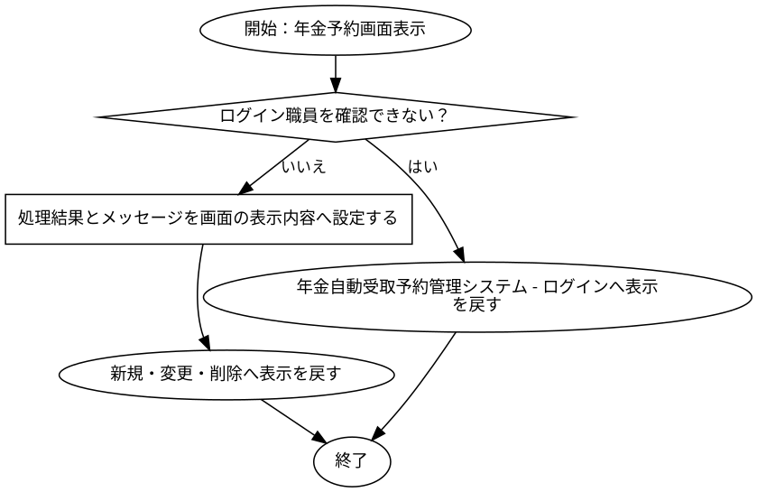

#### SQL・テーブル関連（ER図）

実線はSQLの結合条件。外部キー制約や多重度を断定しない。単独表は独立したエンティティで表す。

#### DB操作の詳細

#### DB操作 SQL-D9F3500B923D

| 情報 | 内容 |
| --- | --- |
| 操作ID | SQL-D9F3500B923D |
| 対象テーブル | DB2.Ｕ職員名簿表 |
| 操作 | 参照 |
| 処理説明 | 対象テーブルの対象データを読み取る。設定項目・対象条件・確定取消は以下の定義に従う。 |
| 設定項目 | 当該SQL式の列指定・実行時引数を使用する。組立式と原本のパラメーター設定を参照。 |
| 対象条件 | 抽出・更新対象条件：S.職員番号 = ? |
| 確定・取消 | 呼出側または接続の設定に従う。当該メソッド単独でのコミット・ロールバック指定はない。 |
| 原本 | nenkin/WEB-INF/src/nenkin/service/ReferenceDataService.java:207 / getStaff@206 |

#### DB操作 SQL-E0FD738666D8

| 情報 | 内容 |
| --- | --- |
| 操作ID | SQL-E0FD738666D8 |
| 対象テーブル | 店名テーブル |
| 操作 | 参照 |
| 処理説明 | 対象テーブルの対象データを読み取る。設定項目・対象条件・確定取消は以下の定義に従う。 |
| 設定項目 | 当該SQL式の列指定・実行時引数を使用する。組立式と原本のパラメーター設定を参照。 |
| 対象条件 | WHERE句による限定はこのSQL式にない。呼出条件・動的付加条件は原本を参照する。 |
| 確定・取消 | 呼出側または接続の設定に従う。当該メソッド単独でのコミット・ロールバック指定はない。 |
| 原本 | nenkin/WEB-INF/src/nenkin/service/ReferenceDataService.java:291 / loadBranchNames@289 |

#### 結果・例外時の扱い

| 到達条件 | 結果 |
| --- | --- |
| ログイン職員を確認できない | 年金自動受取予約管理システム - ログインへ表示を戻す |
| 条件1を満たす（原本条件は補足説明を参照） | 新規・変更・削除へ表示を戻す |

### DB関連処理

## 補足説明

### 適用条件

各仮定のQA番号を確認する。静的に確認できた操作・条件を適用する。

### 項目別DB連携備考

表示元と保存先は別方向の対応。DBから読み出した既存データの履歴保存は、画面入力の直接バインド先と区別する。同じ列の複数経路はイベントの実行条件に従う。

| No | 項目名 | 備考 |
| --- | --- | --- |
| 4 | 店番 | 表示元：N2_SIGHT.Ｂ顧客基本表.店舗コード。経由：BRANCH_NO → PensionReservation.branchNo。加工・変換式：nullableInteger(results, "BRANCH_NO")。処理：findByCustomer@87。 表示元：年金1_LK.店番。経由：BRANCH_NO → PensionReservation.branchNo。加工・変換式：nullableInteger(results, "BRANCH_NO")。処理：findByKanaAndPhone@144。 表示元：年金1_LK.店番。経由：BRANCH_NO → PensionReservation.branchNo。加工・変換式：nullableInteger(results, "BRANCH_NO")。処理：findByKey@640。 保存先：年金1_LK.店番。経由：BRANCH_NO → PensionReservation.branchNo。バインド順序：1。加工・変換式：setInteger(statement, 1, value.getBranchNo())。処理：insert@657。 保存先：年金1_LK.店番。経由：BRANCH_NO → PensionReservation.branchNo。バインド順序：1。加工・変換式：setInteger(statement, 1, value.getBranchNo())。処理：update@672。 関連保存先（DBから取得した既存データ。画面入力の直接保存ではない）：年金＿削除明細.店番。経由：BRANCH_NO → PensionReservation.branchNo。バインド順序：1。加工・変換式：setInteger(statement, 1, value.getBranchNo())。処理：insertDeleted@690。 |
| 6 | 顧客番号 | 表示元：N2_SIGHT.Ｂ顧客基本表.顧客番号。経由：CUSTOMER_NO → PensionReservation.customerNo。加工・変換式：nullableInteger(results, "CUSTOMER_NO")。処理：findByCustomer@87。 表示元：年金1_LK.顧客番号。経由：CUSTOMER_NO → PensionReservation.customerNo。加工・変換式：nullableInteger(results, "CUSTOMER_NO")。処理：findByKanaAndPhone@144。 表示元：年金1_LK.顧客番号。経由：CUSTOMER_NO → PensionReservation.customerNo。加工・変換式：nullableInteger(results, "CUSTOMER_NO")。処理：findByKey@640。 保存先：年金1_LK.顧客番号。経由：CUSTOMER_NO → PensionReservation.customerNo。バインド順序：2。加工・変換式：setInteger(statement, 2, value.getCustomerNo())。処理：insert@657。 保存先：年金1_LK.顧客番号。経由：CUSTOMER_NO → PensionReservation.customerNo。バインド順序：2。加工・変換式：setInteger(statement, 2, value.getCustomerNo())。処理：update@672。 関連保存先（DBから取得した既存データ。画面入力の直接保存ではない）：年金＿削除明細.顧客番号。経由：CUSTOMER_NO → PensionReservation.customerNo。バインド順序：2。加工・変換式：setInteger(statement, 2, value.getCustomerNo())。処理：insertDeleted@690。 |
| 8 | 担当者コード | 表示元：N2_SIGHT.Ｂ顧客基本表.担当者コード。経由：STAFF_CODE → PensionReservation.staffCode。加工・変換式：nullableInteger(results, "STAFF_CODE")。処理：findByCustomer@87。 表示元：年金1_LK.担当者コード。経由：STAFF_CODE → PensionReservation.staffCode。加工・変換式：nullableInteger(results, "STAFF_CODE")。処理：findByKanaAndPhone@144。 表示元：年金1_LK.担当者コード。経由：STAFF_CODE → PensionReservation.staffCode。加工・変換式：nullableInteger(results, "STAFF_CODE")。処理：findByKey@640。 保存先：年金1_LK.担当者コード。経由：STAFF_CODE → PensionReservation.staffCode。バインド順序：3。加工・変換式：setInteger(statement, 3, value.getStaffCode())。処理：insert@657。 保存先：年金1_LK.担当者コード。経由：STAFF_CODE → PensionReservation.staffCode。バインド順序：3。加工・変換式：setInteger(statement, 3, value.getStaffCode())。処理：update@672。 関連保存先（DBから取得した既存データ。画面入力の直接保存ではない）：年金＿削除明細.担当者コード。経由：STAFF_CODE → PensionReservation.staffCode。バインド順序：3。加工・変換式：setInteger(statement, 3, value.getStaffCode())。処理：insertDeleted@690。 |
| 10 | フリガナ | 表示元：N2_SIGHT.Ｂ顧客基本表.カナ氏名。経由：KANA_NAME → PensionReservation.kanaName。加工・変換式：results.getString("KANA_NAME")。処理：findByCustomer@87。 表示元：年金1_LK.ふりがな。経由：KANA_NAME → PensionReservation.kanaName。加工・変換式：results.getString("KANA_NAME")。処理：findByKanaAndPhone@144。 表示元：年金1_LK.ふりがな。経由：KANA_NAME → PensionReservation.kanaName。加工・変換式：results.getString("KANA_NAME")。処理：findByKey@640。 保存先：年金1_LK.ふりがな。経由：KANA_NAME → PensionReservation.kanaName。バインド順序：5。加工・変換式：value.getKanaName()。処理：insert@657。 保存先：年金1_LK.ふりがな。経由：KANA_NAME → PensionReservation.kanaName。バインド順序：5。加工・変換式：value.getKanaName()。処理：update@672。 関連保存先（DBから取得した既存データ。画面入力の直接保存ではない）：年金＿削除明細.ふりがな。経由：KANA_NAME → PensionReservation.kanaName。バインド順序：5。加工・変換式：value.getKanaName()。処理：insertDeleted@690。 |
| 11 | 顧客氏名 | 表示元：N2_SIGHT.Ｂ顧客基本表.漢字氏名。経由：CUSTOMER_NAME → PensionReservation.customerName。加工・変換式：results.getString("CUSTOMER_NAME")。処理：findByCustomer@87。 表示元：年金1_LK.顧客氏名。経由：CUSTOMER_NAME → PensionReservation.customerName。加工・変換式：results.getString("CUSTOMER_NAME")。処理：findByKanaAndPhone@144。 表示元：年金1_LK.顧客氏名。経由：CUSTOMER_NAME → PensionReservation.customerName。加工・変換式：results.getString("CUSTOMER_NAME")。処理：findByKey@640。 保存先：年金1_LK.顧客氏名。経由：CUSTOMER_NAME → PensionReservation.customerName。バインド順序：4。加工・変換式：value.getCustomerName()。処理：insert@657。 保存先：年金1_LK.顧客氏名。経由：CUSTOMER_NAME → PensionReservation.customerName。バインド順序：4。加工・変換式：value.getCustomerName()。処理：update@672。 関連保存先（DBから取得した既存データ。画面入力の直接保存ではない）：年金＿削除明細.顧客氏名。経由：CUSTOMER_NAME → PensionReservation.customerName。バインド順序：4。加工・変換式：value.getCustomerName()。処理：insertDeleted@690。 |
| 12 | 性別 | 表示元：性別テーブル.性別。経由：GENDER → PensionReservation.gender。加工・変換式：results.getString("GENDER")。処理：findByKanaAndPhone@144。 表示元：性別テーブル.性別。経由：GENDER → PensionReservation.gender。加工・変換式：results.getString("GENDER")。処理：findByKey@640。 保存先：年金1_LK.性別。経由：GENDER → PensionReservation.gender。バインド順序：6。加工・変換式：setInteger(statement, 6, resolveCode(connection, GENDER_TABLE,                 "性別ｺｰﾄﾞ", "性別", value.getGender()))。処理：insert@657。 保存先：年金1_LK.性別。経由：GENDER → PensionReservation.gender。バインド順序：6。加工・変換式：setInteger(statement, 6, resolveCode(connection, GENDER_TABLE,                 "性別ｺｰﾄﾞ", "性別", value.getGender()))。処理：update@672。 関連保存先（DBから取得した既存データ。画面入力の直接保存ではない）：年金＿削除明細.性別。経由：GENDER → PensionReservation.gender。バインド順序：6。加工・変換式：setInteger(statement, 6, resolveCode(connection, GENDER_TABLE,                 "性別ｺｰﾄﾞ", "性別", value.getGender()))。処理：insertDeleted@690。 |
| 13 | 住所 | 表示元：N2_SIGHT.Ｂ顧客基本表.漢字住所。経由：ADDRESS → PensionReservation.address。加工・変換式：results.getString("ADDRESS")。処理：findByCustomer@87。 表示元：年金1_LK.住所。経由：ADDRESS → PensionReservation.address。加工・変換式：results.getString("ADDRESS")。処理：findByKanaAndPhone@144。 表示元：年金1_LK.住所。経由：ADDRESS → PensionReservation.address。加工・変換式：results.getString("ADDRESS")。処理：findByKey@640。 保存先：年金1_LK.住所。経由：ADDRESS → PensionReservation.address。バインド順序：7。加工・変換式：value.getAddress()。処理：insert@657。 保存先：年金1_LK.住所。経由：ADDRESS → PensionReservation.address。バインド順序：7。加工・変換式：value.getAddress()。処理：update@672。 関連保存先（DBから取得した既存データ。画面入力の直接保存ではない）：年金＿削除明細.住所。経由：ADDRESS → PensionReservation.address。バインド順序：7。加工・変換式：value.getAddress()。処理：insertDeleted@690。 |
| 14 | 電話番号 | 表示元：N2_SIGHT.Ｂ顧客基本表.電話番号。経由：PHONE_NUMBER → PensionReservation.phoneNumber。加工・変換式：ReferenceDataService.displayPhone(                         results.getString("PHONE_NUMBER"))。処理：findByCustomer@87。 表示元：年金1_LK.電話番号。経由：PHONE_NUMBER → PensionReservation.phoneNumber。加工・変換式：ReferenceDataService.displayPhone(results.getString("PHONE_NUMBER"))。処理：findByKanaAndPhone@144。 表示元：年金1_LK.電話番号。経由：PHONE_NUMBER → PensionReservation.phoneNumber。加工・変換式：ReferenceDataService.displayPhone(results.getString("PHONE_NUMBER"))。処理：findByKey@640。 保存先：年金1_LK.電話番号。経由：PHONE_NUMBER → PensionReservation.phoneNumber。バインド順序：8。加工・変換式：setPhone(statement, 8, value.getPhoneNumber())。処理：insert@657。 保存先：年金1_LK.電話番号。経由：PHONE_NUMBER → PensionReservation.phoneNumber。バインド順序：8。加工・変換式：setPhone(statement, 8, value.getPhoneNumber())。処理：update@672。 関連保存先（DBから取得した既存データ。画面入力の直接保存ではない）：年金＿削除明細.電話番号。経由：PHONE_NUMBER → PensionReservation.phoneNumber。バインド順序：8。加工・変換式：setPhone(statement, 8, value.getPhoneNumber())。処理：insertDeleted@690。 |
| 16 | 生年月日 | 表示元：N2_SIGHT.Ｂ顧客基本表.生年月日。経由：BIRTH_DATE → PensionReservation.birthDate。加工・変換式：ReferenceDataService.compactDate(                         results.getString("BIRTH_DATE"))。処理：findByCustomer@87。 表示元：年金1_LK.生年月日。経由：BIRTH_DATE → PensionReservation.birthDate。加工・変換式：results.getString("BIRTH_DATE")。処理：findByKanaAndPhone@144。 表示元：年金1_LK.生年月日。経由：BIRTH_DATE → PensionReservation.birthDate。加工・変換式：results.getString("BIRTH_DATE")。処理：findByKey@640。 保存先：年金1_LK.生年月日。経由：BIRTH_DATE → PensionReservation.birthDate。バインド順序：9。加工・変換式：setDate(statement, 9, value.getBirthDate())。処理：insert@657。 保存先：年金1_LK.生年月日。経由：BIRTH_DATE → PensionReservation.birthDate。バインド順序：9。加工・変換式：setDate(statement, 9, value.getBirthDate())。処理：update@672。 関連保存先（DBから取得した既存データ。画面入力の直接保存ではない）：年金＿削除明細.生年月日。経由：BIRTH_DATE → PensionReservation.birthDate。バインド順序：9。加工・変換式：setDate(statement, 9, value.getBirthDate())。処理：insertDeleted@690。 |
| 18 | データ更新日 | 表示元：年金1_LK.データ更新日。経由：DATA_UPDATE_DATE → PensionReservation.dataUpdateDate。加工・変換式：results.getString("DATA_UPDATE_DATE")。処理：findByKanaAndPhone@144。 表示元：年金1_LK.データ更新日。経由：DATA_UPDATE_DATE → PensionReservation.dataUpdateDate。加工・変換式：results.getString("DATA_UPDATE_DATE")。処理：findByKey@640。 保存先：年金1_LK.データ更新日。経由：DATA_UPDATE_DATE → PensionReservation.dataUpdateDate。バインド順序：24。加工・変換式：setDate(statement, 24, value.getDataUpdateDate())。処理：insert@657。 保存先：年金1_LK.データ更新日。経由：DATA_UPDATE_DATE → PensionReservation.dataUpdateDate。バインド順序：24。加工・変換式：setDate(statement, 24, value.getDataUpdateDate())。処理：update@672。 関連保存先（DBから取得した既存データ。画面入力の直接保存ではない）：年金＿削除明細.データ更新日。経由：DATA_UPDATE_DATE → PensionReservation.dataUpdateDate。バインド順序：24。加工・変換式：setDate(statement, 24, value.getDataUpdateDate())。処理：insertDeleted@690。 |
| 20 | 国民年金 | 表示元：年金1_LK.種類：国民年金。経由：NATIONAL_PENSION → PensionReservation.nationalPension。加工・変換式：results.getInt("NATIONAL_PENSION") != 0。処理：findByKanaAndPhone@144。 表示元：年金1_LK.種類：国民年金。経由：NATIONAL_PENSION → PensionReservation.nationalPension。加工・変換式：results.getInt("NATIONAL_PENSION") != 0。処理：findByKey@640。 保存先：年金1_LK.種類：国民年金。経由：NATIONAL_PENSION → PensionReservation.nationalPension。バインド順序：10。加工・変換式：value.isNationalPension() ? 1 : 0。処理：insert@657。 保存先：年金1_LK.年金種類。経由：NATIONAL_PENSION → PensionReservation.nationalPension。バインド順序：15。加工・変換式：setInteger(statement, 15, resolvePensionTypeCode(connection, value))。処理：insert@657。 保存先：年金1_LK.種類：国民年金。経由：NATIONAL_PENSION → PensionReservation.nationalPension。バインド順序：10。加工・変換式：value.isNationalPension() ? 1 : 0。処理：update@672。 保存先：年金1_LK.年金種類。経由：NATIONAL_PENSION → PensionReservation.nationalPension。バインド順序：15。加工・変換式：setInteger(statement, 15, resolvePensionTypeCode(connection, value))。処理：update@672。 関連保存先（DBから取得した既存データ。画面入力の直接保存ではない）：年金＿削除明細.種類：国民年金。経由：NATIONAL_PENSION → PensionReservation.nationalPension。バインド順序：10。加工・変換式：value.isNationalPension() ? 1 : 0。処理：insertDeleted@690。 関連保存先（DBから取得した既存データ。画面入力の直接保存ではない）：年金＿削除明細.年金種類。経由：NATIONAL_PENSION → PensionReservation.nationalPension。バインド順序：15。加工・変換式：setInteger(statement, 15, resolvePensionTypeCode(connection, value))。処理：insertDeleted@690。 |
| 21 | 厚生年金基金 | 表示元：年金1_LK.種類：厚生年金基金。経由：EMPLOYEE_PENSION_FUND → PensionReservation.employeePensionFund。加工・変換式：results.getInt("EMPLOYEE_PENSION_FUND") != 0。処理：findByKanaAndPhone@144。 表示元：年金1_LK.種類：厚生年金基金。経由：EMPLOYEE_PENSION_FUND → PensionReservation.employeePensionFund。加工・変換式：results.getInt("EMPLOYEE_PENSION_FUND") != 0。処理：findByKey@640。 保存先：年金1_LK.種類：厚生年金基金。経由：EMPLOYEE_PENSION_FUND → PensionReservation.employeePensionFund。バインド順序：13。加工・変換式：value.isEmployeePensionFund() ? 1 : 0。処理：insert@657。 保存先：年金1_LK.年金種類。経由：EMPLOYEE_PENSION_FUND → PensionReservation.employeePensionFund。バインド順序：15。加工・変換式：setInteger(statement, 15, resolvePensionTypeCode(connection, value))。処理：insert@657。 保存先：年金1_LK.種類：厚生年金基金。経由：EMPLOYEE_PENSION_FUND → PensionReservation.employeePensionFund。バインド順序：13。加工・変換式：value.isEmployeePensionFund() ? 1 : 0。処理：update@672。 保存先：年金1_LK.年金種類。経由：EMPLOYEE_PENSION_FUND → PensionReservation.employeePensionFund。バインド順序：15。加工・変換式：setInteger(statement, 15, resolvePensionTypeCode(connection, value))。処理：update@672。 関連保存先（DBから取得した既存データ。画面入力の直接保存ではない）：年金＿削除明細.種類：厚生年金基金。経由：EMPLOYEE_PENSION_FUND → PensionReservation.employeePensionFund。バインド順序：13。加工・変換式：value.isEmployeePensionFund() ? 1 : 0。処理：insertDeleted@690。 関連保存先（DBから取得した既存データ。画面入力の直接保存ではない）：年金＿削除明細.年金種類。経由：EMPLOYEE_PENSION_FUND → PensionReservation.employeePensionFund。バインド順序：15。加工・変換式：setInteger(statement, 15, resolvePensionTypeCode(connection, value))。処理：insertDeleted@690。 |
| 22 | 厚生年金 | 表示元：年金1_LK.種類：厚生年金。経由：EMPLOYEE_PENSION → PensionReservation.employeePension。加工・変換式：results.getInt("EMPLOYEE_PENSION") != 0。処理：findByKanaAndPhone@144。 表示元：年金1_LK.種類：厚生年金。経由：EMPLOYEE_PENSION → PensionReservation.employeePension。加工・変換式：results.getInt("EMPLOYEE_PENSION") != 0。処理：findByKey@640。 保存先：年金1_LK.種類：厚生年金。経由：EMPLOYEE_PENSION → PensionReservation.employeePension。バインド順序：11。加工・変換式：value.isEmployeePension() ? 1 : 0。処理：insert@657。 保存先：年金1_LK.年金種類。経由：EMPLOYEE_PENSION → PensionReservation.employeePension。バインド順序：15。加工・変換式：setInteger(statement, 15, resolvePensionTypeCode(connection, value))。処理：insert@657。 保存先：年金1_LK.種類：厚生年金。経由：EMPLOYEE_PENSION → PensionReservation.employeePension。バインド順序：11。加工・変換式：value.isEmployeePension() ? 1 : 0。処理：update@672。 保存先：年金1_LK.年金種類。経由：EMPLOYEE_PENSION → PensionReservation.employeePension。バインド順序：15。加工・変換式：setInteger(statement, 15, resolvePensionTypeCode(connection, value))。処理：update@672。 関連保存先（DBから取得した既存データ。画面入力の直接保存ではない）：年金＿削除明細.種類：厚生年金。経由：EMPLOYEE_PENSION → PensionReservation.employeePension。バインド順序：11。加工・変換式：value.isEmployeePension() ? 1 : 0。処理：insertDeleted@690。 関連保存先（DBから取得した既存データ。画面入力の直接保存ではない）：年金＿削除明細.年金種類。経由：EMPLOYEE_PENSION → PensionReservation.employeePension。バインド順序：15。加工・変換式：setInteger(statement, 15, resolvePensionTypeCode(connection, value))。処理：insertDeleted@690。 |
| 23 | 国民年金基金 | 表示元：年金1_LK.種類：国民年金基金。経由：NATIONAL_PENSION_FUND → PensionReservation.nationalPensionFund。加工・変換式：results.getInt("NATIONAL_PENSION_FUND") != 0。処理：findByKanaAndPhone@144。 表示元：年金1_LK.種類：国民年金基金。経由：NATIONAL_PENSION_FUND → PensionReservation.nationalPensionFund。加工・変換式：results.getInt("NATIONAL_PENSION_FUND") != 0。処理：findByKey@640。 保存先：年金1_LK.種類：国民年金基金。経由：NATIONAL_PENSION_FUND → PensionReservation.nationalPensionFund。バインド順序：14。加工・変換式：value.isNationalPensionFund() ? 1 : 0。処理：insert@657。 保存先：年金1_LK.年金種類。経由：NATIONAL_PENSION_FUND → PensionReservation.nationalPensionFund。バインド順序：15。加工・変換式：setInteger(statement, 15, resolvePensionTypeCode(connection, value))。処理：insert@657。 保存先：年金1_LK.種類：国民年金基金。経由：NATIONAL_PENSION_FUND → PensionReservation.nationalPensionFund。バインド順序：14。加工・変換式：value.isNationalPensionFund() ? 1 : 0。処理：update@672。 保存先：年金1_LK.年金種類。経由：NATIONAL_PENSION_FUND → PensionReservation.nationalPensionFund。バインド順序：15。加工・変換式：setInteger(statement, 15, resolvePensionTypeCode(connection, value))。処理：update@672。 関連保存先（DBから取得した既存データ。画面入力の直接保存ではない）：年金＿削除明細.種類：国民年金基金。経由：NATIONAL_PENSION_FUND → PensionReservation.nationalPensionFund。バインド順序：14。加工・変換式：value.isNationalPensionFund() ? 1 : 0。処理：insertDeleted@690。 関連保存先（DBから取得した既存データ。画面入力の直接保存ではない）：年金＿削除明細.年金種類。経由：NATIONAL_PENSION_FUND → PensionReservation.nationalPensionFund。バインド順序：15。加工・変換式：setInteger(statement, 15, resolvePensionTypeCode(connection, value))。処理：insertDeleted@690。 |
| 24 | 共済年金 | 表示元：年金1_LK.種類：共済年金。経由：MUTUAL_AID_PENSION → PensionReservation.mutualAidPension。加工・変換式：results.getInt("MUTUAL_AID_PENSION") != 0。処理：findByKanaAndPhone@144。 表示元：年金1_LK.種類：共済年金。経由：MUTUAL_AID_PENSION → PensionReservation.mutualAidPension。加工・変換式：results.getInt("MUTUAL_AID_PENSION") != 0。処理：findByKey@640。 保存先：年金1_LK.種類：共済年金。経由：MUTUAL_AID_PENSION → PensionReservation.mutualAidPension。バインド順序：12。加工・変換式：value.isMutualAidPension() ? 1 : 0。処理：insert@657。 保存先：年金1_LK.年金種類。経由：MUTUAL_AID_PENSION → PensionReservation.mutualAidPension。バインド順序：15。加工・変換式：setInteger(statement, 15, resolvePensionTypeCode(connection, value))。処理：insert@657。 保存先：年金1_LK.種類：共済年金。経由：MUTUAL_AID_PENSION → PensionReservation.mutualAidPension。バインド順序：12。加工・変換式：value.isMutualAidPension() ? 1 : 0。処理：update@672。 保存先：年金1_LK.年金種類。経由：MUTUAL_AID_PENSION → PensionReservation.mutualAidPension。バインド順序：15。加工・変換式：setInteger(statement, 15, resolvePensionTypeCode(connection, value))。処理：update@672。 関連保存先（DBから取得した既存データ。画面入力の直接保存ではない）：年金＿削除明細.種類：共済年金。経由：MUTUAL_AID_PENSION → PensionReservation.mutualAidPension。バインド順序：12。加工・変換式：value.isMutualAidPension() ? 1 : 0。処理：insertDeleted@690。 関連保存先（DBから取得した既存データ。画面入力の直接保存ではない）：年金＿削除明細.年金種類。経由：MUTUAL_AID_PENSION → PensionReservation.mutualAidPension。バインド順序：15。加工・変換式：setInteger(statement, 15, resolvePensionTypeCode(connection, value))。処理：insertDeleted@690。 |
| 25 | 裁定請求書徴収 | 表示元：裁定請求テーブル.裁定請求。経由：CLAIM_STATUS → PensionReservation.claimStatus。加工・変換式：results.getString("CLAIM_STATUS")。処理：findByKanaAndPhone@144。 表示元：裁定請求テーブル.裁定請求。経由：CLAIM_STATUS → PensionReservation.claimStatus。加工・変換式：results.getString("CLAIM_STATUS")。処理：findByKey@640。 保存先：年金1_LK.裁定請求。経由：CLAIM_STATUS → PensionReservation.claimStatus。バインド順序：16。加工・変換式：setInteger(statement, 16, resolveCode(connection, CLAIM_TABLE,                 "裁請ｺｰﾄﾞ", "裁定請求", value.getClaimStatus()))。処理：insert@657。 保存先：年金1_LK.裁定請求。経由：CLAIM_STATUS → PensionReservation.claimStatus。バインド順序：16。加工・変換式：setInteger(statement, 16, resolveCode(connection, CLAIM_TABLE,                 "裁請ｺｰﾄﾞ", "裁定請求", value.getClaimStatus()))。処理：update@672。 関連保存先（DBから取得した既存データ。画面入力の直接保存ではない）：年金＿削除明細.裁定請求。経由：CLAIM_STATUS → PensionReservation.claimStatus。バインド順序：16。加工・変換式：setInteger(statement, 16, resolveCode(connection, CLAIM_TABLE,                 "裁請ｺｰﾄﾞ", "裁定請求", value.getClaimStatus()))。処理：insertDeleted@690。 |
| 26 | 請求予定日 | 表示元：年金1_LK.請求予定日。経由：CLAIM_SCHEDULED_DATE → PensionReservation.claimScheduledDate。加工・変換式：results.getString("CLAIM_SCHEDULED_DATE")。処理：findByKanaAndPhone@144。 表示元：年金1_LK.請求予定日。経由：CLAIM_SCHEDULED_DATE → PensionReservation.claimScheduledDate。加工・変換式：results.getString("CLAIM_SCHEDULED_DATE")。処理：findByKey@640。 保存先：年金1_LK.請求予定日。経由：CLAIM_SCHEDULED_DATE → PensionReservation.claimScheduledDate。バインド順序：17。加工・変換式：setDate(statement, 17, value.getClaimScheduledDate())。処理：insert@657。 保存先：年金1_LK.請求予定日。経由：CLAIM_SCHEDULED_DATE → PensionReservation.claimScheduledDate。バインド順序：17。加工・変換式：setDate(statement, 17, value.getClaimScheduledDate())。処理：update@672。 関連保存先（DBから取得した既存データ。画面入力の直接保存ではない）：年金＿削除明細.請求予定日。経由：CLAIM_SCHEDULED_DATE → PensionReservation.claimScheduledDate。バインド順序：17。加工・変換式：setDate(statement, 17, value.getClaimScheduledDate())。処理：insertDeleted@690。 |
| 28 | 予定年齢 | 表示元：年金1_LK.予定年齢。経由：PLANNED_AGE → PensionReservation.plannedAge。加工・変換式：nullableInteger(results, "PLANNED_AGE")。処理：findByKanaAndPhone@144。 表示元：年金1_LK.予定年齢。経由：PLANNED_AGE → PensionReservation.plannedAge。加工・変換式：nullableInteger(results, "PLANNED_AGE")。処理：findByKey@640。 保存先：年金1_LK.予定年齢。経由：PLANNED_AGE → PensionReservation.plannedAge。バインド順序：18。加工・変換式：setInteger(statement, 18, value.getPlannedAge())。処理：insert@657。 保存先：年金1_LK.予定年齢。経由：PLANNED_AGE → PensionReservation.plannedAge。バインド順序：18。加工・変換式：setInteger(statement, 18, value.getPlannedAge())。処理：update@672。 関連保存先（DBから取得した既存データ。画面入力の直接保存ではない）：年金＿削除明細.予定年齢。経由：PLANNED_AGE → PensionReservation.plannedAge。バインド順序：18。加工・変換式：setInteger(statement, 18, value.getPlannedAge())。処理：insertDeleted@690。 |
| 29 | 配偶者名 | 表示元：年金1_LK.配偶者名。経由：SPOUSE_NAME → PensionReservation.spouseName。加工・変換式：results.getString("SPOUSE_NAME")。処理：findByKanaAndPhone@144。 表示元：年金1_LK.配偶者名。経由：SPOUSE_NAME → PensionReservation.spouseName。加工・変換式：results.getString("SPOUSE_NAME")。処理：findByKey@640。 保存先：年金1_LK.配偶者名。経由：SPOUSE_NAME → PensionReservation.spouseName。バインド順序：19。加工・変換式：value.getSpouseName()。処理：insert@657。 保存先：年金1_LK.配偶者名。経由：SPOUSE_NAME → PensionReservation.spouseName。バインド順序：19。加工・変換式：value.getSpouseName()。処理：update@672。 関連保存先（DBから取得した既存データ。画面入力の直接保存ではない）：年金＿削除明細.配偶者名。経由：SPOUSE_NAME → PensionReservation.spouseName。バインド順序：19。加工・変換式：value.getSpouseName()。処理：insertDeleted@690。 |
| 30 | 配偶者生年月日 | 表示元：年金1_LK.配偶者生年月日。経由：SPOUSE_BIRTH_DATE → PensionReservation.spouseBirthDate。加工・変換式：results.getString("SPOUSE_BIRTH_DATE")。処理：findByKanaAndPhone@144。 表示元：年金1_LK.配偶者生年月日。経由：SPOUSE_BIRTH_DATE → PensionReservation.spouseBirthDate。加工・変換式：results.getString("SPOUSE_BIRTH_DATE")。処理：findByKey@640。 保存先：年金1_LK.配偶者生年月日。経由：SPOUSE_BIRTH_DATE → PensionReservation.spouseBirthDate。バインド順序：20。加工・変換式：setDate(statement, 20, value.getSpouseBirthDate())。処理：insert@657。 保存先：年金1_LK.配偶者生年月日。経由：SPOUSE_BIRTH_DATE → PensionReservation.spouseBirthDate。バインド順序：20。加工・変換式：setDate(statement, 20, value.getSpouseBirthDate())。処理：update@672。 関連保存先（DBから取得した既存データ。画面入力の直接保存ではない）：年金＿削除明細.配偶者生年月日。経由：SPOUSE_BIRTH_DATE → PensionReservation.spouseBirthDate。バインド順序：20。加工・変換式：setDate(statement, 20, value.getSpouseBirthDate())。処理：insertDeleted@690。 |
| 32 | 受給有無 | 表示元：受給有無テーブル.受給有無。経由：HAS_BENEFIT → PensionReservation.hasBenefit。加工・変換式：results.getString("HAS_BENEFIT")。処理：findByKanaAndPhone@144。 表示元：受給有無テーブル.受給有無。経由：HAS_BENEFIT → PensionReservation.hasBenefit。加工・変換式：results.getString("HAS_BENEFIT")。処理：findByKey@640。 保存先：年金1_LK.受給有無。経由：HAS_BENEFIT → PensionReservation.hasBenefit。バインド順序：21。加工・変換式：setInteger(statement, 21, resolveCode(connection, BENEFIT_TABLE,                 "受給ｺｰﾄﾞ", "受給有無", value.getHasBenefit()))。処理：insert@657。 保存先：年金1_LK.受給有無。経由：HAS_BENEFIT → PensionReservation.hasBenefit。バインド順序：21。加工・変換式：setInteger(statement, 21, resolveCode(connection, BENEFIT_TABLE,                 "受給ｺｰﾄﾞ", "受給有無", value.getHasBenefit()))。処理：update@672。 関連保存先（DBから取得した既存データ。画面入力の直接保存ではない）：年金＿削除明細.受給有無。経由：HAS_BENEFIT → PensionReservation.hasBenefit。バインド順序：21。加工・変換式：setInteger(statement, 21, resolveCode(connection, BENEFIT_TABLE,                 "受給ｺｰﾄﾞ", "受給有無", value.getHasBenefit()))。処理：insertDeleted@690。 |
| 33 | 予約徴求日 | 表示元：年金1_LK.予約徴求日。経由：RESERVATION_REQUEST_DATE → PensionReservation.reservationRequestDate。加工・変換式：results.getString("RESERVATION_REQUEST_DATE")。処理：findByKanaAndPhone@144。 表示元：年金1_LK.予約徴求日。経由：RESERVATION_REQUEST_DATE → PensionReservation.reservationRequestDate。加工・変換式：results.getString("RESERVATION_REQUEST_DATE")。処理：findByKey@640。 保存先：年金1_LK.予約徴求日。経由：RESERVATION_REQUEST_DATE → PensionReservation.reservationRequestDate。バインド順序：22。加工・変換式：setDate(statement, 22, value.getReservationRequestDate())。処理：insert@657。 保存先：年金1_LK.予約徴求日。経由：RESERVATION_REQUEST_DATE → PensionReservation.reservationRequestDate。バインド順序：22。加工・変換式：setDate(statement, 22, value.getReservationRequestDate())。処理：update@672。 関連保存先（DBから取得した既存データ。画面入力の直接保存ではない）：年金＿削除明細.予約徴求日。経由：RESERVATION_REQUEST_DATE → PensionReservation.reservationRequestDate。バインド順序：22。加工・変換式：setDate(statement, 22, value.getReservationRequestDate())。処理：insertDeleted@690。 |
| 35 | 備考 | 表示元：年金1_LK.備考。経由：NOTES → PensionReservation.notes。加工・変換式：results.getString("NOTES")。処理：findByKanaAndPhone@144。 表示元：年金1_LK.備考。経由：NOTES → PensionReservation.notes。加工・変換式：results.getString("NOTES")。処理：findByKey@640。 保存先：年金1_LK.備考。経由：NOTES → PensionReservation.notes。バインド順序：23。加工・変換式：value.getNotes()。処理：insert@657。 保存先：年金1_LK.備考。経由：NOTES → PensionReservation.notes。バインド順序：23。加工・変換式：value.getNotes()。処理：update@672。 関連保存先（DBから取得した既存データ。画面入力の直接保存ではない）：年金＿削除明細.備考。経由：NOTES → PensionReservation.notes。バインド順序：23。加工・変換式：value.getNotes()。処理：insertDeleted@690。 |
| 36 | 確認済 | 表示元：年金1_LK.６ヶ月先確認。経由：SIX_MONTH_CHECK → PensionReservation.sixMonthCheck。加工・変換式：results.getInt("SIX_MONTH_CHECK") != 0。処理：findByKanaAndPhone@144。 表示元：年金1_LK.６ヶ月先確認。経由：SIX_MONTH_CHECK → PensionReservation.sixMonthCheck。加工・変換式：results.getInt("SIX_MONTH_CHECK") != 0。処理：findByKey@640。 保存先：年金1_LK.６ヶ月先確認。経由：SIX_MONTH_CHECK → PensionReservation.sixMonthCheck。バインド順序：27。加工・変換式：value.isSixMonthCheck() ? 1 : 0。処理：insert@657。 保存先：年金1_LK.６ヶ月先確認。経由：SIX_MONTH_CHECK → PensionReservation.sixMonthCheck。バインド順序：27。加工・変換式：value.isSixMonthCheck() ? 1 : 0。処理：update@672。 関連保存先（DBから取得した既存データ。画面入力の直接保存ではない）：年金＿削除明細.６ヶ月先確認。経由：SIX_MONTH_CHECK → PensionReservation.sixMonthCheck。バインド順序：27。加工・変換式：value.isSixMonthCheck() ? 1 : 0。処理：insertDeleted@690。 |

### 処理・条件の原本対応

文書内の条件番号・処理番号は次の原本表記に対応する。完全な業務用語への置換を行っていない箇所はQA・reportで確認する。

| イベント | 参照番号 | 原本条件・処理 |
| --- | --- | --- |
| 年金予約削除 | 条件1 | NOT (!requireStaff(request)) |
| 年金予約削除 | 条件2 | NOT (!requireStaff(request)) |
| 年金予約削除 | 条件3 | NOT (!isAuthorizedMutation(request)) |
| 年金予約削除 | 条件4 | NOT (!requireStaff(request)) |
| 年金予約削除 | 条件5 | NOT (!isAuthorizedMutation(request)) |
| 年金予約削除 | 条件6 | NOT (!requireStaff(request)) |
| 年金予約削除 | 条件7 | NOT (!isAuthorizedMutation(request)) |
| 年金予約削除 | 条件8 | NOT (!requireStaff(request)) |
| 年金予約削除 | 条件9 | NOT (!isAuthorizedMutation(request)) |
| 年金予約削除 | 条件10 | NOT (!requireStaff(request)) |
| 年金予約削除 | 条件11 | NOT (!isAuthorizedMutation(request)) |
| 年金予約削除 | 条件12 | NOT (isRestrictedStaff(staff)) |
| フリガナ+電話番号の正規化キーで、選択した予約を確実に読み込む | 処理1 | Integer customer = integerOrNull(request.getParameter("CUSTOMER_NO")) |
| フリガナ+電話番号の正規化キーで、選択した予約を確実に読み込む | 処理2 | Integer branch = integerOrNull(request.getParameter("BRANCH_NO")) |
| フリガナ+電話番号の正規化キーで、選択した予約を確実に読み込む | 処理3 | phone = input.getPhoneNumber() |
| フリガナ+電話番号の正規化キーで、選択した予約を確実に読み込む | 処理4 | kana = input.getKanaName() |
| フリガナ+電話番号の正規化キーで、選択した予約を確実に読み込む | 処理5 | String phone = trim(request.getParameter("LOOKUP_PHONE")) |
| フリガナ+電話番号の正規化キーで、選択した予約を確実に読み込む | 処理6 | String kana = trim(request.getParameter("LOOKUP_KANA")) |
| フリガナ+電話番号の正規化キーで、選択した予約を確実に読み込む | 処理7 | String kana = trim(request.getParameter("LOOKUP_KANA")) |
| フリガナ+電話番号の正規化キーで、選択した予約を確実に読み込む | 処理8 | String phone = trim(request.getParameter("LOOKUP_PHONE")) |
| フリガナ+電話番号の正規化キーで、選択した予約を確実に読み込む | 処理9 | kana = input.getKanaName() |
| フリガナ+電話番号の正規化キーで、選択した予約を確実に読み込む | 処理10 | phone = input.getPhoneNumber() |
| フリガナ+電話番号の正規化キーで、選択した予約を確実に読み込む | 処理11 | Integer branch = integerOrNull(request.getParameter("BRANCH_NO")) |
| フリガナ+電話番号の正規化キーで、選択した予約を確実に読み込む | 処理12 | Integer customer = integerOrNull(request.getParameter("CUSTOMER_NO")) |
| フリガナ+電話番号の正規化キーで、選択した予約を確実に読み込む | 条件13 | NOT (!requireStaff(request)) |
| 年金予約照会 | 処理1 | out.flush() |
| 年金予約照会 | 処理2 | out.write(value==null?"{\"found\":false}":"{\"found\":true,\"reservation\":"+toJson(value)+"}") |
| 年金予約照会 | 処理3 | PrintWriter out=response.getWriter() |
| 年金予約照会 | 処理4 | Integer branch=integerOrNull(request.getParameter("BRANCH_NO")),customer=integerOrNull(request.getParameter("CUSTOMER_NO")) |
| 年金予約照会 | 条件5 | "key".equals(request.getParameter("LOOKUP_MODE")) |
| 年金予約照会 | 処理6 | PensionReservation value |
| 年金予約照会 | 処理7 | response.sendError(HttpServletResponse.SC_METHOD_NOT_ALLOWED) |
| 年金予約照会 | 処理8 | response.sendError(HttpServletResponse.SC_METHOD_NOT_ALLOWED) |
| 年金予約照会 | 処理9 | PensionReservation value |
| 年金予約照会 | 条件10 | "key".equals(request.getParameter("LOOKUP_MODE")) |
| 年金予約照会 | 処理11 | Integer branch=integerOrNull(request.getParameter("BRANCH_NO")),customer=integerOrNull(request.getParameter("CUSTOMER_NO")) |
| 年金予約照会 | 処理12 | PrintWriter out=response.getWriter() |
| 年金予約照会 | 処理13 | out.write(value==null?"{\"found\":false}":"{\"found\":true,\"reservation\":"+toJson(value)+"}") |
| 年金予約照会 | 処理14 | out.flush() |
| 年金予約照会 | 条件15 | NOT (!requireStaff(request)) |
| 年金予約照会 | 条件16 | NOT (!requireStaff(request)) |
| 年金予約登録・変更 | 条件1 | NOT (!requireStaff(request)) |
| 年金予約登録・変更 | 条件2 | NOT (!requireStaff(request)) |
| 年金予約登録・変更 | 条件3 | NOT (!isAuthorizedMutation(request)) |
| 年金予約登録・変更 | 条件4 | NOT (!requireStaff(request)) |
| 年金予約登録・変更 | 条件5 | NOT (!isAuthorizedMutation(request)) |
| 年金予約登録・変更 | 条件6 | NOT (!requireStaff(request)) |
| 年金予約登録・変更 | 条件7 | NOT (!isAuthorizedMutation(request)) |
| 年金予約登録・変更 | 条件8 | NOT (!requireStaff(request)) |
| 年金予約登録・変更 | 条件9 | NOT (!isAuthorizedMutation(request)) |
| 年金予約登録・変更 | 条件10 | NOT (!requireStaff(request)) |
| 年金予約登録・変更 | 条件11 | NOT (!isAuthorizedMutation(request)) |
| 年金予約画面表示 | 条件1 | NOT (!requireStaff(request)) |

