<!-- spec-meta: {"schema":"spec-md/1.0","documentId":"SCR-019","version":"2.0","path":"基本設計書/基本設計書_SCR-019_登録内容印刷.md","sheets":[{"heading":"概要","kind":"GRID","sheet":"概要"},{"heading":"項目一覧","kind":"LIST","sheet":"項目一覧","key":["No"]},{"heading":"イベント仕様","kind":"GRID","sheet":"イベント仕様"},{"heading":"補足説明","kind":"GRID","sheet":"補足説明"}]} -->
# 登録内容印刷

| 属性 | 内容 |
| --- | --- |
| 文書種別 | 基本設計書 |
| システム名 | 年金自動受取予約管理システム |
| 機能ID | SCR-019 |
| 版 | 2.0 |
| 解析対象 | 登録内容印刷画面、表示・プレビューAction、予約検索、関連する表示変換・CSS・共通要求処理 |
| 基準日 | 2026-10-15 |

## 概要

### 機能の目的と対象

登録済みの年金自動受取予約を、指定した並び順と店舗範囲で明細表示し、ブラウザーの印刷機能へ渡す。店舗を指定しない場合は全店舗を検索する。ログイン職員の所属店舗による自動限定は行わない。

利用者は並び替え基準を選び、必要に応じて店番自・店番至を指定して「プレビューを作成」を押す。検索後は店舗別の明細を確認し、「印刷」を押す。店舗指定時は店番自を必須とし、店番至が空欄なら店番自の1店舗だけを対象とする。

プレビューはサーバーから返されたHTMLであり、印刷操作は表示中のHTMLに対する `window.print()` の呼出しである。サーバー側のPDF生成、印刷ファイルのダウンロード、印刷完了の登録には接続していない。

### 入口と画面間の移動

| 操作 | 画面からの要求 | 処理入口 | 通常の結果 |
| --- | --- | --- | --- |
| メニューの「印刷」 | `POST /Action.do`、`FUNCTION_ID=nenkin`、`VIEW_ID=Report`、`COMMAND_ID=View` | `nenkin.ReportViewAction` | 新しい印刷画面状態を作り、`./JSP/NENKIN/Report.jsp` を表示する |
| プレビューを作成 | `POST /Action.do`、`nenkin／Report／Preview` と印刷条件 | `nenkin.ReportPreviewAction` | 入力拒否または検索結果を同じ画面へ表示する |
| 印刷 | サーバー要求なし | ブラウザーの `window.print()` | 表示中のHTMLをブラウザーの印刷機能へ渡す |
| 戻る | 同じフォームの識別値を `nenkin／Menu／View` に変更してPOST | `nenkin.MenuViewAction` | 新しいメニュー表示状態を作り、`./JSP/NENKIN/Menu.jsp` を表示する |

フォームは要求文字コードとして `Windows-31J` を指定する。共通Servletもパラメータ処理前に要求文字コードを `Windows-31J` に設定する。これとは別に、Report.jspのページ・応答宣言はUTF-8、共通Servletのforward前の応答指定はWindows-31Jである。

各サーバー操作は、共通ログイン確認と運用可否確認を経て、Action内の年金職員確認へ進む。職員情報をセッションから再利用できない場合、有効な共通ログイン職員番号を用いて、業務DBの店名一覧取得、職員名簿照会の順に処理する。この共通確認の読取りと、プレビュー作成時の帳票明細検索は別の処理である。

印刷画面の表示・プレビューでは、更新用のPOST検査・CSRF照合や、店番75の役職による更新制限を呼び出さない。職員確認時のCSRF生成と、要求時の照合は別の処理である。

### 表示状態

| 状態 | 条件・明細の扱い | 画面表示 | 印刷ボタン |
| --- | --- | --- | --- |
| 初期表示・再入場 | 店舗指定なし、店番自・至は空、並び順1、明細は空 | 「条件を指定して」「プレビューを作成」。プレビュー領域を作らない | 無効 |
| 店番自の入力拒否 | 店舗指定ありで店番自を正のIntegerへ変換できない。取込済み条件を保持し、検索しない | 「店番を正しく入力して下さい！」。プレビュー領域を作らない | 無効 |
| 店舗範囲の入力拒否 | 店舗指定ありで有効な店番至が店番自より小さい。検索しない | 「店番自は店番至以下を入力してください。」。プレビュー領域を作らない | 無効 |
| 正常検索0件 | 検索結果は空だが、プレビュー成立とする | 現在のプレビュー0件、0件案内、選択された並び順名称 | 有効 |
| 正常検索で明細あり | 取得した全明細を保持する | 合計件数と、店番単位の帳票・店舗件数 | 有効 |
| プレビュー後の条件編集 | ブラウザー上の条件だけが変わる | 表示済み明細・件数・並び順見出し・出力日時を保持する | 直前の活性状態を保持する |
| 共通職員確認中の例外 | 印刷用の新しいBeanはまだ作成・設定されていない | 店名取得・名簿照会の失敗は共通Action例外として扱う | Report画面の入力拒否状態へは変換しない |
| 帳票明細検索中の例外 | 新しい条件Beanはまだセッションへ設定されていない | 共通処理がアプリケーションエラーの応答先を選ぶ | Report画面の入力拒否状態へは変換しない |

条件編集だけでは表示済みプレビューを更新しない。変更した条件を印刷対象へ反映するには、もう一度「プレビューを作成」を押す必要がある。

### 静的画面投影

以下は「明細あり・全店舗・担当者コード順」の構造を示す非実行のHTMLである。角括弧内のラベルと丸番号はいずれも非実在の差込位置を表し、実在する職員・顧客・件数・日時の表示例ではない。実画面のDOMと関連CSSに沿い、初期スクリプト適用後の入力活性を属性で表す。送信先はdata属性へ移し、ボタンはすべて `type=button` とする。

<!DOCTYPE html>
<html lang="ja">
<head>
<meta charset="UTF-8">
<meta name="viewport" content="width=device-width, initial-scale=1">
<title>登録内容印刷・静的投影</title>

</head>
<body>
<header class="app-nav no-print">
年金自動受取予約管理システム
</header>
<main class="app-shell">
<section class="screen surface report-screen">

<h1>登録内容印刷</h1>
並び順と対象店舗を指定し、印刷用の明細表を作成します。

ログイン職員<strong>［職員番号8桁］</strong>［職員氏名］
<button class="access-button secondary narrow" type="button" data-source-view="Menu" data-source-command="View">戻る</button>

<form id="reportForm" class="report-filter-form no-print" data-source-route="/Action.do" data-source-method="post" data-source-accept-charset="Windows-31J">
<input type="hidden" name="FUNCTION_ID" value="nenkin">
<input id="reportView" type="hidden" name="VIEW_ID" value="Report">
<input id="reportCommand" type="hidden" name="COMMAND_ID" value="Preview">

<h2>印刷条件</h2>
店舗を指定しない場合は全店舗が対象です。

店番ごとに改ページします

<fieldset class="report-filter-panel report-sort-panel">
<legend>並び替え基準</legend>

<label class="report-radio-card"><input type="radio" name="SORT_TYPE" value="1" checked><strong>担当者コード</strong><small>担当者、顧客番号の順</small></label>
<label class="report-radio-card"><input type="radio" name="SORT_TYPE" value="2"><strong>顧客氏名</strong><small>カナ氏名の順</small></label>
<label class="report-radio-card"><input type="radio" name="SORT_TYPE" value="3"><strong>生年月日</strong><small>生年月日、顧客番号の順</small></label>
<label class="report-radio-card"><input type="radio" name="SORT_TYPE" value="4"><strong>請求予定日</strong><small>請求予定日、顧客番号の順</small></label>

</fieldset>
<fieldset class="report-filter-panel report-branch-panel">
<legend>対象店舗</legend>
<label class="report-branch-toggle"><input id="useBranch" type="checkbox" name="USE_BRANCH_RANGE" value="1"><strong>店番を指定する</strong><small>チェックなしで全店舗</small></label>

<label for="branchFrom">店番自</label><input id="branchFrom" name="BRANCH_FROM" value="" class="form-control code-input" maxlength="3" inputmode="numeric" autocomplete="off" data-digits-only disabled>

～

<label for="branchTo">店番至</label><input id="branchTo" name="BRANCH_TO" value="" class="form-control code-input" maxlength="3" inputmode="numeric" autocomplete="off" data-digits-only disabled>

店番至を空欄にすると、店番自の1店舗だけを出力します。

</fieldset>

現在のプレビュー<strong>［総件数］件</strong>

<button class="access-button primary" type="button" data-source-command="Preview">プレビューを作成</button><button class="access-button report-print-button" type="button" data-source-operation="window.print()">印刷</button>

</form>
<section class="report-preview-shell" aria-label="印刷プレビュー">

<h2>印刷プレビュー</h2>
A4横・店舗ごとに改ページ

並び順<strong>担当者コード</strong>合計<strong>［総件数］件</strong>

<article class="report-page">
<table class="report-ledger" aria-label="店番 ［店番］ の年金自動受取予約明細表">
<thead><tr><th scope="col">

<h2>年金自動受取予約明細表</h2>
出力日時<strong>［描画時の和暦日付・時刻］</strong>

店番<strong>［店番］</strong>［店名］

並び順<strong>担当者コード</strong>出力件数<strong>［店舗件数］件</strong>

顧客番号担当顧客氏名カナ氏名性別電話番号生年月日裁請請求予定日予齢予約徴求日
住所配偶者氏名受給配偶者生年月日年金種類備考

</th></tr></thead>
<tbody><tr><td>

［顧客番号］①［顧客氏名］［カナ氏名］②［電話番号］［和暦日付］③［和暦日付］④［和暦日付］
［住所］［配偶者氏名］⑤［和暦日付］［年金種類名称］［備考］

</td></tr></tbody>
</table>
</article>
</section>
</section>
</main>
</body>
</html>

明細行の丸番号は、次の差込項目を表す。元の差込ラベルを短い記号へ置き換えたものであり、実データや業務値の例ではない。実画面の列幅・行高・折返し・省略表示の指定は変更していない。

| 記号 | 明細項目 | 元の差込ラベル | ソースの値 |
| --- | --- | --- | --- |
| ① | 担当 | `［担当者コード］` | `PensionReservation` の `staffCode:Integer`。取得元は `年金1_LK.担当者コード`。`HtmlUtil.value` で表示し、NULLは空欄、0は「0」となる |
| ② | 性別 | `［性別名称］` | `PensionReservation` の `gender:String`。`年金1_LK.性別` と `性別テーブル.性別ｺｰﾄﾞ` のLEFT JOINから得た `性別テーブル.性別` をHTMLエスケープして表示する。結合未一致は空欄となる |
| ③ | 裁請 | `［裁定請求名称］` | `PensionReservation` の `claimStatus:String`。`年金1_LK.裁定請求` と `裁定請求テーブル.裁請ｺｰﾄﾞ` のLEFT JOINから得た `裁定請求テーブル.裁定請求` をHTMLエスケープして表示する。結合未一致は空欄となる |
| ④ | 予齢 | `［予定年齢］` | `PensionReservation` の `plannedAge:Integer`。取得元は `年金1_LK.予定年齢`。`HtmlUtil.value` で表示し、NULLは空欄、0は「0」となる。帳票で年齢計算はしない |
| ⑤ | 受給 | `［受給有無名称］` | `PensionReservation` の `hasBenefit:String`。`年金1_LK.受給有無` と `受給有無テーブル.受給ｺｰﾄﾞ` のLEFT JOINから得た `受給有無テーブル.受給有無` をHTMLエスケープして表示する。結合未一致は空欄となる |

状態ごとの投影差分は次のとおりである。これらを同時に成立する表示として重ねない。

| 状態 | 上記投影からの差分 |
| --- | --- |
| 初期・未プレビュー | `report-preview-shell` 全体を置かない。状態欄は「条件を指定して」「プレビューを作成」にする。印刷ボタンに `disabled` を付ける。店番入力は空欄・無効、並び順1を選択する |
| 店舗指定あり | `useBranch` に `checked` を付け、店番自・至から `disabled` を除く。入力値は保持された条件を表示する |
| 入力不正 | 画面見出しとフォームの間に `class="validation-summary no-print"`、`role="alert"` の領域を置き、該当メッセージを表示する。プレビュー領域は置かず、印刷ボタンに `disabled` を付ける。取込済み条件を戻す |
| 正常検索0件 | 状態欄・合計件数を0件にする。`report-preview-toolbar` は残し、`article.report-page` の代わりに `div.report-empty-state` を置く。その中に「対象データがありません」と「印刷条件を変更してプレビューを作成してください。」を表示する。印刷ボタンには `disabled` を付けない |
| 複数店舗の明細 | 店番の連続グループごとに `article.report-page` を繰り返す。明細行は各店舗の取得件数に応じて繰り返す |
| 並び順が候補外の正数 | 4つのradioから `checked` をすべて除く。検索順と帳票見出しは担当者コード順になる |

通常画面の本体幅は1180px、最小幅は1080pxである。640px以下では画面見出しがgridへ変わるが、印刷画面の最小幅を解除する画面用指定はない。また、店番入力には `form-control` と `code-input` が共に付き、後の `.code-input` の `width:auto` が適用される。

## 項目一覧

| No | グループ | 項目名 | 種類 | 入出力 | DB連携項目 | 候補取得元 | 必須 | 形式・桁 | 説明 |
| --- | --- | --- | --- | --- | --- | --- | --- | --- | --- |
| 1 | 画面共通 | システム名・画面名 | 固定表示 | O | なし | 固定文言 | ‐ | システム名、登録内容印刷 | 共有帯と画面見出しに表示する。印刷時は非表示 |
| 2 | 画面共通 | ログイン職員番号 | 職員表示 | O | 職員確認時の `DB2.Ｕ職員名簿表.職員番号`。予約の担当者コードとは別 | セッションの `StaffContext` | ‐ | `staffNo:int`、`%08d` による8桁ゼロ埋め | `LoginStaffNo` として表示する。印刷時は非表示 |
| 3 | 画面共通 | ログイン職員氏名 | 職員表示 | O | `DB2.Ｕ職員名簿表.漢字氏名` から職員確認時に移送 | セッションの `StaffContext.staffName` | ‐ | `String`、HTMLエスケープ | 本番名簿のDB属性・更新側の業務上限は未確定。印刷時は非表示 |
| 4 | 画面共通 | 戻る | ボタン | I | 予約更新なし | なし | ‐ | `type=button` | `backMenu()` により `Menu／View` をPOSTする |
| 5 | 印刷条件 | 並び替え基準 | radio | I／O | 検索のORDER BYを制御。条件の保存なし | 画面固定の1～4 | 未送信時は1を採用 | `name=SORT_TYPE`、受信 `String` → `sortType:int` | 1=担当者コード、2=顧客氏名、3=生年月日、4=請求予定日。顧客氏名はカナ氏名順 |
| 6 | 印刷条件 | 店番を指定する | checkbox | I／O | 店舗条件を付けるかを制御。保存なし | 画面固定 | 未選択は全店舗 | `id=useBranch`、`name=USE_BRANCH_RANGE`、`value=1` → `useBranchRange:boolean` | falseなら受信した店番値にかかわらず検索引数を両方nullにする |
| 7 | 印刷条件 | 店番自 | テキスト入力 | I／O | 検索先 `年金1_LK.店番`、SQL Server `INT NULL`、H2 `INTEGER`。保存なし | 直接入力。店舗候補取得なし | 店舗指定時は正数への変換後に必須 | `id=branchFrom`、`name=BRANCH_FROM`、`branchFrom:String` → `from:Integer`。ブラウザー `maxlength=3`、JDBC `setInt` | 店舗指定なしでは不要。店舗指定時に空欄・変換失敗・0以下なら検索しない |
| 8 | 印刷条件 | 店番至 | テキスト入力 | I／O | 検索先 `年金1_LK.店番`、SQL Server `INT NULL`、H2 `INTEGER`。保存なし | 直接入力。店舗候補取得なし | 任意 | `id=branchTo`、`name=BRANCH_TO`、`branchTo:String` → `to:Integer`。ブラウザー `maxlength=3`、JDBC `setInt` | 店舗指定なしでは検索に使わない。指定ありで空欄なら店番自の単一店舗。有効な正数なら両端を含む範囲。変換失敗・0以下も単一店舗へ進む |
| 9 | 操作 | プレビューを作成 | ボタン | I | 予約・名称マスターを検索 | なし | ‐ | 実画面は `type=submit` | 職員確認、条件検査、検索、画面状態設定を行う |
| 10 | 操作 | 印刷 | ボタン | I | なし | なし | ‐ | `type=button`、`window.print()` | `preview=false` のとき無効。0件を含め、プレビュー成立後は有効 |
| 11 | 状態表示 | 現在のプレビュー・合計件数 | 状態・件数表示 | O | DB件数を別集計せず、取得リスト件数を使用 | `ReportViewBean.preview`、`rows.size()` | ‐ | boolean、リスト件数 | 未プレビューの案内と取得件数を切り替える。状態欄は `aria-live=polite` |
| 12 | 状態表示 | 入力メッセージ | メッセージ | O | なし | `ReportViewBean.message:String` | ‐ | HTMLエスケープ | 非空時だけ `role=alert` で表示する。印刷時は非表示 |
| 13 | 要求制御 | 機能識別値 | hidden | I | なし | 固定値 | 通常フォームで設定 | `FUNCTION_ID=nenkin` | 共通ServletのAction選択に使用する |
| 14 | 要求制御 | 画面識別値 | hidden | I | なし | 初期値 `Report` | 通常フォームで設定 | `id=reportView`、`name=VIEW_ID` | 戻る操作では `Menu` へ変更する |
| 15 | 要求制御 | コマンド識別値 | hidden | I | なし | 初期値 `Preview` | 通常フォームで設定 | `id=reportCommand`、`name=COMMAND_ID` | 戻る操作では `View` へ変更する。フォームにCSRF項目はない |
| 16 | 帳票見出し | 帳票名 | 固定表示 | O | なし | 固定文言 | ‐ | 年金自動受取予約明細表 | 各店舗のtableヘッダーに置く |
| 17 | 帳票見出し | 出力日時 | 日時表示 | O | なし | JSP描画時のアプリケーション実行環境の日時 | ‐ | `GeneratedAt:String`、帳票用日付と `HH:mm` | DB更新日時ではない。印刷ボタンを押しても再生成しない |
| 18 | 帳票見出し | 店番 | 店舗表示 | O | `年金1_LK.店番`、SQL Server `INT NULL`、H2 `INTEGER` | 店舗グループ先頭行。選択候補ではない | ‐（NULLは空欄） | `branchNo:Integer`、ゼロ埋めなし | 店舗グループの判定にも使う。NULL同士は同じグループ |
| 19 | 帳票見出し | 店名 | 名称表示 | O | `店名テーブル.店名`、SQL Server `NVARCHAR(80) NOT NULL` | 店番によるLEFT JOIN結果。選択候補ではない | ‐（結合未一致は空欄） | `branchName:String` | グループ先頭明細の名称を表示する。DB容量と業務上限は別 |
| 20 | 帳票見出し | 並び順名称 | 条件表示 | O | なし | `sortType` に対応する固定名称 | ‐ | `SortLabel:String` | 2・3・4以外は担当者コードと表示する |
| 21 | 帳票見出し | 出力件数 | 件数表示 | O | 取得リストの店舗グループ内件数 | `GroupEnd-GroupStart` | ‐ | 整数＋件 | 用紙ごとの件数ではなく店舗グループの件数 |
| 22 | 明細上段 | 顧客番号 | 数値表示 | O | `年金1_LK.顧客番号`、SQL Server `BIGINT NULL` | 検索結果。選択候補ではない | ‐（NULLは空欄） | `customerNo:Integer`、`getInt` で取得 | ゼロ埋めしない。BIGINTとJava Integerの範囲差がある |
| 23 | 明細上段 | 担当 | 数値表示 | O | `年金1_LK.担当者コード`、`INT NULL` | 検索結果。選択候補ではない | ‐（NULLは空欄） | `staffCode:Integer` | 担当者コードを表示する。担当者氏名を取得・表示する項目ではない |
| 24 | 明細上段 | 顧客氏名 | 文字表示 | O | `年金1_LK.顧客氏名`、SQL Server `NVARCHAR(100) NULL` | 検索結果。選択候補ではない | ‐（NULLは空欄） | `customerName:String`、全値のtitleあり | 取得時の切詰めなし。セルの表示幅による省略指定あり |
| 25 | 明細上段 | カナ氏名 | 文字表示 | O | `年金1_LK.ふりがな`、SQL Server `NVARCHAR(100) NULL` | 検索結果。選択候補ではない | ‐（NULLは空欄） | `kanaName:String`、全値のtitleあり | 並び順2のソート対象。印刷検索では入力用の再正規化を行わない |
| 26 | 明細上段 | 性別 | 名称表示 | O | 保存コード `年金1_LK.性別:TINYINT NULL` → `性別テーブル.性別:NVARCHAR(10) NOT NULL` | LEFT JOIN結果。選択候補ではない | ‐（結合未一致は空欄） | `gender:String` | 保存コードに対応する名称を表示する |
| 27 | 明細上段 | 電話番号 | 文字表示 | O | `年金1_LK.電話番号`、`DECIMAL(15,0) NULL` | 検索結果を `displayPhone` で変換 | ‐（NULLは空欄） | `phoneNumber:String`、ハイフン生成なし | 数値保存値から表示用文字列へ変換する。数値0とNULLは区別する |
| 28 | 明細上段 | 生年月日 | 日付表示 | O | `年金1_LK.生年月日`、`DATE NULL` | 検索結果。選択候補ではない | ‐（NULLは空欄） | `birthDate:String` → 帳票用日付 | 元号記号と年月日を表示する |
| 29 | 明細上段 | 裁請 | 名称表示 | O | 保存コード `年金1_LK.裁定請求:TINYINT NULL` → `裁定請求テーブル.裁定請求:NVARCHAR(10) NOT NULL` | LEFT JOIN結果。選択候補ではない | ‐（結合未一致は空欄） | `claimStatus:String` | 裁定請求の名称を表示する |
| 30 | 明細上段 | 請求予定日 | 日付表示 | O | `年金1_LK.請求予定日`、`DATE NULL` | 検索結果。選択候補ではない | ‐（NULLは空欄） | `claimScheduledDate:String` → 帳票用日付 | 並び順4では保存日付をソートに使用する |
| 31 | 明細上段 | 予齢 | 数値表示 | O | `年金1_LK.予定年齢`、`INT NULL` | 検索結果。選択候補ではない | ‐（NULLは空欄） | `plannedAge:Integer` | 保存済み予定年齢を表示する。帳票で年齢計算はしない |
| 32 | 明細上段 | 予約徴求日 | 日付表示 | O | `年金1_LK.予約徴求日`、`DATE NULL` | 検索結果。選択候補ではない | ‐（NULLは空欄） | `reservationRequestDate:String` → 帳票用日付 | 登録済みの日付を表示する |
| 33 | 明細下段 | 住所 | 文字表示 | O | `年金1_LK.住所`、SQL Server `NVARCHAR(300) NULL` | 検索結果。選択候補ではない | ‐（NULLは空欄） | `address:String`、全値のtitleあり | 取得時の切詰めなし。セルの表示幅による省略指定あり |
| 34 | 明細下段 | 配偶者氏名 | 文字表示 | O | `年金1_LK.配偶者名`、SQL Server `NVARCHAR(100) NULL` | 検索結果。選択候補ではない | ‐（NULLは空欄） | `spouseName:String`、全値のtitleあり | 保存列名と帳票表示名が異なる |
| 35 | 明細下段 | 受給 | 名称表示 | O | 保存コード `年金1_LK.受給有無:TINYINT NULL` → `受給有無テーブル.受給有無:NVARCHAR(10) NOT NULL` | LEFT JOIN結果。選択候補ではない | ‐（結合未一致は空欄） | `hasBenefit:String` | 受給有無の名称を表示する |
| 36 | 明細下段 | 配偶者生年月日 | 日付表示 | O | `年金1_LK.配偶者生年月日`、`DATE NULL` | 検索結果。選択候補ではない | ‐（NULLは空欄） | `spouseBirthDate:String` → 帳票用日付 | 登録済みの日付を表示する |
| 37 | 明細下段 | 年金種類 | 名称表示 | O | 保存コード `年金1_LK.年金種類:INT NULL` → `年金種類テーブル.年金種類:NVARCHAR(120) NOT NULL` | LEFT JOIN結果。選択候補ではない | ‐（結合未一致は空欄） | `pensionType:String`、全値のtitleあり | 保存コードに対応する名称。印刷時に年金フラグから再合成しない |
| 38 | 明細下段 | 備考 | 文字表示 | O | `年金1_LK.備考`、SQL Server `NVARCHAR(400) NULL` | 検索結果。選択候補ではない | ‐（NULLは空欄） | `notes:String`、全値のtitleあり | 保存時のWindows-31J・56バイト検証と印刷表示幅は別。印刷検索では検証・切詰めをしない |

## イベント仕様

### 初期表示・再入場

#### 処理概要

メニューからの `Report／View` 要求を受け、職員確認後に印刷条件と明細を初期化する。以前の印刷条件・プレビューは引き継がない。

本節の共通入口C1、職員確認S1、共通応答C2は、プレビュー作成・戻るのサーバー要求にも適用する。C1・S1の正常出口から各Action固有処理へ進み、固有処理が返した応答先をC2へ渡す。

#### 処理手順

**1. 共通入口で利用可否を確認する。**

　**1.1.** 共通Servletは要求をWindows-31Jで復号する設定を行い、識別値を取得する。通常入口では共通ログイン状態を確認し、未ログインなら「ログイン時間切れです。再度ログインしてください。」を設定して共通エラーの応答先を選ぶ。

　**1.2.** ログイン確認後に運用可否を確認する。年金は運用状態表の検索対象分岐に含まれないが、判定処理はその前に共通接続を取得する。接続取得等によって判定がfalseとなった場合も、「現在メンテナンス中のため画面を表示できません。」を設定して共通エラーへ進む。

　**1.3.** 利用可能なら、識別値からActionを生成する。Action冒頭の `requireStaff` は、セッションの `NENKIN_STAFF_CONTEXT` が `StaffContext` なら再利用し、CSRFを確保して正常終了する。この枝では、職員再確認のための店名一覧取得・名簿照会は行わない。

**2. 職員情報が未保持なら再構成する。**

　**2.1.** 有効な共通ログイン情報を確認し、職員番号をtrimする。1～8桁の数字である場合だけ、`verifyStaff` から `getStaff` を呼ぶ。

　**2.2.** `getStaff` は、職員名簿用の接続を開く前に `loadBranchNames` を呼ぶ。業務DBの店名テーブルから店舗コード・店名を全件取得し、店舗コードをキーとしたメモリ上の辞書を作る。

　**2.3.** 店名取得が正常終了した後、職員用接続を開き、職員番号を `setInt` で指定して職員名簿を照会する。取得した職員の所属店番を店名辞書と突き合わせて職員参照結果を作る。`verifyStaff` は、その結果から職員番号・氏名・所属店番・役職コードを `StaffContext` へ移す。店名自体はこのContextへ移さない。

　**2.4.** 職員を確認できた場合は、年金職員情報をセッションに設定し、CSRFを確保して処理を続ける。職員不在・職員番号形式不正・有効な共通ログイン情報なしの場合は、該当メッセージを設定し、年金職員情報とCSRFを除去してログイン画面を応答先とする。有効な共通ログイン情報から職員を確認できなかった枝では、共通ログイン情報も除去する。

　**2.5.** 店名取得または名簿照会の途中で発生した例外は、2.4の職員不成立とは別の出口になる。Actionに個別catchはないため、共通のAction用catchへ伝播する。不成立時の属性除去まで実行済みとは扱わない。

**3. 初期の画面状態を作る。**

　**3.1.** `ReportViewAction` は職員確認成功後に新しい `ReportViewBean` を作る。店舗指定はfalse、店番自・至は空文字、並び順は1、previewはfalse、メッセージは空文字、明細は空リストとなる。

　**3.2.** 新しいBeanをセッション属性 `ViewBean` に設定し、`REPORT_JSP` を返す。

**4. 共通応答処理から画面を表示する。**

　**4.1.** 共通処理は利用者識別情報を取得し、アクセス記録を試みた後、キャッシュ抑止ヘッダーを設定して選択済みのJSPへforwardする。Report.jspでは職員情報と未プレビュー状態を表示する。

　**4.2.** 実画面の初期スクリプトは `toggleBranch(false)` により店舗指定チェックと店番入力の活性を合わせる。初期状態では店番自・至と印刷ボタンが無効となる。

#### 処理フロー

**C1：共通受付とActionの呼出し**

入口は各画面の通常POST要求である。生成したActionは最初にS1の職員確認を行う。正常出口では各Actionの固有処理へ進み、拒否・例外の出口では選んだ応答先を保持してC2へ進む。

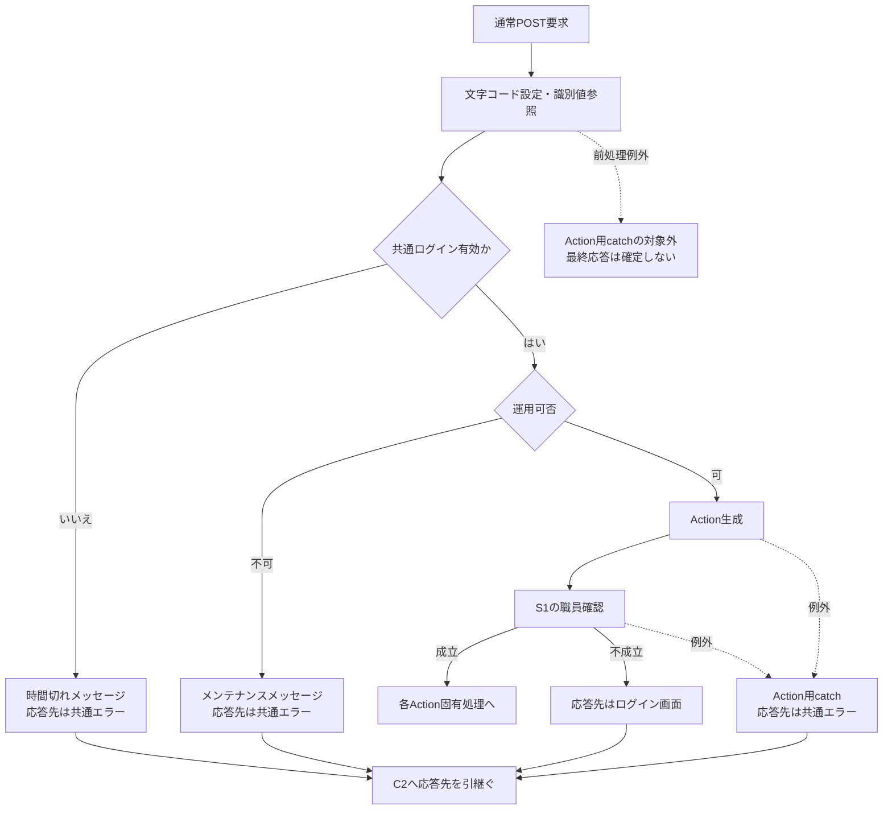

運用可否の内部で処理された接続等の例外は「不可」へ進む。Action用catchへ入った例外と同じ枝にはしない。Action用catchは、以下の各Action固有処理中に発生したExceptionも対象とする。

**S1：年金職員確認**

入口は各Action冒頭の `requireStaff`、正常出口は呼出元Actionの固有処理である。店名一覧は未保持時の職員照会に先行し、取得失敗から名簿照会へは進まない。

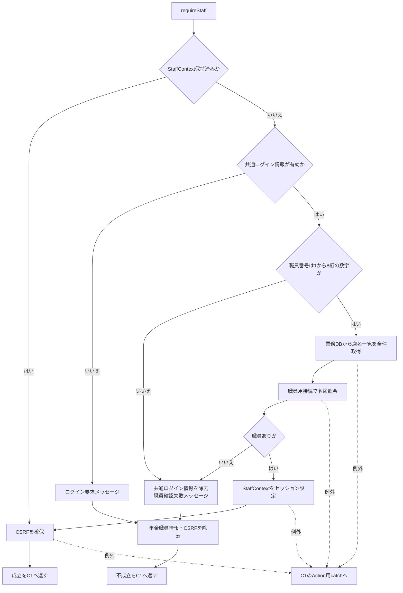

**I1：印刷画面の初期状態作成**

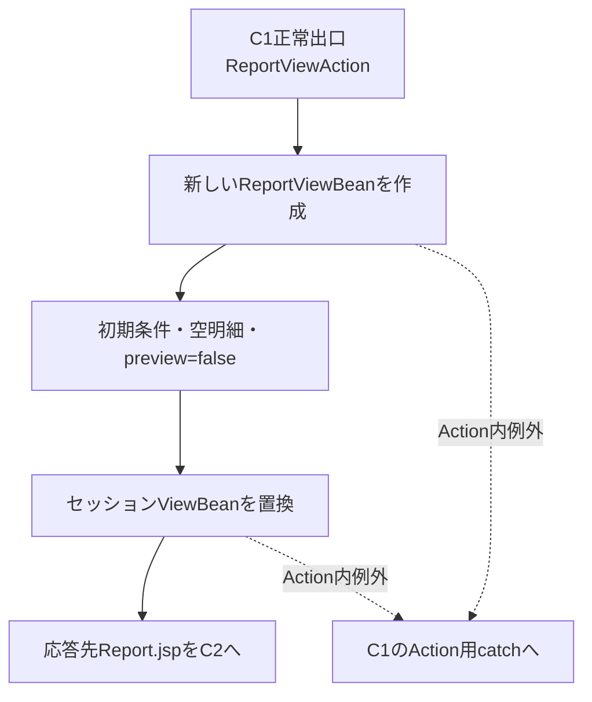

**C2：共通応答**

入口で渡された応答先をforwardへ引き継ぐ。Report.jsp、Menu.jsp、Login.jsp、共通エラーを、それぞれ選ばれた応答先として扱う。

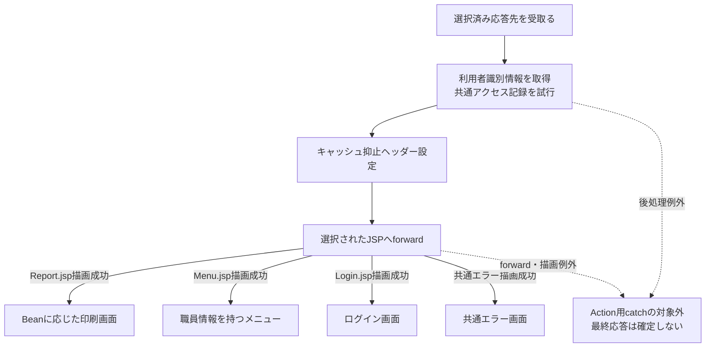

アクセス記録のDB処理内の失敗は記録側でrollback・ログ出力を試みる。利用者情報の取得やforwardを含むC2全体が、Action用catchで囲まれているわけではない。

#### SQL・テーブル関連（ER図）

印刷画面固有の初期化は帳票明細検索を行わず、空の表示用Beanを作る。一方、職員情報が未保持で共通ログイン職員番号が有効な場合、共通職員確認は業務DBの店名テーブルと、別接続先の職員名簿を順に読む。これとは別に、共通要求処理がアクセス記録を試みる。

次図は処理依存とメモリ上の突合せを表し、テーブル間のFK・多重度を示すER図ではない。

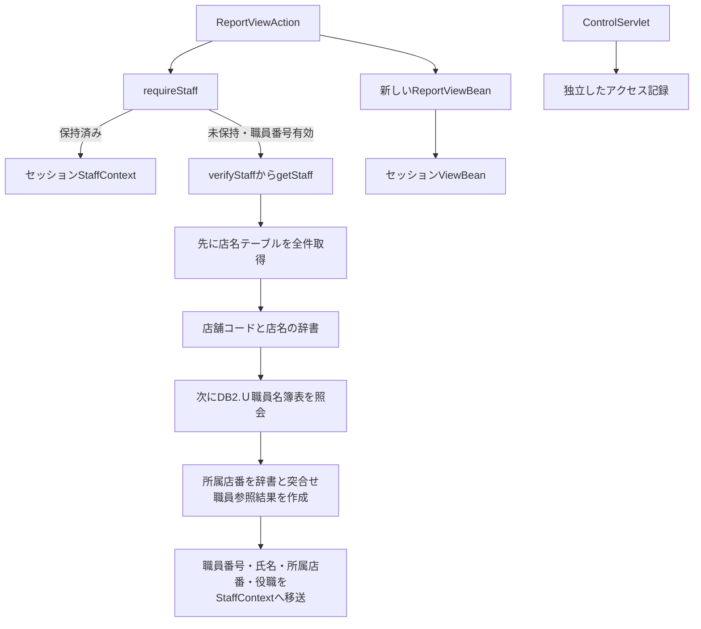

#### DB操作の詳細

職員情報保持済みの場合、職員確認はそのオブジェクトを再利用する。再構成が必要な場合の読取りは次の順序となる。職員番号を再入力させる画面へ進む処理ではない。

| 順序 | 用途・接続 | 検索内容 | パラメータ・結果 |
| --- | --- | --- | --- |
| 1 | 店名辞書の作成。業務用接続 | `SELECT 店舗ｺｰﾄﾞ AS BRANCH_NO, 店名 AS BRANCH_NAME FROM 店名テーブル`。WHERE・JOIN・ORDER BYなし | パラメータなし。全行を `Map<Integer, String>` へ格納する |
| 2 | 職員確認。職員用接続 | `DB2.Ｕ職員名簿表 S` から職員番号、漢字氏名、カナ氏名、所属店番、役職コードを取得。条件は `S.職員番号 = ?`。JOIN・ORDER BYなし | 1番に職員番号を `setInt`。`results.next()` で得た先頭行を使い、0件ならnullを返す |

店名辞書は `getStaff` の職員照会用tryへ入る前に作る。店名取得が失敗した場合は職員用接続を開かず、その例外を呼出元へ伝える。店名辞書が空、または所属店番に対応する店名がない場合、職員参照結果の店名は空文字となる。店名の一致を職員成立の必須条件にはしていない。

業務用DataSourceは `jdbc/RAROA_DB`、`java:comp/env/jdbc/RAROA_DB`、職員用DataSourceは `jdbc/Oracle_SP2NM`、`java:comp/env/jdbc/Oracle_SP2NM` の順に探索する。取得したDataSourceは系統別に共有キャッシュへ保持する。各読取りは個別に接続を取得し、ResultSet、PreparedStatement、Connectionの順で解放する。明示的なcommit・rollbackや、二つの読取りを一体化したトランザクションはない。

アクセス記録先は `DB2.Ｕカウンターシフト` である。アクセス日付・時刻、機能・画面・コマンド・Action・JSP・利用者の識別情報を共通接続で記録し、独立してcommitする。セッションに `MESSAGE` がある場合、記録するJSP名は `./JSP/COMMON/SubMessage.jsp` となるが、実際のforward先は選択済みの応答先を使う。予約検索やプレビュー保持と一体のトランザクションではない。

#### 結果・例外時の扱い

正常時は条件を初期化した印刷画面となる。年金職員不成立時はログイン画面、共通ログイン拒否・運用拒否・Action用catchに到達した例外では、それぞれの理由による共通エラーの応答先となる。

店名取得中のSQLExceptionは「店舗名の取得に失敗しました。」、職員名簿照会中のSQLExceptionは「職員の取得に失敗しました。」を持つ `NenkinDataAccessException` に包まれる。店名取得の例外を、後続の職員照会用catchが「職員の取得」へ包み直すことはない。両方とも職員不在のnull戻り値にはならず、共通Action用catchへ進む。この段階では新しい印刷Beanをまだセッションへ設定していない。

共通Servletの識別値参照やログイン確認等の前処理、Action終了後の利用者識別情報取得とforwardはAction用catchの外にある。これらの例外まで、同じ共通エラー表示や特定のHTTPエラー状態になるとは定義しない。

### 印刷条件の選択・店番入力

#### 処理概要

並び順と店舗指定をブラウザー上で編集する。店舗指定チェックは店番自・至の入力可否を切り替える。条件編集そのものではサーバー検索を行わない。

#### 処理手順

**1. 条件を編集する。**

　**1.1.** 並び替え基準は固定の4候補から1つを選ぶ。候補のDB取得や、選択変更時の検索は行わない。

　**1.2.** 店舗指定チェック変更時は `toggleBranch(true)` を呼ぶ。チェックありなら店番自・至を有効化し、店番自へフォーカスする。チェックなしなら両方を無効化する。入力済み文字列はこの処理では消去しない。

**2. 店番入力を補助する。**

　**2.1.** `app.js` は `data-digits-only` を持つ店番入力へ初回バインドし、全角数字を半角へ変換して数字以外を除去する。以後もinput・blurで同じ正規化を行う。

　**2.2.** 値が変わった場合は、必要に応じてカーソル位置を調整してchangeを発火する。入力可能な既存値へフォーカスした場合は値を選択する。

**3. 表示済みプレビューを保持する。**

　**3.1.** 条件編集では `preview` を解除しない。明細、件数、帳票の並び順名称、出力日時と印刷ボタンの活性は直前の表示状態を保持する。

　**3.2.** 店舗指定を外した状態で再プレビューすると、通常のフォーム送信ではdisabledの店番自・至が送信対象から外れる。次のActionでは未送信値を空文字として新しいBeanへ取り込む。

#### 処理フロー

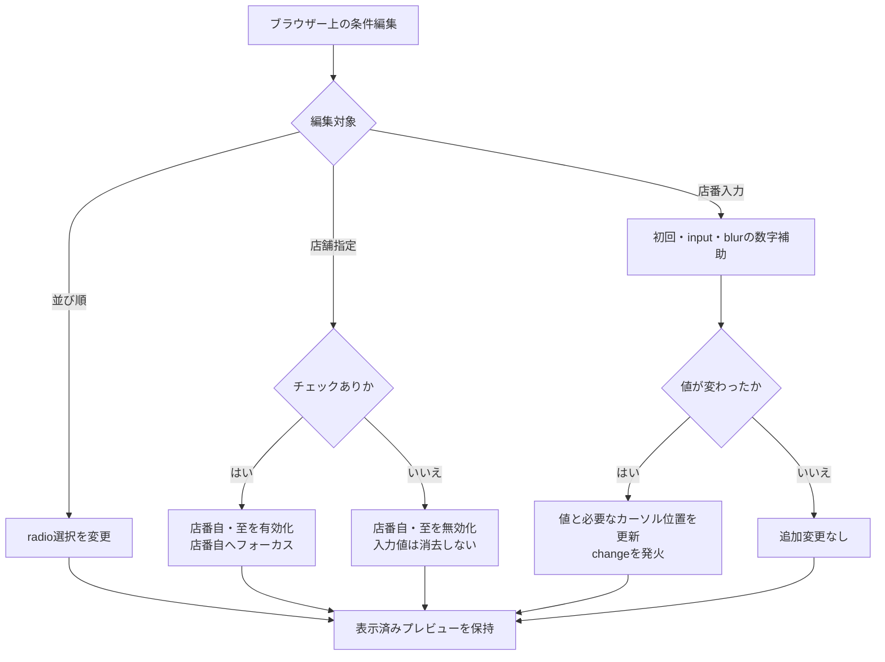

#### SQL・テーブル関連（ER図）

このイベントはDOM内の値・属性・フォーカスを変更する。DB・SQL・セッションの更新は行わないため、テーブルER図は該当しない。変更条件が検索に使われるのは、次のプレビュー作成要求からである。

#### DB操作の詳細

DB操作はない。ブラウザー内の値変更をセッションの `ReportViewBean` へ即時反映する通信もない。

#### 結果・例外時の扱い

店舗指定を切り替えても入力済み値と表示済み明細は維持される。印刷ボタンが既に有効なら、そのまま表示中の明細を印刷できる。

数字入力補助と `maxlength=3` はブラウザー側の制約である。任意の要求値をサーバーが同じ形へ補正する保証にはしない。また、入力拒否後の再表示でも初回の数字補助が動くため、サーバーがBeanへ保持した文字列と、補助後にブラウザーへ残る文字列が異なる場合がある。

### プレビュー作成・再作成

#### 処理概要

現在の条件を新しいBeanへ取り込み、店舗範囲を検査して予約明細を検索する。検索が正常終了すれば、0件でもプレビュー成立とする。入力拒否の場合は新しい条件とメッセージを表示し、以前の明細を残さない。

#### 処理手順

**1. 共通確認後に要求値を取り込む。**

　**1.1.** `ReportPreviewAction` は共通入口C1と職員確認S1を通過してから条件を読む。職員情報未保持時の店名一覧取得・名簿照会、その途中の例外、職員不成立時の戻り先は初期表示と同じである。

　**1.2.** 新しい `ReportViewBean` を作り、`USE_BRANCH_RANGE` をbooleanへ変換する。受信値が文字列 `1`、または大小文字を区別しない `true`・`on` のときtrueとする。未送信・その他の値はfalseとなり、前後の空白を除去して判定する処理はない。

　**1.3.** `BRANCH_FROM`・`BRANCH_TO` は、NULLを空文字へ変換し、Javaの `trim()` を適用したStringとして保持する。`SORT_TYPE` は正のintへ変換し、変換できなければ1を採用する。1～4の候補範囲検査はないため、それ以外の正数はBeanに残る。

　**1.4.** 店番自・至の保持文字列を `Integer.parseInt` で変換し、正のintだけを `from`・`to` として採用する。空文字、変換失敗、0以下、int範囲外はnullとなる。

**2. 店舗範囲を順番に検査する。**

　**2.1.** 店舗指定ありで `from=null` なら「店番を正しく入力して下さい！」を設定する。この検査を範囲の大小検査より先に行う。

　**2.2.** 2.1に該当せず、店舗指定あり・`to` が非null・`from>to` なら「店番自は店番至以下を入力してください。」を設定する。

　**2.3.** いずれかの入力拒否になった場合は検索しない。Beanは `preview=false`、空明細のままとし、取込済み条件とメッセージを持って手順4.1へ進む。

**3. 店舗条件と並び順を指定して検索する。**

　**3.1.** 店舗指定なしなら、保持された店番文字列や変換結果にかかわらず `search(null, null, sortType)` を呼ぶ。店舗指定ありなら `search(from, to, sortType)` を呼ぶ。

　**3.2.** 店舗指定ありで `to=null` の場合は店番自の単一店舗を検索する。店番至の変換失敗・0以下・int範囲外もこの枝へ進む。有効な正数の至が得られた場合だけ、店番自以上・店番至以下を条件にする。

　**3.3.** 予約本表と5つの名称マスターを検索し、取得した全行を `PensionReservation` のリストへ変換する。検索成功後に `rows` を設定し、その後で `preview=true` にする。件数による成功・失敗の切替えは行わない。

**4. 条件と結果を画面へ戻す。**

　**4.1.** 入力拒否または検索正常終了のBeanをセッション属性 `ViewBean` に設定する。`REPORT_JSP` を返し、共通応答C2へ進む。検索途中の例外は、このBean設定へ合流しない。

　**4.2.** JSPは `preview=false` ならメッセージと未プレビュー状態を表示する。`preview=true` なら件数を表示して印刷を有効化し、空リストなら0件案内を表示する。

　**4.3.** 明細ありなら、取得順のまま同一店番の連続範囲を1グループとし、店舗ごとに `article.report-page` を作る。NULLの店番同士も同一グループとする。各グループには先頭行の店名、並び順名称、グループ内件数を表示する。

　**4.4.** 各予約を17項目・2段で表示する。日付等の表示変換を行い、文字列をHTMLエスケープする。出力日時はこのJSP描画で作る。

#### 処理フロー

**P1：要求値の変換と入力検査**

入口は共通入口C1・職員確認S1の正常出口である。それらの拒否・例外経路は本要求にも適用する。

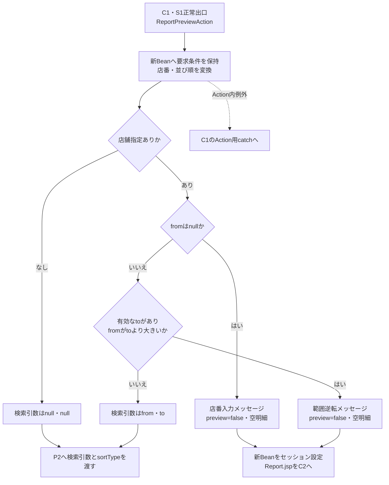

**P2：検索とプレビュー確定**

全店舗はパラメータなし、単一店舗はfrom、範囲はfrom・toを順にバインドする。入力拒否の枝を検索成功に合流させない。

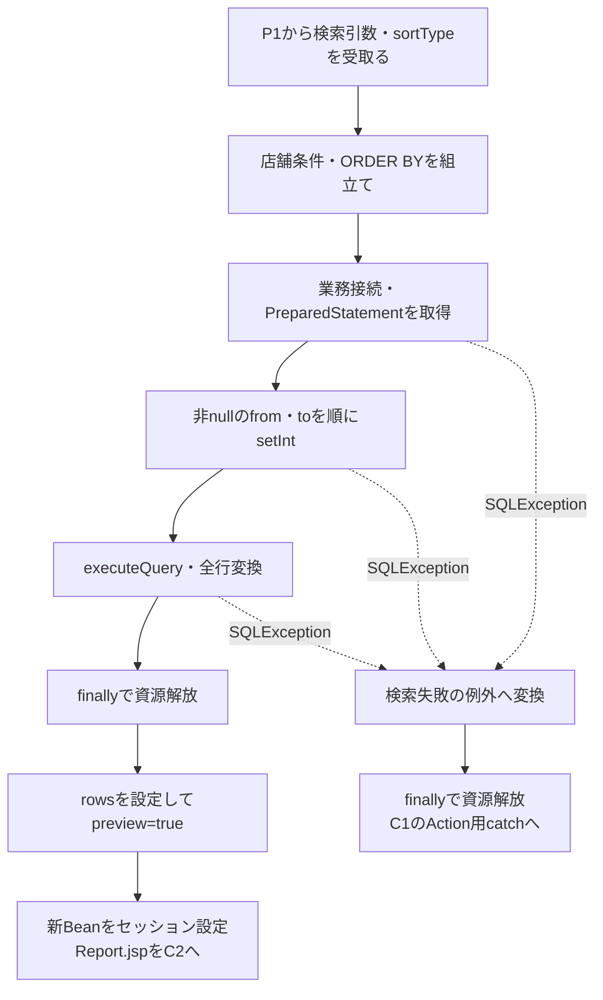

検索処理中のSQLException以外のExceptionは、同じ検索失敗メッセージへ包まれるとは限らない。Repositoryのfinallyを経たうえで、Actionまで伝播したExceptionは共通のAction用catchへ進む。

**P3：Report.jspの表示分岐**

入口はC2のReport.jspへのforwardである。表示を完了するとブラウザー内の条件編集・再プレビュー・印刷へ進める。JSP描画例外はAction用catchへ戻らない。

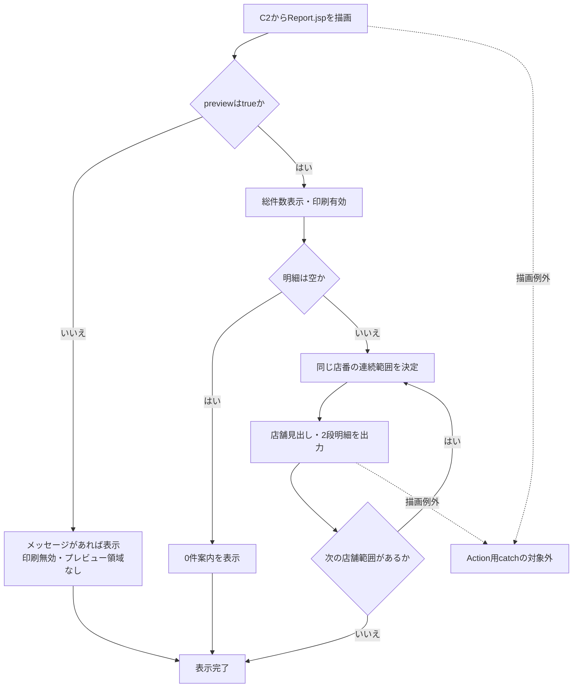

#### SQL・テーブル関連（ER図）

帳票明細検索は `年金1_LK` をRとし、店名・性別・裁定請求・受給有無・年金種類の5表をLEFT JOINする。名称が一致しない予約行も除外しない。職員情報未保持時に先行する店名一覧取得・職員名簿照会は、初期表示のS1に記載した別の共通読取りである。

次図は帳票SQLの結合関係を表す。FKや予約側の一意性を表すものではない。

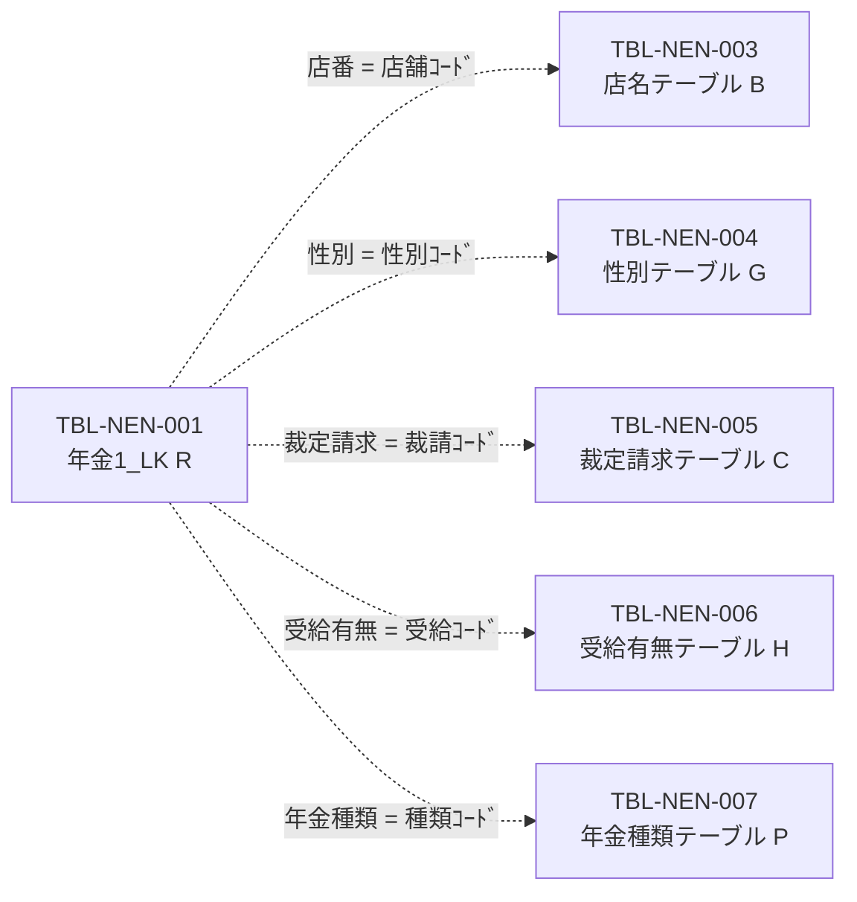

SQL Server用DDLでは名称マスターの各コード列に主キーを宣言している。一方、予約本表にはPK・一意制約・FKの宣言がなく、検索キー等の索引も非一意の `CREATE INDEX` である。

#### DB操作の詳細

検索は `WHERE 1 = 1` に次の店舗条件を追加する。日付、担当者、変更FLG、ログイン職員の所属店舗による追加絞込みはない。

| 画面条件 | Repositoryへ渡す値 | 追加するWHERE | JDBCバインド |
| --- | --- | --- | --- |
| 店舗指定なし | `null, null` | なし | なし |
| 店舗指定あり、至がnull | `from, null` | `R.店番 = ?` | 1番に `setInt(from)` |
| 店舗指定あり、有効な至あり | `from, to` | `R.店番 >= ? AND R.店番 <= ?` | 1番に `setInt(from)`、2番に `setInt(to)` |

nullは店舗条件を付けないための制御値であり、SQL NULLとしてバインドしない。Repository単体では至だけの上限検索も構成できるが、画面経路では店番自の必須検査が先にあるため、その呼出しには進まない。JDBCパラメータはintとして設定し、文字列パラメータのサイズ指定は行わない。

| 並び順 | ORDER BYの全列 |
| --- | --- |
| 1：担当者コード、および既定分岐 | `R.店番, R.担当者コード, R.顧客番号` |
| 2：顧客氏名 | `R.店番, R.ふりがな, R.顧客番号` |
| 3：生年月日 | `R.店番, R.生年月日, R.顧客番号` |
| 4：請求予定日 | `R.店番, R.請求予定日, R.顧客番号` |

いずれもDESC指定はない。店番を先頭にすることで、JSPは店舗の連続範囲を作る。NULLの並び方、ふりがなの照合順序、全ソート列が同値の行に対する追加の順序は指定していない。

SELECTは26列である。予約本表から店番、顧客番号、担当者コード、顧客氏名、ふりがな、住所、電話番号、生年月日、請求予定日、予定年齢、予約徴求日、データ更新日、備考、配偶者名、配偶者生年月日、5種類の年金フラグ、６ヶ月先確認の21列を取得する。結合先から店名・性別・裁定請求・受給有無・年金種類の5名称を取得する。取得するデータ更新日、5種類の年金フラグ、６ヶ月先確認は、この明細では表示しない。

検索先は業務用DataSourceである。`jdbc/RAROA_DB`、`java:comp/env/jdbc/RAROA_DB` の順に探索し、取得したDataSourceを共有キャッシュへ保持する。検索ごとに接続を取得してPreparedStatementを作り、全行をメモリ上のリストへ読み込む。SQLページング、取得上限、明示的なタイムアウト・取消処理はない。

この検索は業務表を更新せず、autoCommitの変更、明示的なcommit・rollbackも行わない。finallyではResultSet、PreparedStatement、Connectionの順にcloseし、close時のExceptionは抑止する。共通アクセス記録は初期表示と同じ独立した処理である。

#### 結果・例外時の扱い

入力拒否では、取込済み条件を持つ新しいBeanに置き換える。以前のプレビューは残らず、印刷は無効となる。店番至の変換失敗は入力拒否にはならず、至が空欄のときと同じ単一店舗検索へ進む。

検索成功では0件でも `preview=true` となる。0件案内は印刷対象から除外するclassを持たないため、有効な印刷ボタンからその案内を含む表示HTMLを印刷機能へ渡せる。

帳票明細の接続・検索・行読取りでSQLExceptionが発生した場合、Repositoryは「年金予約一覧の検索に失敗しました。」を持つ `NenkinDataAccessException` に包む。Actionに個別catchはなく、共通のAction用catchがアプリケーションエラーの応答先を選ぶ。この時点では新しいBeanをまだセッションへ設定していないため、旧Beanが新条件・空明細へ置換されたとは扱わない。

要求条件の取込み前に行うS1の店名取得・職員名簿照会が失敗した場合も、Report画面の入力拒否にはならない。それぞれの取得処理の例外として共通Action用catchへ進む。帳票明細検索の失敗メッセージへ統一しない。

一方、Bean設定後のJSP描画失敗では、そのBeanは既にセッションへ設定されている。別画面のBeanとの型不一致、職員表示の変換、明細描画等の例外はAction用catchの外にあり、同じエラー画面へ必ず変換されるものではない。入力拒否後の店番文字列はHTMLエスケープして再表示し、その後にブラウザーの数字入力補助が適用される。

### 印刷

#### 処理概要

プレビューが成立した画面で「印刷」を押し、表示中のHTMLをブラウザーの印刷機能へ渡す。印刷時のレイアウトは印刷用CSSで切り替える。

#### 処理手順

**1. 表示中のプレビューを印刷機能へ渡す。**

　**1.1.** `preview=true` により有効となった印刷ボタンを押すと、inlineのハンドラーから `window.print()` を呼ぶ。通常のボタン操作では、未プレビュー・入力拒否時のdisabledボタンからこの処理へ進まない。

　**1.2.** フォームを送信せず、再検索もしない。プレビュー後に条件だけ編集している場合も、印刷対象は表示済みの明細・件数・見出し・出力日時である。

**2. 印刷用表示へ切り替える。**

　**2.1.** 印刷CSSはA4横、`@page` 余白8mmを指定し、共有帯、画面見出し、ログイン職員情報、戻る、入力メッセージ、条件フォーム、操作ボタン、プレビューツールバーを非表示にする。

　**2.2.** 帳票名・出力日時・店舗見出し・項目見出し・明細を残す。店舗の切替えで改ページし、最後の店舗の後には強制改ページを指定しない。

　**2.3.** tableのtheadを繰返しヘッダーとし、予約1件に対応するtbodyのtrの途中分割を抑止する。店舗内の固定明細件数や、1店舗を必ず1枚へ収める縮小処理はない。

**3. ブラウザー側で印刷を操作する。**

　**3.1.** 用紙・プリンター等の選択、印刷実行または取消はブラウザー側の操作となる。サーバーへ結果を通知する処理はない。

#### 処理フロー

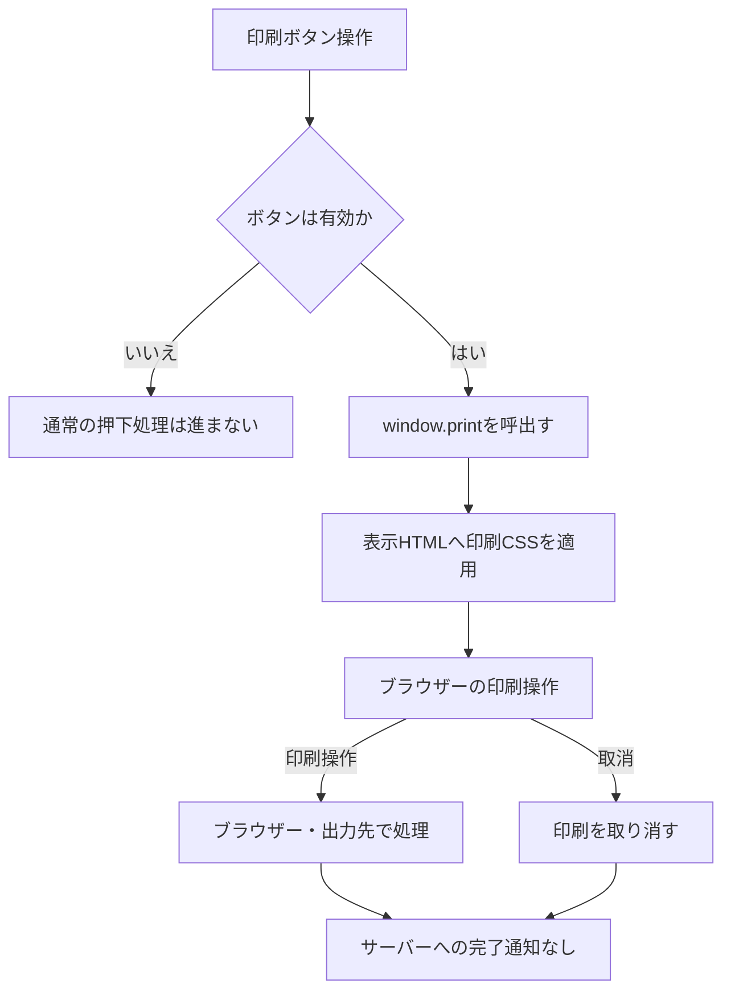

#### SQL・テーブル関連（ER図）

印刷ボタン操作ではSQLを発行しない。対象は既にブラウザーへ表示されたDOMであるため、テーブルER図は該当しない。プレビュー後のDB変更を再取得する処理もない。

#### DB操作の詳細

業務DB更新、印刷用一時表、印刷履歴登録、サーバー一時ファイルの作成は行わない。新しいServlet要求を送らないため、共通アクセス記録もこのボタン操作だけでは発生しない。

#### 結果・例外時の扱い

サーバーのプレビュー応答成功と、利用者による印刷完了は別の状態である。印刷取消、出力先の失敗、用紙の受領をサーバー戻り値から確定することはできない。

印刷画面側に、この呼出しを囲む個別catchや、印刷結果を受けてBeanを更新する処理はない。印刷後にサーバー上の成功状態を追加しない。

### 戻る

#### 処理概要

印刷画面からメニューへ戻る。予約データの保存・取消・削除は行わず、セッションの表示用Beanをメニュー用に置き換える。

#### 処理手順

**1. メニュー表示要求を送る。**

　**1.1.** 戻るボタンの `backMenu()` は同じフォームの `VIEW_ID` を `Menu`、`COMMAND_ID` を `View` へ変更し、フォームをsubmitする。`FUNCTION_ID=nenkin` は保持する。

　**1.2.** 共通入口C1を経て `MenuViewAction` を呼ぶ。印刷条件が同時に送信されても、メニュー表示処理で予約検索や保存には使わない。

**2. 職員を確認してメニュー表示状態を作る。**

　**2.1.** `MenuViewAction` は最初にS1の職員確認を行う。保持済みContextは再利用する。未保持で共通ログイン職員番号が有効なら、店名一覧の全件取得、職員名簿照会の順に処理する。途中の取得失敗は、不成立の戻り値ではなく共通Action用catchへ進む。

　**2.2.** 職員確認成功後、新しい `MenuViewBean` を作り、現在の職員番号・氏名を設定する。

　**2.3.** セッションの `ViewBean` を置き換え、`MENU_JSP` を共通応答C2へ返す。C2の `Menu.jsp` 描画成功出口からメニューを表示する。メニューから再び印刷へ入った場合は、初期表示イベントで新しい印刷Beanを作る。

#### 処理フロー

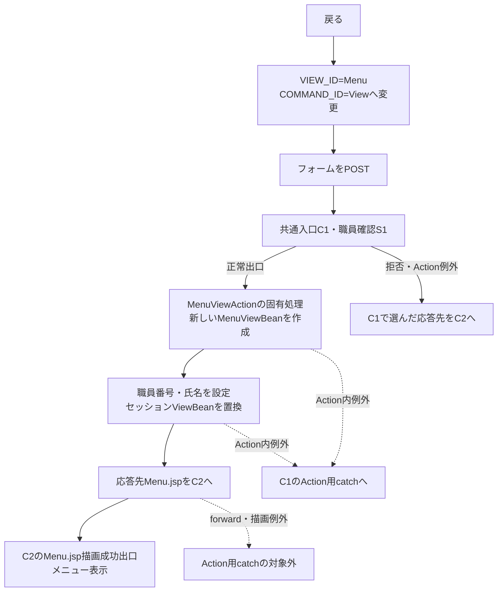

#### SQL・テーブル関連（ER図）

メニュー表示の固有処理は帳票明細検索・予約更新を行わない。共通職員確認で再構成が必要な場合は、店名テーブルを先に全件取得し、その後に職員名簿を照会する。この依存関係は初期表示の関連図と同じである。

二つの接続先をSQLでJOINする処理ではなく、職員の所属店番を取得済み店名辞書とメモリ上で突き合わせる。独立したアクセス記録も共通応答時に試みるため、戻る操作全体をDB非使用とはしない。

#### DB操作の詳細

メニュー表示固有の業務DB操作はない。主な状態変更はセッションの表示用Beanの置換である。職員再確認時のSQL・取得順・バインド・資源解放は、初期表示のDB操作詳細と同じ契約を使う。共通アクセス記録はこのPOST要求に対して試みる。

#### 結果・例外時の扱い

正常時は職員情報を持つメニューを表示する。共通ログイン拒否・運用拒否・年金職員不成立・Action例外はC1・S1の該当経路へ進み、メニュー表示成功へ合流させない。

職員再確認の店名取得または名簿照会が失敗した場合、新しいMenuViewBeanを設定する前に共通Action用catchへ進む。MenuViewBean設定後のJSP forward・描画失敗はAction用catchの外となる。

## 補足説明

### 条件値と検索値の境界

店番自・至のブラウザー属性は `maxlength=3`、`inputmode=numeric`、`autocomplete=off`、`data-digits-only` であり、HTMLのrequiredは付いていない。サーバーはraw文字列の3桁上限や最大999を検査せず、trim後に正のintへ変換できるかで扱いを決める。したがって、ブラウザーの3コード単位の入力制約、数字補助、サーバーの正数条件、DBの整数型は別の制約である。店名マスターへの存在確認も、プレビュー前の必須条件には含まれない。

並び順の未送信・空文字・変換失敗・0以下・int範囲外は1へ既定化する。それ以外の正数で1～4に該当しないものは保持されるが、SQLと帳票の並び順名称は担当者コードへフォールバックする。その場合、画面の4候補には一致するcheckedがない。

### 表示値と保存値

数値項目は `getInt` 後に `wasNull` を確認してIntegerへ移す。NULLは空欄、0は「0」と表示し、帳票側でゼロ埋めしない。顧客番号はSQL Server DDLのBIGINTに対してJava側がIntegerであるため、BIGINT全域を無損失に表示する契約にはなっていない。予約入力画面の顧客番号 `maxlength=7`、担当者コード `maxlength=4`、予定年齢 `maxlength=3` も、既存値の印刷桁やDB容量を保証するものではない。

氏名・住所・名称・備考等はStringとして取得し、モデルsetterがNULLを空文字へ変換する。SQL Server用DDLの文字列は項目一覧のNVARCHAR宣言、ローカルDDLでは対応する同長のVARCHAR宣言である。宣言長はDB容量であり、印刷画面における業務入力上限ではない。

性別・裁請・受給の名称は、予約入力側で選択した名称から保存時にコードを逆引きし、印刷時に保存コードを名称マスターへ結合して取得する。印刷画面には名称の選択・更新操作がない。マスターの名称列がNOT NULLでも、LEFT JOIN未一致なら表示名は空欄となる。マスター名称の保存・更新を担当する業務と、その入力上限は未確定であり、DB容量から補わない。

年金種類の保存側は、国民年金1、厚生年金2、共済年金4、厚生年金基金8、国民年金基金16を合算する。合計0なら保存コードはnull、非0ならコード表の存在を検査する。印刷は保存済みの年金種類コードに対応する名称を使用し、取得した5種類のフラグから名称を再構成しない。既存コードとフラグの不整合を帳票が修復する処理ではない。

電話番号は数値列を文字列として取得し、数字の抽出と先頭ゼロの整理を行う。整理後の値が9桁または10桁で先頭が0でなければ、表示用に0を1つ補う。NULLは空文字、数値0は「0」となり、ハイフンは追加しない。

日付はStringへ移して `formatReportDate` で表示する。令和・平成・昭和・大正・明治の開始日に応じてR・H・S・T・Mを選び、元号年・月・日を組み立てる。元号年は10未満ならゼロを補い、月日も2桁で表す。明治開始前は西暦表示を経由する。その後、文字列中の `/` を `. ` へ置換する。解析できない値は元文字列へ戻すが、この後段置換は適用される。表示時にはさらにHTMLエスケープする。

備考の保存準備には、Windows-31Jへ変換可能で56バイト以内という検証がある。これは56文字上限でも、DBのNVARCHAR(400)という容量でもない。印刷検索は保存用検証や切詰めを呼ばず、保存済みの値を取得する。

### 帳票の配置と印刷時の表示

1予約は、上段11項目、下段6項目の計17項目を12列のCSS gridへ配置する。下段の先頭2領域は空きとなり、その後に住所を置く。担当者氏名、データ更新日、６ヶ月先確認は明細に表示しない。

| 対象 | 通常画面 | 印刷時 |
| --- | --- | --- |
| 共有帯・画面見出し・職員情報・戻る | 表示 | `app-nav`・`no-print` により非表示 |
| 入力メッセージ・条件フォーム・操作ボタン | 表示条件に従う | 非表示 |
| プレビューツールバー | プレビュー成立時に表示 | 非表示 |
| 0件案内 | 正常検索0件で表示 | 印刷対象から除外しない |
| 帳票名・出力日時・店舗帯・明細 | 明細ありで表示 | 表示を保持する |
| 帳票の外枠・角丸・影 | あり | 除去する |
| 項目見出し | 22pxの2段 | 5mmの2段、6.7pt |
| 明細 | 25pxの2段 | 5.2mmの2段、6.6pt |
| 帳票タイトル | 1.18rem | 15pt |
| 日時・店舗帯の文字 | 0.75rem | 7pt |
| 明細の交互色・hover色 | あり | 白へ統一する |

各セルには折返しをしない指定、overflowの隠蔽、省略記号の指定がある。顧客氏名・カナ氏名・住所・配偶者氏名・年金種類・備考には全値を持つtitle属性があるが、印刷で全文を展開する規則はない。文字列の取得時切詰めと、セル幅に収まらない部分の表示抑制は区別する。

店舗グループ全体に改ページを指定し、最後のグループの後は強制改ページを解除する。店舗内の1予約は分割を抑止し、tableのtheadにある帳票タイトル・店舗帯・項目見出しを継続ページでも繰り返す指定である。店舗件数はグループの全件数であり、用紙1枚の明細件数ではない。

印刷CSSは `@page` 余白8mmを指定する一方、`main.app-shell:not(.login-shell)` の通常時paddingは、印刷用 `.app-shell` のpadding指定より詳細度が高い。Report画面には通常時の `20px 18px 52px` が引き続き適用されるため、用紙上の内容の実余白全体を8mmとする契約にはならない。

出力日時はJSP描画時の当日と時刻から作り、タイムゾーンを明示しない日時書式は実行環境の既定設定に従う。出力日と時刻は別の取得呼出しであり、予約のデータ更新日時ではない。ブラウザーの印刷ボタン操作では日時を再生成しない。

### 保持領域と同時操作

印刷条件・メッセージ・preview状態・明細リストは、セッション属性 `ViewBean` の `ReportViewBean` に保持する。明細型は `List<PensionReservation>` であり、`setRows` は受け取ったリストを複製せず保持する。nullを渡した場合だけ空リストへ置換する。

同じ属性名は他画面も使用する。メニュー表示や別画面の操作でBeanが置き換わるため、印刷画面専用の永続状態や、複数タブからの独立性を保証する保持方式ではない。印刷用の一時ID、参照キー、永続プレビュー表、生成ファイルはこの経路で作らない。

職員再確認時の店名辞書は呼出し内のメモリに作る。DataSourceの共有キャッシュ、セッションの職員情報、表示用Bean、ブラウザーに表示済みの帳票は、それぞれ異なる保持領域である。セッションBeanが後から置き換わっても、表示済みHTMLを再取得する通信は自動では発生しない。

### 関連文書

以下は文書計画上の対応先である。生成状態は未確認のため、生成済みリンクとしては扱わず、文書IDと本書からの相対パスを示す。

| 文書ID | 本書からの相対パス | 対応する責務 |
| --- | --- | --- |
| DET-SCR-019 | `../詳細仕様書/詳細仕様書_SCR-019_登録内容印刷.md` | コントロール・Bean・検索引数・SQL・表示変換の詳細対応 |
| OUTPUT-NENKIN | `../共通/帳票一覧.md` | 他のExcel・ZIP出力と区別した帳票形式の整理 |
| DB-OPS | `../共通/DB仕様書/DB操作仕様書.md` | SQL・JDBC・接続・例外の操作別契約 |
| COM-012 | `../共通/共通仕様書_COM-012_共通コントロールサーブレット.md` | 共通受付、Action例外、アクセス記録、forwardの境界 |
| COM-111 | `../共通/共通仕様書_COM-111_年金業務共通処理.md` | 年金職員確認、セッション、値変換の共通契約 |
| COM-151 | `../共通/共通仕様書_COM-151_画面共通入力・通信制御.md` | 数字入力補助、共有画面・印刷CSSの共通契約 |
