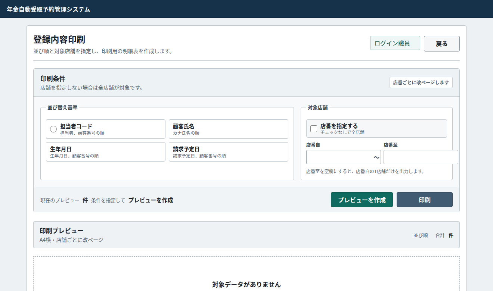
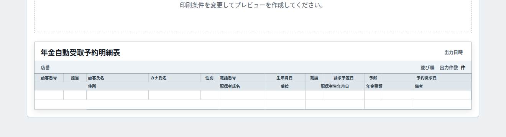
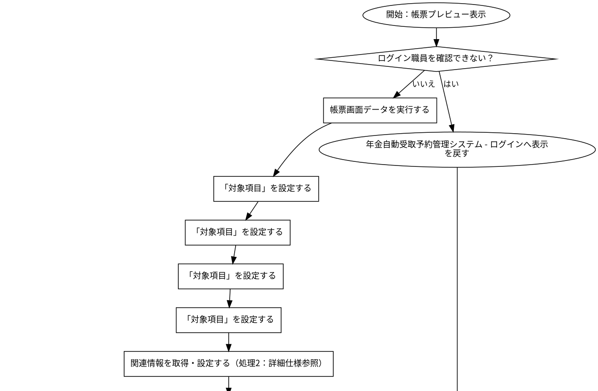
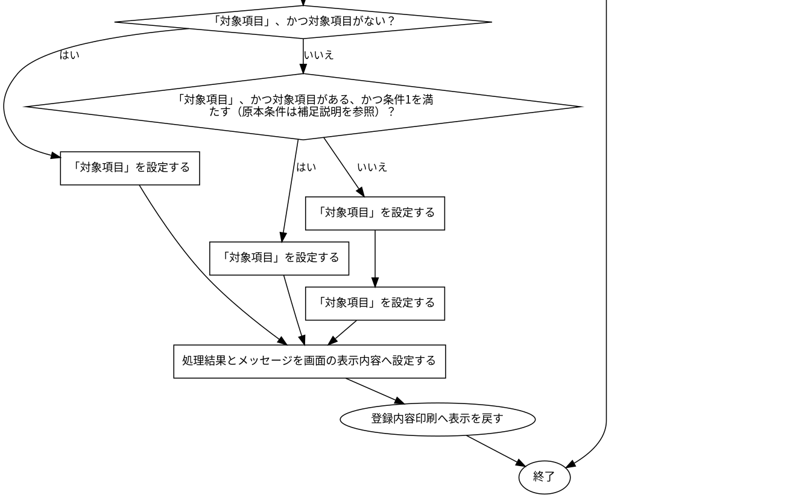
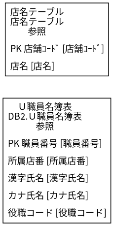
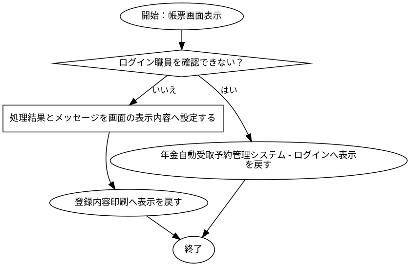

# 登録内容印刷

## 表紙

| 項目 | 内容 |
| --- | --- |
| 文書名 | 基本設計書 |
| システム名 |  |
| 機能ID | SCR-019 |
| 画面名 | 登録内容印刷 |
| 会社名 |  |
| 作成日 |  |

## 概要

### 概要説明

登録内容印刷の入力・表示・要求処理を行う。

| 情報 | 内容 |
| --- | --- |
| 対象種別 | screen |
| 開始契機 | 呼出元からの要求 |
| 処理対象 | DB2.Ｕ職員名簿表、DB2.ＵＪ科目、N2_SIGHT.Ｂ顧客基本表、NAVI.ＵＪ機能マスタ、NAVI.ＵＪ稼動店舗管理マスタ、NAVI.ＵＭオンラインＯＰマスタ、NAVI.ＵＭパス管理マスタ、NAVI.ＵＭ機能マスタ、NAVI.ＵＳパス管理ステータス、受給有無テーブル、年金1_LK、年金種類テーブル、年金＿削除明細、店名テーブル、性別テーブル、職員情報等（セッション）、裁定請求テーブル |

### 画面レイアウト

原本HTML・CSSの静的再構成。実行時の表示条件・値は未実行（仮定 Q-643E1CD4CE）。

### データ操作関連図

## 項目一覧

| No | グループ | 項目名 | 種類 | 入出力 | DB連携項目 | 候補取得元 | 必須 | 形式・桁 | 説明 |
| --- | --- | --- | --- | --- | --- | --- | --- | --- | --- |
| 1 | 見出し・説明 | 登録内容印刷 | Label | O | ‐ | ‐ | ‐ | ‐ | 登録内容印刷を表示する。 |
| 2 | 画面操作 | 戻る | Button | ‐ | ‐ | ‐ | ‐ | ‐ | 「戻る」の操作を受け付ける。業務結果はイベント仕様で確認する。 |
| 3 | 見出し・説明 | 印刷条件 | Label | O | ‐ | ‐ | ‐ | ‐ | 印刷条件を表示する。 |
| 4 | 見出し・説明 | 並び替え基準 | Label | O | ‐ | ‐ | ‐ | ‐ | 並び替え基準を表示する。 |
| 5 | 入力・選択項目 | 担当者コード 担当者、顧客番号の順 | RadioButton | I | DB項目未確定（仮定 Q-88A685A088） | ‐ | 任意（仮定 Q-20B65BDCF4） | 選択／未選択 | 担当者コード 担当者、顧客番号の順を入力・選択する。 |
| 6 | 入力・選択項目 | 顧客氏名 カナ氏名の順 | RadioButton | I | DB項目未確定（仮定 Q-A39B08B0E5） | ‐ | 任意（仮定 Q-37439172BB） | 選択／未選択 | 顧客氏名 カナ氏名の順を入力・選択する。 |
| 7 | 入力・選択項目 | 生年月日 生年月日、顧客番号の順 | RadioButton | I | DB項目未確定（仮定 Q-5FDDFF4BBA） | ‐ | 任意（仮定 Q-A5C9440440） | 選択／未選択 | 生年月日 生年月日、顧客番号の順を入力・選択する。 |
| 8 | 入力・選択項目 | 請求予定日 請求予定日、顧客番号の順 | RadioButton | I | DB項目未確定（仮定 Q-BA5F48E98A） | ‐ | 任意（仮定 Q-D472EC6218） | 選択／未選択 | 請求予定日 請求予定日、顧客番号の順を入力・選択する。 |
| 9 | 見出し・説明 | 対象店舗 | Label | O | ‐ | ‐ | ‐ | ‐ | 対象店舗を表示する。 |
| 10 | 入力・選択項目 | 店番を指定する チェックなしで全店舗 | CheckBox | I | DB項目未確定（仮定 Q-D8FF3F4E78） | ‐ | 任意（仮定 Q-B50D408424） | 選択／未選択 | 店番を指定する チェックなしで全店舗を入力・選択する。 |
| 11 | 入力・選択項目 | 店番自 | TextBox | I | DB項目未確定（仮定 Q-C74872592D） | ‐ | 任意（仮定 Q-A8BF192F1E） | 最大3文字 | 店番自を入力・選択する。 |
| 12 | 入力・選択項目 | 店番至 | TextBox | I | DB項目未確定（仮定 Q-CED77E1E64） | ‐ | 任意（仮定 Q-01CFB76BED） | 最大3文字 | 店番至を入力・選択する。 |
| 13 | 画面操作 | プレビューを作成 | Button | ‐ | ‐ | ‐ | ‐ | ‐ | 「プレビューを作成」の操作を受け付ける。業務結果はイベント仕様で確認する。 |
| 14 | 画面操作 | 印刷 | Button | ‐ | ‐ | ‐ | ‐ | ‐ | 「印刷」の操作を受け付ける。業務結果はイベント仕様で確認する。 |
| 15 | 見出し・説明 | 印刷プレビュー | Label | O | ‐ | ‐ | ‐ | ‐ | 印刷プレビューを表示する。 |
| 16 | 見出し・説明 | 年金自動受取予約明細表 出力日時 店番 並び順 出力件数 件 顧客番号 担当 顧客氏名 カナ氏名 性別 電話番号 生年月日 裁請 請求予定日 予齢 予約徴求日 住所 配偶者氏名 受給 配偶者生年月日 年金種類 備考 | Label | O | ‐ | ‐ | ‐ | ‐ | 年金自動受取予約明細表 出力日時 店番 並び順 出力件数 件 顧客番号 担当 顧客氏名 カナ氏名 性別 電話番号 生年月日 裁請 請求予定日 予齢 予約徴求日 住所 配偶者氏名 受給 配偶者生年月日 年金種類 備考を表示する。 |
| 17 | 見出し・説明 | 年金自動受取予約明細表 | Label | O | ‐ | ‐ | ‐ | ‐ | 年金自動受取予約明細表を表示する。 |

項目定義数：17項目。表示順と反復行の定義数を区別する。

## イベント仕様

### 帳票プレビュー表示

#### 処理概要

登録内容印刷で「帳票プレビュー表示」の要求を受け付ける。入力・確認・データ操作・応答の順と、条件が成立しない場合の処理を以下に示す。

#### 処理手順

1. 「ログイン職員を確認できない」に該当するか確認する。該当する場合に限り、次の分岐内手順を行う。該当しない場合は分岐の後へ進む。

1.1. 条件成立時：年金自動受取予約管理システム - ログインへ表示を戻す。この経路の後続手順は実行しない。

2. 帳票画面データを実行する。

3. 「対象項目」を設定する。

4. 「対象項目」を設定する。

5. 「対象項目」を設定する。

6. 「対象項目」を設定する。

7. 関連情報を取得・設定する（処理3：詳細仕様参照）。

8. 「「対象項目」、かつ対象項目がない」に該当するか確認する。成立時と不成立時の手順を分けて行う。

8.1. 条件成立時：「対象項目」を設定する。

8-別.1. 条件不成立時：「「対象項目」、かつ対象項目がある、かつ条件4を満たす（原本条件は補足説明を参照）」に該当するか確認する。成立時と不成立時の手順を分けて行う。

8-別.1.1. 条件成立時：「対象項目」を設定する。

8-別.1-別.1. 条件不成立時：「対象項目」を設定する。

8-別.1-別.2. 条件不成立時：「対象項目」を設定する。

9. 処理結果とメッセージを画面の表示内容へ設定する。

10. 登録内容印刷へ表示を戻す。この経路の後続手順は実行しない。

#### 処理フロー

入口処理の順序・分岐を示す。呼出先の処理は別単位とし、SQLの対象と実行条件はDB操作の詳細へ記載する。例外線は範囲内で例外が発生した場合の経路で、各命令が必ず例外を送出する意味ではない。

#### SQL・テーブル関連（ER図）

実線はSQLの結合条件。外部キー制約や多重度を断定しない。単独表は独立したエンティティで表す。

#### DB操作の詳細

#### DB操作 SQL-D9F3500B923D

| 情報 | 内容 |
| --- | --- |
| 操作ID | SQL-D9F3500B923D |
| 対象テーブル | DB2.Ｕ職員名簿表 |
| 操作 | 参照 |
| 処理説明 | 対象テーブルの対象データを読み取る。設定項目・対象条件・確定取消は以下の定義に従う。 |
| 設定項目 | 当該SQL式の列指定・実行時引数を使用する。組立式と原本のパラメーター設定を参照。 |
| 対象条件 | 抽出・更新対象条件：S.職員番号 = ? |
| 確定・取消 | 呼出側または接続の設定に従う。当該メソッド単独でのコミット・ロールバック指定はない。 |
| 原本 | nenkin/WEB-INF/src/nenkin/service/ReferenceDataService.java:207 / getStaff@206 |

#### DB操作 SQL-E0FD738666D8

| 情報 | 内容 |
| --- | --- |
| 操作ID | SQL-E0FD738666D8 |
| 対象テーブル | 店名テーブル |
| 操作 | 参照 |
| 処理説明 | 対象テーブルの対象データを読み取る。設定項目・対象条件・確定取消は以下の定義に従う。 |
| 設定項目 | 当該SQL式の列指定・実行時引数を使用する。組立式と原本のパラメーター設定を参照。 |
| 対象条件 | WHERE句による限定はこのSQL式にない。呼出条件・動的付加条件は原本を参照する。 |
| 確定・取消 | 呼出側または接続の設定に従う。当該メソッド単独でのコミット・ロールバック指定はない。 |
| 原本 | nenkin/WEB-INF/src/nenkin/service/ReferenceDataService.java:291 / loadBranchNames@289 |

#### 結果・例外時の扱い

| 到達条件 | 結果 |
| --- | --- |
| ログイン職員を確認できない | 年金自動受取予約管理システム - ログインへ表示を戻す |
| 条件5を満たす（原本条件は補足説明を参照） | 登録内容印刷へ表示を戻す |

### 帳票画面表示

#### 処理概要

登録内容印刷で「帳票画面表示」の要求を受け付ける。入力・確認・データ操作・応答の順と、条件が成立しない場合の処理を以下に示す。

#### 処理手順

1. 「ログイン職員を確認できない」に該当するか確認する。該当する場合に限り、次の分岐内手順を行う。該当しない場合は分岐の後へ進む。

1.1. 条件成立時：年金自動受取予約管理システム - ログインへ表示を戻す。この経路の後続手順は実行しない。

2. 処理結果とメッセージを画面の表示内容へ設定する。

3. 登録内容印刷へ表示を戻す。この経路の後続手順は実行しない。

#### 処理フロー

入口処理の順序・分岐を示す。呼出先の処理は別単位とし、SQLの対象と実行条件はDB操作の詳細へ記載する。例外線は範囲内で例外が発生した場合の経路で、各命令が必ず例外を送出する意味ではない。

#### SQL・テーブル関連（ER図）

実線はSQLの結合条件。外部キー制約や多重度を断定しない。単独表は独立したエンティティで表す。

#### DB操作の詳細

#### DB操作 SQL-D9F3500B923D

| 情報 | 内容 |
| --- | --- |
| 操作ID | SQL-D9F3500B923D |
| 対象テーブル | DB2.Ｕ職員名簿表 |
| 操作 | 参照 |
| 処理説明 | 対象テーブルの対象データを読み取る。設定項目・対象条件・確定取消は以下の定義に従う。 |
| 設定項目 | 当該SQL式の列指定・実行時引数を使用する。組立式と原本のパラメーター設定を参照。 |
| 対象条件 | 抽出・更新対象条件：S.職員番号 = ? |
| 確定・取消 | 呼出側または接続の設定に従う。当該メソッド単独でのコミット・ロールバック指定はない。 |
| 原本 | nenkin/WEB-INF/src/nenkin/service/ReferenceDataService.java:207 / getStaff@206 |

#### DB操作 SQL-E0FD738666D8

| 情報 | 内容 |
| --- | --- |
| 操作ID | SQL-E0FD738666D8 |
| 対象テーブル | 店名テーブル |
| 操作 | 参照 |
| 処理説明 | 対象テーブルの対象データを読み取る。設定項目・対象条件・確定取消は以下の定義に従う。 |
| 設定項目 | 当該SQL式の列指定・実行時引数を使用する。組立式と原本のパラメーター設定を参照。 |
| 対象条件 | WHERE句による限定はこのSQL式にない。呼出条件・動的付加条件は原本を参照する。 |
| 確定・取消 | 呼出側または接続の設定に従う。当該メソッド単独でのコミット・ロールバック指定はない。 |
| 原本 | nenkin/WEB-INF/src/nenkin/service/ReferenceDataService.java:291 / loadBranchNames@289 |

#### 結果・例外時の扱い

| 到達条件 | 結果 |
| --- | --- |
| ログイン職員を確認できない | 年金自動受取予約管理システム - ログインへ表示を戻す |
| 条件1を満たす（原本条件は補足説明を参照） | 登録内容印刷へ表示を戻す |

### DB関連処理

## 補足説明

### 適用条件

各仮定のQA番号を確認する。静的に確認できた操作・条件を適用する。

### 項目別DB連携備考

表示元と保存先は別方向の対応。DBから読み出した既存データの履歴保存は、画面入力の直接バインド先と区別する。同じ列の複数経路はイベントの実行条件に従う。

| No | 項目名 | 備考 |
| --- | --- | --- |
| 5 | 担当者コード 担当者、顧客番号の順 | DB列への接続を原本から確定できていない。名称が似ている列へ自動接続しない。画面データ連携（仮定 Q-88A685A088） |
| 6 | 顧客氏名 カナ氏名の順 | DB列への接続を原本から確定できていない。名称が似ている列へ自動接続しない。画面データ連携（仮定 Q-A39B08B0E5） |
| 7 | 生年月日 生年月日、顧客番号の順 | DB列への接続を原本から確定できていない。名称が似ている列へ自動接続しない。画面データ連携（仮定 Q-5FDDFF4BBA） |
| 8 | 請求予定日 請求予定日、顧客番号の順 | DB列への接続を原本から確定できていない。名称が似ている列へ自動接続しない。画面データ連携（仮定 Q-BA5F48E98A） |
| 10 | 店番を指定する チェックなしで全店舗 | DB列への接続を原本から確定できていない。名称が似ている列へ自動接続しない。画面データ連携（仮定 Q-D8FF3F4E78） |
| 11 | 店番自 | DB列への接続を原本から確定できていない。名称が似ている列へ自動接続しない。画面データ連携（仮定 Q-C74872592D） |
| 12 | 店番至 | DB列への接続を原本から確定できていない。名称が似ている列へ自動接続しない。画面データ連携（仮定 Q-CED77E1E64） |

### 処理・条件の原本対応

文書内の条件番号・処理番号は次の原本表記に対応する。完全な業務用語への置換を行っていない箇所はQA・reportで確認する。

| イベント | 参照番号 | 原本条件・処理 |
| --- | --- | --- |
| 帳票プレビュー表示 | 条件1 | from.intValue()&gt;to.intValue() |
| 帳票プレビュー表示 | 処理2 | Integer from=integerOrNull(bean.getBranchFrom()),to=integerOrNull(bean.getBranchTo()) |
| 帳票プレビュー表示 | 処理3 | Integer from=integerOrNull(bean.getBranchFrom()),to=integerOrNull(bean.getBranchTo()) |
| 帳票プレビュー表示 | 条件4 | from.intValue()&gt;to.intValue() |
| 帳票プレビュー表示 | 条件5 | NOT (!requireStaff(request)) |
| 帳票画面表示 | 条件1 | NOT (!requireStaff(request)) |

