<!-- spec-meta: {"schema":"spec-md/1.0","documentId":"SYS-FUNCTIONS","version":"2.0","path":"機能一覧.md","sheets":[{"heading":"概要","kind":"GRID","sheet":"概要"},{"heading":"項目一覧","kind":"LIST","sheet":"機能一覧","key":["機能ID"]},{"heading":"イベント仕様","kind":"GRID","sheet":"イベント仕様"},{"heading":"補足説明","kind":"GRID","sheet":"補足説明"}]} -->
# 年金機能一覧

| 属性 | 内容 |
| --- | --- |
| 文書種別 | 機能一覧 |
| システム名 | 年金自動受取予約管理システム |
| 文書ID | SYS-FUNCTIONS |
| 版 | 2.0 |
| 解析対象 | nenkin、および年金処理から接続するn2frameworkの共通処理 |
| 基準日 | 2026-10-15 |

## 概要

本システムは、職員が年金自動受取の予約を登録・変更・削除し、店舗別の予約情報や日次・月次の処理データを出力する業務を扱う。利用者は職員番号と認証情報でログインし、同じ職員番号による年金側の職員確認を経て業務メニューへ進む。

機能は、利用者の目的と操作結果を単位に整理する。予約の読込み・登録・変更・削除・クリアは一つの予約管理機能、店番・担当者・顧客の三つの参照モードは一つの参照機能、日次・月次は一つの処理データ出力機能として扱う。共通エラー表示を含め、通常導線を八つの機能へ対応付ける。

メニューには「新規・変更・削除」「処理データ」「印刷」「EXCEL出力」の四つの入口がある。参照機能は予約画面またはExcel出力画面から開く。ログアウトはメニューの操作として扱い、独立した業務画面には分割しない。

**導線サブフロー1：起動・ログイン・業務選択**

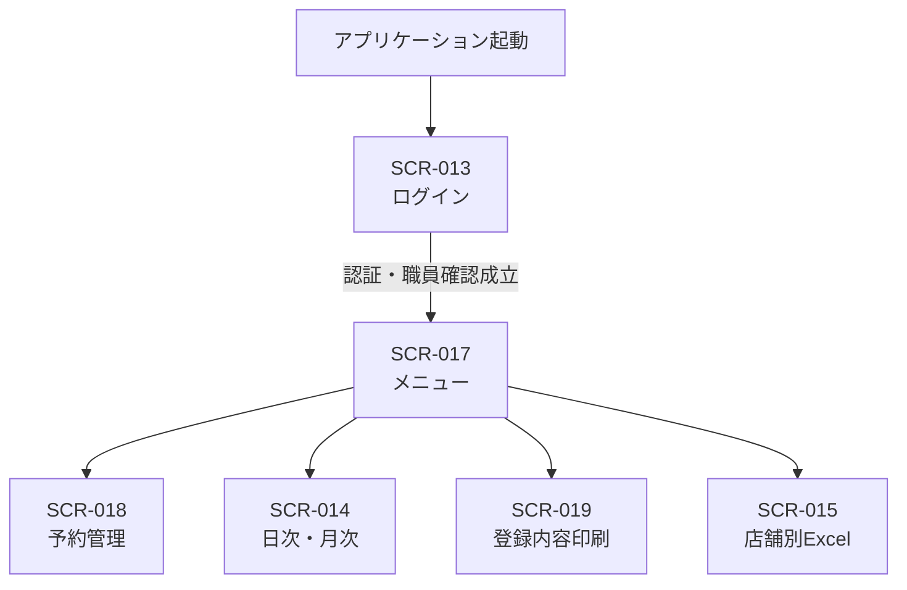

予約管理または店舗別Excelで参照を開く場合は、呼出元を保持して導線サブフロー2へ進む。メニューのログアウトと共通エラーからの復帰は導線サブフロー3に示す。

**導線サブフロー2：参照の呼出しと選択結果の返却**

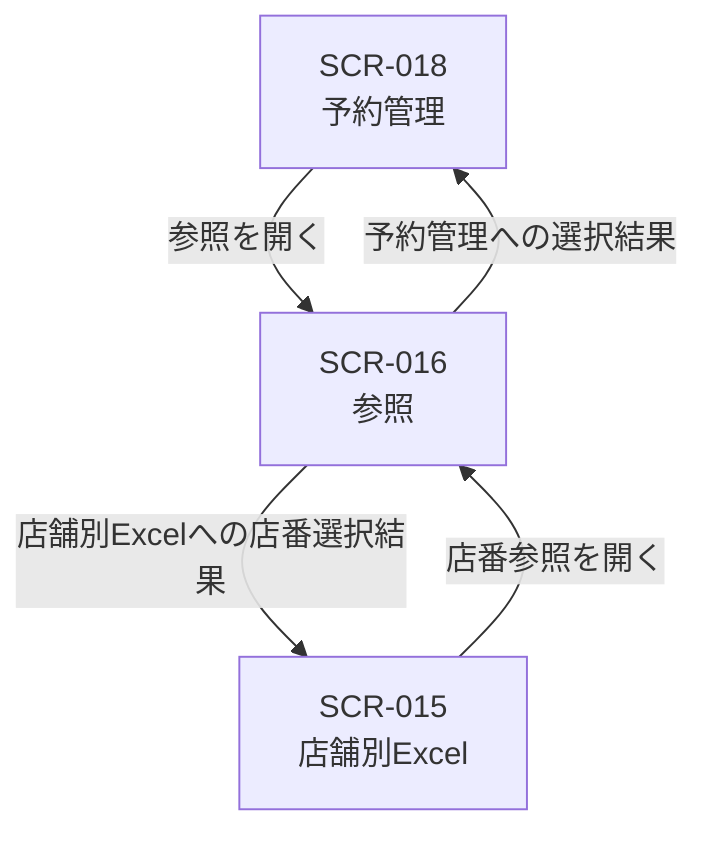

**導線サブフロー3：ログアウトと共通エラーからの復帰**

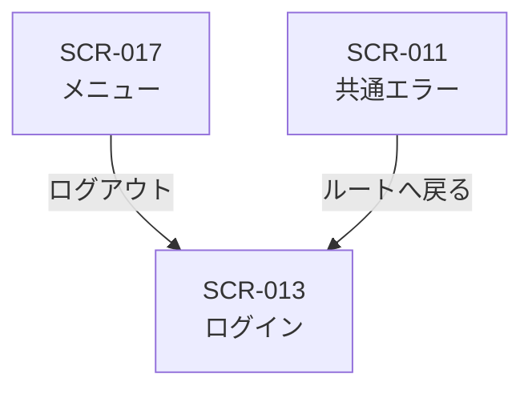

図の参照先は呼出元によって決まる。顧客参照の選択後は予約管理の読込みへ進み、店舗別Excelから開いた参照は店番・店名を返す。各業務画面の「戻る」はメニュー表示要求へ接続する。

通常要求は`POST /Action.do`へ送信する。共通コントロールサーブレットが要求識別値からActionを生成し、Actionの戻り先へforwardする。Excel・ZIPの直接出力ではforwardを抑止する。認証、年金職員確認、画面状態、業務DBの行、出力用メモリはそれぞれ別の責務と保持領域である。

本書の項目一覧は機能単位の一覧である。画面項目の型・制約・移送先、静的画面投影、SQLの全列・バインド順は、補足説明に示す基本設計・詳細仕様・共通仕様へ対応付ける。以下の関連文書IDと相対パスは計画上の対応先を示し、成果物の生成済み状態を表すものではない。

## 項目一覧

| 機能ID | 機能名・利用目的 | 通常入口 | 主な操作 | 遷移先・結果 | 業務データ操作 | 出力 | 基本設計ID | 詳細仕様ID |
| --- | --- | --- | --- | --- | --- | --- | --- | --- |
| SCR-013 | ログイン。利用者を認証し、年金業務を行う職員を確定する。 | welcome画面、アプリケーションルート | 職員番号・認証情報の送信、再ログイン | 認証・職員確認の成立時はメニュー、不成立時はログイン再表示 | 共通認証情報、職員名簿、所属等の参照。ログイン情報と年金職員情報をセッションへ設定 | ログイン画面、メニュー画面 | SCR-013 | DET-SCR-013 |
| SCR-017 | 業務メニュー。利用者が処理目的を選び、業務を開始・終了する。 | ログイン後、各業務画面の戻る | 四つの業務入口、メニュー再表示、ログアウト | 予約管理、日次・月次、登録内容印刷、店舗別Excel、ログイン | 年金職員情報の参照。未成立時は職員名簿照会が起こり得る。ログアウト時は共通属性を除去 | 職員番号・氏名と四つの入口 | SCR-017 | DET-SCR-017 |
| SCR-018 | 予約管理。顧客の予約内容を入力し、既存予約を変更・削除する。 | メニューの新規・変更・削除 | 初期表示、読込み、顧客情報取込み、登録・変更、削除、クリア、参照呼出し | 新規入力、既存予約表示、入力保持、完了後の空入力 | 年金1_LKの検索・追加・更新・削除、年金＿削除明細への追加、顧客基本表と候補表の参照 | 予約入力画面、確認・結果メッセージ | SCR-018 | DET-SCR-018 |
| SCR-016 | 店番・担当者・顧客参照。入力するコードと対象者を検索して選択する。 | 予約画面の参照・候補、Excel出力画面の店番参照 | 三モードの検索、ページ移動、選択、条件クリア、閉じる | 呼出元への値移送。顧客選択後は予約読込み | 店名テーブル、職員名簿、顧客基本表の参照。検索結果をメモリでページ分割 | 参照一覧、親画面への選択通知 | SCR-016 | DET-SCR-016 |
| SCR-014 | 日次・月次処理。指定期間・更新者の処理データを区分別に出力する。 | メニューの処理データ | 日次実行、月次実行、新規・変更・削除区分の選択 | 条件不正・全区分0件は同画面、生成ありは直接ダウンロード | 年金1_LK・年金＿削除明細の抽出。基準日がある場合は出力前に削除明細を整理 | 区分別Excel、複数時のZIP、必要時の出力結果.txt | SCR-014 | DET-SCR-014 |
| SCR-015 | 店舗別Excel出力。指定店舗の現在の予約を一覧ファイルにする。 | メニューのEXCEL出力 | 店番入力、店番参照、出力、戻る | 入力不正・0件は条件画面、明細ありは直接ダウンロード | 年金1_LKと名称表の参照。業務表更新なし | 18列の単一シートExcel | SCR-015 | DET-SCR-015 |
| SCR-019 | 登録内容印刷。店舗範囲と並び順を指定し、予約明細を印刷する。 | メニューの印刷 | 条件指定、プレビュー作成、ブラウザー印刷、戻る | 未プレビュー、入力拒否、0件または明細ありのプレビュー | 年金1_LKと名称表の参照。業務表更新なし | 店舗別の明細プレビュー、ブラウザー印刷 | SCR-019 | DET-SCR-019 |
| SCR-011 | 共通エラー表示。共通入口で拒否された要求や捕捉したAction例外を利用者へ知らせる。 | ログイン時間切れ、運用可否拒否、Action生成・実行の共通catch | メッセージ表示、ルートへの復帰 | ログイン画面への復帰導線 | セッションのErrorMsgを参照。表示自体は業務表更新なし | 共通エラー画面 | SCR-011 | DET-SCR-011 |

## イベント仕様

### ログインと年金職員確認（SCR-013）

#### 処理概要

アプリケーション起動時のwelcome画面は`JSP/MENU/Login.jsp`である。`index.jsp`も同じ画面へforwardする。利用者が職員番号と認証情報を送信すると、共通認証の後に、ログインした職員番号を年金業務で使用できるか確認する。

#### 処理手順

**1. ログイン要求を送信する。**

　**1.1.** 画面は`DWH_USER_ID`と`DWH_PASS_WORD`を、`FUNCTION_ID=nenkin`、`VIEW_ID=Login`、`COMMAND_ID`空文字で送信する。共通認証へ渡すアプリケーション識別は`APPL_NAME=unify`、`UNIFY_FLG=0`である。

　**1.2.** 年金の`LoginAction`は、前回の年金職員情報とCSRF情報を除去してから共通ログイン処理を呼ぶ。共通処理は通常経路の認証用ユーザー値をアプリケーション名へ組み替え、認証後に入力職員番号の名簿・所属等を取得する。

**2. 共通処理の結果から戻り先を決める。**

　**2.1.** 共通処理がログインJSPを返した場合は、その戻り先を維持する。

　**2.2.** それ以外は`MenuViewAction`へ進み、年金職員確認を行う。認証済みログイン情報の職員番号をtrimし、1～8桁の数字であることを確認して、同じ番号を職員名簿へ照会する。

　**2.3.** 該当職員があれば、番号・氏名・所属店番・役職コードを`StaffContext`へ保持し、CSRF情報を用意してメニューを表示する。形式不適合または名簿不在では共通ログイン情報を除去し、年金職員情報・CSRF情報も除去してログイン画面へ戻す。

#### 処理フロー

図は共通入口の運用可否判定を通過して、年金`LoginAction`へ到達した後を示す。共通入口の拒否・例外経路は補足説明の「要求入口と応答の共通契約」に示す。

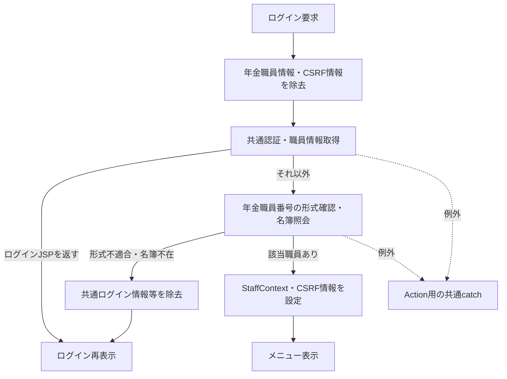

#### SQL・テーブル関連（ER図）

共通認証では認証表、職員名簿、職員所属課係一覧、役職コード表、事業所コード表を参照する。年金側は職員名簿を改めて照会する。次の図は処理上の参照関係であり、FKや多重度を表さない。

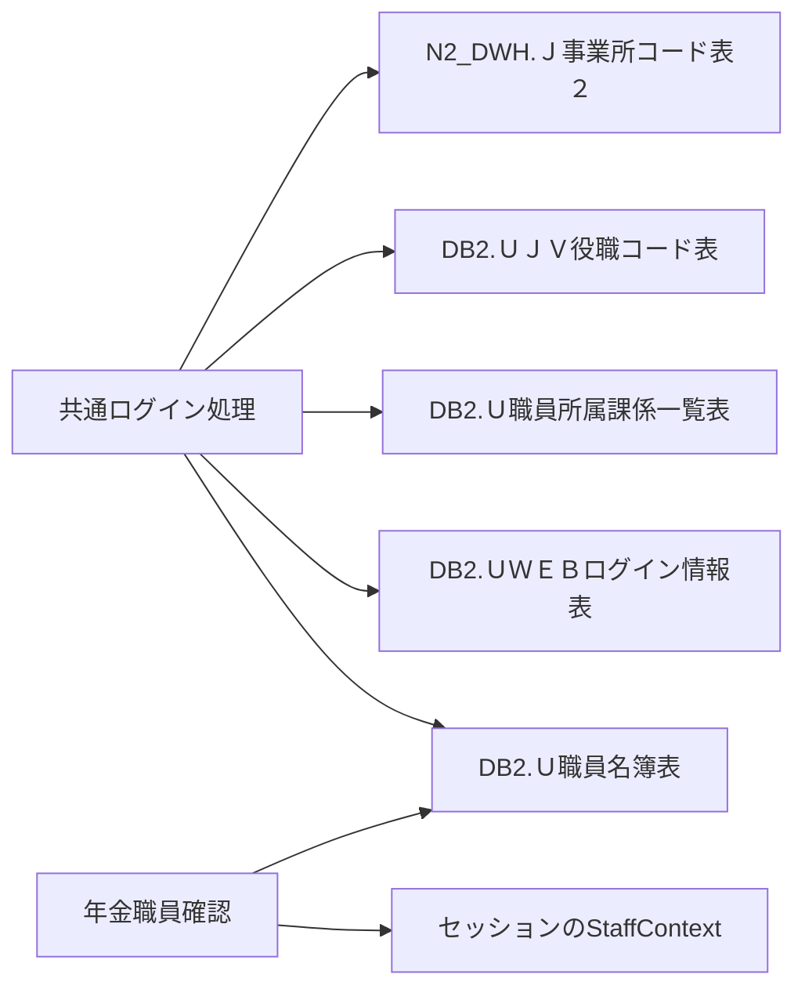

#### DB操作の詳細

共通処理は認証用値で認証表を照会し、入力職員番号から職員・所属情報を取得する。年金側は職員番号を数値引数として職員名簿を参照し、業務セッションへ移す。認証用値の組替えとSQLはCOM-015、年金職員確認の引数・結果はCOM-111、具体的なDB操作はDB-OPSに対応する。

この機能は予約本表や削除明細を更新しない。ログイン状態はセッションへ保持し、共通アクセス記録は別のトランザクションで行う。

#### 結果・例外時の扱い

共通認証の成功と年金職員情報の成立は別の結果である。職員番号の再入力画面を挟む通常手順はなく、年金側が拒否した場合はログイン画面へ戻す。

名簿取得、数値変換、メニュー用の値設定で例外が発生した場合は、通常の認証拒否と同じ戻り値になるとは限らない。Action実行中の例外は共通catchへ伝わり、その後のforwardやJSP描画で生じた例外は同catchの範囲外である。

### 業務選択・メニュー再表示・ログアウト（SCR-017）

#### 処理概要

ログイン職員を表示し、四つの業務入口を提供する。メニュー再表示は画面状態を作り直す処理であり、予約更新ではない。ログアウトは共通ログイン属性を除去してログイン画面へ戻る操作である。

#### 処理手順

**1. メニューを表示する。**

　**1.1.** `Menu/View`は年金職員情報を確認する。既存の`StaffContext`があれば再利用し、なければ認証済みログイン情報から職員確認を試みる。

　**1.2.** 成立時は職員番号を8桁表示へ整え、氏名とともに`MenuViewBean`へ設定する。四つの入口を役職条件で非表示にする分岐はない。

**2. 利用者が業務を選ぶ。**

　**2.1.** `go`関数が`VIEW_ID`と`COMMAND_ID`を選択先へ変更してフォームを送信する。予約管理は`Pension/View`、処理データは`Batch/View`、印刷は`Report/View`、店舗別Excelは`Excel/View`である。

**3. ログアウトする。**

　**3.1.** `FUNCTION_ID=common`、`VIEW_ID=Logout`、`COMMAND_ID`空文字を送信する。共通コントロールサーブレットは、属性除去前の職員番号をアクセス記録用に取得する。

　**3.2.** `common.LogoutAction`は`ViewBean`と`LoginBean`を除去し、ログインJSPを返す。セッション全体の無効化は行わず、`SubWindowBean`、年金職員情報、年金CSRF情報の除去もこのActionにはない。後二者は次の年金ログイン開始時に除去する。

#### 処理フロー

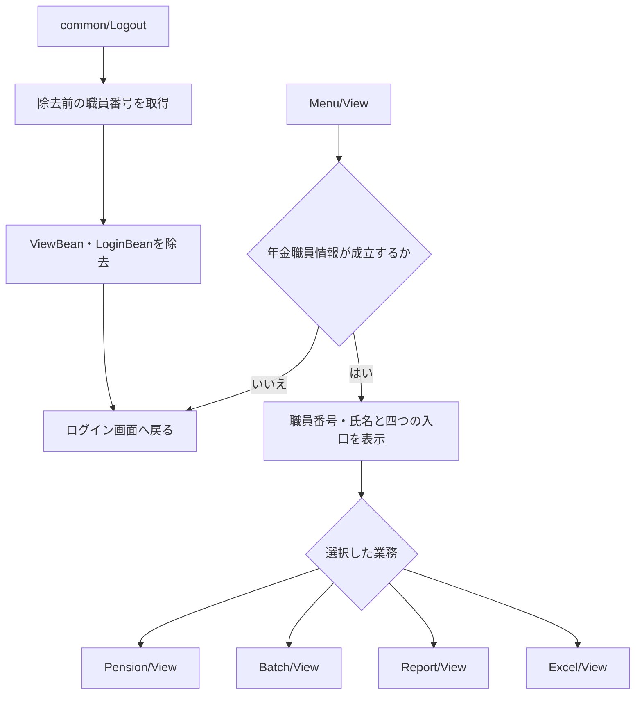

#### SQL・テーブル関連（ER図）

既存の年金職員情報を再利用する場合、メニュー本体は業務表を照会・更新しない。職員情報が未成立なら、ログイン機能に示した職員名簿参照が起こり得る。保持先は`ViewBean`と`NENKIN_STAFF_CONTEXT`であり、メニュー専用の業務表はないため独立したER図は設けない。

#### DB操作の詳細

メニュー表示、業務選択、ログアウトは予約本表・削除明細を変更しない。職員自動確認はCOM-111へ接続し、ログアウトの属性契約はCOM-015へ接続する。共通コントロールサーブレットが記録処理へ進んだ要求では、別途アクセス記録が行われる。

#### 結果・例外時の扱い

職員確認不成立時はメニューを表示せず、ログイン画面へ戻る。名簿取得等の例外は共通catchへ伝わる。ログアウト後も年金属性が残るため、ログアウトをセッション内の全情報消去として扱わない。

### 予約の入力・読込み・登録・変更・削除・クリア（SCR-018）

#### 処理概要

一つの画面で、新規予約の入力、既存予約の読込み、顧客基本情報の取込み、登録・変更、削除、画面クリアを扱う。主な入力は店舗・顧客・担当者、本人の氏名・フリガナ・性別・住所・電話番号・生年月日、年金種類、裁定請求、請求予定日・予定年齢、配偶者情報、受給有無、予約徴求日、備考、6ヶ月先確認である。

既存予約を表示するとフリガナと電話番号をreadonlyにする。データ更新日も表示上readonlyであり、保存時の値はRepositoryが当日に設定する。画面表示値をそのまま保存確定値とは扱わない。

#### 処理手順

**1. 初期表示またはクリアで新規入力状態を作る。**

　**1.1.** 職員確認後、空の`PensionReservation`と既存フラグfalseの画面状態を作る。`Pension/Clear`はこの表示処理を継承するため、入力を消しても予約行は削除しない。

**2. 予約を読み込み、なければ顧客基本情報を取り込む。**

　**2.1.** `Pension/Load`は`LOOKUP_KANA`・`LOOKUP_PHONE`をそれぞれ優先し、空の項目には現在入力のフリガナ・電話番号を使う。両者を一組として予約本表を検索する。

　**2.2.** 予約があれば全予約情報を既存状態で表示する。予約がなければ、店番と顧客番号をともに正数へ変換できる場合に顧客基本表を検索する。取得できれば新規予約用の基本情報として表示し、取得できなければ入力値を保持する。

　**2.3.** キー入力のchangeによる自動読込みは、元キーが未設定で、両入力がreadonlyではなく、フリガナと電話番号の両方がtrim後空でない場合に送信する。顧客参照の選択後もLoadを送信する。

**3. 登録・変更を行う。**

　**3.1.** 画面の確認ダイアログで取消した場合はSaveを送信しない。送信後は職員確認、要求値のモデル化、POST・CSRF照合、入力検査の順に進む。

　**3.2.** 店番、trim後のフリガナ、trim後の電話番号を必須とする。本人・配偶者生年月日、請求予定日、予約徴求日は空欄を許容し、値がある場合に日付へ変換する。備考はWindows-31Jへの変換可否と56バイト以内を検査する。この業務上限は文字数やDB容量とは別である。

　**3.3.** 入力検査で拒否する場合も、既存表示かどうかを決めるため予約照会を行ってから再表示する。続行時は現在キーと`ORIGINAL_KANA`・`ORIGINAL_PHONE`の元キーをそれぞれ照会する。

　**3.4.** 現在キーに予約があり、元予約とのキー比較が一致しなければ、その既存予約を表示して確認を求める。現在キーに予約がなく元予約があれば、キー変更を拒否して元予約を表示する。現在キーの既存予約を変更する場合、ログイン職員の所属店番が75で、役職コードが3000未満または数値化できないときは拒否する。この分岐は新規登録には適用しない。

　**3.5.** Repositoryはモデルをコピーし、検索キー・日付等を整えて保存前検査を行う。業務接続でトランザクションを開始し、キーの存在を再確認してINSERTまたはUPDATEを選ぶ。操作件数1件を確認してcommitし、正常復帰後に空入力と登録完了メッセージを表示する。

**4. 既存予約を削除する。**

　**4.1.** 確認ダイアログ後、職員確認、要求値読取り、POST・CSRF照合、店番とキーの入力検査を行う。現在キーと元キーの予約を照会し、現在予約がない場合または両者のキー比較が一致しない場合は、読込みを求めて予約画面へ戻す。

　**4.2.** 所属店番75の役職制限を確認後、Repositoryで同じキーの予約を再取得する。不在ならrollbackしてfalseを返す。存在すれば削除日・更新者等を設定して削除明細へ追加し、本表を削除する。各操作の1件検査後にcommitする。

　**4.3.** trueなら空入力と削除完了メッセージ、falseなら入力を保持した既存状態と対象不在メッセージを表示する。

#### 処理フロー

**サブフロー1：初期表示・クリア・読込み**

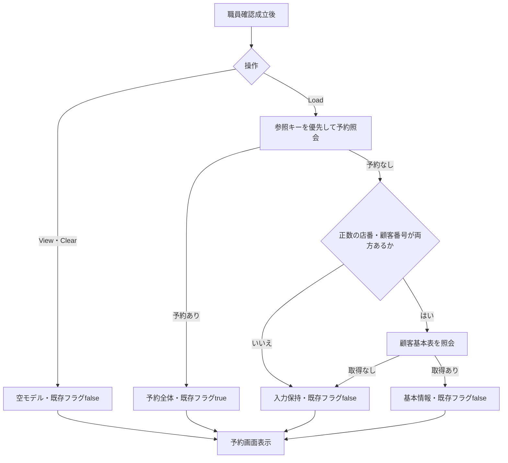

入口前の職員確認不成立はログイン画面へ戻る。図中の照会例外はサブフロー内で画面再表示へ変換せず、共通catchへ伝わる。

**サブフロー2：登録・変更**

**サブフロー2-1：受付・要求照合・入力検査**

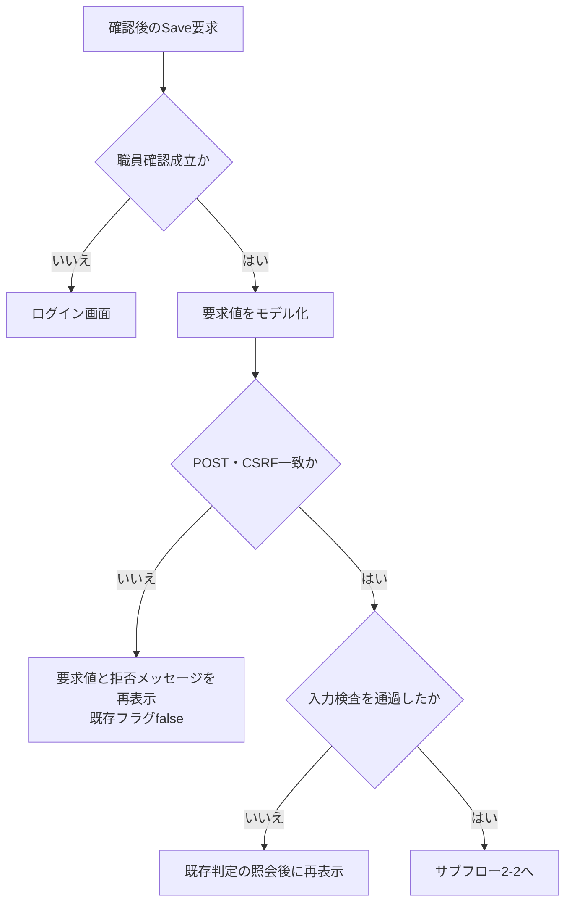

続行時は、入力検査後のモデル、要求の元キー、セッションの職員情報をサブフロー2-2へ引き継ぐ。Fでは入力モデルを保持し、現在キーの照会結果から既存フラグを決める。

**サブフロー2-2：既存予約・元キー・権限の確認**

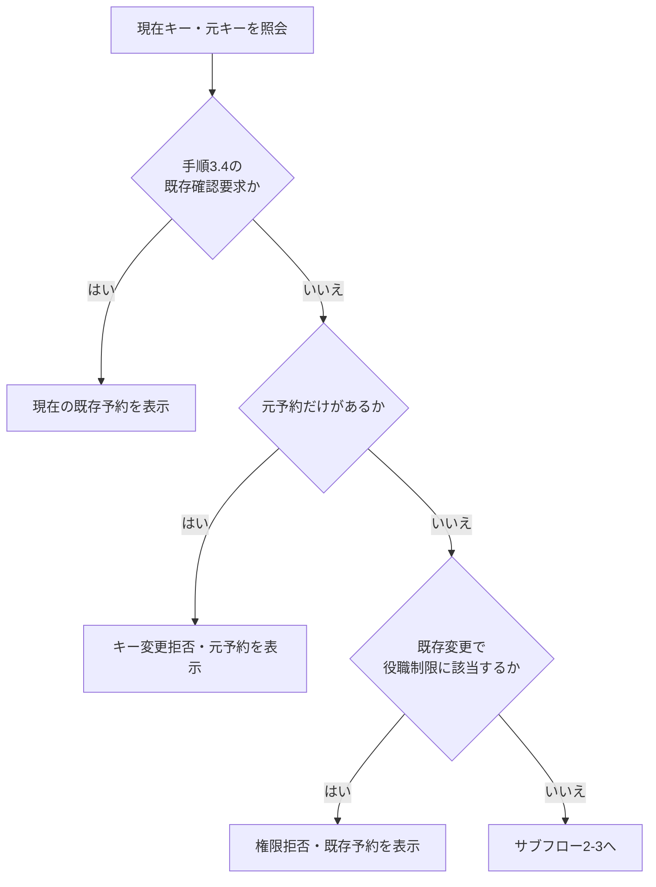

サブフロー2-3へ渡すのは検査済みの入力モデルとログイン職員番号である。ここまでの照会結果だけでINSERT・UPDATEを確定せず、Repositoryが同一接続内で存在を再確認する。

**サブフロー2-3：保存前検査・DB保存・完了表示**

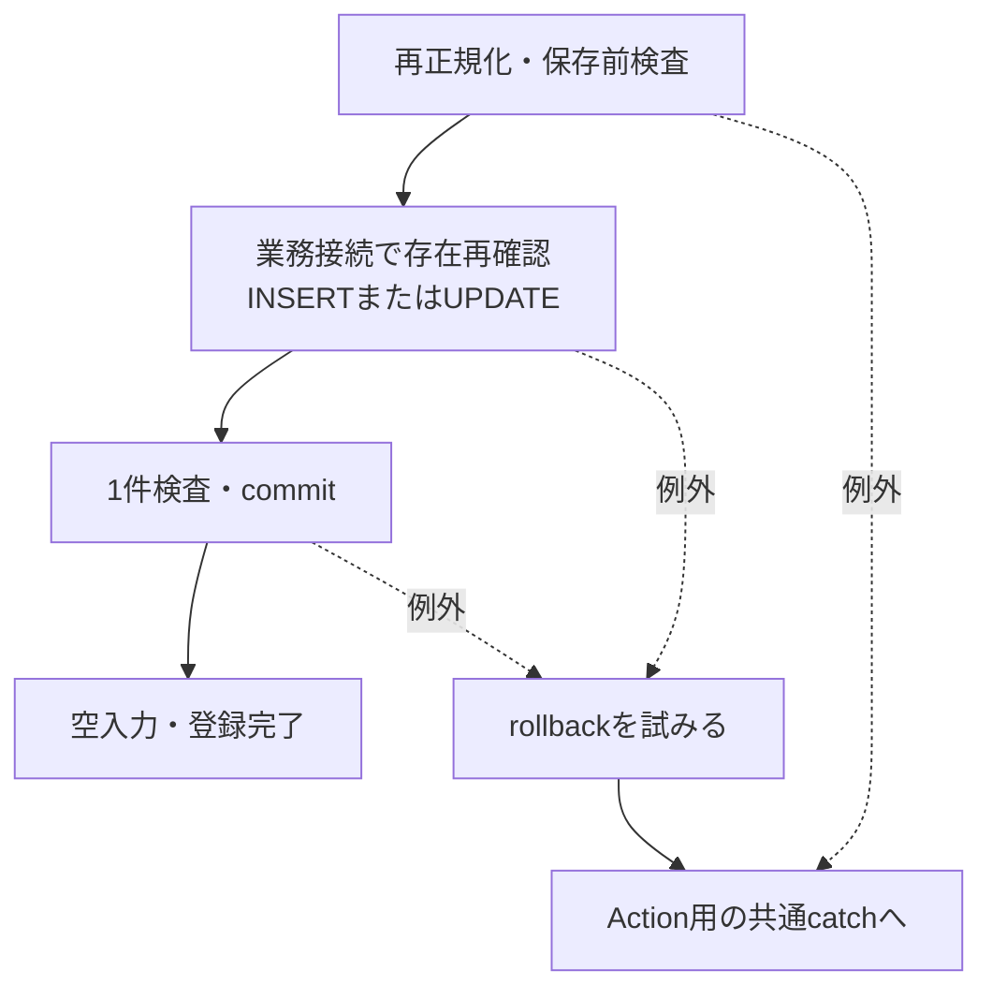

F・GのDB照会、Pの保存前検査、Q・RのDB処理の例外は、各画面再表示節点へ自動的に合流しない。SaveActionにはこれらを一律に入力エラーへ変換する個別catchがなく、共通catchへ伝わる。Repository内のトランザクション処理ではrollbackを試みる。

**サブフロー3：削除**

**サブフロー3-1：受付・要求照合・入口入力検査**

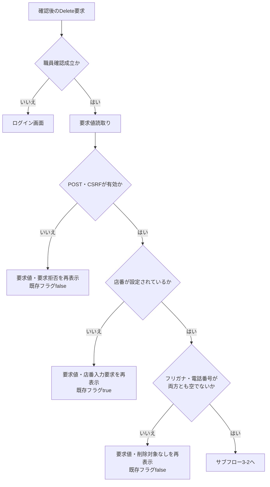

続行時は要求モデルと元キー、成立した職員情報をサブフロー3-2へ渡す。入口の拒否では、各枝に示したメッセージと既存フラグを保持して予約画面へ戻る。

**サブフロー3-2：削除対象・元キー・権限の確認**

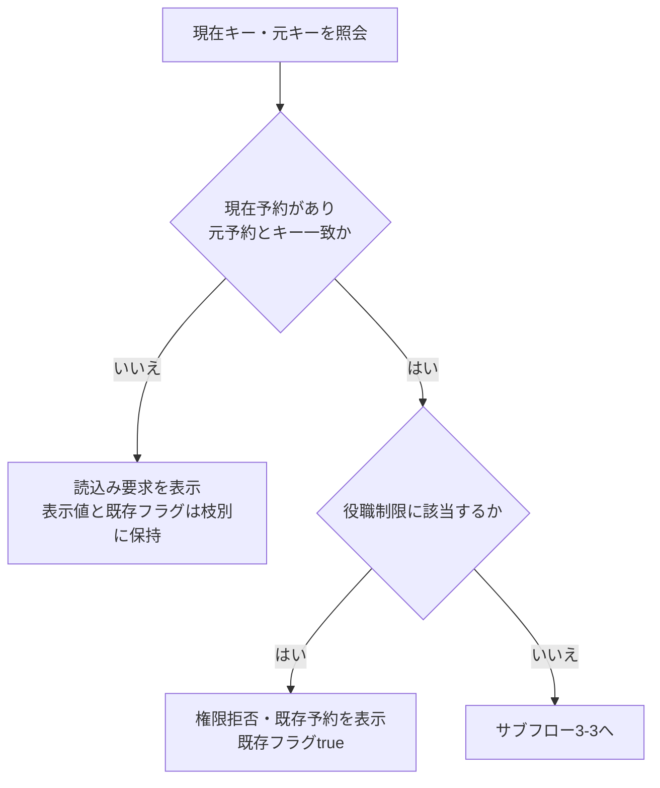

Hでは、現在予約がなければ要求モデルと既存フラグfalse、現在予約があって元キーと一致しなければ取得した既存予約と既存フラグtrueを表示する。続行時は要求モデルのフリガナ・電話番号とログイン職員番号をRepositoryへ渡し、要求モデルを結果再表示用にも保持する。

**サブフロー3-3：キー変換・対象再取得・削除確定**

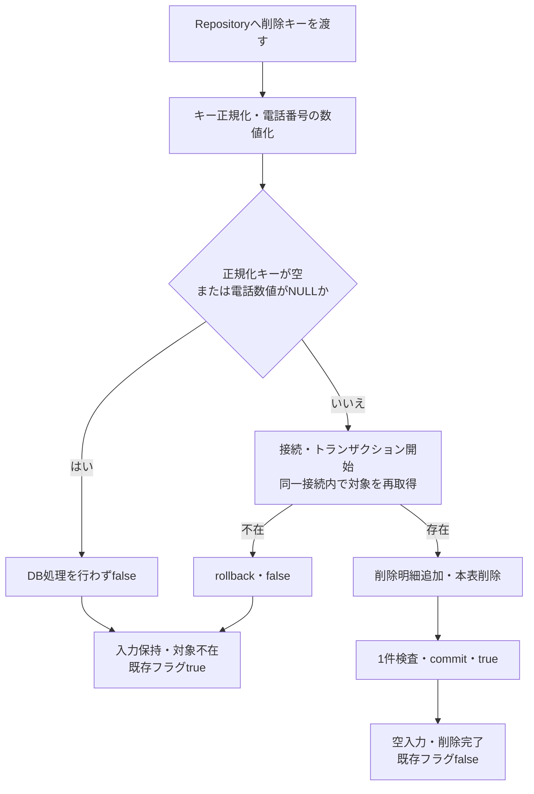

キー変換はRepositoryの接続取得用tryより前にあり、そこで例外が発生すればRepository内のrollback処理を通らず共通catchへ伝わる。K・O・Pを含むtry内の例外ではrollbackを試みて例外を送出する。キー不成立によるfalseと、再取得不在によるrollback後のfalseは、Actionでは同じ対象不在表示へ接続するが、DB処理の実施状態は異なる。

入口入力の拒否では、店番不正、キー未入力、POST・CSRF不成立によってメッセージと既存フラグが異なる。対象再取得後のfalseは、Action照会時の読込み要求とも区別する。DB処理の例外はfalseとして返さず、rollbackを試みて共通catchへ伝わる。

#### SQL・テーブル関連（ER図）

予約本表は`年金1_LK`、削除時の退避先は`年金＿削除明細`である。顧客基本表は新規用情報の取込み元であり、この操作から更新しない。店舗名と各区分名称は補足説明の「データ操作・保持領域の対応」に示す五つの表を参照する。

**関連サブフロー1：予約の表示・取込み・保存**

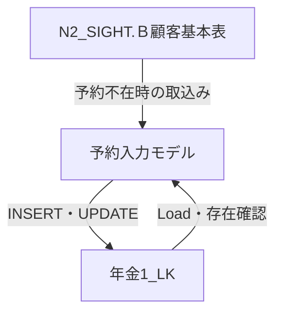

関連サブフロー1は、予約・顧客情報から作る入力モデルと保存先を示す。削除では入力モデルをそのまま退避せず、本表から再取得した削除対象を関連サブフロー2へ渡す。

**関連サブフロー2：削除対象の退避と本表からの除去**

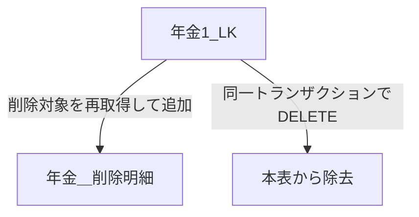

図は処理上の関係であり、顧客表とのFKや、フリガナ・電話番号のDB一意性を示すものではない。

#### DB操作の詳細

予約の検索・変更・削除は、正規化したフリガナと数値化した電話番号をキーにする。変更・削除のWHEREはこの二項目であり、画面で必須とする店番を削除WHEREへ追加する実装ではない。キーは`setString`と`setBigDecimal`でバインドする。

保存は店舗・顧客・担当者と予約内容に、当日のデータ更新日、更新時刻、ログイン職員番号による更新者を設定する。新規は変更FLGを0、変更は1とする。候補の表示名称は保存前にコードへ逆引きし、年金種類は五つの選択を1・2・4・8・16で合成してコード表の存在を確認する。空名称・種類未選択はNULL用の値となり、未知名称や存在しない種類コードはSQL例外となる。

削除では退避先への追加と本表DELETEを同一接続で実施する。保存・削除の詳細な設定列、JDBC型、NULLバインド、件数検査はDET-SCR-018およびDB-OPSへ対応する。

#### 結果・例外時の扱い

Actionのtrim後必須検査を通っても、RepositoryのNFKC正規化後にフリガナが空になる場合や、電話番号から数字を抽出できない場合がある。保存前検査は接続取得用tryの前にあり、そこで発生する`IllegalArgumentException`は同RepositoryのDB例外変換を通らず、SaveActionにも個別捕捉されない。

入力拒否の再表示に必要な既存判定の照会や、JSPでの候補再取得も失敗し得る。再表示を選択したことだけでは画面描画の完了まで保証しない。

保存・削除は共有Repositoryインスタンスの`synchronized`で同期する。比較版をWHEREに使う実装ではなく、DDLの検索キー索引も非一意であるため、複数JVMを含む重複防止や楽観ロックの保証にはならない。rollbackは試行であり、その失敗時も元の処理例外が優先される。

### 店番・担当者・顧客の参照と選択（SCR-016）

#### 処理概要

`Lookup.jsp`を三つの参照モードで共用する。`TARGET=branch`は店番、`staff`は担当者、それ以外は顧客を検索する。予約画面の「候補」は顧客参照を開く操作であり、予約本表の候補検索ではない。

#### 処理手順

**1. 呼出元の条件で参照を開く。**

　**1.1.** 予約画面からは三モードを、Excel出力画面からは店番モードを開く。「候補」では現在のフリガナ・電話番号を顧客参照の氏名・電話条件へ渡す。

　**1.2.** `Lookup/View`と`Lookup/Search`は同じ検索・表示処理へ接続する。職員確認後に検索条件とページ番号を受け取り、モードに応じた検索を行う。

**2. 検索結果を表示する。**

　**2.1.** 店番参照は検索語が正規化後空なら全店舗を対象とする。担当者参照は正数化できる店番があれば所属店番を限定し、名称条件があればカナ氏名または漢字氏名を絞り込む。顧客参照は有効な店舗・氏名・電話条件をANDで組み合わせる。空の条件は対応する絞込みを行わない。

　**2.2.** 全件取得後、メモリ上で20件ずつ切り出す。PAGEの欠落・非正数・数値変換失敗は1にする。ページ上限の補正は切出し後であり、補正したページ番号による再切出しは行わない。0件でも総ページ数は最低1となる。

**3. 選択結果を呼出元へ返す。**

　**3.1.** 選択行のdata属性から値を作り、`source=nenkin.lookup`を付けて同一originの親へ`postMessage`する。親はoriginとsourceを確認する。

　**3.2.** 予約画面の店舗選択は店番・店名、担当者選択は担当者コード・表示名を変更する。顧客選択は店番・顧客番号・表示名称・`LOOKUP_KANA`・`LOOKUP_PHONE`を設定し、モーダルを閉じてLoadを送信する。通知中の担当者コードを、この顧客選択ハンドラーが直接担当者欄へ設定する処理はない。

　**3.3.** Excel画面は店番・店名を受け取って閉じる。条件クリアは参照画面内の検索入力を空にしてPAGE=1で再検索し、親画面の選択済値は直接解除しない。「閉じる」は`target=close`を通知する。

#### 処理フロー

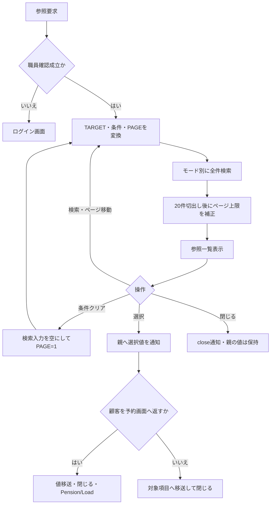

検索の例外は一覧表示へ合流せず、Action用の共通catchへ伝わる。

#### SQL・テーブル関連（ER図）

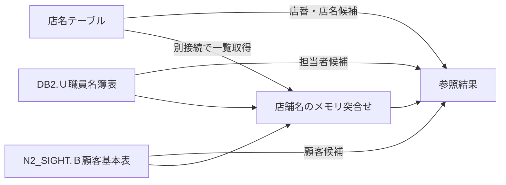

店舗名の付与は異なる接続の取得結果をメモリで突き合わせる処理であり、外部表とのSQL JOINやFKではない。

#### DB操作の詳細

店番参照は店番の文字列または店名の部分一致で検索し、店舗コード順に取得する。担当者参照は所属店番の等価条件と、カナ氏名・漢字氏名のORによる部分一致条件を必要に応じて加え、職員番号順に取得する。

顧客参照は店舗コードの等価条件、漢字氏名・カナ氏名のORによる部分一致、数字抽出後の電話条件による`TO_CHAR`した電話番号の部分一致を必要に応じて加える。順序は店舗コード・顧客番号・カナ氏名である。店番は`setInt`、検索文字列はLIKE用特殊文字をエスケープして`setString`でバインドする。

検索条件は候補抽出の制御値であり、参照先表への保存値ではない。画面ページング用のLIMIT等をSQLへ付ける処理ではなく、全件取得後に切り出す。

#### 結果・例外時の扱い

正数へ変換できない店番は検索引数のNULLとなり、店舗による限定を行わない。電話条件も数字抽出後に空なら電話による限定を行わない。入力文字列が存在することだけで検索範囲が限定されるとは扱わない。

範囲外ページでは、切出し結果が空のままページ番号だけが上限へ補正される場合がある。閉じる操作と検索条件クリアは、親画面の値の削除や予約削除を行わない。

### 日次・月次の処理データ出力（SCR-014）

#### 処理概要

日次は指定した1日、月次は開始日から終了日までを対象に、新規・変更・削除の選択区分ごとにExcelを作る。職員指定の空欄は全職員を意味し、指定した場合は予約の担当者ではなく更新者で限定する。

#### 処理手順

**1. 出力条件を用意する。**

　**1.1.** 初期表示は日次対象日を当日、月次範囲を当月初日から末日、hiddenの削除基準日を現在から2ヶ月前の日付とする。職員指定は空、三つの出力区分は未選択である。

　**1.2.** 日次実行は`Batch/Daily`、月次実行は`Batch/Monthly`を送信する。職員確認後、要求値をBeanへ保持し、POST・CSRF、区分のいずれか一つ以上の選択、職員番号の数字8桁以内を順に検査する。

**2. 期間と更新者を解決する。**

　**2.1.** 要求DTOへ値を移し、サービスが日次対象日または月次開始日・終了日を必須検査してISO日付へ変換する。月次の開始日が終了日より後なら拒否する。

　**2.2.** 職員空欄は更新者条件なしとする。サービス単体の`ALL`も全職員へ変換するが、通常Actionは数字以外を拒否するため、画面で使用できる指定値へ追加しない。

**3. 出力前の削除明細整理を行う。**

　**3.1.** 受信した`DELETE_CUTOFF_DATE`がtrim後空でなければ、基準日以下の削除明細を削除する。この基準日は実行時にサーバーで再算定せず、hiddenから受信した値を用いる。

　**3.2.** 整理は独立した接続・トランザクションでcommitする。その後に区分別抽出とファイル生成へ進む。

**4. 区分別のファイルを作り、結果を返す。**

　**4.1.** 新規・変更は現在の予約本表を変更FLG=0・1で抽出し、削除は削除明細から抽出する。期間の両端を含め、職員指定時は更新者を限定する。取得結果を店番・顧客番号・取得連番の順に並べ直す。

　**4.2.** データがある区分だけExcelを生成する。新規は17列、変更・削除は20列で、日付はAccess風和暦、担当者コードは最低2桁、確認済は「確」で表す。

　**4.3.** 生成0ファイルなら区分別0件メッセージを画面へ戻す。1ファイルならそのExcelを、複数なら日次または月次のZIPを直接返す。ZIPでは未出力区分のメッセージがあれば`出力結果.txt`を同梱する。

#### 処理フロー

**サブフロー1：受付・整理・抽出**

**サブフロー1-1：職員確認・要求検査・DTO移送**

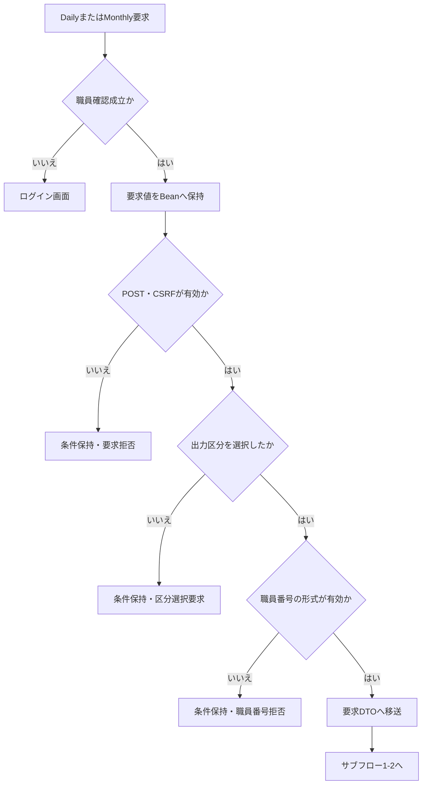

要求DTOには実行区分、日次対象日、月次開始日・終了日、職員指定、三つの出力区分、削除基準日を渡す。要求値を保持するBeanも残したまま、サービス呼出しを囲むtryへ進む。職員確認からDTO移送までは、この個別catchの外である。

**サブフロー1-2：期間解決・独立した整理・区分別生成**

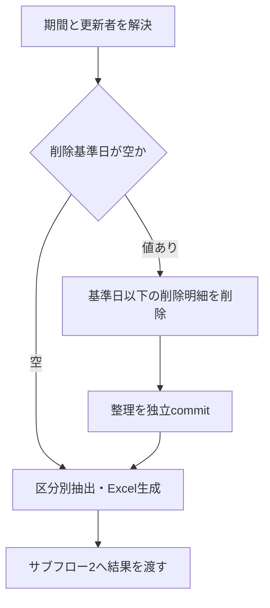

Nへ渡す値は生成ファイル一覧、各ファイルの内容、ファイル情報、0件メッセージである。整理を通った経路では、その確定済み削除状態も引き継ぐ。Gから応答送信までのtryで発生した`IllegalArgumentException`は条件保持の画面再表示へ進み、それ以外の例外は共通catchへ伝わる。

**サブフロー2：出力数による応答選択**

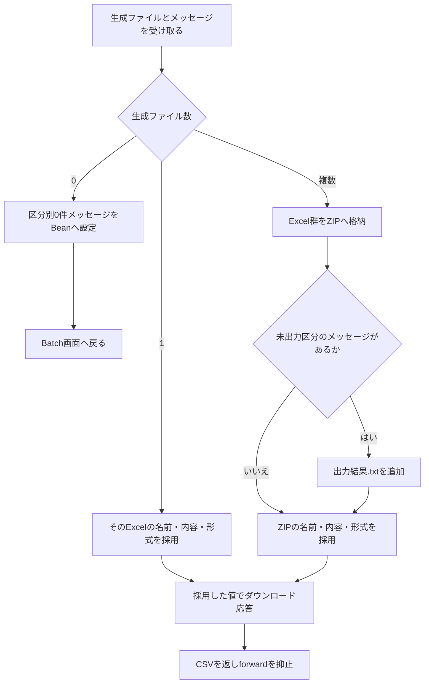

単独Excelの枝では、他区分の0件メッセージが結果オブジェクトに残っていても、画面表示や別ファイル出力へ移す処理はない。共通の送信節点Jは、ExcelとZIPそれぞれのファイル名・Content-Type・内容を引き継ぐ。

#### SQL・テーブル関連（ER図）

```mermaid
flowchart LR
    R[年金1_LK] -->|変更FLG=0| N[新規分]
    R -->|変更FLG=1| C[変更分]
    D[年金＿削除明細] --> X[削除分]
    P[受信した削除基準日] -->|更新日が基準日以下| Q[削除明細整理・独立commit]
    Q --> D
    N --> W[区分別Excel]
    C --> W
    X --> W
```

抽出時の名称取得は補足説明の五表への検索JOINに対応する。新規・変更の元は現在行であり、過去の全変更を保持する履歴表ではない。

#### DB操作の詳細

各区分はデータ更新日の下限・上限と、指定時の更新者で抽出する。SQLの取得順は更新日・更新時刻・店番・顧客番号で、サービスが出力用の順序へ並べ直す。削除明細整理は`データ更新日 <= 基準日`のDELETEであり、区分別抽出とは別の更新処理である。

出力区分、期間、職員指定は検索制御値であり、予約列へ直接保存しない。結果に付く`auditId`は取得結果へ1から付ける連番で、永続監査IDではない。Q番号を含む`queryName`もサービスが作る識別情報であり、保存クエリーやDBオブジェクト名を表さない。

#### 結果・例外時の扱い

入口検査での拒否と、サービス呼出し・ダウンロード処理を囲むtryで捕捉した`IllegalArgumentException`は、要求値を保持してBatch画面へ戻す。それ以外のDB・生成・通信例外はAction用の共通catchへ伝わる。職員確認や要求値のBean設定は、この個別catchより前にある。

削除明細整理のcommit後は、全区分0件、後続の入力例外、生成失敗、応答送信失敗が起きても、整理を含む一体rollbackにはならない。送信後の`CSV`はforward抑止の戻り値であり、CSVファイルの生成結果ではない。

### 店舗別Excelの出力（SCR-015）

#### 処理概要

店番を直接入力するか店番参照から選び、指定店舗の現在の予約を単一シートExcelに出力する。店舗名の照会は表示用であり、名称を取得できたことを出力の必須条件にはしていない。

#### 処理手順

**1. 出力対象を指定する。**

　**1.1.** `Excel/View`は空の条件画面を表示する。店番参照の選択結果は`excelBranch`と店名表示へ移送する。

　**1.2.** `Excel/Export`は職員確認後、`BRANCH_NO`をtrimしてBeanへ保持する。空値または正数Integerへ変換できない値を拒否し、その後に数字3桁以内を検査する。画面のmaxlength=3とサーバーの検査は別の制約である。

**2. 対象予約を取得して出力する。**

　**2.1.** 店舗名を表示用に照会し、指定店番の予約を取得する。0件なら店番、取得できた店名、対象なしメッセージを保持して同画面へ戻す。

　**2.2.** 明細があれば18列へ移送してメモリ上でExcelを生成する。確認済は「確」、日付はモデルの文字列を渡す。シート名は`年金ﾃﾞｰﾀ`、ファイル名は`年金データ_店番3桁_実行日8桁.xlsx`である。

　**2.3.** ダウンロード応答を書き込み、`CSV`を返してforwardを抑止する。

#### 処理フロー

```mermaid
flowchart TD
    A[Excel/Export] --> B{職員確認成立か}
    B -->|いいえ| L[ログイン画面]
    B -->|はい| C[店番をtrim・Beanへ保持・正数化]
    C --> D{空値または正数化失敗か}
    D -->|はい| E[店番入力要求を再表示]
    D -->|いいえ| F{数字3桁以内か}
    F -->|いいえ| G[形式拒否を再表示]
    F -->|はい| H[店名表示用照会・予約検索]
    H --> I{予約が0件か}
    I -->|はい| J[店番・取得済店名・0件を再表示]
    I -->|いいえ| K[18列のExcelを生成・送信]
    K --> M[CSVを返しforwardを抑止]
```

照会・生成・送信の例外は、0件再表示の枝へ合流せず共通catchへ伝わる。

#### SQL・テーブル関連（ER図）

対象は`年金1_LK`と、補足説明の名称取得用五表である。店舗名の入力確認用照会と、予約一覧の店番による検索は別の呼出しである。検索JOINの関連図は「データ操作・保持領域の対応」に示す。

#### DB操作の詳細

予約のWHEREは`R.店番 = ?`であり、正数化した店番を`setInt`でバインドする。並び順は請求予定日降順、担当者コード、顧客番号である。

出力列は顧客番号、担当、顧客氏名、ふりがな、性別、住所、電話番号、生年月日、年金種類、裁定請求、受給有無、請求予定日、予定年齢、配偶者名、配偶者生年月日、予約徴求日、備考、6ヶ月先確認である。業務表への更新や削除明細整理は行わない。

#### 結果・例外時の扱い

店名不在だけでは出力を拒否しない。0件時は条件画面へ戻り、明細ありでは直接ダウンロードする。DB例外、Workbook生成例外、送信失敗を入力不正や0件へ置き換える個別catchはない。送信処理から正常に戻っても、利用者が保存を完了したことまでは確定しない。

### 登録内容のプレビューと印刷（SCR-019）

#### 処理概要

店舗範囲と並び順で予約を検索し、店舗別の明細プレビューを表示する。印刷はブラウザーの`window.print()`を呼ぶ操作であり、サーバーPDF生成ではない。

#### 処理手順

**1. 条件画面を表示する。**

　**1.1.** `Report/View`は未プレビュー状態を表示する。店舗指定なしでは全店舗を対象とし、店番欄に残った値も検索引数へ渡さない。

**2. プレビュー条件を確認する。**

　**2.1.** `Report/Preview`は職員確認後、店舗指定の有無、店番自・至、並び順をBeanへ保持する。店舗指定ありでは正数化できる店番自を必要とする。

　**2.2.** 店番至が空または正数化できなければ店番自の1店舗とする。両方が有効なら上下限を含む範囲とし、自が至を超える場合は拒否する。

　**2.3.** 並び順は店番を先頭に、担当者コード、フリガナ、生年月日、請求予定日の四通りから切り替え、顧客番号を後続の並びに用いる。

**3. プレビューを表示して印刷する。**

　**3.1.** 検索が正常に戻れば0件でもpreview=trueとする。0件なら対象なし、明細ありなら店舗ごとの明細表を表示し、出力日時、店番・店名、並び順、件数、予約情報を示す。

　**3.2.** preview=trueでは印刷ボタンを活性にする。印刷CSSはA4横・余白8mm、操作領域非表示、店舗別改ページ、theadの繰返し、明細行内の改ページ回避を指定する。

#### 処理フロー

**サブフロー1：受付・条件保持・店舗指定の分岐**

```mermaid
flowchart TD
    A[Report/Preview] --> B{職員確認成立か}
    B -->|いいえ| L[ログイン画面]
    B -->|はい| C[条件をBeanへ保持<br/>店番を正数化]
    C --> D{店舗指定ありか}
    D -->|なし| E[検索の範囲引数をNULLにする]
    E --> Z3[サブフロー3へ]
    D -->|あり| Z2[サブフロー2へ]
```

店舗指定なしでは、Beanに保持する入力文字列と、検索へ渡す両端NULLの範囲引数を区別する。店舗指定ありでは変換後の店番自・至をサブフロー2へ渡す。いずれも並び順と画面条件を引き継ぐ。

**サブフロー2：店舗指定時の単一店舗・範囲・拒否の決定**

```mermaid
flowchart TD
    F{店番自が有効か} -->|いいえ| G[入力拒否・未プレビュー]
    F -->|はい| H{店番至が有効か}
    H -->|いいえ| I[単一店舗条件]
    H -->|はい| J{自が至以下か}
    J -->|いいえ| G
    J -->|はい| K[両端を含む店舗範囲]
    I --> Z[サブフロー3へ]
    K --> Z
```

単一店舗条件は店番自を設定し、店番至をNULLとして引き継ぐ。範囲条件は有効な店番自・至の両方を引き継ぐ。Gでは条件に応じた入力拒否メッセージを設定して画面へ戻り、検索とプレビュー成立には進まない。

**サブフロー3：検索・プレビュー成立・ブラウザー印刷**

```mermaid
flowchart TD
    A[枝別の範囲引数と並び順を受け取る] --> Q[指定順序で検索]
    Q --> R[0件でもpreview=true]
    R --> S[対象なしまたは店舗別明細を表示]
    S --> T[印刷ボタンからwindow.print]
```

検索例外はpreview=trueへ進まず、Action用の共通catchへ伝わる。JSP描画はAction復帰後の別の境界である。

#### SQL・テーブル関連（ER図）

対象は予約本表と名称取得用五表である。「データ操作・保持領域の対応」の検索JOINを使用し、印刷専用の保存表はない。出力日時や店舗別グループはプレビュー用に構成する情報であり、DB更新ではない。

#### DB操作の詳細

店舗指定なしは店番条件なし、店番自だけが有効なら等価条件、両端が有効なら上下限条件で検索する。店番のパラメータは`setInt`でバインドする。四つのORDER BYと表示移送はDET-SCR-019およびDB-OPSに対応する。

#### 結果・例外時の扱い

入力拒否時は条件とメッセージを表示し、プレビュー成立とはしない。検索正常終了後は0件でも印刷ボタンが活性となるため、印刷可能状態を明細存在の保証として扱わない。

検索時の例外と、プレビュー用JSPの描画例外は捕捉範囲が異なる。ブラウザーの印刷ダイアログ表示、取消、印刷完了をサーバーの戻り値から確定する処理はない。

### 共通エラーの表示と復帰（SCR-011）

#### 処理概要

共通ログイン時間切れ、運用可否拒否、Action生成・実行中に共通catchが捕捉した例外を通知する。各業務画面内の入力拒否とは別の戻り先である。

#### 処理手順

**1. 共通処理がエラーメッセージと戻り先を設定する。**

　**1.1.** ログイン状態の拒否または運用可否拒否では、その理由をセッションの`ErrorMsg`へ設定する。Action生成・実行のcatchへ到達した場合はアプリケーションエラーのメッセージを設定する。

**2. エラー画面を表示する。**

　**2.1.** `Error.jsp`は`ErrorMsg`をHTMLエスケープして表示する。未設定なら「処理を完了できませんでした。」を表示する。

　**2.2.** 復帰リンクはアプリケーションのルートへ向かい、welcome画面のログインへ戻る。

#### 処理フロー

```mermaid
flowchart TD
    A[ログイン時間切れ] --> M[理由別のErrorMsgを設定]
    B[運用可否拒否] --> M
    C[Action用catchへ到達] --> N[アプリケーションエラーを設定]
    M --> F[共通の後処理・forward]
    N --> F
    F --> E[ErrorMsgをエスケープして表示]
    U[ErrorMsg未設定での表示] --> D[既定文言を表示]
    E --> R[ルートへの復帰リンク]
    D --> R
    R --> L[ログイン画面]
```

図は共通後処理とforwardが正常に進む場合の遷移である。各理由を同一のエラー内容へ置き換えるものではない。

#### SQL・テーブル関連（ER図）

表示時の保持領域はセッションの`ErrorMsg`であり、業務DBを使用しないためER図は設けない。エラーへ至る前に実施した業務更新の確定状態は、発生元の処理に従う。

#### DB操作の詳細

Error.jsp自体は予約本表・削除明細を読書きしない。共通アクセス記録の実施条件と独立トランザクションはCOM-012へ対応する。

#### 結果・例外時の扱い

識別値の参照・加工、運用判定、ログアウト前の利用者識別取得、Action実行後の処理、JSP forwardは、Action用catchと同じ捕捉範囲にはない。これらの失敗や直接出力開始後の失敗が、常にこの画面へ表示できるとは扱わない。

## 補足説明

### 要求入口と応答の共通契約

通常フォームの要求識別値を次に示す。空文字はフォームから送る値であり、パラメータ欠落と区別する。

| 操作 | FUNCTION_ID | VIEW_ID | COMMAND_ID | 接続先 |
| --- | --- | --- | --- | --- |
| ログイン | nenkin | Login | 空文字 | nenkin.LoginAction |
| メニュー表示 | nenkin | Menu | View | MenuViewAction |
| 予約管理 | nenkin | Pension | View、Load、Save、Delete、Clear | 各コマンドのPension系Action |
| 参照 | nenkin | Lookup | View、Search | LookupViewAction、LookupSearchAction |
| 日次・月次 | nenkin | Batch | View、Daily、Monthly | BatchViewAction、BatchDailyAction、BatchMonthlyAction |
| 店舗別Excel | nenkin | Excel | View、Export | ExcelViewAction、ExcelExportAction |
| 登録内容印刷 | nenkin | Report | View、Preview | ReportViewAction、ReportPreviewAction |
| ログアウト | common | Logout | 空文字 | common.LogoutAction |

共通コントロールサーブレットは受信文字コードをWindows-31Jに設定する。通常経路ではFUNCTION_IDを小文字化したパッケージ名とVIEW_ID・COMMAND_IDを連結し、Actionクラス名を作る。Login以外では共通ログイン状態を確認し、運用可否判定を経てActionを生成・実行する。

運用可否処理は業務パッケージの判定前に共通接続を取得する。nenkinは運用状態表を照会する対象分岐に含まれないが、接続取得失敗では拒否となり得る。年金に状態表チェックがないことを、接続障害の影響を受けない保証にはしない。

**共通サブフロー1：Action実行前から実行結果まで**

```mermaid
flowchart TD
    A[通常POST要求] --> B[Windows-31J設定・識別値取得]
    B --> C[FUNCTION_ID小文字化・VIEW_ID参照]
    C -.->|欠落等で例外| X[Action用catchの外へ伝播]
    C --> D{Login要求か}
    D -->|いいえ| E{共通ログイン成立か}
    E -->|いいえ| F[時間切れの共通エラーを選択]
    D -->|はい| G[Logout時は除去前の利用者識別を取得]
    E -->|はい| G
    G --> H{運用可否}
    H -->|拒否| I[運用拒否の共通エラーを選択]
    H -->|許可| J[Action生成・perform実行]
    J -->|正常復帰| K[Actionの戻り値を保持]
    J -->|Exception捕捉| N[アプリケーションエラーを選択]
    F --> Z[共通サブフロー2]
    I --> Z
    K --> Z
    N --> Z
```

Cの例外は識別値を業務エラーとして検査した結果ではなく、Action用tryへ入る前の失敗である。Gや運用判定もAction用catchの外にあり、運用判定内部の例外処理は別に存在する。

**共通サブフロー2：記録と最終出力の選択**

```mermaid
flowchart TD
    A[戻り値と理由別の状態を受け取る] --> B[アクセス記録用の識別情報を取得]
    B --> C{MESSAGE属性があるか}
    C -->|あり| D[記録JSP名をSubMessage.jspにする]
    C -->|なし| E[記録JSP名に実戻り値を使う]
    D --> F[CounterShiftを別接続で記録]
    E --> F
    F --> G{戻り値がJSPへのforward対象か}
    G -->|はい| H[元の戻り先へforward]
    G -->|CSV・PDF・NULL| I[forwardしない]
    H -.->|描画・forward例外| X[Action用catchの外]
```

`MESSAGE`がある場合に変更するのはアクセス記録上のJSP名であり、実際の戻り先ではない。旧`SubMessage.jsp`を通常の独立画面遷移として追加しない。

CounterShiftは`DB2.Ｕカウンターシフト`へ識別値・日時等をINSERTし、独立commitする。失敗時はrollbackを試みてログを出し、呼出元へ再throwしない。業務表非更新の画面操作と、共通アクセス表への書込みを区別する。

ダウンロードは応答をresetし、Content-Type、Content-Disposition、Content-Lengthを設定してbyte配列をwrite・flushする。戻り値`CSV`は共通サーブレットのforward抑止値であり、年金のExcel・ZIP・JSONをCSV形式へ変換するものではない。直接出力開始後やJSP描画中の最終応答は、Action内の戻り先選択だけでは確定しない。

### データ操作・保持領域の対応

| 対象 | 用途と保持範囲 | 主な使用機能 |
| --- | --- | --- |
| LoginBean | 共通認証結果と利用者情報をセッションに保持 | ログイン、共通要求受付、ログアウト |
| NENKIN_STAFF_CONTEXT | 職員番号・氏名・所属店番・役職コードを保持。既存値があれば年金職員確認で再利用 | メニューおよび年金各Action |
| NENKIN_CSRF_TOKEN | 年金職員確認時に用意し、接続された変更系要求で照合 | 予約Save・Delete、BatchのDaily・Monthly |
| ViewBean | 本体画面の入力・表示・メッセージ等。画面ごとに対応Beanを設定 | メニュー、予約、日次・月次、店舗別Excel、印刷 |
| SubWindowBean | 参照条件、ページ、候補一覧。ViewBeanと別のセッション属性 | 三モード参照 |
| PensionReservation | Integerの数値項目、Stringの文字・日付項目、booleanの選択状態を持つ画面・業務モデル | 予約、印刷、Excel・処理データ出力 |
| メモリ上のbyte配列 | WorkbookまたはZIPの生成結果。DB行や利用者の保存済みファイルとは別 | 店舗別Excel、日次・月次 |
| 年金1_LK | 現在の予約。新規・変更の出力元でもある | 予約管理、印刷、店舗別Excel、日次・月次 |
| 年金＿削除明細 | 削除対象を退避し、削除分出力と基準日による整理に使用 | 予約削除、日次・月次 |
| 店名テーブル・区分表 | 名称取得、選択候補、保存時のコード変換 | 予約、参照、印刷、各出力 |
| 外部職員・顧客表 | ログイン職員確認、担当者候補、顧客候補・基本情報取込み | ログイン、メニュー、参照、予約読込み |
| DB2.Ｕカウンターシフト | 共通アクセス記録。業務更新と別接続・別commit | 共通後処理へ進んだ要求 |

年金側の接続は業務用`RAROA_DB`、職員用`Oracle_SP2NM`、顧客用`Oracle_DWH`を分ける。DataSourceは短いJNDI名、`java:comp/env`付き名の順で探索してキャッシュする。共通認証・アクセス記録の接続契約は年金Repositoryと区別する。

予約・出力の名称取得は次の検索関係を持つ。矢印はSQL上のLEFT JOINを表し、DDLのFKや多重度を表さない。結合先が見つからない結果の名称と、保存元列のNULL属性も別の事項である。

```mermaid
flowchart LR
    R[年金1_LK または 年金＿削除明細] -->|検索時LEFT JOIN| B[店名テーブル]
    R -->|検索時LEFT JOIN| G[性別テーブル]
    R -->|検索時LEFT JOIN| C[裁定請求テーブル]
    R -->|検索時LEFT JOIN| H[受給有無テーブル]
    R -->|検索時LEFT JOIN| P[年金種類テーブル]
```

性別、裁定請求、受給有無の選択肢はコード順に取得し、画面は空選択と表示名称を使用する。保存では表示名称からコードを逆引きする。これらの読取り・変換は業務機能の共通依存であり、候補表を保守する画面機能は通常一覧へ追加しない。

予約管理の検索キーは、HTTP受信文字列、Action内のキー比較、Repository内の検索用正規化、電話番号の数値化を経る。Actionの比較とRepositoryの空白集約等は同一処理ではない。各層の値とSQL/JDBCの対応はCOM-111、DET-SCR-018、DB-OPSに接続する。

保存・削除が正常にcommitしてから、画面描画や応答送信が失敗する場合もある。DB更新の確定と、利用者が完了画面・ファイルを受け取ったことは別の境界として扱う。

### 基本設計・詳細仕様との対応

| 機能ID | 基本設計の相対パス | 詳細仕様ID | 詳細仕様の相対パス |
| --- | --- | --- | --- |
| SCR-011 | `基本設計書/基本設計書_SCR-011_エラー.md` | DET-SCR-011 | `詳細仕様書/詳細仕様書_SCR-011_エラー.md` |
| SCR-013 | `基本設計書/基本設計書_SCR-013_年金自動受取予約管理システム - ログイン.md` | DET-SCR-013 | `詳細仕様書/詳細仕様書_SCR-013_年金自動受取予約管理システム - ログイン.md` |
| SCR-014 | `基本設計書/基本設計書_SCR-014_日次 _ 月次処理.md` | DET-SCR-014 | `詳細仕様書/詳細仕様書_SCR-014_日次 _ 月次処理.md` |
| SCR-015 | `基本設計書/基本設計書_SCR-015_EXCEL出力.md` | DET-SCR-015 | `詳細仕様書/詳細仕様書_SCR-015_EXCEL出力.md` |
| SCR-016 | `基本設計書/基本設計書_SCR-016_店番参照／担当者参照／顧客参照.md` | DET-SCR-016 | `詳細仕様書/詳細仕様書_SCR-016_店番参照／担当者参照／顧客参照.md` |
| SCR-017 | `基本設計書/基本設計書_SCR-017_年金自動受取予約管理システム.md` | DET-SCR-017 | `詳細仕様書/詳細仕様書_SCR-017_年金自動受取予約管理システム.md` |
| SCR-018 | `基本設計書/基本設計書_SCR-018_新規・変更・削除.md` | DET-SCR-018 | `詳細仕様書/詳細仕様書_SCR-018_新規・変更・削除.md` |
| SCR-019 | `基本設計書/基本設計書_SCR-019_登録内容印刷.md` | DET-SCR-019 | `詳細仕様書/詳細仕様書_SCR-019_登録内容印刷.md` |

### 共通契約・データ・出力仕様との対応

| 文書ID | 相対パス | 本書から接続する責務 |
| --- | --- | --- |
| DOC-INDEX | `index.md` | 全体の文書構成と基本・詳細・共通仕様の案内 |
| SYS-ARCHITECTURE | `共通/システム分析.md` | ブラウザーからAction・サービス・接続先までの依存と寿命 |
| API-NENKIN | `共通/要求処理一覧.md` | 識別値、要求項目、HTTP method、応答形式、通常UI未使用JSON入口 |
| COM-012 | `共通/共通仕様書_COM-012_共通コントロールサーブレット.md` | 共通ログイン検査、運用可否、Action生成・catch、アクセス記録、forward |
| COM-015 | `共通/共通仕様書_COM-015_ログイン処理.md` | 共通認証用値、認証・名簿等の参照、LoginInfoBean、ログアウト |
| COM-111 | `共通/共通仕様書_COM-111_年金業務共通処理.md` | 職員確認、CSRF、役職制限、入力変換・検査、キー比較、ダウンロード |
| COM-150 | `共通/共通仕様書_COM-150_外部ライブラリを使わず、単1シートの Open XML (.xlsx) を生成する.md` | 店舗別・日次・月次で共用するWorkbook生成 |
| COM-151 | `共通/共通仕様書_COM-151_画面共通入力・通信制御.md` | 入力補助、カレンダー、確認操作、参照通信、画面・印刷CSS |
| ENV-NENKIN | `共通/設定・配置・依存仕様書.md` | welcome・Servlet登録、JNDI探索、接続・配置の契約 |
| DATA-CONTRACTS | `共通/データオブジェクト定義書.md` | フォーム値、Bean、モデル、候補、出力要求・結果の区別 |
| DB-INDEX | `共通/DBオブジェクト一覧.md` | 業務表と到達共通表の安定ID・分類 |
| DB-LOGICAL | `共通/DB仕様書/論理データ仕様書.md` | 入力・候補・検索・保存・出力における各列の意味 |
| DB-PHYSICAL | `共通/DB仕様書/テーブル定義書.md` | 型・容量・NULL・既定値・索引と環境別定義 |
| DB-OPS | `共通/DB仕様書/DB操作仕様書.md` | 全SELECT列・述語・JOIN・ORDER BY、JDBCバインド、件数・トランザクション |
| CODE-NENKIN | `共通/コード一覧.md` | コード候補、名称逆引き、年金種類合成、変更・削除・出力区分 |
| OUTPUT-NENKIN | `共通/帳票一覧.md` | 印刷、店舗別Excel、日次・月次Excel・ZIPの出力移送と形式 |

### 通常機能への採否と互換資源の対応

資源の存在、識別値によるAction生成の可能性、通常画面からの接続は別に判定する。通常導線に含めない資源も、以下の説明先へ対応を残す。

| 資源・入口 | 実装で確認できる責務 | 機能一覧への採否 | 説明先 |
| --- | --- | --- | --- |
| Staff.jsp、StaffViewAction、StaffVerifyAction、StaffClearAction | JSPには職員番号入力とVerify・Clearが残るが、三ActionはいずれもMenuViewActionへ委譲する。STAFF_NOで別の業務職員を確認しない。 | 独立した現行職員入力機能には採用しない。通常確認はログイン職員番号を使用する。JSP直接指定や反射生成の可能性とは区別する。 | COM-111、REPORT-ANALYSIS |
| StaffViewBean | コメントは旧セッションのデシリアライズ互換用と説明する。 | 互換目的の記述として扱い、現行画面利用や互換動作の成功を表さない。 | DATA-CONTRACTS、REPORT-ANALYSIS |
| PensionLookupAction | 職員確認後に要求methodを確認し、到達した非POST要求は405。POSTはキーまたは店番・顧客番号で照会し、UTF-8 JSONを直接返す。 | 通常UIからの呼出しは確認できないため独立業務機能に追加しない。要求入口として記録する。 | API-NENKIN、REPORT-ANALYSIS |
| PensionRepository.searchCandidates | 予約本表をフリガナ・電話番号の任意部分一致で検索する。 | 提供材料内では定義以外の呼出元を確認できない。画面の候補ボタンの処理として採用しない。 | DB-OPS、REPORT-ANALYSIS |
| PensionRepository.findLatestAuditType | 本表の変更FLGを優先し、本表不在時は削除明細の存在から区分を返す。 | 提供材料内では呼出元を確認できず、公開操作には採用しない。 | DB-OPS、REPORT-ANALYSIS |
| SubMessage.jsp | 共通記録処理はMESSAGEの存在により記録JSP名へ設定するが、実forward先は変更しない。 | 共通エラー画面や通常の独立メッセージ機能として追加しない。 | COM-012、REPORT-ANALYSIS |
| ControlServletのGET旧PDF経路 | 通常GETでは旧PDF処理へ接続する分岐がある。 | 年金の登録内容印刷へ対応付けない。年金印刷はReport.jspのブラウザー印刷として採用する。 | COM-012、API-NENKIN、REPORT-ANALYSIS |
| 特殊連携、代行店舗、jhkcommon・webon等の他業務資源 | 共通基盤には別アプリや特殊連携向けの資源・分岐がある。 | 年金の四つのメニュー入口から接続する通常業務へ拡張しない。必要な共通境界と他業務資源の調査対応を残す。 | SYS-ARCHITECTURE、COM-012、COM-015、REPORT-ANALYSIS |

JSON入口の405は、そのActionへ到達し職員確認を通った非POST要求に対する処理である。通常GETが同じActionへ渡る契約ではないため、URLへのGETが一律405になる保証へ拡張しない。通常の顧客照会は参照画面と`Pension/Load`へ接続する。

REPORT-ANALYSISの計画上の文書パスは`report/解析報告.md`である。別冊の指定保存先は`agents/reverse-agent/report/20261015-nenkin-all-01`であり、納品Markdown内の生成済みリンクとしては扱わない。旧文書IDと旧資源の正確な対応が不足するものは、未確定のまま同報告へ引き継ぐ。
