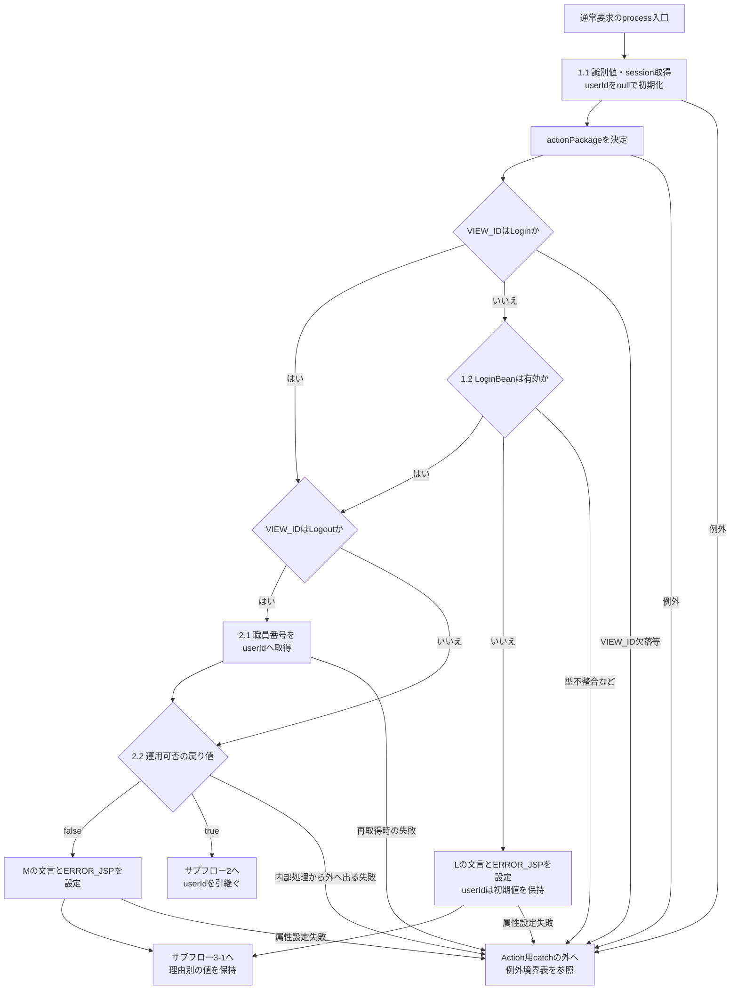
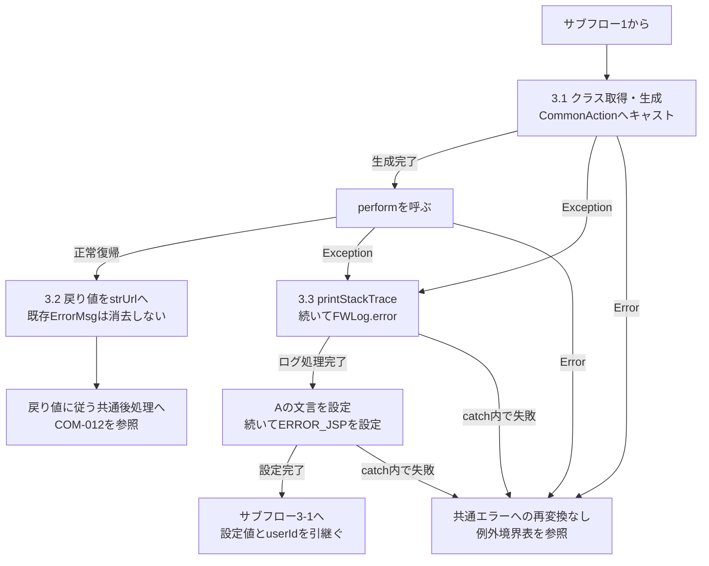
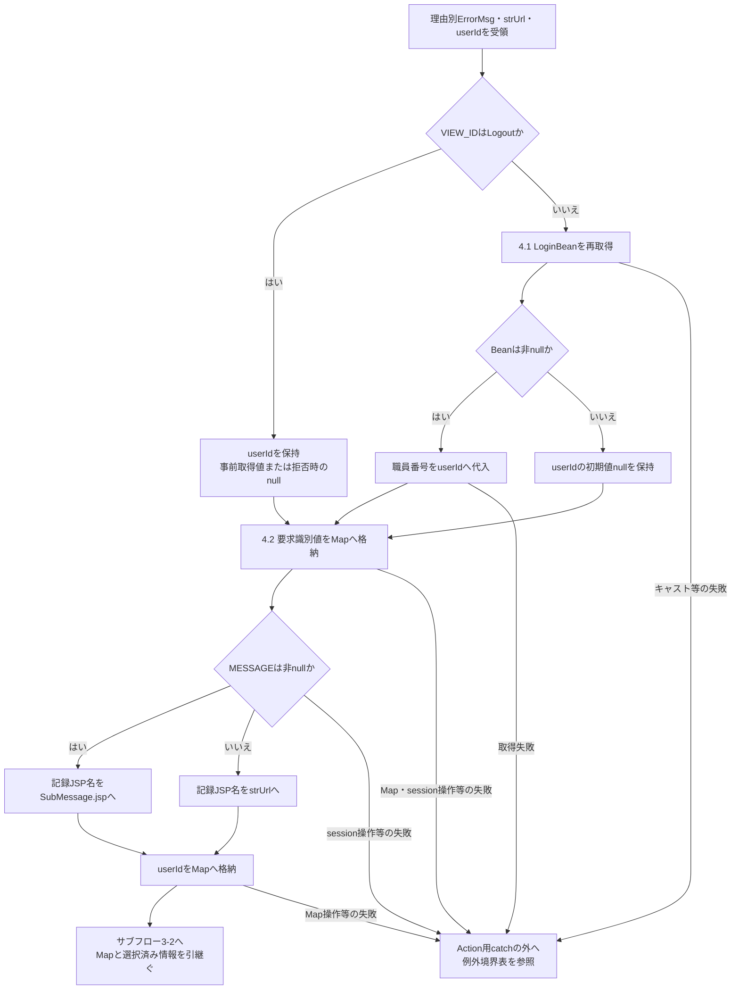
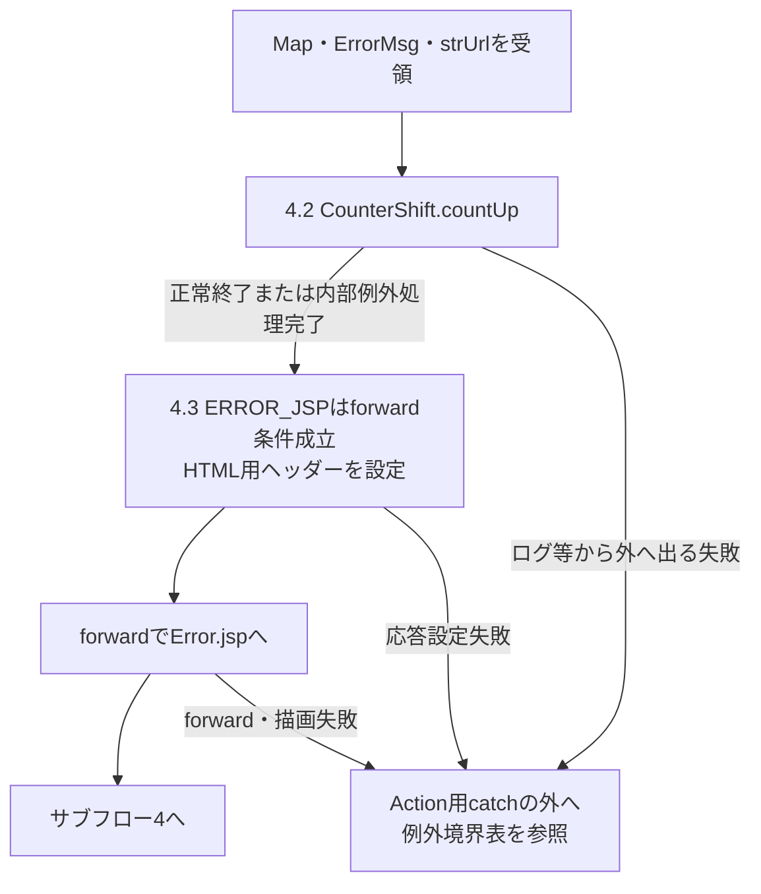
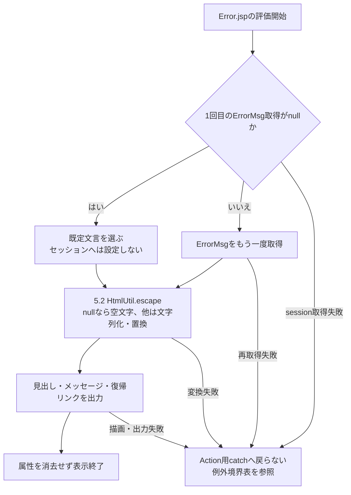
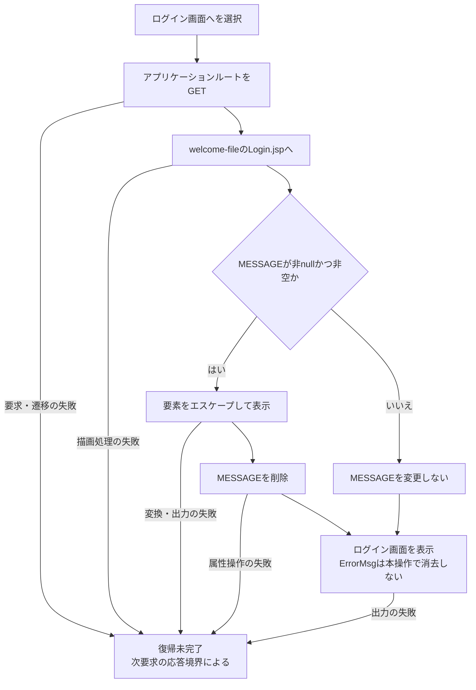

<!-- spec-meta: {"schema":"spec-md/1.0","documentId":"DET-SCR-011","version":"2.0","path":"詳細仕様書/詳細仕様書_SCR-011_エラー.md","sheets":[{"heading":"概要","kind":"GRID","sheet":"概要"},{"heading":"項目一覧","kind":"LIST","sheet":"項目一覧"},{"heading":"イベント仕様","kind":"GRID","sheet":"イベント仕様"},{"heading":"補足説明","kind":"GRID","sheet":"補足説明"}]} -->
# エラー詳細仕様

| 属性 | 内容 |
| --- | --- |
| 文書種別 | 詳細仕様書 |
| システム名 | 年金自動受取予約管理システム |
| 機能ID | SCR-011 |
| 文書ID | DET-SCR-011 |
| 版 | 2.0 |
| 解析対象 | 年金アプリケーションのError.jsp、および表示へ接続する共通制御・表示変換・アクセス記録 |
| 基準日 | 2026-10-15 |

## 概要

本画面は、共通制御が選択した処理中断の理由を表示し、利用者がログイン画面へ移動するための画面である。表示先は年金アプリケーション内の `./JSP/COMMON/Error.jsp`、ブラウザーのタイトルは「エラー」、画面見出しは「処理エラー」とする。画面自身に入力フォームや専用Actionはない。

表示元はセッション属性 `ErrorMsg` である。共通制御はログイン状態不成立、運用可否判定のfalse、Actionの生成・実行範囲から外へ出たExceptionに対して、それぞれ異なる固定文言を設定する。表示先を決定した後も、利用者識別の取得、共通アクセス記録、forward、JSP描画が続く。

本画面の責務は理由の表示と復帰先の案内である。発生元Actionの業務更新やセッション変更を共通的に復元する処理は持たない。業務画面が入力拒否を自画面へ戻す場合や、年金職員確認でログイン画面へ戻す場合は、それぞれのActionの結果分岐として扱う。

| 入口・操作 | 呼出しと対象 | 受け渡す情報 |
| --- | --- | --- |
| 共通制御からの表示 | `/Action.do` に対応する `common.ControlServlet.process` が `CommonConst.ERROR_JSP` を選択し、同じ要求をforwardする | セッションの `ErrorMsg`、要求内の `strUrl` と利用者識別情報 |
| JSPの表示処理 | `nenkin/JSP/COMMON/Error.jsp` がセッション値を読む。JSP自身には共通アクセス記録の呼出しがない | `Object` として取得した属性をエスケープ済み文字列にする |
| ログイン画面への復帰 | `a.access-button` からアプリケーションルート `request.getContextPath() + "/"` をGETする | フォーム項目や識別パラメータの送信はない |

POSTの `/Action.do` は `doPost` から `process` を呼ぶ。GETの `/Action.do` は、`OPK` と `charCommonUID` がともにない場合に旧PDF処理、それ以外で `process` を呼ぶ構成である。このGET分岐と、復帰リンクによるアプリケーションルートへのGETは別の入口である。

### 画面配置と静的投影

`body` 直下の `main.app-shell` に `section.screen.surface.compact-screen` を置き、見出し、メッセージ、復帰リンクの順に表示する。このJSPには共有ナビゲーションヘッダー、職員情報、候補領域を出力するDOMがない。各表示要素に `id`、`name`、`role` の指定はなく、装飾は実際の要素名と `class` に一致する共有CSSで決まる。

`.compact-screen` の最大幅640pxは、後方にある詳細度の高い `.screen:not(.lookup-screen-popup)` により最大1180pxへ上書きされる。上余白28pxは残り、左右余白はautoとなる。外側の `.app-shell` は幅100%、最大1440px、`main` の内側余白は上20px・左右18px・下52pxである。見出しは1.45rem、メッセージは赤系の文字・背景・枠、リンクは最小高さ42pxのボタン状表示とする。

以下は属性未設定時の文言を用いた静的投影であり、実画面の撮影ではない。元のDOM構造と該当する共有CSSを用い、復帰リンクは文書内fragmentへ置き換えている。`data-source-href` は原実装のURL構成を示す説明用属性である。他のメッセージ状態でも要素の表示・活性条件は変わらない。

<!DOCTYPE html>
<html lang="ja">
<head>
<meta charset="UTF-8">
<title>エラー</title>

</head>
<body><main class="app-shell"><section class="screen surface compact-screen">
<h1>処理エラー</h1>
処理を完了できませんでした。

<a class="access-button" href="#ログイン画面への復帰" data-source-href="{contextPath}/" data-http-method="GET">ログイン画面へ</a>
</section></main></body>
</html>

## 項目一覧

| No | グループ | 項目名 | 種類 | 入出力 | DB連携項目 | 候補取得元 | 必須 | 形式・桁 | 説明 |
| --- | --- | --- | --- | --- | --- | --- | --- | --- | --- |
| 1 | 表示 | 処理エラー | `h1`・固定見出し | O | 非DB項目 | 候補なし | 入力必須判定の対象外。常時表示 | 固定文字列「処理エラー」 | 要素にid・name・roleはない。メッセージの原因にかかわらず同じ見出しを出す。 |
| 2 | 表示 | エラーメッセージ | `div.message.error` | O | 非DB項目。セッション属性 `ErrorMsg` を表示 | 候補なし | 入力必須判定の対象外。属性がnullなら既定文言 | 取得型は `Object`、変換後は `String`。表示変換にtrim・文字数切捨て・バイト長検査はない | `CommonConst.ERROR_MSG` はキー文字列 `ErrorMsg`。要求DTO・検索列・保存列・SQLパラメータへの対応はない。空文字は既定文言にせず空表示とする。 |
| 3 | 復帰 | ログイン画面へ | `a.access-button`・通常リンク | ‐ | 非DB項目 | 候補なし | 入力必須判定の対象外。常時表示 | 表示文言は固定、遷移先は `String` のcontextPathに `/` を連結 | 利用者がリンクを選ぶとルートをGETする。フォーム値の入出力はなく、LogoutActionの送信や前画面へ戻るJavaScriptは呼ばない。 |

## イベント仕様

### 共通エラーの選択と表示

#### 処理概要

共通制御は要求識別値、共通ログイン状態、運用可否、Actionの実行結果を順に扱い、共通エラーへ進む場合にセッションの `ErrorMsg` と要求内の `strUrl` を設定する。選択理由をL・M・Aで区別する。各理由の正確な文言は「結果・例外時の扱い」に定義する。

`ErrorMsg` はHTTP入力から直接バインドする項目ではない。Actionの例外メッセージも表示値へコピーせず、共通catchでは固定文言Aを設定する。Actionが自ら捕捉したエラーや拒否を戻り値へ変換した場合は、その戻り値による処理が継続する。

#### 処理手順

**1. 要求識別とログイン状態を確認する。**

　**1.1.** `process` は要求の文字コードを `Windows-31J` に設定する。特殊連携分岐を通らない通常要求では、`FUNCTION_ID`、`VIEW_ID`、`COMMAND_ID` を、それぞれ `String functionID`、`String viewID`、`String commandID` に直接受け取る。セッションを取得し、要求内の `String userId` をnullで初期化する。`actionPackage` は `functionID.toLowerCase()` で決定する。

　**1.2.** `viewID` が `Login` 以外なら、`checkLogin(session)` で属性 `LoginBean` を `LoginInfoBean` へキャストする。Beanが非nullで `isログイン可否()` がtrueの場合に通過する。不成立なら文言Lと `ERROR_JSP` を設定し、2.・3.を通らず4.へ進む。`Login` の場合はこの検査を省き、2.へ進む。

**2. Action実行前の利用者識別と運用可否を扱う。**

　**2.1.** 1.2.を通過し、`viewID` が `Logout` の場合は、Actionより前に `LoginBean` を再取得して `get職員番号()` を `userId` へ設定する。この再取得後にはBeanのnull検査がない。ログイン拒否で2.へ来なかったLogout要求の `userId` は、初期値nullのままである。

　**2.2.** `OperatePermission.check(actionPackage)` を呼ぶ。共通接続 `jdbc/Oracle_SP2NM` の取得は業務種別の判定より前に行われる。`nenkin` は運用状態表の照会対象に含まれず、接続取得後の対象外分岐ではtrueを返す。取得・判定のtryでExceptionが生じ、内部catchとfinallyが完了して末尾へ進む場合はfalseとなる。戻り値がfalseなら文言Mと `ERROR_JSP` を設定し、3.を通らず4.へ進む。

**3. Actionを生成・実行し、範囲内のExceptionを変換する。**

　**3.1.** 運用可否がtrueなら、`actionPackage + "." + viewID + commandID + "Action"` をクラス名として `Class.forName`、`newInstance`、`CommonAction` へのキャスト、`action.perform(req, res)` の順に実行する。この範囲がAction用tryである。`CommonAction.perform` の戻り値は `String`、宣言上の送出型は `Exception` である。

　**3.2.** Actionが正常に戻れば、その値を `strUrl` へ設定する。ここには既存の `ErrorMsg` を消去する処理がない。自画面再表示や直接出力を選んだActionを、共通エラー表示へ置き換えない。

　**3.3.** 3.1.から外へ出た `Exception` は一つのcatchで処理する。`e.printStackTrace()`、`FWLog.error(e)`、文言Aのセッション設定、`strUrl = CommonConst.ERROR_JSP` の順に実行し、完了した場合に4.へ進む。`FWLog.error(Throwable)` は `errorLogger`、`logger` の順に記録する。このcatch内部に追加の保護catchはない。

**4. 選択した理由を保持して共通後処理へ進む。**

　**4.1.** `viewID` がLogout以外なら、この段階の `LoginBean` をキャストして再取得し、非nullの場合だけ職員番号を `userId` へ代入する。Beanがnullなら初期値nullを保持する。Logoutの場合は再代入せず、2.1.で取得した値、または1.2.で拒否された場合のnullをそのまま引き継ぐ。

　**4.2.** `Map mapCS` に機能ＩＤ、画面ＩＤ、コマンドＩＤ、アクションＩＤとして、それぞれ `functionID`、`viewID`、`commandID`、`viewID + commandID` を格納する。属性 `MESSAGE` が非nullなら、空のListでも記録用ＪＳＰ名を `./JSP/COMMON/SubMessage.jsp` とする。それ以外は `strUrl` を格納する。ユーザーＩＤに4.1.の `userId` を設定し、`CounterShift.countUp(mapCS)` を呼ぶ。`ErrorMsg` 本文はMapへ入れず、この記録名の選択で `strUrl` も変えない。

　**4.3.** 共通制御は `strUrl` が非null、かつ `PDF`・`CSV` のいずれでもない場合にforwardする。`ERROR_JSP` はこの条件を満たす。応答のContent-Typeを `text/html; charset=Windows-31J`、Expiresを `Sat, 01 Jan 2000 00:00:00 GMT`、cache-controlを `no-store`、Pragmaを `no-cache` に設定し、`req.getRequestDispatcher(strUrl).forward(req, res)` を呼ぶ。

**5. セッション値をHTMLとして表示する。**

　**5.1.** JSPは `session.getAttribute("ErrorMsg")` がnullなら「処理を完了できませんでした。」を選ぶ。非nullなら同じ属性をもう一度取得し、その `Object` を `HtmlUtil.escape` へ渡す。既定文言をセッションへ保存し直す処理はない。

　**5.2.** `HtmlUtil.escape(Object)` は引数がnullなら空文字、それ以外は `String.valueOf(value)` で文字列化し、`&`、`<`、`>`、二重引用符、単一引用符の順に、それぞれ `&amp;`、`&lt;`、`&gt;`、`&quot;`、`&#39;` へ置換する。trim、改行タグの生成、長さ制限は行わない。見出し、変換後のメッセージ、復帰リンクを出力し、属性を保持したまま表示を終える。

#### 処理フロー

サブフロー1は1.～2.、サブフロー2は3.、サブフロー3-1・3-2は共通エラー選択後の4.、サブフロー4は5.に対応する。図のL・M・Aは理由と文言の対応を表す。`ErrorMsg`、`strUrl`、`userId` は流入枝の値を引き継ぎ、合流点で固定値へ置き換えない。

**サブフロー1：要求識別・ログイン・運用可否**

L・Mを設定するセッション操作自体が失敗した場合も、その枝の設定完了やサブフロー3-1への到達は保証されない。運用可否の内部で処理されたExceptionは、falseを返した場合にMへ進む。内部から外へ出た失敗とは区別する。

**サブフロー2：Action用tryとcatch**

**サブフロー3-1：利用者識別と記録情報の作成**

入口はL・M・Aの設定が完了した経路であり、`strUrl = ERROR_JSP` を保持している。Logoutで既に取得した職員番号を、未取得枝のnullで上書きしない。

**サブフロー3-2：アクセス記録とforward**

`countUp` の正常終了と内部例外処理完了では、アクセス記録の確定結果が異なり得る。共通するのは戻り値がvoidで、処理が呼出元へ戻れば、選択済み `ErrorMsg` と `strUrl` のまま次へ進むことである。

**サブフロー4：表示値の決定とJSP描画**

null判定と表示値取得は一回の読取りへ固定されていない。最初が非nullでも、二回目がnullなら `escape(null)` により空表示となる。途中で別値へ変わった場合も、二回目に取得した値を変換する。

#### SQL・テーブル関連（ER図）

表示が使う領域はセッションの `ErrorMsg`、要求処理内の `String`・`Map`、JSPの文字列変換、HTML応答である。予約等の業務テーブルに対する検索・保存はないため、画面項目と業務表のER図は作成しない。

サーブレット経由では、前段の運用可否処理が共通接続を取得し、後段の `CounterShift` が `DB2.Ｕカウンターシフト` へ記録する。年金に対する運用可否の対象外分岐では、運用状態表のSELECTは実行しない。アクセス記録は単一表へのINSERTであり、本画面に起因する表間JOIN・FK関係を示す材料はないため、そのER図も省略する。接続・記録の共通契約はCOM-012へ接続する。

#### DB操作の詳細

| 処理 | 対象・操作 | 条件・移送内容 | 確定と呼出元への結果 |
| --- | --- | --- | --- |
| JSP表示 | セッションの `ErrorMsg` を読む。業務DB操作なし | 5.1.のnull判定と再取得、5.2.の表示変換 | DBのcommit・rollbackは発生しない。属性は表示後も保持する |
| 前段の運用可否 | `jdbc/Oracle_SP2NM` の接続取得 | 年金は運用状態表の照会対象外。接続取得は省略されない | 内部で処理した取得・判定のExceptionから末尾へ進む場合はfalse。接続closeのSQLExceptionはログ処理され、既に選択した戻り値自体を変更しない |
| 共通アクセス記録 | 同JNDI名から別途取得した接続で `DB2.Ｕカウンターシフト` へINSERT | アクセス日付、アクセス時刻、および4.2.の六つのMap値。ErrorMsg本文は含めない | INSERT後に独立commit。Exception時は接続が非nullならrollbackを試み、ログ出力、finallyのcloseへ進む |

共通アクセス記録では、同じ `Date` からアクセス日付を `yyyyMMdd`、時刻を `HHmmssSSS` で生成する。SQLは文字列連結した `Statement.executeUpdate` であり、PreparedStatementのパラメータ型・サイズ指定はない。`setColumun` を通る識別値とJSP名のnull・空文字はSQLのnullになるが、ユーザーＩＤは単一引用符で囲むため、Javaのnullが文字列 `'null'` として組み込まれる。INSERTにWHERE・JOIN・ORDER BY・ページングはなく、`countUp` は更新件数による成功判定を返さない。

記録処理のrollback・closeで生じたSQLExceptionも個別にログへ出す。これらのcatchとログ処理が完了すれば呼出元へ戻り、記録失敗のために `ErrorMsg` を変更したり、元例外を再throwしたりしない。ログ処理等から外へ出る失敗まで無条件に吸収する契約ではない。

commitでExceptionが生じた場合も、DB側での確定有無やrollbackの成立をvoidの戻りから判断することはできない。記録のcommitはforwardより前であり、その後のJSP描画失敗に連動して記録を取り消す処理はない。発生元Actionの業務トランザクションとも別の接続・確定境界である。

#### 結果・例外時の扱い

| 区分 | 選択条件 | 設定値・表示結果 |
| --- | --- | --- |
| L | Login以外の要求でLoginBeanがnull、またはログイン可否がfalse | `ログイン時間切れです。再度ログインしてください。` をErrorMsgへ設定する。実際の経過時間だけを判定した結果ではない |
| M | 運用可否の戻り値がfalse | `現在メンテナンス中のため画面を表示できません。` を設定する。年金では共通接続取得等の失敗からも選ばれ得るため、表示文言だけで運用状態表の保守中を確定しない |
| A | Action用tryから出たExceptionに対するcatchが設定処理まで完了 | `アプリケーションエラーが発生しました。 システム管理者に連絡してください。` を設定する。` ` はエスケープされ、画面ではタグの文字列として表示される |
| 既定表示 | JSPの最初の属性取得がnull | `処理を完了できませんでした。` を表示する。ErrorMsg属性を生成する処理ではない |
| 空表示 | 取得した属性が空文字、または非null判定後の再取得値がnull | 空のメッセージ領域を出力する。既定文言への置換は行わない |
| 残存値の表示 | 属性が保持されたまま再度JSPを表示 | その時点の取得値を変換して表示する。表示回数による消去はない |

` ` を含む文言Aも、他の値と同じエスケープ契約を通る。画面側で ` ` を補ったり、改行用HTMLとして挿入したりしない。長い文字列にもこの変換による切捨てはなく、表示領域の幅と通常のHTML/CSSによる折返しに従う。

| 失敗する段階 | Action用catchとの関係 | その段階で決まる扱い |
| --- | --- | --- |
| 識別値処理・ログイン検査 | tryの前 | FUNCTION_ID欠落では `toLowerCase()`、VIEW_ID欠落では `viewID.equals("Login")` の参照解除で例外が起こり得る。LoginBeanの型不整合も同じtryの対象外であり、L・M・A設定へ自動変換されない |
| COMMAND_ID欠落 | 事前の参照解除はない | Action実行まで進んだ場合はクラス名の文字列連結へnullが入り得る。その後のクラス取得失敗等が3.1.のExceptionならAのcatchへ進む。三識別値の欠落を同じ入力検証として扱わない |
| Logout前の利用者識別・運用可否から外へ出る失敗 | tryの前 | 2.1.のBean再取得・参照や、運用可否の内部から外へ出る失敗をAction用catchは処理しない |
| クラス取得・生成・キャスト・perform | tryの内側 | 外へ出たExceptionを3.3.で処理する。Action自身が捕捉した拒否は対象に入らず、Exceptionに含まれないErrorも捕捉しない |
| Action用catch内のログ・属性設定 | 同じcatchによる再捕捉はない | Aの文言や遷移先の設定途中で止まる可能性があり、catchへ入ったことだけで共通画面表示は確定しない |
| 利用者識別の再取得・Map生成・countUpから外へ出る失敗 | tryの後 | 既に選択したErrorMsgを別の共通文言へ設定し直す処理はない。アクセス記録の内部処理完了とは区別する |
| 応答設定・forward・JSPの属性読取り／文字列変換／出力 | tryの後 | JSP独自catchやerrorPage指定もない。描画失敗を同じAction用catchへ戻してError.jspを再表示する構造ではない |
| ダウンロード応答を開始したActionの失敗 | performから出たExceptionならcatchの対象 | Aの設定を試みても、共通エラー側にはコミット確認、応答reset、既送信データの回収がない。エラーHTMLへ切り替わることや受領完了は確定しない |

POSTの `doPost` は `process` を外側のcatchで囲まない。GETでは旧PDF呼出しと `process` 呼出しを囲む各catchがExceptionをログへ出すが、追加のエラー画面forwardやHTTP状態設定は行わない。GET分岐の準備処理やcatch内のログ処理まで、これらのcatchで保護されるわけではない。

共通エラー選択、forward準備、Error.jspには `setStatus`・`sendError` の呼出しがない。HTTP状態はこの機能のエラー理由で設定されず、先行Actionの応答設定・コミット状態、forwardの成否、コンテナーの処理に依存する。提供された `web.xml` には `error-page`、`filter`、`security-constraint` の宣言がない。

文字コードは層ごとに異なる。要求パラメータの読取り前に設定する文字コードと、共通制御がforward前に指定するHTML応答のcharsetは `Windows-31J` である。一方、Error.jspの `contentType`、`pageEncoding`、HTMLの `meta charset` は `UTF-8` を宣言している。

### ログイン画面への復帰

#### 処理概要

利用者が「ログイン画面へ」を選ぶと、アプリケーションルートへ通常のリンク遷移を行う。直前の業務画面を復元する操作や、ログアウト処理の送信は伴わない。ログイン画面の表示後に行う認証送信は別のイベントである。

#### 処理手順

**1. 復帰先を要求する。**

　**1.1.** `a.access-button` のhrefは `request.getContextPath()` に `/` を連結したURLである。ブラウザーはこのURLをGETする。Error.jspから `FUNCTION_ID`、`VIEW_ID`、`COMMAND_ID` や入力DTOを送信する処理はない。

**2. ログイン画面を表示する。**

　**2.1.** `web.xml` のwelcome-fileは `JSP/MENU/Login.jsp` である。`index.jsp` を要求した場合も、同じログインJSPへforwardする。復帰リンクが必ずindex.jspを経由するとは定めない。

　**2.2.** 復帰リンクとError.jspは `ErrorMsg`、`LoginBean`、`ViewBean` を削除せず、セッションのinvalidateも行わない。Login.jspでは別属性 `MESSAGE` が非nullかつ非空のListなら、その各要素をエスケープして表示した後に `removeAttribute("MESSAGE")` を実行する。空Listの場合はこの表示・削除ブロックへ入らない。

#### 処理フロー

図はルートからwelcome-fileへ進む経路を示す。index.jspへの要求からは、同じログインJSPへ合流する。この次要求の失敗を、前の要求のAction用catchで捕捉することはない。

#### SQL・テーブル関連（ER図）

復帰リンクとルートからログインJSPへの表示には、業務テーブルの検索・保存を行う処理がない。扱うのは遷移先URL、存続中のセッション属性、HTML応答である。表間の関連がないためER図は非該当とする。後続の認証送信で行うDB操作はログイン処理の責務である。

#### DB操作の詳細

本操作にSQL、検索条件、保存列、JDBCパラメータはない。リンク先は `/Action.do` ではなくルートであり、このリンク操作のコードに `CounterShift.countUp` の呼出しはない。Login.jspによる非空 `MESSAGE` の消去は、セッション操作として区別する。

#### 結果・例外時の扱い

要求と描画が完了するとログイン画面が表示される。これによりErrorMsgの消費やログアウトが成立する仕様ではない。ログイン情報の再作成、年金職員情報・CSRF情報の変更は、後続のログインAction等の契約で判断する。

復帰先の要求・描画が失敗しても、前のError.jspやAction用catchへ戻す処理はない。最終応答はその次要求の処理境界に従う。単なるリンク選択から、認証状態の解除や再認証成功を確定しない。

## 補足説明

### 保持情報と他のエラー表示との関係

| 情報 | 保持領域・用途 | 本画面と復帰操作での扱い |
| --- | --- | --- |
| `ErrorMsg` | HttpSession。単一の共通エラー表示値 | 共通制御のL・M・Aで上書きする。Error.jspは表示後に削除せず、正常Actionの後にも共通制御は消去しない。別の上書きやセッション終了等まで残り得る |
| `MESSAGE` | HttpSession。`CommonConst.ERROR_MSG_LIST` が指す別属性 | Error.jspは参照しない。アクセス記録名の選択では非nullだけを判定する。SubMessage.jspはListを反復表示してhistory.backの戻る操作を提供し、Login.jspは非空Listを表示した後に削除する |
| `LoginBean` | HttpSession。共通ログイン判定と記録用職員番号 | 共通制御が取得・キャストする。Error.jspと復帰リンクには削除処理がない。発生元Actionが変更した状態はそのまま引き継ぐ |
| `ViewBean`・年金職員情報・CSRF情報 | HttpSession。各業務画面と認証の保持情報 | 本画面は作り直し・消去を行わない。個別Actionによる変更や削除の有無は、当該Actionの処理結果に従う |
| `strUrl`・`userId`・`mapCS` | 要求内の変数・メモリ | セッション属性とは別物である。理由別に選んだ遷移先と枝別に取得した職員番号を後処理へ渡す |

残存するMESSAGEが非nullなら、実際のforward先がError.jspでも、アクセス記録のＪＳＰ名がSubMessage.jspとなる。記録名を実際に表示した画面や入力エラーの有無と同一視しない。

### 個別機能との結果分岐

通常画面の例として、`Excel.jsp` は `FUNCTION_ID=nenkin`、`VIEW_ID=Excel`、`COMMAND_ID=Export` をPOSTする。`ExcelExportAction` は店番の空欄・変換不成立・形式不正・対象0件を `ExcelViewBean.message` へ設定し、Beanを保持して `EXCEL_JSP` を返す。職員確認の戻り値がfalseなら `STAFF_JSP`、すなわちログインJSPを返す。いずれも、その拒否結果だけでError.jspを表示する経路ではない。

同Actionのダウンロードでは、`writeDownload` が応答reset、Content-Type・Content-Disposition・長さの設定、write、flushを行い、完了後に `CSV` を返して共通forwardを抑止する。途中のExceptionが共通catchへ届く場合は、既に開始した応答と文言Aの選択が併存し得る。このため、共通エラーの選択は、既送信データの回収、業務DBのrollback、利用者によるファイル受領完了を表さない。

### 関連文書

以下は全体計画上の関連文書であり、未生成の計画参照として示す。

| 文書ID | 相対パス・計画参照先 | 関連する責務 |
| --- | --- | --- |
| SCR-011 | [基本設計書_SCR-011_エラー.md](../基本設計書/基本設計書_SCR-011_エラー.md) | 利用者向けの表示目的、状態と復帰操作 |
| COM-012 | [共通仕様書_COM-012_共通コントロールサーブレット.md](../共通/共通仕様書_COM-012_共通コントロールサーブレット.md) | 要求処理順、共通catch、運用可否、アクセス記録とforwardの共通契約 |
| COM-015 | [共通仕様書_COM-015_ログイン処理.md](../共通/共通仕様書_COM-015_ログイン処理.md) | LoginBeanの成立・除去と認証送信 |
| COM-111 | [共通仕様書_COM-111_年金業務共通処理.md](../共通/共通仕様書_COM-111_年金業務共通処理.md) | 職員確認、HTML変換、ダウンロード応答の共通契約 |
| COM-151 | [共通仕様書_COM-151_画面共通入力・通信制御.md](../共通/共通仕様書_COM-151_画面共通入力・通信制御.md) | 実DOMに適用する共有CSSと画面側処理 |
| API-NENKIN | [要求処理一覧.md](../共通/要求処理一覧.md) | HTTP method、識別値、Actionと応答種別の対応 |
