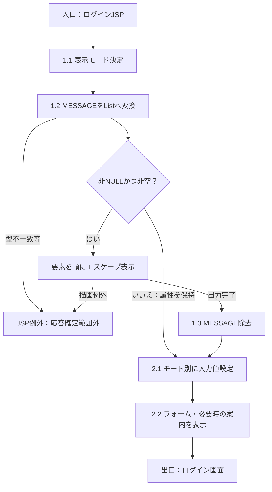
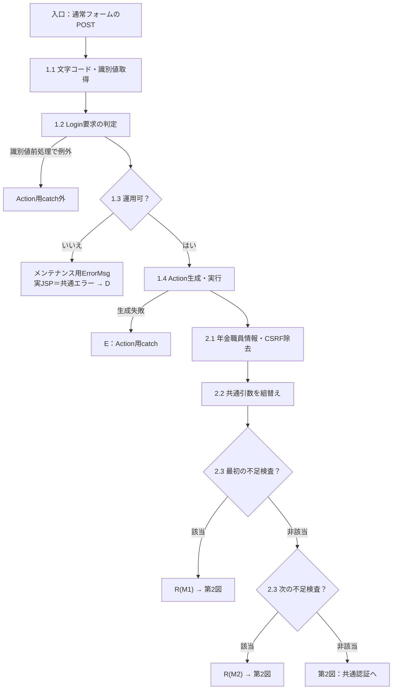
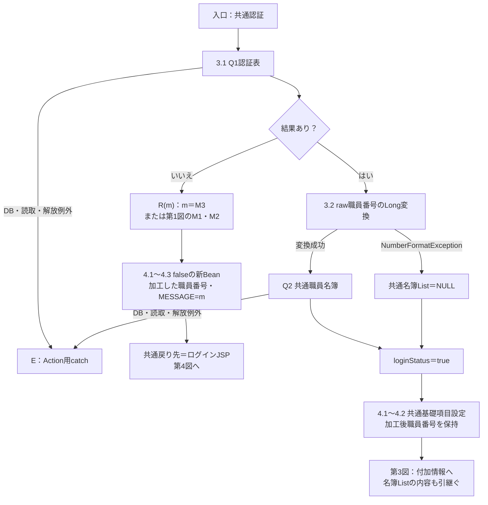
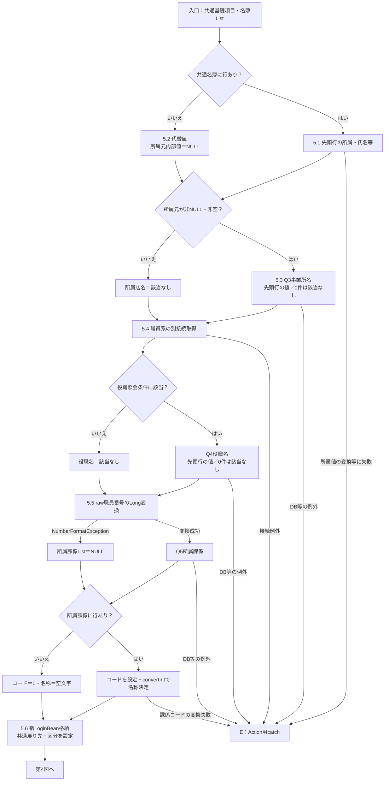
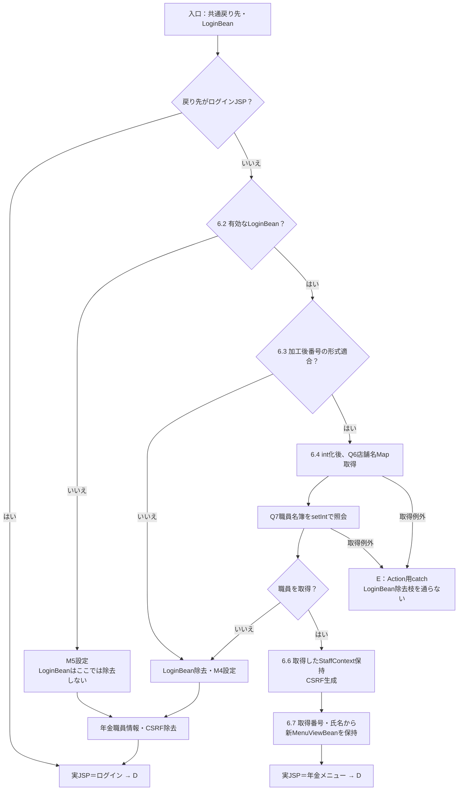
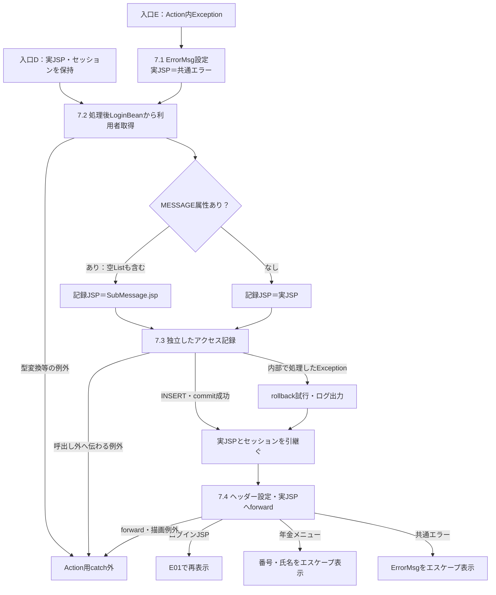
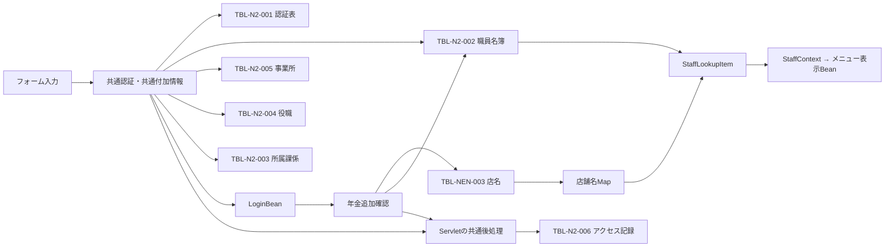

<!-- spec-meta: {"schema":"spec-md/1.0","documentId":"DET-SCR-013","version":"2.0","path":"詳細仕様書/詳細仕様書_SCR-013_年金自動受取予約管理システム - ログイン.md","sheets":[{"heading":"概要","kind":"GRID","sheet":"概要"},{"heading":"項目一覧","kind":"LIST","sheet":"項目一覧","key":["No"]},{"heading":"イベント仕様","kind":"GRID","sheet":"イベント仕様"},{"heading":"補足説明","kind":"GRID","sheet":"補足説明"}]} -->

# 年金ログイン詳細仕様

| 属性 | 内容 |
| --- | --- |
| 文書種別 | 詳細仕様書 |
| システム名 | 年金自動受取予約管理システム |
| 機能ID | SCR-013 |
| 文書ID | DET-SCR-013 |
| 版 | 2.0 |
| 解析対象 | 年金ログイン画面、年金LoginAction、および接続される共通認証・職員確認処理 |
| 基準日 | 2026-10-15 |

## 概要

職員番号とパスワードを受け付け、共通認証の後に同じ職員番号で年金業務用の職員情報を確認し、年金メニューへ引き渡す。共通認証の成功は `LoginBean` の成立、年金側の追加確認成功は `NENKIN_STAFF_CONTEXT` の成立として区別する。通常操作に職員番号の再入力画面は挟まない。

共通認証では、フォームの `APPL_NAME=unify` をアプリケーション名と認証表のユーザーＩＤの両方へ渡す。入力された職員番号は、認証表のユーザーＩＤではなく、職員名簿・所属課係の検索と、後段の年金職員確認に使う。パスワードは共通認証の検索条件へ渡し、職員情報Beanには保持しない。

| 入口 | 実装上の接続 | 結果 |
| --- | --- | --- |
| アプリケーションのwelcome表示 | `JSP/MENU/Login.jsp` | ログイン画面を直接表示する |
| `index.jsp` の表示 | 同JSPへforward | ログイン画面を表示する |
| ログインボタン | `POST {contextPath}/Action.do` → `common.ControlServlet` → `nenkin.LoginAction.perform` | 共通拒否ならログイン画面、追加確認成功なら年金メニュー、Action内の未処理Exceptionなら共通エラーを選ぶ |

フォームの送信文字コード指定は `Windows-31J`、Servletもパラメータ取得前に同じ文字コードを設定する。ログインJSP自体のpage directiveはUTF-8である。通常のボタン操作をGETへ読み替えない。ServletのGET入口は連携識別値によって旧PDF処理または `process` を選ぶ別契約である。

**画面構成と状態**

ヘッダーは `header.app-nav` の直下にシステム名と「N2 Framework」を左右配置する。カードは `main.login-shell` 内の `section.screen.surface.login-card` で、ログイン見出し、必要時のメッセージ、職員番号、パスワード、ログインボタンの順に置く。候補選択欄、職員参照ボタン、クリアボタンはない。

| 状態 | 入力欄 | メッセージ・案内 | 操作状態 |
| --- | --- | --- | --- |
| 通常表示 | 両方とも空欄 | 非空のMESSAGEがあれば表示する | 両入力は編集可能、ログインは活性 |
| 通常モードでの拒否後再表示 | 送信値を復元せず両方とも空欄 | 今回設定されたMESSAGEを表示後に除去する | 初期表示と同じ |
| ローカルDB有効時 | 原文に設定された確認用初期値を入れる | ローカル確認用案内を表示する | 両入力は編集可能、ログインは活性 |
| ローカルDB有効時の拒否後再表示 | 送信値ではなく確認用初期値へ戻る | MESSAGEとローカル確認用案内を表示する | 初期表示と同じ |

表示モードは `Boolean.parseBoolean(System.getProperty("n2nenkin.localDb","false"))` で決める。画面表示だけでDBへの接続や認証は行わない。この設定による初期表示と、接続先の初期化・実際の認証結果は別の事柄である。

**通常モードの静的投影**

以下は実画面撮影ではない。フォームのaction属性を除去し、原送信先とHTTP methodを非実行のdata属性へ保持した単独表示用HTMLである。ボタンは `type=button` とし、元のDOM階層と適用CSSを反映する。ログイン処理やJavaScriptは組み込まない。

<!DOCTYPE html>
<html lang="ja">
<head>
<meta charset="UTF-8">
<meta name="viewport" content="width=device-width, initial-scale=1">
<title>年金自動受取予約管理システム - ログイン</title>

</head>
<body class="login-page">
<header class="app-nav">
年金自動受取予約管理システム

N2 Framework
</header>
<main class="login-shell">
<section class="screen surface login-card">
<h1>ログイン</h1>
<form name="form0" data-source-action="/Action.do" data-source-method="POST" accept-charset="Windows-31J">
<input type="hidden" name="APPL_NAME" value="unify">
<input type="hidden" name="FUNCTION_ID" value="nenkin">
<input type="hidden" name="VIEW_ID" value="Login">
<input type="hidden" name="COMMAND_ID" value="">
<input type="hidden" name="UNIFY_FLG" value="0">

<label for="loginUser">職員番号</label><input id="loginUser" class="form-control code-input" name="DWH_USER_ID" maxlength="8" value="" inputmode="numeric" autocomplete="username">

<label for="loginPassword">パスワード</label><input id="loginPassword" class="form-control" type="password" name="DWH_PASS_WORD" maxlength="20" value="" autocomplete="current-password">

<button class="access-button primary" type="button">ログイン</button>

</form>
</section>
</main>
</body>
</html>

**ローカルDB有効モードの静的投影**

次の投影は認証拒否後の例である。確認用の職員番号・パスワードの実値はすべて「［非掲載］」へ置換している。この置換文字列は入力規則や初期認証値を定義するものではない。通常モードと同じく、フォームにaction属性を置かず、原送信先とHTTP methodをdata属性へ保持する。

<!DOCTYPE html>
<html lang="ja">
<head>
<meta charset="UTF-8">
<meta name="viewport" content="width=device-width, initial-scale=1">
<title>年金自動受取予約管理システム - ログイン</title>

</head>
<body class="login-page">
<header class="app-nav">
年金自動受取予約管理システム

N2 Framework
</header>
<main class="login-shell">
<section class="screen surface login-card">
<h1>ログイン</h1>

ログインに失敗しました。ユーザ名・パスワードを確認してください。

<form name="form0" data-source-action="/Action.do" data-source-method="POST" accept-charset="Windows-31J">
<input type="hidden" name="APPL_NAME" value="unify">
<input type="hidden" name="FUNCTION_ID" value="nenkin">
<input type="hidden" name="VIEW_ID" value="Login">
<input type="hidden" name="COMMAND_ID" value="">
<input type="hidden" name="UNIFY_FLG" value="0">

<label for="loginUser">職員番号</label><input id="loginUser" class="form-control code-input" name="DWH_USER_ID" maxlength="8" value="［非掲載］" inputmode="numeric" autocomplete="username">

<label for="loginPassword">パスワード</label><input id="loginPassword" class="form-control" type="password" name="DWH_PASS_WORD" maxlength="20" value="［非掲載］" autocomplete="current-password">

<button class="access-button primary" type="button">ログイン</button>

</form>

ローカル確認用：職員番号 ［非掲載］ ／ パスワード ［非掲載］

</section>
</main>
</body>
</html>

`.app-nav .app-shell` は子孫セレクターである。ログインヘッダーには `app-shell` の子要素がないため、そのflex-wrapや狭幅用widthの指定をヘッダー自身へ転用しない。職員番号欄には `.form-control` の後から `.code-input` の `width:auto` が適用される。通常時とローカルDB有効時のいずれにも `readonly`、`disabled`、`required` は付いていない。

## 項目一覧

| No | グループ | 項目名 | 種類 | 入出力 | DB連携項目 | 候補取得元 | 必須 | 形式・桁 | 説明 |
| --- | --- | --- | --- | --- | --- | --- | --- | --- | --- |
| 1 | ヘッダー | システム名 | `div.app-nav__title` | O | 非DB固定表示 | なし | 入力対象外 | 年金自動受取予約管理システム | 共通ヘッダー左側に表示する |
| 2 | ヘッダー | 基盤名 | `div.app-nav__meta` | O | 非DB固定表示 | なし | 入力対象外 | N2 Framework | ヘッダー右側に表示する |
| 3 | 本文 | 画面見出し | `h1` | O | 非DB固定表示 | なし | 入力対象外 | ログイン | カードの先頭に表示する |
| 4 | 通知 | エラーメッセージ | `div.message.error` 内の明細 | O | セッション `MESSAGE`。DB列ではない | なし | 非空Listがある場合だけ表示 | 各要素をHTMLエスケープ | 全要素出力後に属性を除去する。空Listは残る |
| 5 | ログイン入力 | 職員番号 | `input#loginUser`、`name=DWH_USER_ID` | I | 共通名簿・所属課係の職員番号条件、年金名簿の `S.職員番号` 条件。アクセス記録には処理後Beanの職員番号を使う | なし | 通常ログインで必須。NULL・厳密な空文字は共通側で拒否 | 受信 `String dwhUserId`。ブラウザー `maxlength=8`、`inputmode=numeric`。加工後は半角数字1～8桁 | 共通側はraw値を数値確認してSQLへ連結。年金側は加工後値を `int` とし `setInt(1,...)`。マスターへ保存しない |
| 6 | ログイン入力 | パスワード | `input#loginPassword`、`type=password`、`name=DWH_PASS_WORD` | I | 認証表の `パスワード` 等価条件 | なし | 通常ログインで必須。NULL・厳密な空文字は共通側で拒否 | 受信 `String dwhPassWord`。ブラウザー `maxlength=20`。通常経路にサーバー側20文字検査なし | `sPass` へそのまま渡す。trim・ハッシュ変換なし。職員Beanへ保持しない |
| 7 | 操作 | ログイン | `button.access-button.primary` | I | 認証・職員確認の開始操作 | なし | 操作時に項目5・6を検査 | 原画面は `type=submit` | `form0` をPOSTする。拒否時の再表示は入力値を復元しない |
| 8 | 送信制御 | 認証アプリケーション名 | hidden `APPL_NAME` | I | 認証表の `アプリケーション名` と `ユーザーＩＤ` の条件 | なし | 通常フォームが固定送信 | `String applName`、値 `unify` | 共通認証分岐を選び、通常時の `sUser` にもなる |
| 9 | 送信制御 | 機能識別子 | hidden `FUNCTION_ID` | I | アクセス記録の `機能ＩＤ` | なし | 通常フォームが固定送信。欠落はAction前の例外になり得る | `String functionID`、値 `nenkin` | 小文字化してActionのパッケージ名に使う |
| 10 | 送信制御 | 画面識別子 | hidden `VIEW_ID` | I | アクセス記録の `画面ＩＤ`、`アクションＩＤ` の一部 | なし | 通常フォームが固定送信。欠落はAction前の例外になり得る | `String viewID`、値 `Login` | Action名を構成し、既存ログイン状態の検査を省略する判定に使う |
| 11 | 送信制御 | コマンド識別子 | hidden `COMMAND_ID` | I | アクセス記録の `コマンドＩＤ`、`アクションＩＤ` の一部 | なし | 通常フォームは項目を存在させ空文字を送る | `String commandID`、値は空文字 | 空文字とパラメータ欠落のNULLは別。通常は `nenkin.LoginAction` を構成する |
| 12 | 送信制御 | 共通メニュー区分 | hidden `UNIFY_FLG` | I | DBへ直接保存しない。`LoginInfoBean.ＵＮＩＦＹフラグ` | なし | 通常フォームが固定送信 | `String unify_flg`、値 `0` | 共通戻り先を選ぶ。年金側は共通メニューへ直接forwardせず追加確認へ進む |
| 13 | ローカル案内 | 確認用入力案内 | `p.hint` | O | 非DB。システムプロパティによる表示制御 | なし | ローカルDB有効時だけ表示 | 案内文と確認用初期値 | 認証値の実値は本書に掲載しない |

## イベント仕様

### E01 初期表示・ログイン画面再表示

#### 処理概要

welcome表示、indexからのforward、ログイン拒否後のforwardで同じJSPを表示する。画面表示には認証や職員照会を伴わず、年金セッション属性の除去も行わない。

#### 処理手順

**1. 表示モードと通知を決める。**

　**1.1.** ローカルDB設定を読み、ヘッダーと見出しを表示する。

　**1.2.** セッションの `MESSAGE` を `List` へキャストする。非NULLかつ非空なら、各要素を `HtmlUtil.escape(Object)` で文字列化・エスケープして表示する。NULL要素は空表示となる。

　**1.3.** 全要素の出力後に `MESSAGE` を除去する。属性がNULLまたは空Listなら表示せず、除去もしない。

**2. 入力欄を作る。**

　**2.1.** 通常時は両入力を空文字にし、ローカルDB有効時は確認用初期値を設定する。要求パラメータ、`LoginBean`、以前の入力値から復元しない。

　**2.2.** 固定hidden項目とログインボタンを表示する。ローカルDB有効時だけ案内文を追加する。

#### 処理フロー

#### SQL・テーブル関連（ER図）

このJSPはDBを使用しない。通知の取得元はセッションの `MESSAGE`、入力初期値の選択元はシステムプロパティであり、ER図の対象となる表関連はない。

#### DB操作の詳細

認証・マスター検索・更新は行わない。Actionからforwardされた場合のアクセス記録はE02の後処理で既に実施されるものであり、この表示イベントが記録SQLを発行するわけではない。

#### 結果・例外時の扱い

正常描画ではフォームを表示する。通知のHTML特殊文字は `&`、山括弧、二重引用符、単一引用符をエスケープするため、メッセージ内のタグをHTMLとして実行しない。

`MESSAGE` の型不一致や要素の文字列化・描画に失敗した場合、属性除去やフォーム表示まで到達するとは限らない。Action後のforward内で生じた例外はAction用catchの外であり、同じログイン画面または共通エラー画面へ必ず再表示される契約ではない。

### E02 ログイン実行・年金メニューへの引渡し

#### 処理概要

通常フォームのPOSTを共通認証へ渡し、共通側が返した遷移先を判定する。共通拒否はログイン画面へ戻し、それ以外は `MenuViewAction` から年金職員確認を行う。追加確認に成功した場合だけ、年金職員情報、CSRF、メニュー用表示Beanを設定する。

#### 処理手順

**1. Servletで通常要求を振り分ける。**

　**1.1.** `doPost` から `process` を呼び、パラメータ取得前に `Windows-31J` を設定する。通常フォームには `Otheflg`、`OPK`、`charCommonUID` がないため通常分岐で識別値を取得する。

　**1.2.** `FUNCTION_ID.toLowerCase()` でActionのパッケージを作る。`VIEW_ID=Login` では既存ログイン状態の検査を省略する。FUNCTION_ID欠落時の小文字化、VIEW_ID欠落時の `equals` はAction用tryより前である。

　**1.3.** `OperatePermission.check("nenkin")` を呼ぶ。この処理は先に `jdbc/Oracle_SP2NM` の接続を取得するが、年金は運用状態表の照会対象に含まれない。接続取得等のExceptionでは内部でログを出してfalseを返し、Servletがメンテナンス用ErrorMsgと共通エラーJSPを選ぶ。この枝では年金LoginActionを呼ばない。

　**1.4.** 運用可なら識別値から `nenkin.LoginAction` を反射生成して実行する。COMMAND_IDがNULLなら空文字へ補正せず、クラス名の文字列連結へ入る。反射生成の失敗はAction用catchの対象となる。

**2. 年金情報を解除して共通認証へ渡す。**

　**2.1.** 年金LoginActionは `NENKIN_STAFF_CONTEXT`、続いて `NENKIN_CSRF_TOKEN` を除去する。`LoginBean`、`ViewBean`、`MESSAGE`、`ErrorMsg` は開始時に一括除去しない。

　**2.2.** `super.perform` は新しい `LoginInfoBean` を作り、要求から `dwhUserId`、`dwhPassWord`、`applName`、`unify_flg` を取得する。通常のunifyでは `sUser=applName`、`sPass=dwhPassWord` とする。

　**2.3.** 先に `sUser` または `sPass` のNULL・空文字を検査する。該当ならM1で拒否する。この検査を通った後、`applName` または `dwhUserId` のNULL・空文字ならM2で拒否する。trim前の検査であり、空白だけの入力は空文字と同じ扱いにはならない。

**3. 共通認証と最初の職員名簿検索を行う。**

　**3.1.** `jdbc/Oracle_SP2NM` でQ1を実行する。引数は `(applName,sUser,sPass)`、通常はアプリケーション名とユーザーＩＤがともに `unify` である。検索メソッドのbooleanではなく、取得ListのNULL・空を判定し、該当行なしはM3で拒否する。

　**3.2.** 認証表に行があれば、rawの `dwhUserId` を `Long.parseLong` で確認してからQ2を実行する。数値変換が失敗すると内側の `catch(NumberFormatException)` が名簿ListをNULLにして継続する。名簿0件もここでの拒否条件ではなく、共通の `loginStatus` はtrueになる。DB読取失敗はこの代替経路へまとめない。

**4. 共通Beanの基礎項目と拒否結果を設定する。**

　**4.1.** 成功・通常拒否の双方で、新Beanへログイン可否とアプリケーション名を設定する。受信職員番号がNULLまたは厳密な空文字なら職員番号を8個のゼロにし、それ以外は `getAdd0String(dwhUserId,8)` の結果を設定する。

　**4.2.** `getAdd0String` はNULLまたは大小文字を無視した文字列 `null` を空文字とし、それ以外をtrimする。空になれば空のまま返す。非空で8コード単位未満なら左にゼロを加え、8以上なら切り捨てない。数字限定検査やraw値の上限検査ではない。

　**4.3.** 共通拒否では新Beanのログイン可否をfalseとして `LoginBean` に格納し、今回のメッセージListを `MESSAGE` に格納して `./JSP/MENU/Login.jsp` を返す。年金側はこの文字列と一致するときだけ、そのまま戻る。拒否メッセージの対応は次のとおりである。

| 記号 | 判定順・条件 | MESSAGE |
| --- | --- | --- |
| M1 | 2.3の最初の検査に該当 | ユーザ名・パスワードを入力してください。 |
| M2 | 最初の検査通過後、2.3の次の検査に該当 | ログインに失敗しました。 |
| M3 | Q1の結果がNULLまたは空 | ログインに失敗しました。ユーザ名・パスワードを確認してください。 |
| M4 | 後段の年金職員番号形式不適合、またはQ7が0件 | ログイン職員番号が職員名簿に存在しません。管理者に確認してください。 |
| M5 | 後段でLoginBeanの型またはログイン可否が不適合 | ログインしてください。 |

**5. 共通成功時の付加情報を完成させる。**

　**5.1.** 共通名簿があれば先頭行を使用する。所属店番を4コード単位へ左ゼロ埋めし、先頭2文字を詳細部室店コード、次の2文字を枝番とする。その数値が100未満なら共通所属店番を `010`、それ以外なら先頭3文字とする。漢字氏名、カナ氏名、性別、役職コードを移し、所属元数値が65または70ならシステム事務統括部職員をtrueとする。

　**5.2.** 名簿がNULLまたは空なら、共通所属店番を `999`、詳細コード・枝番をそれぞれ `99`、職員氏名をraw職員番号、性別・役職コードを `0`、システム事務統括部職員をfalseにする。カナ氏名は設定せず初期NULLが残る。所属元の内部変数はNULLのままとなる。

　**5.3.** 所属元が非NULL・非空なら別の `jdbc/Oracle_DWH` 接続でQ3を実行し、先頭行の事業所名を共通所属店名へ設定する。検索しない場合または0件なら「該当なし」とする。

　**5.4.** さらに別の `jdbc/Oracle_SP2NM` 接続を取得する。役職コードがNULL・空文字・厳密な `0` 以外ならQ4の先頭行から役職名を得る。照会対象外または0件は「該当なし」とする。

　**5.5.** 同じ接続で、再びraw職員番号を `Long.parseLong` してからQ5を行う。この数値変換のNumberFormatExceptionだけは内側catchで所属課係ListをNULLとして継続する。先頭行があれば所属課係コードを設定し、`convertInt` の結果が10なら「店長席」、100なら「融資Ｍ・リレーションＧ」、600なら「事務グループ」、その他なら「その他」とする。行がなければコード `0`、名称空文字とする。`convertInt` はNULL・空文字・厳密な0を数値0にするが、その他の不正数値は再送出する。この後段の変換失敗はraw職員番号用catchに入らない。

　**5.6.** 通常unifyでは融資系ユーザーＩＤをNULL、融資系ユーザー名を役職名とし、credit専用の権限設定を行わない。新Beanを `LoginBean` へ格納し、同じBeanのＵＮＩＦＹフラグへ `0` を設定して、共通戻り先 `./JSP/MENU/Menu.jsp` を返す。

**6. 共通戻り先を判定し、年金職員情報を作る。**

　**6.1.** 年金LoginActionは共通戻り値がログインJSPと等しい場合だけ終了する。それ以外は戻り値を直接forwardせず、`new MenuViewAction().perform` を呼ぶ。共通処理が例外を投げれば、この文字列判定には到達しない。

　**6.2.** `requireStaff` は既存の正しい型のStaffContextがあれば再利用するが、今回の再ログインでは2.1で除去済みなので新規確認へ進む。`LoginBean` が `LoginInfoBean` かつログイン可否trueでなければM5を設定し、年金職員情報とCSRFを除去してfalseを返す。このM5枝にはLoginBean除去がない。

　**6.3.** Beanの職員番号をNULL→空文字・trimし、`[0-9]{1,8}` に一致する場合だけ `Integer.parseInt` して `verifyStaff(int)` へ渡す。先頭ゼロはint化で失われる。正数条件はなく、数値0も形式検査を通る。形式不適合は6.5へ進む。

　**6.4.** `verifyStaff` が呼ぶ `getStaff` は、自身のtryおよび職員接続取得より先にQ6で店舗名Mapを作る。続いて職員接続を取得しQ7を `setInt(1,staffCode)` で実行する。0件はNULL、行があれば最初の1行からStaffLookupItemを作り、職員番号・漢字氏名・所属店番・役職コードをStaffContextへ移す。読取・移送の詳細は補足説明による。

　**6.5.** 形式不適合または職員照会NULLなら `LoginBean` を除去してM4を設定する。続いて年金職員情報とCSRFを除去しfalseを返す。`MenuViewAction` は `STAFF_JSP`、実値 `./JSP/MENU/Login.jsp` を返す。DB例外はNULL結果と同じ枝へ入らない。

　**6.6.** 職員が得られた場合は `NENKIN_STAFF_CONTEXT` へ設定し、`ensureCsrfToken` を呼ぶ。非空Stringの既存値なら再利用し、それ以外なら `UUID.randomUUID().toString()` で生成する。今回のログインでは旧値を除去しているため生成経路へ進む。ログイン要求自体には `CSRF_TOKEN` がなく、`isAuthorizedMutation` も呼ばない。

　**6.7.** `MenuViewBean` を新規作成し、StaffContextの職員番号intを `String.format(Locale.ROOT,"%08d",...)` で表示文字列にし、同じContextの職員氏名とともに設定する。セッションの `ViewBean` へ格納し、`./JSP/NENKIN/Menu.jsp` を返す。メニューJSPは番号・氏名をHTMLエスケープして表示する。

**7. Action例外と共通後処理を扱う。**

　**7.1.** 反射生成またはAction実行から届くExceptionはServletのAction用catchで処理する。スタックトレースとログを出し、`ErrorMsg` にアプリケーションエラーメッセージを設定して `./JSP/COMMON/Error.jsp` を選ぶ。セッション全体を巻き戻す処理はない。

　**7.2.** 選択したJSPとセッション状態を保持したまま、Action用catchの外でLoginBeanから処理後の職員番号を取得する。Beanがなければ `userId` は初期NULLのままである。MESSAGE属性が存在すれば記録用JSP名だけを `./JSP/COMMON/SubMessage.jsp` にし、存在しなければ実際の戻り先を記録する。

　**7.3.** `CounterShift.countUp` に識別値・記録用JSP名・利用者識別を渡す。独立した接続でアクセス記録をINSERTしてcommitする。処理内Exceptionではrollbackを試みてログを出し、通常は元の画面処理へ戻る。

　**7.4.** Servletは `text/html; charset=Windows-31J` とExpires、cache-control=no-store、Pragma=no-cacheを設定し、選択済みの実JSPへforwardする。記録用のSubMessage.jspへ差し替えてforwardする処理ではない。

#### 処理フロー

以下のR(m)は4.1～4.3の共通拒否終端であり、流入元のメッセージmをそのまま保持する。Eは7.1のAction用catch、Dは選択済みJSPとその時点のセッションを引き継ぐ7.2の後処理入口を表す。図で分割した入口・出口は同一要求内の続きである。Eの捕捉範囲は反射生成と手順2～6から届くException全体であり、先行するraw職員番号用catchで処理済みのNumberFormatExceptionを含めない。

**1. 要求振分けと入力検査（手順1～2）**

**2. 共通認証・raw職員番号と共通拒否終端（手順3～4）**

**3. 共通付加情報（手順5）**

**4. 年金職員確認とメニュー準備（手順6）**

今回のログインでは旧StaffContextを除去済みである。既存Contextの再利用は、補足説明の別要求における契約として区別する。

**5. 例外選択後・通常戻り後の共通後処理（手順7）**

共通成功後の年金照会例外では、Eへ入る時点で新LoginBeanは格納済みである。図の合流点はその状態を引き継ぎ、職員不在枝の「LoginBean除去」を適用しない。7.2以降の例外もEへ戻す矢印はない。

#### SQL・テーブル関連（ER図）

ログインは複数接続による逐次照会であり、以下は引数移送とメモリ突合せの関連図である。表間のSQL JOIN、FK、多重度を表す図ではない。

#### DB操作の詳細

Q1～Q7は次の補足説明のSQL定義に対応する。認証・職員・店舗等のマスターは読取専用であり、フォーム値をこれらへ保存しない。全読取を束ねるcommit、比較版、共通読取結果と追加照会結果の一致検証はない。

共通接続はJNDI名を直接lookupし、取得Connectionへ `setAutoCommit(false)` を設定する。年金側は店舗名に `jdbc/RAROA_DB`、職員に `jdbc/Oracle_SP2NM` を使い、各通常名、`java:comp/env/` 付き名の順に探索する。DataSourceは種類別にキャッシュするが、Connection取得時にautoCommitを変更しない。

アクセス記録は `DB2.Ｕカウンターシフト` への別トランザクションである。通常要求では機能ID=nenkin、画面ID=Login、コマンドID=空文字、Action ID=Loginを渡す。日付・時刻は一つのDateから `yyyyMMdd`、`HHmmssSSS` で作る。JSP名は7.2の条件で決める。各値を文字列連結したINSERTであり、PreparedStatementの型・サイズ指定はない。

記録用の機能・画面・コマンド・Action・JSPの各値は、NULLまたは空文字ならSQL NULLにする。このため通常の空COMMAND_IDはSQL NULLとなる。一方ユーザーＩＤは別に単一引用符付きで連結するため、LoginBean不在でJavaのuserIdがNULLならSQL文字列リテラル `'null'` となり、SQL NULLや空文字と同じではない。INSERT件数を認証成功条件にする処理はなく、記録のcommit・rollbackはセッション状態へ連動しない。

#### 結果・例外時の扱い

| 到達した結果 | 選択する実JSP | セッション上の主な状態 |
| --- | --- | --- |
| M1・M2・M3の通常拒否 | ログインJSP | falseの新LoginBeanと今回のMESSAGE。年金職員情報・旧CSRFは除去済み |
| M4の追加確認拒否 | ログインJSP | LoginBean、年金職員情報、CSRFを除去。MESSAGEにM4 |
| M5の前提不成立 | ログインJSP | その枝ではLoginBeanを除去せず、年金職員情報とCSRFを除去。MESSAGEにM5 |
| 年金職員確認成功 | 年金メニューJSP | trueの新LoginBean、取得したStaffContext、新CSRF、新MenuViewBean |
| 共通処理の新Bean格納前に未処理Exception | Action用catchが共通エラーを選択 | 年金職員情報・CSRFは除去済み。従前のLoginBean・ViewBean等は残り得る |
| 共通成功後の年金店舗名・職員照会Exception | Action用catchが共通エラーを選択 | trueの新LoginBeanは残る。M4の除去処理には到達しない |
| 運用可否で拒否 | 共通エラーJSP | 年金LoginAction未実行のため、ログイン開始時の年金属性除去を行わない |

共通SELECTは、実行・結果変換だけでなくResultSetやStatementのcloseでSQLExceptionが起きてもActionへ失敗を返し得る。finallyではResultSetを先にcloseするため、そのcloseが例外になれば後続のStatement.closeまで到達する保証はない。共通Action側のConnection.closeのSQLExceptionはログへ出す。所属値のsubstring・Integer.parseIntや課係コードのconvertInt失敗は、raw職員番号用の個別catchでは処理されない。

年金側の店舗名取得失敗は「店舗名の取得に失敗しました。」、職員取得失敗は「職員の取得に失敗しました。」を持つ `NenkinDataAccessException` となる。これは原因を保持するRuntimeExceptionである。年金サービスの各close helperはExceptionを抑止し、元の取得結果または失敗を優先する。職員0件とDB障害を同じM4に置き換えるcatchはない。

共通エラーの選択は、最終HTTP応答の完了を保証しない。Action後のLoginBean取得、アクセス記録呼出し、forward、JSP描画はAction用catchの外にある。POST側にはこれらを同じエラーJSPへ変換する外側catchがなく、確認した経路に失敗別の `setStatus`・`sendError` 指定はない。共通エラーJSPはErrorMsgをエスケープし、NULLなら「処理を完了できませんでした。」と表示する。ErrorMsgやセッション全体を表示後に除去しない。

## 補足説明

**SQL定義と引数**

表中の `{...}` は説明上の文字列埋込位置であり、JDBCのパラメータではない。共通検索は値をSQLへ直接連結して `Statement.executeQuery` を呼ぶ。Q7の `?` だけが実際のバインド位置である。認証値の実値は示さない。

| SQL ID | SQLと条件の全体 | 引数・JDBC指定 | 取得結果の扱い |
| --- | --- | --- | --- |
| Q1 | `SELECT * FROM DB2.ＵＷＥＢログイン情報表 WHERE アプリケーション名 = '{applName}' AND ユーザーＩＤ = '{sUser}' AND パスワード = '{sPass}'` | 3引数ともStringを引用符付きで直接連結。型・サイズバインドなし | 全行をList化し、NULLまたは空ならM3。通常unifyでは存在判定に使う |
| Q2 | `SELECT * FROM DB2.Ｕ職員名簿表 WHERE 職員番号 = {dwhUserId}` | raw職員番号StringをLong変換確認後、引用符なしで直接連結 | 全行取得後、非空なら先頭行を共通Beanへ移送 |
| Q3 | `SELECT 事業所名 FROM N2_DWH.Ｊ事業所コード表２ WHERE 店舗コード = {code} AND 枝番 = {edaban}` | 所属元から切り出した2文字ずつのStringを引用符なしで連結 | 全行取得後の先頭行。0件は「該当なし」 |
| Q4 | `SELECT 役職 FROM DB2.ＵＪＶ役職コード表 WHERE 役職コード = {yakusyokuCode}` | 名簿由来の役職コードStringを引用符なしで連結 | 全行取得後の先頭行。0件は「該当なし」 |
| Q5 | `SELECT * FROM DB2.Ｕ職員所属課係一覧表 WHERE 職員番号 = {dwhUserId}` | raw職員番号Stringを再度Long変換確認後、引用符なしで直接連結 | 全行取得後の先頭行。未照会・0件はコード0、名称空文字 |
| Q6 | `SELECT 店舗ｺｰﾄﾞ AS BRANCH_NO, 店名 AS BRANCH_NAME FROM 店名テーブル` | パラメータなしのPreparedStatement | 全行を `Map<Integer,String>` へ格納。同一キーは後から読んだ値で上書き |
| Q7 | `SELECT S.職員番号 AS STAFF_NO, S.漢字氏名 AS STAFF_NAME, S.カナ氏名 AS STAFF_KANA_NAME, S.所属店番 AS BRANCH_NO, S.役職コード AS ROLE_CODE FROM DB2.Ｕ職員名簿表 S WHERE S.職員番号 = ?` | `int staffCode` を `setInt(1,staffCode)`。文字列サイズ指定なし | 最初の `results.next()` がtrueなら1行をモデル化、falseならNULL |

Q1～Q7にJOIN、ORDER BY、SQL上の件数上限、ページングはない。query timeoutや取消の指定もない。複数行が存在する場合、共通検索とQ7の「先頭」が同じ行を意味する保証はない。Q6の重複キーについても取得順を確定するORDER BYはない。

共通SELECTは `getColumnName` でMapキーを作り、全列を `getString` で読む。SQL NULLは空文字、非NULLはtrimした文字列へ変換する。0件は空ArrayListになるため、検索Baseの `getList()!=null` だけを返すbooleanは「該当行あり」を意味しない。通常の呼出側はListの空判定を別に行う。

共通SELECTは成功時のdebug条件内およびSQLException時のerror呼出しへSQL文字列全体を渡す。Q1では認証条件を含むSQLが対象となる。これはログへの引渡し処理の説明であり、ログ出力設定や実ログの内容を確定するものではない。

**年金追加照会からメニューへの値の移送**

| 取得項目 | 読取型・変換 | StaffLookupItem | StaffContext・画面への用途 |
| --- | --- | --- | --- |
| `STAFF_NO` ← 名簿.職員番号 | `ResultSet.getInt`。wasNullの確認なし | `int staffCode` | `int staffNo` へ移し、メニューでは左ゼロ埋め8桁のStringとして表示 |
| `STAFF_NAME` ← 名簿.漢字氏名 | `getString`。コンストラクタでNULL→空文字。共通SELECTのtrim変換とは別 | `String staffName` | `String staffName` へ移し、メニューでHTMLエスケープ表示 |
| `STAFF_KANA_NAME` ← 名簿.カナ氏名 | `getString`、NULL→空文字 | `String staffKanaName` | このログインのStaffContextには移さない |
| `BRANCH_NO` ← 名簿.所属店番 | `getInt`。wasNullの確認なし | `int branchNo` | 同じintをContextへ移す。共通Beanの3文字所属店番とは別値 |
| `ROLE_CODE` ← 名簿.役職コード | `getString`、NULL→空文字 | `String roleCode` | 同じStringをContextへ移す。ログイン時に役職によるメニュー非表示は行わない |
| 店舗名Mapの値 ← 店名テーブル.店名 | 名簿のbranchNoをキーにメモリ参照。不在またはNULLなら空文字 | `String branchName` | 追加確認で取得するがStaffContext・ログイン後の職員表示には移さない |

Q6の店舗コード読取とQ7の整数項目は、SQL NULLの場合の0と実データの0を保持上区別しない。文字列についてはNULLを空文字へ変えるが、取得した氏名等へ独立した業務長検査を行わない。店舗名の有無を職員存在の合否条件には使わない。

年金側は共通Beanの氏名・所属店番をコピーせず、Q7の再取得値でContextを作る。そのため共通名簿が不在だった場合の代替氏名や所属店番999が、年金メニューの表示値としてそのまま採用されるわけではない。

**DB属性と業務上限の区別**

次表の外部マスター属性はローカル互換DDLの宣言である。本番外部マスターの物理型、NULL可否、照合規則、一意性を保証しない。氏名・名称の保存・保守側の業務上限は確認できず、VARCHAR等の容量を業務上限へ代用しない。ログインはこれらを更新しない。

| 対象表・列 | 確認できる宣言 | 本処理での用途 |
| --- | --- | --- |
| TBL-N2-001 認証表：アプリケーション名、ユーザーＩＤ、パスワード | ローカルは順に `VARCHAR(20)`、`VARCHAR(40)`、`VARCHAR(100)`、全てNOT NULL。前2列が複合PK | Q1の3条件。通常unifyでは職員番号をユーザーＩＤ列へ対応させない |
| TBL-N2-002 職員名簿：職員番号 | ローカルは `DECIMAL(18,0)`、NOT NULL・PK | Q2のraw検索、Q7のint検索、職員番号の表示元 |
| 同：所属店番、役職コード | ローカルはいずれも `DECIMAL(18,0)`、NULL可 | 共通所属変換・事業所／役職検索と、年金Contextの所属・役職情報 |
| 同：漢字氏名、カナ氏名 | ローカルはいずれも `VARCHAR(40)`、NULL可 | 共通Beanへ移送。年金側では漢字氏名をContextへ移送 |
| 同：性別 | ローカルは `DECIMAL(18,0)`、NULL可 | Q2の値を共通Beanの性別コードへ移す |
| TBL-N2-003 所属課係：職員番号、所属課係コード | ローカルは `DECIMAL(8,0)` と `VARCHAR(20)`、両方NOT NULL・複合PK | Q5の検索と、コードによる共通所属課係名の決定 |
| TBL-N2-004 役職：役職コード、役職 | ローカルは `DECIMAL(4,0)` NOT NULL・PK、`VARCHAR(40)` NULL可 | Q4の検索と共通役職名。保存元列がNULLなら共通変換で空文字になる |
| TBL-N2-005 事業所：店舗コード、枝番、事業所名 | ローカルはコード・枝番が各 `DECIMAL(2,0)` NOT NULL・複合PK、名称は `VARCHAR(80)` NULL可 | Q3の2条件と共通所属店名 |
| TBL-NEN-003 店名：店舗ｺｰﾄﾞ、店名 | ローカルは `INTEGER` NOT NULL・PK、`VARCHAR(80)` NOT NULL。SQL Server用DDLは `dbo.店名テーブル` に `INT` NOT NULL・PK、`NVARCHAR(80)` NOT NULLを宣言 | Q6のMapキーと名称。SQL Server用DDLは表が存在しない場合に作成する宣言で、既存表の再定義ではない |
| TBL-N2-006 アクセス記録：各識別子等 | ローカルは機能・画面・コマンド各 `VARCHAR(100)`、Action `VARCHAR(200)`、JSP `VARCHAR(260)` がNULL可。日付 `VARCHAR(8)`、時刻 `VARCHAR(9)`、利用者 `VARCHAR(20)` はNOT NULL | E02後処理で設定する記録値。画面の入力上限やマスターの業務上限とは別 |

ローカル宣言に上記表間のFKはない。SQL上の検索キー、メモリ突合せのキー、DDLのPKを区別する。文字列容量はDDLの型引数であり、Windows-31Jのバイト数を意味しない。ブラウザーのmaxlengthはHTMLの長さ制約、ゼロ埋めの判定はJavaの `String.length()` によるUTF-16コード単位、年金側の1～8桁は半角数字列の正規表現条件である。

**受信値と加工後値の経路例**

以下はQ1認証が成功し、途中の別処理で例外が起きない場合のコード上の分岐である。認証・職員存在の成功実績を示すものではない。

| 職員番号の状態 | 共通側のraw数値確認・加工 | 年金側の判定 |
| --- | --- | --- |
| 前後空白を含む数字列 | rawのLong変換は失敗し共通名簿・所属課係は未取得。後のtrim・左ゼロ埋めは行う | 加工後に半角数字1～8桁ならQ7へ進める。職員が存在すれば成立し得る |
| 空白だけ | NULL・厳密な空文字検査は通過するが、後のtrimで空文字になる | 形式不適合となりM4 |
| 文字列null（大小文字を問わない） | raw数値確認失敗、null2blankで空文字になる | 形式不適合となりM4 |
| 8桁を超える数字列 | 共通処理は切り捨てない。Long変換の成否と文字列長検査は別 | 加工後も8桁を超えればM4 |
| ゼロの数字列 | 正規化後も数字。正数であることは要求しない | Q7へ数値0を渡せるが、職員0の存在までは保証しない |

**保持領域と再ログイン**

要求値・検索用List・店舗名Map・StaffLookupItemは処理内の一時情報である。`LoginBean` のLoginInfoBean、`NENKIN_STAFF_CONTEXT` のStaffContext、`NENKIN_CSRF_TOKEN` のString、`ViewBean` のMenuViewBeanはセッションへ保持する。認証パスワードの保持項目をLoginInfoBeanとStaffContextに追加する処理はない。

LoginInfoBeanの初期値はログイン可否false、String項目NULL、int権限0で、setterによる長さ・NULL検査はない。通常unifyではcredit専用の各権限値を認証表から移さず、所属コード等の未設定Stringは初期値のままとなる。MenuViewBeanの初期表示値は番号「-」、氏名「未確認」だが、今回の成功経路では取得したContextの番号と氏名を設定する。

ログイン後の別要求で正しい型のStaffContextが既にあると、`requireStaff` は名簿とLoginBeanを再確認せず、CSRFを確保してtrueを返す。通常のMenu/View要求ではその前段でServletの共通ログイン検査を受ける。再ログインは先にContextを除去するため、この再利用枝で追加確認を省略しない。`StaffViewAction`、`StaffVerifyAction`、`StaffClearAction` はいずれもMenuViewActionへの委譲であり、独自の職員番号再入力手順ではない。

ログイン開始時にMESSAGEやErrorMsgを消さないため、以前の属性が残る経路がある。アクセス記録はMESSAGEの非空判定ではなく属性の存在でJSP名を選ぶ。成功時にも従前のMESSAGEがあれば記録名へ影響する。ログインJSPでの表示後除去と、認証開始時の状態初期化を同じ処理として扱わない。

固定hidden値はブラウザーから送られる通常値であり、年金LoginActionはそれらの一致を検証してから委譲する実装ではない。共通ActionにはAPPL_NAME別・連携識別値別の処理があり、ringiの認証表非照会枝やbatの専用Bean枝などを通常unifyの認証保証へ含めない。

**関連する設計責務**

次は文書計画上の対応先である。パスは本書からの相対パスで示し、生成済み成果物の存在を表すものではない。

| 文書ID | 対応する契約 | 相対パス |
| --- | --- | --- |
| SCR-013 | ログインの業務導線と画面基本設計 | `../基本設計書/基本設計書_SCR-013_年金自動受取予約管理システム - ログイン.md` |
| COM-015 | 共通認証引数、文字列連結SQL、LoginInfoBeanと他アプリケーション分岐 | `../共通/共通仕様書_COM-015_ログイン処理.md` |
| COM-012 | Servletのcatch境界、アクセス記録、forwardとGET側の別契約 | `../共通/共通仕様書_COM-012_共通コントロールサーブレット.md` |
| COM-111 | StaffContext、CSRF、年金共通入力変換と権限判定 | `../共通/共通仕様書_COM-111_年金業務共通処理.md` |
| DET-SCR-017 | 引渡し後のメニュー操作とログアウト | `詳細仕様書_SCR-017_年金自動受取予約管理システム.md` |
| DB-PHYSICAL | 各表の安定IDと物理定義全体 | `../共通/DB仕様書/テーブル定義書.md` |
