<!-- spec-meta: {"schema":"spec-md/1.0","documentId":"DET-SCR-014","version":"2.0","path":"詳細仕様書/詳細仕様書_SCR-014_日次 _ 月次処理.md","sheets":[{"heading":"概要","kind":"GRID","sheet":"概要"},{"heading":"項目一覧","kind":"LIST","sheet":"項目一覧","key":["No"]},{"heading":"イベント仕様","kind":"GRID","sheet":"イベント仕様"},{"heading":"補足説明","kind":"GRID","sheet":"補足説明"}]} -->

# 日次・月次処理詳細仕様

| 属性 | 内容 |
| --- | --- |
| 文書種別 | 詳細仕様書 |
| システム名 | 年金自動受取予約管理システム |
| 機能ID | SCR-014／文書ID：DET-SCR-014 |
| 版 | 2.0 |
| 解析対象 | 日次・月次処理画面、接続するAction、出力サービス、Repository、共通入出力 |
| 基準日 | 2026-10-15 |

## 概要

本機能は、更新日と必要に応じた更新職員を条件として、年金予約の新規分・変更分・削除分をExcelへ出力する。日次は対象日を検索期間の両端に、月次は開始日・終了日を検索期間に用いる。出力対象は一つ以上を選択する。職員番号を空欄にすると全職員を対象とする。

新規分・変更分は予約本表の現在行から抽出する。新規登録時の変更FLGは0、既存行の更新時は1となり、データ更新日・更新者も保存処理で設定される。削除分は、削除時に当日の更新日・現在時刻・削除実行職員を付けて退避した削除明細から抽出する。このため、新規分・変更分は各時点の全変更履歴ではない。画面の「抽出対象の職員番号」は更新者の条件であり、予約明細の担当者コードとは異なる。

出力前には、hiddenで受け取る削除基準日以前の削除明細を整理する。整理は出力区分・職員・出力期間によらず実行され得る独立した更新である。正常commit後の整理は、後続の抽出0件、入力案内への再表示、生成失敗、通信失敗によって取り消されない。

入口とActionの対応は次のとおりである。通常のフォーム送信先はコンテキスト配下の `/Action.do`、HTTP methodはPOST、FUNCTION_IDは `nenkin` である。

| 操作 | VIEW_ID／COMMAND_ID | 到達する実装 | 通常の結果 |
| --- | --- | --- | --- |
| メニューの「処理データ」 | Batch／View | nenkin.BatchViewAction | 初期条件を作成してBatch.jspを表示 |
| 日次データを出力 | Batch／Daily | nenkin.BatchDailyAction → BatchRunAction、runMode=DAILY | 条件保持再表示、Excel、ZIPのいずれか |
| 月次データを出力 | Batch／Monthly | nenkin.BatchMonthlyAction → BatchRunAction、runMode=MONTHLY | 条件保持再表示、Excel、ZIPのいずれか |
| 戻る | Menu／View | nenkin.MenuViewAction | メニュー用の画面状態へ置換 |

BatchRunActionは抽象クラスであり、通常入口はDaily・Monthlyの具象Actionである。出力モードは到達したActionが決め、フォームの日付から判別しない。

ControlServletは要求文字コードをWindows-31Jに設定してからパラメータを取得し、共通ログイン確認、運用可否判定、識別値によるAction生成・実行へ進む。Batch.jsp自体のページ宣言はUTF-8で、フォームのaccept-charsetはWindows-31Jである。以下の受信値の説明は `getParameter` が返すString以降を対象とする。POST検査はBatchRunActionへ到達した要求の契約であり、任意のHTTP methodが同じActionへ配信されることを意味しない。

年金側の職員確認は `requireStaff` が担う。セッションの `NENKIN_STAFF_CONTEXT` がStaffContextなら再利用し、CSRFトークンの存在を確保する。職員情報がない場合は、ログイン可否とtrim後のログイン職員番号の半角数字1～8桁を確認し、名簿を照会してStaffContextを作成する。職員番号不正・名簿不在ではLoginBeanを除去し、職員不在の案内をMESSAGEへ設定する。ログイン情報不成立ではログイン案内を設定する。拒否時はいずれも年金職員情報とCSRFトークンを除去してログイン画面へ戻す。Batchの入口では、店番75・役職コードによる追加制限を呼ばない。

次の静的投影は実画面の配置を示す。日付はサーバー当日が2026-10-15の場合の初期状態、職員表示は置換記号である。フォーム送信先・操作は非実行のdata属性に置き換えている。入力拒否・0件時は、同じDOMの画面ヘッダー直後へメッセージを表示し、要求から保持した入力値・選択状態を使う。

<!DOCTYPE html>
<html lang="ja">
<head>
<meta charset="UTF-8">
<meta name="viewport" content="width=device-width, initial-scale=1">
<title>日次 / 月次処理</title>
<style>
:root{--bg:#edf1f4;--surface:#fff;--line:#b8c2cc;--text:#18212a;--muted:#566370;--nav:#16324a;--nav-text:#f4f8fb;--primary:#0f6b5f;--primary-dark:#0a5148;--button:#e8edf1;--button-border:#7b8792;--focus:#1a75bb;--work-screen-width:1180px}
*,*::before,*::after{box-sizing:border-box}
html{min-height:100%}
body{min-height:100vh;margin:0;color:var(--text);background:var(--bg);font-family:"Yu Gothic UI","Meiryo","Segoe UI",sans-serif}
button,input{margin:0;font:inherit}
button,[type="button"]{cursor:pointer}
.app-shell{width:100%;max-width:1440px;margin-inline:auto}
.app-nav{display:flex;min-height:48px;align-items:center;justify-content:space-between;gap:12px;padding:7px 18px;color:var(--nav-text);background:var(--nav);border-bottom:1px solid #0c2236}
.app-nav__title{color:var(--nav-text);font-weight:800;line-height:1.25}
main.app-shell:not(.login-shell){padding:20px 18px 52px}
.surface{background:var(--surface);border:1px solid var(--line);border-radius:6px;box-shadow:0 1px 2px rgba(16,32,48,.08)}
.screen{padding:18px}
.screen-header{display:flex;gap:16px;align-items:flex-start;justify-content:space-between;margin-bottom:18px;padding-bottom:12px;border-bottom:1px solid var(--line)}
.screen-header-actions{display:flex;flex-wrap:wrap;gap:10px;align-items:flex-start;justify-content:flex-end}
h1{margin:0;font-size:1.45rem;font-weight:700;letter-spacing:0}
h2{margin:0 0 10px;font-size:1rem;font-weight:700;letter-spacing:0}
.staff-badge{display:grid;grid-template-columns:auto auto auto;gap:8px;align-items:center;min-height:34px;padding:6px 10px;background:#eef7f5;border:1px solid #9fc3bc;border-radius:4px;color:var(--primary-dark)}
.staff-badge strong{font-variant-numeric:tabular-nums}
.access-button{display:inline-flex;min-height:42px;align-items:center;justify-content:center;padding:8px 18px;color:var(--text);background:var(--button);border:1px solid var(--button-border);border-radius:4px;font-weight:700;text-decoration:none;line-height:1.2}
.access-button.primary{color:#fff;background:var(--primary);border-color:var(--primary-dark)}
.access-button.secondary{background:#f4f6f8}
.access-button.narrow{min-width:96px}
.form-control{display:block;width:100%;padding:6px 10px;color:var(--text);background:#fff;border:1px solid #9da9b4;line-height:1.4}
.checkbox-item{display:inline-flex;min-height:34px;align-items:center;gap:8px;color:var(--text);font-size:.92rem;font-weight:700}
.screen.batch-export-screen{width:1120px;min-width:1040px}
.batch-page-header{align-items:center;margin-bottom:20px;padding-bottom:16px}
.batch-page-title{display:grid;gap:5px}
.batch-page-title p,.batch-section-heading p,.batch-period-heading p{margin:0;color:var(--muted);font-size:.88rem}
.batch-export-form{display:grid;gap:20px}
.batch-condition-card{overflow:hidden;background:#f7f9fb;border:1px solid #b9c4cd;border-radius:5px}
.batch-section-heading{display:flex;gap:18px;align-items:center;justify-content:space-between;padding:14px 18px;background:#edf2f5;border-bottom:1px solid #c6d0d8}
.batch-section-heading h2,.batch-period-heading h2{margin-bottom:2px;font-size:1.05rem}
.batch-required-note{padding:5px 9px;color:#435564;background:#fff;border:1px solid #c6d0d8;border-radius:3px;font-size:.78rem;font-weight:700;white-space:nowrap}
.batch-condition-grid{display:grid;grid-template-columns:320px minmax(0,1fr);gap:26px;align-items:start;padding:18px}
.batch-staff-filter{display:grid;gap:7px;align-content:start}
.batch-staff-filter>label,.batch-target-fieldset>legend,.batch-period-body>label,.batch-date-field>label{color:#3d4d59;font-size:.84rem;font-weight:700}
.batch-staff-input-line{display:flex;gap:9px;align-items:center}
.batch-staff-input-line .staff-code-input{width:128px}
.batch-all-staff-badge{display:inline-flex;min-height:34px;align-items:center;padding:4px 9px;color:#2b6258;background:#eaf5f2;border:1px solid #a8c9c2;border-radius:3px;font-size:.8rem;font-weight:700;white-space:nowrap}
.field-note{margin:0;color:var(--muted);font-size:.8rem;line-height:1.45}
.batch-target-fieldset{min-width:0;margin:0;padding:0;border:0}
.batch-target-fieldset>legend{margin-bottom:7px;padding:0}
.batch-condition-card .batch-options{display:grid;grid-template-columns:repeat(3,minmax(0,1fr));gap:10px;padding:0}
.batch-options .checkbox-item{min-height:62px;padding:9px 11px;background:#fff;border:1px solid #b9c4cd;border-radius:4px;cursor:pointer}
.batch-options .checkbox-item input{width:18px;height:18px;flex:0 0 auto;margin:0}
.batch-options .checkbox-item>span{display:grid;gap:2px;line-height:1.25}
.batch-options .checkbox-item strong{font-size:.92rem}
.batch-options .checkbox-item small{color:var(--muted);font-size:.74rem;font-weight:400}
.batch-period-grid{display:grid;grid-template-columns:minmax(360px,.78fr) minmax(610px,1.22fr);gap:18px}
.batch-period-card{display:grid;overflow:hidden;min-height:252px;grid-template-rows:auto 1fr auto;background:#fff;border:1px solid #aebac4;border-radius:5px}
.batch-period-heading{display:flex;gap:11px;align-items:center;padding:14px 17px;background:#f1f5f7;border-bottom:1px solid #c8d1d8}
.batch-period-mark{display:grid;width:36px;height:36px;flex:0 0 36px;place-items:center;color:#fff;background:#55708a;border-radius:4px;font-size:1rem;font-weight:800}
.batch-period-card--monthly .batch-period-mark{background:var(--primary)}
.batch-period-body{display:grid;gap:8px;align-content:start;padding:18px}
.batch-date-control{grid-template-columns:minmax(0,1fr) 38px;width:230px}
.batch-date-range{display:grid;grid-template-columns:minmax(200px,1fr) 28px minmax(200px,1fr);gap:7px;align-items:end}
.batch-date-field{display:grid;min-width:0;gap:6px}
.batch-date-field .batch-date-control{width:100%}
.range-separator{display:grid;min-height:38px;place-items:center;color:var(--muted);font-weight:700}
.batch-period-note{margin:3px 0 0;color:var(--muted);font-size:.78rem}
.batch-period-actions{display:flex;justify-content:flex-end;padding:12px 16px;background:#f7f9fa;border-top:1px solid #d2d9de}
.batch-run-button{min-width:176px;min-height:40px}
.form-control{min-height:38px;border-color:#9da9b4;border-radius:3px}
.calendar-input{display:inline-grid;grid-template-columns:minmax(0,220px) 38px;align-items:center;width:min(100%,258px)}
.calendar-input .form-control{width:100%;border-top-right-radius:0;border-bottom-right-radius:0}
.era-calendar-button{position:relative;width:38px;min-height:38px;background:#f4f6f8;border:1px solid #9da9b4;border-left:0;border-radius:0 3px 3px 0}
.era-calendar-button::before,.era-calendar-button::after{position:absolute;content:""}
.era-calendar-button::before{top:10px;left:10px;width:16px;height:15px;background:linear-gradient(#55708a,#55708a) 0 4px / 100% 2px no-repeat,linear-gradient(90deg,transparent 0 4px,#d7e0e7 4px 6px,transparent 6px 10px,#d7e0e7 10px 12px,transparent 12px) 0 8px / 100% 2px no-repeat;border:2px solid #55708a;border-radius:2px}
.era-calendar-button::after{top:7px;left:14px;width:8px;height:5px;border-top:2px solid #55708a;border-bottom:2px solid #55708a}
.code-input{width:auto;box-sizing:border-box;font-variant-numeric:tabular-nums}
.validation-summary{margin-bottom:12px;padding:10px 12px;background:#fff8df;border:1px solid #d5b75f;border-radius:4px;color:#4d3a00}
.screen:not(.lookup-screen-popup){max-width:var(--work-screen-width);margin-right:auto;margin-left:auto}
@media(max-width:640px){.screen-header{display:grid}.batch-date-range{grid-template-columns:1fr!important}}
@media print{@page{size:A4 landscape;margin:8mm}html,body{width:auto;min-width:0;margin:0;padding:0;background:#fff;color:#000;-webkit-print-color-adjust:exact;print-color-adjust:exact}.app-nav{display:none}.app-shell{padding:0}}
</style>
</head>
<body>
<header class="app-nav"><div class="app-nav__title">年金自動受取予約管理システム</div></header>
<main class="app-shell">
<section class="screen surface batch-export-screen">
<div class="screen-header batch-page-header">
<div class="batch-page-title"><h1>日次 / 月次処理</h1><p>出力条件と対象期間を指定して、年金予約データをExcelへ出力します。</p></div>
<div class="screen-header-actions"><div class="staff-badge"><span>ログイン職員</span><strong>{職員番号8桁}</strong><span>{氏名}</span></div><button class="access-button secondary narrow" type="button" data-view-id="Menu" data-command-id="View">戻る</button></div>
</div>
<form id="batchForm" accept-charset="Windows-31J" class="batch-export-form" data-action="/Action.do" data-http-method="POST">
<input type="hidden" name="FUNCTION_ID" value="nenkin">
<input id="batchView" type="hidden" name="VIEW_ID" value="Batch">
<input id="batchCommand" type="hidden" name="COMMAND_ID" value="Daily">
<input type="hidden" name="CSRF_TOKEN" data-value-source="NENKIN_CSRF_TOKEN">
<input type="hidden" name="DELETE_CUTOFF_DATE" value="2026-08-15">
<section class="batch-condition-card" aria-labelledby="batchConditionTitle">
<div class="batch-section-heading"><div><h2 id="batchConditionTitle">共通の出力条件</h2><p>日次・月次のどちらにも適用されます。</p></div><span class="batch-required-note">出力対象は複数選択できます</span></div>
<div class="batch-condition-grid">
<div class="batch-staff-filter"><label for="batchStaff">抽出対象の職員番号</label><div class="batch-staff-input-line"><input id="batchStaff" name="STAFF_NO" value="" class="form-control code-input staff-code-input" maxlength="8" inputmode="numeric" autocomplete="off" data-digits-only><span class="batch-all-staff-badge">空欄：全職員</span></div><p class="field-note">職員を限定する場合だけ8桁以内の職員番号を入力します。</p></div>
<fieldset class="batch-target-fieldset"><legend>出力対象</legend><div class="batch-options">
<label class="checkbox-item"><input type="checkbox" name="INCLUDE_NEW" value="1"><span><strong>新規分</strong><small>新しく登録した明細</small></span></label>
<label class="checkbox-item"><input type="checkbox" name="INCLUDE_CHANGED" value="1"><span><strong>変更分</strong><small>内容を変更した明細</small></span></label>
<label class="checkbox-item"><input type="checkbox" name="INCLUDE_DELETED" value="1"><span><strong>削除分</strong><small>削除履歴の明細</small></span></label>
</div></fieldset>
</div>
</section>
<div class="batch-period-grid">
<section class="batch-period-card batch-period-card--daily" aria-labelledby="dailyTitle">
<div class="batch-period-heading"><span class="batch-period-mark">日</span><div><h2 id="dailyTitle">日次処理</h2><p>指定した1日分のデータを出力</p></div></div>
<div class="batch-period-body"><label for="dailyDate">対象日</label><div class="calendar-input batch-date-control"><input id="dailyDate" name="DAILY_DATE" value="2026/10/15" class="form-control" maxlength="14" autocomplete="off" data-era-calendar data-era-calendar-mode="western"><button class="era-calendar-button" type="button" data-era-calendar-toggle="dailyDate" aria-label="日付のカレンダーを開く" title="カレンダー"></button></div><p class="batch-period-note">データ更新日が対象日と一致する明細を抽出します。</p></div>
<div class="batch-period-actions"><button class="access-button primary batch-run-button" type="button" data-command-id="Daily">日次データを出力</button></div>
</section>
<section class="batch-period-card batch-period-card--monthly" aria-labelledby="monthlyTitle">
<div class="batch-period-heading"><span class="batch-period-mark">月</span><div><h2 id="monthlyTitle">月次処理</h2><p>開始日から終了日までのデータを出力</p></div></div>
<div class="batch-period-body"><div class="batch-date-range">
<div class="batch-date-field"><label for="monthStart">開始日</label><div class="calendar-input batch-date-control"><input id="monthStart" name="MONTH_START" value="2026/10/01" class="form-control" maxlength="14" autocomplete="off" data-era-calendar data-era-calendar-mode="western"><button class="era-calendar-button" type="button" data-era-calendar-toggle="monthStart" aria-label="開始日のカレンダーを開く" title="カレンダー"></button></div></div>
<span class="range-separator" aria-hidden="true">～</span>
<div class="batch-date-field"><label for="monthEnd">終了日</label><div class="calendar-input batch-date-control"><input id="monthEnd" name="MONTH_END" value="2026/10/31" class="form-control" maxlength="14" autocomplete="off" data-era-calendar data-era-calendar-mode="western"><button class="era-calendar-button" type="button" data-era-calendar-toggle="monthEnd" aria-label="終了日のカレンダーを開く" title="カレンダー"></button></div></div>
</div><p class="batch-period-note">初期値は当月の月初日から月末日です。</p></div>
<div class="batch-period-actions"><button class="access-button primary batch-run-button" type="button" data-command-id="Monthly">月次データを出力</button></div>
</section>
</div>
</form>
</section>
</main>
</body>
</html>

mainには上20px・左右18px・下52pxの余白が適用される。画面は幅1120px、最小幅1040pxで、共通の最大幅1180pxと左右autoマージンによりmain内で中央配置される。共通条件は職員欄320pxと区分欄の二列、区分欄は三列、期間カードは最小360px・610pxの二列で配置する。

日付の `.calendar-input` と `.batch-date-control` は同じ詳細度のため、後方の共通カレンダー幅・列定義が適用される。月次の `.batch-date-field .batch-date-control` の幅100%は詳細度が高く保持される。640px以下ではヘッダーと日付範囲が一列になるが、画面最小幅と期間カード二列は解除されない。

## 項目一覧

| No | グループ | 項目名 | 種類 | 入出力 | DB連携項目 | 候補取得元 | 必須 | 形式・桁 | 説明 |
| --- | --- | --- | --- | --- | --- | --- | --- | --- | --- |
| 1 | 職員表示 | ログイン職員番号 | strong表示 | O | 職員確認時のDB2.Ｕ職員名簿表.職員番号 | StaffContext | 表示情報 | 内部StringをInteger化し、%08dで最小8桁表示 | 抽出対象のSTAFF_NOとは別のセッション情報。8桁で切り捨てる処理ではない。 |
| 2 | 職員表示 | ログイン職員氏名 | span表示 | O | 職員確認時のDB2.Ｕ職員名簿表.漢字氏名 | StaffContext | 表示情報 | String、HTMLエスケープ | 本番外部表の容量・NULL属性や氏名の業務上限は本書で確定しない。 |
| 3 | 共通条件 | 抽出対象の職員番号 | テキスト入力 | I／O | R.更新者の検索条件。直接保存なし | なし。直接入力 | 任意。空欄は全職員 | input#batchStaff、STAFF_NO。Bean・要求DTOのstaffNoはString。maxlength=8、Actionはtrim後半角数字8桁以内 | サービスでInteger化しupdatedByへ移送。setIntで比較。0・先頭ゼロを許容し、指定職員の名簿存在やログイン職員との一致は検査しない。 |
| 4 | 出力対象 | 新規分 | チェックボックス | I／O | 年金1_LK.変更FLG=0の選択制御。直接保存なし | 固定区分NEW | No.4～6のいずれか一つ以上 | INCLUDE_NEW、value=1。Bean・要求DTOのincludeNewはboolean | 初期false。未送信はfalse。選択時に新規分を検索する。 |
| 5 | 出力対象 | 変更分 | チェックボックス | I／O | 年金1_LK.変更FLG=1の選択制御。直接保存なし | 固定区分CHANGED | No.4～6のいずれか一つ以上 | INCLUDE_CHANGED、value=1。includeChangedはboolean | 初期false。未送信はfalse。選択時に変更分を検索する。 |
| 6 | 出力対象 | 削除分 | チェックボックス | I／O | 年金＿削除明細の抽出元選択。直接保存なし | 固定区分DELETED | No.4～6のいずれか一つ以上 | INCLUDE_DELETED、value=1。includeDeletedはboolean | 初期false。未送信はfalse。削除明細整理を実行するか否かの指定ではない。 |
| 7 | 日次期間 | 対象日 | テキスト入力 | I／O | R.データ更新日の下限・上限。直接保存なし | westernカレンダー、直接入力 | 日次実行時に正規化前の空欄検査。月次では未検査 | input#dailyDate、DAILY_DATE。dailyDateはString。maxlength=14、通常表示yyyy/MM/dd | 初期当日。requiredDate後のISO値をrange.from/to双方へ設定しsetDate。正規化後空値となる経路はイベント仕様に記載する。 |
| 8 | 月次期間 | 開始日 | テキスト入力 | I／O | R.データ更新日の下限。直接保存なし | westernカレンダー、直接入力 | 月次実行時に正規化前の空欄検査。日次では未検査 | input#monthStart、MONTH_START。monthStartはString。maxlength=14 | 初期当月初日。正規化後range.from。開始・終了の順序を検査する。 |
| 9 | 月次期間 | 終了日 | テキスト入力 | I／O | R.データ更新日の上限。直接保存なし | westernカレンダー、直接入力 | 月次実行時に正規化前の空欄検査。日次では未検査 | input#monthEnd、MONTH_END。monthEndはString。maxlength=14 | 初期当月末日。正規化後range.to。同一月・月末日への限定はない。 |
| 10 | 整理制御 | 削除基準日 | hidden | I／O | 年金＿削除明細.データ更新日<=基準日のDELETE条件 | 初期表示時にサーバーで算出 | 任意。trim後空欄は整理呼出しなし | DELETE_CUTOFF_DATE。deleteCutoffDateはString。初期yyyy-MM-dd | 初期は表示時点の2か月前。実行時は要求値を使用し、再算出・セッション値照合・未来日拒否を行わない。 |
| 11 | 要求制御 | 機能識別値 | hidden | I／O | 非DB項目 | 固定nenkin | Action選択用 | FUNCTION_ID、String | Bean・出力要求DTOには移さない。 |
| 12 | 要求制御 | 画面識別値 | hidden | I／O | 非DB項目 | 固定Batch、戻る時Menu | Action選択用 | input#batchView、VIEW_ID、String | 戻る操作でMenuへ変更する。 |
| 13 | 要求制御 | コマンド識別値 | hidden | I／O | 非DB項目 | Daily／Monthly、戻る時View | Action選択用 | input#batchCommand、COMMAND_ID、String | 送信前に操作別の値へ変更する。runModeは到達したActionが決定する。 |
| 14 | 要求制御 | CSRFトークン | hidden | I／O | 非DB項目 | セッションNENKIN_CSRF_TOKEN | 日次・月次実行時にPOSTと一致照合 | CSRF_TOKEN、String。受信値をtrimしない | Bean・出力要求DTOには移さない。 |
| 15 | 結果表示 | メッセージ | 条件付きdiv | O | 非DB項目 | BatchViewBean.message | 非空時だけ表示 | String、HTMLエスケープ、role=alert | 入力拒否、IllegalArgumentException、全選択区分0件の案内を表示する。roleはCSS classではない。 |
| 16 | 操作 | 日次データを出力 | button | ‐ | 日次検索・先行整理へ接続 | 固定操作 | 操作ボタン | type=button、runBatch('Daily') | フォーム全体を送信する。実行中にdisabledへ変更する処理はない。 |
| 17 | 操作 | 月次データを出力 | button | ‐ | 月次検索・先行整理へ接続 | 固定操作 | 操作ボタン | type=button、runBatch('Monthly') | 日次対象日も送信するが、サービスは月次二日付を検査・使用する。 |
| 18 | 操作 | 戻る | button | ‐ | Batchの整理・抽出には接続しない | メニュー遷移 | 操作ボタン | type=button、backMenu() | 同じフォームでMenu/Viewを送る。独立したクリアボタンはない。 |
| 19 | 日付補助 | カレンダーを開く | button三個 | ‐ | 非DB項目 | ブラウザー内カレンダー | 任意操作 | data-era-calendar-toggleはdailyDate、monthStart、monthEnd | 対応する表示入力へ日付を設定する。別のISO hidden入力やDELETE_CUTOFF_DATEとは同期しない。 |

## イベント仕様

### 初期表示

#### 処理概要

メニューからBatch/Viewを受け、職員確認が成立した場合に新しいBatchViewBeanを作成する。前回の抽出条件を読み戻す処理は行わない。

#### 処理手順

**1. 職員と画面状態を確定する。**

　**1.1.** 共通側のログイン・運用可否確認を通過してから、概要に記載したrequireStaffを実行する。不成立なら `./JSP/MENU/Login.jsp` を返し、BatchViewBeanを作らない。

　**1.2.** 成立した場合はBatchViewBeanを新しく作り、dailyDateへサーバー当日、monthStartへ当月初日、monthEndへ当月末日をISO形式で設定する。

　**1.3.** `Calendar.getInstance(Locale.JAPAN)` に対してMONTHを-2し、削除基準日をyyyy-MM-ddにする。Locale.JAPANはタイムゾーンを明示する指定ではない。

　**1.4.** staffNo・messageは空文字、三区分はfalseの初期値を保持し、セッションの `ViewBean` へ設定する。Batch.jspを返す。

**2. JSPで表示値へ変換する。**

　**2.1.** 職員番号はStaffContextの文字列をInteger化して%08d、氏名はStringとして表示する。日付は `HtmlUtil.formatWesternDate` により、解析できればyyyy/MM/ddへ整える。

　**2.2.** メッセージが空なら案内領域を出さない。checkboxはtrueの場合だけchecked属性を出す。初期表示では三つとも属性を出さない。

#### 処理フロー

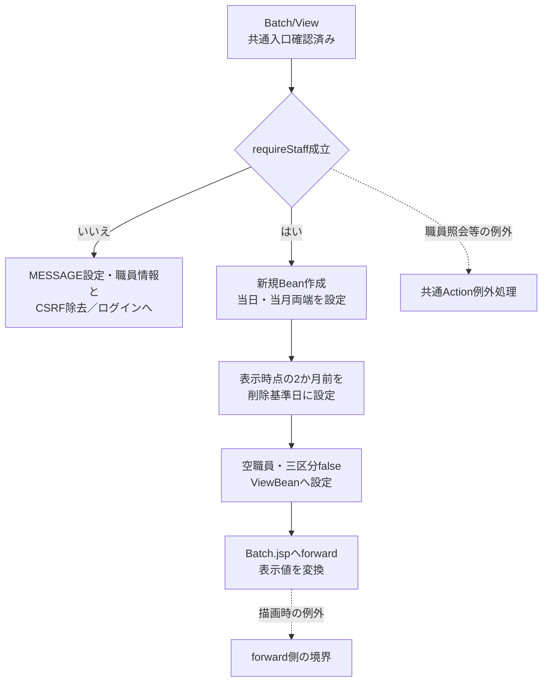

この図の入口前にある共通ログイン拒否・運用拒否は、出力イベントのフロー1-1と同じ共通入口契約による。初期値の決定と、入力値を保持する再表示は別の処理である。

#### SQL・テーブル関連（ER図）

職員情報をセッションから再利用する場合、年金側の追加職員照会はない。再作成が必要な場合は、先に業務DBの店名テーブルを全件取得し、次に職員DBの名簿を照会する。両者の店舗名はメモリで突き合わせる。

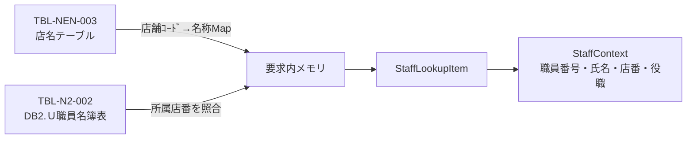

これは二つの接続による取得とメモリ照合の関連図であり、FKやSQL JOINではない。

#### DB操作の詳細

店舗名取得は `SELECT 店舗ｺｰﾄﾞ AS BRANCH_NO, 店名 AS BRANCH_NAME FROM 店名テーブル` で、条件・パラメータ・ORDER BYはない。結果をMapへ読み終えてから閉じる。

職員取得は次のSQLで、パラメータ1を `setInt(1, staffCode)` で設定する。staffCodeはログイン情報の職員番号を検査・数値化した値であり、画面の抽出職員番号ではない。

```sql
SELECT S.職員番号 AS STAFF_NO, S.漢字氏名 AS STAFF_NAME,
       S.カナ氏名 AS STAFF_KANA_NAME, S.所属店番 AS BRANCH_NO,
       S.役職コード AS ROLE_CODE
FROM DB2.Ｕ職員名簿表 S
WHERE S.職員番号 = ?
```

先頭行がなければnullを返す。所属店番に対応する店舗名がMapにない場合は空文字とする。StaffContextへ移すのは職員番号・氏名・店番・役職コードで、店舗名Mapは要求内の一時情報である。初期表示では予約抽出・削除明細整理・業務表更新を呼ばない。

#### 結果・例外時の扱い

成功時は初期Beanをセッションへ設定してBatch.jspを返す。職員不成立時はログイン画面へ戻す。職員確認中のDB例外は `NenkinDataAccessException` となり、Action生成・実行の共通catchへ伝わる。

JSPのStaffContextの型変換、職員番号のInteger化、ViewBeanの型整合、描画処理はActionが戻った後のforward側にある。ActionがJSP名を返したことと、表示が完了したことは別の境界である。

### 職員番号入力補助・日付カレンダー

#### 処理概要

職員番号の数字補助と、対象日・開始日・終了日のカレンダーをブラウザー内で処理する。入力補助は送信時のサーバー検証を代替しない。

カレンダーを開く際は入力値または当日から表示月を初期決定する。開いた後の前月・翌月操作は、現在の表示月を基に算出された移動先年月を保持して再描画する。

#### 処理手順

**1. 職員番号を補助する。**

　**1.1.** `data-digits-only` の初期バインド、input、blurで全角数字を半角へ変換し、数字以外を取り除く。値が変わればchangeを発火する。

　**1.2.** 入力中は数字の位置に合わせてキャレットを補正する。編集可能で値がある入力へのfocusでは全選択する。画面には職員参照モーダルを開く属性はない。

**2. 日付入力を整え、カレンダーを開く。**

　**2.1.** 三日付の初期化、blur、changeで有効な入力をwestern形式のyyyy/MM/ddへ整える。解析できない非空値は入力に残す。

　**2.2.** 対応ボタン、F4、Alt+下矢印で `openCalendar` を呼ぶ。activeInputへ対象入力を設定し、入力を解析できる場合はその日、できない場合はブラウザー当日を選択日の基準にする。

　**2.3.** 選択日のUTC年をvisibleYear、0始まりのUTC月をvisibleMonthへ設定する。`renderCalendar(input)` でこの表示年月を描画し、ポップアップを表示して位置を調整する。

**3. 表示月を移動し、日を選択する。**

　**3.1.** 再描画時はvisibleYear・visibleMonthから当月初日、前月、翌月を算出する。前月・翌月ボタンの `data-era-month` には、移動先の年と0始まり月をハイフンで結んだ値を設定する。

　**3.2.** 月移動ボタンを押すと、data-era-monthを分割してNumberへ変換し、visibleYear・visibleMonthを移動先へ更新する。`renderCalendar(activeInput)` を呼び、更新した表示年月を使って再描画する。この経路ではopenCalendarによる初期月決定を呼ばず、入力値も変更しない。

　**3.3.** 日選択時は対象日をwestern形式で表示入力へ設定する。input、changeを発火し、カレンダーを閉じて対象入力へfocusする。閉じる際はポップアップをhiddenにし、activeInputをnullへ戻す。外側クリック・Escapeでも閉じる。

　**3.4.** 三入力に `data-era-hidden-input` はない。日選択で変更するのは対応する表示入力であり、DELETE_CUTOFF_DATEへは反映しない。

#### 処理フロー

**フロー1：職員番号の数字補助（手順1）**

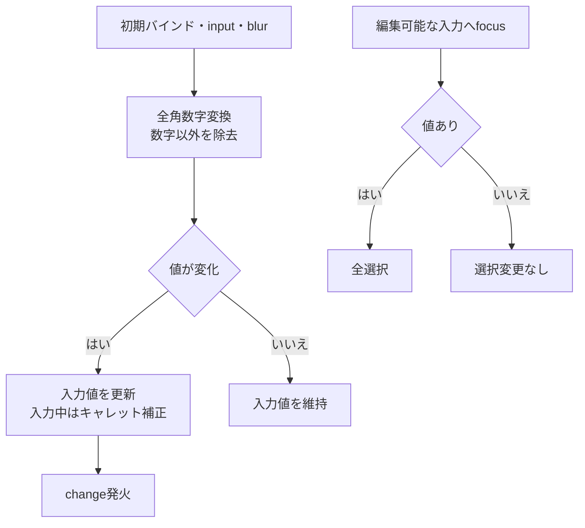

**フロー2：日付入力の整形（手順2.1）**

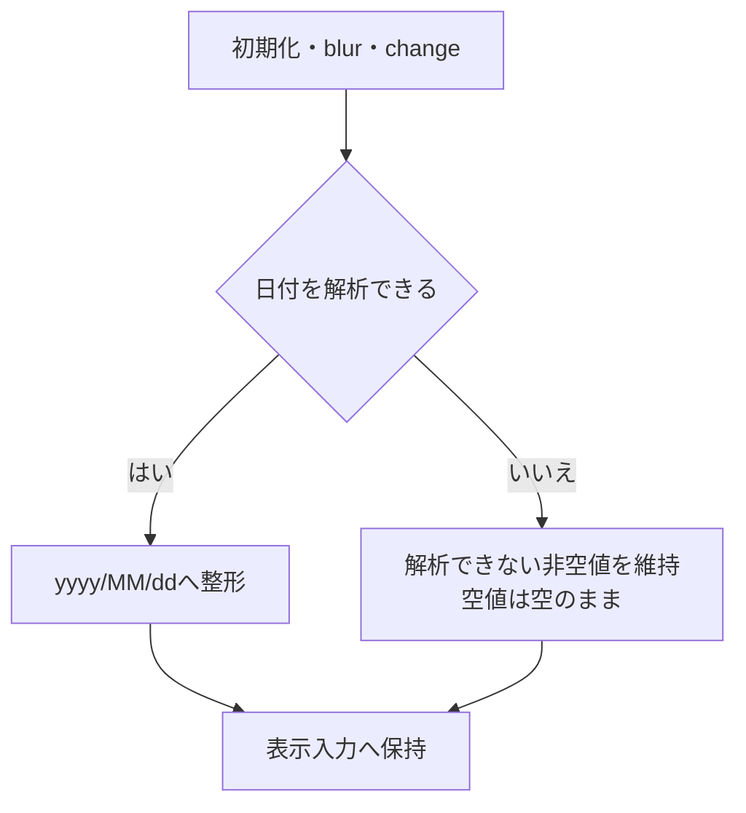

**フロー3：カレンダーの初期決定・月移動・終了（手順2.2～3.4）**

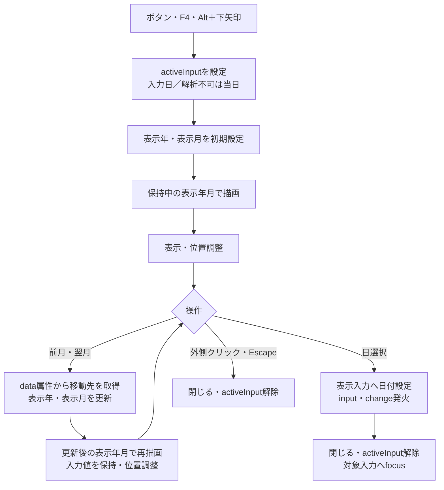

フロー3の初期設定はopenCalendarの呼出し時に行う。月移動は手順3.2で更新したvisibleYear・visibleMonthを再描画へ渡す。日選択まで入力値は変わらず、閉じた後に再び開くと、その時点の入力値または当日から初期決定を行う。

#### SQL・テーブル関連（ER図）

DBを使用しない。保持先はブラウザー内の入力要素、activeInput、visibleYear、visibleMonth、カレンダーDOMである。候補日はブラウザー内で生成するため、ER図は対象外である。

#### DB操作の詳細

入力補助からサーバー照会・保存は行わない。三日付に別のISO hidden入力は接続されていないため、汎用カレンダーのhidden同期処理から削除基準日が変更されることもない。

ブラウザーの解析は全角数字・全角空白、一文字の元号略称、区切りなし和暦などを扱い、Javaの受理形と一致しない。ブラウザー側のISO解析は先頭の日付に一致すると末尾の文字を表示正規化で除く場合がある。実行ボタンはform.submit()を呼ぶため、必須日付の拒否は接続するAction・サービス側の検査に依存する。

#### 結果・例外時の扱い

このイベントの結果は画面入力値・表示年月の変更またはカレンダー終了で、HTTP応答やDB確定は発生しない。解析できない非空値を入力に残す経路と、サーバーが受信後に拒否する経路を区別する。

数字補助・カレンダーが実行されない受信経路も、後述のサーバー検証で扱う。確認ダイアログ、実行中のボタン無効化、別ISO hidden値の同期はBatchの接続処理に含まれない。

### 日次・月次出力

#### 処理概要

Daily／MonthlyのActionが、要求条件を取り込み、POST・CSRF、出力区分、職員番号を検査して出力サービスを呼ぶ。サービスは期間と更新者を解決し、削除明細の整理後に選択区分を順に抽出する。明細のある区分だけExcelを作り、生成数によって再表示・単独Excel・ZIPを選ぶ。

#### 処理手順

**1. 職員確認と要求値の保持を行う。**

　**1.1.** ControlServletの共通ログイン・運用可否判定後にActionへ入る。requireStaff不成立なら、入力Beanを作る前にログイン画面を返す。職員確認中の例外も後述の入力例外catchの外にある。

　**1.2.** 新しいBatchViewBeanへSTAFF_NO、DAILY_DATE、MONTH_START、MONTH_END、DELETE_CUTOFF_DATEを取り込む。欠落は空文字へ変換し、Javaのtrimを行う。前回Beanの値で欠落を補わない。

　**1.3.** INCLUDE_NEW、INCLUDE_CHANGED、INCLUDE_DELETEDは、要求値が1、大小文字を無視したtrueまたはonのときだけtrueとする。欠落・その他の値はfalseで、比較前のtrimは行わない。

**2. Actionで実行条件を検査し、DTOへ移す。**

　**2.1.** POSTであることと、セッションStringのCSRFトークンが未加工の要求CSRF_TOKENとequalsで一致することを確認する。拒否時は期限切れ案内をBeanへ設定してBatch.jspを返す。

　**2.2.** 三つともfalseなら区分未選択の案内で戻す。各区分を個別必須にはしない。

　**2.3.** trim後の職員番号が非空なら、半角数字のみ、String.length()が8以下であることを検査する。ゼロ・先頭ゼロは許容する。名簿存在やログイン職員との一致は検査しない。

　**2.4.** 通過後、Beanの全条件をPensionBatchExportRequestへ明示移送する。runModeは日次ActionのDAILYまたは月次ActionのMONTHLYであり、日付の入力内容から推測しない。DTOはセッションへ格納しない。

**3. サービスで期間と更新者を決定する。**

　**3.1.** buildは要求DTOがnull、次に区分が全未選択なら拒否する。続けてrunModeを検査する。これらのサービス単体検査と、通常Actionで先に行う検査を区別する。

　**3.2.** 日次ではDAILY_DATEをrequiredDateへ渡し、正規化後の値をrange.fromとrange.toへ設定する。月次では開始日、終了日の順にrequiredDateへ渡し、正規化後のfromがtoより大きければ拒否する。日次は月次二日付、月次は日次対象日を検査しない。月次を同一月・実際の月初月末・一か月以内へ限定する検査はない。

　**3.3.** requiredDateは正規化前のnull・trim後空欄を拒否してからDateUtil.toIsoDateを呼ぶ。toIsoDateはNFKCとtrim後、西暦4桁年の区切り付き日付、yyyyMMdd、明治～令和またはM/T/S/H/Rの区切り付き和暦を解析する。和暦年は元または1～3桁で、0以下、元号の期間外、実在しない暦日を拒否する。区切り付き西暦はピリオド・スラッシュ・ハイフンを扱い、和暦は年・月・日の表記も扱う。

　**3.4.** requiredDateは正規化後の空文字を再検査しない。全角空白だけのStringなどが正規化で空になると、日次は両端空、月次は両端空または開始側だけ空の範囲になり得る。有効な開始日と空へ正規化された終了日の組合せは大小比較で拒否する。検索では空の側の日付述語を省くため、必須検査を通ったことだけで一日・両端付き期間を保証しない。

　**3.5.** 職員番号をIntegerのupdatedByへ変換する。通常Actionの空欄はnullとなり更新者条件を省く。サービス単体はnull・空欄・大小文字を無視したALLもnullとし、その他はInteger.valueOfを使う。サービス単体のALL・符号付き整数の解釈を通常画面の許可値へ拡張しない。数値化後は先頭ゼロを失う。

**4. 削除明細を先行整理する。**

　**4.1.** 要求DTOの削除基準日がtrim後空なら整理を呼ばない。非空ならpurgeDeletedAuditsThroughへその要求文字列を渡す。サーバーで初期値を再計算せず、セッション値との比較、未来日拒否、出力期間との関係検査も行わない。

　**4.2.** Repositoryは接続前・try外で日付を正規化する。正規化後空なら0を返し、接続しない。それ以外は専用接続でautoCommit=falseとし、基準日以下の削除明細をDELETEする。

　**4.3.** executeUpdateの件数を取得してcommitし、その件数を返す。サービスは件数を使用しない。削除分未選択でも整理は実行され得る。正常commitした整理状態を以後の手順へ引き継ぐ。

**5. 選択区分を検索し、区分別のExcelを作る。**

　**5.1.** 新規→変更→削除の順で選択済み区分だけをリスト化する。各区分のtype、Q識別名、Excel名、シート名、タイトルを決定する。

　**5.2.** type、range.from、range.to、updatedByでfindAuditRecordsを呼ぶ。全結果を読み終えたListが空なら、区分別の0件メッセージだけをmessagesへ追加して次の区分へ進む。

　**5.3.** 明細があれば店番、顧客番号、auditIdの順に昇順ソートする。店番・顧客番号のInteger nullは非nullより前に置く。auditIdはSQL読取順の1始まり連番であり、永続IDではない。

　**5.4.** ソート後にファイルごとのNoを1から付けて明細配列へ変換する。日付は和暦文字列、担当は最小2桁の文字列、６ヶ月先確認は「確」または空文字へ変換する。

　**5.5.** 新規17列と変更・削除20列の別を保持して、7先行行、結合範囲、印刷倍率を決定する。シート名・ヘッダー・明細・先行行・結合範囲・倍率をOpenXmlWorkbookWriterへ渡す。生成byte[]とspec、明細件数をGeneratedFileへ追加する。

　**5.6.** 区分途中の例外で次区分へ継続する処理はない。既に生成したExcelだけを部分配信する結果も返さない。すべての区分が終わってからfiles情報一覧を作る。

**6. 生成数別の結果を組み立て、応答する。**

　**6.1.** 生成0件は空名・長さ0のcontent、空のfiles、蓄積messagesで返す。Actionはmessagesを半角空白一つで連結してBeanへ設定し、要求値を保持してBatch.jspへ戻す。削除整理が正常commit済みなら、その状態は残る。

　**6.2.** 生成1件は当該Excelの名前・byte[]をそのまま使用する。filesはその一件の情報、messagesは他の選択区分の0件案内を保持する。ただしActionは内容ありのmessagesを表示せず、単独Excelにも結果テキストを付けない。

　**6.3.** 生成2～3件は生成順のExcelをZIPへ格納する。messagesがある場合だけUTF-8・各行末CRLFの「出力結果.txt」を追加する。ZIPの各エントリー時刻は0Lに設定する。

　**6.4.** 内容ありならwriteDownloadを呼ぶ。名前のUTF-8 URL符号化と+から%20への置換後、response.reset、Content-Type、Content-Disposition、Content-Length、write、flushの順に処理する。write・flushから戻った後にだけCSVを返す。成功枝では入力Beanをセッションへ再設定しない。

　**6.5.** ControlServletはCSVの戻り値でJSP forwardを抑止する。生成物は.xlsxまたは.zipであり、CSVファイルではない。直接出力でも共通アクセス記録は後続する。

#### 処理フロー

フロー間ではDTOだけでなく、正規化後range、updatedBy、削除整理の未実施・正常commit済み状態、生成ファイルとmessagesを引き継ぐ。例外出口AはAction内IllegalArgumentExceptionの再表示、出口Bは個別catchを通らないExceptionの共通処理を示す。職員確認中の例外は種類にかかわらずAction内の出口Aへは入らない。

**フロー1-1：共通入口と年金職員確認（手順1.1）**

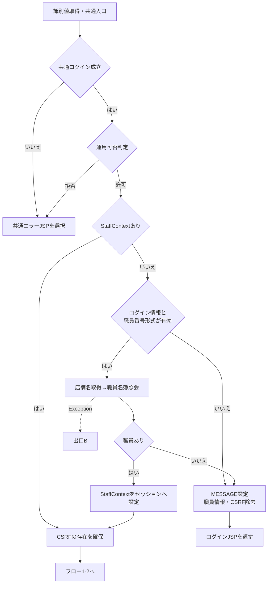

年金は運用状態表を検索する業務分岐には含まれないが、判定前の共通接続取得が失敗すれば運用拒否になり得る。識別値処理・運用判定そのものはAction生成・実行用catchの外にあり、この図の共通エラー選択と同じ処理で全例外を吸収するものではない。

**フロー1-2：要求保持とAction検査（手順1.2～2.4）**

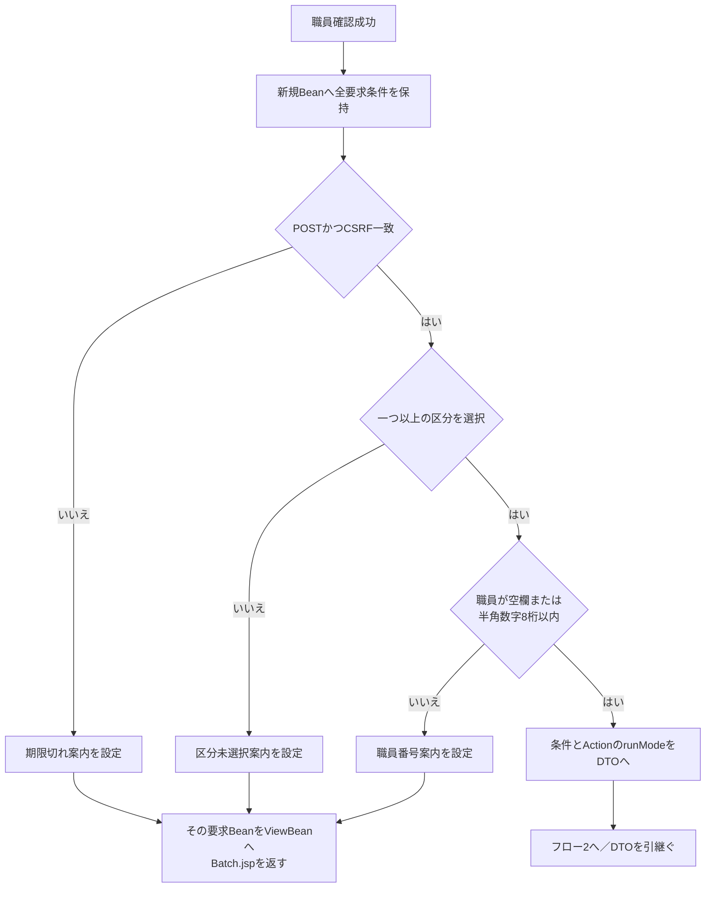

**フロー2：サービス検査と削除整理（手順3～4）**

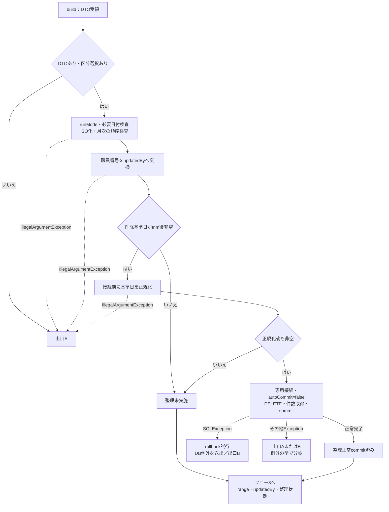

requiredDate後の空値は手順3.4のとおりrangeへ残る。Hのその他ExceptionはSQLException用catchを通らず、IllegalArgumentExceptionなら出口A、それ以外のExceptionなら出口Bへ進む。commit例外後の確定状態は正常commit済み枝と同一に扱わない。

**フロー3：区分別の抽出・生成（手順5）**

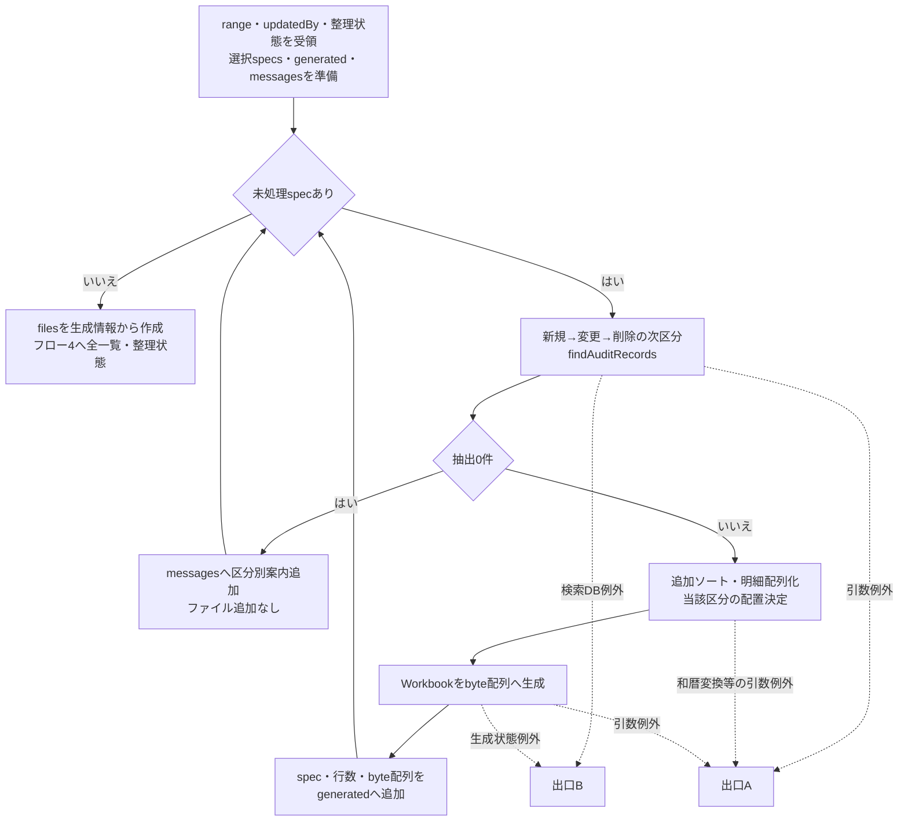

**フロー4：0・1・複数ファイルの合流（手順6）**

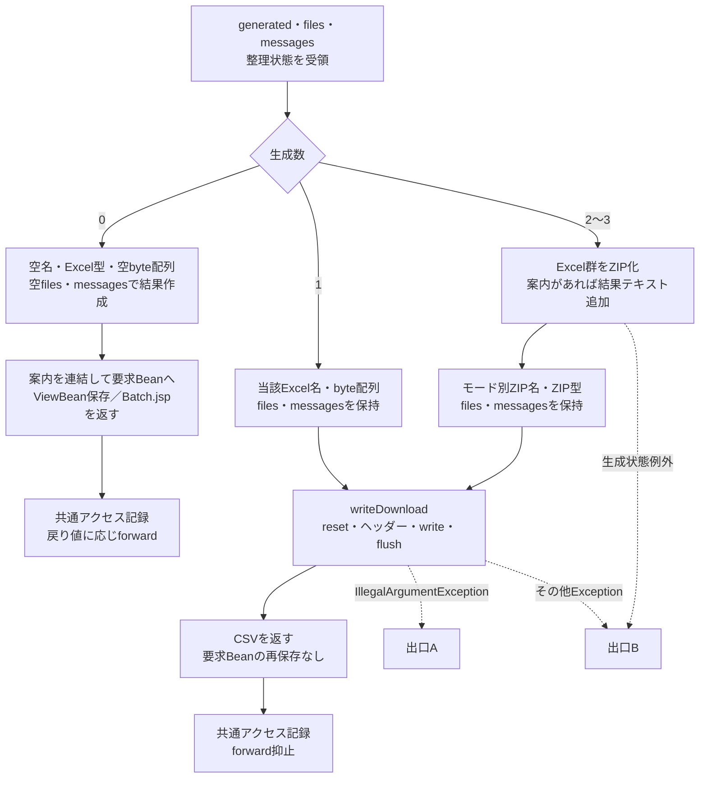

0件枝の空名・空内容を、Excel・ZIPの枝へ代入しない。どの枝も先行整理の状態を維持する。出口A・Bの捕捉順、応答確定後とforward時の境界は「結果・例外時の扱い」に従う。

#### SQL・テーブル関連（ER図）

区分ごとに抽出元Rを選び、五つの名称表へLEFT JOINする。新規・変更はTBL-NEN-001、削除はTBL-NEN-002を使用する。

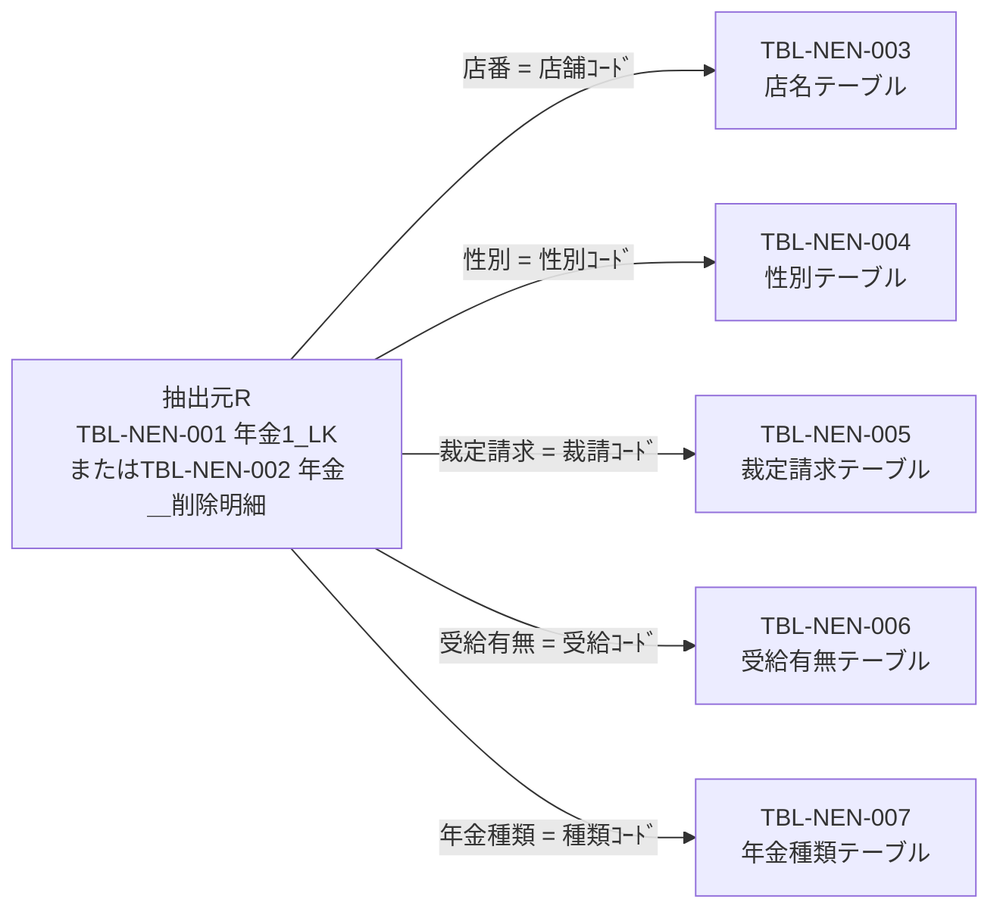

矢印は検索上の等価条件を示す。DDLにFKは宣言されておらず、多重度・参照整合性を追加しない。削除明細の名称も検索時点のコード表から得るため、削除時点の名称を保存したものとは限らない。結合先名称がNOT NULLでも、LEFT JOIN不成立の取得値はNULLになり得る。

整理はTBL-NEN-002だけを削除対象にする。抽出表・コード表に対するINSERT／UPDATEや出力済み印の設定は、この出力イベントでは行わない。

#### DB操作の詳細

**1. 接続と整理トランザクション**

業務接続は `jdbc/RAROA_DB`、次に `java:comp/env/jdbc/RAROA_DB` の順で探索する。職員確認用は `jdbc/Oracle_SP2NM` とそのjava:comp/env名を使う。用途別DataSourceは共有キャッシュ、Connectionは呼出しごとに取得する。接続取得自体はautoCommitを変更せず、削除整理の入口がfalseへ設定する。

```sql
DELETE FROM 年金＿削除明細
WHERE データ更新日 <= ?
```

パラメータ1は、正規化後基準日から `java.sql.Date.valueOf` を経由した `setDate` である。SQL Server列はDATE NULL。職員・変更FLG・出力区分・出力期間の条件はない。NULLの日付は比較を満たさない。削除件数を取得してcommitし、件数を返すが画面へ通知しない。

SQLExceptionではrollbackを試みて「削除明細履歴の整理に失敗しました。」のNenkinDataAccessExceptionを送出する。rollbackのSQLExceptionは元の例外を優先して抑制する。statement・connectionはfinallyでcloseし、close例外も元の結果を上書きしない。日付正規化はtry外であり、一般RuntimeExceptionもこのSQLException用catchでは捕捉しない。commitの例外はrollback試行へ進むが、DB側の最終確定状態を成功・取消のいずれかに断定する戻り値はない。

**2. 区分別検索SQL**

以下は新規・変更で全日付条件と職員条件を付ける形である。Rの物理表は削除区分だけ `年金＿削除明細` へ置換する。WHEREの各可変条件は後表に従って追加・省略し、値の文字列連結は行わない。

```sql
SELECT R.店番 AS BRANCH_NO, B.店名 AS BRANCH_NAME,
       R.顧客番号 AS CUSTOMER_NO, R.担当者コード AS STAFF_CODE,
       R.顧客氏名 AS CUSTOMER_NAME, R.ふりがな AS KANA_NAME,
       G.性別 AS GENDER, R.住所 AS ADDRESS, R.電話番号 AS PHONE_NUMBER,
       R.生年月日 AS BIRTH_DATE, C.裁定請求 AS CLAIM_STATUS,
       R.請求予定日 AS CLAIM_SCHEDULED_DATE, R.予定年齢 AS PLANNED_AGE,
       R.予約徴求日 AS RESERVATION_REQUEST_DATE,
       R.データ更新日 AS DATA_UPDATE_DATE,
       R.備考 AS NOTES, R.配偶者名 AS SPOUSE_NAME,
       H.受給有無 AS HAS_BENEFIT,
       R.配偶者生年月日 AS SPOUSE_BIRTH_DATE,
       P.年金種類 AS PENSION_TYPE,
       R."種類：国民年金" AS NATIONAL_PENSION,
       R."種類：厚生年金" AS EMPLOYEE_PENSION,
       R."種類：共済年金" AS MUTUAL_AID_PENSION,
       R."種類：厚生年金基金" AS EMPLOYEE_PENSION_FUND,
       R."種類：国民年金基金" AS NATIONAL_PENSION_FUND,
       R."６ヶ月先確認" AS SIX_MONTH_CHECK,
       R.データ更新日 AS AUDIT_DATE, R.更新時間 AS AUDIT_TIME,
       R.更新者 AS UPDATED_BY
FROM 年金1_LK R
LEFT JOIN 店名テーブル B ON R.店番 = B.店舗ｺｰﾄﾞ
LEFT JOIN 性別テーブル G ON R.性別 = G.性別ｺｰﾄﾞ
LEFT JOIN 裁定請求テーブル C ON R.裁定請求 = C.裁請ｺｰﾄﾞ
LEFT JOIN 受給有無テーブル H ON R.受給有無 = H.受給ｺｰﾄﾞ
LEFT JOIN 年金種類テーブル P ON R.年金種類 = P.種類ｺｰﾄﾞ
WHERE 1 = 1
  AND R.変更FLG = ?
  AND R.データ更新日 >= ?
  AND R.データ更新日 <= ?
  AND R.更新者 = ?
ORDER BY R.データ更新日, R.更新時間, R.店番, R.顧客番号
```

| 追加順 | 条件 | 追加する場合 | バインドとSQL Server列型 |
| --- | --- | --- | --- |
| 1 | R.変更FLG = ? | 新規・変更だけ。削除では省略 | setInt、新規0・変更1。TINYINT NULL |
| 2 | R.データ更新日 >= ? | optionalDate後のfromが非空 | setDate、java.sql.Date。DATE NULL |
| 3 | R.データ更新日 <= ? | optionalDate後のtoが非空 | setDate、java.sql.Date。DATE NULL |
| 4 | R.更新者 = ? | updatedByが非null | setInt、Integerの値。INT NULL |

位置は存在する条件だけを1から詰める。両日付と職員を指定した新規・変更はFLG、from、to、updatedByの4引数、同条件の削除はfrom、to、updatedByの3引数となる。全職員では更新者条件・引数を除く。空の日付は述語を除くため、この検索で日付条件へSQL NULLをバインドする枝はない。setDate共通helper自体には空値をTypes.DATEのNULLにする枝があるが、この検索の条件付き呼出しとは区別する。型別バインドにサイズ指定はない。

findAuditRecordsはtype=nullを接続前に拒否し、両日付も接続前にoptionalDateで正規化する。区分ごとに別Connection・PreparedStatementを取得し、ResultSetを全件Listへ読み終えて返す。LIMIT、OFFSET、件数上限、query timeout、cancel、fetch上限の明示設定はない。SQLExceptionは「年金予約の更新区分検索に失敗しました。」のNenkinDataAccessExceptionへ変換し、finallyで結果・文・接続を閉じる。

**3. 取得値とDB属性**

データ更新日は予約モデルのdataUpdateDateと監査レコードのauditDateへ、更新時間はauditTimeへ、更新者はIntegerのupdatedByへ移す。auditIdは各検索で1から採番する。予約モデルはPensionAuditRecordのコンストラクタ・setter・getterでコピーされる。

nullableIntegerはgetInt後にwasNullを使い、NULLをInteger nullへ戻す。モデルのString setterはDB NULLを空文字へ変える。五つの年金種類フラグと６ヶ月先確認はgetInt()!=0で読み、NULLもfalse相当になる。電話番号は数値列のStringから数字を取り出し、先頭ゼロを整理して、9桁または10桁で0始まりでないときは0を一つ補う。入力時の任意の電話書式を完全に復元する変換ではない。

SQL Server DDLでは両抽出表の28列がすべてNULL許可で、DEFAULT、PK、一意制約はない。変更FLGがNULLの行は新規・変更条件に一致せず、日付・更新者がNULLの行も、それぞれの比較条件を付けた場合に一致しない。更新区分索引と削除明細の更新日索引は非一意である。DDLは既存表がない場合だけ作成する宣言であり、既存DBの実状態と同一であることを前提にしない。

コード表の名称列は性別・裁定請求・受給有無がNVARCHAR(10)、店名がNVARCHAR(80)、年金種類がNVARCHAR(120)で、NOT NULL、各コード列がPKである。予約保存側は表示名称をコードへ逆引きし、年金種類は五フラグから1・2・4・8・16を合成して存在確認するが、名称表自体は更新しない。名称維持管理側の業務上限は、これらのDB容量では代用しない。

**4. 排他と取得時点**

整理・保存・削除は共有Repositoryインスタンスのsynchronized対象だが、findAuditRecordsとサービスbuildは同期対象ではない。整理と各区分検索を一つの接続・一つのスナップショットへ束ねず、比較版、明示行ロック、再出力の重複抑止も設けない。実行中に別要求が保存・削除した場合、各区分が同一時点の状態を示す保証はない。

#### 結果・例外時の扱い

| 到達段階・条件 | 処理と戻り先 | 整理・応答の状態 |
| --- | --- | --- |
| POST以外またはCSRF不一致 | 「画面の有効期限が切れました。メニューから操作しなおしてください。」を設定しBatch.jspへ | サービス未実行。要求値は新規Beanで保持 |
| 三区分未選択 | 「新規分、変更分、削除分のどれかを選択してから再度、実行ボタンを選択してください」を設定しBatch.jspへ | 職員番号・サービス日付の後続検査へ進まない |
| 職員番号形式不正 | 「職員番号は8桁以内の数字で入力してください」を設定しBatch.jspへ | サービス未実行 |
| build～writeDownload内のIllegalArgumentException | 例外のメッセージをBeanへ設定・保存してBatch.jspを返す | 発生段階によって整理未実施または正常commit後。送信開始後の再表示到達も保証しない |
| 全選択区分0件 | 区分別案内を空白連結してBatch.jspへ | ダウンロードなし。正常commit済み整理は残る |
| Excel一件 | 当該Excelを直接送信してCSVを返す | files・messagesは結果に残るが、0件案内を画面や結果テキストへ出さない |
| Excel二～三件 | ZIPを直接送信してCSVを返す | 0件案内がある場合だけZIP内の出力結果.txtへ出す |
| 個別catchを通らないException | 共通Action用catchが記録し、ErrorMsgを設定して共通エラーJSPを選択 | 既確定整理を取消さない。送信開始・応答確定後のエラー画面表示は保証しない |
| JSP再表示中の例外 | forward側で発生 | BatchRunActionの個別catchにも共通Action用catchにも戻らない |

サービスの主な拒否文言は次のとおりである。通常Actionで既に拒否する条件と、サービスに到達して初めて判定する条件を分けて読む。

| 条件 | サービスの文言 |
| --- | --- |
| 要求DTOがnull | 出力条件がありません。 |
| 三区分未選択 | 新規分、変更分、削除分のいずれかを選択してください。 |
| runModeがnull | 日次または月次を指定してください。 |
| 日次対象日が正規化前の必須検査で空 | 年月日を入力してください。 |
| 月次開始日が正規化前の必須検査で空 | 月初日を入力してください。 |
| 月次終了日が正規化前の必須検査で空 | 月末日を入力してください。 |
| 月次の正規化後fromがtoより大きい | 月初日は月末日以前で指定してください。 |
| サービス単体で職員番号をInteger化できない | 職員番号は数値で入力してください。 |
| 日付の形式・実在性・元号期間が不正 | 日付の形式または実在性が不正です: に対象値を付ける |
| 和暦出力で1868-09-08より前の日付を扱う | 明治元年より前の日付は和暦変換できません。 |

西暦入力の形式・実在性を通過しても、帳票期間や明細日付の和暦化でIllegalArgumentExceptionになる場合がある。その処理は整理の後であり、入力案内に戻る場合にも先行整理が確定している可能性がある。Workbookはヘッダー空・明細List nullをIllegalArgumentException、生成IOExceptionをIllegalStateExceptionへ変換する。ZIP生成IOExceptionもIllegalStateExceptionとなる。通常経路では固定ヘッダーと生成した非nullリストを渡す。

BatchRunActionの個別catchはbuildから送信までのIllegalArgumentExceptionだけを処理する。職員確認中の例外、NenkinDataAccessException、Excel・ZIPのIllegalStateException、送信IOException等は、個別catchの対象に含めずControlServletのAction生成・perform用catch(Exception)へ伝える。先行catchが処理したIllegalArgumentExceptionを、後段の共通エラー分類へ重ねて含めない。

共通catchはアプリケーションエラー案内をErrorMsgへ設定するが、HTTPエラー状態を明示設定せず、送信済み応答をresetして作り直す処理も持たない。write・flushが戻ってもブラウザーの完全受領・保存は確定しない。識別値の小文字化・参照、運用判定、Action後の利用者取得・アクセス記録・forwardは、このAction用catchの外にある。

再表示はBatchViewActionを経由せず、保持したBeanをBatch.jspが読む。日付は解析できればyyyy/MM/ddへ整え、解析できなければ元文字列を表示する。値とメッセージはHTMLエスケープするが、職員表示のInteger化やセッションBeanの型不一致など、forward中の二次例外までAction内で捕捉するわけではない。

### 戻る

#### 処理概要

画面条件を同じフォームでMenu/Viewへ送信し、年金メニューへ戻る。Batchの実行条件検査・整理・抽出は呼ばない。

#### 処理手順

**1. メニューへ遷移する。**

　**1.1.** backMenuはbatchViewをMenu、batchCommandをViewへ変更し、batchForm.submit()を呼ぶ。

　**1.2.** 共通入口後、MenuViewActionが職員確認を行う。不成立ならログイン画面を返す。

　**1.3.** 成立時はMenuViewBeanを新しく作り、職員番号・氏名を設定してセッションのViewBeanを置き換え、Menu.jspを返す。BatchRunActionのPOST・CSRF・区分・日付検査は経由しない。

　**1.4.** メニューから再び処理データへ入ると初期表示イベントでBatchViewBeanを作り直す。前回抽出条件を自動復元する操作ではない。

#### 処理フロー

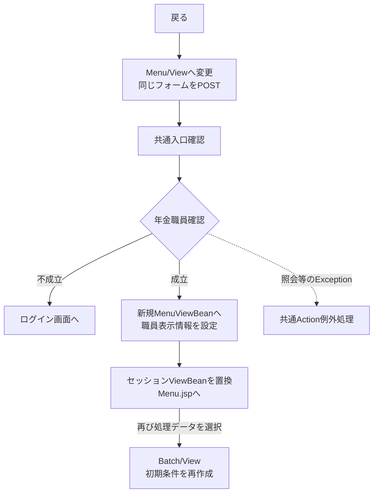

共通入口の拒否・catch外境界は出力イベントのフロー1-1と同じ契約による。

#### SQL・テーブル関連（ER図）

Batchの整理・抽出SQLは使用しない。年金職員情報を作り直す場合だけ初期表示イベントと同じ店舗名取得・職員名簿照会が起こるため、同節の関連図を適用する。

#### DB操作の詳細

Batch条件をDBへ保存しない。MenuViewBeanへの置換はセッション内の画面状態変更である。職員確認SQL以外の業務DB更新はなく、共通アクセス記録は独立した共通処理として行われる。

#### 結果・例外時の扱い

成功時はメニュー用のBeanとMenu.jsp、不成立時はログイン画面となる。職員照会等のExceptionは共通側へ伝わり、JSP表示中の例外はforward側に残る。戻る操作自体から削除明細整理やファイル送信が始まることはない。

## 補足説明

### 画面状態と出力結果の保持

BatchViewBeanはSerializableなセッション画面状態で、staffNo・dailyDate・monthStart・monthEnd・deleteCutoffDate・messageをString、三区分をbooleanで保持する。String setterはnullを空文字へ変えるだけで、trim・日付解析はしない。要求取込み時のtrimとサービスのISO化は別段階であり、サービスは正規化後の値をBeanへ書き戻さない。

PensionBatchExportRequestの初期値はrunMode=DAILY、文字列空、三区分falseである。文字列setterはnullを空文字へ変えるが、runMode setterはnullを許す。通常Actionはすべての条件とモードを設定してからbuildへ渡す。

| 状態 | ViewBeanの扱い | 表示・応答 |
| --- | --- | --- |
| 初期表示 | 新しいBatchViewBeanへ置換 | 当日・当月期間、空職員、全区分未選択 |
| Actionで入力拒否 | その要求から作ったBeanを保存 | 拒否文言と要求後trim済み入力を再表示 |
| サービス以降のIllegalArgumentException | 入力Beanへ例外文言を設定して保存 | 初期日付を再計算せず再表示を要求 |
| 全選択区分0件 | 入力Beanへ0件案内を設定して保存 | 入力・選択を維持 |
| 内容あり | 入力Beanを再保存しない | HTTPへ直接出力。結果一覧の画面表示はない |
| 戻る | MenuViewBeanへ置換 | 再入場時はBatchの初期条件を再作成 |

ViewBeanは他画面と同じセッション属性を共有する。画面ごと・タブごとに独立した保存領域ではなく、別画面での置換と並行要求の状態を混同しない。

PensionBatchExportResultはfileName、contentType、byte[] content、files、messagesを持つ。文字列nullは空文字、content nullは空配列となり、byte[]は受取時とgetterでcloneする。files・messagesはリストをコピーして変更不可にするが、リスト自体のnullを空リストへ変える処理はない。通常buildは非nullリストを渡す。filesの各要素はqueryName、fileName、categoryName、int rowCountである。

明細List、Workbook、GeneratedFile群、ZIPは要求内メモリで保持する。この経路にサーバー上の出力ファイル保存、Excelプロセス起動、出力済み状態の永続化はない。

### 抽出値とExcel列の対応

次表のRは区分別の抽出表を表す。R列はすべてNULL許可で、名称表側のNOT NULLとJOIN結果のNULL可能性は前述のとおり区別する。「新規列」「変更・削除列」はExcelの1始まりの列位置で、空欄はその帳票へ出さないことを示す。

| 出力項目 | モデル項目・Java型 | 取得元・SQL別名 | SQL Serverの保存属性 | 新規列 | 変更・削除列 | 出力変換 |
| --- | --- | --- | --- | --- | --- | --- |
| No | ソート後のInteger連番 | DB保存なし | 非DB項目 | 1 | 1 | ファイルごとに1から採番し数値セル |
| 予約徴求日 | reservationRequestDate：String | R.予約徴求日／RESERVATION_REQUEST_DATE | DATE NULL | 2 | 17 | 和暦文字列 |
| カナ氏名 | kanaName：String | R.ふりがな／KANA_NAME | NVARCHAR(100) NULL | 3 | 5 | 文字列 |
| 漢字氏名 | customerName：String | R.顧客氏名／CUSTOMER_NAME | NVARCHAR(100) NULL | 4 | 4 | 文字列 |
| 性別 | gender：String | G.性別／GENDER。R.性別でJOIN | RコードはTINYINT NULL、名称はNVARCHAR(10) NOT NULL | 5 | 6 | 名称文字列。ヘッダーは「性」と「別」の間で改行 |
| 住所 | address：String | R.住所／ADDRESS | NVARCHAR(300) NULL | 6 | 7 | 文字列 |
| 生年月日 | birthDate：String | R.生年月日／BIRTH_DATE | DATE NULL | 7 | 9 | 和暦文字列 |
| 電話番号 | phoneNumber：String | R.電話番号／PHONE_NUMBER | DECIMAL(15,0) NULL | 8 | 8 | 表示用ゼロ補完後の文字列 |
| 年金種類 | pensionType：String | P.年金種類／PENSION_TYPE。R.年金種類でJOIN | RコードはINT NULL、名称はNVARCHAR(120) NOT NULL | 9 | 10 | 名称文字列。ヘッダーは「年金」と「種類」の間で改行 |
| 予定年齢 | plannedAge：Integer | R.予定年齢／PLANNED_AGE | INT NULL | 10 | 13 | 非nullは数値。ヘッダーは「予定」と「年齢」の間で改行 |
| 請求予定日 | claimScheduledDate：String | R.請求予定日／CLAIM_SCHEDULED_DATE | DATE NULL | 11 | 12 | 和暦文字列 |
| 備考 | notes：String | R.備考／NOTES | NVARCHAR(400) NULL | 12 | 19 | 文字列。DB容量を入力業務上限・バイト数と同一視しない |
| 配偶者名 | spouseName：String | R.配偶者名／SPOUSE_NAME | NVARCHAR(100) NULL | 13 | 14 | 文字列 |
| 配偶者生年月日 | spouseBirthDate：String | R.配偶者生年月日／SPOUSE_BIRTH_DATE | DATE NULL | 14 | 15 | 和暦文字列。ヘッダーは「配偶者」と「生年月日」の間で改行 |
| 店番 | branchNo：Integer | R.店番／BRANCH_NO | INT NULL | 15 | 2 | 非nullは数値 |
| 顧客番号 | customerNo：Integer | R.顧客番号／CUSTOMER_NO | BIGINT NULL | 16 | 3 | getIntで読み、非nullは数値。DB容量とJava範囲は異なる |
| 担当 | staffCode：Integer | R.担当者コード／STAFF_CODE | INT NULL | 17 | 18 | nullは空文字、それ以外は%02dの文字列。ヘッダーは「担」と「当」の間で改行 |
| 裁定請求 | claimStatus：String | C.裁定請求／CLAIM_STATUS。R.裁定請求でJOIN | RコードはTINYINT NULL、名称はNVARCHAR(10) NOT NULL |  | 11 | 名称文字列。ヘッダーは「裁定」と「請求」の間で改行 |
| 受給有無 | hasBenefit：String | H.受給有無／HAS_BENEFIT。R.受給有無でJOIN | RコードはTINYINT NULL、名称はNVARCHAR(10) NOT NULL |  | 16 | 名称文字列。ヘッダーは「受給」と「有無」の間で改行 |
| ６ヶ月先確認 | sixMonthCheck：boolean | R.６ヶ月先確認／SIX_MONTH_CHECK | BIT NULL |  | 20 | trueは「確」、falseは空文字。ヘッダーは「６ヶ月」と「先確認」の間で改行 |

取得してもこのバッチの明細列へ出さない値は次のとおりである。

| 値 | 移送先・用途 | 保存属性と注意 |
| --- | --- | --- |
| B.店名／BRANCH_NAME | branchName：String | 店名テーブルの店名はNVARCHAR(80) NOT NULL。JOIN不成立はモデルで空文字 |
| R.データ更新日／DATA_UPDATE_DATE・AUDIT_DATE | dataUpdateDate・auditDate：String。抽出期間・SQL並び順にも使用 | DATE NULL。帳票の上部期間は要求range由来であり、この列の明細値ではない |
| R.更新時間／AUDIT_TIME | auditTime：String。SQL並び順に使用 | TIME(0) NULL |
| R.更新者／UPDATED_BY | updatedBy：Integer。職員指定の検索列 | INT NULL。帳票の担当者コードとは別 |
| R.種類：国民年金、種類：厚生年金、種類：共済年金、種類：厚生年金基金、種類：国民年金基金 | nationalPension、employeePension、mutualAidPension、employeePensionFund、nationalPensionFund：boolean | 各BIT NULL。個別の帳票列へは出さず、年金種類名称は保存コードのJOINで取得 |
| R.変更FLG | 新規・変更のWHEREだけに使用し、このSELECT結果には追加しない | TINYINT NULL。新規0・変更1、削除では条件なし |
| auditId | SQL読取順を追加ソートの最終比較に使用 | 永続列なし。店番・顧客番号が同じ場合に元の取得順を維持 |

日付四項目と帳票上部期間は、空値を空文字、それ以外を `DateUtil.toAccessWareki` によりR8.06.11のような文字列へ変換する。元号年はゼロ埋めせず、月日は2桁とする。担当の%02dは最小2桁指定で、3桁以上を切り捨てない。SQLのORDER BY列がすべて同値の行について、一意な順序を追加指定する処理はない。

職員番号のAction上限8はJava String.length()のUTF-16コード単位数であり、許可文字が半角数字なので8桁に対応する。ブラウザーのmaxlength=8／14は入力要素側の長さ制約で、HTTP受信長の保証ではない。サービスの日付変換には生入力長の上限検査がなく、正規化後の空値を再必須検査する処理もない。hidden削除基準日にも生入力長や保持期間の業務上限検査はない。

### ファイル識別と帳票配置

Q番号はサービスで計算する識別情報で、保存クエリーやDBオブジェクトの実行名ではない。

| モード・職員条件 | 新規 | 変更 | 削除 |
| --- | --- | --- | --- |
| 日次・職員指定 | Q010 | Q020 | Q030 |
| 日次・全職員 | Q040 | Q050 | Q060 |
| 月次・職員指定 | Q070 | Q080 | Q090 |
| 月次・全職員 | Q100 | Q110 | Q120 |

queryNameは「Q番号_Excel出力_年金予約_区分名_データ明細リスト」、Excel名は「年金予約【区分名】データ明細リスト（対象範囲＋モード）.xlsx」とする。区分名は新規・変更・削除、対象範囲は職員指定時「担当者別」、全職員時「全担当者」、モードは日次・月次で、括弧内に区切り文字を挿入せず連結する。シート名は新規分データ・変更分データ・削除分データである。ファイル名の「担当者別」という表現にかかわらず、抽出列は更新者である。

| 帳票 | 列数・上部の設定 | 結合範囲 | 印刷倍率 |
| --- | --- | --- | --- |
| 新規分 | 17列。D1に区分別タイトル、D5に見出し「処理日」、F5に対象日または期間、J5に見出し「職員番号」、L5に職員指定文字列またはALL | D1:M3、D5:E6、日次F5:H6／月次F5:I6、J5:K6、L5:M6 | 70 |
| 変更分・削除分 | 20列。E1に区分別タイトル、E5に見出し「処理日」、G5に対象日または期間、L5に見出し「職員番号」、N5に職員指定文字列またはALL | E1:P3、E5:F6、日次G5:H6／月次G5:I6、L5:M6、N5:P6 | 60 |

タイトルは「年金予約【区分名】データ明細リスト」。上部の処理日は実行当日を新たに印字する欄ではなく、日次対象日または月次from～toを表示する。職員欄は元の要求文字列のtrim値を使うため、検索Integerで失う先頭ゼロも保持する。空欄時のALLは帳票表示でありDB保存値ではない。

Writerは単一シートをメモリ内のOpen XML ZIPとして生成する。Numberは数値セル、それ以外はinlineStr、nullは空文字セルとする。日付・電話番号・ゼロ埋め担当は文字列である。XMLに許容されないコードポイントを除去し、特殊文字をエスケープする。シート名は禁則文字を_へ置換し、31 Javaコード単位までにする。

ヘッダーは8行目、明細は9行目からで、8行まで固定し、8行目から最終明細までオートフィルターを設定する。列幅はヘッダーと先頭100明細の表示長を用い、ASCIIを1、その他のコードポイントを2として余白2を加え、5～40に制限する。この100件は幅計算の対象数であり、出力明細数の上限ではない。印刷はA4縦・横中央で、倍率は10～400の範囲に補正する。

ExcelのContent-Typeは `application/vnd.openxmlformats-officedocument.spreadsheetml.sheet`。複数生成時のZIP名は「年金予約データ明細リスト（日次）.zip」または「年金予約データ明細リスト（月次）.zip」、Content-Typeは `application/zip` である。Content-Dispositionは `attachment; filename=download; filename*=UTF-8''` に符号化名を続ける。

### 0件案内と共通側の処理

区分名を新規・変更・削除、モードを日次・月次として、次の文言を選択区分順に作る。未選択区分の案内は作らない。

| 条件 | 文言 |
| --- | --- |
| 職員指定あり | 入力した担当者の【区分名分（モード）】の該当明細はありませんでした |
| 全職員・日次 | 入力年月日の【区分名分（日次）】の該当明細はありませんでした |
| 全職員・月次 | 入力年月の【区分名分（月次）】の該当明細はありませんでした |

共通側のアクセス記録は、直接出力も含めAction後にDB2.Ｕカウンターシフトへ日付・時刻・機能・画面・コマンド・Action・JSP名・利用者を記録し、別接続でcommitする。失敗時はrollbackとログ出力を行い、削除整理と一体のトランザクションにはしない。MESSAGEがある場合に記録するJSP名はSubMessage.jspとなるが、実際の戻り先をこのJSPへ置換する処理ではない。

### 関連文書

次表は計画上の対応先であり、生成済みであることを示さない。相対パスは本書の配置ディレクトリからの表記である。

| 文書ID | 相対パス | 本書との分担 | 生成状態 |
| --- | --- | --- | --- |
| SCR-014 | `../基本設計書/基本設計書_SCR-014_日次 _ 月次処理.md` | 操作目的・画面状態・業務上の出力条件 | 未確認 |
| API-NENKIN | `../共通/要求処理一覧.md` | 識別値・HTTP入口・戻り値の共通整理 | 未確認 |
| COM-012 | `../共通/共通仕様書_COM-012_共通コントロールサーブレット.md` | Action前後、共通エラー、アクセス記録、forward境界 | 未確認 |
| COM-111 | `../共通/共通仕様書_COM-111_年金業務共通処理.md` | requireStaff、CSRF、要求値変換、writeDownload | 未確認 |
| COM-150 | `../共通/共通仕様書_COM-150_外部ライブラリを使わず、単1シートの Open XML (.xlsx) を生成する.md` | Workbook共通契約・内部ZIP構成・スタイル | 未確認 |
| COM-151 | `../共通/共通仕様書_COM-151_画面共通入力・通信制御.md` | 数字補助・カレンダー・共有CSS | 未確認 |
| DATA-CONTRACTS | `../共通/データオブジェクト定義書.md` | Bean、要求・結果DTO、コピーと保持領域 | 未確認 |
| DB-OPS | `../共通/DB仕様書/DB操作仕様書.md` | SQL・バインド・接続・トランザクションの横断整理 | 未確認 |
| DB-PHYSICAL | `../共通/DB仕様書/テーブル定義書.md` | 安定IDごとの全物理列・索引・環境別宣言 | 未確認 |
| OUTPUT-NENKIN | `../共通/帳票一覧.md` | 他出力との比較、帳票・ファイル契約の統合 | 未確認 |
