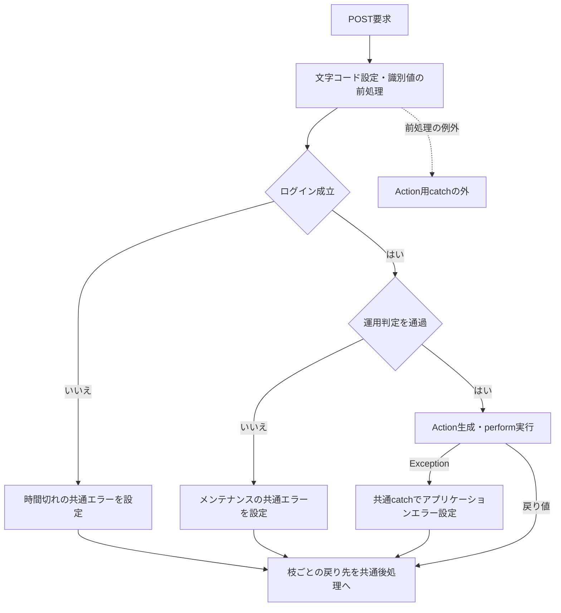
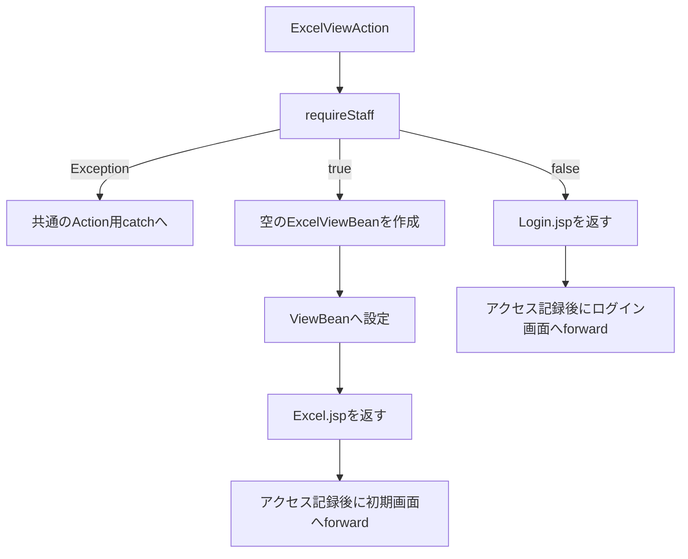
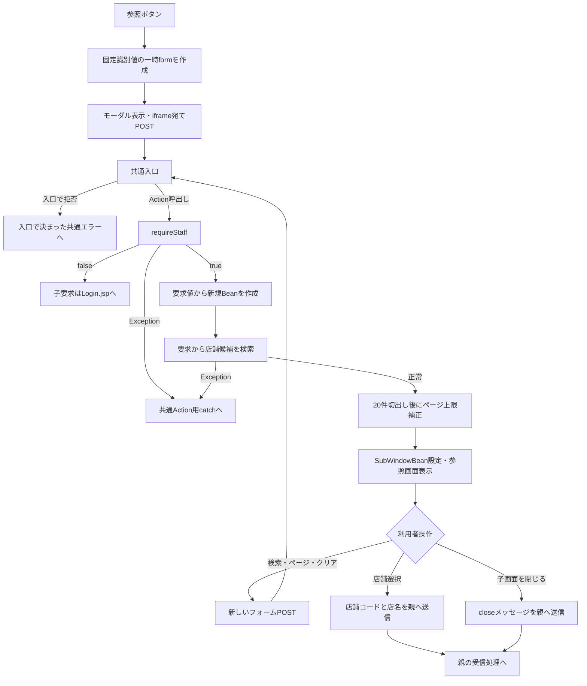
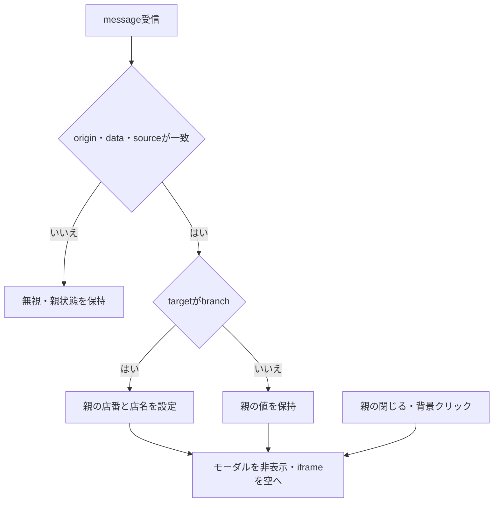
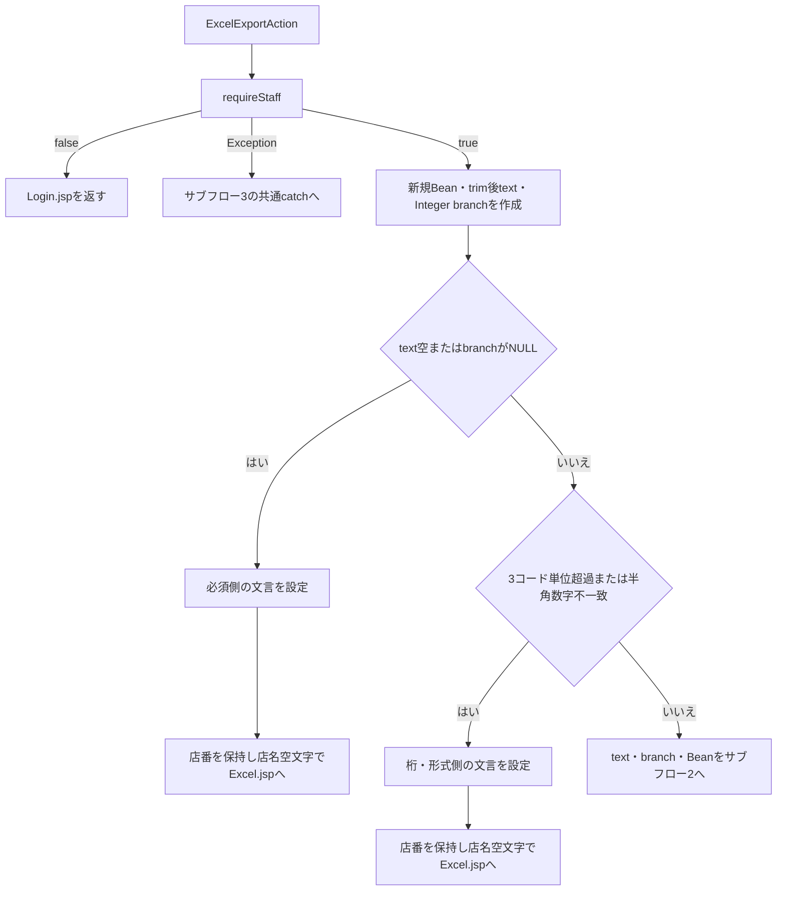
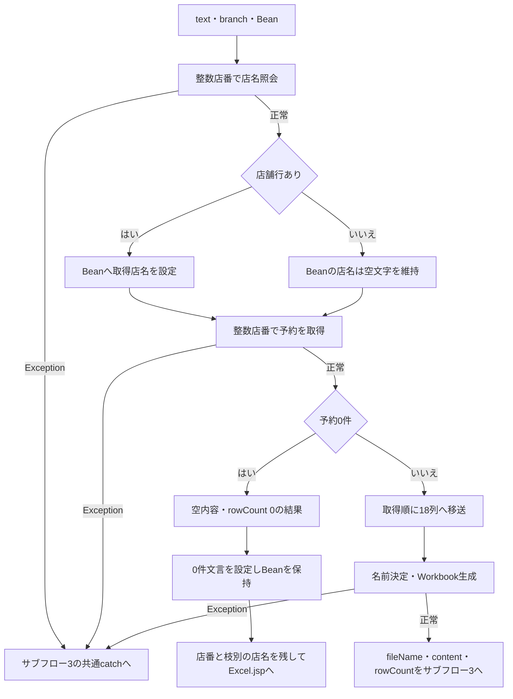
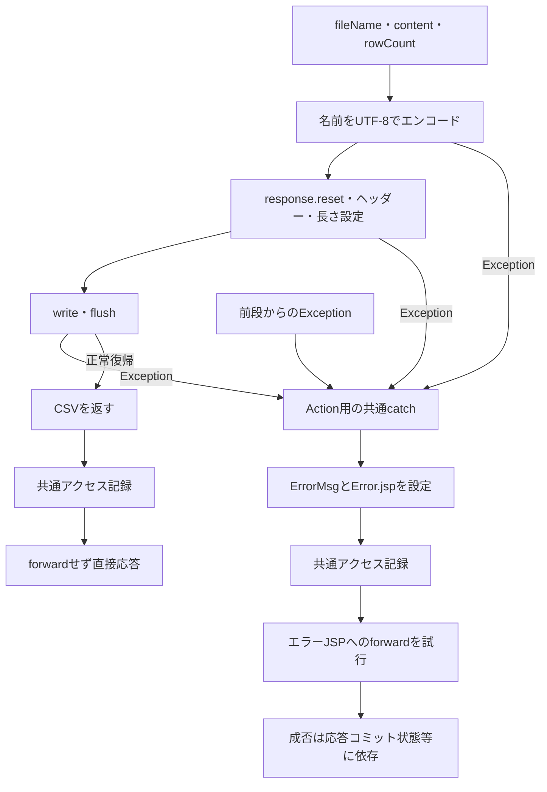
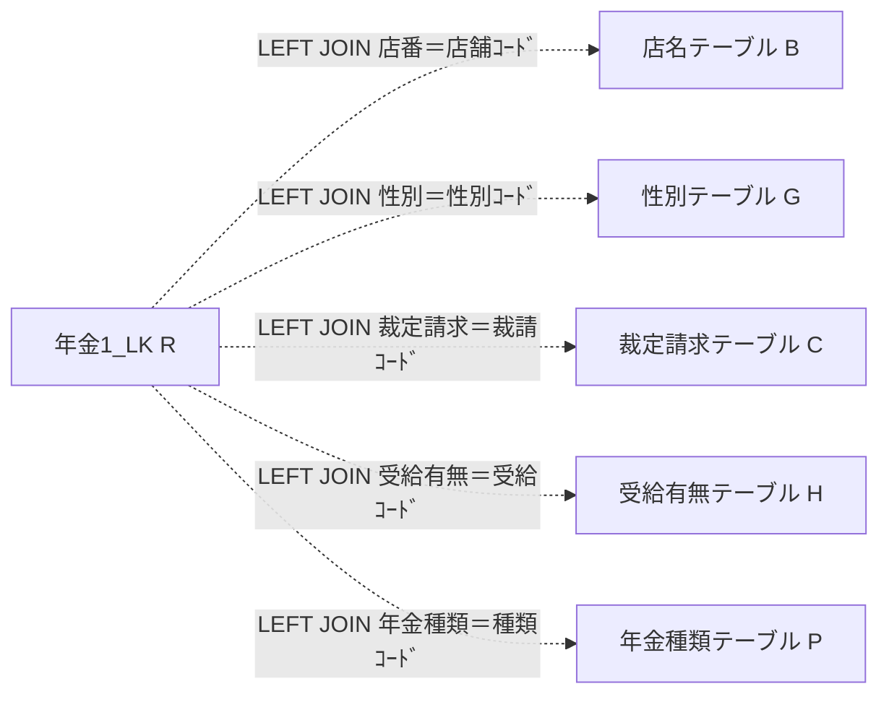
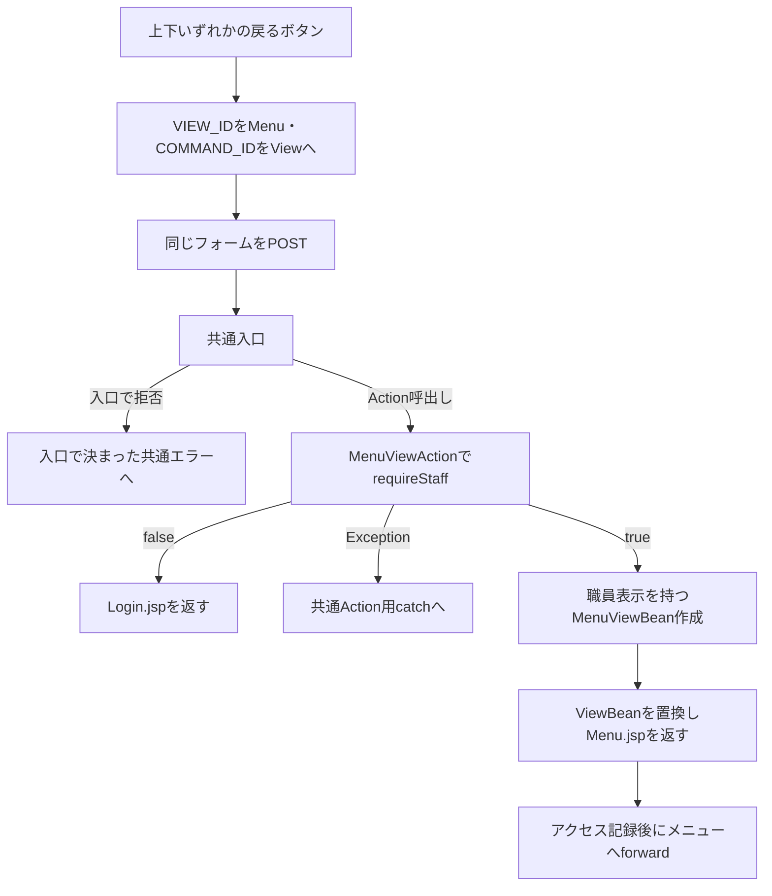

<!-- spec-meta: {"schema":"spec-md/1.0","documentId":"DET-SCR-015","version":"2.0","path":"詳細仕様書/詳細仕様書_SCR-015_EXCEL出力.md","sheets":[{"heading":"概要","kind":"GRID","sheet":"概要"},{"heading":"項目一覧","kind":"LIST","sheet":"項目一覧"},{"heading":"イベント仕様","kind":"GRID","sheet":"イベント仕様"},{"heading":"補足説明","kind":"GRID","sheet":"補足説明"}]} -->
# EXCEL出力詳細仕様

| 属性 | 内容 |
| --- | --- |
| 文書種別 | 詳細仕様書 |
| システム名 | 年金自動受取予約管理システム |
| 機能ID | SCR-015 |
| 文書ID | DET-SCR-015 |
| 版 | 2.0 |
| 解析対象 | 店舗別Excel出力画面と接続される参照・検索・ファイル生成・応答処理 |
| 基準日 | 2026-10-15 |

## 概要

本機能は、店番を直接入力するか店番参照から選択し、その店舗の年金予約を単一シートのExcelファイルへ出力する。出力対象は、年金1_LKの店番が指定店舗に一致する行である。期間、担当者、確認済状態による追加条件は設けない。

出力前の店舗名照会は、画面を再表示する場合の名称を得る処理である。店舗名が見つからなくても予約検索へ進むため、店舗名の存在は出力成立の必須条件ではない。ただし、この照会自体が例外になった場合は予約検索へ進まない。

画面状態はセッション属性`ViewBean`の`ExcelViewBean`に保持する。メニューから開くと空のBeanを作り直す。入力拒否と予約検索0件では、要求から作ったBeanを保存して同じ画面へ戻る。明細がある場合はファイルを直接応答へ書き込み、今回のBeanをセッションへ保存する処理は行わない。

### 操作入口と応答

送信先はアプリケーションのコンテキストパス配下の`/Action.do`である。通常画面はPOSTで送信し、フォームの`accept-charset`と共通Servletの受信文字コード設定はWindows-31Jを使用する。店番の数値自動バインドや専用要求DTOは使用せず、Actionが`getParameter`で文字列を受け取る。

| 操作 | FUNCTION_ID | VIEW_ID | COMMAND_ID | 接続先・結果 |
| --- | --- | --- | --- | --- |
| メニューから開く | nenkin | Excel | View | `ExcelViewAction.perform`。職員確認後、新しいBeanを設定して`./JSP/NENKIN/Excel.jsp`を返す |
| EXCEL出力 | nenkin | Excel | Export | `ExcelExportAction.perform`。入力拒否・0件はExcel.jsp、明細ありは.xlsxを直接送信して`CSV`を返す |
| 店番参照を開く | nenkin | Lookup | View | `TARGET=branch`、`POPUP=1`を付け、参照結果を`lookupFrame`へ表示する |
| 戻る | nenkin | Menu | View | `MenuViewAction.perform`。メニュー用Beanを設定して`./JSP/NENKIN/Menu.jsp`を返す |

共通入口はログイン状態と運用可否を確認し、識別値からActionを生成する。各Actionはさらに`requireStaff`を実行する。既存の`NENKIN_STAFF_CONTEXT`があれば再利用し、なければログイン情報の職員番号から職員名簿を照会する。

Excelの表示・出力Actionは、POST・CSRFを照合する`isAuthorizedMutation`と、店番75・役職コードを判定する`isRestrictedStaff`を呼ばない。Excelフォームに`CSRF_TOKEN`はなく、対象店番とログイン職員の所属店番を比較する検査もない。`requireStaff`によるトークン生成は、出力要求でのトークン照合を意味しない。通常導線はPOSTであり、ExcelExportAction自身にはHTTP methodを拒否する処理がない。

### 画面配置

共有ヘッダーはシステム名だけを表示し、この画面には職員表示とログアウトフォームを置かない。画面本体は、後段の`.screen:not(.lookup-screen-popup)`が`max-width:var(--work-screen-width)`と左右の自動マージンを適用するため、最大幅1180px・左右中央配置となる。`--work-screen-width`の定義は1180pxである。`.compact-screen`の最大幅640pxは、この詳細度が高いセレクターで上書きされ、上余白28pxと`.screen`の内側余白18pxは保持される。白い領域の上部に見出しと戻るボタン、中央に店番・参照・店名、下部にEXCEL出力と戻るボタンを配置する。

次のHTMLは初期状態の非実行の静的投影である。読み込み用iframeを除き、元のDOM階層と表示用classを保ち、適用される共有CSSを内包する。実画面のiframeの役割と接続先は、入口表・項目一覧・参照イベントに記載する。元の送信先とmethodは入口表とdata属性に保持する。実行用スクリプト、イベントハンドラー、送信先属性を設けず、ボタンはすべて`type=button`とする。投影専用の`inert`を既存のbodyとformへ付け、店番欄のEnterによる暗黙送信を含む操作とフォーカスを抑止する。この`inert`は原画面の入力ロック条件ではない。

<!DOCTYPE html>
<html lang="ja">
<head>
<meta charset="UTF-8">
<meta name="viewport" content="width=device-width, initial-scale=1">
<title>EXCEL出力</title>
<style>
:root{--bg:#edf1f4;--surface:#fff;--line:#b8c2cc;--text:#18212a;--muted:#566370;--nav:#16324a;--nav-text:#f4f8fb;--primary:#0f6b5f;--primary-dark:#0a5148;--button:#e8edf1;--button-border:#7b8792;--work-screen-width:1180px}
*,*::before,*::after{box-sizing:border-box}
[hidden]{display:none!important}
button,input{margin:0;font:inherit}
button,[type="button"]{cursor:pointer}
html{min-height:100%}
body{min-height:100vh;margin:0;color:var(--text);background:var(--bg);font-family:"Yu Gothic UI","Meiryo","Segoe UI",sans-serif}
.app-shell{width:100%;max-width:1440px;margin-inline:auto}
.app-nav{display:flex;min-height:48px;align-items:center;justify-content:space-between;gap:12px;padding:7px 18px;color:var(--nav-text);background:var(--nav);border-bottom:1px solid #0c2236}
.app-nav__title{color:var(--nav-text);font-weight:800;line-height:1.25}
main.app-shell:not(.login-shell){padding:20px 18px 52px}
.surface{background:var(--surface);border:1px solid var(--line);border-radius:6px;box-shadow:0 1px 2px rgba(16,32,48,.08)}
.screen{padding:18px}
.compact-screen{max-width:640px;margin-top:28px}
.screen-header{display:flex;gap:16px;align-items:flex-start;justify-content:space-between;margin-bottom:18px;padding-bottom:12px;border-bottom:1px solid var(--line)}
h1{margin:0;font-size:1.45rem;font-weight:700;letter-spacing:0}
.access-form{margin:0}
.field-row{display:grid;grid-template-rows:auto 38px auto;gap:4px;min-width:0}
.field-row label{color:var(--muted);font-size:.88rem;font-weight:700}
.form-control{display:block;width:100%;padding:6px 10px;color:var(--text);background:#fff;border:1px solid #9da9b4;line-height:1.4;min-height:38px;border-radius:3px}
.short-input{max-width:110px}
.code-input{width:auto;box-sizing:border-box;font-variant-numeric:tabular-nums}
.input-reference{display:inline-grid;grid-template-columns:minmax(0,auto) auto minmax(7em,auto);gap:6px;align-items:center;justify-content:start;min-width:0}
.input-reference .form-control{width:100%}
.input-reference .code-input{width:100%}
.code-name-display{min-width:7em;color:var(--text);font-size:.9rem;line-height:1.25;white-space:nowrap}
.lookup-button{display:inline-flex;min-height:38px;align-items:center;justify-content:center;padding:6px 10px;color:var(--text);background:#f4f6f8;border:1px solid var(--button-border);border-radius:3px;font-size:.88rem;font-weight:700;line-height:1.2}
.button-row{display:flex;flex-wrap:wrap;gap:10px;align-items:center;margin-top:16px}
.access-button{display:inline-flex;min-height:42px;align-items:center;justify-content:center;padding:8px 18px;color:var(--text);background:var(--button);border:1px solid var(--button-border);border-radius:4px;font-weight:700;text-decoration:none;line-height:1.2}
.access-button.primary{color:#fff;background:var(--primary);border-color:var(--primary-dark)}
.access-button.secondary{background:#f4f6f8}
.access-button.narrow{min-width:96px}
.message{margin-bottom:12px;padding:10px 12px;background:#eef7f5;border:1px solid #9fc3bc;border-radius:4px}
.message.error{color:#6f1f1f;background:#fff0f0;border-color:#ca8f8f}
.lookup-modal{position:fixed;inset:0;z-index:1000;display:grid;place-items:center;padding:24px}
.lookup-modal__backdrop{position:absolute;inset:0;background:rgb(15 23 42 / 52%)}
.lookup-modal__panel{position:relative;z-index:1;display:grid;grid-template-rows:auto minmax(0,1fr);width:min(1120px,96vw);height:min(720px,90vh);overflow:hidden;background:var(--surface);border:1px solid #7f8b96;border-radius:4px;box-shadow:0 18px 42px rgb(15 23 42 / 34%)}
.lookup-modal__header{display:flex;gap:12px;align-items:center;justify-content:space-between;padding:12px 14px;background:#e8eef2;border-bottom:1px solid var(--line)}
.lookup-modal__header h2{margin:0;color:var(--text);font-size:1rem;font-weight:800}
.lookup-modal__close{min-height:34px;padding:5px 12px;color:var(--text);background:#fff;border:1px solid var(--button-border);border-radius:3px;font-size:.88rem;font-weight:700}
.lookup-modal__frame{width:100%;height:100%;border:0;background:#f8fafb}
.screen:not(.lookup-screen-popup){max-width:var(--work-screen-width);margin-right:auto;margin-left:auto}
@media(max-width:640px){.screen-header{display:grid}.short-input{max-width:100%}.input-reference{grid-template-columns:minmax(0,1fr) auto minmax(6em,auto);width:100%}}
</style>
</head>
<body inert>
<header class="app-nav"><div class="app-nav__title">年金自動受取予約管理システム</div></header>
<main class="app-shell">
<section class="screen surface compact-screen excel-screen">
<div class="screen-header"><h1>EXCEL出力</h1><button class="access-button secondary narrow" type="button" data-operation="Menu/View">戻る</button></div>
<form id="excelForm" class="access-form" accept-charset="Windows-31J" data-original-action="/Action.do" data-original-method="POST" inert>
<input type="hidden" name="FUNCTION_ID" value="nenkin">
<input id="excelView" type="hidden" name="VIEW_ID" value="Excel">
<input id="excelCommand" type="hidden" name="COMMAND_ID" value="Export">
<div class="field-row"><label for="excelBranch">店番</label><div class="input-reference"><input id="excelBranch" name="BRANCH_NO" value="" class="form-control code-input short-input" maxlength="3" inputmode="numeric" data-digits-only><button class="lookup-button" type="button" data-operation="Lookup/View">参照</button><span id="excelBranchName" class="code-name-display"></span></div></div>
<div class="button-row"><button class="access-button primary" type="button" data-operation="Excel/Export">EXCEL出力</button><button class="access-button secondary" type="button" data-operation="Menu/View">戻る</button></div>
</form>
<div id="lookupModal" class="lookup-modal" role="dialog" aria-modal="true" hidden><div class="lookup-modal__backdrop"></div><div class="lookup-modal__panel"><div class="lookup-modal__header"><h2>店番参照</h2><button class="lookup-modal__close" type="button">閉じる</button></div></div></div>
</section>
</main>
</body>
</html>

原画面の入力欄は通常時も再表示時も編集可能であり、readonlyやdisabledへ切り替える条件はない。店名は折り返さない表示領域である。画面幅640px以下では見出し行がグリッド配置へ変わり、店番欄の最大幅と入力・参照・名称の列構成が変わる。

共有CSSにある`excel-export-screen`、`excel-export-form`、`excel-export-branch-row`、`excel-export-actions`は、このJSPのclassと一致しない。本画面には、それらの専用配置ではなく、投影に示した汎用セレクターが適用される。

### 状態ごとの表示差

| 状態 | 店番・店名 | メッセージ・参照領域 | 原画面の操作状態 |
| --- | --- | --- | --- |
| メニューからの初期表示 | 両方空文字 | エラー領域を生成せず、モーダルはhidden | 入力・参照・出力・戻るが使用可能 |
| 入力検査による拒否 | Beanにtrim後店番を保持。店名は空文字 | 見出し行とフォームの間に`div.message.error`を表示 | 初期表示と同じ。ページ読込み時の数字補助が店番表示を変更する場合がある |
| 予約検索0件 | trim後店番と、単件照会で取得できた場合の店名 | 0件メッセージを同じエラー領域へ表示 | 再入力・参照・再出力・戻るが可能 |
| 店番参照を開いた状態 | 親画面の値を保持 | モーダルのhiddenを外し、iframeに店番参照を表示 | 子画面の選択・閉じるを受け付ける |
| 店舗を選択して閉じた状態 | 選択した店番と店名をDOMへ設定 | モーダルをhiddenに戻し、iframeをabout:blankへ変更 | 親画面の店番は引き続き編集可能 |
| 正常ダウンロード | 今回のBeanをセッションへ設定する処理はない | JSP再表示と成功メッセージを生成せず、ファイルを直接応答 | Action戻り値は`CSV`。ブラウザーの画面・保存UIはクライアント側の処理となる |

## 項目一覧

| No | グループ | 項目名 | 種類 | 入出力 | DB連携項目 | 候補取得元 | 必須 | 形式・桁 | 説明 |
| --- | --- | --- | --- | --- | --- | --- | --- | --- | --- |
| 01 | 共通ヘッダー | システム名 | `div.app-nav__title` | O | ‐ | ‐ | 常時表示 | 固定文字列 | 年金自動受取予約管理システムを表示する。職員情報はこのヘッダーに表示しない |
| 02 | 見出し | EXCEL出力 | `h1` | O | ‐ | ‐ | 常時表示 | 固定文字列 | 画面の目的を示す |
| 03 | 出力条件 | 店番 | `input#excelBranch`、要求名`BRANCH_NO` | I／O | 検索先は`年金1_LK.店番`、店名照会先は`店名テーブル.店舗ｺｰﾄﾞ`。保存しない | 店番参照の`BranchLookupItem.branchNo` | 出力時必須。戻る・参照起動では入力不要 | 受信`String`→trim後`String`→正数`Integer`。ブラウザー`maxlength=3`。Action受理条件はtrim後1～3桁の半角数字、数値1～999 | 初期空文字。先頭ゼロを表示に残し、SQLには整数を渡す。DB属性とバインドは出力イベントに記載する |
| 04 | 出力条件 | 参照 | `button.lookup-button` | I | 自身はDB列を持たない | 店名テーブルによる店番参照 | 操作任意 | `type=button` | `TARGET=branch`でモーダル内参照を開く。直接入力だけでも出力できる |
| 05 | 出力条件 | 店名 | `span#excelBranchName` | O | `店名テーブル.店名`。送信・保存しない | 参照選択値、または出力前の単件照会結果 | 出力成立の必須条件ではない | Bean・候補とも`String`。収録DDLは`NVARCHAR(80) NOT NULL`。業務上限は未確定 | 初期空文字。単件照会で行がなければ空文字。手入力した店番の変更に連動する照会・消去はない |
| 06 | 操作 | EXCEL出力 | `button.access-button.primary` | I | 指定店舗の予約を参照する操作 | ‐ | 出力時に店番を検査 | 実画面は`type=submit` | Excel/ExportをPOSTする。入力拒否・0件は再表示、明細ありは.xlsxを応答する |
| 07 | 見出し操作 | 戻る | `button.access-button.secondary.narrow` | I | ‐ | ‐ | 店番入力不要 | `type=button` | `backMenu`によりMenu/Viewへ送信する |
| 08 | 下部操作 | 戻る | `button.access-button.secondary` | I | ‐ | ‐ | 店番入力不要 | `type=button` | No.07と同じ処理を呼ぶ |
| 09 | 通知 | エラーメッセージ | `div.message.error` | O | ‐ | ‐ | `message`非空時のみ表示 | `ExcelViewBean.message: String` | 必須側拒否、桁・形式側拒否、検索0件の文言をHTMLエスケープして表示する |
| 10 | 参照領域 | 店番参照モーダル | `div#lookupModal` | O | 自身はDB列を持たない | No.12の子画面 | 初期非表示 | `role=dialog`、`aria-modal=true`、初期`hidden` | roleは意味付け、classはCSS、idは画面固有処理の参照に使う |
| 11 | 参照操作 | 閉じる・背景 | `button.lookup-modal__close`、`div.lookup-modal__backdrop` | I | ‐ | ‐ | 操作任意 | 閉じるボタンは`type=button` | 親の選択済み値を変更せずモーダルを閉じる |
| 12 | 参照領域 | 店番参照表示枠 | `iframe#lookupFrame`、`name=lookupFrame` | O | 子画面が店名テーブルを参照 | Lookup/View、Lookup/Search | 参照起動時に使用 | titleは店番参照 | 初期は送信先未設定。起動時はPOSTのtarget、終了時はabout:blankにする |
| 13 | 要求制御 | 機能ID | hidden `FUNCTION_ID` | I | ‐ | ‐ | 通常要求の識別値 | `String`、固定`nenkin` | 親フォームと参照起動用一時フォームから送信する |
| 14 | 要求制御 | 画面ID | hidden `#excelView`、`VIEW_ID` | I | ‐ | ‐ | 通常要求の識別値 | `String`、通常`Excel`、戻る時`Menu` | 参照起動用一時フォームでは`Lookup`を使用する |
| 15 | 要求制御 | コマンドID | hidden `#excelCommand`、`COMMAND_ID` | I | ‐ | ‐ | 通常要求の識別値 | `String`、通常`Export`、戻る時`View` | 参照起動用一時フォームでは`View`を使用する |
| 16 | 参照要求制御 | 参照対象 | 一時フォームのhidden `TARGET` | I | DBへ直接保存しない | ‐ | 店番参照起動時に設定 | `String`、固定`branch` | 店舗候補を取得する分岐を選ぶ。出力要求の店番とは別の制御値 |
| 17 | 参照要求制御 | ポップアップ表示指定 | 一時フォームのhidden `POPUP` | I | DBへ直接保存しない | ‐ | 店番参照起動時に設定 | `String`、固定`1` | 参照子画面の表示に使用する。ExcelViewBeanの保持項目ではない |

## イベント仕様

### 初期表示

#### 処理概要

メニューのEXCEL出力からExcel/Viewを受け付け、ログイン職員の業務セッションを確認して空の出力画面を作る。以前のExcel用入力は読み戻さず、共用セッション属性`ViewBean`を新しい`ExcelViewBean`へ置き換える。

#### 処理手順

**1. 共通入口で要求を振り分ける。**

　**1.1.** `ControlServlet`はPOST要求の文字コードをWindows-31Jに設定する。通常経路では`FUNCTION_ID`を小文字化してパッケージ名とし、`VIEW_ID`と`COMMAND_ID`からAction名を組み立てる。

　**1.2.** ログイン情報が存在しログイン可否が真であることを確認する。成立しなければActionを呼ばず、共通エラーの「ログイン時間切れです。再度ログインしてください。」へ進む。

　**1.3.** 運用可否を判定する。nenkinは運用状態表を照会する業務分岐に含まれないが、判定処理は先に共通接続を取得する。接続取得失敗等で判定がfalseになれば、メンテナンスの共通エラーへ進む。

　**1.4.** 判定通過後、反射によって`nenkin.ExcelViewAction`を生成して`perform`を実行する。生成・実行中の`Exception`は共通のAction用catchへ渡る。

**2. 年金職員情報を確認する。**

　**2.1.** `requireStaff`は、`NENKIN_STAFF_CONTEXT`が`StaffContext`なら再利用し、CSRFトークンの存在を確保してtrueを返す。この枝では職員名簿を再照会しない。

　**2.2.** 職員情報がない場合は、ログイン済み`LoginInfoBean`の職員番号をtrimする。半角数字1～8桁に一致するときだけ整数へ変換し、`ReferenceDataService.verifyStaff`へ渡す。取得できた職員番号、氏名、所属店番、役職コードから`StaffContext`を作り、セッションへ保存する。

　**2.3.** 職員を確認できなければ、職員属性とCSRF属性を除去してfalseを返す。ログイン済み情報の職員番号が不正または名簿に存在しない枝では`LoginBean`も除去し、職員不在のメッセージ一覧を設定する。ログイン情報自体が成立しない枝ではログインを求めるメッセージ一覧を設定する。Actionは`STAFF_JSP`、すなわち`./JSP/MENU/Login.jsp`を返す。

**3. 初期画面を作る。**

　**3.1.** 職員確認がtrueなら新しい`ExcelViewBean`を作る。`branchNo`、`branchName`、`message`はすべて空文字である。各setterもNULLを空文字へ置換する。

　**3.2.** セッションの`ViewBean`へBeanを設定し、`EXCEL_JSP`を返す。共通アクセス記録の後にExcel.jspへforwardして空の店番欄を表示する。

#### 処理フロー

共通入口は、出力・戻る・参照のサーバー要求でも使用する。識別値の前処理、ログイン確認、運用判定はAction用tryより前にある。各枝で決定した戻り先を後処理へ引き継ぐ。



初期表示のAction内では、空のBeanによる初期表示と職員確認拒否を別の結果とする。



#### SQL・テーブル関連（ER図）

初期表示は予約表を検索しない。職員セッションを再構成する枝だけが、店舗名一覧の取得後に職員名簿を照会する。二つの取得結果はメモリで対応付けるものであり、両表間のFKを示さない。


#### DB操作の詳細

職員確認の入口は`verifyStaff(int)`から`getStaff(int)`である。先に業務接続で`店舗ｺｰﾄﾞ AS BRANCH_NO, 店名 AS BRANCH_NAME`を店名テーブルから取得し、その後、職員用接続で次の照会を行う。

```sql
SELECT S.職員番号 AS STAFF_NO,
       S.漢字氏名 AS STAFF_NAME,
       S.カナ氏名 AS STAFF_KANA_NAME,
       S.所属店番 AS BRANCH_NO,
       S.役職コード AS ROLE_CODE
FROM DB2.Ｕ職員名簿表 S
WHERE S.職員番号 = ?
```

パラメータ1は職員番号を`setInt`で設定する。取得結果と店舗名Mapから職員情報を作り、`verifyStaff`が`StaffContext`へ必要な値を移す。既存`StaffContext`を再利用する場合、この自動生成用照会は行わない。

予約本表・削除明細への登録・更新・削除はなく、画面の保持先はセッションである。職員確認の共通契約はCOM-111、Action後の独立したアクセス記録はCOM-012へ対応する。

#### 結果・例外時の扱い

職員確認成立時は空のExcel画面、不成立時はログイン画面を返す。確認DBの障害は職員不在のfalseへ置き換えず、Actionから共通catchへ伝える。

`FUNCTION_ID`の小文字化と`VIEW_ID`への`equals`はAction用tryの前にある。その識別値欠落による例外は、同catchの共通エラー化の対象範囲に含まれない。`COMMAND_ID`を含めて組み立てたクラス名による反射生成失敗はtry内の捕捉対象となる。

共通後処理とforward、JSP描画はAction用catchの外である。Excel.jspはセッションの`ViewBean`を`ExcelViewBean`として使用するため、他画面・並行要求によって異なる型のBeanへ置き換わった場合の描画失敗を、Action用catchが処理するとは扱わない。

### 店番参照・選択・閉じる

#### 処理概要

参照ボタンは店番参照をモーダル内iframeへ開く。選択した店舗コードと店名を`postMessage`で親画面へ返し、親は入力欄と名称表示を変更する。この段階ではExcel用Beanへの保存、予約検索、Excel生成は行わない。

候補画面自体の詳細な入力・ページ操作はDET-SCR-016の責務とし、本節ではExcel画面との値の受渡しと店舗候補の取得契約を定義する。

#### 処理手順

**1. 参照要求を作る。**

　**1.1.** `openLookup`は一時formをDOMへ追加する。送信先はコンテキストパス配下の`/Action.do`、methodはPOST、文字コードはWindows-31J、targetは`lookupFrame`とする。

　**1.2.** `FUNCTION_ID=nenkin`、`VIEW_ID=Lookup`、`COMMAND_ID=View`、`TARGET=branch`、`POPUP=1`をhiddenへ設定する。現在の`excelBranch`は送信しない。

　**1.3.** `lookupModal.hidden=false`としてからformを送信し、一時formを削除する。

**2. 店舗候補を表示する。**

　**2.1.** 共通入口と`requireStaff`を通過後、`LookupViewAction`は要求値から新しい`LookupViewBean`を作る。初回の検索語は空文字、ページは1であり、Excel用`ViewBean`とは別のセッション属性`SubWindowBean`へ保持する。

　**2.2.** 店舗候補を店舗コード順で全件取得し、メモリで20件ずつ切り出す。検索語が空なら全店舗が対象となる。検索・ページ移動も同じ取得処理に接続し、`LookupSearchAction`は`LookupViewAction`を継承する。検索・ページ移動・クリアは、それぞれ`COMMAND_ID=Search`の新しいフォームPOSTとなる。各要求は共通入口のログイン・運用判定、`requireStaff`、要求値からの新規Bean生成を再度通過してから、検索・切出しへ進む。

　**2.3.** ページ上限の補正は切出し後に行う。範囲外ページでは、明細が空のままページ番号だけ最終ページへ補正される経路がある。0件時の総ページ数は1である。

**3. 選択値を親へ移す。**

　**3.1.** 子画面の選択ボタンは`data-branch-no`と`data-branch-name`を持つ。子画面は`target=branch`、`branchNo`、`branchName`、`source=nenkin.lookup`を親へ送る。送信先originには`location.origin`を指定する。

　**3.2.** 親は受信originが自身の`location.origin`と一致し、dataが存在し、`source`が`nenkin.lookup`と一致する場合に処理する。条件不成立なら無視する。`e.source`と`lookupFrame.contentWindow`の一致確認は行わない。

　**3.3.** `target=branch`なら`branchNo`を`excelBranch.value`、`branchName`を`excelBranchName.textContent`へ設定する。各値がJavaScriptの偽値なら空文字を設定する。この移送でinputイベントを発火させたり、3桁へ切り詰めたりはしない。参照から得た値にも、出力時にはActionの検査を適用する。

　**3.4.** 受理したメッセージでは、店舗選択による設定後、または`target=close`等の店舗選択以外の場合にモーダルを閉じる。店舗選択以外では親の店番・店名を変更しない。

**4. 選択せずに閉じる。**

　**4.1.** 親の閉じるボタンと背景は`closeLookup`を呼ぶ。子画面の閉じるも、手順3の受信条件を通過して同じ処理へ接続する。

　**4.2.** `lookupModal.hidden=true`、`lookupFrame.src=about:blank`を設定する。親の入力値は消去せず、`SubWindowBean`をセッションから除去する処理もない。

　**4.3.** 子画面のクリアは検索入力を空にしてPAGE=1で再検索する操作であり、親の選択済み店番をクリアする操作ではない。

#### 処理フロー

起動要求に渡すのは固定の参照識別値であり、親の現在店番ではない。初回起動と検索・ページ移動・クリアの再要求は、いずれも共通入口を通る。共通入口の拒否結果は初期表示の共通フローで決定したものを引き継ぐ。





#### SQL・テーブル関連（ER図）

店舗候補は店名テーブル単独の参照であり、予約表とのJOINは行わない。この操作固有の複数表ER図は不要である。値の移送は次の関係となる。


#### DB操作の詳細

検索語はNFKC、trim、全角空白の半角化、連続半角空白の集約、大文字化の順に処理する。正規化後に空ならWHEREを省き、全店舗を取得する。非空なら次の検索を行う。

```sql
SELECT 店舗ｺｰﾄﾞ AS BRANCH_NO, 店名 AS BRANCH_NAME
FROM 店名テーブル
WHERE CAST(店舗ｺｰﾄﾞ AS VARCHAR(20)) LIKE ? ESCAPE '\'
   OR UPPER(店名) LIKE UPPER(?) ESCAPE '\'
ORDER BY 店舗ｺｰﾄﾞ
```

バックスラッシュ、%、_、角括弧をエスケープして前後へ%を付けた同じ部分一致値を、パラメータ1・2へ`setString`で設定する。明示的なバインドサイズは設定しない。店舗の停止状態を判定する述語はない。

各行は`branchNo: int`、`branchName: String`の`BranchLookupItem`へ移し、名称NULLは空文字にする。SQL側のページングと取得件数上限はなく、全件取得後に20件ずつ切り出す。

SQLExceptionは「店舗の検索に失敗しました。」の`NenkinDataAccessException`へ変換する。ResultSet、PreparedStatement、Connectionの順に閉じ、closeの例外は再送出しない。

#### 結果・例外時の扱い

参照選択が変更するのは親DOMである。Excel出力時は表示済み店名を要求として送らず、受信店番で店名を再照会する。出力条件の決定に、子画面から返った名称は使用しない。

親で店番を手入力変更しても、選択済み店名の消去・再照会は行わない。そのため、送信前の店名表示が現在の店番に対応していることは保証しない。

モーダルはJSP固有の`openLookup`・`closeLookup`で制御する。共有JavaScriptのモーダル処理が対象とする`data-modal`等の接続属性は本画面にない。共有処理のEscape終了、初期フォーカス設定、呼出元へのフォーカス復帰を本画面の動作へ追加しない。

検索・ページ移動・クリアの再要求でも、共通ログイン・運用判定で拒否されれば候補検索へ進まない。`requireStaff`がfalseなら、その子要求はログイン画面へ進む。確認・検索が正常に完了した場合に、新しい`SubWindowBean`を設定して候補を再表示する。

参照要求のDB・Action例外は共通catchへ伝わる。子画面のforward・描画はそのcatchの外であり、失敗時に親の値を初期化する処理はない。

### EXCEL出力

#### 処理概要

受信店番を検査し、表示用店名を単件照会した後、店舗別予約を取得する。0件なら入力を保持してExcel画面を再表示する。1件以上なら取得順を保って18列へ移し、.xlsxの全内容をメモリで生成して直接応答する。

店番は検索制御値である。本イベントは年金業務データを更新せず、出力前整理や出力済みフラグ設定も行わない。

#### 処理手順

**1. 共通入口と職員確認を通過する。**

　**1.1.** Excel/ExportをPOSTし、初期表示の手順1に示した共通ログイン・運用判定・Action生成を通過する。

　**1.2.** `ExcelExportAction`は最初に`requireStaff`を呼ぶ。falseなら店番を読む前に`STAFF_JSP`を返す。確認中のDB例外は共通Action用catchへ伝える。

**2. 店番の保持値と検索値を作る。**

　**2.1.** 新しい`ExcelViewBean`を作り、`request.getParameter("BRANCH_NO")`を`String`として取得する。共通の`trim`はNULLを空文字に置換し、それ以外に`String.trim()`を適用する。その結果を`text`とし、Beanの`branchNo`へ保持する。

　**2.2.** `integerOrNull(text)`で検索用`Integer branch`を作る。空文字、変換失敗、int範囲外、0以下はNULLとし、`Integer.parseInt`に成功して0より大きい場合だけ値を返す。

　**2.3.** `text`が空、または`branch`がNULLなら「店番を入力してください。」をBeanへ設定する。Beanをセッションの`ViewBean`へ保存して`EXCEL_JSP`を返す。店名照会前なので店名は空文字である。

　**2.4.** 手順2.3を通過した後、`text.length()>3`または`text`が`[0-9]+`に不一致なら「店番は3桁以内の数字で入力してください。」を設定し、同じ保持・戻りを行う。長さはtrim後のJava StringのUTF-16コード単位数であり、受信raw長ではない。

　**2.5.** 受理する文字列はtrim後1～3桁の半角数字、整数値は1～999となる。例えば`001`はBeanに`001`を残し、検索に1を渡す。`0001`は数値化後の桁検査で拒否し、`0`・`000`はそれより前の正数変換判定で拒否する。

**3. 再表示用店名を照会する。**

　**3.1.** `ReferenceDataService.getBranch(branch.intValue())`へ整数店番を渡す。行が得られた場合だけBeanの`branchName`へ名称を設定する。

　**3.2.** 行がなければ店名を空文字のまま予約検索へ進める。照会で例外になれば後続処理へ進まず、共通catchへ伝える。

**4. 予約検索結果から出力結果を作る。**

　**4.1.** `PensionExcelExportService.buildByBranch(int)`は`PensionRepository.listByBranch(int)`を呼ぶ。対象店番の全結果を、請求予定日降順、担当者コード昇順、顧客番号昇順で取得する。サービスによる追加ソートは行わない。

　**4.2.** 取得リストが空なら、ファイル名空文字、長さ0のbyte配列、`rowCount=0`の結果を返す。Workbookは生成しない。Actionは「入力された店番には対象データがありません。」を設定し、trim後店番と手順3で取得できた場合の店名をBeanへ保持して`EXCEL_JSP`を返す。

　**4.3.** 明細があれば、補足説明の18列移送表に従って各予約を`Object[18]`へ移す。日付は取得文字列、電話番号は表示用変換後の文字列、６ヶ月先確認は「確」または空文字とする。

　**4.4.** 整数店番を最低3桁へゼロ埋めし、処理日の`yyyyMMdd`と組み合わせてファイル名を作る。`OpenXmlWorkbookWriter.buildWorkbook("年金ﾃﾞｰﾀ", headers, rows)`を呼び、Workbook全体をbyte配列として生成する。

　**4.5.** ファイル名、生成内容、明細件数を`PensionExcelExportResult`へ格納する。件数にヘッダーは含めない。内容は結果生成時と`getContent`時にcloneされる。

**5. ダウンロード応答を送る。**

　**5.1.** Actionの分岐は`rowCount==0`であり、`hasContent()`の判定ではない。0件でない結果のファイル名・Content-Type・内容を`writeDownload`へ渡す。

　**5.2.** `writeDownload`はファイル名をUTF-8でURLエンコードし、`+`を`%20`へ置換する。その後、responseのreset、Content-Type、Content-Disposition、Content-Length、OutputStreamへのwrite、flushの順に処理する。

　**5.3.** write・flushが戻った場合だけActionは`CSV`を返す。この枝に`setViewBean`と成功メッセージ設定はない。共通Servletはアクセス記録を行い、`CSV`ではJSPへforwardしない。

#### 処理フロー

**サブフロー1：要求検査**

入口は共通ログイン・運用判定を通過したExcelExportActionである。正常出口では`text`、正数`branch`、`branchNo=text`かつ店名空文字の新規Beanをサブフロー2へ渡す。



**サブフロー2：店名照会・予約検索・生成**

店名取得に成功した枝だけ名称を代入する。取得なしの枝と合流しても、取得済み名称を空文字で上書きしない。0件時は両枝の名称状態をそのまま再表示へ引き継ぐ。



**サブフロー3：応答送信と例外の後処理**

正常結果と、前段または送信中の`Exception`を分けて引き継ぐ。共通catch後のエラーforwardは試行であり、送信中例外を確定したエラー画面や固定HTTP状態へまとめない。



共通後処理自身の例外とforward・JSP描画の例外は、この図のAction用catchの捕捉範囲外である。

#### SQL・テーブル関連（ER図）

店舗別予約検索は年金1_LKを中心に5マスターをLEFT JOINする。次の図はSQL上の結合関係であり、FKやDDLにない多重度を表さない。マスター名称が得られなくても予約行を検索対象から除外しない。



収録SQL Server DDLでは各マスターのコード列はPKである。本表から各マスターへのFKは宣言していない。本表にはPK・一意制約がなく、検索の`DISTINCT`もないため、重複行を除去する出力ではない。

#### DB操作の詳細

**1. 店名の単件照会**

```sql
SELECT 店舗ｺｰﾄﾞ AS BRANCH_NO, 店名 AS BRANCH_NAME
FROM 店名テーブル
WHERE 店舗ｺｰﾄﾞ = ?
```

パラメータ1は正数Integerから取り出した店番を`setInt(1, branchNo)`で設定する。NULLバインドと文字列サイズ指定は使用しない。最初の1行を`BranchLookupItem`へ移し、行がなければNULLを返す。SQLにORDER BY・件数制限はなく、収録DDLでは`店舗ｺｰﾄﾞ INT NOT NULL`がPKである。

SQLExceptionは「店舗の取得に失敗しました。」の`NenkinDataAccessException`へ変換する。finallyでResultSet、PreparedStatement、Connectionの順に閉じ、closeで発生した例外は再送出しない。

**2. 店舗別予約の取得**

```sql
SELECT
    R.店番 AS BRANCH_NO,
    B.店名 AS BRANCH_NAME,
    R.顧客番号 AS CUSTOMER_NO,
    R.担当者コード AS STAFF_CODE,
    R.顧客氏名 AS CUSTOMER_NAME,
    R.ふりがな AS KANA_NAME,
    G.性別 AS GENDER,
    R.住所 AS ADDRESS,
    R.電話番号 AS PHONE_NUMBER,
    R.生年月日 AS BIRTH_DATE,
    C.裁定請求 AS CLAIM_STATUS,
    R.請求予定日 AS CLAIM_SCHEDULED_DATE,
    R.予定年齢 AS PLANNED_AGE,
    R.予約徴求日 AS RESERVATION_REQUEST_DATE,
    R.データ更新日 AS DATA_UPDATE_DATE,
    R.備考 AS NOTES,
    R.配偶者名 AS SPOUSE_NAME,
    H.受給有無 AS HAS_BENEFIT,
    R.配偶者生年月日 AS SPOUSE_BIRTH_DATE,
    P.年金種類 AS PENSION_TYPE,
    R."種類：国民年金" AS NATIONAL_PENSION,
    R."種類：厚生年金" AS EMPLOYEE_PENSION,
    R."種類：共済年金" AS MUTUAL_AID_PENSION,
    R."種類：厚生年金基金" AS EMPLOYEE_PENSION_FUND,
    R."種類：国民年金基金" AS NATIONAL_PENSION_FUND,
    R."６ヶ月先確認" AS SIX_MONTH_CHECK
FROM 年金1_LK R
LEFT JOIN 店名テーブル B ON R.店番 = B.店舗ｺｰﾄﾞ
LEFT JOIN 性別テーブル G ON R.性別 = G.性別ｺｰﾄﾞ
LEFT JOIN 裁定請求テーブル C ON R.裁定請求 = C.裁請ｺｰﾄﾞ
LEFT JOIN 受給有無テーブル H ON R.受給有無 = H.受給ｺｰﾄﾞ
LEFT JOIN 年金種類テーブル P ON R.年金種類 = P.種類ｺｰﾄﾞ
WHERE R.店番 = ?
ORDER BY R.請求予定日 DESC, R.担当者コード, R.顧客番号
```

WHEREは店番の等価条件だけで、パラメータ1を`setInt(1, branchNo)`で設定する。`年金1_LK.店番`は収録DDLで`INT NULL`だが、通常の出力要求から渡す値は検査済みの非NULL整数であり、NULL店番を対象にする条件はない。

取得順は請求予定日降順、担当者コード昇順、顧客番号昇順である。同じ3項目を持つ行の追加順序とNULLの配置はSQLで指定していない。期間、変更FLG、６ヶ月先確認、担当者、ログイン職員の所属店による条件は付加しない。

全結果を`ArrayList<PensionReservation>`へ読み込む。SQLページング、最大取得件数、queryTimeout、明示的な取消機構は設定しない。取得する26項目と、Excelに直接移す18列の対応は補足説明に示す。

接続取得、PreparedStatement生成、パラメータ設定、実行、結果読取りのSQLExceptionは「店舗別年金予約の検索に失敗しました。」の`NenkinDataAccessException`へ変換する。finallyでResultSet、PreparedStatement、Connectionを閉じる。

**3. 接続と確定範囲**

店名照会、候補検索、予約検索は`NenkinDataSource.openConnection`から業務接続を取得する。DataSourceは`jdbc/RAROA_DB`、`java:comp/env/jdbc/RAROA_DB`の順に探索してキャッシュする。各照会は個別のConnectionを取得・解放する。

これらの参照処理はautoCommitや分離レベルを設定せず、明示的なcommit・rollbackも行わない。先行する単件店名照会と後続する予約・名称JOINを同一スナップショットにする処理はない。検索後の比較版確認、予約のロック、出力時点での再検証も行わない。

本イベントから予約本表、削除明細、マスターへのINSERT・UPDATE・DELETEは実行しない。共通アクセス記録は別接続・別トランザクションの処理であり、Excel内容の読取りや応答送信と一体のcommit・rollbackではない。

#### 結果・例外時の扱い

| 発生段階・条件 | 保持値・戻り値 | 画面・応答の扱い |
| --- | --- | --- |
| `requireStaff`がfalse | Excel用Beanを作る前に`STAFF_JSP`を返す | ログイン画面への共通後処理へ進む |
| trim後空文字、正数変換不成立 | trim後店番、店名空文字、必須側文言をViewBeanへ保存 | 「店番を入力してください。」でExcel画面へ戻る |
| 正数変換後の桁・形式不正 | trim後店番、店名空文字、形式側文言をViewBeanへ保存 | 「店番は3桁以内の数字で入力してください。」でExcel画面へ戻る |
| 店名照会に行なし | 店名空文字のまま | 拒否せず予約検索へ進む |
| 予約0件 | trim後店番と枝別の店名、0件文言をViewBeanへ保存 | 「入力された店番には対象データがありません。」でExcel画面へ戻る。ファイル生成・送信なし |
| 予約あり、生成・送信正常復帰 | ファイル送信後に`CSV`を返す。今回のBeanは保存しない | 共通アクセス記録後、forwardを抑止する |
| 職員確認・店名照会・予約検索のDB例外 | Action内の個別catchなし。今回Beanを保存する経路へ進まない | 共通Action用catchで一般エラーを設定する。入力拒否・0件へ置き換えない |
| Workbook生成のException | 正常結果と`CSV`を返さない | 共通Action用catchへ伝わる |
| responseのreset・設定・write・flush中のException | 正常な`CSV`返却に到達しない | 共通catch後にエラーforwardを試みる。送信済み状態によって成否が異なる |
| 共通後処理・forward・JSP描画の例外 | Action用catchの外 | 同catchによるエラー画面化は保証されない |

先行する正数変換判定を通過できない文字列は、桁・形式側ではなく必須側文言となる。英字、負数、0、int範囲外の数値文字列は必須側で拒否する。正数として変換できても、`+1`や全角数字のように半角数字の正規表現へ一致しない文字列は後段で拒否する。

再表示では店番、店名、メッセージを`HtmlUtil.escape`でHTMLエスケープする。JSPは店番を数値へ再変換したり算術に使用したりせず、文字列として表示する。一方、共有JavaScriptの初期数字補助により、再表示後のDOM値から非数字が除去される場合がある。これはサーバー側Beanの書換えではなく、返却されたエラーメッセージも再計算しない。

WriterはZIP書込みのIOExceptionを「Excelファイルの生成に失敗しました。」の`IllegalStateException`へ変換する。ヘッダーNULL・空、明細リストNULLは`IllegalArgumentException`であるが、通常の店舗別サービスは固定ヘッダーと生成済み明細リストを渡す。サービスとActionに生成例外の個別catchはない。

共通の`catch(Exception)`はログ出力後、`ErrorMsg`へ一般的なアプリケーションエラーを設定し、戻り先を`./JSP/COMMON/Error.jsp`へ変更する。応答のコミット状態を調べたり、送信済みダウンロードを破棄して再構成したりする処理はない。送信途中の失敗では、完全なファイル受領とエラー画面への正常遷移のどちらも確定しない。この経路は例外分類ごとのHTTP状態コードを設定しない。

### 戻る

#### 処理概要

見出し横と画面下部の戻るボタンは、同じ`backMenu`を呼んでメニューへ戻る。店番の出力用必須・桁検査は実行しない。

#### 処理手順

**1. メニュー要求へ切り替える。**

　**1.1.** `excelView.value`を`Menu`、`excelCommand.value`を`View`へ変更する。

　**1.2.** `excelForm.submit()`を実行する。`FUNCTION_ID=nenkin`と入力中の`BRANCH_NO`も同じフォームに残る。

**2. メニュー状態を作る。**

　**2.1.** 共通入口の確認後、`MenuViewAction`が`requireStaff`を呼ぶ。falseなら`STAFF_JSP`を返す。

　**2.2.** trueなら新しい`MenuViewBean`を作り、現在の職員情報から8桁ゼロ埋め職員番号と氏名を設定する。受信した`BRANCH_NO`は使用しない。

　**2.3.** セッションの`ViewBean`をメニュー用Beanへ置き換えて`MENU_JSP`を返す。共通アクセス記録後にMenu.jspへforwardする。

#### 処理フロー



#### SQL・テーブル関連（ER図）

戻る操作は受信店番による店舗・予約検索を行わないため、この操作固有のER図はない。職員セッションが存在しない場合の店舗名一覧・職員名簿照会は、初期表示に示した共通職員確認と同じ条件で発生する。

#### DB操作の詳細

メニュー用表示値は`StaffContext`から作り、保持先はセッションの`ViewBean`である。予約本表・削除明細・各マスターへの更新はない。職員確認の条件付きDB参照と、Action後の共通アクセス記録を分けて扱う。

#### 結果・例外時の扱い

店番が空欄・不正でも、戻る操作ではExcel出力の検査メッセージを出さない。職員確認成立時はメニューへ、不成立時はログイン画面へ進む。

メニュー用Beanの設定によってExcel用Beanは共用属性から置き換わる。再びメニューのEXCEL出力を選択すると、新しい空のExcelViewBeanを作る。Action内例外と共通後処理・forward・JSP描画例外の境界は初期表示と同じである。

## 補足説明

### 店番の各層の対応

| 層 | 値・型 | 制約・用途 |
| --- | --- | --- |
| ブラウザー入力 | `excelBranch.value`、文字列 | `maxlength=3`、`inputmode=numeric`、`data-digits-only`。required属性はないが、出力時はActionが必須検査する |
| 数字入力補助 | ブラウザー内文字列 | 初期バインド・input・blurで全角数字を半角化し非数字を除去する。変更時はchangeを発火する。focus時は編集可能かつ非空なら選択する |
| HTTP受信 | `BRANCH_NO: String`、欠落時NULL | 受信raw長の検査なし。専用DTO・自動Integer変換なし |
| 再表示保持 | `text`、`ExcelViewBean.branchNo: String` | NULLを空文字化してtrim。先頭ゼロを保持。setterもNULLを空文字化する |
| Action検索値 | `branch: Integer` | 正数変換後に文字列の3コード単位以内・半角数字を検査。受理値は1～999 |
| 店名照会 | `getBranch(int)` | `店名テーブル.店舗ｺｰﾄﾞ INT NOT NULL`へ`setInt(1, branch)` |
| 予約検索 | `buildByBranch(int)`→`listByBranch(int)` | `年金1_LK.店番 INT NULL`の等価条件へ`setInt(1, branch)`。直接保存しない |
| ファイル名 | 整数値の文字列 | 最低3桁へゼロ埋め。受信表記のまま連結しない |

ブラウザーの数字補助に独自の3桁切捨てはない。参照からのプログラム設定でもinputイベントは発火させない。ブラウザー制約、JavaScript補助、Actionの検査、DBのINT容量は別の制約であり、Actionはサーバー側NFKC正規化を行わない。

`buildByBranch(int)`と`listByBranch(int)`は受け取った整数を検索へ渡す。通常画面の1～999という制約はActionによるものであり、サービス単体の独立した店番検査ではない。

### 18列の出力移送

以下のDB属性は収録SQL Server DDLの宣言である。DDLは対象表が存在しない場合にCREATEするため、既存配備表をこの定義へ変更する処理ではない。`NVARCHAR(n)`の宣言容量は、入力・名称管理の業務上限と区別する。

ヘッダーのセル内改行を表中の`<br>`で示す。モデル名はすべて`PensionReservation`のプロパティである。

| 列・ヘッダー | 取得元・SELECT別名 | モデル・Java型 | 収録SQL Server型・NULL | 出力値・セル型 |
| --- | --- | --- | --- | --- |
| A 顧客番号 | `R.顧客番号`→`CUSTOMER_NO` | `customerNo: Integer` | 本表`BIGINT NULL` | 非NULLは数値セル。getIntとwasNullで読むため、BIGINT全域を扱うJava型ではない |
| B 担<br>当 | `R.担当者コード`→`STAFF_CODE` | `staffCode: Integer` | 本表`INT NULL` | 担当者コードの数値セル。氏名表示や桁ゼロ埋めをしない |
| C 顧客氏名 | `R.顧客氏名`→`CUSTOMER_NAME` | `customerName: String` | 本表`NVARCHAR(100) NULL` | 取得文字列の文字列セル |
| D ふりがな | `R.ふりがな`→`KANA_NAME` | `kanaName: String` | 本表`NVARCHAR(100) NULL` | 取得文字列の文字列セル。出力時のカナ正規化なし |
| E 性<br>別 | `G.性別`→`GENDER` | `gender: String` | 本表キー`TINYINT NULL`、名称列`NVARCHAR(10) NOT NULL` | LEFT JOIN先名称の文字列セル。保存コードを直接出さない |
| F 住所 | `R.住所`→`ADDRESS` | `address: String` | 本表`NVARCHAR(300) NULL` | 取得文字列の文字列セル |
| G 電話番号 | `R.電話番号`→`PHONE_NUMBER` | `phoneNumber: String` | 本表`DECIMAL(15,0) NULL` | getString後のdisplayPhone結果を文字列セルへ移す |
| H 生年月日 | `R.生年月日`→`BIRTH_DATE` | `birthDate: String` | 本表`DATE NULL` | JDBCのgetString結果を文字列セルへ移す |
| I 年金種類 | `P.年金種類`→`PENSION_TYPE` | `pensionType: String` | 本表キー`INT NULL`、名称列`NVARCHAR(120) NOT NULL` | JOIN先の合成年金種類名称。5選択フラグを個別列には出さない |
| J 裁定<br>請求 | `C.裁定請求`→`CLAIM_STATUS` | `claimStatus: String` | 本表キー`TINYINT NULL`、名称列`NVARCHAR(10) NOT NULL` | JOIN先名称の文字列セル |
| K 受給<br>有無 | `H.受給有無`→`HAS_BENEFIT` | `hasBenefit: String` | 本表キー`TINYINT NULL`、名称列`NVARCHAR(10) NOT NULL` | JOIN先名称の文字列セル |
| L 請求予定日 | `R.請求予定日`→`CLAIM_SCHEDULED_DATE` | `claimScheduledDate: String` | 本表`DATE NULL` | JDBCのgetString結果の文字列セル。取得順の第1条件でもある |
| M 予定<br>年齢 | `R.予定年齢`→`PLANNED_AGE` | `plannedAge: Integer` | 本表`INT NULL` | 非NULLは数値セル。出力時に年齢を再計算しない |
| N 配偶者名 | `R.配偶者名`→`SPOUSE_NAME` | `spouseName: String` | 本表`NVARCHAR(100) NULL` | 取得文字列の文字列セル |
| O 配偶者<br>生年月日 | `R.配偶者生年月日`→`SPOUSE_BIRTH_DATE` | `spouseBirthDate: String` | 本表`DATE NULL` | JDBCのgetString結果の文字列セル |
| P 予約徴求日 | `R.予約徴求日`→`RESERVATION_REQUEST_DATE` | `reservationRequestDate: String` | 本表`DATE NULL` | JDBCのgetString結果の文字列セル |
| Q 備考 | `R.備考`→`NOTES` | `notes: String` | 本表`NVARCHAR(400) NULL` | 取得文字列の文字列セル。出力時の56バイト検査・切詰めなし |
| R ６ヶ月先<br>確認 | `R."６ヶ月先確認"`→`SIX_MONTH_CHECK` | `sixMonthCheck: boolean` | 本表`BIT NULL` | getIntが0以外なら「確」、それ以外は空文字の文字列セル。wasNullを使わずNULLと0を同じ空表示にする |

顧客番号・担当者コード・予定年齢はgetInt直後のwasNullでNULLを維持する。非NULLの0は数値0、NULLは空文字の文字列セルとなる。StringプロパティのsetterはNULLを空文字へ置換するため、SQL NULLと不成立JOINによる名称NULLは空表示になる。マスター名称列のNOT NULLは、LEFT JOIN結果が非NULLになる保証ではない。

取得する26項目のうち、次の8項目はこのExcelへ直接出力しない。

| 項目数 | 取得値 | モデル・用途 |
| --- | --- | --- |
| 1 | `BRANCH_NO` | `branchNo: Integer`。検索結果の所属店番。ファイル名には結果行ではなくサービス引数の店番を用いる |
| 1 | `BRANCH_NAME` | `branchName: String`。予約検索のJOIN先店名。Actionが単件照会してBeanへ設定した店名とは別の取得値 |
| 1 | `DATA_UPDATE_DATE` | `dataUpdateDate: String`。予約の更新日を取得するが18列には含めない |
| 5 | `NATIONAL_PENSION`、`EMPLOYEE_PENSION`、`MUTUAL_AID_PENSION`、`EMPLOYEE_PENSION_FUND`、`NATIONAL_PENSION_FUND` | `nationalPension`、`employeePension`、`mutualAidPension`、`employeePensionFund`、`nationalPensionFund`の各boolean。I列には個別フラグでなく年金種類コードのJOIN先名称を用いる |

### 表示・保存・出力の値の違い

電話番号はDB数値をgetStringで取得し、数字として認識する文字を半角数字にして非数字を除去する。複数の先頭ゼロを除き、結果が9桁または10桁で先頭が0でない場合に0を一つ付ける。他の長さはその値を返す。NULLは空文字、数値0は文字列`0`となる。Excelへ渡すのはこの表示文字列であり、ハイフンは追加せず数値セルへ戻さない。

生年月日、請求予定日、配偶者生年月日、予約徴求日の4列は、DATE列からのgetString結果をそのまま出力する。店舗別サービスは和暦、`yyyy/MM/dd`、Excel日付シリアルへ変換せず、日付セル用書式も設定しない。具体的な取得文字列表現はJDBCドライバーの境界に残る。

性別・裁定請求・受給有無・年金種類は、予約本表の保存コードとマスター名称を区別する。予約保存側は名称を本表へ保存せず、性別・裁定請求・受給有無は名称からコードを逆引きし、年金種類は選択フラグを合成したコードを設定する。名称逆引きはtrim後空ならNULL、非空で対応名称がなければSQLExceptionとなる。Excel出力ではその逆引きを実行せず、既存コードをLEFT JOINして得た名称を読む。

店名と各区分名称の管理・更新画面、名称の業務上限、停止運用は、この接続範囲からは確定しない。収録DDLの名称容量を業務上限や候補の有効性へ読み替えない。

備考の保存準備側にはWindows-31J変換可否と56バイト以内の検査がある。これは文字数やDB容量ではなく、保存側の条件である。出力では保存準備を再実行せず、既存DB値を文字列セルへ渡す。出力入口の検査が既存備考の56バイト適合を保証するものではない。

### ファイル・シートの構成

| 定義 | 内容 |
| --- | --- |
| ファイル名 | `年金データ_`＋整数店番の最低3桁ゼロ埋め＋`_`＋処理日`yyyyMMdd`＋`.xlsx`。店番1なら`年金データ_001_yyyyMMdd.xlsx`の形 |
| 処理日 | `DateUtil.todayIso()`のハイフンを除去する。new DateとSimpleDateFormatを使い、タイムゾーンは明示指定しない |
| シート | `年金ﾃﾞｰﾀ`の単一シート |
| 先行行・結合指定 | ともにNULL。店舗名・出力日時のタイトル行と結合セルは作らない |
| 行構成 | 1行目が18列ヘッダー、2行目以降が取得順の明細 |
| 対象領域 | 明細n件に対して`A1:R(n+1)` |
| 固定・フィルター | ヘッダー直下のA2を基準に行固定。オートフィルターはヘッダーから最終明細行まで |
| 印刷 | A4縦、倍率100、水平中央。左右余白0、上下0.3937インチ、header/footer余白0.1181インチ |
| 保持 | 予約リスト、18列明細リスト、Workbookのbyte配列をメモリで保持。一時ファイル・生成内容のセッション保存なし |
| 件数 | `rowCount`は明細数。0件ではWorkbookを生成しない |

店番のゼロ埋め補助は最低3桁にするだけで、長い値を切り捨てない。通常Actionの3桁制約は前段で独立して適用する。

WriterはNumberを数値セル、それ以外をinlineStrの文字列セルにする。文字列を数式要素へ変換しない。XMLに許容されない文字を除去して特殊文字をエスケープし、先頭・末尾が空白文字の場合は`xml:space=preserve`を付ける。シート名の一般契約は、空ならSheet1、禁止文字をアンダースコアへ置換、31 UTF-16コード単位超過を切り捨てる処理であり、本機能の固定名はそのまま使用する。

列幅はヘッダーと先頭最大100明細から算定する。ASCIIコードポイントを1、その他を2として数えた長さに2を加え、最大値を5～40へ収める。101件目以降の長い値は列幅へ反映しない。ヘッダーは高さ45、メイリオ10ポイント太字、黄色背景、罫線、中央・上下中央・折返しを設定する。通常明細はメイリオ10ポイントと罫線、数値セルは右寄せ・上寄せを設定する。

共通Writerの詳細はCOM-150へ対応する。本機能は先行タイトル行等を使用しない3引数呼出しであり、日次・月次出力の別レイアウトを引き継がない。

### HTTP応答・アクセス記録・状態保持

ダウンロードのContent-Typeは`application/vnd.openxmlformats-officedocument.spreadsheetml.sheet`である。Content-Dispositionは`attachment; filename=download; filename*=UTF-8''`へエンコード済みファイル名を連結する。Content-Lengthには送信byte配列長を設定する。

Action戻り値`CSV`は共通Servletのforward抑止値であり、ファイル形式は.xlsxである。`strUrl`がNULL・PDF・CSV以外の場合だけJSPへforwardするため、入力拒否と0件の`EXCEL_JSP`は再表示へ進む。

共通アクセス記録はAction後に実行する。正常ダウンロードではwrite・flushが戻った後であり、別接続で`DB2.Ｕカウンターシフト`へアクセス日付・時刻、機能ID、画面ID、コマンドID、アクションID、JSP名、ユーザーIDを記録してcommitする。記録失敗時は可能ならrollbackし、元例外とrollback失敗をログへ出す。予約読取りや送信済み応答を巻き戻す処理ではない。

記録するJSP名は、セッションの共通メッセージ一覧キー`MESSAGE`が存在すればSubMessage.jsp、なければActionの戻り値である。`ExcelViewBean.message`は別の保持領域なので、入力拒否・0件の文言だけではSubMessage記録条件にならない。MESSAGEがなければ正常出力の記録名は`CSV`となる。

Excel.jspはUTF-8のcontentTypeとpageEncodingを宣言する。一方、共通Servletはforward前にWindows-31JのContent-Typeとキャッシュ抑止ヘッダーを設定する。要求のWindows-31J、JSPの宣言、コンテナーで確定する応答文字コードは区別する。

`ViewBean`はExcel専用のセッションキーではなく、戻る操作や他画面で置き換わる。親DOM、Excel用Bean、参照用`SubWindowBean`、サービス内の出力データは別の保持領域である。参照選択や正常ダウンロードが、それらすべてを同期する処理ではない。

### 関連文書

以下は全体計画における対応先であり、生成済みを示す一覧ではない。pathは文書計画のルートからの相対パスである。

| 文書ID | 計画上のpath | 本書との対応 |
| --- | --- | --- |
| SCR-015 | `基本設計書/基本設計書_SCR-015_EXCEL出力.md` | 操作目的、入力・0件・出力の業務上の状態 |
| DET-SCR-016 | `詳細仕様書/詳細仕様書_SCR-016_店番参照／担当者参照／顧客参照.md` | 店舗候補画面の項目、検索、ページ操作、選択通信 |
| DET-SCR-017 | `詳細仕様書/詳細仕様書_SCR-017_年金自動受取予約管理システム.md` | メニューからの入口と戻り先 |
| COM-012 | `共通/共通仕様書_COM-012_共通コントロールサーブレット.md` | Action生成、共通catch、アクセス記録、forward |
| COM-111 | `共通/共通仕様書_COM-111_年金業務共通処理.md` | 職員確認、文字列・整数変換、ダウンロード送信 |
| COM-150 | `共通/共通仕様書_COM-150_外部ライブラリを使わず、単1シートの Open XML (.xlsx) を生成する.md` | 単一シートWriterの入力、セル・XML・ZIP生成 |
| COM-151 | `共通/共通仕様書_COM-151_画面共通入力・通信制御.md` | 接続された数字補助と共有CSS |
| DATA-CONTRACTS | `共通/データオブジェクト定義書.md` | ExcelViewBean、予約モデル、候補、出力結果の型と保持 |
| OUTPUT-NENKIN | `共通/帳票一覧.md` | 他の印刷・日次月次出力との対象・形式の対応 |
| DB-OPS | `共通/DB仕様書/DB操作仕様書.md` | 店名照会、店舗候補検索、店舗別予約検索 |
| DB-PHYSICAL | `共通/DB仕様書/テーブル定義書.md` | 表・列の物理属性と既存配備定義との確認境界 |
