<!-- spec-meta: {"schema":"spec-md/1.0","documentId":"DET-SCR-016","version":"2.0","path":"詳細仕様書/詳細仕様書_SCR-016_店番参照／担当者参照／顧客参照.md","sheets":[{"heading":"概要","kind":"GRID","sheet":"概要"},{"heading":"項目一覧","kind":"LIST","sheet":"項目一覧","key":["No"]},{"heading":"イベント仕様","kind":"GRID","sheet":"イベント仕様"},{"heading":"補足説明","kind":"GRID","sheet":"補足説明"}]} -->
# 店番・担当者・顧客参照詳細仕様

| 属性 | 内容 |
| --- | --- |
| 文書種別 | 詳細仕様書 |
| システム名 | 年金自動受取予約管理システム |
| 機能ID | SCR-016 |
| 文書ID | DET-SCR-016 |
| 版 | 2.0 |
| 解析対象 | 店番・担当者・顧客参照、親画面への選択値移送、顧客選択後の予約読込み |
| 基準日 | 2026-10-15 |

## 概要

本機能は、予約画面で使用する店舗・担当者・顧客と、EXCEL出力画面で使用する店舗を検索して選ぶ入力補助である。参照画面は親画面のiframe内に表示する。行の選択では親画面のブラウザー上の値を変更し、顧客選択の場合にだけ、続けて予約画面のLoadを送信する。参照とLoadでは予約および参照マスターを更新しない。

店舗は業務DBの店名テーブル、担当者は職員DBの職員名簿、顧客は顧客DBの顧客基本表から取得する。担当者・顧客の店名は、業務DBから別に取得した店舗名一覧をメモリ上で突き合わせて付加する。画面の20件表示はDBの取得件数制限ではなく、全候補を取得した後の切出しである。

### 要求入口と保持領域

| 操作 | 通常導線の要求 | 接続先と戻り先 |
| --- | --- | --- |
| 親画面から参照を開く | POST `/Action.do`、`FUNCTION_ID=nenkin`、`VIEW_ID=Lookup`、`COMMAND_ID=View` | `nenkin.LookupViewAction` → `./JSP/NENKIN/Lookup.jsp` |
| 検索・ページ移動・条件クリア | POST `/Action.do`、`FUNCTION_ID=nenkin`、`VIEW_ID=Lookup`、`COMMAND_ID=Search` | `LookupSearchAction`が`LookupViewAction`を継承し、同じ処理を実行 |
| 顧客選択後の読込み | POST `/Action.do`、`FUNCTION_ID=nenkin`、`VIEW_ID=Pension`、`COMMAND_ID=Load` | `PensionLoadAction` → `./JSP/NENKIN/Pension.jsp` |
| 行選択・参照を閉じる | `window.parent.postMessage` | 親画面のmessage listener。通知自体はHTTP要求を発行しない |

要求パラメータは`HttpServletRequest.getParameter`で文字列として受け、Action内で変換する。検索ごとに新しい`LookupViewBean`を作り、検索条件、総件数、表示ページ分の候補をセッション属性`SubWindowBean`へ設定する。前回のBeanから条件を復元する方式ではない。予約画面の`ViewBean`とは別属性であり、検索中の全件リストと店舗名Mapは要求処理中の一時情報である。

共通ServletはPOSTの要求文字コードをWindows-31Jに設定し、共通ログイン確認、運用可否確認、Action実行の順に進む。参照とLoadのActionは、業務入力を読む前に年金職員情報を確認する。既存の`NENKIN_STAFF_CONTEXT`を再利用できなければ、共通ログイン情報の職員番号をtrimし、数字1～8桁の条件で職員名簿を再照会する。確認できない場合は年金職員情報とCSRF属性を除去してログイン画面へ戻る。両ActionはCSRF値を確保するが、更新用のPOST・CSRF照合や店番75の役職別更新制限は呼び出さない。

### 呼出元別の初期条件

| 呼出元と操作 | TARGET | 参照へ渡す検索条件 | 初期対象 |
| --- | --- | --- | --- |
| 予約画面・店番参照 | `branch` | 現在の`BRANCH_NO`も送るが、このモードの検索には使わない | KEYWORD未指定のため全店舗 |
| 予約画面・担当者参照 | `staff` | 現在の`BRANCH_NO` | 正数変換できた店番の担当者。変換できなければ全店舗 |
| 予約画面・顧客番号の参照 | `customer` | 現在の`BRANCH_NO`。名称・電話条件は空 | 指定店舗の顧客。現在の顧客番号では絞り込まない |
| 予約画面・電話番号横の候補 | `candidate`を`customer`へ置換 | 現在の店番、フリガナを`NAME_KEYWORD`、電話を`PHONE_KEYWORD` | 顧客基本表を各有効条件のANDで検索 |
| EXCEL出力画面・店番参照 | `branch` | 検索条件を送らない | 親の店番入力に関係なく全店舗 |

親画面の起動要求はKEYWORDとPAGEを送らないため、それぞれ空文字、1ページ目から開始する。予約画面の候補ボタンは顧客基本表を検索する導線であり、年金予約表の候補検索helperを呼ぶ操作ではない。

### 静的画面投影

次は、顧客参照で検索条件が空、結果が0件となった状態の非実行表示である。実データを表す見本ではない。送信先はdata属性へ残し、ボタンからの送信とJavaScript処理を除いている。親画面の共有ヘッダーはiframeの外に存在するため、この参照画面内へ重複して置かない。

<!DOCTYPE html>
<html lang="ja">
<head>
<meta charset="UTF-8">
<meta name="viewport" content="width=device-width, initial-scale=1">
<title>顧客参照</title>
<style>
:root{--bg:#edf1f4;--surface:#fff;--line:#b8c2cc;--text:#18212a;--primary:#0f6b5f;--primary-dark:#0a5148;--button:#e8edf1;--button-border:#7b8792}
*,*::before,*::after{box-sizing:border-box}html{min-height:100%}body{min-height:100vh;margin:0;color:var(--text);background:var(--bg);font-family:'Yu Gothic UI','Meiryo','Segoe UI',sans-serif}button,input{margin:0;font:inherit}.app-shell{width:100%;max-width:1440px;margin-inline:auto}main.app-shell:not(.login-shell){padding:20px 18px 52px}.surface{background:var(--surface);border:1px solid var(--line);border-radius:6px;box-shadow:0 1px 2px rgba(16,32,48,.08)}.screen{padding:18px}.lookup-screen{max-width:1180px}.lookup-screen-popup{max-width:none;min-height:calc(100vh - 24px);margin:0}.screen-header{display:flex;gap:16px;align-items:flex-start;justify-content:space-between;margin-bottom:18px;padding-bottom:12px;border-bottom:1px solid var(--line)}.screen-header.compact{margin-bottom:14px}h1{margin:0;font-size:1.45rem;font-weight:700;letter-spacing:0}.lookup-filter{display:grid;grid-template-columns:max-content auto;gap:8px 12px;align-items:end;justify-content:start;margin:0 0 8px}.lookup-filter-row{display:flex;flex-wrap:wrap;gap:8px;align-items:center}.form-control{display:block;width:100%;padding:6px 10px;color:var(--text);background:#fff;border:1px solid #9da9b4;line-height:1.4;min-height:38px;border-radius:3px}.lookup-filter-row .form-control{width:min(260px,100%)}.short-input{max-width:110px}.code-input{width:auto;box-sizing:border-box;font-variant-numeric:tabular-nums}.access-button{display:inline-flex;min-height:42px;align-items:center;justify-content:center;padding:8px 18px;color:var(--text);background:var(--button);border:1px solid var(--button-border);border-radius:4px;font-weight:700;text-decoration:none;line-height:1.2}.access-button.primary{color:#fff;background:var(--primary);border-color:var(--primary-dark)}.access-button.secondary{background:#f4f6f8}.access-button.narrow{min-width:96px}.lookup-pagination-top{display:flex;justify-content:flex-end;margin:8px 0 10px}.table-wrap{overflow-x:auto}.lookup-table-wrap{margin-top:12px}.access-table{width:100%;border-collapse:collapse;font-size:.9rem}.access-table th,.access-table td{padding:6px 8px;border:1px solid var(--line);white-space:nowrap;vertical-align:top}.access-table th{background:#e8edf1;font-weight:700}.access-code-center{text-align:center;font-variant-numeric:tabular-nums}
@media(max-width:640px){.screen-header{display:grid}.short-input{max-width:100%}.lookup-filter{grid-template-columns:1fr}.lookup-filter-row{grid-template-columns:1fr}}
</style>
</head>
<body class="popup-page">
<main class="app-shell"><section class="screen surface lookup-screen lookup-screen-popup">
<div class="screen-header compact"><h1>顧客参照</h1><button class="access-button secondary narrow" type="button">閉じる</button></div>
<form id="lookupForm" accept-charset="Windows-31J" class="lookup-filter" data-source-action="/Action.do" data-source-method="post">
<input type="hidden" name="FUNCTION_ID" value="nenkin"><input type="hidden" name="VIEW_ID" value="Lookup"><input type="hidden" name="COMMAND_ID" value="Search"><input type="hidden" name="TARGET" value="customer"><input id="lookupPage" type="hidden" name="PAGE" value="1"><input type="hidden" name="POPUP" value="1">
<div class="lookup-filter-row"><label for="lookupBranch">店番</label><input id="lookupBranch" name="BRANCH_NO" value="" class="form-control code-input short-input" maxlength="3" inputmode="numeric" data-digits-only><label for="lookupName">氏名・フリガナ</label><input id="lookupName" name="NAME_KEYWORD" value="" class="form-control"><label for="lookupPhone">電話番号</label><input id="lookupPhone" name="PHONE_KEYWORD" value="" class="form-control"><button class="access-button primary narrow" type="button">検索</button><button class="access-button narrow" type="button">クリア</button></div>
</form>
<div class="lookup-pagination-top"><span>0件中 0～0件</span></div>
<div class="table-wrap lookup-table-wrap"><table class="access-table"><thead><tr><th class="access-code-center">店番</th><th>店名</th><th class="access-code-center">顧客番号</th><th>フリガナ</th><th>顧客氏名</th><th>電話番号</th><th>生年月日</th><th></th></tr></thead><tbody></tbody></table></div>
</section></main>
</body>
</html>

三モードは同時に表示しない。店番・担当者参照は上記の構造を共用し、次の差分を適用する。

| 対象 | 店番参照 | 担当者参照 | 顧客参照 |
| --- | --- | --- | --- |
| h1・title | 店番参照 | 担当者参照 | 顧客参照 |
| TARGET | `branch` | `staff` | `customer` |
| 条件行の順序 | 検索ラベル、`lookupKeyword`、検索、クリア | 店番ラベル、`lookupBranch`、担当者名ラベル、`lookupKeyword`、検索、クリア | 投影のとおり |
| 名称欄 | `name=KEYWORD`、placeholderは「番号・店舗名で検索」 | `name=KEYWORD`、placeholderなし | `name=NAME_KEYWORD` |
| 一覧列 | 店番、店名、選択 | 担当者コード、担当者名、店番、店名、選択 | 投影の7表示列と選択 |
| 中央揃え | 店番 | 担当者コード、店番 | 店番、顧客番号 |
| 0件 | 件数0、空のtbody | 同左 | 同左 |

結果がある場合は末尾列に`button.table-action`の「選択」を置く。総ページ数が2以上の場合だけ表の後に`nav.pagination`を表示し、先頭ページの「前へ」と最終ページの「次へ」に`disabled`を付ける。現在ページには`current`クラスを付ける。これらの条件は0件投影には成立しないため、投影へボタンを追加していない。

親の参照モーダルは`div#lookupModal.lookup-modal`、背景、パネル、ヘッダー、`iframe#lookupFrame.lookup-modal__frame`で構成する。`role=dialog`と`class=lookup-modal`は別属性である。パネルは幅`min(1120px,96vw)`、高さ`min(720px,90vh)`、iframeは幅・高さ100%で、親の共有ヘッダーと入力画面の上へ重なる。予約画面の共有ヘッダーはシステム名・職員番号・氏名を表示し、EXCEL出力画面の共有ヘッダーはシステム名を表示する。

実DOMのbodyは`popup-page`、mainは`app-shell`である。別名の`.lookup-popup-body`と`.lookup-popup-main`にある専用背景・paddingはこのDOMへ適用しない。mainには通常のpaddingが適用される。`.lookup-screen-popup`は一般画面の幅制約から除外され、候補表のセルは折り返さず、表ラッパーが横スクロールする。640px以下でも条件行はflexのままであり、gridの列指定だけを理由に縦一列のgridへ変更しない。

## 項目一覧

| No | グループ | 項目名 | 種類 | 入出力 | DB連携項目 | 候補取得元 | 必須 | 形式・桁 | 説明 |
| --- | --- | --- | --- | --- | --- | --- | --- | --- | --- |
| 1 | 制御 | 参照対象 | hidden `TARGET` | I／O | 直接保存なし | 呼出元の参照操作 | 省略時customer | 受信`String`→trim | branch・staffとの完全一致以外はcustomer。大文字への変換はしない |
| 2 | 店番条件 | 番号・店舗名 | input `lookupKeyword`／`KEYWORD` | I／O | 検索：店名テーブル.店舗ｺｰﾄﾞ、店名。保存なし | なし | 不要。空欄で名称・番号条件なし | Beanは`String`。サービスで名称正規化。JSPのmaxlengthとサービス長検査なし | 店番の文字列化と店名の部分一致をORで検索する |
| 3 | 担当者条件 | 担当者名 | input `lookupKeyword`／`KEYWORD` | I／O | 検索：職員名簿.カナ氏名、漢字氏名。保存なし | なし | 不要。正規化後空なら氏名条件なし | `String`。名称正規化。到達処理に長さ検査なし | カナ・漢字の氏名をORで検索する |
| 4 | 担当者・顧客条件 | 店番 | input `lookupBranch`／`BRANCH_NO` | I／O | 検索：職員名簿.所属店番または顧客基本表.店舗コード。保存なし | 親画面の現在店番、参照内の直接入力 | 不要。未指定・変換不能なら全店舗 | Beanはtrim後`String`、サービス引数は正数`Integer`。ブラウザーmaxlength=3 | data-digits-onlyを持つ。Actionは3桁超を拒否せず、不正値はnullへ変換する |
| 5 | 顧客条件 | 氏名・フリガナ | input `lookupName`／`NAME_KEYWORD` | I／O | 検索：顧客基本表.漢字氏名、カナ氏名。保存なし | 候補起動時は親のKANA_NAME | 不要。正規化後空なら氏名条件なし | `String`。名称正規化。到達処理に長さ検査なし | 二つの氏名列の部分一致をORで評価する |
| 6 | 顧客条件 | 電話番号 | input `lookupPhone`／`PHONE_KEYWORD` | I／O | 検索：`TO_CHAR(C.電話番号)`。保存なし | 候補起動時は親のPHONE_NUMBER | 不要。数字抽出後空なら電話条件なし | `String`→数字抽出→先頭ゼロ除去。到達処理に長さ検査なし | 名称用NFKCは使わない。ゼロだけなら文字列0の条件が残る |
| 7 | ページ制御 | 要求ページ | hidden `lookupPage`／`PAGE` | I／O | 非DB。メモリ切出し用 | ページボタン。再表示時hidden値は1 | 不正・欠落時1 | 正数変換後`int`。pageSizeは20固定 | SQLパラメータではない。上限補正は切出し後 |
| 8 | 件数表示 | 総件数・表示範囲 | `lookup-pagination-top`内span | O | 全取得リストの件数から算出 | LookupViewBean | 該当なし | `int`。0件は0～0 | ページ補正後のpageから表示範囲を算出するため、行数と一致しない経路がある |
| 9 | 候補共通 | 店番 | `td.access-code-center`、`data-branch-no` | O | 店名.店舗ｺｰﾄﾞ、職員.所属店番、顧客.店舗コード | モード別検索結果 | 該当なし | DTOは`int`。ゼロ埋めなし | getIntのSQL NULLを候補では0と区別しない |
| 10 | 候補共通 | 店名 | td、モード別`data-branch-name` | O | 店名テーブル.店名 | 店番検索、または別接続の店舗名Map | 該当なし | `String`。ローカルVARCHAR(80)、SQL Server DDLはNVARCHAR(80) | 名称NULL・Map未対応は空。担当者選択メッセージには含めない |
| 11 | 担当者候補 | 担当者コード | td、`data-staff-code` | O | 職員名簿.職員番号 | searchStaff | 該当なし | `StaffLookupItem.staffCode:int` | staffNoも同じ値の別名。親担当者欄へ移送する |
| 12 | 担当者候補 | 担当者名 | td、`data-staff-name` | O | 職員名簿.漢字氏名 | searchStaff | 該当なし | `String`。ローカルVARCHAR(40)、NULL可 | NULLは空文字。親では表示spanへ設定する |
| 13 | 担当者内部 | カナ氏名・役職コード | 候補モデル内部値 | ‐ | 職員名簿.カナ氏名、役職コード | searchStaff | 該当なし | 両方`String`。ローカルはVARCHAR(40)、DECIMAL(18,0) | カナ氏名は検索にも使用。一覧と選択メッセージには出さない |
| 14 | 顧客候補 | 顧客番号 | td、`data-customer-no` | O | 顧客基本表.顧客番号 | searchCustomers | 該当なし | `CustomerLookupItem.customerNo:int` | ゼロ埋めなし。親へ移送後、予約なし時の基本表検索に使用 |
| 15 | 顧客候補 | フリガナ | td、`data-kana-name` | O | 顧客基本表.カナ氏名 | searchCustomers | 該当なし | `String`。ローカルVARCHAR(48)、NULL可 | 選択時はLOOKUP_KANAへ移送。編集用KANA_NAMEへは直接設定しない |
| 16 | 顧客候補 | 顧客氏名 | td、`data-customer-name` | O | 顧客基本表.漢字氏名 | searchCustomers | 該当なし | `String`。ローカルVARCHAR(96)、NULL可 | 親の表示spanへ移送。編集inputへ直接設定しない |
| 17 | 顧客候補 | 電話番号 | td、`data-phone-number` | O | 顧客基本表.電話番号 | searchCustomersのdisplayPhone | 該当なし | DBはローカルDECIMAL(18,0)、DTOは表示用`String` | 数字抽出・先頭ゼロ調整後の値。ハイフンは付けない |
| 18 | 顧客候補 | 生年月日 | td | O | 顧客基本表.生年月日 | compactDate後、和暦表示 | 該当なし | DBはローカルDECIMAL(18,0)、DTOはISO日付`String` | 一覧に表示するが選択通知へ含めない |
| 19 | 顧客候補 | 担当者コード | `data-staff-code` | O | 顧客基本表.担当者コード | searchCustomers | 該当なし | DTOは`int`。SQL NULLは0 | 一覧列なし。通知へ含むが、予約画面はこの値を担当者欄へ直接設定しない |
| 20 | 要求識別 | 機能・画面・コマンド | hidden `FUNCTION_ID`、`VIEW_ID`、`COMMAND_ID` | I／O | 非DB。Action選択用 | 呼出元、一時フォーム、検索フォーム | 通常導線で固定設定 | 各`String` | 検索フォームはnenkin・Lookup・Search。起動時はView |
| 21 | 要求制御 | ポップアップ指定 | hidden `POPUP` | I／O | 非DB | 起動・検索フォーム | 通常導線は1 | `String` | LookupViewActionは値を分岐に使用しない |
| 22 | 操作 | 検索 | button | I | モード別SELECT | 現在の検索条件 | 該当なし | 実画面はtype=submit | 再表示されたhidden PAGE=1を送る |
| 23 | 操作 | 前へ・ページ番号・次へ | `nav.pagination`内button | I | 同じ検索を再実行 | 総ページ数と現在ページ | 該当なし | ページ番号は最大7個 | 2ページ以上で表示。先頭の前へ、最終の次へはdisabled |
| 24 | 操作 | クリア | button | I | 条件解除後のSELECT | clearFilters | 該当なし | テキストinputを空にする | TARGET等のhiddenは保持。親の選択値は解除しない |
| 25 | 操作 | 選択 | `button.table-action` | I | 直接更新なし | 当該行のdataset | 該当なし | 各値はdataset由来の文字列 | postMessageの内容と親の利用先はイベントE03に定義する |
| 26 | 操作 | 閉じる | 参照内・親モーダルのbutton | I | DB非使用 | target=close、親closeLookup | 該当なし | 終了通知またはDOM操作 | 親入力・LOOKUPキー・SubWindowBeanは消去しない |
| 27 | 親・予約 | 店番 | input `branchNo`／`BRANCH_NO` | I／O | Load時は顧客基本表.店舗コード。予約優先検索の条件外 | 店番・顧客の選択通知 | 基本表検索には顧客番号と両方必要 | DOM文字列→正数`Integer`。親maxlength=3 | 店番選択でも既存の顧客・担当者・検索キーを消さない |
| 28 | 親・予約 | 顧客番号 | input `customerNo`／`CUSTOMER_NO` | I／O | Load時は顧客基本表.顧客番号 | 顧客選択通知 | 基本表検索には店番と両方必要 | DOM文字列→正数`Integer`。親maxlength=7 | 予約優先検索のWHEREには含まれない |
| 29 | 親・予約 | 担当者コード | input `staffCode`／`STAFF_CODE` | I／O | Loadの現在入力モデル。予約・顧客基本表からの取得でも設定 | 担当者選択、Load結果 | Load入口では必須検査なし | 正数`Integer`。親maxlength=4 | 顧客通知のstaffCodeは直接代入しない |
| 30 | 親・予約 | 名称表示 | span `branchName`、`customerNameDisplay`、`staffNameDisplay` | O | 読込み結果の名称または選択通知。保存入力ではない | 選択通知、PensionViewBean | 該当なし | `textContent`による表示 | span自体に要求名はなく送信しない。担当者名spanは再表示時に空 |
| 31 | 親・予約 | 選択フリガナ | hidden `lookupKana`／`LOOKUP_KANA` | I／O | 検索：年金1_LK.ふりがな。保存なし | 顧客通知、手入力change | 空なら現在KANA_NAMEを代用 | trim後`String`→Repository名称正規化 | 再表示時は空。正規化後に空になっても再代用しない |
| 32 | 親・予約 | 選択電話番号 | hidden `lookupPhone`／`LOOKUP_PHONE` | I／O | 検索：年金1_LK.電話番号。保存なし | 顧客通知、手入力change | 空なら現在PHONE_NUMBERを代用 | trim後`String`→数字抽出→`BigDecimal` | 非空でも数字なしなら予約照会を省略する |
| 33 | 親・予約 | 現在フリガナ・電話 | input `kanaName`／`KANA_NAME`、`phoneNumber`／`PHONE_NUMBER` | I／O | 代用時の予約検索キー。Loadでは保存しない | 現在入力またはLoad結果 | 自動Loadはtrim後両方非空が条件 | `String`。既存時readonly | 顧客通知からは直接書き換えない。取得予約があればその値へ置換する |
| 34 | 親・予約 | 元キー | hidden `originalKana`／`ORIGINAL_KANA`、`originalPhone`／`ORIGINAL_PHONE` | I／O | Load検索では使用しない | existing=trueの取得モデル | 該当なし | `String`。新規状態では空 | クライアント自動Loadの抑止はORIGINAL_KANAを参照する |
| 35 | 親・EXCEL | 店番・店名 | input `excelBranch`／`BRANCH_NO`、span `excelBranchName` | I／O | 参照選択では保存・出力検索なし | 店番選択通知 | 出力時条件はDET-SCR-015の責務 | 店番はDOM文字列、maxlength=3。店名は表示文字列 | 選択で更新して閉じる。EXCEL出力は自動送信しない |

## イベント仕様

### E01 参照起動・検索・ページ移動

#### 処理概要

初期表示と再検索は同じAction処理を使用する。検索条件を要求から作り直し、対象モードの全候補を取得し、要求ページの20件をメモリ上で切り出して表示する。検索条件はすべて空でも実行でき、名称と電話のいずれか一つを要求する検査もない。

#### 処理手順

**1. 親画面から参照を開始する。**

　**1.1.** 予約画面は起動要素を`lookupOpener`へ記憶し、モード別に親モーダルの見出しを設定する。モーダルを表示し、bodyへ`lookup-modal-open`を付け、親側の閉じるボタンへfocusを移す。

　**1.2.** 一時フォームを作り、概要の呼出元別条件をWindows-31J指定のPOSTで`lookupFrame`へ送ってから一時フォームを除去する。EXCEL出力画面は店番参照を表示するが、現在店番を送らず、起動要素の記憶と明示的なfocus移動も行わない。

**2. 共通認証と年金職員確認を行う。**

　**2.1.** 共通Servletが識別値を処理し、共通ログインを確認する。ログイン切れは共通エラーとする。識別値欠落等によりAction用tryより前で生じる例外は、Action実行例外と同じ捕捉範囲ではない。

　**2.2.** 運用可否を確認する。nenkinは運用状態表の照会対象分岐に含まれないが、判定処理は先に共通接続を取得する。この取得が失敗してfalseとなる場合も、Servletはメンテナンス中の共通エラーへ進む。

　**2.3.** Action内で`requireStaff`を呼ぶ。年金職員情報がなければ共通ログイン職員を名簿で確認する。拒否時はログイン画面を戻り先とし、検索条件の読取りへ進まない。

**3. 要求値を検索用の値へ変換する。**

　**3.1.** 新しい`LookupViewBean`へ、TARGET・KEYWORD・BRANCH_NO・NAME_KEYWORD・PHONE_KEYWORDのtrim後文字列を設定する。欠落は空文字に変える。TARGETはbranch・staff以外をcustomerにする。前回セッションの条件は引き継がない。

　**3.2.** BRANCH_NOは`Integer.parseInt`で変換し、正数だけを検索引数とする。欠落、空、変換失敗、int範囲外、ゼロ以下はnullとなり、担当者・顧客の店舗述語を作らない。検索条件の不正店番を画面入力エラーとして返す分岐はない。Beanには変換前のtrim後文字列を残す。

　**3.3.** PAGEも正数変換し、変換できなければ1を使う。pageSizeは20で、要求から変更しない。

　**3.4.** 店番・担当者のKEYWORDと顧客のNAME_KEYWORDを、サービス内でNFKC、trim、全角空白の半角化、連続半角空白の集約、`Locale.JAPAN`による大文字化の順に処理する。正規化後が空なら名称条件を作らない。正規化結果はBeanへ書き戻さない。

　**3.5.** 顧客のPHONE_KEYWORDは、NFKCを経由せずJavaのchar単位で`Character.isDigit`と`Character.digit`によりASCII数字を抽出する。その後、少なくとも1桁を残して先頭ゼロを除く。数字なしなら電話条件なし、ゼロだけなら0の部分一致条件とする。

**4. モード別に全件を取得する。**

　**4.1.** branchは`searchBranches(keyword)`、staffは`searchStaff(branch,keyword)`、customerは`searchCustomers(branch,nameKeyword,phoneKeyword)`を呼ぶ。

　**4.2.** staff・customerでは、主検索の接続を開く前に`loadBranchNames`で店名テーブルを全件読み、Mapを作って業務接続を閉じる。取得失敗時は主検索へ進まない。

　**4.3.** モード別のSQLを実行し、ResultSetを最後まで読む。担当者・顧客には店舗名Mapの値を付加する。店舗の対応がない場合と店名がNULLの場合は空文字とする。

**5. 表示ページを作成する。**

　**5.1.** 全件リストのsizeをtotalCountに設定する。要求ページを用いて`start=max(0,(page-1)*20)`、`end=min(全件数,start+20)`を計算する。startが全件数以上なら空リスト、それ以外ならsubListを新しいArrayListへコピーする。

　**5.2.** 切出し後に、pageが総ページ数を超えていれば総ページ数へ補正する。補正ページで候補を切り直す処理はない。これらのint演算にはオーバーフロー検査がない。

　**5.3.** 完成したBeanをSubWindowBeanへ設定し、Lookup.jspを返す。共通Servletは独立したアクセス記録処理を呼んだ後、JSPへforwardする。

**6. 検索条件とページ操作を再表示する。**

　**6.1.** 検索欄にはBeanのtrim後文字列をHTMLエスケープして戻す。hidden PAGEは現在ページにかかわらず1とする。検索ボタンはこの値を送り、ページボタンは`goPage`で指定ページへ書き換えて送る。

　**6.2.** 総ページ数は`max(1,(totalCount+19)/20)`、先頭行は0件なら0、それ以外は`(page-1)*20+1`、末尾行は`min(page*20,totalCount)`で表示する。ページボタンは現在ページ付近の最大7個とする。

　**6.3.** app.jsの数字入力補助は店番欄へ接続する。初期バインド・input・blurで全角数字を半角化し、ASCII数字以外を除去する。変更時はchangeを発火し、編集可能な値入り項目のfocusでは文字列を選択する。初期表示後に値が補正されても、それより前に終わったサーバー検索を自動再実行しない。名称・電話の検索欄にはこの補助を接続しない。

#### 処理フロー

サブフロー1は共通入口から検索準備までを扱う。共通拒否の理由と、職員拒否によるログイン画面への戻りを分ける。

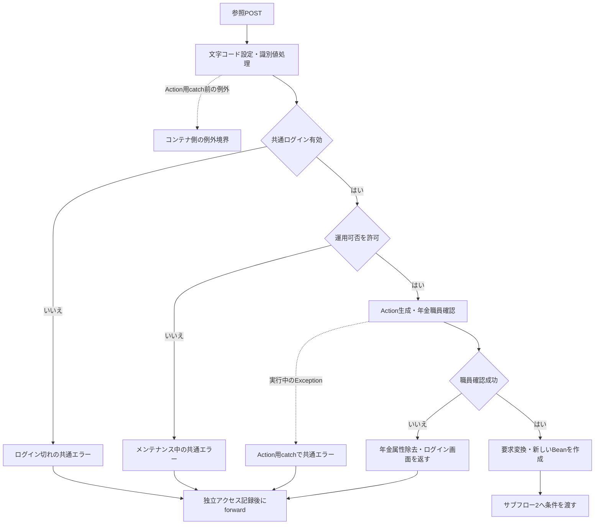

サブフロー2はモード別取得を扱う。成功出口は全件リストであり、取得・変換に失敗した経路から一覧設定へ合流させない。

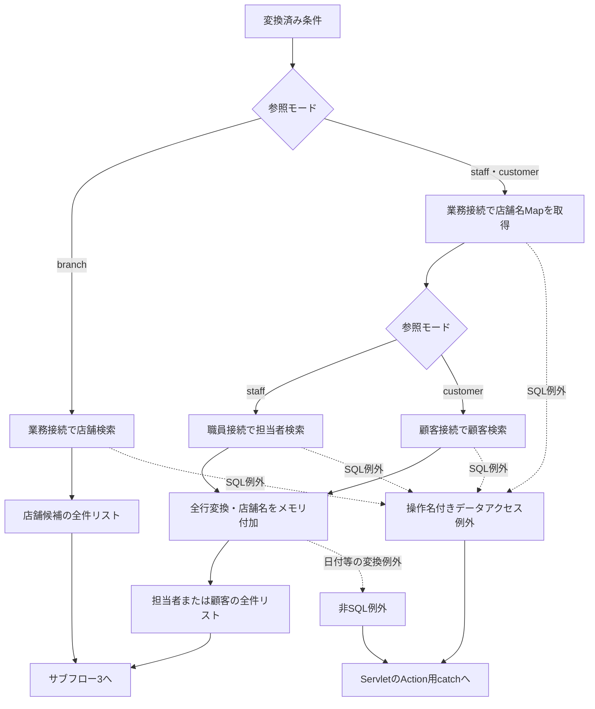

サブフロー3は全件リストから表示までを扱う。ページ補正は候補切出しの後に位置する。

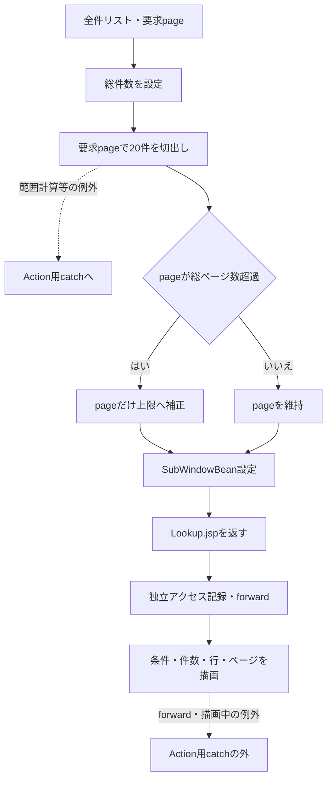

#### SQL・テーブル関連（ER図）

候補検索にSQL JOINはない。次図の関連はメモリ上の店番突合せであり、FKや多重度を表さない。

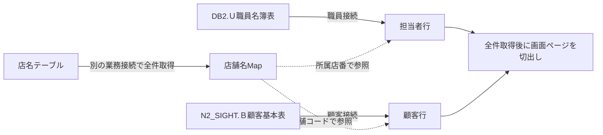

店舗検索単独では店名テーブル1表だけを扱うため、店舗検索のER図は省略する。接続先は、業務が`jdbc/RAROA_DB`、職員が`jdbc/Oracle_SP2NM`、顧客が`jdbc/Oracle_DWH`である。各種類で`java:comp/env/`付きの同名候補も探索し、DataSourceを種類別にキャッシュする。各検索のConnectionは個別取得し、年金側ではautoCommitを変更しない。

#### DB操作の詳細

以下の検索SQLは条件がすべて有効な場合を示す。条件を省く場合は対応する述語とバインドを除く。

店舗検索は次の列と順序で取得する。正規化KEYWORDが空ならWHERE全体を付けない。

```sql
SELECT 店舗ｺｰﾄﾞ AS BRANCH_NO, 店名 AS BRANCH_NAME
FROM 店名テーブル
WHERE CAST(店舗ｺｰﾄﾞ AS VARCHAR(20)) LIKE ? ESCAPE '\'
   OR UPPER(店名) LIKE UPPER(?) ESCAPE '\'
ORDER BY 店舗ｺｰﾄﾞ
```

担当者検索は店番指定時だけ所属店番条件を付け、正規化KEYWORDが非空の場合だけ括弧内の氏名条件を付ける。役職や在籍状態の追加条件はない。

```sql
SELECT S.職員番号 AS STAFF_NO,
       S.漢字氏名 AS STAFF_NAME,
       S.カナ氏名 AS STAFF_KANA_NAME,
       S.所属店番 AS BRANCH_NO,
       S.役職コード AS ROLE_CODE
FROM DB2.Ｕ職員名簿表 S
WHERE 1 = 1
  AND S.所属店番 = ?
  AND (UPPER(S.カナ氏名) LIKE UPPER(?) ESCAPE '\'
       OR UPPER(S.漢字氏名) LIKE UPPER(?) ESCAPE '\')
ORDER BY S.職員番号
```

顧客検索は店番、名称、電話をANDで結び、漢字氏名とカナ氏名だけを括弧内のORとする。

```sql
SELECT C.店舗コード AS BRANCH_NO,
       C.顧客番号 AS CUSTOMER_NO,
       C.カナ氏名 AS KANA_NAME,
       C.漢字氏名 AS CUSTOMER_NAME,
       C.電話番号 AS PHONE_NUMBER,
       C.生年月日 AS BIRTH_DATE,
       C.担当者コード AS STAFF_CODE
FROM N2_SIGHT.Ｂ顧客基本表 C
WHERE 1 = 1
  AND C.店舗コード = ?
  AND (UPPER(C.漢字氏名) LIKE UPPER(?) ESCAPE '\'
       OR UPPER(C.カナ氏名) LIKE UPPER(?) ESCAPE '\')
  AND TO_CHAR(C.電話番号) LIKE ? ESCAPE '\'
ORDER BY C.店舗コード, C.顧客番号, C.カナ氏名
```

| 検索 | パラメータの順序 | JDBC設定 |
| --- | --- | --- |
| 店舗 | 名称・番号用パターン、同じパターン | 1番・2番をsetString |
| 担当者 | 有効な店番、カナ氏名用パターン、漢字氏名用パターン | 店番はsetInt、名称はsetStringを2回 |
| 顧客 | 有効な店番、漢字氏名用パターン、カナ氏名用パターン、有効な電話パターン | 店番はsetInt、残りはsetString |
| 店舗名Map | パラメータなし | `SELECT 店舗ｺｰﾄﾞ AS BRANCH_NO, 店名 AS BRANCH_NAME FROM 店名テーブル`。WHERE・ORDER BYなし |

担当者・顧客のパラメータ番号は1から順に加算し、省略条件の分は作らない。未指定店番をsetNullで渡す方式ではない。

部分一致パターンは、バックスラッシュ、%、アンダースコア、角括弧の開始・終了を順にエスケープし、前後へ%を付ける。DB側の検索列へNFKCや空白集約は適用せず、SQLに記載したCAST・UPPER・TO_CHARだけを適用する。店舗コードのVARCHAR(20)変換幅は検索入力の上限ではない。

各検索は全行を取得する。SQLページング、setMaxRows、setFetchSize、setQueryTimeout、要求取消への接続、明示的なバインドサイズ指定はない。JDBCのsetString・setIntという設定方法と、実DB列の型・容量は分けて扱う。

#### 結果・例外時の扱い

| 状態 | 結果 |
| --- | --- |
| 全条件が空 | 各モードの全対象を取得する |
| 店番が空・不正・ゼロ以下 | 担当者・顧客の店舗条件を省き、他の有効条件だけで検索する |
| 電話条件に数字がない | 電話条件を省く。Beanの検索欄にはtrim後の入力文字列が残る |
| 店舗名Mapに対応なし・名称NULL | 店名を空表示する。候補行自体は除かない |
| 0件 | 総ページ数1、page=1、0件中0～0件、空のtbody。0件専用のメッセージ行なし |
| 範囲外の要求ページ | 通常のint演算範囲では空リストとなり得る。その後pageだけを上限へ補正する |
| 極端なPAGE・件数 | int演算のオーバーフロー検査がなく、通常範囲のページ計算と同じ結果を保証しない |

例えば全21件にPAGE=99を要求すると、先に空リストが作られ、その後pageが2になる。件数表示は21～21件となるが、行は再切出しされない。この例は処理式から導く状態である。

SQLExceptionは「店舗の検索」「職員の検索」「顧客の検索」「店舗名の取得」の操作名を持つ`NenkinDataAccessException`へ変換する。店舗名取得は職員・顧客検索のtryより前なので、その失敗を後続検索のcatchで再分類しない。finallyではResultSet、PreparedStatement、Connectionの順に閉じ、close時のExceptionは破棄する。

日付変換等の非SQL例外とAction内のページ処理例外は、サービスのSQLException用catchでは処理しない。Action自身にも検索入力エラー用catchはなく、Action実行中のExceptionは共通Servletのcatchへ届く。共通catchの処理が完了すれば、ErrorMsgにアプリケーションエラーを設定して共通エラーJSPへ進む。検索完了前は新しいSubWindowBeanの設定に到達せず、前回属性を削除する処理もない。

forwardはAction用catchより後にある。Lookup.jspの描画中の失敗を同じcatchが処理する保証はなく、全失敗の最終HTTP状態を一つに固定しない。ServletのWindows-31J応答設定とJSPのUTF-8宣言が併存するため、宣言だけから最終応答の文字コードを断定しない。

### E02 検索条件クリア

#### 処理概要

参照画面内のクリアは検索条件を空にして同じモードを再検索する。親画面のコード・名称を解除する操作ではない。

#### 処理手順

**1. 表示中の条件を空にする。**

　**1.1.** `clearFilters`はlookupForm内のtype未指定またはtype=textのinputを空にする。店番参照ではKEYWORD、担当者参照ではBRANCH_NOとKEYWORD、顧客参照ではBRANCH_NO・NAME_KEYWORD・PHONE_KEYWORDが対象となる。

　**1.2.** hiddenのTARGET・識別値・POPUPは保持し、PAGEだけを1にする。

**2. 条件解除後の検索を実行する。**

　**2.1.** Search要求を送信し、E01の認証、職員確認、検索、切出しへ接続する。担当者・顧客では店舗条件も外れる。

　**2.2.** 親へのpostMessageは送らない。親の選択済みコード・名称・LOOKUPキーはこの操作では変わらない。

#### 処理フロー

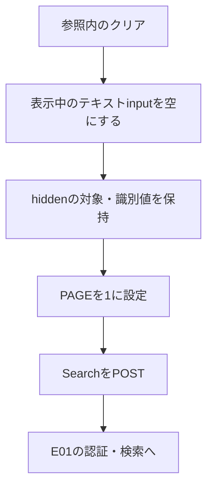

#### SQL・テーブル関連（ER図）

クリア関数自体はブラウザーDOMを変更する。再送信後はE01と同じ表を検索し、新しい検索条件に従って述語を省く。独立したER図は作らず、E01の関連図を適用する。

#### DB操作の詳細

店番参照はWHEREなしの店舗一覧、担当者・顧客参照はWHERE 1 = 1とORDER BYだけの主検索になる。担当者・顧客では店舗名Mapも取り直す。更新SQLは発行しない。

#### 結果・例外時の扱い

正常時は条件なしの1ページ目を表示する。選択解除通知はなく、一覧にも選択済み状態を保持するチェック項目はない。再検索中の失敗はE01と同じ境界で扱い、クリア後の全件取得成功をクライアント処理だけで保証しない。

### E03 行選択と親画面への移送

#### 処理概要

参照行の選択ボタンからdatasetを読み、同一originの親へ選択通知を送る。親は通知を検査して対象項目へ値を設定する。予約画面の顧客選択だけは、モーダル終了後にE04のLoadへ進む。

#### 処理手順

**1. 行の通知データを作る。**

　**1.1.** 選択ボタンの`data-choice-target`で通知区分を決め、同じボタンのdata属性から値を読む。番号もdataset由来の文字列である。

　**1.2.** 共通sendが`source=nenkin.lookup`を追加し、`window.parent.postMessage`のtargetOriginに`location.origin`を指定する。

**2. 親画面で通知を検査する。**

　**2.1.** `event.origin`と`location.origin`の一致、dataの存在、`data.source=nenkin.lookup`を確認する。満たさなければreturnし、親項目もモーダル状態も変更しない。

　**2.2.** `event.source`とiframeのcontentWindowの一致、モーダル表示中かどうか、プロパティの型・形式は検査しない。ここで受理したことは、コードや顧客のサーバー検証完了を意味しない。

**3. 呼出元別に値を設定する。**

　**3.1.** 予約画面のbranch通知はbranchNoとbranchNameを設定する。顧客番号・担当者・検索キーを消さず、LoadやSaveも送らない。

　**3.2.** 予約画面のstaff通知はstaffCodeとstaffNameDisplayを設定する。通知に含まれるbranchNoを親店番へは設定しない。

　**3.3.** 予約画面のcustomer通知はbranchNo・customerNo・branchName・customerNameDisplayを設定し、kanaNameとphoneNumberをLOOKUP_KANA・LOOKUP_PHONEへ入れる。モーダルを閉じ、Pension／Loadとして親フォーム全体を送る。編集用CUSTOMER_NAME・KANA_NAME・PHONE_NUMBERと担当者コードは、通知から直接変更しない。

　**3.4.** EXCEL出力画面はbranch通知だけをexcelBranchとexcelBranchNameへ設定する。出力要求は送らない。

　**3.5.** 検査を通ったcloseまたは未知のtargetも、親のcloseLookupへ進む。EXCEL出力画面ではbranch以外の通知も項目変更なしで閉じる。

#### 処理フロー

予約画面の受信処理は次の分岐となる。顧客選択の出口だけがLoadを伴う。

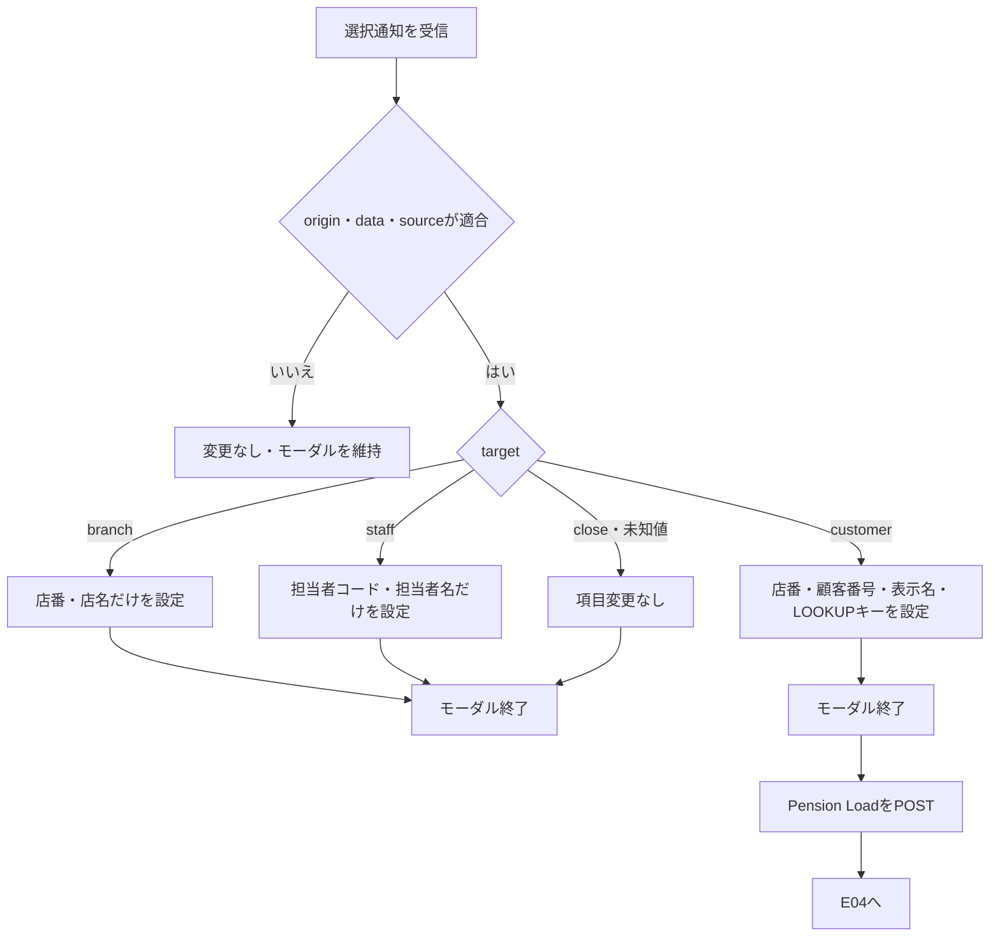

EXCEL出力画面は同じ受信検査の後、branchなら店番・店名を設定し、それ以外は項目を変更せずに閉じる。

#### SQL・テーブル関連（ER図）

通知作成と親DOMへの代入はDB非使用である。値の取得元はE01の候補検索結果であり、選択通知のたびに再照会しない。顧客選択の後続照会はE04へ接続する。

#### DB操作の詳細

| target | 個別の通知項目 | 予約画面の移送先・利用 | EXCEL出力画面 |
| --- | --- | --- | --- |
| branch | branchNo、branchName | branchNo.value、branchName.textContent | excelBranch.value、excelBranchName.textContent |
| staff | staffCode、staffName、branchNo | staffCode.value、staffNameDisplay.textContent。branchNoは使用しない | 項目変更なし |
| customer | branchNo、customerNo、branchName、customerName、staffCode、kanaName、phoneNumber | 店番・顧客番号・表示名・LOOKUPキーを設定してLoad。staffCodeは使用しない | 項目変更なし |
| close | 個別項目なし | 終了のみ | 終了のみ |

全通知にsourceを付加する。担当者の店舗名・カナ氏名・役職コード、顧客の生年月日・住所・性別は通知へ含めない。

文字列のdata属性はHTMLエスケープして出力し、親の名称表示にはtextContentを使う。親の代入は通知値が真値ならその値、それ以外なら空文字とする。通常の候補番号0はdataset上では文字列の0であり、数値0の通知と同じ評価になるとは扱わない。

#### 結果・例外時の扱い

branch・staffの選択直後に変わるのはDOMだけで、親のセッションBeanやDBは更新しない。代入時にchangeを明示発火せず、自動Loadも起動しない。閉じる際の状態とfocusはE05に従う。

customerの選択通知は後続Loadの成功を保証しない。選択時の顧客氏名は表示spanだけに入り、Load未取得時に保持するCUSTOMER_NAMEは、それ以前から編集inputに残っていた値である。選択候補の住所・性別・生年月日はLoadで再取得する。

### E04 顧客選択・手入力後の予約読込み

#### 処理概要

Loadはフリガナと電話番号で年金予約を先に探す。予約がなければ、正数の店番と顧客番号がそろった場合にだけ顧客基本表を読む。予約取得、基本表取得、未取得では採用するモデルとexisting状態が異なる。

顧客選択以外に、予約画面のフリガナまたは電話番号のchangeからも接続する。自動Loadの条件は、ORIGINAL_KANAが空、両入力がreadonlyでない、両値がtrim後非空であることとする。条件を満たす場合は現在値をLOOKUPキーへ入れてLoadを送る。顧客番号のchangeは、店番・顧客番号に値がありORIGINAL_KANAが空なら顧客参照を開く操作であり、当該顧客番号による直接Loadではない。

#### 処理手順

**1. 職員確認後、現在入力と読込みキーを受ける。**

　**1.1.** E01と同じ共通入口、年金職員確認を通る。職員拒否はログイン画面へ戻る。

　**1.2.** `readReservation`で新しいPensionReservationへ現在入力を読む。店番・顧客番号・担当者コード・予定年齢は正数Integerへ変換し、文字列はtrimする。チェック項目は要求値が1、trueまたはonの場合にtrueとする。Loadは登録用`validateAndNormalize`を呼ばないため、登録時の必須・日付・長さ検査の完了を意味しない。

　**1.3.** LOOKUP_KANAとLOOKUP_PHONEを個別にtrimする。長さ0の項目だけ現在入力のKANA_NAMEまたはPHONE_NUMBERで代用する。非空だが後段で空になるキーを再代用する処理はない。

**2. フリガナ・電話による予約優先検索を行う。**

　**2.1.** RepositoryでフリガナをNFKC、trim、空白集約、大文字化し、電話はchar単位の数字抽出結果をBigDecimalにする。電話の数値化では先頭ゼロの違いは検索値に残らない。

　**2.2.** 正規化フリガナが空、または数字抽出後の電話が空なら、業務接続を開かずnullを返す。それ以外は`R.ふりがな = ? AND R.電話番号 = ?`で予約を照会する。選択した店番と顧客番号はこのWHEREに含めない。

　**2.3.** 最初の1行を予約モデルへ変換する。ORDER BYと複数件検査がないため、同じキーの複数予約からどれを採るかはこの処理では確定しない。

**3. 予約がない場合に顧客基本表を読む。**

　**3.1.** 要求のBRANCH_NOとCUSTOMER_NOを正数Integerへ変換する。どちらかがnullなら基本表検索も省略する。

　**3.2.** 両方あれば`findByCustomer`で店舗コードと顧客番号の完全一致検索を行う。最初の1行から新しいPensionReservationを作る。現在入力へ基本情報を部分追加する処理ではない。

　**3.3.** 顧客行がなければnullを返す。顧客行があれば顧客接続を閉じた後、別の業務接続で店舗名と性別名称を取得する。店舗コード・性別コードが未指定、名称が未取得またはNULLの場合は空文字にする。表示名称の照会が失敗した場合は、基本情報だけの成功結果を返さない。

**4. 結果別に親画面モデルを確定する。**

　**4.1.** 予約があれば取得予約全体を採用し、messageを「既存データを読み込みました。」、existingをtrueにする。選択顧客の番号より、取得した予約モデルの番号と各項目が優先される。

　**4.2.** 予約なし・基本表ありなら基本表モデル全体を採用し、messageを「顧客基本表から読み込みました。」、existingをfalseにする。予約専用の文字列は空、予定年齢はnull、チェック値はfalse等、新モデルの初期値になる。

　**4.3.** 両方未取得または基本表検索用番号不足なら、手順1.2の現在入力モデルを採用し、messageを空、existingをfalseにする。これは選択通知の全表示値を復元する分岐ではない。branchNameは要求から読まないため空で、CUSTOMER_NAMEは現在の編集inputの値となる。

　**4.4.** 結果ごとのPensionViewBeanをセッションのViewBeanへ設定し、Pension.jspを返す。各枝のモデル・message・existingを共通の固定値へ上書きしない。

**5. 親画面を再表示する。**

　**5.1.** Pension.jspは表示冒頭で性別・裁定請求・受給有無・年金種類の候補をDBから再取得する。

　**5.2.** existing=trueならフリガナ・電話をreadonlyと`access-key-locked`付きで出し、ORIGINAL_KANA・ORIGINAL_PHONEに取得値を設定する。existing=falseなら編集可能で元キーは空とする。

　**5.3.** LOOKUP_KANA・LOOKUP_PHONEは結果にかかわらず空で出す。担当者コードinputにはモデル値を出すが、staffNameDisplayは常に空で出す。

#### 処理フロー

サブフロー1は検索とモデル選択である。予約なしの枝には、キー不足でDB検索を省略した場合と、照会0件の場合の両方が入る。

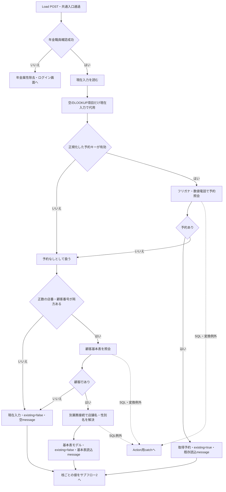

職員確認中の例外もAction用catchへ届く。入力読取り・キー変換等のAction実行中の例外も同じ境界で扱い、下図のViewBean設定へは進めない。

サブフロー2は採用モデルを保持したまま再表示する。描画成功と、ActionがJSP名を返した時点を区別する。

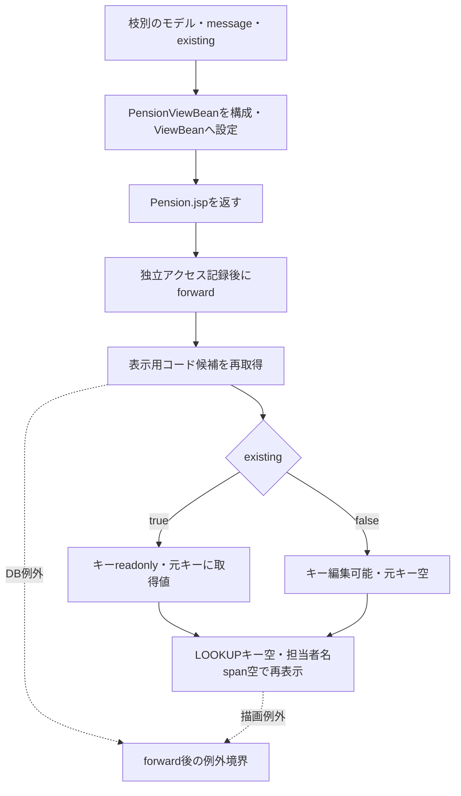

#### SQL・テーブル関連（ER図）

予約優先検索は予約表と5種類の名称表をLEFT JOINする。次図は検索条件であり、FK制約・一意性・多重度の宣言ではない。

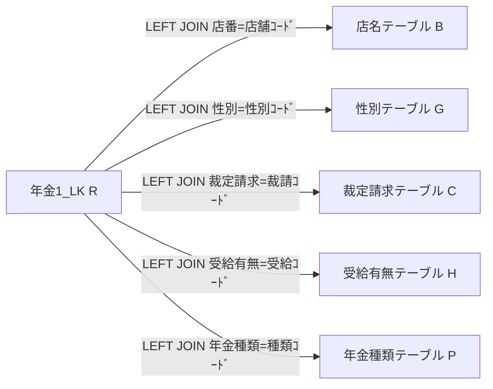

基本表フォールバックは、顧客接続の検索後に業務接続で名称を個別照会する。顧客基本表と名称表をSQL JOINする処理ではない。

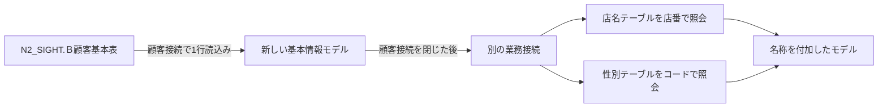

#### DB操作の詳細

予約優先検索は次の取得項目・結合・条件を使う。並び順と取得件数制限は付けず、最初のresults.nextだけを採用する。

```sql
SELECT R.店番 AS BRANCH_NO, B.店名 AS BRANCH_NAME,
       R.顧客番号 AS CUSTOMER_NO, R.担当者コード AS STAFF_CODE,
       R.顧客氏名 AS CUSTOMER_NAME, R.ふりがな AS KANA_NAME,
       G.性別 AS GENDER, R.住所 AS ADDRESS,
       R.電話番号 AS PHONE_NUMBER, R.生年月日 AS BIRTH_DATE,
       C.裁定請求 AS CLAIM_STATUS,
       R.請求予定日 AS CLAIM_SCHEDULED_DATE, R.予定年齢 AS PLANNED_AGE,
       R.予約徴求日 AS RESERVATION_REQUEST_DATE,
       R.データ更新日 AS DATA_UPDATE_DATE, R.備考 AS NOTES,
       R.配偶者名 AS SPOUSE_NAME, H.受給有無 AS HAS_BENEFIT,
       R.配偶者生年月日 AS SPOUSE_BIRTH_DATE,
       P.年金種類 AS PENSION_TYPE,
       R."種類：国民年金" AS NATIONAL_PENSION,
       R."種類：厚生年金" AS EMPLOYEE_PENSION,
       R."種類：共済年金" AS MUTUAL_AID_PENSION,
       R."種類：厚生年金基金" AS EMPLOYEE_PENSION_FUND,
       R."種類：国民年金基金" AS NATIONAL_PENSION_FUND,
       R."６ヶ月先確認" AS SIX_MONTH_CHECK
FROM 年金1_LK R
LEFT JOIN 店名テーブル B ON R.店番 = B.店舗ｺｰﾄﾞ
LEFT JOIN 性別テーブル G ON R.性別 = G.性別ｺｰﾄﾞ
LEFT JOIN 裁定請求テーブル C ON R.裁定請求 = C.裁請ｺｰﾄﾞ
LEFT JOIN 受給有無テーブル H ON R.受給有無 = H.受給ｺｰﾄﾞ
LEFT JOIN 年金種類テーブル P ON R.年金種類 = P.種類ｺｰﾄﾞ
WHERE R.ふりがな = ? AND R.電話番号 = ?
```

1番は正規化フリガナをsetString、2番は電話のBigDecimalをsetBigDecimalで設定する。店番・顧客番号・担当者コード・予定年齢はgetInt後にwasNullを確認し、Integerのnullを保持する。電話はdisplayPhoneで表示文字列へ変換する。その他の文字列NULLはモデルで空文字とし、年金種類別・確認済はgetIntの結果が0以外かでboolean化する。LEFT JOINに対応名称がない場合のNULLは、名称表側のNOT NULL宣言とは別の結果である。

顧客基本表の検索は次のSQLで、1番の店番と2番の顧客番号をsetIntで設定する。

```sql
SELECT C.店舗コード AS BRANCH_NO, C.顧客番号 AS CUSTOMER_NO,
       C.担当者コード AS STAFF_CODE, C.漢字氏名 AS CUSTOMER_NAME,
       C.カナ氏名 AS KANA_NAME, C.性別コード AS GENDER_CODE,
       C.漢字住所 AS ADDRESS, C.電話番号 AS PHONE_NUMBER,
       C.生年月日 AS BIRTH_DATE
FROM N2_SIGHT.Ｂ顧客基本表 C
WHERE C.店舗コード = ? AND C.顧客番号 = ?
```

この検索も最初の1行を採用し、ORDER BY・複数件検査はない。番号類はIntegerのNULLを保持するため、候補DTOのNULL→0変換と同一ではない。電話にはdisplayPhone、生年月日にはcompactDateを適用する。

顧客行取得後の名称照会は、`SELECT 店名 FROM 店名テーブル WHERE 店舗ｺｰﾄﾞ = ?`、続いて性別コードが変換できる場合に`SELECT 性別 FROM 性別テーブル WHERE 性別ｺｰﾄﾞ = ?`を使う。各1番へsetIntし、最初の名称を読む。性別コードのInteger変換は正数限定ではなく、空・変換不能なら性別照会を省略する。

Loadが読む現在入力の型と用途は次のとおりである。これらは未取得時に戻すモデルの材料であり、この操作では保存値へバインドしない。

| 型・変換 | 対象要求 | Loadでの扱い |
| --- | --- | --- |
| 正数Integer、変換不能はnull | BRANCH_NO、CUSTOMER_NO、STAFF_CODE、PLANNED_AGE | 番号・年齢として保持。店番と顧客番号は基本表照会条件にも使用 |
| trim後String | CUSTOMER_NAME、KANA_NAME、GENDER、ADDRESS、PHONE_NUMBER、BIRTH_DATE、CLAIM_STATUS、CLAIM_SCHEDULED_DATE、RESERVATION_REQUEST_DATE、DATA_UPDATE_DATE、NOTES、SPOUSE_NAME、HAS_BENEFIT、SPOUSE_BIRTH_DATE | 現在入力を保持。KANA_NAME・PHONE_NUMBERは空のLOOKUPキーの代用にも使用 |
| boolean | NATIONAL_PENSION、EMPLOYEE_PENSION、MUTUAL_AID_PENSION、EMPLOYEE_PENSION_FUND、NATIONAL_PENSION_FUND、SIX_MONTH_CHECK | 1、true、onを真として保持 |
| trim後String | LOOKUP_KANA、LOOKUP_PHONE | 予約検索用の制御値。保存列へ直接設定しない |
| Loadの検索では未使用 | ORIGINAL_KANA、ORIGINAL_PHONE、CSRF_TOKEN | フォームに含まれていても、本Actionは元キー比較とCSRF照合を行わない |

#### 結果・例外時の扱い

| 到達結果 | 採用モデル | message | existingと再表示 |
| --- | --- | --- | --- |
| 予約あり | 取得予約全体 | 既存データを読み込みました。 | true。フリガナ・電話readonly、元キー設定 |
| 予約なし・基本表あり | 新しい基本情報モデル全体 | 顧客基本表から読み込みました。 | false。予約専用項目は初期値、元キー空 |
| 両方なし・基本表番号不足 | readReservationで受けた現在入力 | 空 | false。選択通知だけの名称は保持モデルに含まれない |

選択候補のLOOKUPキーが空なら、親に残る現在入力を項目別に代用する。このため、空の候補電話・フリガナと、親の従前入力が組み合わさる経路がある。非空のLOOKUP_PHONEに数字がない場合や、非空のLOOKUP_KANAがNFKC後に空になる場合は、代用をやり直さず予約なしとして後続へ進む。

同一フリガナ・数値電話の予約が複数あれば、選択した店番・顧客番号との一致をこの検索は保証しない。候補選択からLoadまでの間にもデータは変わり得る。Loadは再照会するが、選択時点の版との比較や同一スナップショットを保持する処理はない。

Loadには入力エラー用catchがない。予約照会、基本表照会、電話・日付変換、表示名称照会等のExceptionがAction実行中に生じた場合は共通catchへ届く。結果のViewBean設定はこれらの後なので、途中例外時に新結果へ置き換わるとは扱わない。

基本表を読めても、別業務接続での名称解決が失敗すればLoadは成功しない。Actionが正常に戻っても、Pension.jsp冒頭の候補再取得や後続描画が失敗する場合がある。これらはAction用catchの外であり、Action戻り値だけで画面表示完了や最終HTTP状態を確定しない。

### E05 モーダルを閉じる

#### 処理概要

終了操作は参照の表示を終え、親画面を継続する。親入力の取消し、選択解除、セッション内候補の削除を伴う操作ではない。

#### 処理手順

**1. 終了のきっかけを受ける。**

　**1.1.** 参照内の閉じるボタンはsource付きのtarget=closeをpostMessageで送り、親はE03の受信検査後にcloseLookupを呼ぶ。

　**1.2.** 親モーダルの閉じるボタンと背景クリックは、親のcloseLookupを直接呼ぶ。

　**1.3.** 予約画面の親documentでEscapeを受けた場合、確認メッセージボックスが開いていればそのキャンセルを優先し、それ以外で参照が開いていれば閉じる。iframe内のキーイベントを親へ転送する処理はない。

**2. 親画面の表示状態を戻す。**

　**2.1.** モーダルをhiddenにし、iframe.srcをabout:blankへ変える。

　**2.2.** 予約画面はbodyのlookup-modal-openを除き、記憶した起動要素にfocusを戻す。EXCEL出力画面はこのbodyクラスとfocus復帰を実装しない。

　**2.3.** 親入力、名称、LOOKUPキーを消さない。SubWindowBeanを削除するHTTP要求も送らない。

#### 処理フロー

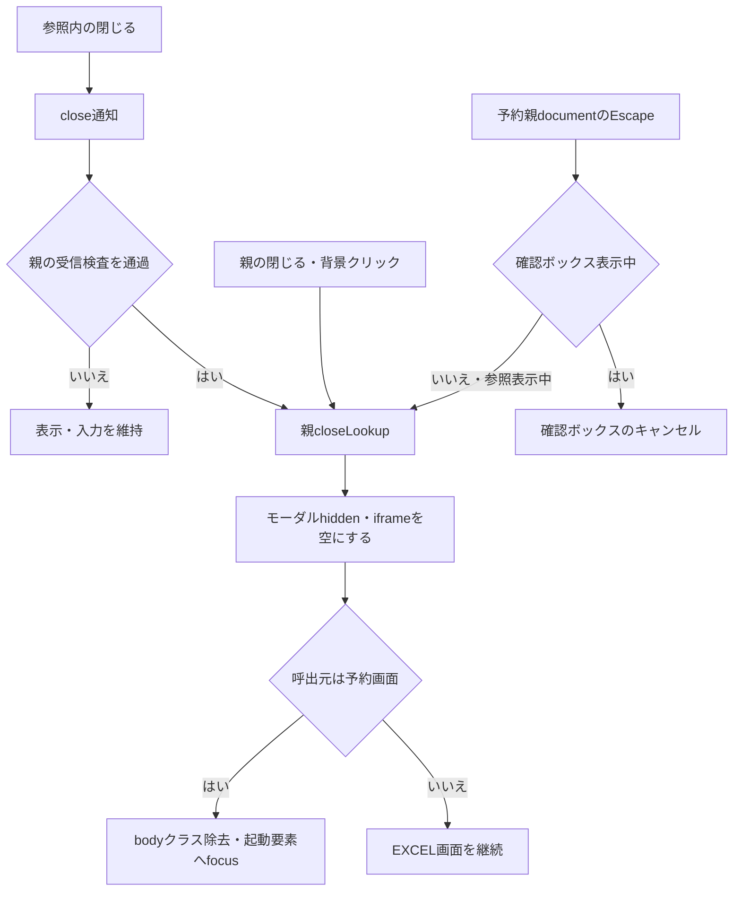

#### SQL・テーブル関連（ER図）

終了操作はブラウザーのDOMとfocusだけを扱う。業務DB・参照マスターへの操作がないためER図は不要である。セッションのSubWindowBeanは残る。

#### DB操作の詳細

SELECT・INSERT・UPDATE・DELETEは発行しない。iframeをabout:blankへ変えることを、既に開始したJDBC検索の取消し契約とは扱わない。サーバー検索に明示的な取消機構はない。

#### 結果・例外時の扱い

通常終了では選択前の親入力を保持する。選択を伴う終了ではE03で設定した値を保持する。顧客選択の場合だけ、終了直後にLoadを送る。

EXCEL出力画面には予約画面と同じEscape処理がない。app.jsの汎用モーダル処理はdata-modal等を接続条件とするため、それを持たない本モーダルのEscapeやfocus復帰を補完しない。

## 補足説明

### 検索値・候補値・表示値の区別

名称条件の正規化は検索引数だけに適用する。候補の氏名・店名は取得文字列を保持し、NULLを空文字へ変える。DB側の名称を同じ正規化規則で保存していることまでは、この参照経路から確定しない。

顧客電話の検索値は、要求から数字を抽出し、先頭ゼロを除いた部分一致文字列である。一方、表示値はDB値をgetStringで受けて同じ数字抽出・先頭ゼロ除去を行った後、9桁または10桁で先頭が0でなければ0を1文字補う。NULL・数字なしは空、ゼロは0のままで、ハイフン付加や不正桁数の拒否はしない。顧客通知のphoneNumberはこの表示値であり、DB数値や検索パターンそのものではない。

顧客生年月日は、DB文字列をtrimし、空または文字列0なら空にする。それ以外は最初の小数点より前を残し、DateUtil.toIsoDateへ渡す。NFKC後、西暦の区切り形式・8桁形式・和暦形式を解析し、実在日と元号範囲を検査する。0判定は小数点除去より先なので、0.0は除去後の0を日付解析へ渡し、単純な欠落値扱いにはならない。

一覧の生年月日は、内部ISO日付をR・H・S・T・M、空白、2桁以上の年、月日の形式で表示する。元号開始日は令和2019-05-01、平成1989-01-08、昭和1926-12-25、大正1912-07-30、明治1868-09-08で、明治開始前は西暦表示へ戻す。不正な顧客元データの変換例外は、その行だけを空欄にして続行する処理ではない。

検索条件、候補文字列、文字列のdata属性、日付表示はHtmlUtil.escapeを通す。番号はintをゼロ埋めせず出力する。SQL NULLと0を区別しない候補DTOの番号と、NULLを保持するLoadモデルのIntegerを混同しない。

### DB属性と各列の役割

次表の外部表属性はローカル互換DDLの宣言である。本番の職員・顧客表の型・容量・NULL・PKを保証する属性ではない。表IDは全体計画の安定IDを使用する。

| 表ID・表 | 列 | 収録DDLの属性 | 本機能での用途 |
| --- | --- | --- | --- |
| TBL-NEN-003 店名テーブル | 店舗ｺｰﾄﾞ | ローカルINTEGER、SQL Server DDLはINT。NOT NULL、PK | 店番候補キー、番号部分一致、店舗名Mapのキー、Load後の店名照会 |
| TBL-NEN-003 店名テーブル | 店名 | ローカルVARCHAR(80)、SQL Server DDLはNVARCHAR(80)。NOT NULL | 店舗名検索、候補・親画面の表示、メモリ付加名称 |
| TBL-N2-002 DB2.Ｕ職員名簿表 | 職員番号 | ローカルDECIMAL(18,0)、NOT NULL、PK | 担当者コードと並び順。職員確認でも利用 |
| TBL-N2-002 DB2.Ｕ職員名簿表 | 所属店番 | ローカルDECIMAL(18,0)、NULL可 | 担当者の店舗絞込み、店名突合せ、候補表示 |
| TBL-N2-002 DB2.Ｕ職員名簿表 | 漢字氏名・カナ氏名 | ローカル各VARCHAR(40)、NULL可 | 両方を名称検索。漢字氏名を一覧・通知へ使用 |
| TBL-N2-002 DB2.Ｕ職員名簿表 | 役職コード | ローカルDECIMAL(18,0)、NULL可 | 担当者候補モデルへ文字列で保持。候補の絞込み・通知には使用しない |
| TBL-N2-007 N2_SIGHT.Ｂ顧客基本表 | 店舗コード・顧客番号 | ローカル各DECIMAL(18,0)、NOT NULL、2列の複合PK | 候補の店舗絞込み・並び順・移送、Loadの完全一致条件 |
| TBL-N2-007 N2_SIGHT.Ｂ顧客基本表 | カナ氏名 | ローカルVARCHAR(48)、NULL可 | 名称検索、一覧、LOOKUP_KANA、基本表Load |
| TBL-N2-007 N2_SIGHT.Ｂ顧客基本表 | 漢字氏名 | ローカルVARCHAR(96)、NULL可 | 名称検索、顧客氏名表示、基本表Load |
| TBL-N2-007 N2_SIGHT.Ｂ顧客基本表 | 担当者コード | ローカルDECIMAL(18,0)、NULL可 | 候補のdata属性・通知、基本表Loadの担当者。親の直接代入対象外 |
| TBL-N2-007 N2_SIGHT.Ｂ顧客基本表 | 電話番号 | ローカルDECIMAL(18,0)、NULL可 | TO_CHARによる検索、表示変換、LOOKUP_PHONE、基本表Load |
| TBL-N2-007 N2_SIGHT.Ｂ顧客基本表 | 生年月日 | ローカルDECIMAL(18,0)、NULL可 | 一覧の和暦表示、基本表Load。通知項目外 |
| TBL-N2-007 N2_SIGHT.Ｂ顧客基本表 | 漢字住所 | ローカルVARCHAR(160)、NULL可 | 参照一覧では取得せず、基本表Loadで親の住所へ設定 |
| TBL-N2-007 N2_SIGHT.Ｂ顧客基本表 | 性別コード | ローカルVARCHAR(1)、NULL可 | 基本表LoadでIntegerへ変換し、性別名称を別照会 |

上記の対象列には列DEFAULTの宣言がなく、店舗と外部表の間のFKも宣言されていない。店名テーブルのDDLは表がない場合の作成であり、既存の配備表を変更・照合する処理ではない。SQL Server用DDLでは職員・顧客表を既存N2 Oracle表として作成対象外にしている。

名称マスターの保存・更新入口、登録時の名称正規化、名称の業務上限、停止・廃止値の運用は、この参照・Load経路では確定しない。VARCHAR・NVARCHARの容量を、承認された入力上限やバイト上限に読み替えない。検索サービスには停止状態による絞込みがないため、取得された候補を停止値として無効化する表示条件もない。

検索欄のブラウザーmaxlength、サービスの業務検査、Javaの型変換、SQLのCAST幅、DB容量は別の制約である。名称・電話欄に到達処理上の長さ検査がないことは、無制限運用が承認されていることを意味しない。

### 更新・排他・アクセス記録の境界

本機能の業務操作はSELECT、要求内メモリ操作、セッション属性設定、親DOM更新である。保存対象、比較版、更新件数検査、業務更新のcommit・rollbackは参照とLoadには存在しない。別接続の店舗名Mapと職員・顧客検索結果は、一つの読み取りスナップショットを構成しない。

共通ServletはAction結果の後、forward前にカウンターシフト記録を呼ぶ。これは別の共通接続でDB2.ＵカウンターシフトへINSERTし、独立してcommitする処理である。失敗時はrollbackを試みてログへ記録し、呼出元へ成功可否の値を返さない。MESSAGE属性がある場合は、記録上のJSP名だけSubMessage.jspとなる。実forward先が同じ値へ変わるとは扱わない。参照検索とこの記録を一体のトランザクションとして説明しない。

### 関連文書

以下は全体計画上の参照先である。ここでは生成済み状態を表さず、パスは本書からの相対位置で示す。

| 文書ID | 計画上の相対パス | 対応する責務 |
| --- | --- | --- |
| SCR-016 | `../基本設計書/基本設計書_SCR-016_店番参照／担当者参照／顧客参照.md` | 三モードの業務操作と状態 |
| DET-SCR-018 | `詳細仕様書_SCR-018_新規・変更・削除.md` | 予約画面全項目、登録・変更・削除、Load結果の利用 |
| DET-SCR-015 | `詳細仕様書_SCR-015_EXCEL出力.md` | 選択店番を使うEXCEL出力の入力検査と出力処理 |
| COM-012 | `../共通/共通仕様書_COM-012_共通コントロールサーブレット.md` | 共通認証、Action生成、例外捕捉、アクセス記録、forward |
| COM-111 | `../共通/共通仕様書_COM-111_年金業務共通処理.md` | 年金職員確認、受信変換、Bean構成 |
| COM-151 | `../共通/共通仕様書_COM-151_画面共通入力・通信制御.md` | 数字入力補助、共有CSSと画面通信 |
| DATA-CONTRACTS | `../共通/データオブジェクト定義書.md` | 候補DTO、PensionReservation、各ViewBeanの型と保持領域 |
| DB-OPS | `../共通/DB仕様書/DB操作仕様書.md` | 接続、SQL・JDBC、検索結果変換の共通整理 |
| DB-PHYSICAL | `../共通/DB仕様書/テーブル定義書.md` | 対象表の収録DDLと本番外部表属性の区別 |
