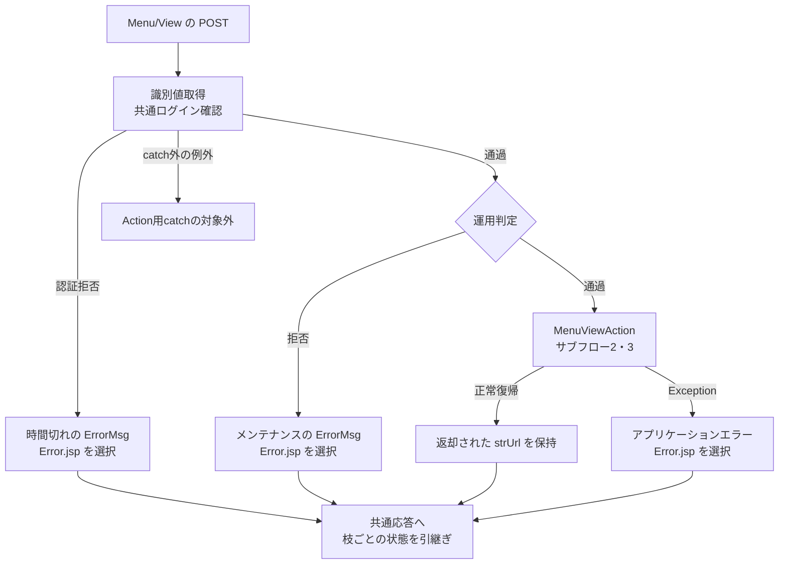
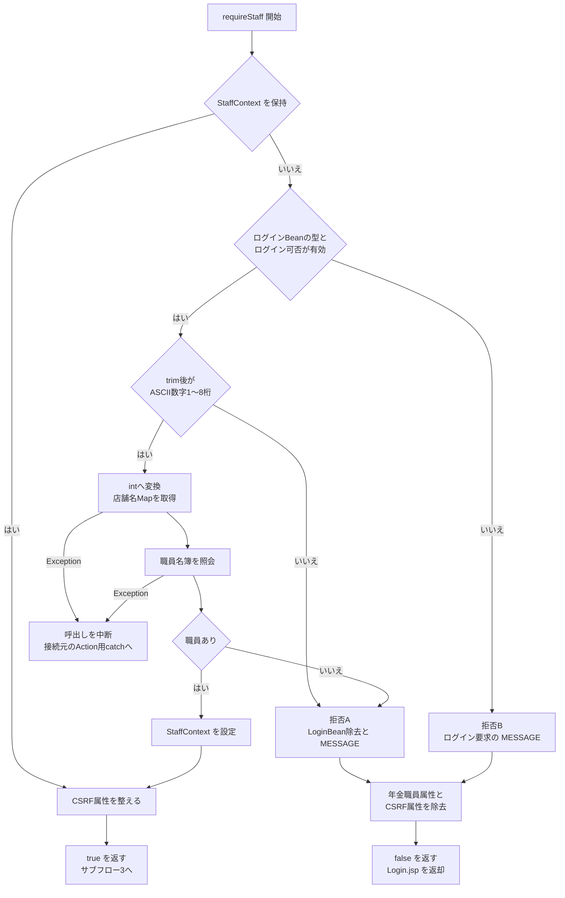
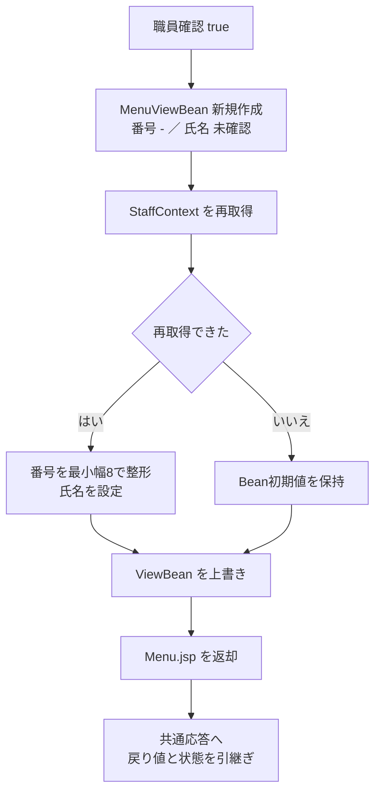
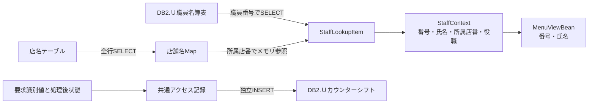
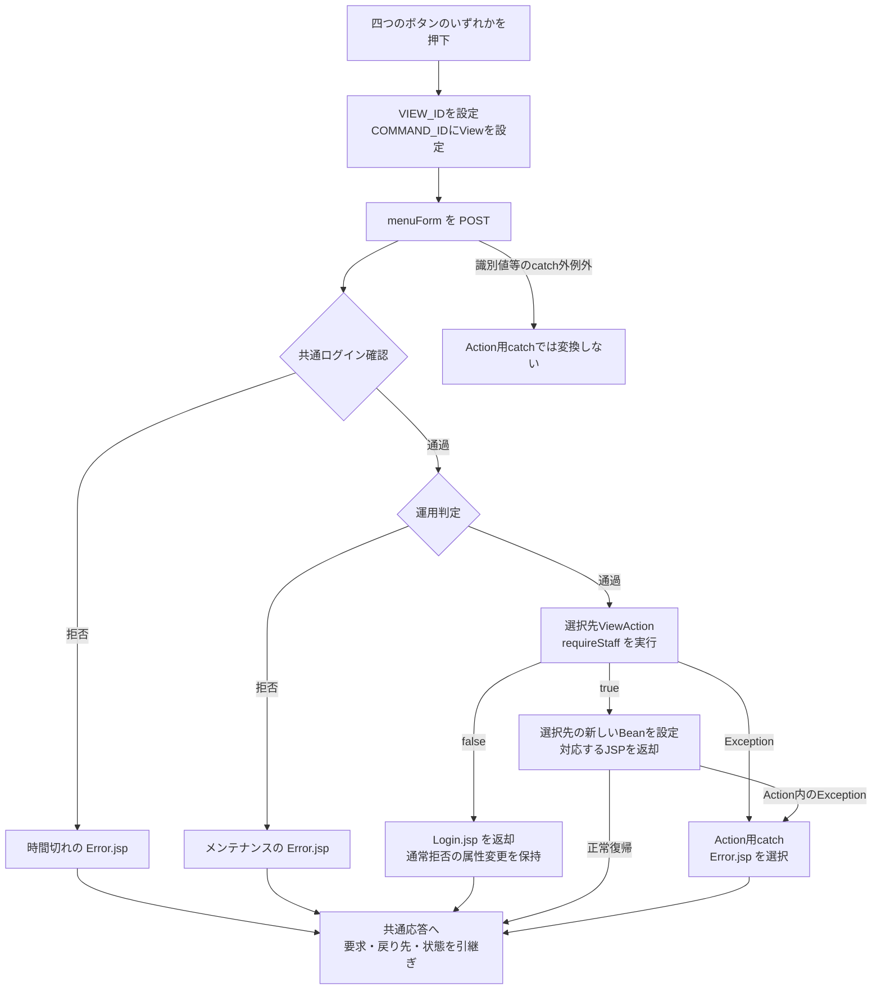
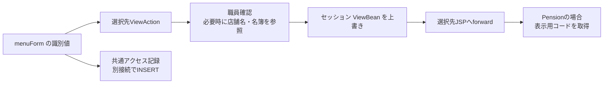
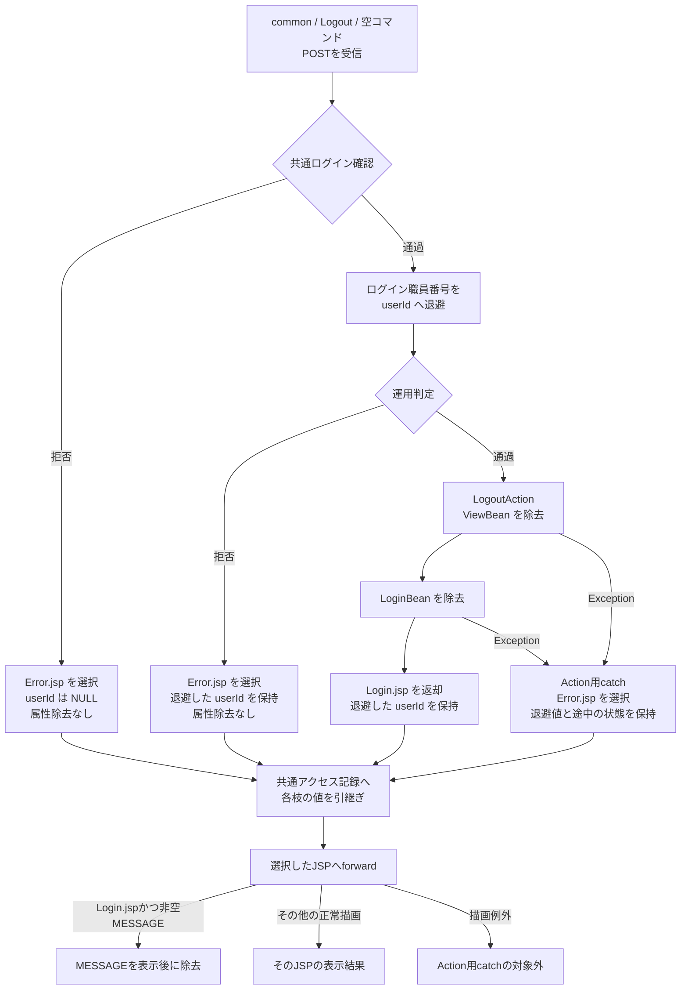
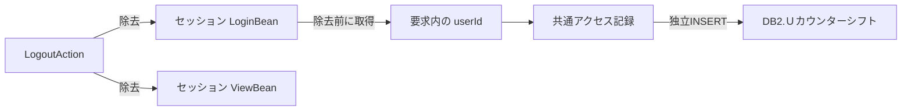
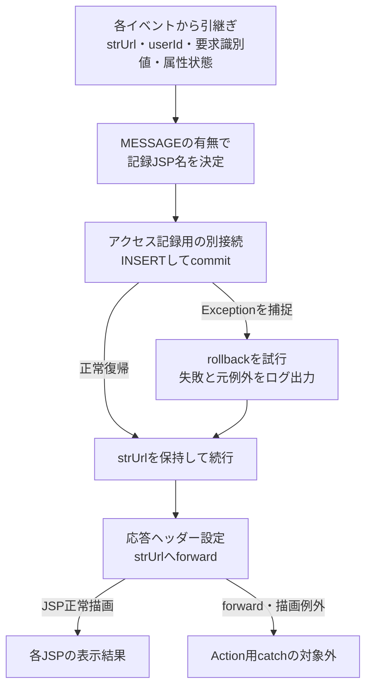

<!-- spec-meta: {"schema":"spec-md/1.0","documentId":"DET-SCR-017","version":"2.0","path":"詳細仕様書/詳細仕様書_SCR-017_年金自動受取予約管理システム.md","sheets":[{"heading":"概要","kind":"GRID","sheet":"概要"},{"heading":"項目一覧","kind":"LIST","sheet":"項目一覧","key":["No"]},{"heading":"イベント仕様","kind":"GRID","sheet":"イベント仕様"},{"heading":"補足説明","kind":"GRID","sheet":"補足説明"}]} -->
# 年金メニュー詳細仕様

| 属性 | 内容 |
| --- | --- |
| 文書種別 | 詳細仕様書 |
| システム名 | 年金自動受取予約管理システム |
| 機能ID | SCR-017 |
| 文書ID | DET-SCR-017 |
| 版 | 2.0 |
| 解析対象 | 年金メニューのJSP、表示Action、表示Bean、年金職員確認、共通要求処理およびログアウトの接続部分 |
| 基準日 | 2026-10-15 |

## 概要

### 機能の責務と入口

年金メニューは、セッションに保持されたログイン職員の番号と氏名を表示し、予約の新規・変更・削除、日次・月次の処理データ、登録内容印刷、店舗別EXCEL出力の各画面へ進む入口である。メニューボタンを押した段階では、予約の保存・削除、印刷プレビューの検索、出力ファイルの生成を指示しない。

メニュー表示の業務処理は、年金職員情報の確認と表示Beanの作成である。予約本表と削除明細への更新は行わない。職員情報が未保持の場合には店舗名と職員名簿を参照する。また、共通Servletは運用判定用の接続取得とアクセス記録を別に行うため、メニュー要求全体をDB非使用の処理とは扱わない。

通常画面からの要求先は、コンテキストパス配下の`/Action.do`である。`web.xml`により`common.ControlServlet`へ接続され、通常POSTでは受信パラメータからAction名を組み立てる。

| 入口 | 要求または呼出し | 実行関係 | メニュー表示との関係 |
| --- | --- | --- | --- |
| ログインからの移行 | `FUNCTION_ID=nenkin`、`VIEW_ID=Login`、`COMMAND_ID=空文字` | `nenkin.LoginAction`が共通ログイン処理を呼び、その戻り値が`./JSP/MENU/Login.jsp`以外の場合に`MenuViewAction.perform`へ委譲する | 初回表示の通常導線。要求識別値はLoginのまま引き継ぐ |
| メニュー表示・各画面から戻る | `FUNCTION_ID=nenkin`、`VIEW_ID=Menu`、`COMMAND_ID=View` | `nenkin.MenuViewAction`を生成する | 表示のたびに新しい`MenuViewBean`を設定する |
| 互換Action | `StaffViewAction`、`StaffVerifyAction`、`StaffClearAction`からの呼出し | いずれも`MenuViewAction.perform`へ委譲する | このメニューに職員番号の入力・確認・クリア操作を追加するものではない |
| ログアウト | `FUNCTION_ID=common`、`VIEW_ID=Logout`、`COMMAND_ID=空文字` | `common.LogoutAction`を生成する | 共通属性を除去してログインJSPへ戻る |

通常のMenu/View要求では、共通の`LoginBean`確認を通過してから年金側の`requireStaff`を実行する。ログイン要求ではServletの既存ログイン確認を省略し、ログインAction自身の認証処理を経てメニュー表示へ委譲する。この二つの入口を同一の認証手順にはまとめない。

### 画面構成と静的投影

画面上部の`header.app-nav`にはシステム名と独立したログアウトフォームを置く。`main.app-shell`内の`section.screen.surface.menu-screen`には、システム名の見出し、ログイン職員表示、四つのメニューボタンを置く。職員番号は`strong`、氏名は`span`による表示であり、送信する入力欄ではない。

最大画面幅は1440pxである。通常のボタン領域は最大396pxの一列で、上余白48px、ボタン間隔20pxとなる。幅960px以下では二列になり、幅640px以下では後続規則により一列へ戻る。最大396pxの指定は二列の場合にも残る。幅640px以下では画面見出し領域もgrid配置になる。

以下は実DOMと適用CSSに基づく非実行の静的投影である。職員情報の差込位置を置換記号で示す。実画面の撮影ではない。フォームの送信先と操作識別値は`data-*`属性へ残し、送信処理とJavaScriptイベントは接続しない。

<!DOCTYPE html>
<html lang="ja">
<head>
<meta charset="UTF-8">
<meta name="viewport" content="width=device-width, initial-scale=1">
<title>年金自動受取予約管理システム</title>
<style>
:root {
  --bg: #edf1f4;
  --surface: #ffffff;
  --line: #b8c2cc;
  --text: #18212a;
  --nav: #16324a;
  --nav-text: #f4f8fb;
  --primary-dark: #0a5148;
  --button: #e8edf1;
  --button-border: #7b8792;
  --focus: #1a75bb;
}
*, *::before, *::after { box-sizing: border-box; }
button, input, select, textarea { margin: 0; font: inherit; }
button, [type="button"], [type="submit"], [type="reset"] { cursor: pointer; }
button:focus-visible { outline: 2px solid var(--focus); outline-offset: 1px; }
body {
  min-height: 100vh;
  margin: 0;
  color: var(--text);
  background: var(--bg);
  font-family: "Yu Gothic UI", "Meiryo", "Segoe UI", sans-serif;
}
.app-shell { width: 100%; max-width: 1440px; margin-inline: auto; }
.app-nav {
  display: flex;
  min-height: 48px;
  align-items: center;
  justify-content: space-between;
  gap: 12px;
  padding: 7px 18px;
  color: var(--nav-text);
  background: var(--nav);
  border-bottom: 1px solid #0c2236;
}
.app-nav__title { color: var(--nav-text); font-weight: 800; line-height: 1.25; }
.nav-button {
  min-height: 32px;
  padding: 4px 12px;
  color: var(--nav-text);
  background: #294a64;
  border: 1px solid #8da3b5;
  border-radius: 3px;
  font-weight: 700;
}
.nav-button:hover, .nav-button:focus { background: #365f7d; border-color: #ffffff; }
main.app-shell:not(.login-shell) { padding: 20px 18px 52px; }
.surface {
  background: var(--surface);
  border: 1px solid var(--line);
  border-radius: 6px;
  box-shadow: 0 1px 2px rgba(16, 32, 48, 0.08);
}
.screen { padding: 18px; }
.screen-header {
  display: flex;
  gap: 16px;
  align-items: flex-start;
  justify-content: space-between;
  margin-bottom: 18px;
  padding-bottom: 12px;
  border-bottom: 1px solid var(--line);
}
.screen-header-actions {
  display: flex;
  flex-wrap: wrap;
  gap: 10px;
  align-items: flex-start;
  justify-content: flex-end;
}
h1 { margin: 0; font-size: 1.45rem; font-weight: 700; letter-spacing: 0; }
.staff-badge {
  display: grid;
  grid-template-columns: auto auto auto;
  gap: 8px;
  align-items: center;
  min-height: 34px;
  padding: 6px 10px;
  background: #eef7f5;
  border: 1px solid #9fc3bc;
  border-radius: 4px;
  color: var(--primary-dark);
}
.staff-badge strong { font-variant-numeric: tabular-nums; }
.menu-grid {
  display: grid;
  grid-template-columns: minmax(260px, 396px);
  gap: 20px;
  align-items: stretch;
  justify-content: center;
  max-width: 396px;
  margin: 48px auto 0;
}
.access-button {
  display: inline-flex;
  min-height: 42px;
  align-items: center;
  justify-content: center;
  padding: 8px 18px;
  color: var(--text);
  background: var(--button);
  border: 1px solid var(--button-border);
  border-radius: 4px;
  font-weight: 700;
  text-decoration: none;
  line-height: 1.2;
}
.access-button:hover, .access-button:focus {
  color: var(--text);
  background: #dce5eb;
  border-color: var(--focus);
}
@media (max-width: 960px) {
  .menu-grid { grid-template-columns: 1fr 1fr; }
}
@media (max-width: 640px) {
  .screen-header { display: grid; }
  .menu-grid { grid-template-columns: 1fr; }
}
</style>
</head>
<body>
<header class="app-nav">
  <div class="app-nav__title">年金自動受取予約管理システム</div>
  <form data-source-action="{contextPath}/Action.do" data-source-method="POST">
    <input type="hidden" name="FUNCTION_ID" value="common">
    <input type="hidden" name="VIEW_ID" value="Logout">
    <input type="hidden" name="COMMAND_ID" value="">
    <button class="nav-button" type="button">ログアウト</button>
  </form>
</header>
<main class="app-shell">
  <section class="screen surface menu-screen">
    <div class="screen-header">
      <h1>年金自動受取予約管理システム</h1>
      <div class="screen-header-actions">
        <div class="staff-badge">
          <span>ログイン職員</span>
          <strong>［職員番号表示値］</strong>
          <span>［職員氏名表示値］</span>
        </div>
      </div>
    </div>
    <form id="menuForm" data-source-action="{contextPath}/Action.do" data-source-method="POST">
      <input type="hidden" name="FUNCTION_ID" value="nenkin">
      <input id="menuView" type="hidden" name="VIEW_ID" value="Menu">
      <input id="menuCommand" type="hidden" name="COMMAND_ID" value="View">
      <div class="menu-grid">
        <button class="access-button" type="button" data-view="Pension" data-command="View">新規・変更・削除</button>
        <button class="access-button" type="button" data-view="Batch" data-command="View">処理データ</button>
        <button class="access-button" type="button" data-view="Report" data-command="View">印刷</button>
        <button class="access-button" type="button" data-view="Excel" data-command="View">EXCEL出力</button>
      </div>
    </form>
  </section>
</main>
</body>
</html>

原画面のヘッダー直下には`.app-shell`の内側ラッパーがない。このため、`.app-nav .app-shell`を対象とする共有CSSの規則は、このヘッダーには適用されない。投影にもそのラッパーを追加していない。

### 表示状態

| 状態 | 職員表示と画面 | 操作の状態 |
| --- | --- | --- |
| 職員情報を保持した通常表示 | 保持中の番号と氏名から新しいメニューBeanを作る | 四つのボタンとログアウトを表示する |
| 職員情報を補完できた表示 | 名簿から作成した職員情報をセッションへ保持し、番号と氏名を表示する | 通常表示と同じ |
| 職員確認後の再取得結果がNULL | メニューBeanの初期値である番号`-`、氏名`未確認`を表示する枝がある | JSPにはこの枝でボタンを無効化する条件がない |
| 職員番号形式不正・名簿不在 | 新しいメニューBeanを作らずログインJSPへ戻る | メニューを通常表示する結果ではない |
| 共通認証拒否・運用判定拒否・Action用catchで捕捉した例外 | 各原因の共通エラーJSPを選択する | メニュー表示成功とは扱わない |
| 各業務画面から戻る | Menu/ViewをPOSTし、職員確認後にメニューBeanを作り直す | 以前のメニューBeanの再利用ではない |

所属店番や役職によるメニューボタンの非表示・無効化はない。`isRestrictedStaff`はこの表示Actionから呼ばれず、メニューの利用可能表示と、予約変更・削除時の実行権限は別の判定である。

## 項目一覧

| No | グループ | 項目名 | 種類 | 入出力 | DB連携項目 | 候補取得元 | 必須 | 形式・桁 | 説明 |
| --- | --- | --- | --- | --- | --- | --- | --- | --- | --- |
| 1 | 画面共通 | システム名 | 固定表示 | O | 非DB項目 | 候補なし | 入力対象外 | 固定文字列 | `div.app-nav__title`と`h1`に「年金自動受取予約管理システム」を表示する |
| 2 | 職員表示 | ログイン職員 | 固定ラベル | O | 非DB項目 | 候補なし | 入力対象外 | 固定文字列 | `.staff-badge`内の先頭`span`。後続の職員番号と氏名の意味を示す |
| 3 | 職員表示 | 職員番号 | `strong`による表示 | O | 参照元は`DB2.Ｕ職員名簿表.職員番号`。メニューから保存しない | 候補なし | 入力対象外 | `StaffContext.staffNo`は`int`、`MenuViewBean.staffNo`は`String`。表示は最小幅8のゼロ埋め | 保持済み職員情報または補完結果を表示する。フォーム項目としては送信しない。Bean初期値は`-` |
| 4 | 職員表示 | 職員氏名 | `span`による表示 | O | 参照元は`DB2.Ｕ職員名簿表.漢字氏名`。メニューから保存しない | 候補なし | 入力対象外 | 移送値は`String`。業務上限検査はこの経路にない | `.staff-badge`内の末尾`span`へHTMLエスケープして表示する。Bean初期値およびNULL設定時の代替値は文字列`未確認` |
| 5 | メニュー | 新規・変更・削除 | `button.access-button` | I | 遷移制御。直接保存する列なし | 候補なし | 押下時に遷移 | `type=button` | `go('Pension','View')`を呼び、予約入力画面の表示を要求する |
| 6 | メニュー | 処理データ | `button.access-button` | I | 遷移制御。直接保存する列なし | 候補なし | 押下時に遷移 | `type=button` | `go('Batch','View')`を呼び、日次・月次画面の表示を要求する |
| 7 | メニュー | 印刷 | `button.access-button` | I | 遷移制御。直接保存する列なし | 候補なし | 押下時に遷移 | `type=button` | `go('Report','View')`を呼ぶ。この押下では明細プレビューを作成しない |
| 8 | メニュー | EXCEL出力 | `button.access-button` | I | 遷移制御。直接保存する列なし | 候補なし | 押下時に遷移 | `type=button` | `go('Excel','View')`を呼ぶ。この押下ではファイルを生成しない |
| 9 | 画面共通 | ログアウト | `button.nav-button` | I | 共通アクセス記録は別途実施。業務表のログアウト状態は更新しない | 候補なし | 押下時に送信 | 原画面は`type=submit` | ヘッダーの独立フォームからcommon/Logout/空コマンドをPOSTする |
| 10 | メニュー要求 | 機能識別値 | hidden `FUNCTION_ID` | I | 保存列ではない。共通記録の`機能ＩＤ`に使用する | 候補なし | メニュー遷移要求で送信 | 固定値`nenkin`、受信型`String` | `menuForm`内に置く。サーバーでは小文字化した値をActionパッケージ名に用いる |
| 11 | メニュー要求 | 画面識別値 | hidden `VIEW_ID`、id=`menuView` | I | 保存列ではない。共通記録の`画面ＩＤ`等に使用する | 候補なし | メニュー遷移要求で送信 | 初期値`Menu`、受信型`String` | `go`の第1引数で変更する。業務データの入力DTOではない |
| 12 | メニュー要求 | コマンド識別値 | hidden `COMMAND_ID`、id=`menuCommand` | I | 保存列ではない。共通記録の`コマンドＩＤ`等に使用する | 候補なし | メニュー遷移要求で送信 | 初期値`View`、受信型`String` | `go`の第2引数で変更する。四つのボタンはいずれも`View`を設定する |
| 13 | ログアウト要求 | 機能識別値 | hidden `FUNCTION_ID` | I | 共通記録の`機能ＩＤ`に使用する | 候補なし | ログアウト要求で送信 | 固定値`common`、受信型`String` | メニュー遷移フォームとは別のフォームに置く |
| 14 | ログアウト要求 | 画面識別値 | hidden `VIEW_ID` | I | 共通記録の`画面ＩＤ`等に使用する | 候補なし | ログアウト要求で送信 | 固定値`Logout`、受信型`String` | 共通Servletでログアウト前の利用者識別取得にも使用する |
| 15 | ログアウト要求 | コマンド識別値 | hidden `COMMAND_ID` | I | 共通記録では空文字からSQL NULLへ変換する | 候補なし | 項目を空文字で送信 | 固定値は空文字、受信型`String` | 正常な組合せで`common.LogoutAction`を生成する。パラメータ欠落とは異なる |

## イベント仕様

### メニュー表示・再表示

#### 処理概要

`MenuViewAction.perform(HttpServletRequest, HttpServletResponse)`は、年金職員情報を確認し、職員番号と氏名を持つ新しい`MenuViewBean`を共通セッション属性`ViewBean`へ設定する。正常戻り値は`./JSP/NENKIN/Menu.jsp`である。職員確認が通常拒否になった場合の`STAFF_JSP`は、旧職員入力画面ではなく`./JSP/MENU/Login.jsp`と同値である。

各業務画面の「戻る」もMenu/ViewをPOSTするため、同じ表示処理を通る。ログインから委譲された場合にも表示Actionの処理は共通だが、Servletで保持する要求識別値は元のLogin要求のままである。

#### 処理手順

**1. 共通Servletから表示Actionへ接続する。**

　**1.1.** 通常POSTでは、要求文字コードをWindows-31Jに設定してから識別パラメータを取得する。Menu/View要求では、セッションの`LoginBean`を`LoginInfoBean`へキャストし、非NULLかつログイン可否がtrueであることを確認する。

　**1.2.** 共通認証が通常拒否になった場合は、`ErrorMsg`へ「ログイン時間切れです。再度ログインしてください。」を設定し、共通エラーJSPを選択する。`MenuViewAction`は呼ばない。ログインActionからの委譲では、既存ログインの確認を省略したLogin要求の処理が先行する。

　**1.3.** 共通認証を通過したMenu/View要求では、`OperatePermission.check`を実行する。nenkinは運用状態表の検索対象分岐に含まれないが、対象判定前に共通接続を取得する。接続取得等の失敗でfalseになった場合は、メンテナンス文言を`ErrorMsg`へ設定し、表示Actionを呼ばず共通エラーJSPを選択する。

　**1.4.** 運用判定通過後、`nenkin.MenuViewAction`を生成して`perform`を呼ぶ。反射処理とAction実行を囲むcatchへ到達した`Exception`は、共通アプリケーションエラーへ変換する。識別値処理等のcatch外の境界は補足説明に定める。

**2. 年金職員情報を確認する。**

　**2.1.** `requireStaff`は`NENKIN_STAFF_CONTEXT`を読み、値が`StaffContext`型であればその情報を再利用する。この枝では名簿を照会せず、現在の`LoginBean`との職員番号一致、名簿上の状態、所属店番、役職を再検証しない。CSRF属性を整えてtrueを返す。

　**2.2.** 職員情報がないか別型の場合は、`LoginBean`が`LoginInfoBean`型でログイン可否trueであることを年金側でも確認する。その職員番号を、NULLなら空文字、それ以外なら`String.trim()`後の文字列へ変換する。ASCII数字1～8桁の`[0-9]{1,8}`に一致した場合だけ`Integer.parseInt`し、`verifyStaff(int)`へ渡す。これはメニューフォームの入力検査ではなく、共通ログインBean内の値の検査である。ゼロを拒否する条件はない。

　**2.3.** `verifyStaff`は、先に店舗名をMapへ取得し、その後、職員番号を条件に職員名簿を照会する。職員を取得できれば、番号・氏名・所属店番・役職コードから`StaffContext`を作成してセッションへ設定し、CSRF属性を整えてtrueを返す。

　**2.4.** ログイン可否trueのBeanがあるものの、番号形式が不正または名簿照会結果がNULLの場合は、`LoginBean`を除去し、`MESSAGE`へ「ログイン職員番号が職員名簿に存在しません。管理者に確認してください。」の一件リストを設定する。続いて年金職員属性とCSRF属性を除去し、falseを返す。

　**2.5.** `requireStaff`内でログインBeanの型またはログイン可否条件を満たさない場合は、`MESSAGE`へ「ログインしてください。」を設定する。この枝では`LoginBean`自体を除去せず、年金職員属性とCSRF属性を除去してfalseを返す。通常のMenu/View要求では先行する共通認証があるため、この単体契約を通常の全受信要求が到達する枝とは扱わない。特に別型の`LoginBean`は、共通側のキャストで先に例外となり得る。

　**2.6.** 職員確認がfalseの場合は、新しいメニューBeanを作らずログインJSPを返す。DB例外等で処理が中断した場合は、手順2.4・2.5の末尾にある属性除去へ到達するとは限らない。

**3. メニューの表示値を作成する。**

　**3.1.** 職員確認成功後、`MenuViewBean`を新規作成する。番号の初期値は`-`、氏名の初期値は`未確認`である。

　**3.2.** セッションから`StaffContext`を再取得する。取得できた場合は、番号を`String.format(Locale.ROOT, "%08d", Integer.valueOf(staff.getStaffNo()))`で文字列化し、氏名とともにBeanへ設定する。この8はゼロ埋めの最小幅であり、上限検査でも切捨てでもない。既存`StaffContext`の番号に対する範囲検査はここにはない。

　**3.3.** 再取得結果がNULLの場合は、番号と氏名の初期値を変更しない。この枝でも表示Beanの設定へ進む。

　**3.4.** `setViewBean`でセッション属性`ViewBean`を上書きし、`./JSP/NENKIN/Menu.jsp`を返す。JSPは番号と氏名を`HtmlUtil.escape`して表示する。

**4. 共通処理を経てJSPへforwardする。**

　**4.1.** Servletは、Logout以外の要求について、その時点の`LoginBean`が非NULLなら職員番号を`userId`へ設定する。年金職員確認で`LoginBean`を除去した枝ではNULLのままである。共通認証拒否であっても、型が正しい非NULLのBeanが残っていれば、この後処理で番号を取得する場合がある。

　**4.2.** 戻り先、要求識別値、利用者識別値、`MESSAGE`の有無を保って共通アクセス記録へ進む。その後、選択済みのJSPへforwardする。記録とforwardの契約は補足説明「共通応答とアクセス記録」に定める。

#### 処理フロー

サブフロー1は通常のMenu/View要求の入口である。ログインからの委譲はログイン処理を経てサブフロー2へ入る。その場合も元の要求識別値を保持する。



サブフロー2は`requireStaff`の判定である。図中の拒否Aは手順2.4、拒否Bは手順2.5に対応する。補完中の例外をfalseの戻り値へ置き換えない。



サブフロー3では、職員確認の成功と、表示値の再取得結果を分ける。どちらの設定枝も、それぞれの値を保持して`ViewBean`設定へ合流する。



#### SQL・テーブル関連（ER図）

職員補完時の店舗名と職員名簿は別接続で取得する。所属店番による関連付けはJavaのMap参照であり、SQL JOINではない。共通アクセス記録も別接続で実施する。以下は処理上の関連図であり、FK制約やDB上の多重度を表すものではない。



保持済み`StaffContext`を再利用する場合は、このイベントの職員確認から店舗名・職員名簿をSELECTしない。予約本表`年金1_LK`および`年金＿削除明細`の更新処理には接続しない。

#### DB操作の詳細

職員補完の順序は、店舗名取得、職員名簿取得、Javaオブジェクトへの移送である。

```sql
SELECT 店舗ｺｰﾄﾞ AS BRANCH_NO, 店名 AS BRANCH_NAME
FROM 店名テーブル
```

店舗名取得にはWHERE、JOIN、ORDER BY、バインドパラメータ、ページング、件数制限がない。各行の`BRANCH_NO`を`getInt`、`BRANCH_NAME`を`getString`で取得し、`Map<Integer,String>`へ設定する。同一キーがあれば後の読取値で上書きするが、取得順序を指定していない。コード取得直後の`wasNull`確認はない。

```sql
SELECT S.職員番号 AS STAFF_NO,
       S.漢字氏名 AS STAFF_NAME,
       S.カナ氏名 AS STAFF_KANA_NAME,
       S.所属店番 AS BRANCH_NO,
       S.役職コード AS ROLE_CODE
FROM DB2.Ｕ職員名簿表 S
WHERE S.職員番号 = ?
```

| 操作 | 接続取得口 | パラメータ | 結果と件数の扱い | トランザクション等 |
| --- | --- | --- | --- | --- |
| 店舗名取得 | `NenkinDataSource.openConnection()` | なし | 全行を店舗番号キーのMapへ格納する | この読取処理でcommit・rollback・autoCommit変更を明示しない |
| 職員名簿取得 | `NenkinDataSource.openStaffConnection()` | 第1引数に変換後の`int staffCode`を`setInt(1, staffCode)`で設定する。NULLバインドなし | `results.next()`の最初の一行を採用し、0件ならNULL。ORDER BY、SQL上の上限、重複件数検査なし | 同上。パラメータサイズ、クエリータイムアウト、取消機構の明示設定なし |
| 共通アクセス記録 | 共通JNDIから取得する別接続 | Statement用のSQL文字列を作成する。PreparedStatementのバインドではない | 要求処理後の記録を追加する | 補足説明の独立commit・rollback契約に従う |

職員行の番号と所属店番は`getInt`で読み、直後の`wasNull`確認は行わない。氏名・カナ氏名・役職コードは`getString`で読む。所属店番で店舗名Mapを参照し、該当名がなければ空文字として`StaffLookupItem`を作る。

`verifyStaff`が`StaffContext`へ移送するのは番号・氏名・所属店番・役職コードである。カナ氏名と店舗名は移送しない。さらにメニューBeanへ渡すのは番号と氏名だけであり、この経路に氏名のtrimや業務上限検査はない。

#### 結果・例外時の扱い

| 経路 | ActionまたはServletが選ぶ戻り先 | 主な保持情報の変化 | 利用者識別値 |
| --- | --- | --- | --- |
| 職員再利用・補完成功 | `./JSP/NENKIN/Menu.jsp` | 新しい`ViewBean`を設定。補完時は職員属性も設定。CSRF属性を生成または再利用する | Logout以外の後処理で、その時点のログインBeanから取得する |
| 確認成功後の職員再取得がNULL | 同上 | 初期値`-`・`未確認`を持つ新しい`ViewBean`を設定する | 同上 |
| 番号形式不正・名簿不在 | `./JSP/MENU/Login.jsp` | `LoginBean`、年金職員属性、CSRF属性を除去し、非空の`MESSAGE`を設定する。新しいメニューBeanは設定しない | この通常拒否では`LoginBean`がないためNULL |
| requireStaff内でログイン条件不成立 | `./JSP/MENU/Login.jsp` | ログイン要求の`MESSAGE`を設定し、年金職員属性とCSRF属性を除去する。`LoginBean`自体はこの枝で除去しない | Servlet後処理へ到達できた場合の残存Beanによる。型不一致の扱いは別境界 |
| 共通認証拒否 | `./JSP/COMMON/Error.jsp` | 時間切れの`ErrorMsg`を設定する。表示Actionの属性操作は実行しない | 非NULLのログインBeanが残っていれば後処理で番号を取得し得る |
| 運用判定拒否 | 同上 | メンテナンスの`ErrorMsg`を設定する。表示Actionを呼ばない | その時点のログインBeanから取得する |
| Action用catchへ到達したException | 同上 | 共通エラーを設定する。既に実施したセッション操作を復元する処理はない | 後処理時のログインBeanの有無による |

店舗名取得の`SQLException`は「店舗名の取得に失敗しました。」、職員名簿取得の`SQLException`は「職員の取得に失敗しました。」を持つ`NenkinDataAccessException`へ変換する。この例外は`RuntimeException`を継承し、年金側の表示Actionと`requireStaff`では捕捉しない。通常のServlet呼出しであればAction実行用catchへ伝播する。

店舗名取得は職員照会用tryの前にあるため、店舗名取得の失敗を職員照会側のcatchで再分類しない。サービスはfinallyで取得済みのResultSet、Statement、Connectionを閉じるが、そのclose中の`Exception`は抑止する。

ログインJSPは非空の`MESSAGE`をエスケープ表示した後に除去する。NULLまたは空リストの場合にはその除去処理へ入らない。メニューJSPには`MESSAGE`の表示・除去処理がない。JSP描画の失敗はAction用catchの外であり、Actionが戻り値を返したことだけでは画面の受領成功まで確定しない。

### メニューボタンによる業務画面への遷移

#### 処理概要

四つのメニューボタンは同じ`go(view, command)`を使用する。違いは遷移先の識別値である。要求に職員番号・氏名の入力値を付加せず、遷移先Actionがセッションの職員情報を確認する。

| ボタン | goの引数 | 生成されるAction | 通常戻り先 | 表示状態の作成 |
| --- | --- | --- | --- | --- |
| 新規・変更・削除 | `Pension`、`View` | `nenkin.PensionViewAction` | `./JSP/NENKIN/Pension.jsp` | 新しい予約モデルを、メッセージ空文字・既存区分falseの新しい`PensionViewBean`へ設定する |
| 処理データ | `Batch`、`View` | `nenkin.BatchViewAction` | `./JSP/NENKIN/Batch.jsp` | 新しい`BatchViewBean`へ対象日、当月開始日・終了日、削除基準日の初期値を設定する |
| 印刷 | `Report`、`View` | `nenkin.ReportViewAction` | `./JSP/NENKIN/Report.jsp` | 新しい`ReportViewBean`を設定する |
| EXCEL出力 | `Excel`、`View` | `nenkin.ExcelViewAction` | `./JSP/NENKIN/Excel.jsp` | 新しい`ExcelViewBean`を設定する |

#### 処理手順

**1. ブラウザー上で遷移先を設定する。**

　**1.1.** 押下ボタンに対応する第1引数を、`document.getElementById('menuView').value`へ設定する。

　**1.2.** 第2引数`View`を`menuCommand.value`へ設定する。

　**1.3.** `menuForm.submit()`を呼ぶ。FUNCTION_IDは`nenkin`のまま、変更したVIEW_IDとCOMMAND_IDをPOSTする。この関数に確認ダイアログや入力値検査はない。

**2. 共通入口と遷移先の職員確認を実行する。**

　**2.1.** Servletは共通ログイン確認、運用判定、Action生成の順に進む。認証拒否と運用判定拒否は、それぞれの共通エラーを選択する。

　**2.2.** 各ViewActionは最初に`requireStaff`を実行する。職員情報の再利用・補完、通常拒否、例外の区別は前イベントの手順2と同じである。falseの場合はログインJSPを返し、当該画面の表示Bean作成へ進まない。

**3. 選択された画面の表示状態を作り直す。**

　**3.1.** Pensionでは`createEmpty(currentStaff(session))`の戻り値を用いる。この呼出先は新しい`PensionReservation`を返し、引数の職員情報を処理内で使用しない。職員番号から予約の店舗や担当者が自動設定される契約ではない。表示Beanには職員表示値も設定する。

　**3.2.** Batchでは対象日を`DateUtil.todayIso()`、期間をその当月の開始日・終了日とする。削除基準日は`Calendar.getInstance(Locale.JAPAN)`から2か月減算し、`yyyy-MM-dd`へ整形して設定する。この段階では削除明細の整理を実行しない。職員指定は空文字、出力区分のbooleanは初期値falseである。

　**3.3.** Reportでは、店舗範囲指定false、店番自・至は空文字、並び順1、preview=false、明細は空の新しいBeanを設定する。明細検索やブラウザー印刷を実行する入口ではない。

　**3.4.** Excelでは、店番・店舗名・メッセージが空文字の新しいBeanを設定する。店舗別ファイル生成を実行する入口ではない。

　**3.5.** いずれも同じセッション属性`ViewBean`を上書きし、対応するJSPパスを返す。以前の同名画面Beanはこの入口では引き継がない。

**4. 共通記録と画面描画へ進む。**

　**4.1.** Servletはその要求の識別値、処理後のログインBeanから得る利用者識別値、選択された戻り先を共通アクセス記録へ渡す。通常のアクションIDは順に`PensionView`、`BatchView`、`ReportView`、`ExcelView`となる。

　**4.2.** 記録処理後に戻り先JSPをforwardする。Pension.jspでは、この段階で性別・裁定請求・受給有無・年金種類の表示用データを取得するため、ViewActionの正常復帰を、遷移先JSPの候補取得や描画の成功まで広げない。

#### 処理フロー

四つのボタンは、入口で選択値を保持したまま分岐し、対応するBeanと戻り先を作る。正常合流点へ固定のJSP名を設定しない。



#### SQL・テーブル関連（ER図）

`go`はブラウザーのhidden値を書き換える処理であり、DBを使用しない。各ViewActionでは、必要に応じて前イベントと同じ職員補完が行われる。Servletは別に共通アクセス記録を追加する。



この関連図は、画面移行時の保持領域と参照契機を示す。予約本表の保存・削除や出力用抽出を、このボタン操作へ追加しない。

#### DB操作の詳細

遷移先ViewActionが職員確認で実施し得るSELECTとそのJDBCバインドは、前イベントの「DB操作の詳細」と同じである。保持済み職員情報を利用できる場合には、その補完SELECTを省略する。

新しい予約モデル、Batchの初期日付、ReportとExcelの初期BeanはJavaのメモリ上で作成する。この時点で予約本表・削除明細を更新する処理はない。Pension.jspで取得する表示候補の取得契約はDET-SCR-018およびCOM-111の責務に対応する。候補取得はforward先の処理であり、Action用catchの捕捉範囲には入らない。

共通アクセス記録では、要求された遷移先の画面IDと`View`コマンドを記録する。職員確認の通常拒否で`MESSAGE`が設定された場合は、実際の戻り先がログインJSPでも、記録JSP名はSubMessage.jspとなる。

#### 結果・例外時の扱い

職員確認成功後の通常結果は、選択された画面の初期状態である。保存・削除・出力処理の成功結果ではない。画面間で同じ`ViewBean`属性を使うため、この遷移によってメニューBeanは選択先のBeanへ置き換わる。

職員確認の通常拒否ではログインJSPへ戻り、該当画面の新しいBeanを設定しない。共通認証拒否、運用判定拒否、Action用catchへ到達した例外はそれぞれの共通エラーに進む。各経路の`LoginBean`と`MESSAGE`の状態を引き継いで記録する。

JavaScriptの値設定や送信呼出しが完了したことは、サーバーの受付、JSP描画、利用者による画面受領を保証しない。サーバー側でも、表示Actionの戻り値とforward先JSPの処理成功は別の境界である。

### ログアウト

#### 処理概要

ヘッダーのログアウトは、メニュー遷移用の`go`を使用せず、独立フォームからcommon/Logout/空コマンドをPOSTする。共通ServletはAction実行前にログイン職員番号を`userId`へ退避する。`LogoutAction`は共通の表示BeanとログインBeanを除去し、ログインJSPを返す。

このActionはセッション全体を無効化しない。年金職員情報とCSRF属性も除去しないため、ログイン情報の除去とセッション全属性の消去を同じ結果として扱わない。

#### 処理手順

**1. ログアウト要求を共通入口へ送る。**

　**1.1.** フォームから`FUNCTION_ID=common`、`VIEW_ID=Logout`、`COMMAND_ID=空文字`を送る。空コマンドを連結したAction名は`common.LogoutAction`となる。

　**1.2.** Servletは共通ログイン確認を実行する。通常拒否なら時間切れの共通エラーを選択する。この場合は利用者番号の事前取得もLogoutActionも実行せず、`userId`は初期値NULLのままである。

**2. 利用者識別値を退避して運用判定する。**

　**2.1.** 共通認証を通過した場合、Servletは`LoginBean`の職員番号を`userId`へ設定する。Actionがログイン情報を除去する前に取得する順序である。

　**2.2.** `OperatePermission.check("common")`を実行する。commonも運用状態表の検索対象ではないが、先行する共通接続取得の失敗等で拒否され得る。拒否時はメンテナンスの共通エラーを選択し、LogoutActionによる属性除去を行わない。退避済みの利用者識別値は維持する。

**3. 共通属性を順番に除去する。**

　**3.1.** `LogoutAction.perform`が`getSession()`でセッションを取得する。

　**3.2.** `CommonConst.SS_JSP_BEAN`、実キー`ViewBean`を除去する。

　**3.3.** `CommonConst.SS_LOGIN_INFO_BEAN`、実キー`LoginBean`を除去する。

　**3.4.** `./JSP/MENU/Login.jsp`を返す。コメントアウトされている`login`および`userId`属性の代入は実行しない。

**4. 退避値で記録し、ログインJSPへforwardする。**

　**4.1.** ServletはLogout要求について処理後の利用者番号取得を省略し、手順2.1の退避値を記録に使用する。認証拒否枝のNULLを、退避成功枝へ適用しない。

　**4.2.** 共通アクセス記録を行い、選択したJSPへforwardする。正常ログアウト時のアクションIDは`Logout`となる。空COMMAND_IDは記録SQLでNULLへ変換される。

　**4.3.** ログインJSPへ到達した場合、既存の非空`MESSAGE`は表示後に除去される。`LogoutAction`自身がMESSAGEを消去する処理ではない。

#### 処理フロー

この図は正規のログアウト識別値を受信した後の処理を示す。識別値欠落、共通ログインBeanのキャスト等で生じるcatch外例外は、補足説明の受信境界に従う。



Action生成時の例外も、手順2.1の退避後であればAction用catchへ進み、退避値を保持する。Action内で例外が生じた場合、既に除去した属性を復元する処理はない。

#### SQL・テーブル関連（ER図）

ログアウトActionの対象はセッション属性であり、予約表、削除明細、職員名簿の更新ではない。通常のログアウト経路から`requireStaff`は呼ばず、職員補完SELECTも実施しない。



この図の矢印は取得・属性除去・記録追加を示すもので、テーブル間のFKや関連多重度ではない。

#### DB操作の詳細

`LogoutAction`にはSQL呼出し、DB上のログアウト状態更新、commit・rollbackがない。属性除去はセッションメモリに対する操作である。

Servlet経由では、Action前の運用判定用接続取得と、Action後のアクセス記録がある。アクセス記録の対象列、StatementによるSQL組立て、独立commit・rollbackは補足説明に定める。記録失敗を理由に、除去済みの`ViewBean`と`LoginBean`を復元する処理はない。

#### 結果・例外時の扱い

以下の残存状態は、正常なLogoutActionの終了直後を基準とする。forward先JSPが行う属性操作とは分ける。

| 保持情報 | 正常LogoutAction終了直後 | 後続で確認できる扱い |
| --- | --- | --- |
| `ViewBean` | 除去する | メニュー表示や各ViewActionが、後の操作で新しいBeanを設定する |
| `LoginBean` | 除去する | この情報がないため、残存する年金職員属性だけでは通常の共通認証を通過しない |
| `NENKIN_STAFF_CONTEXT` | このActionでは除去しない | 年金の通常LoginActionが共通ログイン処理を呼ぶ前に除去する |
| `NENKIN_CSRF_TOKEN` | 除去・更新しない | 同じく年金LoginActionがログイン開始時に除去する |
| `SubWindowBean` | このActionでは除去しない | このログアウト処理に消去処理はない |
| `MESSAGE` | このActionでは除去しない | ログインJSPで非空リストを表示した場合に除去する。NULL・空リストの枝には除去処理がない |
| `ErrorMsg` | このActionでは除去しない | 本Actionからの変更はない |
| `OtherUserBean` | このActionでは除去しない | 本Actionからの変更はない |

共通認証拒否時は、ログアウトActionを実行していないため、属性除去済みとは扱わない。運用判定拒否時も同様であり、利用者識別値だけは事前取得済みとなる。Action用catchへ到達した例外では共通エラーを選択するが、属性除去がどこまで済んだかは例外発生位置による。

正常にActionが終了した後でも、アクセス記録とJSP描画はそれぞれ別の処理である。画面応答の失敗を理由にセッションを復元する実装はない。セッション全体の`invalidate`やCSRFの再発行を、このログアウトの完了条件へ追加しない。

## 補足説明

### 値の移送・属性・制約

| 対象 | 入力または参照元 | 変換と内部型 | 表示・使用先 | DB属性との区別 |
| --- | --- | --- | --- | --- |
| 補完用職員番号 | `LoginInfoBean.get職員番号()`の`String` | NULLを空文字へ変換しtrim。ASCII数字1～8桁の検査後に`int`へ変換する | `verifyStaff(int)`、職員番号WHEREの`setInt` | この条件は補完呼出しの検査。DB列容量や保持済み`StaffContext`全体の保証ではない |
| 表示用職員番号 | `StaffContext.staffNo`の`int` | 最小幅8のゼロ埋めで`MenuViewBean.staffNo`の`String`へ移送する | `HtmlUtil.escape`後に`strong`へ表示 | ローカル名簿の職員番号は`DECIMAL(18,0) NOT NULL PRIMARY KEY`。本番名簿の物理属性とは区別する |
| 職員氏名 | 名簿の`漢字氏名`を`getString`で取得 | `StaffLookupItem`と`StaffContext`はNULLを空文字へ変換する。trim・業務上限検査はない | `MenuViewBean.staffName`を経てエスケープ表示する | ローカル定義はNULL許容の`VARCHAR(40)`。本番列の型・容量および保存側の業務上限は確定していない |
| 氏名の代替表示 | メニューBeanの初期値またはNULL setter引数 | 初期値とNULL設定時は文字列`未確認`。空文字を設定した場合は空文字を保持する | メニューの氏名表示 | 通常の名簿NULLは前段で空文字になるため、この代替値とは別経路 |
| 所属店番・役職コード | 職員名簿の`所属店番`・`役職コード` | 所属店番は`int`、役職コードは`String`。役職コードNULLは空文字へ変換する | `StaffContext`に保持するがメニューでは表示・権限制御に使用しない | ローカルでは両列ともNULL許容の`DECIMAL(18,0)`。Java型からDB型を推定しない |
| カナ氏名 | 職員名簿の`カナ氏名` | `StaffLookupItem`の`String`として取得する | この補完では`StaffContext`とメニューBeanへ移送しない | ローカルではNULL許容の`VARCHAR(40)`。メニューの入力項目ではない |
| 店舗名 | 店名テーブルを全件取得したMap | 所属店番で参照し、不在またはNULLならStaffLookupItemには空文字を設定する | 職員照会時に取得するがメニューへ表示しない | 店舗コードはローカル`INTEGER`、SQL Server用DDLでは`INT`で、いずれもPK・NOT NULL。店名はローカル`VARCHAR(80)`、SQL Server用`NVARCHAR(80)`でNOT NULL。容量を業務上限に読み替えない |
| 画面・コマンド識別値 | フォームのhiddenと`go`引数 | Servletが`getParameter`で`String`として受信する | Action名の組立てと共通アクセス記録 | 予約表への保存値ではない。名簿照会のJDBCパラメータでもない |

本番SQL Server用の業務DDLは、職員名簿を既存N2 Oracle表として作成対象から除外している。このため、ローカル互換DDLのNULL、容量、PKを、本番名簿の保証として用いない。また、この画面は職員名や店舗名を管理・保存する画面ではなく、名称の保存側にある業務上限検査は本経路から確定できない。

`HtmlUtil.escape`は、NULLを空文字へ変換したうえで、アンパサンド、山括弧、二重引用符、単一引用符をHTML出力用にエスケープする。これは表示上の変換であり、セッションに保持した元文字列やDB値を書き換える処理ではない。

### セッションと共有情報の寿命

`MenuViewBean`と`StaffContext`は`Serializable`であり、どちらもセッション内に保持する。表示Beanは画面別の属性名ではなく共通の`ViewBean`を使う。メニュー表示および各遷移先のViewActionは、この一つの属性を上書きする。同一セッションの複数タブに、独立した画面Beanを保持する仕組みではない。

`Menu.jsp`はセッションスコープの`jsp:useBean`で`ViewBean`を参照・作成する。JSP自身には共通ログイン確認や`requireStaff`がない。Action経由の職員確認済み表示と、JSPを直接描画する場合のBean初期値を同じ状態として扱わない。別画面の型のBeanが設定済みの場合も、型が適合することを保証する独立キーはない。

CSRF属性は、非空の`String`が既にあれば再利用し、不在・別型・空文字ならUUID文字列を生成する。空白だけのStringを空文字へ正規化する検査ではない。メニューの二つのフォームには`CSRF_TOKEN`項目がなく、MenuViewActionとLogoutActionは`isAuthorizedMutation`を呼ばない。POSTフォームであることと、Actionがトークンを検証することは別の契約である。

店舗名と職員名簿のDataSourceは、それぞれ別の`static volatile`キャッシュに保持する。接続自体を職員セッションへ保持するものではなく、各照会で`getConnection()`する。店舗名用は`jdbc/RAROA_DB`、次に`java:comp/env/jdbc/RAROA_DB`、職員用は`jdbc/Oracle_SP2NM`、次に`java:comp/env/jdbc/Oracle_SP2NM`を探索する。候補からDataSourceを取得できなければ`SQLException`となる。この取得口ではautoCommitを明示変更しない。

### 共通応答とアクセス記録

共通ServletはActionの戻り先決定後にアクセス記録用Mapを作成する。各イベントの合流時には、戻り先、要求識別値、利用者識別値、残存する`MESSAGE`を保持する。MenuViewActionへ委譲されたことを理由に、元の要求識別値をMenu/Viewへ変更する処理はない。

| 記録値 | 設定規則 |
| --- | --- |
| 機能ID・画面ID・コマンドID | その要求の`FUNCTION_ID`、`VIEW_ID`、`COMMAND_ID`。Actionパッケージ名には小文字化した値を使うが、記録Mapには元の機能識別値を渡す |
| アクションID | `viewID + commandID`。通常Menu/Viewは`MenuView`、通常ログアウトは`Logout`。Login要求からの委譲であれば`Login` |
| 利用者識別値 | Logoutは共通認証通過後・運用判定前に退避した番号。その他は処理後のログインBeanが非NULLならその番号。取得しない枝は初期値NULLを保持する |
| 記録JSP名 | `MESSAGE`属性が非NULLなら内容や件数に関係なく`./JSP/COMMON/SubMessage.jsp`。それ以外は`strUrl` |
| 実forward先 | 記録JSP名とは別に、`strUrl`を使用する。SubMessage.jspという記録名だけで実表示先を判定しない |

`CounterShift.countUp`は共通JNDIの`jdbc/Oracle_SP2NM`から別接続を取得し、`CommonUtil.getConnection`でautoCommitをfalseにする。次の八列へINSERTする。WHERE、JOIN、ORDER BYはない。

| 順序 | `DB2.Ｕカウンターシフト`の列 | 設定内容とSQL表現 |
| --- | --- | --- |
| 1 | アクセス日付 | 一つの`Date`から`yyyyMMdd`で生成してSQLへ連結する。個別のタイムゾーン設定はない |
| 2 | アクセス時刻 | 同じ`Date`から`HHmmssSSS`で生成してSQLへ連結する |
| 3 | 機能ＩＤ | Mapの値を引用符付きで連結する。NULL・空文字はSQL NULL |
| 4 | 画面ＩＤ | 同上 |
| 5 | コマンドＩＤ | 同上。正常ログアウトの空コマンドはSQL NULL |
| 6 | アクションＩＤ | 同上 |
| 7 | ＪＳＰ名 | 同上。MESSAGE非NULL時の記録名置換を反映する |
| 8 | ユーザーＩＤ | 値を常に引用符内へappendする。JavaのNULLは文字列`'null'`となり、SQL NULLではない |

INSERTはSQL文字列を組み立て、`Statement.executeUpdate`へ渡す。PreparedStatementのパラメータ型・サイズ指定はない。この呼出し経路に更新件数が1であることの検査はない。

INSERT後に独立してcommitする。`Exception`を捕捉した場合は接続があればrollbackを試み、rollback失敗と元例外をログ出力する。最後に接続を閉じ、closeの`SQLException`もログ出力する。捕捉した記録失敗は呼出元へ成功・失敗として返さず、選択済みの`strUrl`を変更しない。commit例外後の実DB確定状態を確認する照会はない。



図中の記録処理にはfinallyの接続closeがあり、そのSQL例外もログ出力する。記録に失敗した枝と正常commitした枝を、同じDB確定状態へまとめるものではない。合流後に共通なのは、選択済みの画面遷移を継続することである。

### 受信・例外・表示の境界

通常分岐の識別値には、NULL・空文字の明示的な一括検査がない。`FUNCTION_ID`欠落時の`toLowerCase()`と、`VIEW_ID`欠落時の`equals()`はAction実行用tryより前にある。これらの例外をAction用catchが共通エラーへ変換する契約ではない。

`COMMAND_ID`欠落の場合は、文字列結合により`null`を含むAction名になる。共通認証と運用判定を通過し、クラス解決まで到達した場合にAction用catchの対象となる。空文字を明示送信する正常ログアウトとは異なる。共通ログイン確認の`LoginBean`キャストと、Action実行後の利用者番号取得もAction用tryの外にある。

Action用catchは、反射によるクラス取得、インスタンス生成、`perform`呼出しを囲む。捕捉した`Exception`ではスタックとエラーログを出力し、共通アプリケーションエラーを設定する。後続のアクセス記録、応答ヘッダー設定、forward、JSP内処理をこのcatchへ含めない。各枝に対するHTTP状態コードの明示設定は、この処理にはない。

メニューJSPはpageEncoding、contentType、meta charsetにUTF-8を宣言し、二つのフォームにはaccept-charset指定がない。一方、共通Servletは通常POSTの要求文字コードをWindows-31Jに設定し、forward直前にも`text/html; charset=Windows-31J`を設定する。要求値の受信設定とJSPの宣言を分けて扱い、最終的な通信文字コードを一方の宣言だけから確定しない。

forward直前には、過去の`Expires`、`cache-control=no-store`、`Pragma=no-cache`を設定する。通常GETは同じ表示処理へ直行せず、OPKとcharCommonUIDがともにNULLの場合は旧PDF処理へ分岐する。単純なGET `/Action.do`をメニュー表示用入口とはしない。

### 関連文書との対応

以下は文書計画上の対応先である。パスは納品Markdownルートを基準とする。本書への入力では各成果物の生成状態を確認できないため、生成済みリンクとはしていない。

| 文書ID | 計画上の相対パス | 本書との分担 |
| --- | --- | --- |
| SCR-017 | `基本設計書/基本設計書_SCR-017_年金自動受取予約管理システム.md` | メニューの業務上の位置付け、表示と操作の基本設計 |
| DET-SCR-013 | `詳細仕様書/詳細仕様書_SCR-013_年金自動受取予約管理システム - ログイン.md` | 認証要求、年金属性除去、メニューへの委譲まで |
| DET-SCR-018 | `詳細仕様書/詳細仕様書_SCR-018_新規・変更・削除.md` | 予約画面の初期表示後の読込み・保存・削除・クリア |
| DET-SCR-014 | `詳細仕様書/詳細仕様書_SCR-014_日次 _ 月次処理.md` | 日次・月次の入力条件、整理、抽出、出力 |
| DET-SCR-019 | `詳細仕様書/詳細仕様書_SCR-019_登録内容印刷.md` | プレビュー検索とブラウザー印刷 |
| DET-SCR-015 | `詳細仕様書/詳細仕様書_SCR-015_EXCEL出力.md` | 店舗指定からファイル応答まで |
| COM-012 | `共通/共通仕様書_COM-012_共通コントロールサーブレット.md` | 要求振分け、共通認証、運用判定、Action例外、記録とforward |
| COM-015 | `共通/共通仕様書_COM-015_ログイン処理.md` | 共通認証とログイン情報、共通ログアウト |
| COM-111 | `共通/共通仕様書_COM-111_年金業務共通処理.md` | 職員確認、CSRF、業務操作ごとの権限制御 |
| COM-151 | `共通/共通仕様書_COM-151_画面共通入力・通信制御.md` | 共有CSSと画面側制御の共通契約 |
| DB-OPS | `共通/DB仕様書/DB操作仕様書.md` | 職員参照と共通アクセス記録を含むSQL操作の集約 |
| DB-PHYSICAL | `共通/DB仕様書/テーブル定義書.md` | ローカル互換定義と本番定義の区別を含む物理属性 |
| ENV-NENKIN | `共通/設定・配置・依存仕様書.md` | Servlet配置、JNDI探索、接続設定と依存 |
