<!-- spec-meta: {"schema":"spec-md/1.0","documentId":"DET-SCR-018","version":"2.0","path":"詳細仕様書/詳細仕様書_SCR-018_新規・変更・削除.md","sheets":[{"heading":"概要","kind":"GRID","sheet":"概要"},{"heading":"項目一覧","kind":"LIST","sheet":"項目一覧"},{"heading":"イベント仕様","kind":"GRID","sheet":"イベント仕様"},{"heading":"補足説明","kind":"GRID","sheet":"補足説明"}]} -->
# 予約登録・変更・削除詳細仕様

| 属性 | 内容 |
| --- | --- |
| 文書種別 | 詳細仕様書 |
| システム名 | 年金自動受取予約管理システム |
| 機能ID | SCR-018／文書ID DET-SCR-018 |
| 版 | 2.0 |
| 解析対象 | 予約画面、接続するAction、入力・表示変換、予約Repository、参照サービス、収録DDL |
| 基準日 | 2026-10-15 |

## 概要

### 機能の責務

本画面は、年金自動受取予約の入力、既存予約の読込み、顧客基本情報の取込み、登録・変更、削除、入力のクリアを扱う。登録ボタンは新規登録と変更で共用し、サーバーが現在のフリガナと電話番号による存在状況を確認して処理を選ぶ。

予約の検索・更新・削除には、正規化したフリガナと数値化した電話番号を使用する。店番と顧客番号は顧客基本情報を取り込む検索条件にも使うが、予約の更新・削除WHEREには含めない。画面のexistingはキー入力のreadonlyと元キーの出力を決める表示状態であり、比較版やDBの一意性を表す値ではない。

予約情報は`PensionReservation`、表示メッセージと既存状態は`PensionViewBean`に格納する。Beanはセッション属性`ViewBean`に保持し、参照子画面の`SubWindowBean`、ログイン情報、`NENKIN_STAFF_CONTEXT`、`NENKIN_CSRF_TOKEN`とは分けて管理する。同一セッションで後続操作を行うと、画面用Beanはその操作結果に置き換わる。

### 要求入口と共通処理

通常画面はコンテキスト相対の`/Action.do`へPOSTする。実フォームの送信文字コード指定はWindows-31Jで、共通Servletも通常処理のパラメータ読取り前にWindows-31Jを設定する。JSPのページ定義はUTF-8である。受信後は`request.getParameter`から手動でモデルへ移送し、別のフォームDTOによる自動バインドは使用しない。

| 操作 | HTTP method・送信先 | FUNCTION_ID | VIEW_ID | COMMAND_ID | 呼出入口・戻り先 |
| --- | --- | --- | --- | --- | --- |
| メニューから表示 | POST `/Action.do` | nenkin | Pension | View | `PensionViewAction.perform` → `./JSP/NENKIN/Pension.jsp` |
| 読込み | POST `/Action.do` | nenkin | Pension | Load | `PensionLoadAction.perform` → 同JSP |
| 登録・変更 | POST `/Action.do` | nenkin | Pension | Save | `PensionSaveAction.perform` → 同JSP |
| 削除 | POST `/Action.do` | nenkin | Pension | Delete | `PensionDeleteAction.perform` → 同JSP |
| クリア | POST `/Action.do` | nenkin | Pension | Clear | `PensionClearAction`が継承するView処理 → 同JSP |
| 参照子画面表示 | POST `/Action.do`、送信先フレームはlookupFrame | nenkin | Lookup | View | `LookupViewAction.perform` → iframe内の参照画面 |
| 戻る | POST `/Action.do` | nenkin | Menu | View | `MenuViewAction` → メニュー |

`ControlServlet`は要求識別値からActionクラス名を組み立て、共通ログインと運用可否を確認してから、要求ごとにActionを生成する。年金は運用状態表を検索する業務分岐に含まれないが、その判定より前に行う職員系接続の取得には依存する。FUNCTION_ID欠落時の小文字化、VIEW_ID欠落時の比較は、Action生成・実行用catchより前に失敗し得る。

年金Actionは最初に`requireStaff`を呼ぶ。職員コンテキストがあれば再利用し、なければログイン情報の職員番号をtrimし、1～8桁の数字列であることを確認して職員名簿を照会する。この照会は店舗名Mapの取得にも依存する。職員確認が成立しなければ理由を`MESSAGE`へ設定し、所定のログイン・職員・CSRF属性を除去してログインJSPを返す。名簿照会中の例外を、この処理内で入力エラーへ変換するcatchはない。

以下を共通入口Gとする。各サーバーイベントの「G通過」は、共通ログイン、運用判定、Action生成、職員確認が成立し、当該Actionの業務処理へ進める状態を指す。共通エラー・ログイン復帰も、戻り先の決定後にアクセス記録とforwardへ進む。図の終端は戻り先の決定であり、描画完了を意味しない。

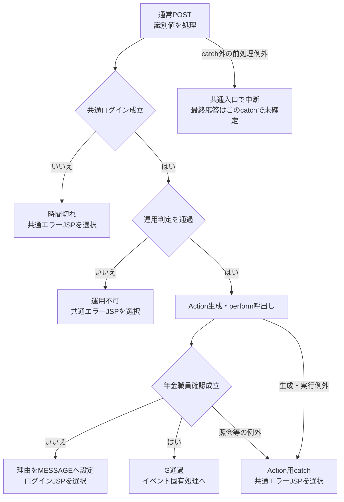

SaveとDeleteは、G通過後にフォーム読取り、POST・CSRF検査の順で進む。CSRFはセッション内のStringと受信した`CSRF_TOKEN`の完全一致を確認する。既存トークンが非空Stringなら再利用し、なければUUID文字列を生成する。View、Load、Clearは同じ変更認可検査を呼ばない。

### 画面配置と状態

共有ヘッダーにログイン職員番号・氏名を表示し、画面見出しの右側に戻るボタンを置く。入力領域は左が基本情報、右が予約情報である。通常幅では二列、列間36px、予約フォームの項目ラベル列は128pxとなる。960px以下では領域を一列にし、640px以下では項目ラベルと入力も一列にする。

`main.app-shell:not(.login-shell)`に上20px・左右18px・下52pxの余白を設ける。画面下の操作領域はsticky配置と上境界線を持つ。確認ボックス内のボタンには、通常ボタンより小さい最小高さと上下6px・左右14pxの余白を適用する。

`role="status"`は通知の役割を表し、外観は`message`等のclassで決まる。名称spanは折り返さない指定である。既存キーは`access-key-locked`で赤字となり、背景には詳細度の高い`.form-control[readonly]`が適用される。データ更新日は`.access-readonly-display[readonly]`で表示する。

次は空モデルの静的投影である。職員表示の括弧内はセッション値の差込位置であり、実在する利用者情報ではない。候補名称は収録ローカル初期値による表示例で、実画面は描画時の取得値を使う。元のformとiframeは、同じ階層・class・id・項目配置と枠寸法を保つdivで表し、元要素と要求名は`data-source-element`・`data-source-name`へ記録する。実フォームの送信先・HTTP method・文字コードは非実行の`data-source-*`属性と前記入口表に対応させ、参照子画面の送信先フレームは同表のlookupFrameに対応する。投影は送信・画面遷移を行わず、スクリプトとイベントハンドラーを持たない。全ボタンは表示用のtype=buttonとする。

<style>
:root{--bg:#edf1f4;--surface:#ffffff;--line:#b8c2cc;--text:#18212a;--muted:#566370;--nav:#16324a;--nav-text:#f4f8fb;--primary:#0f6b5f;--primary-dark:#0a5148;--danger:#9d2f2f;--button:#e8edf1;--button-border:#7b8792;--focus:#1a75bb;--work-screen-width:1180px}
*,*::before,*::after{box-sizing:border-box}[hidden]{display:none!important}body{min-height:100vh;margin:0;color:var(--text);background:var(--bg);font-family:"Yu Gothic UI","Meiryo","Segoe UI",sans-serif}button,input,select,textarea{margin:0;font:inherit}h1{margin:0;font-size:1.45rem;font-weight:700;letter-spacing:0}h2{margin:0 0 10px;font-size:1rem;font-weight:700;letter-spacing:0}.app-shell{width:100%;max-width:1440px;margin-inline:auto}main.app-shell:not(.login-shell){padding:20px 18px 52px}.app-nav{display:flex;min-height:48px;align-items:center;justify-content:space-between;gap:12px;padding:7px 18px;color:var(--nav-text);background:var(--nav);border-bottom:1px solid #0c2236}.app-nav__title{color:var(--nav-text);font-weight:800;line-height:1.25}.app-nav__meta{color:#c9d7e2;font-size:.82rem}.surface{background:var(--surface);border:1px solid var(--line);border-radius:6px;box-shadow:0 1px 2px rgba(16,32,48,.08)}.screen{padding:18px}.screen:not(.lookup-screen-popup){max-width:var(--work-screen-width);margin-right:auto;margin-left:auto}.screen-header{display:flex;gap:16px;align-items:flex-start;justify-content:space-between;margin-bottom:18px;padding-bottom:12px;border-bottom:1px solid var(--line)}.message{margin-bottom:12px;padding:10px 12px;background:#eef7f5;border:1px solid #9fc3bc;border-radius:4px}.message.error{color:#6f1f1f;background:#fff0f0;border-color:#ca8f8f}.access-form{margin:0}.access-layout{display:grid;grid-template-columns:minmax(0,1fr) minmax(0,1.15fr);gap:24px;align-items:start}.pension-entry-form .access-layout{gap:36px}.access-section{display:grid;gap:10px;align-content:start}.access-section h2{padding-bottom:8px;border-bottom:1px solid var(--line)}.field-row{display:grid;grid-template-rows:auto 38px auto;gap:4px;min-width:0}.field-row.access-row{grid-template-columns:170px minmax(0,1fr);grid-template-rows:auto;column-gap:12px;align-items:center}.pension-entry-form .field-row.access-row{grid-template-columns:128px minmax(0,1fr);column-gap:10px}.field-row.access-row label{margin:0}.field-row.access-row.tall{align-items:start}.field-row.access-row.tall label{padding-top:8px}.field-row.access-row.tall textarea{min-height:92px;resize:vertical}.field-row label{color:var(--muted);font-size:.88rem;font-weight:700}.field-row label.access-red-label{color:#c00000}.form-control,.form-select{display:block;width:100%;padding:6px 10px;color:var(--text);background:#fff;border:1px solid #9da9b4;line-height:1.4;min-height:38px;border-radius:3px}.form-control[readonly]{background:#edf0f2}.access-key-locked{color:#c00000;background-color:#f1f3f5}.access-readonly-display[readonly]{color:var(--text);background-color:#f1f3f5}.short-input{max-width:110px}.medium-input{max-width:220px}.input-reference{display:inline-grid;grid-template-columns:minmax(0,auto) auto minmax(7em,auto);gap:6px;align-items:center;justify-content:start;min-width:0}.input-reference .form-control{width:100%}.code-input{width:auto;box-sizing:border-box;font-variant-numeric:tabular-nums}.input-reference .code-input{width:100%}.code-name-display{min-width:7em;color:var(--text);font-size:.9rem;line-height:1.25;white-space:nowrap}.lookup-button{display:inline-flex;min-height:38px;align-items:center;justify-content:center;padding:6px 10px;color:var(--text);background:#f4f6f8;border:1px solid var(--button-border);border-radius:3px;font-size:.88rem;font-weight:700;line-height:1.2}.checkbox-grid{display:grid;grid-template-columns:minmax(130px,1fr) minmax(160px,1fr);gap:8px 14px}.checkbox-grid label,.single-check{display:inline-flex;min-height:34px;align-items:center;gap:8px;padding:6px 8px;color:var(--muted);background:#fff;border:1px solid #c5cdd5;border-radius:3px;font-size:.88rem;font-weight:700}.calendar-input{display:inline-grid;grid-template-columns:minmax(0,220px) 38px;align-items:center;width:min(100%,258px)}.calendar-input .form-control{width:100%;border-top-right-radius:0;border-bottom-right-radius:0}.era-calendar-button{position:relative;width:38px;min-height:38px;background:#f4f6f8;border:1px solid #9da9b4;border-left:0;border-radius:0 3px 3px 0}.era-calendar-button::before,.era-calendar-button::after{position:absolute;content:""}.era-calendar-button::before{top:10px;left:10px;width:16px;height:15px;background:linear-gradient(#55708a,#55708a) 0 4px/100% 2px no-repeat,linear-gradient(90deg,transparent 0 4px,#d7e0e7 4px 6px,transparent 6px 10px,#d7e0e7 10px 12px,transparent 12px) 0 8px/100% 2px no-repeat;border:2px solid #55708a;border-radius:2px}.era-calendar-button::after{top:7px;left:14px;width:8px;height:5px;border-top:2px solid #55708a;border-bottom:2px solid #55708a}.access-button{display:inline-flex;min-height:42px;align-items:center;justify-content:center;padding:8px 18px;color:var(--text);background:var(--button);border:1px solid var(--button-border);border-radius:4px;font-weight:700;text-decoration:none;line-height:1.2}.access-button.primary{color:#fff;background:var(--primary);border-color:var(--primary-dark)}.access-button.secondary{background:#f4f6f8}.access-button.danger{color:#fff;background:var(--danger);border-color:#7c2323}.access-button.narrow{min-width:96px}.button-row{display:flex;flex-wrap:wrap;gap:10px;align-items:center;margin-top:16px}.sticky-actions{position:sticky;bottom:0;z-index:2;padding:10px 0 0;background:var(--surface);border-top:1px solid var(--line)}.lookup-modal{position:fixed;inset:0;z-index:1000;display:grid;place-items:center;padding:24px}.lookup-modal__backdrop{position:absolute;inset:0;background:rgb(15 23 42 / 52%)}.lookup-modal__panel{position:relative;z-index:1;display:grid;grid-template-rows:auto minmax(0,1fr);width:min(1120px,96vw);height:min(720px,90vh);overflow:hidden;background:var(--surface);border:1px solid #7f8b96;border-radius:4px;box-shadow:0 18px 42px rgb(15 23 42 / 34%)}.lookup-modal__header{display:flex;gap:12px;align-items:center;justify-content:space-between;padding:12px 14px;background:#e8eef2;border-bottom:1px solid var(--line)}.lookup-modal__header h2{margin:0;color:var(--text);font-size:1rem;font-weight:800}.lookup-modal__close{min-height:34px;padding:5px 12px;color:var(--text);background:#fff;border:1px solid var(--button-border);border-radius:3px;font-size:.88rem;font-weight:700}.lookup-modal__frame{width:100%;height:100%;border:0;background:#f8fafb}.lookup-modal-open{overflow:hidden}.message-box{position:fixed;inset:0;z-index:1100;display:grid;place-items:center;padding:20px}.message-box__backdrop{position:absolute;inset:0;background:rgb(15 23 42 / 36%)}.message-box__panel{position:relative;z-index:1;width:min(440px,calc(100vw - 32px));overflow:hidden;background:#f7f8f9;border:1px solid #687684;border-radius:3px;box-shadow:0 18px 38px rgb(15 23 42 / 32%)}.message-box__titlebar{padding:8px 10px;background:#e8eef2;border-bottom:1px solid var(--line)}.message-box__titlebar h2{margin:0;color:var(--text);font-size:.95rem;font-weight:800}.message-box__body{display:grid;grid-template-columns:40px minmax(0,1fr);gap:12px;align-items:start;min-height:88px;padding:18px 18px 12px}.message-box__icon{display:inline-flex;width:32px;height:32px;align-items:center;justify-content:center;color:#165a87;border:2px solid #165a87;border-radius:50%;font-size:1.15rem;font-weight:800;line-height:1}.message-box__message{margin:2px 0 0;line-height:1.55;white-space:pre-line}.message-box__actions{display:flex;gap:8px;justify-content:flex-end;padding:0 18px 16px}.message-box__actions .access-button{min-width:84px;min-height:34px;padding:6px 14px}
@media(max-width:960px){.access-layout{grid-template-columns:1fr}.pension-entry-form .access-layout{gap:24px}.pension-entry-form .field-row.access-row{grid-template-columns:128px minmax(0,1fr)}}
@media(max-width:640px){.screen-header{display:grid}.pension-entry-form .field-row.access-row{grid-template-columns:1fr}.short-input,.medium-input{max-width:100%}.input-reference{grid-template-columns:minmax(0,1fr) auto minmax(6em,auto);width:100%}.checkbox-grid{grid-template-columns:1fr}}
</style>
<header class="app-nav"><div class="app-nav__title">年金自動受取予約管理システム</div><div class="app-nav__meta">職員番号 <strong>〈職員番号8桁〉</strong>　〈職員氏名〉</div></header>
<main class="app-shell"><section class="screen surface pension-screen">
<div class="screen-header"><h1>新規・変更・削除　画面</h1><button class="access-button secondary narrow" type="button">戻る</button></div>
<div id="pensionStatusMessage" role="status" aria-live="polite" class="message" hidden></div>
<div id="pensionForm" class="access-form pension-entry-form" data-source-element="form" data-source-action="/Action.do" data-source-method="post" data-source-accept-charset="Windows-31J">
<input type="hidden" data-source-name="FUNCTION_ID" value="nenkin"><input id="pensionView" type="hidden" data-source-name="VIEW_ID" value="Pension"><input id="pensionCommand" type="hidden" data-source-name="COMMAND_ID" value="Save"><input type="hidden" data-source-name="CSRF_TOKEN" value=""><input id="originalKana" type="hidden" data-source-name="ORIGINAL_KANA" value=""><input id="originalPhone" type="hidden" data-source-name="ORIGINAL_PHONE" value=""><input id="lookupKana" type="hidden" data-source-name="LOOKUP_KANA" value=""><input id="lookupPhone" type="hidden" data-source-name="LOOKUP_PHONE" value="">
<div class="access-layout">
<div class="access-section"><h2>基本情報</h2>
<div class="field-row access-row"><label for="branchNo">店番</label><div class="input-reference"><input id="branchNo" data-source-name="BRANCH_NO" value="" class="form-control code-input short-input" maxlength="3" inputmode="numeric" data-digits-only><button class="lookup-button" type="button">参照</button><span id="branchName" class="code-name-display"></span></div></div>
<div class="field-row access-row"><label for="customerNo">顧客番号</label><div class="input-reference"><input id="customerNo" data-source-name="CUSTOMER_NO" value="" class="form-control code-input medium-input" maxlength="7" inputmode="numeric" data-digits-only><button class="lookup-button" type="button">参照</button><span id="customerNameDisplay" class="code-name-display"></span></div></div>
<div class="field-row access-row"><label for="staffCode">担当者コード</label><div class="input-reference"><input id="staffCode" data-source-name="STAFF_CODE" value="" class="form-control code-input short-input" maxlength="4" inputmode="numeric" data-digits-only><button class="lookup-button" type="button">参照</button><span id="staffNameDisplay" class="code-name-display"></span></div></div>
<div class="field-row access-row"><label class="access-red-label" for="kanaName">フリガナ</label><input id="kanaName" data-source-name="KANA_NAME" value="" class="form-control"></div>
<div class="field-row access-row"><label for="customerName">顧客氏名</label><input id="customerName" data-source-name="CUSTOMER_NAME" value="" class="form-control"></div>
<div class="field-row access-row"><label for="gender">性別</label><select id="gender" data-source-name="GENDER" class="form-select short-input"><option value=""></option><option value="男">男</option><option value="女">女</option></select></div>
<div class="field-row access-row tall"><label for="address">住所</label><textarea id="address" data-source-name="ADDRESS" class="form-control" rows="3"></textarea></div>
<div class="field-row access-row"><label class="access-red-label" for="phoneNumber">電話番号</label><div class="input-reference"><input id="phoneNumber" data-source-name="PHONE_NUMBER" value="" class="form-control"><button class="lookup-button" type="button">候補</button></div></div>
<div class="field-row access-row"><label for="birthDate">生年月日</label><div class="calendar-input"><input id="birthDate" data-source-name="BIRTH_DATE" value="" class="form-control medium-input" maxlength="14" data-era-calendar data-era-calendar-mode="japanese"><button class="era-calendar-button" type="button" data-era-calendar-toggle="birthDate" aria-label="生年月日のカレンダーを開く"></button></div></div>
<div class="field-row access-row"><label for="dataUpdateDate">データ更新日</label><input id="dataUpdateDate" data-source-name="DATA_UPDATE_DATE" value="" class="form-control medium-input access-readonly-display" readonly></div>
</div>
<div class="access-section"><h2>予約情報</h2>
<div class="field-row access-row tall"><label>年金種類</label><div class="checkbox-grid"><label><input type="checkbox" data-source-name="NATIONAL_PENSION" value="1"> 国民年金</label><label><input type="checkbox" data-source-name="EMPLOYEE_PENSION_FUND" value="1"> 厚生年金基金</label><label><input type="checkbox" data-source-name="EMPLOYEE_PENSION" value="1"> 厚生年金</label><label><input type="checkbox" data-source-name="NATIONAL_PENSION_FUND" value="1"> 国民年金基金</label><label><input type="checkbox" data-source-name="MUTUAL_AID_PENSION" value="1"> 共済年金</label></div></div>
<div class="field-row access-row"><label for="claimStatus">裁定請求書徴収</label><select id="claimStatus" data-source-name="CLAIM_STATUS" class="form-select short-input"><option value=""></option><option value="未">未</option><option value="済">済</option></select></div>
<div class="field-row access-row"><label for="claimDate">請求予定日</label><div class="calendar-input"><input id="claimDate" data-source-name="CLAIM_SCHEDULED_DATE" value="" class="form-control medium-input" maxlength="14" data-era-calendar data-era-calendar-mode="western"><button class="era-calendar-button" type="button" data-era-calendar-toggle="claimDate" aria-label="請求予定日のカレンダーを開く"></button></div></div>
<div class="field-row access-row"><label for="plannedAge">予定年齢</label><input id="plannedAge" data-source-name="PLANNED_AGE" value="" class="form-control short-input" maxlength="3" inputmode="numeric" data-digits-only></div>
<div class="field-row access-row"><label for="spouseName">配偶者名</label><input id="spouseName" data-source-name="SPOUSE_NAME" value="" class="form-control"></div>
<div class="field-row access-row"><label for="spouseBirthDate">配偶者生年月日</label><div class="calendar-input"><input id="spouseBirthDate" data-source-name="SPOUSE_BIRTH_DATE" value="" class="form-control medium-input" maxlength="14" data-era-calendar data-era-calendar-mode="japanese"><button class="era-calendar-button" type="button" data-era-calendar-toggle="spouseBirthDate" aria-label="配偶者生年月日のカレンダーを開く"></button></div></div>
<div class="field-row access-row"><label for="hasBenefit">受給有無</label><select id="hasBenefit" data-source-name="HAS_BENEFIT" class="form-select short-input"><option value=""></option><option value="未">未</option><option value="既">既</option></select></div>
<div class="field-row access-row"><label for="requestDate">予約徴求日</label><div class="calendar-input"><input id="requestDate" data-source-name="RESERVATION_REQUEST_DATE" value="" class="form-control medium-input" maxlength="14" data-era-calendar data-era-calendar-mode="western"><button class="era-calendar-button" type="button" data-era-calendar-toggle="requestDate" aria-label="予約徴求日のカレンダーを開く"></button></div></div>
<div class="field-row access-row tall"><label for="notes">備考</label><textarea id="notes" data-source-name="NOTES" class="form-control" rows="3"></textarea></div>
<div class="field-row access-row"><label>６ヶ月先確認</label><label class="single-check"><input type="checkbox" data-source-name="SIX_MONTH_CHECK" value="1"> 確認済</label></div>
</div></div>
<div class="button-row sticky-actions"><button class="access-button primary" type="button">登録</button><button class="access-button danger" type="button">削除</button><button class="access-button secondary" type="button">クリア</button></div>
</div></section></main>
<div id="lookupModal" class="lookup-modal" role="dialog" aria-modal="true" aria-labelledby="lookupTitle" hidden><div class="lookup-modal__backdrop"></div><div class="lookup-modal__panel"><div class="lookup-modal__header"><h2 id="lookupTitle">入力補助</h2><button id="lookupClose" class="lookup-modal__close" type="button">閉じる</button></div><div id="lookupFrame" class="lookup-modal__frame" title="入力補助" data-source-element="iframe" data-source-name="lookupFrame"></div></div></div>
<div id="messageBox" class="message-box" role="dialog" aria-modal="true" aria-labelledby="messageTitle" hidden><div class="message-box__backdrop"></div><div class="message-box__panel"><div class="message-box__titlebar"><h2 id="messageTitle">確認</h2></div><div class="message-box__body"><div id="messageIcon" class="message-box__icon">?</div><p id="messageText" class="message-box__message"></p></div><div class="message-box__actions"><button id="messageOk" class="access-button primary" type="button">OK</button><button id="messageCancel" class="access-button" type="button">キャンセル</button></div></div></div>

初期投影からの状態差を次に示す。登録・削除ボタンの表示と活性は職員権限によって切り替えず、サーバー側で対象確認後に権限を判定する。

| 状態 | 入力値とキー | hidden・メッセージ・補助領域 |
| --- | --- | --- |
| 初期・クリア | 数値は空、文字列は空、六つのチェックは未選択。キーは編集可能 | ORIGINALとLOOKUPは空。状態メッセージ、参照、確認領域はhidden |
| 既存予約 | DB取得モデルを表示。kanaNameとphoneNumberにreadonlyとaccess-key-lockedを付ける | ORIGINALに表示モデルのキーを設定。LOOKUPは空。既存読込みの文言はerrorクラスで表示 |
| 顧客基本取込み | 顧客基本由来の新モデル。予約・配偶者情報等は空。キーは編集可能 | ORIGINALとLOOKUPは空。取込みメッセージを表示 |
| 入力拒否 | 入力モデルを保持。先に成功した日付正規化も保持 | existingの決定はイベント別。trueなら入力モデルからORIGINALを再作成し、キーをreadonlyにする |
| 重複・キー変更・権限拒否 | 各分岐が選んだDBモデルへ置換し、キーをreadonlyにする | 置換後モデルからORIGINALを設定し、拒否理由を表示 |
| 登録・削除完了 | 新しい空モデル、キー編集可能 | ORIGINALとLOOKUPは空。「終了」を含む状態メッセージと完了ボックスを表示 |
| 参照表示中 | 親の入力を保持 | lookupModalのhiddenを外し、bodyへlookup-modal-openを付加。対象別見出しとiframeを表示 |
| 登録・削除確認中 | 未送信の入力を保持 | messageBoxのhiddenを外し、OKとキャンセルを表示 |
| 案内・完了ボックス | 表示中の入力を保持 | messageBoxを表示し、キャンセルだけhiddenにする |

## 項目一覧

| No | グループ | 項目名 | 種類 | 入出力 | DB連携項目 | 候補取得元 | 必須 | 形式・桁 | 説明 |
| --- | --- | --- | --- | --- | --- | --- | --- | --- | --- |
| 01 | ヘッダー | ログイン職員番号 | `strong` | O | 職員名簿.職員番号から職員セッションへ取得 | 職員確認処理 | 表示元の職員確認が必要 | ViewBean.staffNo：`String`、8桁ゼロ埋め | 予約の担当者コードとは別。要求項目ではない |
| 02 | ヘッダー | ログイン職員氏名 | 表示文字列 | O | 職員名簿.漢字氏名 | 職員確認処理 | 職員確認に従う | ViewBean.staffName：`String` | 予約表へ氏名を保存しない。本番元列の容量・NULL属性は未確定 |
| 03 | 状態 | 処理メッセージ | `pensionStatusMessage` | O | DBへ直接保存しない | Action結果 | 条件表示 | ViewBean.message：`String` | 空ならhidden。「終了」を含む場合はsuccess、それ以外はerror |
| 04 | 基本情報 | 店番 | input `branchNo`／BRANCH_NO | I／O | 年金1_LK.店番、P01。顧客基本Loadでは顧客基本表.店舗コードを検索 | 店名テーブルの店舗参照 | Save・Deleteで正数変換後の値が必要。顧客基本Loadでは顧客番号と両方必要 | branchNo：`Integer`、maxlength=3 | 空・不正・0・負数はnull。サーバーに3桁検査はない |
| 05 | 基本情報 | 店名 | span `branchName` | O | 店名テーブル.店名を参照。予約保存列なし | 店舗参照、予約JOIN、店番による名称照会 | 名称取得は保存可否の必須条件ではない | branchName：`String` | 店番の手入力変更だけでは再照会しない |
| 06 | 基本情報 | 顧客番号 | input `customerNo`／CUSTOMER_NO | I／O | 年金1_LK.顧客番号、P02。顧客基本Loadでは顧客基本表.顧客番号を検索 | 顧客参照 | Saveでは任意。顧客基本Loadでは店番と両方必要 | customerNo：`Integer`、maxlength=7 | 空・変換不成立はnull保存。DBはBIGINTだがJava・JDBCはintで扱う |
| 07 | 基本情報 | 顧客氏名補助表示 | span `customerNameDisplay` | O | 年金1_LK.顧客氏名または顧客参照名称。独立保存列なし | 顧客参照・表示モデル | 条件表示 | `String` | JSPは顧客氏名入力と同じモデル値を表示する |
| 08 | 基本情報 | 担当者コード | input `staffCode`／STAFF_CODE | I／O | 年金1_LK.担当者コード、P03 | 職員名簿の担当者参照 | Saveでは任意 | staffCode：`Integer`、maxlength=4 | 空・不正等はnull保存。候補存在・所属整合性の保存時検査はない |
| 09 | 基本情報 | 担当者氏名補助表示 | span `staffNameDisplay` | O | 選択候補の職員名簿.漢字氏名。予約保存列なし | 担当者参照の選択値 | 条件表示 | ブラウザー内文字列 | JSP初期値は空。再描画でコードが残っていても名称は空になる |
| 10 | 基本情報 | フリガナ | input `kanaName`／KANA_NAME | I／O | 年金1_LK.ふりがなを検索・保存、P05 | 顧客参照・既存予約・顧客基本 | Save・Deleteでtrim後非空。保存時は正規化後も非空 | kanaName：`String`。画面maxlength・業務長検査は実装されていない | RepositoryでNFKC、trim、空白集約、大文字化。既存表示時readonly |
| 11 | 基本情報 | 顧客氏名 | input `customerName`／CUSTOMER_NAME | I／O | 年金1_LK.顧客氏名、P04 | 顧客基本取込み・既存予約 | Saveでは任意 | customerName：`String` | trimして保存。空欄は空文字。DB容量に対応する入力長検査はない |
| 12 | 基本情報 | 性別 | select `gender`／GENDER | I／O | 性別テーブル.性別を表示し、逆引きコードを年金1_LK.性別へ保存、P06 | 性別テーブル、コード昇順 | Saveでは任意 | gender：`String`、option値は名称 | 空選択はNULL保存。非空名称を逆引きできなければDB処理例外 |
| 13 | 基本情報 | 住所 | textarea `address`／ADDRESS | I／O | 年金1_LK.住所、P07 | 顧客基本取込み・既存予約 | Saveでは任意 | address：`String`、rows=3 | trimして保存。空欄は空文字。画面maxlength・DB容量対応検査はない |
| 14 | 基本情報 | 電話番号 | input `phoneNumber`／PHONE_NUMBER | I／O | 年金1_LK.電話番号を検索・保存、P08 | 顧客参照・既存予約・顧客基本 | Save・Deleteでtrim後非空。保存時は数字が必要 | phoneNumber：`String`から`BigDecimal`、画面maxlengthなし | 数字を抽出して数値保存。ハイフン・先頭ゼロをそのまま保存しない。既存表示時readonly |
| 15 | 基本情報 | 生年月日 | input `birthDate`／BIRTH_DATE | I／O | 年金1_LK.生年月日、P09 | 顧客基本取込み・既存予約 | Saveでは任意、非空時は日付検査 | birthDate：`String`、maxlength=14、和暦表示 | 空欄はDATEのNULL。SaveでISO化する |
| 16 | 基本情報 | データ更新日 | readonly input `dataUpdateDate`／DATA_UPDATE_DATE | I／O | 年金1_LK.データ更新日、P24 | 既存予約・保存時生成 | 利用者入力不要 | dataUpdateDate：`String`、西暦表示 | 要求は受信するが保存時はサーバー当日へ上書き。比較版ではない |
| 17 | 年金種類 | 国民年金 | checkbox NATIONAL_PENSION | I／O | 種類：国民年金、P10。年金種類の重み1 | 年金種類テーブルのコード1の名称 | 選択任意 | nationalPension：`boolean`、value=1 | 未送信はfalse、保存値0。合成値へ加算 |
| 18 | 年金種類 | 厚生年金基金 | checkbox EMPLOYEE_PENSION_FUND | I／O | 種類：厚生年金基金、P13。年金種類の重み8 | 年金種類テーブルのコード8の名称 | 選択任意 | employeePensionFund：`boolean`、value=1 | 画面上の二番目。DBバインド順とは異なる |
| 19 | 年金種類 | 厚生年金 | checkbox EMPLOYEE_PENSION | I／O | 種類：厚生年金、P11。年金種類の重み2 | 年金種類テーブルのコード2の名称 | 選択任意 | employeePension：`boolean`、value=1 | 未選択は0で保存 |
| 20 | 年金種類 | 国民年金基金 | checkbox NATIONAL_PENSION_FUND | I／O | 種類：国民年金基金、P14。年金種類の重み16 | 年金種類テーブルのコード16の名称 | 選択任意 | nationalPensionFund：`boolean`、value=1 | 未選択は0で保存 |
| 21 | 年金種類 | 共済年金 | checkbox MUTUAL_AID_PENSION | I／O | 種類：共済年金、P12。年金種類の重み4 | 年金種類テーブルのコード4の名称 | 選択任意 | mutualAidPension：`boolean`、value=1 | 全五項目未選択なら合成年金種類はNULL |
| 22 | 予約情報 | 裁定請求書徴収 | select `claimStatus`／CLAIM_STATUS | I／O | 裁定請求テーブル.裁定請求を表示し、コードを年金1_LK.裁定請求へ保存、P16 | 裁定請求テーブル、コード昇順 | Saveでは任意 | claimStatus：`String`、option値は名称 | 空選択はNULL保存。名称を予約列へ直接保存しない |
| 23 | 予約情報 | 請求予定日 | input `claimDate`／CLAIM_SCHEDULED_DATE | I／O | 年金1_LK.請求予定日、P17 | 既存予約 | Saveでは任意、非空時は日付検査 | claimScheduledDate：`String`、maxlength=14、西暦表示 | 空欄はDATEのNULL。予定年齢のブラウザー計算にも使用 |
| 24 | 予約情報 | 予定年齢 | input `plannedAge`／PLANNED_AGE | I／O | 年金1_LK.予定年齢、P18 | 手入力・ブラウザーの年差計算 | Saveでは任意 | plannedAge：`Integer`、maxlength=3 | 正数のみ保持。空・0・負数・不正値はnull。サーバーで再計算しない |
| 25 | 予約情報 | 配偶者名 | input `spouseName`／SPOUSE_NAME | I／O | 年金1_LK.配偶者名、P19 | 既存予約 | Saveでは任意 | spouseName：`String` | trimして保存。空欄は空文字 |
| 26 | 予約情報 | 配偶者生年月日 | input `spouseBirthDate`／SPOUSE_BIRTH_DATE | I／O | 年金1_LK.配偶者生年月日、P20 | 既存予約 | Saveでは任意、非空時は日付検査 | spouseBirthDate：`String`、maxlength=14、和暦表示 | 空欄はDATEのNULL |
| 27 | 予約情報 | 受給有無 | select `hasBenefit`／HAS_BENEFIT | I／O | 受給有無テーブル.受給有無を表示し、コードを年金1_LK.受給有無へ保存、P21 | 受給有無テーブル、コード昇順 | Saveでは任意 | hasBenefit：`String`、option値は名称 | 空選択はNULL保存 |
| 28 | 予約情報 | 予約徴求日 | input `requestDate`／RESERVATION_REQUEST_DATE | I／O | 年金1_LK.予約徴求日、P22 | 既存予約 | Saveでは任意、非空時は日付検査 | reservationRequestDate：`String`、maxlength=14、西暦表示 | 空欄はDATEのNULL |
| 29 | 予約情報 | 備考 | textarea `notes`／NOTES | I／O | 年金1_LK.備考、P23 | 既存予約 | Saveでは任意 | notes：`String`、Windows-31Jで56バイト以内 | trim後に変換可否・バイト数を検査。空欄は空文字。自動切捨てなし |
| 30 | 予約情報 | ６ヶ月先確認 | checkbox SIX_MONTH_CHECK | I／O | 年金1_LK.６ヶ月先確認、P27 | 既存予約 | 選択任意 | sixMonthCheck：`boolean`、value=1 | 未選択は0保存。将来日付から自動判定しない |
| 31 | 要求制御 | 機能ID | hidden FUNCTION_ID | I／O | DB保存なし | 固定値nenkin | 通常要求の振分けに必要 | 要求`String` | 共通Servletがパッケージ名へ使用 |
| 32 | 要求制御 | 画面ID | hidden `pensionView`／VIEW_ID | I／O | DB保存なし | Pension・Menu | 通常要求の振分けに必要 | 要求`String` | 戻る操作ではMenuへ変更 |
| 33 | 要求制御 | コマンドID | hidden `pensionCommand`／COMMAND_ID | I／O | DB保存なし | Save・Delete・Clear・Load・View | 操作の振分けに必要 | 要求`String`、描画時Save | Actionクラス名の一部となる |
| 34 | 要求制御 | CSRF | hidden CSRF_TOKEN | I／O | セッションNENKIN_CSRF_TOKENと照合。DB保存なし | セッション生成値 | Save・Deleteで一致が必要 | 要求`String` | DBキー・比較版ではない。欠落・不一致は変更認可不成立 |
| 35 | 対象制御 | 元フリガナ | hidden `originalKana`／ORIGINAL_KANA | I／O | 年金1_LK.ふりがなの照会値 | existing=trueの表示モデル | 現在対象との同一性判定に使用 | 要求`String`、欠落時null | existing=falseでは空。受信時の独立必須検査・署名・版照合はない |
| 36 | 対象制御 | 元電話番号 | hidden `originalPhone`／ORIGINAL_PHONE | I／O | 年金1_LK.電話番号の照会値 | existing=trueの表示モデル | 元フリガナと組で照会 | 要求`String`から数値検索キー | 空・数字なしは元対象なし。生のNULLをSQLへバインドしない |
| 37 | 読込み制御 | 照会フリガナ | hidden `lookupKana`／LOOKUP_KANA | I／O | 年金1_LK.ふりがなの検索値。直接保存なし | 顧客選択・キーchange | Loadで空なら現在KANA_NAMEを使用 | 要求`String`、毎描画空 | 電話とは項目ごとに補完する |
| 38 | 読込み制御 | 照会電話番号 | hidden `lookupPhone`／LOOKUP_PHONE | I／O | 年金1_LK.電話番号の検索値。直接保存なし | 顧客選択・キーchange | Loadで空なら現在PHONE_NUMBERを使用 | 要求`String`、毎描画空 | フリガナとは項目ごとに補完する |
| 39 | 操作 | 店番参照 | button | I | 親ではDB操作なし | 店名テーブル | 任意操作 | `openLookup('branch')` | 店番・店名だけを移送 |
| 40 | 操作 | 顧客参照 | button | I | 親ではDB操作なし | 顧客基本表 | 任意操作 | `openLookup('customer')` | 選択後にLoadする |
| 41 | 操作 | 担当者参照 | button | I | 親ではDB操作なし | 職員名簿 | 任意操作 | `openLookup('staff')` | コードと補助表示名だけを移送 |
| 42 | 操作 | 候補 | button | I | 親ではDB操作なし | 顧客基本表 | 任意操作 | `openLookup('candidate')` | フリガナ・電話を条件に顧客参照を開く。予約候補helperは呼ばない |
| 43 | 日付補助 | 四つのカレンダー | button | I | DB操作なし | ブラウザー内カレンダー | 任意操作 | 対象はbirthDate・claimDate・spouseBirthDate・requestDate | 表示入力へ日付文字列を設定。ISO専用hiddenなし |
| 44 | 操作 | 登録 | button | I | 年金1_LKへINSERT・UPDATE | 現在キー・元キー照会 | 操作時検査あり | `confirmSave()`からSave | 確認OKで送信 |
| 45 | 操作 | 削除 | button | I | 年金＿削除明細へ追加後、年金1_LKから削除 | 現在キー・元キー照会 | 操作時検査あり | `confirmDelete()`からDelete | 確認OKで送信 |
| 46 | 操作 | クリア | button | I | 予約表の更新なし | 空モデル生成 | 任意操作 | Clear | 確認なしで画面状態を再作成 |
| 47 | 操作 | 戻る | button | I | 予約表の更新なし | Menu/View | 任意操作 | `navigateMenu()` | 現在フォームを送るが予約保存は行わない |
| 48 | 参照領域 | 参照画面・見出し | `lookupModal`・`lookupFrame`・`lookupTitle` | O | 子画面の検索結果を表示 | Lookup/View | 条件表示 | iframe・ブラウザー内文字列 | 対象別に店番参照・担当者参照・顧客参照へ切替え |
| 49 | 参照領域 | 閉じる・背景 | `lookupClose`・backdrop | I | DB操作なし | ‐ | 任意操作 | click・Escape | 選択を変えず閉じ、iframeをabout:blankへ戻す |
| 50 | 確認領域 | 確認・案内内容 | `messageBox`・`messageTitle`・`messageIcon`・`messageText` | O | DB操作なし | ブラウザー検査・確認・完了メッセージ | 条件表示 | タイトル・記号・本文の文字列 | 確認は?、案内・完了は!を表示 |
| 51 | 確認領域 | OK | button `messageOk` | I | DB操作なし | 確認状態 | ボックス表示時 | Promiseへtrueを返す | Save・Deleteの確認時に後続送信へ進む |
| 52 | 確認領域 | キャンセル | button `messageCancel` | I | DB操作なし | 確認状態 | 確認時のみ表示 | Promiseへfalseを返す | 送信せず閉じる。Escapeも同じclick処理を呼ぶ |

## イベント仕様

### E01 初期表示・クリア

#### 処理概要

メニューからの表示とクリアは同じView処理へ接続する。職員を確認し、新しい空の予約モデルで画面状態を置き換える。

#### 処理手順

**1. 共通入口と職員を確認する。**

　**1.1.** 共通入口Gを通過した場合だけ画面状態の作成へ進む。共通ログイン・運用拒否は共通エラー、職員確認不成立はログインJSPの選択となる。

**2. 画面状態を作成する。**

　**2.1.** `createEmpty(currentStaff(session))`で新しい`PensionReservation`を作る。職員引数から店番・担当者コード・当日を補充する処理はない。

　**2.2.** 数値項目をnull、文字列を空、五つの年金種類と６ヶ月先確認をfalseとする。メッセージ空、existing=falseのBeanを作り、職員番号8桁表示・氏名を設定してセッション`ViewBean`へ格納する。

　**2.3.** Pension.jspを返し、E07の候補取得・画面表示へ進む。

#### 処理フロー

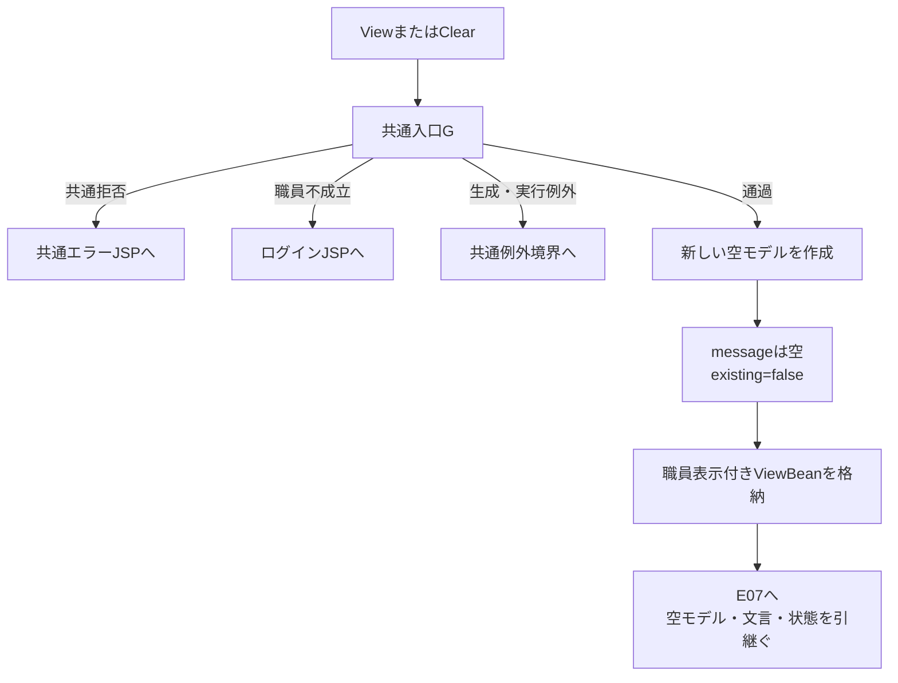

G内部の識別値前処理例外は、概要のcatch外経路に従う。

#### SQL・テーブル関連（ER図）

予約本表・削除明細を読み書きしない。職員コンテキスト未成立時には職員名簿と店舗名の照会が起こり得る。表示時の四コード候補取得はE07、共通アクセス記録は共通Servletの別処理である。画面状態はセッションとブラウザーに保持する。

#### DB操作の詳細

`PensionClearAction`は`PensionViewAction`を継承するだけで、削除SQLを持たない。クリアはセッション内の画面状態を再作成する操作であり、DBの予約、職員コンテキスト、セッション全体を削除しない。

#### 結果・例外時の扱い

通常結果はキー編集可能の空画面である。Actionから伝播したExceptionは共通のAction用catchへ届けば共通エラーとなる。Beanを格納できても、後続のJSP候補取得・描画の成功までは確定しない。

### E02 数字・日付入力補助と予定年齢計算

#### 処理概要

ブラウザー内で数字入力、日付選択、日付の表示形式、予定年齢の入力を補助する。数字補助、カレンダー表示状態、年齢計算は別の処理であり、日付選択時のinput・changeを介して連動する。

#### 処理手順

**1. 数字指定項目を整える。**

　**1.1.** 店番、顧客番号、担当者コード、予定年齢の`data-digits-only`に共通補助を接続する。初回bind、input、blurで全角0～9を半角へ変換し、数字以外を除く。

　**1.2.** 値が変わった場合はchangeを発火する。顧客番号のchangeはE03の参照開始条件にも接続する。編集可能・有効・非空の入力をfocusした場合は全選択を予約する。

　**1.3.** フリガナと電話番号にはこの属性がなく、両項目への`data-trim`・`data-uppercase`指定もない。

**2. カレンダーの初期表示を決める。**

　**2.1.** 対応ボタン、または対象入力でAlt＋ArrowDown・F4を操作すると`openCalendar(input)`を呼ぶ。ボタン操作では対象入力へfocusする。

　**2.2.** 対象入力を`activeInput`へ設定し、入力値を日付として解釈する。共通helperには日付hiddenを参照する処理もあるが、本画面の四入力には対応hiddenの指定がないため、解釈できた入力日、解釈できなければブラウザーの当日の順で基準日を決める。当日はローカルの年月日からUTC日付を作る。

　**2.3.** 基準日の年と0始まりの月を`visibleYear`・`visibleMonth`へ設定する。その表示年月で再描画し、カレンダーのhiddenを外して対象入力付近へ配置する。空・不正入力を当日に書き換える処理ではない。

**3. 表示年月の再描画と日選択を処理する。**

　**3.1.** `renderCalendar`は現在のvisibleYear・visibleMonthから月初、曜日、月末日、前後月を作り、月見出し・曜日・日ボタンを再構成する。和暦モードでは和暦を主見出し、西暦を副見出しとし、西暦モードでは逆にする。日ボタンには日曜・基準日・当日の表示classを設定する。

　**3.2.** 前月・次月ボタンでは`data-era-month`から表示年・月を受け取り、visibleYear・visibleMonthだけを更新して手順3.1へ戻る。入力値を更新せず、手順2.2の基準日による表示月の初期決定もやり直さない。選択表示の比較日は再描画時に入力値または当日から求めるため、表示月移動だけで新しい日が入力されたことにはならない。

　**3.3.** 日ボタンでは対象入力を一時変数へ保持し、日付を表示モードの文字列にして入力valueへ設定する。生年月日・配偶者生年月日は和暦、請求予定日・予約徴求日は西暦形式とする。

　**3.4.** hidden同期helperを呼んだ後、対象入力へinput、changeの順でイベントを発火する。本画面には対応hiddenがないためhidden更新は行われない。生年月日または請求予定日なら、このイベントから手順5の年齢計算へも進む。

　**3.5.** カレンダーをhiddenにしてactiveInputをnullへ戻し、選択した入力へfocusする。選択後は入力値を保持する。

**4. 日を選ばず終了・整形する。**

　**4.1.** カレンダー、対象入力、カレンダー切替ボタンの外側をmousedownした場合、または開いた状態でEscapeを押した場合は閉じ、activeInputをnullにする。入力値は変更しない。閉じる処理自体には、日選択後のような入力へのfocus設定はない。

　**4.2.** 開いている間のresize・scrollでは位置だけを再計算し、表示年月や入力値を変更しない。

　**4.3.** 初回bindでは`formatAccessEraDate`の戻り値を入力valueへ設定する。解釈できる日付は指定表示形式へ整え、解析不成立でも前後をtrimした文字列へ置き換える。blur・changeでは`normalizeDisplayInput`が解釈できる日付だけを指定表示形式へ整え、解析不成立ならinput.valueを変更しない。閉じた後に再度開けば、手順2から現在の入力値または当日を使って初期月を決め直す。

**5. 予定年齢を補助計算する。**

　**5.1.** 生年月日または請求予定日のinput・changeで、両入力を公開parserの`nenkinEraDate.parse`により解釈する。両方成功した場合だけ、請求年から出生年を引いた値を予定年齢へ上書きする。

　**5.2.** 誕生日到来や月日は差引きに使用しない。parser未接続、片方が空、または解析不成立の場合は予定年齢を消去しない。サーバーは送信値を正数Integerへ変換するだけで、日付との一致検査や再計算を行わない。

#### 処理フロー

サブフロー1は数字入力補助である。変更した値とchangeイベントを画面側へ引き渡す。

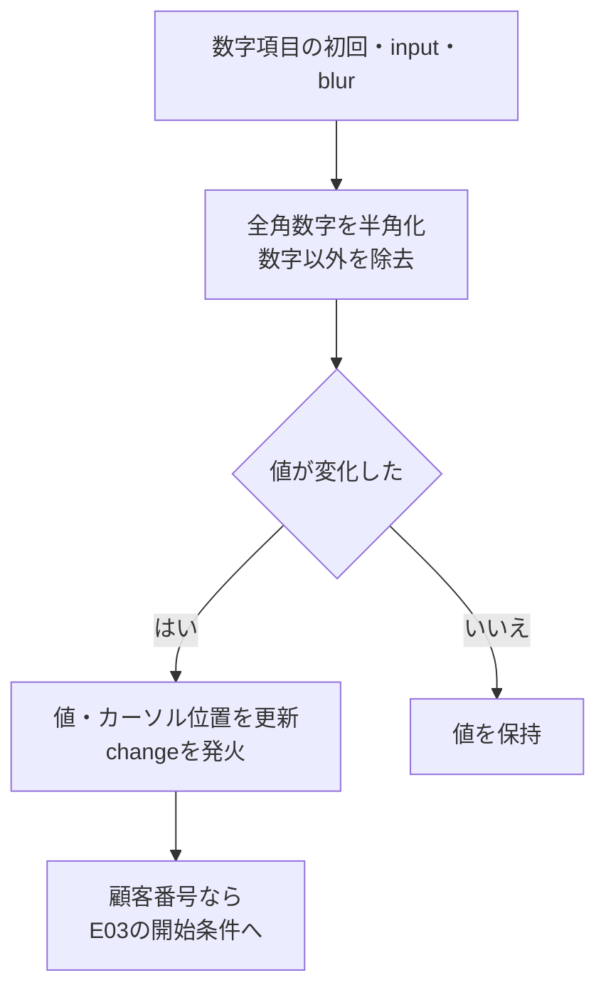

サブフロー2はカレンダーを開くときの初期決定である。表示年月と対象入力をサブフロー3へ渡す。

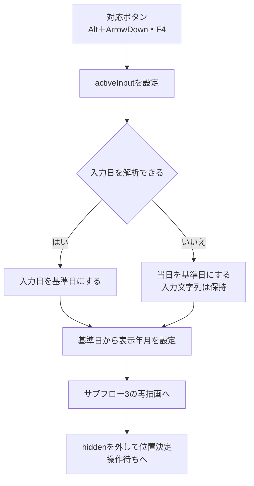

サブフロー3は表示中の操作である。月移動から再描画へ戻る枝では表示年月を保持し、初期決定へ戻さない。

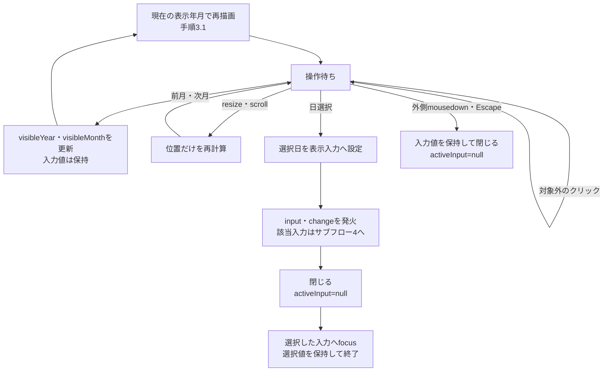

サブフロー4は予定年齢計算である。カレンダーの日選択だけでなく、入力の編集からも入る。

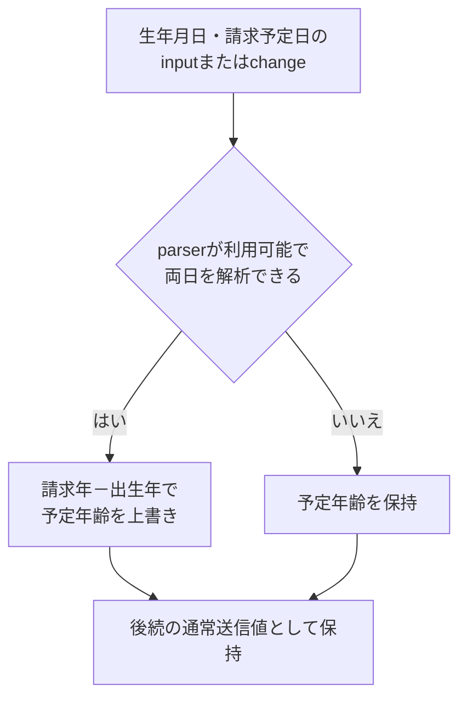

#### SQL・テーブル関連（ER図）

本イベントはDOMの入力値とカレンダー用メモリを扱い、SQLを実行しない。四日付と予定年齢の保存対応はP09・P17・P18・P20・P22である。sharedカレンダー要素、activeInput、表示年月はブラウザー内の保持情報であり、予約表やセッションの値ではない。

#### DB操作の詳細

DB接続、commit、rollbackはない。ブラウザーのmaxlengthは数字項目が3・7・4・3、日付が14で、受信文字列に対するサーバーの桁検査を代行しない。JavaScriptが生成した予定年齢も通常の要求値としてサーバーへ送る。

#### 結果・例外時の扱い

月移動とカレンダーを閉じる操作は入力値を変えず、日選択だけが対象日付を更新する。初期表示の基準日が当日となっても、空・不正入力はそのまま残る。

ブラウザーparserは元号略字一文字や区切りなし元号形式等も扱い、サーバー`DateUtil`と受理形式が一致しない。カレンダー内部ではISO形式を解析する補助も併用するが、予定年齢計算は公開parserを呼ぶ。クライアントで表示できたことを、サーバー受理や保存成功の保証にしない。

### E03 店番・担当者・顧客参照の開始、選択、終了

#### 処理概要

親予約画面はiframeの参照子画面を開き、選択結果を必要な項目へ移送する。電話番号横の候補も顧客参照であり、予約本表の候補検索ではない。

#### 処理手順

**1. 参照画面を開く。**

　**1.1.** 呼出元の要素を記憶し、参照モーダルを表示する。タイトルを店番参照、担当者参照、顧客参照へ変更し、bodyへlookup-modal-openを付け、閉じるボタンへfocusする。

　**1.2.** 一時formから`FUNCTION_ID=nenkin`、`VIEW_ID=Lookup`、`COMMAND_ID=View`、`POPUP=1`、`TARGET`、現在の`BRANCH_NO`をPOSTし、lookupFrameへ表示する。一時formは送信後に除去する。

　**1.3.** 通常の参照ボタンは名称・電話条件を空で送る。候補ボタンはtargetをcustomerに変え、現在フリガナをNAME_KEYWORD、現在電話をPHONE_KEYWORDとして送る。

　**1.4.** 顧客番号changeでは、店番と顧客番号が非空でORIGINAL_KANAが空の場合に顧客参照を開く。この開始条件に使用した顧客番号を、参照画面の検索条件としては送らない。

**2. 選択結果を受け取る。**

　**2.1.** 子画面は`source=nenkin.lookup`を付け、同一originを宛先にpostMessageする。親はevent.originとdata.sourceを検査し、不一致なら処理しない。event.sourceとiframeの一致検査は行わない。

　**2.2.** 店舗選択では店番と店名だけ、担当者選択では担当者コードとstaffNameDisplayだけを設定する。他の入力やORIGINALキーを解除しない。

　**2.3.** 顧客選択では店番、顧客番号、店名、顧客氏名補助span、LOOKUP二項目を設定してモーダルを閉じ、Loadを送信する。親は選択メッセージの担当者コードを直接移送せず、E04の取得モデルを使う。

**3. 選択せず閉じる。**

　**3.1.** 閉じるボタン、背景、または確認ボックスが開いていないときのEscapeで閉じる。iframeをabout:blankへ戻し、bodyのlookup-modal-openを除去して呼出元へfocusを戻す。

　**3.2.** 子画面のクリアは子の検索条件を空にして再検索する。親予約の値を消去する操作ではない。

#### 処理フロー

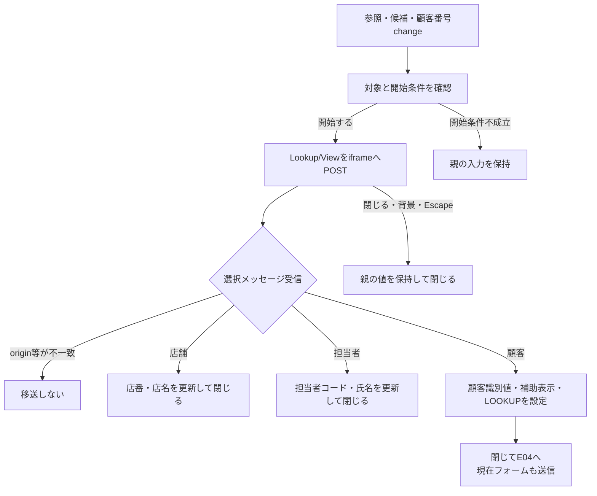

#### SQL・テーブル関連（ER図）

親の連携処理自体はSQLを発行しない。店舗は業務DBの店名テーブル、担当者は職員DBの`DB2.Ｕ職員名簿表`、顧客は顧客DBの`N2_SIGHT.Ｂ顧客基本表`を取得元とする。職員・顧客の店名は、別接続から得た店舗名Mapで突き合わせる。

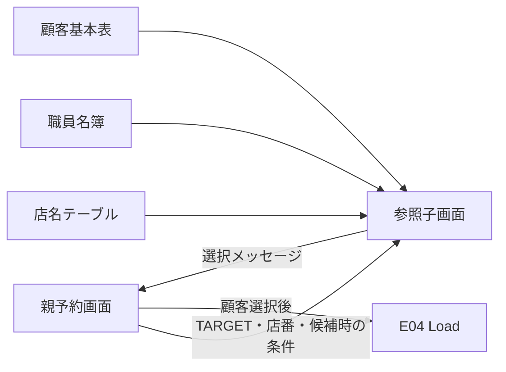

これは画面間・取得元の関連図であり、三表間のFKを示すものではない。

#### DB操作の詳細

参照子画面は、店舗ではコード文字列または店名、担当者では任意の所属店番と氏名、顧客では任意の店番・氏名・数字化電話を条件にする。空・不正店番がnullになれば店番条件を付けない。店舗コード順、職員番号順、顧客は店舗コード・顧客番号・カナ氏名順で全件取得し、メモリで20件単位に切り出す。

親の要求・移送・Load開始条件は本節の責務である。子画面内部の全WHERE、LIKEエスケープ、JDBCバインド、切出し後のページ上限補正は、計画文書DET-SCR-016に対応する。

#### 結果・例外時の扱い

店舗・担当者選択は親の入力を部分的に変更する。顧客選択ではLoadがモデル全体を決め直すため、変更途中の非キー入力をそのまま残すとは限らない。閉じるだけでは選択値を変更しない。参照取得と後続Loadは別要求であり、それぞれの失敗を分けて扱う。

### E04 キー変更・顧客選択による読込み

#### 処理概要

最初にフリガナ・電話番号から予約を探し、見つからない場合だけ店番・顧客番号から顧客基本情報を取り込む。既存予約、顧客基本、入力保持の三結果で、モデル・メッセージ・existingを分ける。

#### 処理手順

**1. 読込みを開始する。**

　**1.1.** 顧客選択後はE03からLoadを送る。フリガナまたは電話番号のchangeでも、ORIGINAL_KANAが空、両入力がreadonlyでない、両方のブラウザーtrim後が非空という条件を全て満たせば、現在値をLOOKUPへ設定してLoadを送る。

　**1.2.** G通過後、現在フォームをinputモデルへ移す。Save用の必須・日付・備考検査とPOST・CSRF照合は行わない。

**2. 既存予約を優先して取得する。**

　**2.1.** LOOKUP二項目をそれぞれtrimし、空の項目だけinputのフリガナまたは電話番号で補う。片方だけLOOKUPを使う組合せも生じる。

　**2.2.** `findByKanaAndPhone`へ渡す。Repositoryはフリガナを正規化し、電話を数字からBigDecimalへ変換する。正規化フリガナ空または電話nullなら接続せず対象なしを返す。

　**2.3.** 予約があれば、要求の店番・顧客番号にかかわらず取得モデル全体を採用する。「既存データを読み込みました。」、existing=trueでE07へ進む。

**3. 顧客基本情報へフォールバックする。**

　**3.1.** 予約がない場合だけ、店番と顧客番号を正数Integerへ変換する。両方ある場合に限り`findByCustomer`を呼ぶ。

　**3.2.** 顧客があれば新しいモデルへ九項目を移し、顧客接続を閉じた後に業務接続から店名と性別名称を補う。現在フォームの予約情報・配偶者情報等は合成しない。

　**3.3.** 顧客モデルを採用した場合は「顧客基本表から読み込みました。」、existing=falseとする。必要な識別値がない場合または顧客がない場合はinput、メッセージ空、existing=falseを採用する。

#### 処理フロー

図の入口はG通過後である。Gの拒否出口は概要に従い、input作成へ入らない。

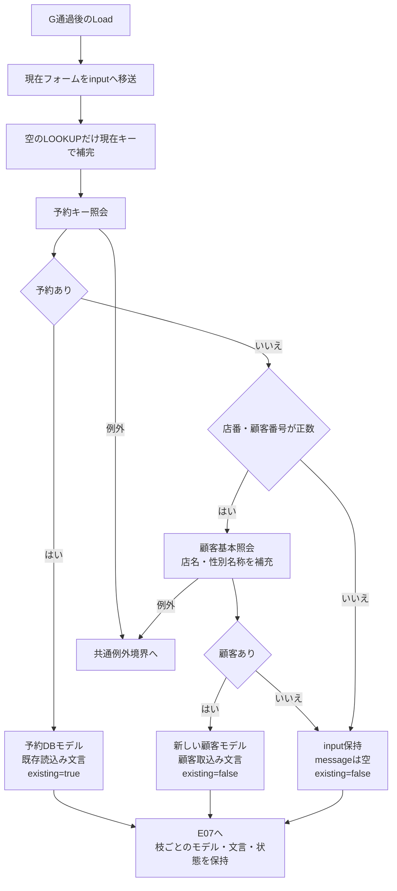

#### SQL・テーブル関連（ER図）

次は予約取得SQLのLEFT JOINを示す関連図であり、FKや多重度の宣言ではない。

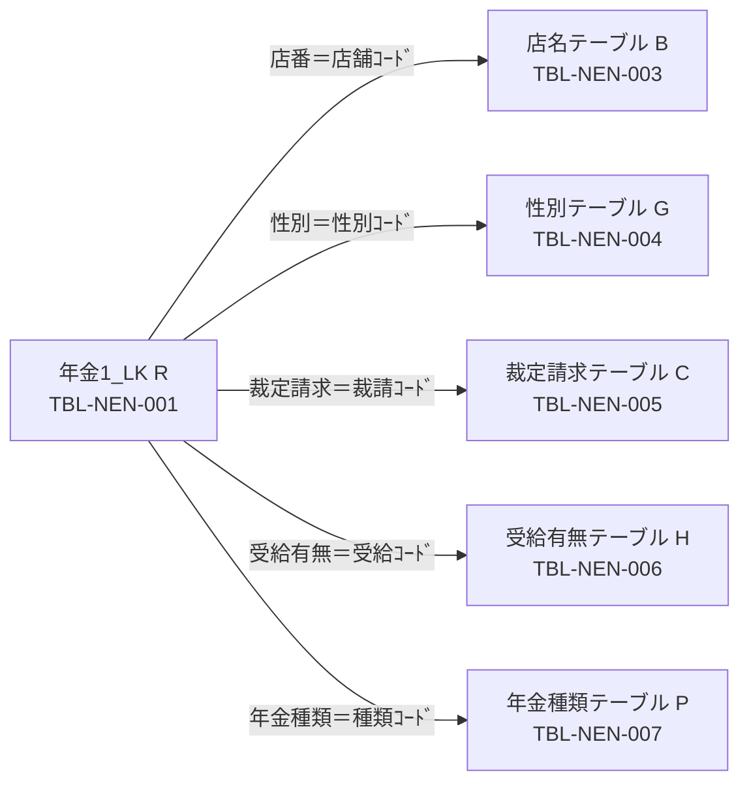

顧客基本表TBL-N2-007は別接続の取得元であり、このJOINには参加しない。

#### DB操作の詳細

予約取得SQLは次のとおりである。パラメータ1は正規化フリガナをsetString、2は電話数値をsetBigDecimalで設定する。

```sql
SELECT R.店番 AS BRANCH_NO, B.店名 AS BRANCH_NAME,
       R.顧客番号 AS CUSTOMER_NO, R.担当者コード AS STAFF_CODE,
       R.顧客氏名 AS CUSTOMER_NAME, R.ふりがな AS KANA_NAME,
       G.性別 AS GENDER, R.住所 AS ADDRESS,
       R.電話番号 AS PHONE_NUMBER, R.生年月日 AS BIRTH_DATE,
       C.裁定請求 AS CLAIM_STATUS,
       R.請求予定日 AS CLAIM_SCHEDULED_DATE,
       R.予定年齢 AS PLANNED_AGE,
       R.予約徴求日 AS RESERVATION_REQUEST_DATE,
       R.データ更新日 AS DATA_UPDATE_DATE,
       R.備考 AS NOTES, R.配偶者名 AS SPOUSE_NAME,
       H.受給有無 AS HAS_BENEFIT,
       R.配偶者生年月日 AS SPOUSE_BIRTH_DATE,
       P.年金種類 AS PENSION_TYPE,
       R."種類：国民年金" AS NATIONAL_PENSION,
       R."種類：厚生年金" AS EMPLOYEE_PENSION,
       R."種類：共済年金" AS MUTUAL_AID_PENSION,
       R."種類：厚生年金基金" AS EMPLOYEE_PENSION_FUND,
       R."種類：国民年金基金" AS NATIONAL_PENSION_FUND,
       R."６ヶ月先確認" AS SIX_MONTH_CHECK
  FROM 年金1_LK R
  LEFT JOIN 店名テーブル B ON R.店番 = B.店舗ｺｰﾄﾞ
  LEFT JOIN 性別テーブル G ON R.性別 = G.性別ｺｰﾄﾞ
  LEFT JOIN 裁定請求テーブル C ON R.裁定請求 = C.裁請ｺｰﾄﾞ
  LEFT JOIN 受給有無テーブル H ON R.受給有無 = H.受給ｺｰﾄﾞ
  LEFT JOIN 年金種類テーブル P ON R.年金種類 = P.種類ｺｰﾄﾞ
 WHERE R.ふりがな = ? AND R.電話番号 = ?
```

ORDER BY、ページング、複数件検査はなく、最初の一行をモデルとして返す。更新時間・更新者・変更FLGはこの26表示項目に含まれない。pensionType：Stringは合成コードのJOIN名称を保持するが、本画面に独立したフォーム項目はない。

顧客基本照会は次の九項目で、1を店番、2を顧客番号としてsetIntする。最初の一件を返し、ORDER BY、ページング、複数件検査はない。

```sql
SELECT C.店舗コード AS BRANCH_NO, C.顧客番号 AS CUSTOMER_NO,
       C.担当者コード AS STAFF_CODE, C.漢字氏名 AS CUSTOMER_NAME,
       C.カナ氏名 AS KANA_NAME, C.性別コード AS GENDER_CODE,
       C.漢字住所 AS ADDRESS, C.電話番号 AS PHONE_NUMBER,
       C.生年月日 AS BIRTH_DATE
  FROM N2_SIGHT.Ｂ顧客基本表 C
 WHERE C.店舗コード = ? AND C.顧客番号 = ?
```

電話は数字列の先頭ゼロを整理し、9桁または10桁で0始まりでなければ0を一つ補って表示する。顧客生年月日は空または文字列0を空とし、小数点以下の文字列を除いてISO日付へ変換する。

顧客取得後は`SELECT 店名 FROM 店名テーブル WHERE 店舗ｺｰﾄﾞ = ?`、`SELECT 性別 FROM 性別テーブル WHERE 性別ｺｰﾄﾞ = ?`を業務接続で実行する。各キーはsetIntで、性別コードをInteger化できない場合は名称を照会せず空にする。どちらも該当行がなければ空名称となる。

#### 結果・例外時の扱い

予約取得は既存状態、顧客取込みは新規入力状態、未取得は入力保持状態である。モデル取得元・文言・existingを固定の成功結果にまとめない。

各SQLのSQLExceptionは取得処理の`NenkinDataAccessException`となる。顧客日付変換のIllegalArgumentExceptionや後段の名称補充失敗もLoad自身では捕捉しない。顧客読取りが成功しても、表示名称の補充まで成功しなければ通常の取込み結果へ到達しない。

### E05 登録・変更

#### 処理概要

登録確認後、変更要求の認可、入力検査、現在キーと元キーの確認、変更権限を順に確認する。Repositoryは保存直前に存在を再確認し、予約本表へ28列を設定してcommitする。

#### 処理手順

**1. ブラウザーで確認して要求を送る。**

　**1.1.** 店番valueが空なら「店番は必ず入力してください」を案内し、送信しない。続いてフリガナまたは電話番号のvalueが空なら「フリガナと電話番号を入力してください。」を案内し、送信しない。ここではtrim・数字抽出を行わない。

　**1.2.** 「登録します。よろしいですか？」のOKでSaveを送る。キャンセル・Escapeでは送信しない。確認中にDBの対象状態を固定する処理はない。

**2. 受信値を作成し、入力を検査する。**

　**2.1.** G通過後、全フォーム値をvalueモデルへ移す。その後POST・CSRFを検査し、不成立ならvalue、期限切れ文言、existing=falseでE07へ進む。

　**2.2.** 店番非null、フリガナ非空、電話番号非空の順に確認する。受信時、数値はtrim後の正数intだけを保持し、文字列はnullを空へ変換してtrimする。

　**2.3.** 生年月日、配偶者生年月日、請求予定日、予約徴求日の順に空を許容して日付を検査する。成功した項目はその場でISOへ書き換える。最後に備考のWindows-31J変換可否と56バイト以内を検査し、最初の不備を返す。DATA_UPDATE_DATEはこの検査に含めない。

　**2.4.** 入力不備でも直ちに再表示せず、valueの現在キーで予約を照会する。存在の有無だけをexistingへ設定し、表示モデルはDB値へ置き換えずvalueのまま保持する。照会例外では入力エラー再表示へ到達しない。

**3. 保存対象を確認する。**

　**3.1.** 検査成功後、現在キーでexisting、ORIGINAL二項目でoriginalの順に照会する。ORIGINAL欠落・空・無効キーはRepositoryで対象なしとなる。

　**3.2.** existingがあり、`sameReservationKey(existing, original)`がfalseなら、existingのDBモデルを表示する。「同じフリガナと電話番号の既存データを読み込みました。内容を確認してから登録してください。」、existing=trueで保存せず戻る。この判定をキー変更判定より先に行う。

　**3.3.** existingがなくoriginalがある場合は、originalのDBモデルを表示する。「キー項目は変更できません。クリア後に新規データとして入力してください。」、existing=trueで保存せず戻る。

　**3.4.** existingがある場合だけ変更権限を確認する。ログイン職員の所属店番が75で、trimした役職コードの整数値が3000未満、または整数変換できない場合は拒否する。入力店番はこの判定に使わない。拒否時はexistingのDBモデル、推進役以上による変更を求める文言、existing=trueを設定する。

**4. 保存用モデルを準備する。**

　**4.1.** `repository.save(value, ログイン職員番号のInteger)`を呼ぶ。Repositoryは同期メソッドへ入った後、DB用tryの前にprepareForSaveを呼ぶ。

　**4.2.** null対象を拒否し、入力モデルをコピーする。コピーのフリガナを正規化し、電話文字列をtrimする。正規化後フリガナ空、数字を含まない電話、備考の変換不可・56バイト超過をIllegalArgumentExceptionで拒否する。

　**4.3.** 生年月日、請求予定日、予約徴求日、配偶者生年月日の順に日付を再正規化し、データ更新日をサーバー当日へ上書きする。保存準備はコピーに対して行い、入力valueへ保存用正規化を反映する方式ではない。

**5. トランザクション内で保存する。**

　**5.1.** 業務接続を取得してautoCommit=falseを設定し、店番から店名を再照会する。名称がないことだけを理由に店番を拒否せず、店名は28保存列に含めない。

　**5.2.** 同一接続でキーの存在を再確認する。存在すればCHANGEDとしてUPDATE、なければNEWとしてINSERTを選ぶ。Actionのexistingは渡さず、権限の再判定も行わない。

　**5.3.** 現在時刻を生成し、P01～P28を順にバインドする。名称からコードへの逆引きと合成年金種類の存在確認もこの段階に含む。SQL実行後、件数が1であることを検査する。

　**5.4.** commitし、選んだAuditTypeを返す。接続はfinallyでcloseする。

**6. 完了画面を設定する。**

　**6.1.** ActionはNEW／CHANGEDを表示分岐に使わず、いずれも新しい空モデル、「登録終了！」、existing=falseを設定してPension.jspを返す。E07にはcommit後の状態を引き継ぐ。

#### 処理フロー

サブフロー1は送信確認である。送信しない枝はブラウザー内で終了する。

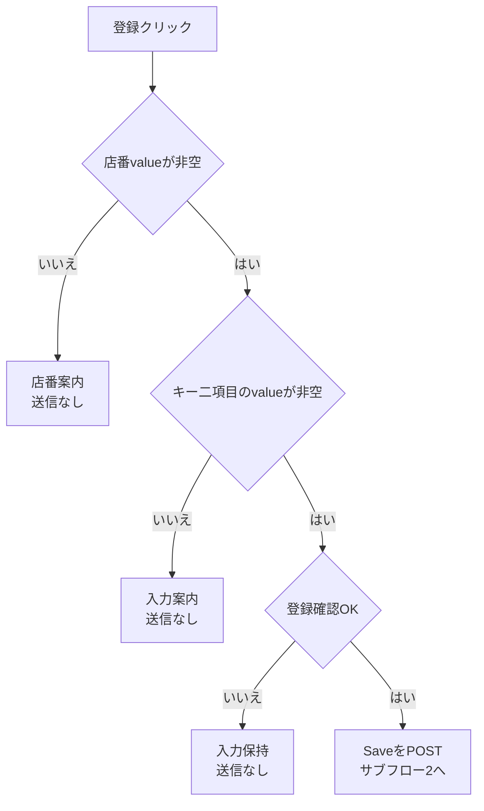

サブフロー2は共通入口から入力検査までである。G通過以外の枝はフォーム読取りへ進まない。

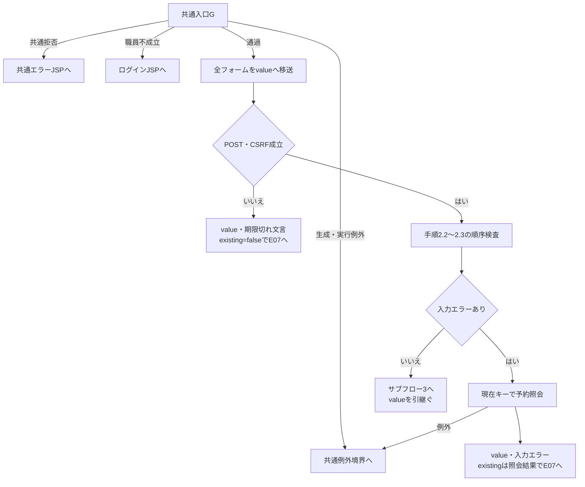

サブフロー3は対象と権限を確認する。K1は「existingあり、かつ元対象と同一キーでない」、K2は「existingなし、かつoriginalあり」である。

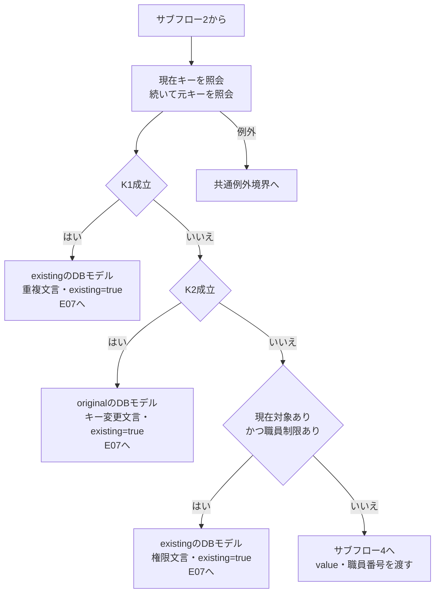

サブフロー4はRepository保存である。二つの正常枝は、それぞれの処理種別を失わずcommitへ進む。

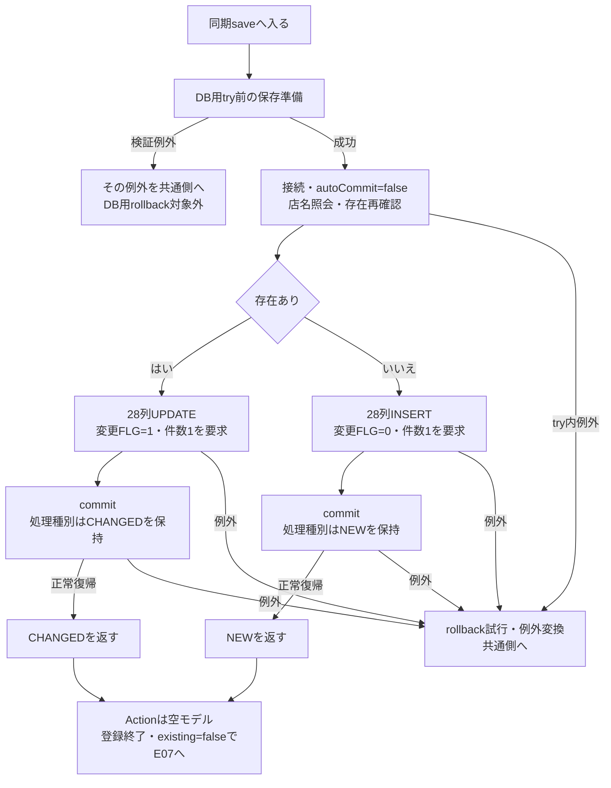

#### SQL・テーブル関連（ER図）

予約の参照関連はE04の図に従う。保存は年金1_LKだけに行い、削除明細への追加は行わない。

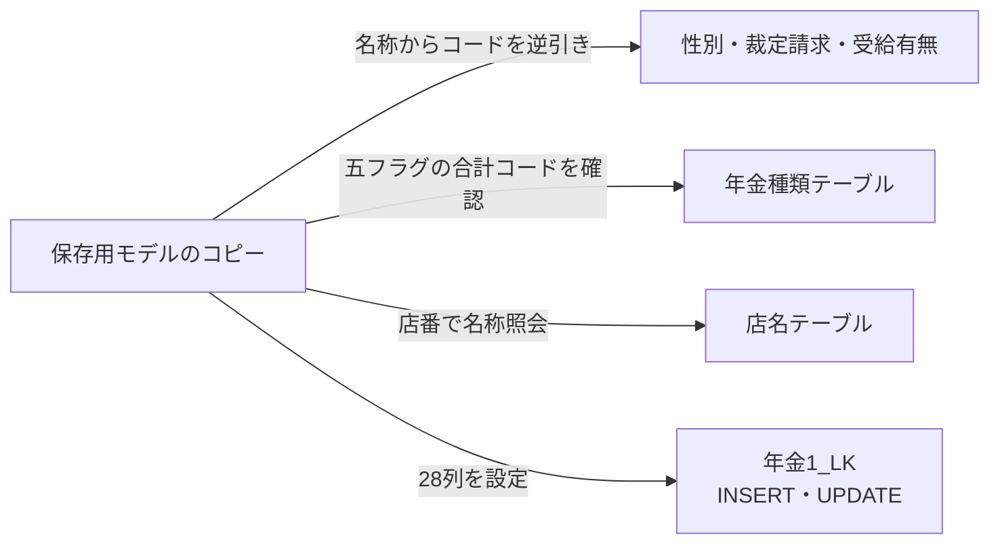

#### DB操作の詳細

存在再確認SQLは次のとおりである。1をsetString、2をsetBigDecimalとして、最初の行の有無を返す。ORDER BYや明示的な行ロック指定はない。

```sql
SELECT 1 FROM 年金1_LK
 WHERE ふりがな = ? AND 電話番号 = ?
```

INSERTは次の28列を順に設定する。UPDATEも同じ順序で全列を設定し、末尾のWHERE用29番に保存用フリガナ、30番に保存用電話数値を設定する。

```sql
INSERT INTO 年金1_LK (
 店番, 顧客番号, 担当者コード, 顧客氏名, ふりがな, 性別, 住所, 電話番号,
 生年月日, "種類：国民年金", "種類：厚生年金", "種類：共済年金",
 "種類：厚生年金基金", "種類：国民年金基金", 年金種類, 裁定請求,
 請求予定日, 予定年齢, 配偶者名, 配偶者生年月日, 受給有無,
 予約徴求日, 備考, データ更新日, 更新時間, 更新者, "６ヶ月先確認", 変更FLG
) VALUES (?,?,?,?,?,?,?,?,?,?,?,?,?,?,?,?,?,?,?,?,?,?,?,?,?,?,?,?)

UPDATE 年金1_LK
   SET 店番 = ?, 顧客番号 = ?, 担当者コード = ?, 顧客氏名 = ?,
       ふりがな = ?, 性別 = ?, 住所 = ?, 電話番号 = ?, 生年月日 = ?,
       "種類：国民年金" = ?, "種類：厚生年金" = ?, "種類：共済年金" = ?,
       "種類：厚生年金基金" = ?, "種類：国民年金基金" = ?,
       年金種類 = ?, 裁定請求 = ?, 請求予定日 = ?, 予定年齢 = ?,
       配偶者名 = ?, 配偶者生年月日 = ?, 受給有無 = ?, 予約徴求日 = ?,
       備考 = ?, データ更新日 = ?, 更新時間 = ?, 更新者 = ?,
       "６ヶ月先確認" = ?, 変更FLG = ?
 WHERE ふりがな = ? AND 電話番号 = ?
```

WHEREに店番、顧客番号、ORIGINAL受信値、元更新日、更新者、比較版は追加しない。INSERT・UPDATEとも実行件数が1でなければSQLExceptionを送出する。

次表は保存と削除明細に共通するバインド順・物理属性である。予約本表と削除明細の28列は、両収録DDLで全てNULL可、DEFAULT宣言なしである。P番号は本書のパラメータ対応番号であり、DB列の一意キーではない。

| 番号 | 設定列 | Java上の値・加工 | JDBCバインド | SQL Server／H2の型 | 空値・操作別設定 |
| --- | --- | --- | --- | --- | --- |
| P01 | 店番 | branchNo：Integer | setInt／setNull(INTEGER) | INT／INTEGER | 通常SaveはActionで非null要求。削除明細は再取得値 |
| P02 | 顧客番号 | customerNo：Integer | setInt／setNull(INTEGER) | BIGINT／BIGINT | 空等はNULL。Java int範囲で扱う |
| P03 | 担当者コード | staffCode：Integer | setInt／setNull(INTEGER) | INT／INTEGER | 空等はNULL。更新者とは別 |
| P04 | 顧客氏名 | customerName：String | setString | NVARCHAR(100)／VARCHAR(100) | Save空欄は空文字 |
| P05 | ふりがな | kanaName：String | setString | NVARCHAR(100)／VARCHAR(100) | Saveは正規化結果。削除明細は再取得モデル値 |
| P06 | 性別 | gender名称からIntegerコードへ逆引き | setInt／setNull(INTEGER) | TINYINT／TINYINT | 空名称はNULL |
| P07 | 住所 | address：String | setString | NVARCHAR(300)／VARCHAR(300) | Save空欄は空文字 |
| P08 | 電話番号 | 数字抽出後のBigDecimal | setBigDecimal／setNull(DECIMAL) | DECIMAL(15,0)／DECIMAL(15,0) | 数字なしはNULL変換。通常Saveはその前に拒否 |
| P09 | 生年月日 | ISO文字列からjava.sql.Date | setDate／setNull(DATE) | DATE／DATE | 空はNULL |
| P10 | 種類：国民年金 | nationalPension：boolean | setInt、1または0 | BIT／BOOLEAN | 未選択は0 |
| P11 | 種類：厚生年金 | employeePension：boolean | setInt、1または0 | BIT／BOOLEAN | 未選択は0 |
| P12 | 種類：共済年金 | mutualAidPension：boolean | setInt、1または0 | BIT／BOOLEAN | 未選択は0 |
| P13 | 種類：厚生年金基金 | employeePensionFund：boolean | setInt、1または0 | BIT／BOOLEAN | 未選択は0 |
| P14 | 種類：国民年金基金 | nationalPensionFund：boolean | setInt、1または0 | BIT／BOOLEAN | 未選択は0 |
| P15 | 年金種類 | 五フラグの重み合計を確認したInteger | setInt／setNull(INTEGER) | INT／INTEGER | 合計0はNULL。非0はコード表の行が必要 |
| P16 | 裁定請求 | claimStatus名称からIntegerコードへ逆引き | setInt／setNull(INTEGER) | TINYINT／TINYINT | 空名称はNULL |
| P17 | 請求予定日 | claimScheduledDateからjava.sql.Date | setDate／setNull(DATE) | DATE／DATE | 空はNULL |
| P18 | 予定年齢 | plannedAge：Integer | setInt／setNull(INTEGER) | INT／INTEGER | 正数化できない受信値はNULL |
| P19 | 配偶者名 | spouseName：String | setString | NVARCHAR(100)／VARCHAR(100) | Save空欄は空文字 |
| P20 | 配偶者生年月日 | spouseBirthDateからjava.sql.Date | setDate／setNull(DATE) | DATE／DATE | 空はNULL |
| P21 | 受給有無 | hasBenefit名称からIntegerコードへ逆引き | setInt／setNull(INTEGER) | TINYINT／TINYINT | 空名称はNULL |
| P22 | 予約徴求日 | reservationRequestDateからjava.sql.Date | setDate／setNull(DATE) | DATE／DATE | 空はNULL |
| P23 | 備考 | notes：String | setString | NVARCHAR(400)／VARCHAR(400) | Save空欄は空文字。56バイトは別の業務検査 |
| P24 | データ更新日 | サーバー当日のISO文字列 | setDate | DATE／DATE | Save・削除時の当日を設定 |
| P25 | 更新時間 | currentTimeの先頭8文字からjava.sql.Time | setTime／setNull(TIME) | TIME(0)／TIME | HH:mm:ssを設定。文字列が8文字未満ならNULL |
| P26 | 更新者 | updatedBy：Integer | setInt／setNull(INTEGER) | INT／INTEGER | 通常Actionはログイン職員番号を渡す |
| P27 | ６ヶ月先確認 | sixMonthCheck：boolean | setInt、1または0 | BIT／BOOLEAN | 未選択は0 |
| P28 | 変更FLG | 処理種別のInteger | setInt／setNull(INTEGER) | TINYINT／TINYINT | 新規0、変更1、削除明細NULL |

文字列はsetStringを使い、setNStringやJDBCのサイズ指定はない。100・300・400等は各DB型の宣言容量であり、入力の業務文字数上限として検査している値ではない。電話の精度15・位取り0、日付入力のmaxlength=14、備考56バイトも別の制約である。

コード逆引きでは名称をtrimし、空なら照会せずnullを返す。非空の場合は次の各SQLの1番へsetStringし、最初のコードを返す。ORDER BYと名称重複件数検査はない。

```sql
SELECT 性別ｺｰﾄﾞ FROM 性別テーブル WHERE 性別 = ?
SELECT 裁請ｺｰﾄﾞ FROM 裁定請求テーブル WHERE 裁定請求 = ?
SELECT 受給ｺｰﾄﾞ FROM 受給有無テーブル WHERE 受給有無 = ?
```

非空名称に該当行がなければSQLExceptionとなる。コード列にはPKがあるが、名称の一意制約は宣言されていない。

五フラグの重みは国民1、厚生2、共済4、厚生基金8、国民基金16である。非0合計は`SELECT 年金種類 FROM 年金種類テーブル WHERE 種類ｺｰﾄﾞ = ?`へsetIntし、行がなければSQLExceptionとする。合計0は照会せずNULLを保存する。

#### 結果・例外時の扱い

| 条件・段階 | 表示モデル | existing | 結果・境界 |
| --- | --- | --- | --- |
| POST・CSRF不成立 | 入力value | false | 期限切れ文言。保存しない |
| 入力不備、後続キー照会成功 | 入力value | 予約照会の有無 | 最初の入力エラー。先行日付のISO化を保持 |
| 現在対象あり・元対象と不同一 | 現在対象のDBモデル | true | 重複読込み。入力の非キー変更は置換される |
| 現在対象なし・元対象あり | 元対象のDBモデル | true | キー変更拒否 |
| 既存変更の職員制限 | 現在対象のDBモデル | true | 推進役以上による変更を要求 |
| Repository正常復帰 | 新しい空モデル | false | 「登録終了！」。DBはcommit後 |
| 保存準備の検証例外 | 通常の再表示Beanは設定しない | 通常結果なし | DB用try外のIllegalArgumentExceptionが共通側へ伝播 |
| DB用try内の例外 | 通常の完了Beanは設定しない | 通常結果なし | rollbackを試み、例外を共通側へ伝播 |

Actionの必須検査はRepository正規化より前である。全角空白だけのフリガナはString.trim後にも残り得るが、RepositoryのNFKCとtrimで空になり拒否される。数字を含まない非空電話もActionの必須検査を通過し得るが、保存準備で拒否される。

保存準備の例外はsaveのDB用catchによる包み直し・rollbackの対象外である。DB用try内はExceptionを捕捉してrollbackを試みる。既存NenkinDataAccessExceptionなら同じ例外を再送出し、それ以外は「年金予約の登録・更新に失敗しました。」の例外へ包む。Action自身に個別catchはない。

commit例外もDB用catchへ入るが、例外だけからDB未確定やrollback成功を断定できない。正常commit後のBean設定、アクセス記録、JSP描画、応答送信は、この保存トランザクションのrollback範囲に戻らない。

### E06 削除

#### 処理概要

表示対象と元キーの同一性、ログイン職員の権限を確認し、Repositoryが削除直前に再取得した予約から削除明細を作成する。明細追加と本表削除を同一トランザクションで実施する。

#### 処理手順

**1. ブラウザーで削除を確認する。**

　**1.1.** 店番valueが空なら店番案内、キー二項目のどちらかが空なら既存レコードの読込みを求める案内を表示し、送信しない。ブラウザー検査ではtrim・数字抽出を行わない。

　**1.2.** 「表示しているレコードを削除します。よろしいですか？」のOKでDeleteを送る。キャンセル・Escapeでは入力を保持して送信しない。

**2. 共通入口、受信値、対象を確認する。**

　**2.1.** 共通ログイン・運用判定に拒否された場合は共通エラーの戻り先を選び、Delete Actionのフォーム読取りへ進まない。Action内のrequireStaff不成立ではログインJSPを返し、同様にフォームを読まない。

　**2.2.** Gを通過した場合だけ全フォームをvalueへ移す。その後POST・CSRFを検査し、不成立ならvalue、期限切れ文言、existing=falseでE07へ進む。

　**2.3.** 店番がnullならvalue、「店番は必ず入力してください」、existing=trueで戻る。続いてフリガナまたは電話番号が空ならvalue、既存レコードの読込みを求める文言、existing=falseで戻る。

　**2.4.** 現在キー、ORIGINAL二項目の順に予約を照会する。現在対象がない、または元対象と同一キーでなければ「削除対象を参照画面またはキー入力から読み込んでください。」とする。現在対象があればそのDBモデル・existing=true、なければvalue・existing=falseを設定する。

　**2.5.** 同一性確認後、ログイン職員の所属店番75と役職コードによる制限を確認する。制限時は取得済みDBモデル・existing=trueで推進役以上による削除を求める。

**3. Repositoryで対象を再取得する。**

　**3.1.** 入力キーとログイン職員番号をdeleteへ渡す。同期メソッド内でキーを正規化し、フリガナ空または電話数字なしなら接続前にfalseを返す。

　**3.2.** 業務接続を取得してautoCommit=falseとし、同一接続でE04と同じJOIN付き予約をキー検索する。

　**3.3.** 対象がなければconnection.rollbackを呼び、正常復帰後にfalseを返す。このrollback自体が例外になった場合はfalseを返さず、DB用catchへ入る。

**4. 削除明細を追加して本表を削除する。**

　**4.1.** 再取得モデルのデータ更新日をサーバー当日へ変更する。削除時刻とログイン職員番号を用い、P01～P28の共通バインドで年金＿削除明細へINSERTする。P28変更FLGはNULLとする。

　**4.2.** 明細INSERTが1件であることを確認し、年金1_LKを同じフリガナ・電話数値でDELETEする。DELETEも1件であることを要求する。

　**4.3.** commitしてtrueを返す。finallyでDELETE用Statementと接続をcloseする。再取得・明細登録用のResultSetとStatementは各helperのfinallyで閉じる。

**5. 結果を画面へ設定する。**

　**5.1.** trueなら新しい空モデル、「削除終了！」、existing=falseとする。falseなら入力value、「削除対象が見つかりません。」、existing=trueとする。

　**5.2.** DB用try内のExceptionはrollbackを試み、「年金予約の削除に失敗しました。」のNenkinDataAccessExceptionへ包む。Delete Actionに個別catchはない。

#### 処理フロー

サブフロー1はブラウザー内の確認である。OKの場合だけサーバー要求へ進む。

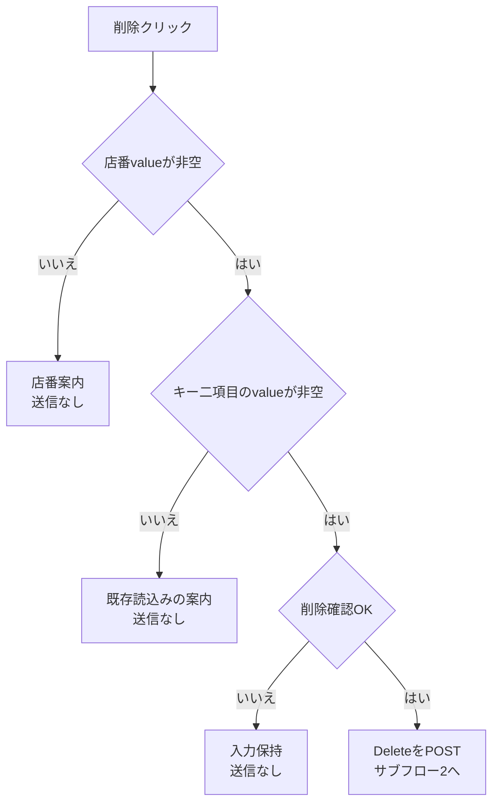

サブフロー2は共通入口とAction入口検査である。共通拒否、職員不成立、G通過を分け、G通過枝だけをフォーム読取りへ接続する。

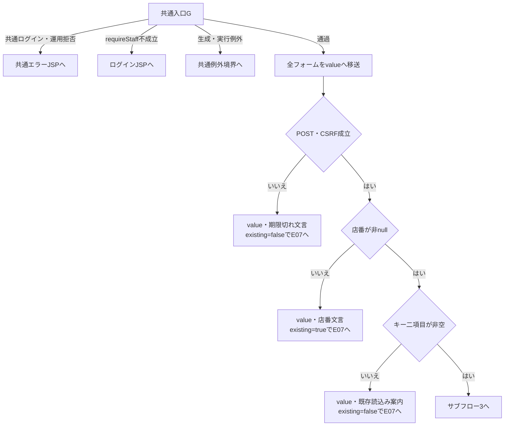

Gの識別値前処理例外は概要のcatch外経路に従う。サブフロー3は、現在対象の有無を保持して拒否状態を決める。

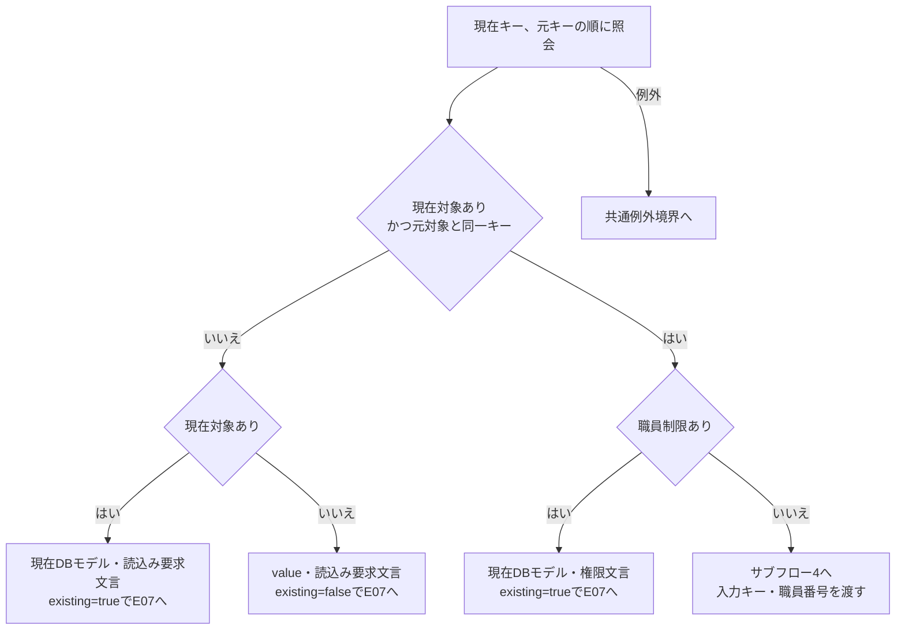

サブフロー4はRepository削除である。Repositoryのfalseは、サブフロー3の対象不成立とは異なるexisting状態で再表示する。

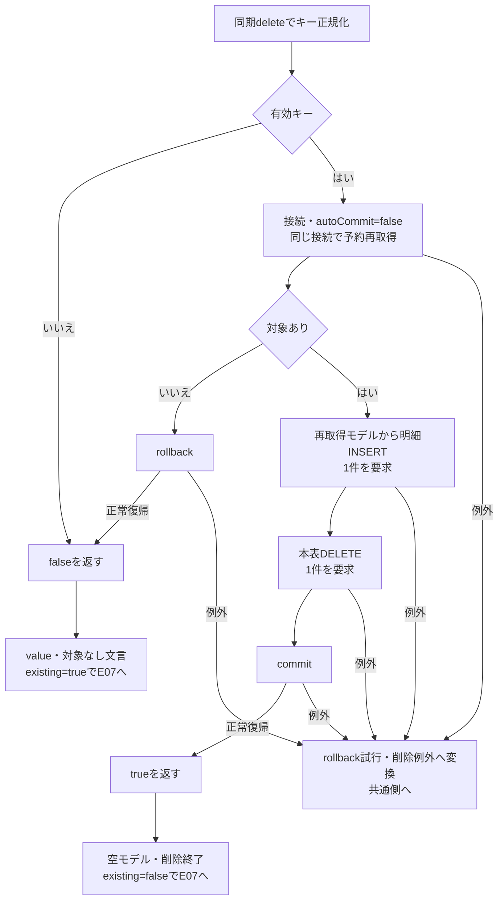

#### SQL・テーブル関連（ER図）

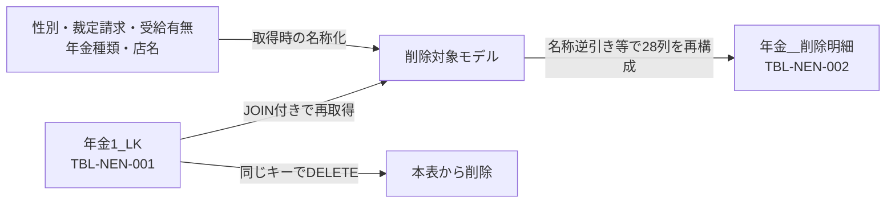

明細と本表の関係はこの処理によるもので、DDL上のFKではない。再取得・逆引きに使う参照表との関連はE04・E05に従う。

#### DB操作の詳細

再取得SQLはE04の26項目、五つのLEFT JOIN、フリガナ・電話のWHEREを同一接続で実行する。1はsetString、2はsetBigDecimalで、最初の一件を返す。

明細INSERTはE05と同じ28列・順序で、対象表を年金＿削除明細へ変更する。変更FLGはNULLで、実行件数が1以外ならSQLExceptionとする。本表削除は次のSQLである。

```sql
DELETE FROM 年金1_LK WHERE ふりがな = ? AND 電話番号 = ?
```

1を正規化フリガナのsetString、2を電話数値のsetBigDecimalで設定する。店番・顧客番号・元更新日・比較版はWHEREに含めない。複数行に一致すればSQLは全一致行に作用し、その後で件数不一致を検出する。

明細の非キー値は画面の変更途中の値ではなく、削除直前の再取得モデルを使う。ただし物理行のINSERT SELECTコピーではない。取得時にコードをJOIN名称へ、NULLフラグをfalseへ、電話を表示文字列へ変換し、明細登録時にコード・数値へ戻す。合成年金種類は五フラグから再計算し、更新日・時刻・更新者は削除時の値に置き換える。

DeleteはSave用の日付・備考検査とprepareForSaveを呼ばない。明細作成では再取得値を共通バインドへ渡すため、名称逆引きやDATE変換等が失敗すれば正常完了しない。

#### 結果・例外時の扱い

入口の対象不成立では、現在対象の有無に応じてDBモデルまたは入力モデルを採用する。一方、Repositoryがfalseを返した場合は再照会せず、入力value・existing=trueを採用する。対象なしという理由だけで両者のreadonly状態を同じにしない。

対象なし分岐の明示rollbackが失敗した場合は、catchで再度rollbackを試みて削除例外を送出する。catchから呼ぶrollback補助内のSQLExceptionは元例外を優先して抑止する。close例外も業務結果を上書きしない。

参照コード欠落によってJOIN名称が空になれば、明細ではNULLコードになる場合がある。非空名称の逆引きに失敗すれば削除全体が例外となる。削除明細が元の物理コード・NULLをそのまま保持するとは扱わない。

正常commit後にtrueを返した場合はDB削除確定後である。commit例外時の確定状態、rollback成功、後続HTTP応答の完了は、例外の有無だけでは確定できない。

### E07 候補再取得・画面再表示

#### 処理概要

各Actionが設定したモデル・メッセージ・existingから画面を描画する。候補は毎描画取得し直し、表示状態からORIGINALキーとreadonlyを作成する。

#### 処理手順

**1. Action結果を保持してforwardへ進む。**

　**1.1.** pensionBeanはreservation、message、existing、職員表示を新しいBeanへ設定する。reservationがnullなら空モデルへ置き換えるが、非nullならコピーせず同じモデルを保持する。

　**1.2.** ServletはActionの後に共通アクセス記録を行い、その後forwardする。MESSAGEがある場合の記録JSP名はSubMessage.jspとなるが、それだけで実forward先を変更しない。

**2. 候補を再取得する。**

　**2.1.** JSP冒頭で性別、裁定請求、受給有無の一覧を取得し、年金種類一覧をコードキーのMapへ移す。各一覧は全件・コード昇順で、パラメータはない。

　**2.2.** selectの先頭に空optionを置き、モデル名称と候補名称の完全一致でselectedを付ける。候補にない旧名称を保持する追加optionは作らない。

　**2.3.** 年金種類の表示文言はMapのコード1・8・2・16・4を画面順に参照する。コード不在なら空名称となる。チェック状態はモデルのbooleanから決める。

**3. 値と状態をHTMLへ投影する。**

　**3.1.** 文字列・メッセージをHTMLエスケープし、数値nullは空文字として表示する。DB由来文字列・JOIN名称のNULLはモデルで空へ変換される。

　**3.2.** 日付はISOとして解析できれば指定の和暦・西暦へ整形し、解析できなければ元の文字列を返す。入力拒否後の不正日付を表示モデルから消去しない。

　**3.3.** existing=trueなら表示モデルのキーをORIGINALへ設定し、フリガナ・電話をreadonlyにする。falseならORIGINALを空にしてキーを編集可能とする。LOOKUP二項目は全描画で空にする。

　**3.4.** 担当者氏名spanは空で開始する。予約の担当者コードから氏名を再取得する処理はない。

**4. ブラウザー表示を初期化する。**

　**4.1.** メッセージが空なら状態領域をhiddenにする。非空なら「終了」を含む場合にsuccess、それ以外はerrorを付ける。

　**4.2.** 「終了」を含む状態メッセージがある場合は完了ボックスを開く。共通数字補助とカレンダーの初回bindも発生する。

#### 処理フロー

```mermaid
flowchart TD
 A[Actionがモデル・文言・existingを設定] --> B[共通アクセス記録]
 B --> C[Servletのforward]
 C --> D[JSPで四コード候補を取得]
 D -->|成功| E[候補・値・日付を表示変換]
 E --> F[existingに従い<br/>ORIGINAL・readonlyを設定]
 F --> G[LOOKUPを空にして描画]
 G --> H[ブラウザー補助<br/>該当時の完了ボックス]
 D -->|例外| X[Action用catch外の失敗]
 E -->|捕捉されない例外| X
 C -->|forward失敗| X
```

各流入枝のモデル・文言・existingとcommit済みか否かを維持する。描画開始時に一律の初期状態へ置き換えない。

#### SQL・テーブル関連（ER図）

候補取得は予約本表と独立した四表の読取りである。各コードが候補キー、名称が表示値となる。名称を保守する保存・更新入口は接続された年金画面にはない。

```mermaid
flowchart LR
 G[性別テーブル] --> S[性別select]
 C[裁定請求テーブル] --> T[裁定請求select]
 H[受給有無テーブル] --> U[受給有無select]
 P[年金種類テーブル] --> M[コードキーのMap]
 M --> L[五チェックの表示名称]
```

#### DB操作の詳細

毎描画、以下をそれぞれ業務接続で実行する。WHEREとバインド値はなく、全行をリストへ取得する。年金種類はその後Mapへ変換する。

```sql
SELECT 性別ｺｰﾄﾞ AS CODE_VALUE, 性別 AS LABEL_VALUE
  FROM 性別テーブル ORDER BY 性別ｺｰﾄﾞ
SELECT 裁請ｺｰﾄﾞ AS CODE_VALUE, 裁定請求 AS LABEL_VALUE
  FROM 裁定請求テーブル ORDER BY 裁請ｺｰﾄﾞ
SELECT 受給ｺｰﾄﾞ AS CODE_VALUE, 受給有無 AS LABEL_VALUE
  FROM 受給有無テーブル ORDER BY 受給ｺｰﾄﾞ
SELECT 種類ｺｰﾄﾞ AS CODE_VALUE, 年金種類 AS LABEL_VALUE
  FROM 年金種類テーブル ORDER BY 種類ｺｰﾄﾞ
```

SQL Serverの名称列は性別・裁定請求・受給有無がNVARCHAR(10)、店名がNVARCHAR(80)、年金種類がNVARCHAR(120)でNOT NULL、コード列はPKである。H2は対応するVARCHAR容量とNOT NULLを宣言する。これは保存元列の属性であり、予約LEFT JOIN不成立時のNULL可能性をなくすものではない。

ローカル初期データには候補五表のMERGEがある。接続された年金Java処理には名称の保守入口がなく、名称の業務上限をDB容量で代用しない。

#### 結果・例外時の扱い

候補0件ではselectは空optionだけとなり、年金種類の必要コードがなければラベルは空になる。旧名称が候補からなくなった場合に追加optionを補わないため、次の送信で元名称が保持される保証はない。

各Actionから伝播したExceptionは、ControlServletの生成・perform用catchへ届けば、ログ記録と共通エラー設定を経て共通エラーJSPへ変換される。保存準備のIllegalArgumentExceptionとRepository内で包んだDB例外も、この境界へ届いた場合は対象となる。

JSPの候補取得・描画とforwardはAction用catchの外側である。日付表示関数はParseExceptionを捕捉して元文字列を返すが、候補取得例外等まで入力エラーへ変換するcatchはない。本画面のサーバー描画には予定年齢の算術演算はない。

入力・CSRF拒否では明示的なHTTP拒否コードを設定せずJSPを返す。Action用catchも一律のHTTPエラー状態を設定しない。catch外の失敗や描画・送信途中まで、同じ最終画面・HTTP状態で終わるとは定義できない。完了ボックスは表示動作であり、閲覧完了をサーバーへ通知しない。

### E08 メニューへ戻る

#### 処理概要

戻るボタンで画面IDとコマンドIDをメニュー表示へ切り替え、現在の通常フォームを送信する。

#### 処理手順

**1. 遷移先を変更する。**

　**1.1.** navigateMenuがVIEW_IDをMenu、COMMAND_IDをViewへ変更する。

　**1.2.** 保存・削除の確認ボックスを経由せずform.submitする。入力項目は同時に送信するが、予約のSaveは呼ばない。

**2. メニューへ戻る。**

　**2.1.** 共通入口からメニュー表示Actionへ進む。職員情報表示とメニュー側の状態設定は計画文書DET-SCR-017に対応する。

#### 処理フロー

```mermaid
flowchart TD
 A[戻る] --> B[VIEW_ID=Menu<br/>COMMAND_ID=View]
 B --> C[通常フォームをPOST]
 C --> D[共通入口G]
 D -->|共通拒否| E[共通エラーJSPへ]
 D -->|職員不成立| F[ログインJSPへ]
 D -->|通過| G[メニュー表示]
 D -->|生成・実行例外| X[共通例外境界へ]
```

識別値前処理とforwardのcatch外境界は概要・E07に従う。

#### SQL・テーブル関連（ER図）

予約のINSERT、UPDATE、DELETEは行わない。職員確認に伴う照会と共通アクセス記録は予約保存とは別の責務である。遷移先の画面状態はセッションのViewBeanへ設定する。

#### DB操作の詳細

入力中の予約を保存するSQLは実行しない。共通アクセス記録は職員系接続を別取得して独立commit・rollbackするため、予約表の更新有無とは別に発生し得る。

#### 結果・例外時の扱い

通常はメニューへ戻る。予約入力を自動保存した結果ではない。共通入口、メニューAction、forwardの各段階に例外境界があり、全てを予約画面内メッセージへ変換しない。

## 補足説明

### 受信値・キー正規化・表示値

数値受信はInteger.parseIntの結果が正数の場合だけ採用する。欠落、空、ゼロ、負数、変換失敗、int範囲外はnullとなる。ブラウザーの数字除去補助と、サーバーの正数int変換は別の契約である。チェックは受信値1、true、onでtrueとなり、true・onは大文字小文字を区別しない。それ以外と欠落はfalseである。

| 層・用途 | フリガナ | 電話番号 |
| --- | --- | --- |
| フォーム移送 | nullを空へ変換してString.trim | nullを空へ変換してString.trim |
| Actionの対象比較 | trim、NFKC、Locale.ROOTの大文字化。空白集約なし | trim、NFKC後にASCII数字だけを抽出した文字列を比較 |
| Repository検索・保存キー | NFKC、trim、全角空白置換、連続半角空白を一つへ集約、Locale.JAPANの大文字化 | char単位のCharacter.isDigitとCharacter.digitでASCII数字へ移し、BigDecimal化 |
| DB保存 | 正規化文字列をふりがな列へ保存 | DECIMAL(15,0)へ数値保存 |
| DBから再表示 | 保存列の文字列 | 先頭ゼロを整理した数字列が9・10桁で0始まりでなければ0を一つ補う |

Actionは取得済み二モデルのキーを比較し、どちらかのモデルがnullならfalseを返す。Repositoryの検索正規化と同一実装ではない。電話0は数字なしと異なり数値ゼロである。数値化するため、入力のハイフンや任意個数の先頭ゼロは往復保持しない。

ORIGINALは受信した参照キーであり、サーバーが選択済みキーを別保持して署名・版と照合する処理はない。NULLはRepositoryの文字列補助で空となり、数字なし電話はnullキーとなる。これらは接続前に対象なしへ至り、NULLキーをSQLへ直接バインドしない。その結果と現在対象の有無を組み合わせ、E05・E06で保存可否を決める。

### 日付・備考・任意項目の空値

四日付の空欄は許容し、保存時はDATEのNULLとする。サーバーはNFKC後、西暦区切り形式、8桁西暦、正式元号名またはM・T・S・H・Rを使う区切り形式を解析し、実在日と元号の開始・終了期間を検査する。元年も扱う。ブラウザーparserの受理形式やmaxlengthは、このサーバー検査と分ける。

顧客氏名、住所、配偶者名、備考の空欄は空文字をsetStringする。顧客番号、担当者コード、予定年齢の空欄・変換不成立はNULL、三つのコード選択の空欄はコードNULL、五種類と確認済の未選択は0である。

備考はtrim後の文字列がWindows-31Jへ変換でき、変換後56バイト以内であることを要求する。文字数やJavaのコード単位数、DBの宣言容量400とは異なる。Actionは変換不可と超過を同じ「Excel出力した際、文字が途中で切れてしまいます。編集しなおしてください」の文言にする。Repositoryは両者を異なるIllegalArgumentExceptionで拒否する。自動切捨ては行わず、56バイトの算定理由を当該文言以上に補完しない。

### NULLと取得・再保存時の変換

Integer項目はResultSet.getInt後にwasNullを確認してDB NULLを保持する。五種類と６ヶ月先確認はgetIntの結果を0と比較するため、DB NULLと0をfalseへまとめる。文字列・名称はsetterがNULLを空にする。

したがって、画面空欄から元のDB NULLと空文字を区別できず、NULLフラグは再保存時に明示的な0となる。削除明細も同じモデル・バインド変換を通るため、元行のNULLやコードを完全に保持する監査履歴ではない。新規・変更時は別履歴表へ追加せず、本表の更新日・時刻・更新者・変更FLGを設定する。

### 同期・競合と確定境界

Repositoryは単一INSTANCEを公開し、saveとdeleteをインスタンスsynchronizedとしている。同じJVM・同じクラスロード下の同インスタンスを介する変更処理は直列化するが、Actionの事前照会、一般検索、別JVM、外部更新まで同じロックで保護しない。

収録DDLの予約本表・削除明細にはPK・一意制約・FKがなく、フリガナと電話番号の索引は非一意である。SQLに比較版、FOR UPDATE等の明示ロック、分離レベル設定はない。照会は最初の一件を返し、UPDATE・DELETEは全一致行へ作用して実行後に件数不一致を検出する。楽観ロックやDB全体の重複防止保証はない。

| 競合する段階 | 現行の処理結果・境界 |
| --- | --- |
| SaveのActionで新規判定後に同一キーが作成される | Repository再確認でUPDATEへ変わり得る。変更権限を再判定しない |
| Saveの事前照会または保存直前に対象が消える | Action両照会がnullとなる枝やRepository不存在枝ではINSERTへ進み得る |
| DeleteのAction確認後に対象が消える | Repository再取得で対象なしならrollback後false。Actionは入力モデル・existing=trueで戻す |
| Deleteまでに同じキーの内容が変更される | 比較版検査はなく、削除直前に再取得した内容を明細化・削除する |
| INSERT・UPDATE・DELETEの件数不一致 | SQLExceptionとなりrollbackを試みる |
| commitが例外になる | rollbackを試みるが、DB確定状態やrollback成功は例外だけで断定しない |
| commit後の画面状態設定・描画・通信失敗 | Repositoryのrollback範囲外。DB確定と利用者への結果到達は別 |

更新日・時刻はJavaの既定タイムゾーンに依存し、日付と時刻を別に生成する。更新時刻のミリ秒はTIME設定時に先頭8文字へ落とす。画面のデータ更新日は比較版として使用しない。

### 接続と参照元属性

予約、削除明細、コード、店名はjdbc/RAROA_DB、職員はjdbc/Oracle_SP2NM、顧客はjdbc/Oracle_DWHを先に探索し、次にjava:comp/env/付き名称を探索する。DataSourceをキャッシュする一方、接続は呼出しごとに取得する。読取接続取得時にはautoCommit等を変更せず、保存・削除が明示的にfalseを設定する。

対象SQLにはJDBCパラメータサイズ、query timeout、fetch size、SQL上のページ制限、取消処理の明示設定がない。これらの未指定を、DB・ドライバー側も無制限であるという保証へ置き換えない。

職員・顧客の本番外部表はSQL Server用DDLの作成対象外である。H2互換定義の職員氏名VARCHAR(40)、顧客カナ氏名VARCHAR(48)、漢字氏名VARCHAR(96)、住所VARCHAR(160)等を、本番外部列の容量・NULL保証や業務上限に転用しない。取込み元列と予約保存先列は特定できるが、同じ容量とは限らない。

### 関連文書

以下は提供計画上の対応先である。パスはMarkdown正本ルート基準で示す。生成済み確認を意味するリンクではない。

| 文書ID | 計画相対パス | 本書との責務分担 |
| --- | --- | --- |
| SCR-018 | 基本設計書/基本設計書_SCR-018_新規・変更・削除.md | 業務操作、操作別条件、画面状態の基本設計 |
| DET-SCR-016 | 詳細仕様書/詳細仕様書_SCR-016_店番参照／担当者参照／顧客参照.md | 参照子画面の検索条件、全SQL、ページング、選択通知 |
| DET-SCR-017 | 詳細仕様書/詳細仕様書_SCR-017_年金自動受取予約管理システム.md | メニュー表示・遷移・職員表示 |
| COM-012 | 共通/共通仕様書_COM-012_共通コントロールサーブレット.md | 文字コード、共通認証、運用判定、Action生成、共通catch、アクセス記録、forward |
| COM-111 | 共通/共通仕様書_COM-111_年金業務共通処理.md | 職員確認、CSRF、権限、受信変換、日付・備考の契約 |
| COM-151 | 共通/共通仕様書_COM-151_画面共通入力・通信制御.md | 数字補助、カレンダー、共有CSS、ブラウザー通信 |
| DATA-CONTRACTS | 共通/データオブジェクト定義書.md | ViewBean、予約モデル、職員・候補モデルの型と保持領域 |
| DB-OPS | 共通/DB仕様書/DB操作仕様書.md | 接続別SQL、共通バインド、トランザクション |
| DB-LOGICAL | 共通/DB仕様書/論理データ仕様書.md | 表・列の業務上の意味と検索関連 |
| DB-PHYSICAL | 共通/DB仕様書/テーブル定義書.md | TBL-NEN-001～007、TBL-N2-002・007等の物理属性 |
| CODE-NENKIN | 共通/コード一覧.md | コード表、年金種類合成、変更FLG等の区分 |
| API-NENKIN | 共通/要求処理一覧.md | 通常フォーム入口と独立JSON入口の区別 |

PensionLookupActionにはJSON直接応答の入口があるが、本画面のJavaScriptは呼ばない。通常の読込みはE04のフォームLoadである。searchCandidates等の宣言されたhelperも本画面の候補ボタンへ接続しない。通常導線で使わないことを、反射入口や外部呼出しから到達不能であることへ一般化しない。
