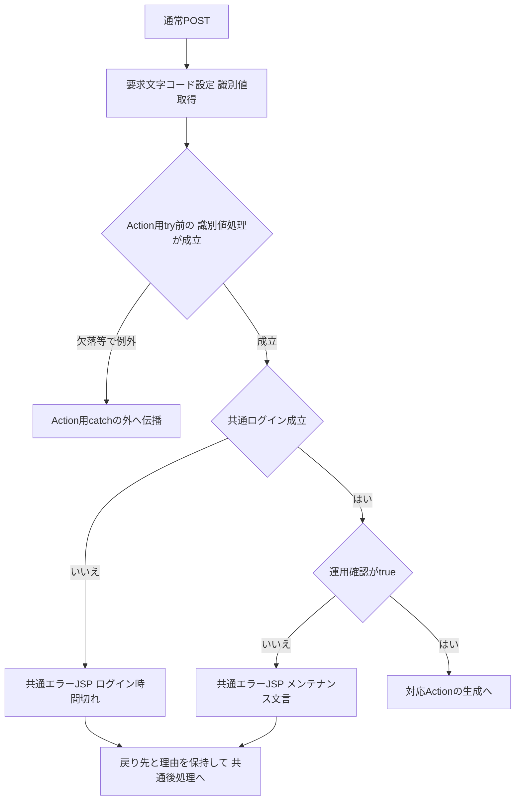
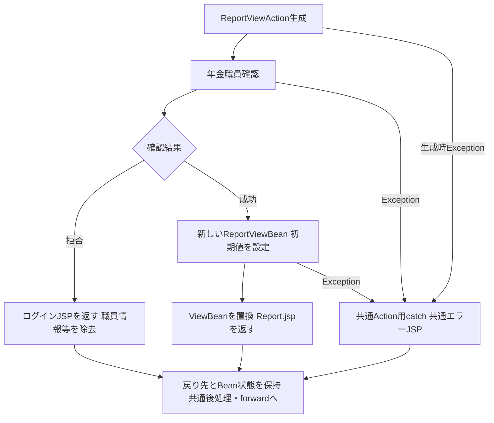
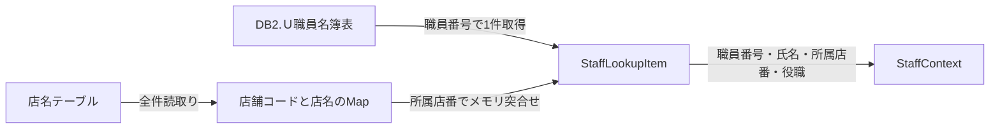
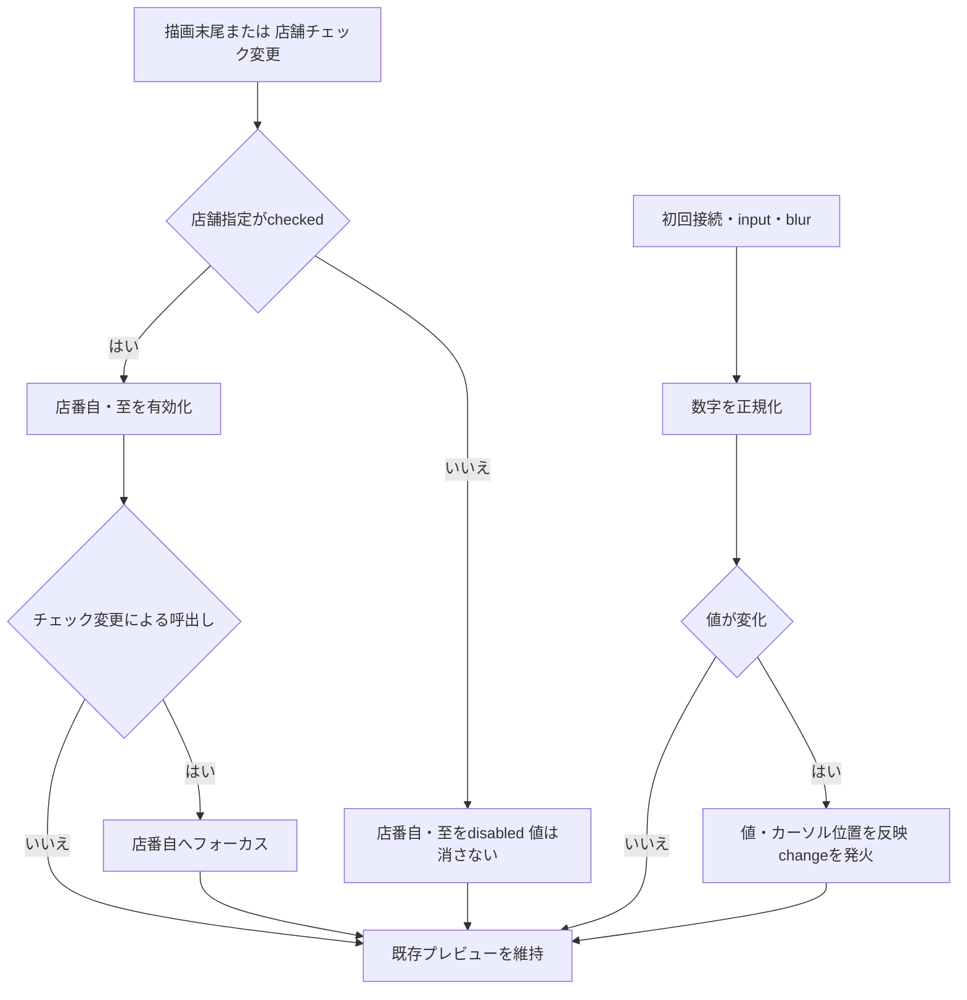
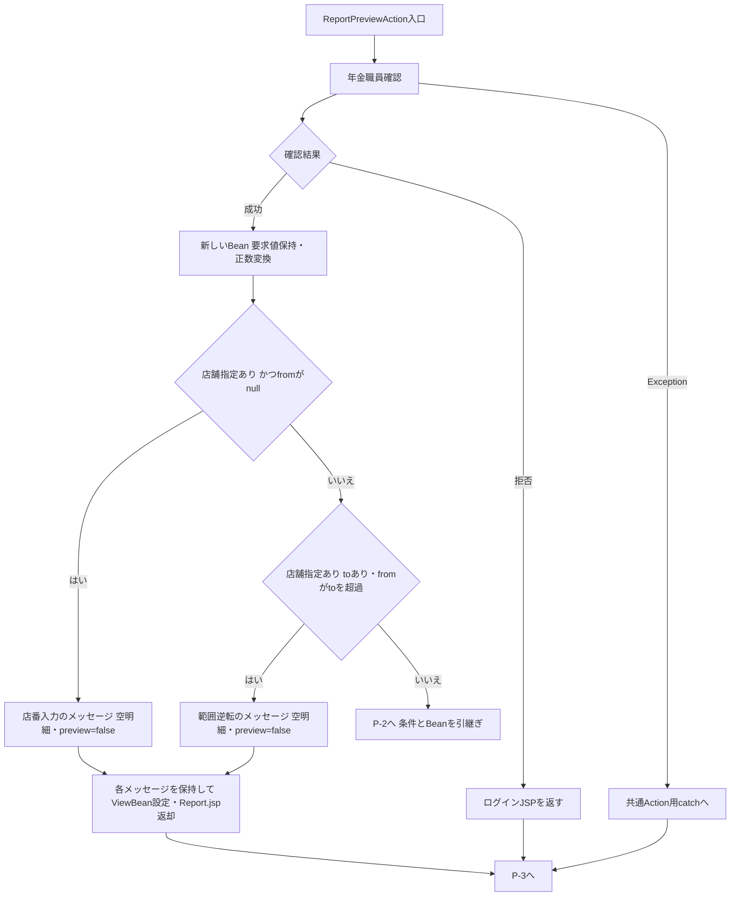
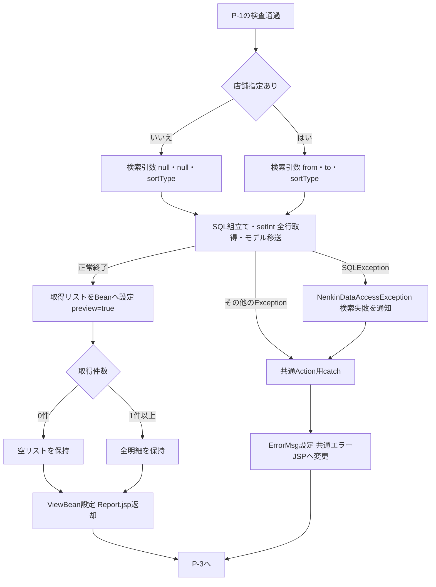
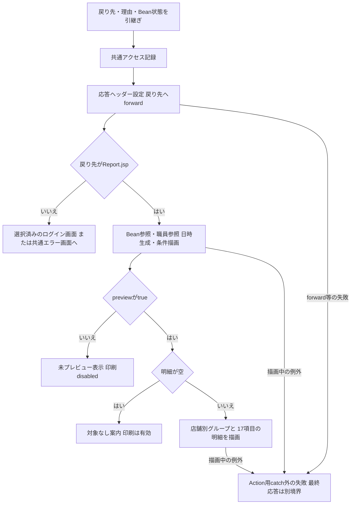
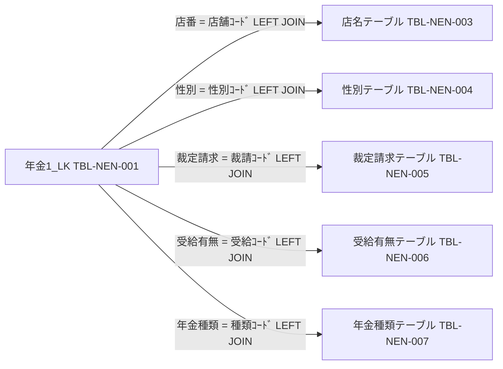
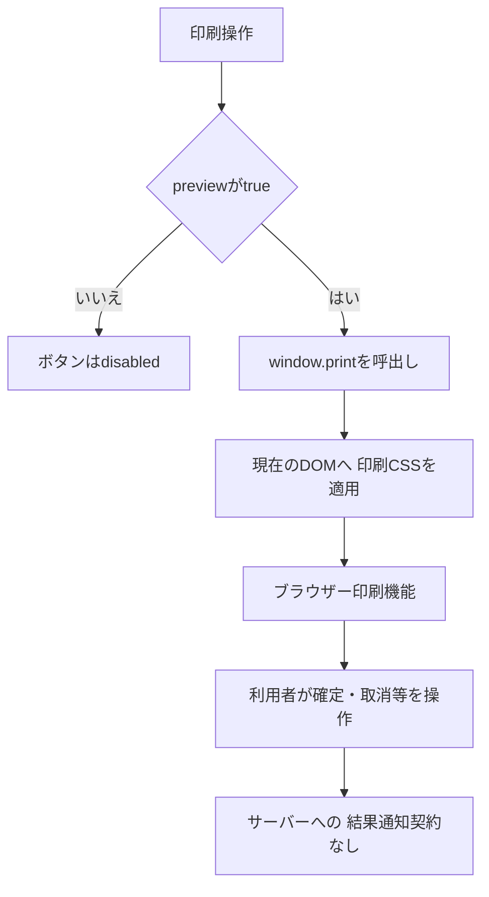
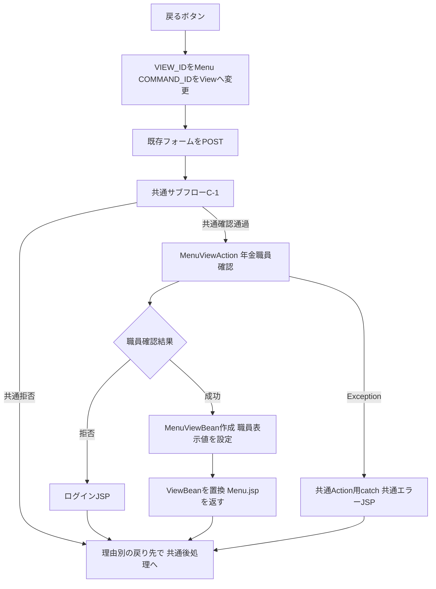

<!-- spec-meta: {"schema":"spec-md/1.0","documentId":"DET-SCR-019","version":"2.0","path":"詳細仕様書/詳細仕様書_SCR-019_登録内容印刷.md","sheets":[{"heading":"概要","kind":"GRID","sheet":"概要"},{"heading":"項目一覧","kind":"LIST","sheet":"項目一覧","key":["No"]},{"heading":"イベント仕様","kind":"GRID","sheet":"イベント仕様"},{"heading":"補足説明","kind":"GRID","sheet":"補足説明"}]} -->

# 登録内容印刷詳細仕様

| 属性 | 内容 |
| --- | --- |
| 文書種別 | 詳細仕様書 |
| システム名 | 年金自動受取予約管理システム |
| 機能ID | SCR-019 |
| 文書ID | DET-SCR-019 |
| 版 | 2.0 |
| 解析対象 | 登録内容印刷のJSP、Action、表示Bean、予約検索、表示変換、共通入口および適用CSS |
| 基準日 | 2026-10-15 |

## 概要

### 機能の責務

登録内容印刷は、登録済みの年金予約を全店舗、単一店舗または店舗範囲で検索し、店舗別の明細表をブラウザーへ表示する機能である。利用者は並び順と対象店舗を決めて「プレビューを作成」を実行し、表示された内容を「印刷」からブラウザーの印刷機能へ渡す。

検索対象は予約本表の`年金1_LK`である。削除明細は含めず、変更区分や更新日による抽出も行わない。店舗、性別、裁定請求、受給有無、年金種類の名称は各名称表とのLEFT JOINで取得する。

検索成功時には、取得した全明細と検索条件をセッションの`ViewBean`へ保持する。画面上の条件を編集するだけでは、表示済み明細、件数、帳票内の並び順表示を変更しない。条件変更を反映する操作は再度のプレビュー作成である。

### 要求入口と処理の分担

| 操作 | 通常入口 | 識別値・呼出先 | 結果 |
| --- | --- | --- | --- |
| 印刷画面を開く | メニューの「印刷」から`/Action.do`へPOST | `FUNCTION_ID=nenkin`、`VIEW_ID=Report`、`COMMAND_ID=View`から`nenkin.ReportViewAction`を生成 | 新しい`ReportViewBean`を設定し、`./JSP/NENKIN/Report.jsp`へ進む |
| プレビューを作成 | `form#reportForm`から`/Action.do`へPOST | `FUNCTION_ID=nenkin`、`VIEW_ID=Report`、`COMMAND_ID=Preview`から`nenkin.ReportPreviewAction`を生成 | 入力拒否または検索結果を新しいBeanへ設定し、同じJSPへ進む |
| 印刷 | 印刷ボタンの`window.print()` | サーバーへの要求なし | 現在のブラウザー文書を印刷機能へ渡す |
| 戻る | `backMenu()`が同じフォームをPOST | `VIEW_ID=Menu`、`COMMAND_ID=View`へ変更し、`nenkin.MenuViewAction`を呼ぶ | メニュー用Beanで`ViewBean`を置き換え、`./JSP/NENKIN/Menu.jsp`へ進む |

通常のPOSTは共通ログイン確認と運用確認を通り、各Actionでさらに年金職員確認を行う。ReportのActionには所属店舗による対象制限や役職による印刷拒否は接続されていない。フォームにはCSRF照合項目がなく、両Report Actionは`isAuthorizedMutation`を呼ばない。職員確認でセッションのCSRF用属性を確保することと、この要求で照合することは別の処理である。

`reportForm`の`accept-charset`と共通入口の要求文字コード設定はWindows-31Jである。Actionは`getParameter`で受けた文字列を自ら変換する。JSPのページ宣言はUTF-8であり、要求文字列の復号、Action内の値、表示応答の文字コード設定を同一の処理として扱わない。

### 画面と保持情報の状態

| 状態 | 条件欄 | プレビュー領域 | 印刷ボタン | 保持情報 |
| --- | --- | --- | --- | --- |
| 初期表示・Report/Viewへの再入場 | 並び順1、店舗指定なし、店番自・至は空欄 | 生成しない。「条件を指定して／プレビューを作成」を表示 | disabled | 空明細、`preview=false`の新しいBean |
| 店舗指定を有効化 | 店番自・至を入力可能にし、チェック変更による有効化では店番自へフォーカス | 既存表示を維持 | 既存状態を維持 | この時点ではサーバーBeanを変更しない |
| 店舗指定を解除 | 店番自・至をdisabledにする。DOMの値は消去しない | 既存表示を維持 | 既存状態を維持 | 通常送信ではdisabled項目が送られず、次回Previewでは未受信値が空文字となる |
| 店番自の入力拒否 | trim後の受信文字列と並び順を再表示 | 生成しない | disabled | 空明細、`preview=false`、店番自のエラーメッセージ |
| 範囲逆転の入力拒否 | 受信条件を再表示 | 生成しない | disabled | 空明細、`preview=false`、範囲逆転のエラーメッセージ |
| 検索成功・0件 | 検索に使用した条件を表示 | 0件の案内を表示し、店舗別表は生成しない | 有効 | 空リスト、`preview=true` |
| 検索成功・明細あり | 検索に使用した条件を表示 | 店舗別表、合計件数、店舗内件数を表示 | 有効 | 取得全明細、`preview=true` |
| 条件編集後・再検索前 | 編集した条件を表示 | 前回の明細と帳票内表示を維持 | 前回の活性を維持 | 前回検索の状態を維持 |
| 検索例外 | 正常な再表示へは進まない | 途中取得リストを公開しない | Report画面の応答を確定しない | 当該Actionの新しいBean設定には到達しない |

入力拒否では以前のプレビューを保持せず、新しい未プレビューBeanで置き換える。一方、検索例外ではその置換処理に到達しない。この二つを同じ再表示状態として扱わない。

### 静的画面投影

次のHTMLは、明細がある場合の項目位置を示す非実行の投影である。`［…］`は差込み位置を表し、実際の職員・予約データや取得件数を示さない。DOMの構造、コントロール名、主要な適用CSSと帳票配置を対応付け、元の送信先とHTTP methodは`data-source-*`および入口表へ保持する。投影のフォームには`action`属性を設けず、すべてのボタンを`type="button"`とする。実アプリへの送信、JavaScript実行、印刷呼出しは含めない。

初期状態は、この投影から`section.report-preview-shell`を生成せず、状態表示を「条件を指定して／プレビューを作成」とし、印刷ボタンに`disabled`を付けた状態である。0件状態は、プレビュー領域内の`article.report-page`の代わりに`div.report-empty-state`で「対象データがありません」「印刷条件を変更してプレビューを作成してください。」を表示する。入力拒否状態では、条件フォームの前に`div.validation-summary.no-print`を`role="alert"`で置き、対応するメッセージを表示する。これらの状態を同時には表示しない。

<!DOCTYPE html>
<html lang="ja">
<head>
<meta charset="UTF-8">
<meta name="viewport" content="width=device-width, initial-scale=1">
<title>登録内容印刷</title>
<style>
:root{--bg:#edf1f4;--surface:#fff;--line:#b8c2cc;--text:#18212a;--muted:#566370;--nav:#16324a;--nav-text:#f4f8fb;--primary:#0f6b5f;--primary-dark:#0a5148;--button:#e8edf1;--button-border:#7b8792;--focus:#1a75bb;--work-screen-width:1180px}
*,*::before,*::after{box-sizing:border-box}button,input{margin:0;font:inherit}html{min-height:100%}body{min-height:100vh;margin:0;color:var(--text);background:var(--bg);font-family:"Yu Gothic UI","Meiryo","Segoe UI",sans-serif}
.app-shell{width:100%;max-width:1440px;margin-inline:auto}.app-nav{display:flex;min-height:48px;align-items:center;justify-content:space-between;gap:12px;padding:7px 18px;color:var(--nav-text);background:var(--nav);border-bottom:1px solid #0c2236}.app-nav__title{color:var(--nav-text);font-weight:800;line-height:1.25}main.app-shell:not(.login-shell){padding:20px 18px 52px}.surface{background:var(--surface);border:1px solid var(--line);border-radius:6px;box-shadow:0 1px 2px rgba(16,32,48,.08)}.screen{padding:18px}
.screen-header{display:flex;gap:16px;align-items:flex-start;justify-content:space-between;margin-bottom:18px;padding-bottom:12px;border-bottom:1px solid var(--line)}.screen-header-actions{display:flex;flex-wrap:wrap;gap:10px;align-items:flex-start;justify-content:flex-end}h1{margin:0;font-size:1.45rem;font-weight:700;letter-spacing:0}h2{margin:0 0 10px;font-size:1rem;font-weight:700;letter-spacing:0}.staff-badge{display:grid;grid-template-columns:auto auto auto;gap:8px;align-items:center;min-height:34px;padding:6px 10px;background:#eef7f5;border:1px solid #9fc3bc;border-radius:4px;color:var(--primary-dark)}.staff-badge strong{font-variant-numeric:tabular-nums}
.form-control{display:block;width:100%;padding:6px 10px;color:var(--text);background:#fff;border:1px solid #9da9b4;line-height:1.4;min-height:38px;border-radius:3px}.form-control:focus,button:focus-visible{outline:2px solid var(--focus);outline-offset:1px}.form-control:disabled{background:#edf0f2}.code-input{width:auto;box-sizing:border-box;font-variant-numeric:tabular-nums}.access-button{display:inline-flex;min-height:42px;align-items:center;justify-content:center;padding:8px 18px;color:var(--text);background:var(--button);border:1px solid var(--button-border);border-radius:4px;font-weight:700;text-decoration:none;line-height:1.2}.access-button:hover,.access-button:focus{color:var(--text);background:#dce5eb;border-color:var(--focus)}.access-button.primary{color:#fff;background:var(--primary);border-color:var(--primary-dark)}.access-button.primary:hover,.access-button.primary:focus{color:#fff;background:var(--primary-dark)}.access-button.secondary{background:#f4f6f8}.access-button.narrow{min-width:96px}.access-button:disabled{color:#6c757d;background:#edf0f2;border-color:#c8d0d7;cursor:not-allowed}.validation-summary{margin-bottom:12px;padding:10px 12px;background:#fff8df;border:1px solid #d5b75f;border-radius:4px;color:#4d3a00}
.screen.report-screen{width:1180px;min-width:1080px}.report-page-header{align-items:center;margin-bottom:20px;padding-bottom:16px}.report-page-title{display:grid;gap:5px}.report-page-title p,.report-filter-heading p,.report-preview-toolbar p{margin:0;color:var(--muted);font-size:.88rem}.report-filter-form{overflow:hidden;background:#f7f9fb;border:1px solid #b9c4cd;border-radius:5px}.report-filter-heading{display:flex;gap:18px;align-items:center;justify-content:space-between;padding:14px 18px;background:#edf2f5;border-bottom:1px solid #c6d0d8}.report-filter-heading h2{margin-bottom:2px;font-size:1.05rem}.report-filter-heading>span{padding:5px 9px;color:#435564;background:#fff;border:1px solid #c6d0d8;border-radius:3px;font-size:.78rem;font-weight:700}.report-filter-grid{display:grid;grid-template-columns:minmax(0,1.25fr) minmax(390px,.75fr);gap:18px;padding:18px}.report-filter-panel{min-width:0;margin:0;padding:14px;background:#fff;border:1px solid #bdc7cf;border-radius:4px}.report-filter-panel>legend{margin:0 0 9px;padding:0 4px;color:#3d4d59;font-size:.84rem;font-weight:700}.report-sort-options{display:grid;grid-template-columns:repeat(2,minmax(0,1fr));gap:9px}.report-radio-card{display:flex;min-height:52px;gap:9px;align-items:center;padding:8px 10px;background:#fff;border:1px solid #b9c4cd;border-radius:4px;cursor:pointer}.report-radio-card:hover,.report-radio-card:focus-within{background:#f1f7f6;border-color:#6c9f95}.report-radio-card:has(input:checked){background:#eaf5f2;border-color:#5b8f85;box-shadow:inset 3px 0 0 var(--primary)}.report-radio-card input,.report-branch-toggle input{width:18px;height:18px;flex:0 0 auto;margin:0}.report-radio-card>span,.report-branch-toggle>span{display:grid;gap:2px;line-height:1.2}.report-radio-card strong,.report-branch-toggle strong{font-size:.9rem}.report-radio-card small,.report-branch-toggle small{color:var(--muted);font-size:.74rem;font-weight:400}.report-branch-panel{display:grid;gap:10px;align-content:start}.report-branch-toggle{display:flex;min-height:45px;gap:9px;align-items:center;padding:7px 10px;background:#f5f7f9;border:1px solid #c5cdd5;border-radius:4px;cursor:pointer}.report-branch-toggle:has(input:checked){background:#eaf5f2;border-color:#5b8f85}.report-branch-range{display:grid;grid-template-columns:minmax(0,1fr) 24px minmax(0,1fr);gap:7px;align-items:end}.report-branch-field{display:grid;gap:5px}.report-branch-field label{color:#3d4d59;font-size:.78rem;font-weight:700}.branch-range-separator{display:grid;min-height:38px;place-items:center;color:var(--muted);font-weight:700}.report-branch-range input:disabled{color:#78838c;background:#edf0f2;border-color:#c8d0d7}.report-filter-note{margin:0;color:var(--muted);font-size:.76rem}.report-filter-actions{display:flex;align-items:center;justify-content:space-between;padding:13px 18px;background:#f1f4f6;border-top:1px solid #c6d0d8}.report-preview-status{display:flex;gap:8px;align-items:baseline;color:var(--muted);font-size:.82rem}.report-preview-status strong{color:var(--text);font-size:.94rem}.report-action-buttons{display:flex;gap:10px}.report-action-buttons .access-button{min-width:150px;min-height:40px}.report-print-button:not(:disabled){color:#fff;background:#405b72;border-color:#32495d}
.report-preview-shell{display:grid;gap:22px;margin-top:24px}.report-preview-toolbar{display:flex;align-items:center;justify-content:space-between;padding:12px 16px;background:#eef2f5;border:1px solid #c1cbd3;border-radius:4px}.report-preview-toolbar h2{margin-bottom:2px;font-size:1.05rem}.report-preview-toolbar>div:last-child{display:grid;grid-template-columns:auto auto auto auto;gap:6px 10px;align-items:center;color:var(--muted);font-size:.8rem}.report-preview-toolbar strong{color:var(--text)}.report-empty-state{display:grid;min-height:180px;place-content:center;gap:6px;color:var(--muted);background:#fff;border:1px dashed #aeb9c2;text-align:center}.report-empty-state strong{color:var(--text);font-size:1.05rem}.report-page{overflow:hidden;background:#fff;border:1px solid #9eabb5;border-radius:3px;box-shadow:0 5px 16px rgba(31,48,60,.1);break-after:page;page-break-after:always}.report-page:last-child{break-after:auto;page-break-after:auto}.report-ledger{width:100%;border-collapse:collapse;table-layout:fixed}.report-ledger th,.report-ledger td{padding:0;background:transparent;border:0;text-align:left;vertical-align:top}.report-print-title{display:flex;align-items:center;justify-content:space-between;padding:13px 16px 9px}.report-print-title h2{margin:0;font-size:1.18rem}.report-print-title>div,.report-branch-band>div{display:flex;gap:7px;align-items:baseline;color:var(--muted);font-size:.75rem}.report-print-title strong,.report-branch-band strong{color:var(--text);font-variant-numeric:tabular-nums}.report-branch-band{display:flex;align-items:center;justify-content:space-between;min-height:34px;padding:5px 16px;background:#edf3f6;border-top:1px solid #b9c5cd;border-bottom:1px solid #9eabb5}.report-branch-band>div:first-child strong{font-size:1rem}.report-ledger-grid{display:grid;grid-template-columns:.7fr .55fr 1.5fr 1.25fr .42fr 1.1fr 1fr .42fr 1fr .42fr .75fr 1.4fr;grid-template-areas:"customer staff name kana gender phone birth claim claimdate age request request" ". . address address address spouse benefit spousebirth spousebirth pension pension notes";min-width:0}.report-ledger-grid--head{grid-template-rows:22px 22px;color:#2f414e;background:#dfe7ec;font-size:.66rem;font-weight:700}.report-ledger-grid--row{grid-template-rows:25px 25px;font-size:.67rem}.report-ledger tbody tr:nth-child(even) .report-ledger-grid--row{background:#fafcfd}.report-ledger tbody tr:hover .report-ledger-grid--row{background:#f0f7f6}.report-cell{display:flex;min-width:0;align-items:center;overflow:hidden;padding:3px 4px;border-right:1px solid #c7d0d6;border-bottom:1px solid #c7d0d6;line-height:1.15;text-overflow:ellipsis;white-space:nowrap}.report-cell--customer{grid-area:customer;justify-content:center}.report-cell--staff{grid-area:staff;justify-content:center}.report-cell--name{grid-area:name}.report-cell--kana{grid-area:kana}.report-cell--gender{grid-area:gender;justify-content:center}.report-cell--phone{grid-area:phone}.report-cell--birth{grid-area:birth;justify-content:center}.report-cell--claim{grid-area:claim;justify-content:center}.report-cell--claim-date{grid-area:claimdate;justify-content:center}.report-cell--age{grid-area:age;justify-content:center}.report-cell--request{grid-area:request;justify-content:center}.report-cell--address{grid-area:address}.report-cell--spouse{grid-area:spouse}.report-cell--benefit{grid-area:benefit;justify-content:center}.report-cell--spouse-birth{grid-area:spousebirth;justify-content:center}.report-cell--pension{grid-area:pension}.report-cell--notes{grid-area:notes;border-right:0}.screen:not(.lookup-screen-popup){max-width:var(--work-screen-width);margin-right:auto;margin-left:auto}
@media(max-width:640px){.screen-header{display:grid}.branch-range-separator{min-height:auto;justify-content:start}}
@media print{@page{size:A4 landscape;margin:8mm}html,body{width:auto;min-width:0;margin:0;padding:0;background:#fff;color:#000;-webkit-print-color-adjust:exact;print-color-adjust:exact}.app-nav,.no-print{display:none}.app-shell{padding:0}.screen.report-screen{width:auto;min-width:0;max-width:none;margin:0;padding:0;border:0;border-radius:0;box-shadow:none}.report-preview-shell{display:block;margin:0}.report-page{overflow:visible;margin:0;padding:0;border:0;border-radius:0;box-shadow:none;break-after:page;page-break-after:always}.report-page:last-child{break-after:auto;page-break-after:auto}.report-ledger{width:100%;table-layout:fixed}.report-ledger thead{display:table-header-group}.report-ledger tbody tr{break-inside:avoid;page-break-inside:avoid}.report-print-title{padding:0 0 2.2mm}.report-print-title h2{font-size:15pt}.report-print-title>div,.report-branch-band>div{font-size:7pt}.report-branch-band{min-height:7mm;padding:1mm 2mm;background:#edf3f6!important}.report-ledger-grid--head{grid-template-rows:5mm 5mm;background:#dfe7ec!important;font-size:6.7pt}.report-ledger-grid--row{grid-template-rows:5.2mm 5.2mm;background:#fff!important;font-size:6.6pt}.report-ledger tbody tr:nth-child(even) .report-ledger-grid--row,.report-ledger tbody tr:hover .report-ledger-grid--row{background:#fff!important}.report-cell{padding:.7mm .8mm;border-color:#aeb7bd}}
</style>
</head>
<body>
<header class="app-nav no-print"><div class="app-nav__title">年金自動受取予約管理システム</div></header>
<main class="app-shell">
<section class="screen surface report-screen">
<div class="screen-header report-page-header no-print">
<div class="report-page-title"><h1>登録内容印刷</h1><p>並び順と対象店舗を指定し、印刷用の明細表を作成します。</p></div>
<div class="screen-header-actions"><div class="staff-badge"><span>ログイン職員</span><strong>［職員番号］</strong><span>［職員氏名］</span></div><button class="access-button secondary narrow" type="button" data-source-function="backMenu" data-source-view="Menu" data-source-command="View">戻る</button></div>
</div>
<form id="reportForm" accept-charset="Windows-31J" class="report-filter-form no-print" data-source-action="/Action.do" data-source-method="POST">
<input type="hidden" name="FUNCTION_ID" value="nenkin">
<input id="reportView" type="hidden" name="VIEW_ID" value="Report">
<input id="reportCommand" type="hidden" name="COMMAND_ID" value="Preview">
<div class="report-filter-heading"><div><h2>印刷条件</h2><p>店舗を指定しない場合は全店舗が対象です。</p></div><span>店番ごとに改ページします</span></div>
<div class="report-filter-grid">
<fieldset class="report-filter-panel report-sort-panel"><legend>並び替え基準</legend><div class="report-sort-options">
<label class="report-radio-card"><input type="radio" name="SORT_TYPE" value="1" checked><span><strong>担当者コード</strong><small>担当者、顧客番号の順</small></span></label>
<label class="report-radio-card"><input type="radio" name="SORT_TYPE" value="2"><span><strong>顧客氏名</strong><small>カナ氏名の順</small></span></label>
<label class="report-radio-card"><input type="radio" name="SORT_TYPE" value="3"><span><strong>生年月日</strong><small>生年月日、顧客番号の順</small></span></label>
<label class="report-radio-card"><input type="radio" name="SORT_TYPE" value="4"><span><strong>請求予定日</strong><small>請求予定日、顧客番号の順</small></span></label>
</div></fieldset>
<fieldset class="report-filter-panel report-branch-panel"><legend>対象店舗</legend>
<label class="report-branch-toggle"><input id="useBranch" type="checkbox" name="USE_BRANCH_RANGE" value="1" data-source-change="toggleBranch(true)"><span><strong>店番を指定する</strong><small>チェックなしで全店舗</small></span></label>
<div class="report-branch-range">
<div class="report-branch-field"><label for="branchFrom">店番自</label><input id="branchFrom" name="BRANCH_FROM" value="" class="form-control code-input" maxlength="3" inputmode="numeric" autocomplete="off" data-digits-only disabled></div>
<span class="branch-range-separator" aria-hidden="true">～</span>
<div class="report-branch-field"><label for="branchTo">店番至</label><input id="branchTo" name="BRANCH_TO" value="" class="form-control code-input" maxlength="3" inputmode="numeric" autocomplete="off" data-digits-only disabled></div>
</div><p class="report-filter-note">店番至を空欄にすると、店番自の1店舗だけを出力します。</p>
</fieldset>
</div>
<div class="report-filter-actions"><div class="report-preview-status" aria-live="polite"><span>現在のプレビュー</span><strong>［合計件数］件</strong></div><div class="report-action-buttons"><button class="access-button primary" type="button" data-source-type="submit">プレビューを作成</button><button class="access-button report-print-button" type="button" data-source-function="window.print()">印刷</button></div></div>
</form>
<section class="report-preview-shell" aria-label="印刷プレビュー" id="report-preview-projection">
<div class="report-preview-toolbar no-print"><div><h2>印刷プレビュー</h2><p>A4横・店舗ごとに改ページ</p></div><div><span>並び順</span><strong>担当者コード</strong><span>合計</span><strong>［合計件数］件</strong></div></div>
<article class="report-page">
<table class="report-ledger" aria-label="店番 ［店番］ の年金自動受取予約明細表">
<thead><tr><th scope="col">
<div class="report-print-title"><h2>年金自動受取予約明細表</h2><div><span>出力日時</span><strong>［描画時の和暦日付と時刻］</strong></div></div>
<div class="report-branch-band"><div><span>店番</span><strong>［店番］</strong><span>［店舗名］</span></div><div><span>並び順</span><strong>担当者コード</strong><span>出力件数</span><strong>［店舗内件数］件</strong></div></div>
<div class="report-ledger-grid report-ledger-grid--head">
<span class="report-cell report-cell--customer">顧客番号</span><span class="report-cell report-cell--staff">担当</span><span class="report-cell report-cell--name">顧客氏名</span><span class="report-cell report-cell--kana">カナ氏名</span><span class="report-cell report-cell--gender">性別</span><span class="report-cell report-cell--phone">電話番号</span><span class="report-cell report-cell--birth">生年月日</span><span class="report-cell report-cell--claim">裁請</span><span class="report-cell report-cell--claim-date">請求予定日</span><span class="report-cell report-cell--age">予齢</span><span class="report-cell report-cell--request">予約徴求日</span>
<span class="report-cell report-cell--address">住所</span><span class="report-cell report-cell--spouse">配偶者氏名</span><span class="report-cell report-cell--benefit">受給</span><span class="report-cell report-cell--spouse-birth">配偶者生年月日</span><span class="report-cell report-cell--pension">年金種類</span><span class="report-cell report-cell--notes">備考</span>
</div>
</th></tr></thead>
<tbody><tr><td><div class="report-ledger-grid report-ledger-grid--row">
<span class="report-cell report-cell--customer">［顧客番号］</span><span class="report-cell report-cell--staff">［担当］</span><span class="report-cell report-cell--name" title="［顧客氏名全文］">［顧客氏名］</span><span class="report-cell report-cell--kana" title="［カナ氏名全文］">［カナ氏名］</span><span class="report-cell report-cell--gender">［性別］</span><span class="report-cell report-cell--phone">［電話番号］</span><span class="report-cell report-cell--birth">［生年月日］</span><span class="report-cell report-cell--claim">［裁請］</span><span class="report-cell report-cell--claim-date">［請求予定日］</span><span class="report-cell report-cell--age">［予齢］</span><span class="report-cell report-cell--request">［予約徴求日］</span>
<span class="report-cell report-cell--address" title="［住所全文］">［住所］</span><span class="report-cell report-cell--spouse" title="［配偶者氏名全文］">［配偶者氏名］</span><span class="report-cell report-cell--benefit">［受給］</span><span class="report-cell report-cell--spouse-birth">［配偶者生年月日］</span><span class="report-cell report-cell--pension" title="［年金種類全文］">［年金種類］</span><span class="report-cell report-cell--notes" title="［備考全文］">［備考］</span>
</div></td></tr></tbody>
</table>
</article>
</section>
</section>
</main>
</body>
</html>

画面幅は`main.app-shell`の最大1440pxと、`.screen.report-screen`の幅1180px・最小1080pxの組合せで決まる。640px以下では共有の`.screen-header`がgridへ変わるが、Report専用の固定幅・最小幅を解除する規則はない。別クラスである`.print-condition-grid`や`.print-branch-range`向けの縮小表示規則は、この画面の条件欄には適用されない。

## 項目一覧

| No | グループ | 項目名 | 種類 | 入出力 | DB連携項目 | 候補取得元 | 必須 | 形式・桁 | 説明 |
| --- | --- | --- | --- | --- | --- | --- | --- | --- | --- |
| 1 | 共通ヘッダー | システム名 | 固定表示 | O | 非DB項目 | 候補なし | 入力対象外 | 固定文字列 | `header.app-nav.no-print`内のシステム名。印刷時は非表示。 |
| 2 | 画面ヘッダー | 画面名・操作案内 | 固定表示 | O | 非DB項目 | 候補なし | 入力対象外 | 固定文字列 | `div.report-page-title`の「登録内容印刷」と操作案内。印刷時は非表示。 |
| 3 | 画面ヘッダー | ログイン職員番号 | 表示 | O | セッション`StaffContext.staffNo`。補完元は`DB2.Ｕ職員名簿表.職員番号` | 候補なし | 入力対象外 | `int`由来。`%08d`で最低8桁表示 | `div.staff-badge`の`strong`。JSPで職員情報がなければ空表示。帳票明細の担当とは別項目。 |
| 4 | 画面ヘッダー | ログイン職員氏名 | 表示 | O | セッション`StaffContext.staffName`。補完元は職員名簿の漢字氏名 | 候補なし | 入力対象外 | `String`、HTMLエスケープ | `staff-badge`内の氏名。職員番号とともに印刷時は非表示。 |
| 5 | 画面ヘッダー | 戻る | ボタン | I | 業務保存先なし | 候補なし | 操作時 | `type=button` | `backMenu()`が識別値をMenu/Viewへ変更してフォームを送信する。 |
| 6 | 要求制御 | 機能識別値 | hidden | I | 非DB項目 | JSP固定値 | 通常フォームで設定 | `FUNCTION_ID:String`、`nenkin` | 共通入口がActionパッケージの決定に使用する。 |
| 7 | 要求制御 | 画面識別値 | hidden | I | 非DB項目 | JSP固定値 | 通常フォームで設定 | `input#reportView`、`VIEW_ID:String` | 通常は`Report`。戻る時は`Menu`へ変更する。 |
| 8 | 要求制御 | コマンド識別値 | hidden | I | 非DB項目 | JSP固定値 | 通常フォームで設定 | `input#reportCommand`、`COMMAND_ID:String` | 通常は`Preview`。戻る時は`View`へ変更する。 |
| 9 | 印刷条件 | 並び替え基準 | ラジオボタン4個 | I／O | 固定ORDER BYの選択。直接保存しない | JSP内の1=担当者コード、2=顧客氏名、3=生年月日、4=請求予定日 | 未指定・正数変換不能時は1を使用 | `SORT_TYPE:String`→`sortType:int` | 同じnameで送信する。正数の候補外値も保持し、検索と帳票名は担当者コード順へ分岐する。その場合、4個のradioはすべて未選択となる。 |
| 10 | 印刷条件 | 店番を指定する | チェックボックス | I／O | 店番述語の有無を決める制御値。直接保存しない | JSP固定値1 | 未指定は店舗指定なし | `input#useBranch`、`USE_BRANCH_RANGE:String`→`useBranchRange:boolean` | `1`、大文字小文字を区別しない`true`または`on`だけをtrueとする。判定前のtrimはない。 |
| 11 | 印刷条件 | 店番自 | テキスト入力 | I／O | 検索列`R.店番`。SQL Server宣言は`INT NULL`。保存なし | 候補取得なし。直接入力 | 店舗指定ありの場合に正数変換後の値が必須 | `input#branchFrom`、`BRANCH_FROM:String`→trim済み`branchFrom:String`→`from:Integer`。ブラウザー`maxlength=3` | 店舗指定なしでは検索へ渡さない。指定ありで空欄・0・負数・変換失敗・int範囲外は拒否する。検索時は`setInt`でバインドする。 |
| 12 | 印刷条件 | 店番至 | テキスト入力 | I／O | 検索列`R.店番`の包含上限。`INT NULL`。保存なし | 候補取得なし。直接入力 | 単独では必須にしない | `input#branchTo`、`BRANCH_TO:String`→trim済み`branchTo:String`→`to:Integer`。ブラウザー`maxlength=3` | 指定ありで変換後nullなら店番自だけの等価検索。正数なら店番自以上を要求する。0・負数・変換失敗もnull分岐となる。 |
| 13 | 操作 | プレビューを作成 | 送信ボタン | I | 予約検索を開始。条件のDB保存なし | 候補なし | 操作時 | 実画面では`type=submit` | 受信条件で新しいBeanを作り、入力拒否または再検索の結果で置き換える。 |
| 14 | 操作 | 印刷 | ボタン | I | DB呼出しなし | 候補なし | `preview=true`で操作可能 | `type=button`、`window.print()` | 0件でも有効。現在描画済みの文書を印刷し、サーバー再検索は行わない。 |
| 15 | 条件結果 | 入力メッセージ | メッセージ表示 | O | 非DB項目 | 候補なし | 入力対象外 | `ReportViewBean.message:String` | 非空文字の場合だけ`div.validation-summary.no-print`へ表示する。`role=alert`を持つ。 |
| 16 | 条件結果 | プレビュー状態・合計件数 | 表示 | O | セッション`preview:boolean`、`rows:List<PensionReservation>` | 候補なし | 入力対象外 | `rows.size()`と「件」 | 条件欄には現在のプレビュー件数、ツールバーには合計件数を表示する。未プレビュー時は作成案内へ切り替える。重複排除した件数ではない。 |
| 17 | プレビュー | プレビュー見出し・用紙案内 | 固定表示 | O | 非DB項目 | 候補なし | 入力対象外 | 「印刷プレビュー」「A4横・店舗ごとに改ページ」 | `div.report-preview-toolbar.no-print`。`preview=true`の場合に生成する。 |
| 18 | プレビュー・帳票 | 並び順名 | 表示 | O | `sortType:int`から算出する`SortLabel:String` | JSPの固定ラベル | 入力対象外 | 2=顧客氏名、3=生年月日、4=請求予定日、その他=担当者コード | ツールバーと店舗帯へ表示する。候補2の実際のソート列はふりがなである。 |
| 19 | 帳票ヘッダー | 帳票名 | 固定表示 | O | 非DB項目 | 候補なし | 入力対象外 | 「年金自動受取予約明細表」 | 各店舗の`thead`内へ表示する。 |
| 20 | 帳票ヘッダー | 出力日時 | 表示 | O | JSPの`GeneratedAt:String`。DB保存なし | 候補なし | 入力対象外 | 帳票用和暦日付＋空白＋`HH:mm` | JSP描画時の値。検索実行時刻や印刷完了時刻ではない。 |
| 21 | 店舗帯 | 店番 | 表示 | O | `R.店番`→`BRANCH_NO`→`branchNo:Integer`。`INT NULL` | 候補なし | 入力対象外 | `getInt`と`wasNull`、`HtmlUtil.value` | グループ先頭行の値。nullは空表示、0は0と表示し、ゼロ埋めしない。 |
| 22 | 店舗帯 | 店舗名 | 表示 | O | `B.店名`→`BRANCH_NAME`→`branchName:String`。名称列は`NVARCHAR(80) NOT NULL` | 候補なし。店名テーブルとの名称JOIN | 入力対象外 | `getString`、nullはモデルで空文字化 | グループ先頭行の名称。LEFT JOIN不成立でも予約行は残り、名称が空表示になり得る。名称の業務上限は未特定。 |
| 23 | 店舗帯 | 出力件数 | 表示 | O | 非DB算出値 | 候補なし | 入力対象外 | `GroupEnd-GroupStart:int`と「件」 | 同じ店番が連続するグループの行数。店舗単位の物理ページ数ではない。 |
| 24 | 明細1段目 | 顧客番号 | 表示 | O | `R.顧客番号`→`CUSTOMER_NO`→`customerNo:Integer`。`BIGINT NULL` | 候補なし | 入力対象外 | `getInt`と`wasNull`、数値文字列 | `.report-cell--customer`。ゼロ埋めなし。DB型とJava読取り型の範囲に差がある。 |
| 25 | 明細1段目 | 担当 | 表示 | O | `R.担当者コード`→`STAFF_CODE`→`staffCode:Integer`。`INT NULL` | 候補なし。職員名簿JOINは行わない | 入力対象外 | `getInt`と`wasNull`、数値文字列 | `.report-cell--staff`。担当者氏名へ変換せずコードを表示する。 |
| 26 | 明細1段目 | 顧客氏名 | 表示 | O | `R.顧客氏名`→`CUSTOMER_NAME`→`customerName:String`。`NVARCHAR(100) NULL` | 候補なし | 入力対象外 | `getString`、HTMLエスケープ | `.report-cell--name`。全文をtitle属性にも設定する。印刷時の全文収容を保証しない。 |
| 27 | 明細1段目 | カナ氏名 | 表示 | O | `R.ふりがな`→`KANA_NAME`→`kanaName:String`。`NVARCHAR(100) NULL` | 候補なし | 入力対象外 | `getString`、HTMLエスケープ | `.report-cell--kana`。title属性あり。並び順「顧客氏名」の検索ソートに使う列でもある。 |
| 28 | 明細1段目 | 性別 | 表示 | O | `R.性別:TINYINT NULL`から`G.性別`へJOIN→`GENDER`→`gender:String`。名称列は`NVARCHAR(10) NOT NULL` | 候補なし。性別テーブルとの名称JOIN | 入力対象外 | `getString`、HTMLエスケープ | `.report-cell--gender`。予約保存コードの名称を表示する。JOIN結果nullは空表示。 |
| 29 | 明細1段目 | 電話番号 | 表示 | O | `R.電話番号`→`PHONE_NUMBER`→`phoneNumber:String`。`DECIMAL(15,0) NULL` | 候補なし | 入力対象外 | `getString`後に`displayPhone` | `.report-cell--phone`。数字抽出・先頭0調整後の文字列を表示し、ハイフンは付けない。 |
| 30 | 明細1段目 | 生年月日 | 表示 | O | `R.生年月日`→`BIRTH_DATE`→`birthDate:String`。`DATE NULL` | 候補なし | 入力対象外 | `getString`→`formatReportDate` | `.report-cell--birth`。帳票用和暦へ変換し、HTMLエスケープする。 |
| 31 | 明細1段目 | 裁請 | 表示 | O | `R.裁定請求:TINYINT NULL`から`C.裁定請求`へJOIN→`CLAIM_STATUS`→`claimStatus:String`。名称列は`NVARCHAR(10) NOT NULL` | 候補なし。裁定請求テーブルとの名称JOIN | 入力対象外 | `getString`、HTMLエスケープ | `.report-cell--claim`。コード値自体は帳票欄へ出さない。JOIN結果nullは空表示。 |
| 32 | 明細1段目 | 請求予定日 | 表示 | O | `R.請求予定日`→`CLAIM_SCHEDULED_DATE`→`claimScheduledDate:String`。`DATE NULL` | 候補なし | 入力対象外 | `getString`→`formatReportDate` | `.report-cell--claim-date`。並び順4では検索ソートにも使う。 |
| 33 | 明細1段目 | 予齢 | 表示 | O | `R.予定年齢`→`PLANNED_AGE`→`plannedAge:Integer`。`INT NULL` | 候補なし | 入力対象外 | `getInt`と`wasNull`、数値文字列 | `.report-cell--age`。保存値を表示し、この帳票で生年月日から再計算しない。 |
| 34 | 明細1段目 | 予約徴求日 | 表示 | O | `R.予約徴求日`→`RESERVATION_REQUEST_DATE`→`reservationRequestDate:String`。`DATE NULL` | 候補なし | 入力対象外 | `getString`→`formatReportDate` | `.report-cell--request`。第1段の最後の2列分へ配置する。 |
| 35 | 明細2段目 | 住所 | 表示 | O | `R.住所`→`ADDRESS`→`address:String`。`NVARCHAR(300) NULL` | 候補なし | 入力対象外 | `getString`、HTMLエスケープ | `.report-cell--address`。title属性へ全文を設定する。 |
| 36 | 明細2段目 | 配偶者氏名 | 表示 | O | `R.配偶者名`→`SPOUSE_NAME`→`spouseName:String`。`NVARCHAR(100) NULL` | 候補なし | 入力対象外 | `getString`、HTMLエスケープ | `.report-cell--spouse`。title属性あり。 |
| 37 | 明細2段目 | 受給 | 表示 | O | `R.受給有無:TINYINT NULL`から`H.受給有無`へJOIN→`HAS_BENEFIT`→`hasBenefit:String`。名称列は`NVARCHAR(10) NOT NULL` | 候補なし。受給有無テーブルとの名称JOIN | 入力対象外 | `getString`、HTMLエスケープ | `.report-cell--benefit`。JOIN結果nullは空表示。 |
| 38 | 明細2段目 | 配偶者生年月日 | 表示 | O | `R.配偶者生年月日`→`SPOUSE_BIRTH_DATE`→`spouseBirthDate:String`。`DATE NULL` | 候補なし | 入力対象外 | `getString`→`formatReportDate` | `.report-cell--spouse-birth`。第2段の8～9列へ配置する。 |
| 39 | 明細2段目 | 年金種類 | 表示 | O | `R.年金種類:INT NULL`から`P.年金種類`へJOIN→`PENSION_TYPE`→`pensionType:String`。名称列は`NVARCHAR(120) NOT NULL` | 候補なし。年金種類テーブルとの名称JOIN | 入力対象外 | `getString`、HTMLエスケープ | `.report-cell--pension`。title属性あり。5個の個別フラグから名称を再合成しない。 |
| 40 | 明細2段目 | 備考 | 表示 | O | `R.備考`→`NOTES`→`notes:String`。`NVARCHAR(400) NULL` | 候補なし | 入力対象外 | 保存入口の業務上限はWindows-31Jで56バイト。印刷時は再検査・切詰めなし | `.report-cell--notes`。title属性へ全文を設定する。DB容量、保存時のバイト上限、帳票セルの収容範囲は別の制約。 |
| 41 | プレビュー | 対象なし案内 | メッセージ表示 | O | `rows.isEmpty()`による表示分岐 | 候補なし | 入力対象外 | 固定2文 | `preview=true`かつ0件のときだけ`div.report-empty-state`へ表示する。この領域に`no-print`は付かない。 |

## イベント仕様

### 初期表示・Report/Viewへの再入場

#### 処理概要

メニューから登録内容印刷へ入ると、共通入口の確認と年金職員確認を行い、印刷条件と明細を初期化する。以前のプレビューを引き継ぐ操作ではなく、毎回新しい`ReportViewBean`を設定する。

#### 処理手順

**1. 共通入口で要求を識別する。**

　**1.1.** メニューの`go('Report','View')`が、機能・画面・コマンドの識別値を`/Action.do`へPOSTする。共通入口は要求文字コードをWindows-31Jに設定し、識別値を取得する。

　**1.2.** `FUNCTION_ID.toLowerCase()`でActionパッケージを決め、`VIEW_ID.equals`を用いる共通ログイン確認へ進む。この処理はAction用tryの前にある。`FUNCTION_ID`または`VIEW_ID`が欠落した要求は、Action用catchより前に例外となり得る。`COMMAND_ID`の欠落は同じ位置で明示拒否されず、後のクラス名連結へ渡る。

　**1.3.** 共通ログインが成立していなければ、`ErrorMsg`へ「ログイン時間切れです。再度ログインしてください。」を設定し、共通エラーJSPを戻り先とする。ログイン成立時は運用確認へ進む。

　**1.4.** 年金は運用状態表の照会対象分岐には入らないが、その判定前の共通DB接続取得は行われる。運用確認がfalseなら「現在メンテナンス中のため画面を表示できません。」を設定して共通エラーJSPを戻り先とする。

**2. 年金職員を確認する。**

　**2.1.** 共通入口が`nenkin.ReportViewAction`を生成し、`perform`の先頭で`requireStaff`を呼ぶ。セッションに正しい型の`StaffContext`があれば再利用する。

　**2.2.** 職員情報がなければ、共通ログイン情報の職員番号をtrimし、半角数字1～8桁であることを確認して名簿照会する。照会成功時は`StaffContext`を設定する。成功枝ではCSRF用のセッション属性も確保する。

　**2.3.** 職員番号の形式不正または名簿不在では共通ログイン情報を除去し、`MESSAGE`へ「ログイン職員番号が職員名簿に存在しません。管理者に確認してください。」を設定する。利用可能な共通ログイン情報がない枝では「ログインしてください。」を設定する。失敗枝は年金職員情報とCSRF用属性を除去し、`./JSP/MENU/Login.jsp`を返す。職員照会途中の例外は、このfalse戻り値の枝とは別に共通Action用catchへ伝わる。

**3. 印刷画面の状態を作る。**

　**3.1.** 職員確認成功後、新しい`ReportViewBean`を作る。`useBranchRange=false`、`branchFrom=""`、`branchTo=""`、`sortType=1`、`preview=false`、`message=""`、`rows`は空の`ArrayList`となる。

　**3.2.** セッション属性`ViewBean`へ新しいBeanを設定し、`./JSP/NENKIN/Report.jsp`を返す。この段階で予約検索は行わない。

　**3.3.** 共通のアクセス記録後、JSPへforwardする。JSPは職員表示と条件欄を生成する。未プレビューのためプレビュー領域を生成せず、印刷ボタンへ`disabled`を付ける。ページ末尾の`toggleBranch(false)`で店番入力をdisabledにする。

#### 処理フロー

共通サブフローC-1は、プレビュー作成と戻る操作にも適用する。入口は通常POST、出口は対応Actionの生成へ進む経路、共通拒否の戻り先、Action用catch前の例外である。



初期表示サブフローV-1はC-1のAction生成出口から開始する。共通後処理は「プレビュー作成・再作成」のP-3と同じ境界を持つ。



#### SQL・テーブル関連（ER図）

初期表示では予約本表と帳票名称表を検索しない。ただし、セッションの職員情報が未成立なら、共通依存処理として店名テーブルと職員名簿を読む。これは帳票用の予約検索とは別の読取りである。



この図は別接続の結果をメモリで組み合わせる依存関係を示す。店名と職員名簿のSQL JOINやFKを示すものではない。`StaffContext`には、補完中の`StaffLookupItem`が持つ店舗名をそのまま全項目移送するわけではない。

#### DB操作の詳細

職員補完では、先に業務接続で次の店舗名一覧を取得する。WHERE、ORDER BY、バインド値はない。

```sql
SELECT 店舗ｺｰﾄﾞ AS BRANCH_NO, 店名 AS BRANCH_NAME
FROM 店名テーブル
```

続いて職員用接続で名簿を検索する。

```sql
SELECT S.職員番号 AS STAFF_NO,
       S.漢字氏名 AS STAFF_NAME,
       S.カナ氏名 AS STAFF_KANA_NAME,
       S.所属店番 AS BRANCH_NO,
       S.役職コード AS ROLE_CODE
FROM DB2.Ｕ職員名簿表 S
WHERE S.職員番号 = ?
```

第1パラメータは変換済み職員番号を`setInt(1, staffCode)`で設定する。先頭行があれば職員情報を作り、なければ職員不在とする。店舗名読取りが失敗した場合は、その後の職員照会へ進まない。職員補完の詳細契約はCOM-111、接続先はENV-NENKINの責務にも属する。

#### 結果・例外時の扱い

正常時に確定するのは、初期Beanのセッション設定とReport JSPを戻り先とする処理である。Action内の生成・職員照会等の`Exception`は共通Action用catchで共通エラーへ変換される。JSP描画と応答送信はその後の処理であり、このcatchの範囲には入らない。

共通ログイン拒否と運用拒否は、異なる文言を保持したまま共通エラーへ進む。年金職員確認の拒否は年金ログイン画面へ進む。いずれも印刷画面の入力エラーメッセージとして扱わない。

### 店舗指定の切替・条件欄の入力補助

#### 処理概要

店舗指定チェックは店番入力の活性を切り替える。数字入力補助は店番欄の表示値を整える。どちらもブラウザー内の処理であり、その時点ではサーバー検索や既存プレビューの作り直しを行わない。

#### 処理手順

**1. 店舗指定の状態を反映する。**

　**1.1.** JSP描画末尾で`toggleBranch(false)`を呼び、`input#useBranch.checked`を読む。店番自・至の`disabled`をチェック状態の逆へ設定する。初期表示と再表示の両方に適用する。

　**1.2.** チェック変更時は`toggleBranch(true)`を呼ぶ。有効化した場合だけ店番自へフォーカスし、解除した場合は値を消さずにdisabledとする。

**2. 店番欄の数字を整える。**

　**2.1.** 共通`app.js`が`data-digits-only`を持つ店番欄へ入力補助を接続する。初回接続、`input`、`blur`で全角数字を半角へ変換し、半角数字以外を除去する。

　**2.2.** 値が変われば`change`イベントを発火する。フォーカス時には、readonlyでもdisabledでもない非空欄を選択する。入力中の正規化では、数字抽出後の位置に合わせてカーソル位置を調整する。

**3. 再検索まで既存プレビューを維持する。**

　**3.1.** 店舗指定、店番、並び順の変更では、既存明細、件数、`SortLabel`、印刷ボタンの活性を更新しない。印刷対象を変更するには「プレビューを作成」を実行する。

　**3.2.** 店舗指定を解除して通常送信すると、disabledの店番欄は送信対象から外れる。Preview Actionは未受信を空文字として新しいBeanへ設定する。改変要求などで店番文字列が届いた場合でも、店舗指定がfalseなら検索引数は両方nullとなる。

#### 処理フロー



#### SQL・テーブル関連（ER図）

このイベントが操作するのはブラウザーDOMのチェック状態、入力値、disabled状態、フォーカスである。サーバー呼出しがないため、SQLとDB関連図は該当しない。店番の検索列との関係は次のプレビュー作成イベントで使用する。

#### DB操作の詳細

DB操作はない。セッション内の検索条件もこのイベントでは更新しない。ブラウザー側で整えられた文字列が次の要求値となり、Actionが別途trimと正数変換を行う。

#### 結果・例外時の扱い

通常の画面操作では店番欄に数字入力補助が働くが、サーバーはこの補助の実行を前提とした受信保証を持たない。Action自体は入力欄と同じ文字除去処理をしない。

直接受信した不正文字列を入力拒否後のBeanへ残した場合、JSPはその文字列をエスケープしてvalueへ出す。その後の初回入力補助で入力欄だけが変更され、表示中のエラーメッセージが判断した要求値と欄内の値に差が生じ得る。再送信時は、その時点の欄内値を改めて検査する。

### プレビュー作成・再作成

#### 処理概要

フォームから受信した条件を新しい`ReportViewBean`へ移し、店舗条件を検査した後に予約を全件検索する。入力拒否では未プレビュー状態を再表示し、検索成功では0件を含めてプレビュー成立とする。検索例外とJSP描画例外は、入力拒否の再表示から分けて扱う。

#### 処理手順

**1. 入口と職員を確認する。**

　**1.1.** 通常フォームは`/Action.do`へPOSTし、識別値Report/Previewで`ReportPreviewAction`を呼ぶ。初期表示の共通サブフローC-1を通る。

　**1.2.** Action先頭で`requireStaff`を呼ぶ。拒否ならログインJSPを返し、条件取得と予約検索へ進まない。補完照会等の例外は共通Action用catchへ伝わる。

**2. 要求文字列と検索用の値を作る。**

　**2.1.** 新しい`ReportViewBean`を作り、`USE_BRANCH_RANGE`を`isChecked`でbooleanへ変換する。`1`、大文字小文字を区別しない`true`、`on`だけがtrueであり、例えば前後に空白が付いた値をtrimして採用する処理はない。

　**2.2.** `BRANCH_FROM`と`BRANCH_TO`は、nullを空文字へ置き換え、非nullはJavaの`String.trim()`後の文字列としてBeanへ保持する。表示用の文字列を、数値へ置き換えてBeanへ保存する処理ではない。

　**2.3.** `SORT_TYPE`は`integerOrDefault(value,1)`で変換する。内部の`integerOrNull`はtrim後の空文字をnullとし、`Integer.parseInt`の結果が正数の場合だけ`Integer`を返す。0、負数、数値変換失敗、int範囲外はnullとなり、並び順では既定値1を採用する。正数について1～4の集合検査は行わない。

　**2.4.** Beanへ保持した店番文字列を同じ正数変換へ渡し、ローカル変数`from:Integer`と`to:Integer`を作る。ブラウザーの`maxlength=3`は入力欄のUTF-16コード単位による制約であり、Actionに3桁検査はない。サーバーでは、正数のintへ変換できる値が店番条件になり得る。店舗名表への存在確認は行わない。

**3. 店舗条件を検査する。**

　**3.1.** 店舗指定がtrueで`from=null`なら、メッセージを「店番を正しく入力して下さい！」とする。`to`の状態にかかわらず、この検査が先に成立する。検索は行わない。

　**3.2.** 3.1に該当せず、店舗指定がtrue、`to`が非null、かつ`from > to`なら、「店番自は店番至以下を入力してください。」とする。検索は行わない。

　**3.3.** 二つの拒否枝では、新しいBeanの空明細と`preview=false`を維持する。以前の検索結果はこのBeanへ移さない。

**4. 条件に応じて予約を検索する。**

　**4.1.** 店舗指定がfalseなら、受信文字列や変換結果にかかわらず`search(null,null,sortType)`を呼ぶ。店番の形式や大小関係を理由とする拒否は行わず、店舗条件なしで検索する。

　**4.2.** 店舗指定がtrueで`to=null`なら、`search(from,null,sortType)`を呼ぶ。店番至の空欄に加え、0、負数、変換失敗、int範囲外もこの分岐となり、店番自の等価条件を使う。

　**4.3.** 両端が正数なら、`search(from,to,sortType)`を呼び、両端を含む範囲条件を使う。`from=to`も許容する。

　**4.4.** Repositoryは固定SELECT、5本のLEFT JOIN、店番述語、並び順を組み立てる。店番を第1キーとし、選択された基準と顧客番号を続けてORDER BYへ設定する。

　**4.5.** 業務接続でPreparedStatementを作成する。非nullの`from`、続いて非nullの`to`を、1から始まるパラメータ番号へ`setInt`する。実行結果の全行を`PensionReservation`へ移し、`ArrayList`へ蓄積して返す。

**5. 検索結果をセッションへ設定する。**

　**5.1.** 検索が正常にリストを返した場合だけ、`setRows`でそのリストをBeanへ設定し、`preview=true`とする。件数0でも同じ設定を行い、対象なしを入力エラーにしない。

　**5.2.** 入力拒否または検索成功の新しいBeanをセッション`ViewBean`へ設定し、Report JSPを返す。検索中の例外ではここへ到達しない。

**6. 画面と店舗別帳票を生成する。**

　**6.1.** 共通入口はAction処理後に利用者識別を取得し、アクセス記録を呼ぶ。その後、戻り先JSPへforwardする。アクセス記録のJSP名は`MESSAGE`属性が残る場合にSubMessage.jspとなるが、この記録名の選択によって実forward先を変更する処理ではない。

　**6.2.** JSPはセッションのReport用Bean、職員情報、描画時の出力日時、`SortLabel`を使って条件と結果を生成する。`preview=false`なら結果領域を作らない。`preview=true`なら件数と印刷ボタンを有効な状態で表示する。

　**6.3.** 成功リストが空なら対象なし案内を表示する。空でなければ`GroupStart`から同じ`branchNo`が続く間を`GroupEnd`まで探し、店舗ごとに`article.report-page`と1個の帳票表を生成する。nullの店番同士も同じグループとする。

　**6.4.** 店舗帯へ先頭行の店番と店舗名、`SortLabel`、`GroupEnd-GroupStart`の出力件数を表示する。明細は取得順のまま17項目を2段で表示し、次のグループへ進む。重複顧客や同一キーの行を除去しない。

#### 処理フロー

サブフローP-1はC-1通過後のAction入口から始まる。検索へ引き継ぐ値は`useBranchRange`、`from`、`to`、`sortType`であり、再表示へ引き継ぐ値はBean内の文字列と検査結果である。



サブフローP-2では検索引数を確定してからRepositoryを呼ぶ。SQL例外はRepositoryで包まれ、その他のAction内例外とともに共通catchへ接続する。成功枝だけが取得リストと`preview=true`を設定する。



サブフローP-3は、戻り先とBean状態を変えずに共通後処理へ渡す。入力拒否、検索成功、共通拒否、Action例外の理由と戻り先は、合流時に一つの固定値へ置き換えない。Report JSPに進んだ場合だけ、そのBeanの状態で結果を分岐する。



共通アクセス記録は内部で記録例外を処理するが、共通後処理全体やforwardをAction用catchで囲む構造ではない。図の表示出口もHTTP送信完了やブラウザー印刷完了を意味しない。

#### SQL・テーブル関連（ER図）

帳票検索の関連を次に示す。すべてLEFT JOINであり、線は検索時の照合条件を表す。DDLにないFK、多重度、予約行の一意性は付与しない。



予約側コードがnullまたは対応名称が不在でも、INNER JOINによって予約行を除外する構造ではない。SQL Server作成定義では名称表のコード列にPK、名称列にNOT NULLがあるが、LEFT JOINの結果名称はnullになり得る。予約本表にはこの作成定義上のPK・FK・一意制約がなく、帳票は取得結果をそのまま数える。

#### DB操作の詳細

検索の基本SELECTは次の構成である。店番条件とORDER BYは後続表の条件で付加する。

```sql
SELECT R.店番 AS BRANCH_NO,
       B.店名 AS BRANCH_NAME,
       R.顧客番号 AS CUSTOMER_NO,
       R.担当者コード AS STAFF_CODE,
       R.顧客氏名 AS CUSTOMER_NAME,
       R.ふりがな AS KANA_NAME,
       G.性別 AS GENDER,
       R.住所 AS ADDRESS,
       R.電話番号 AS PHONE_NUMBER,
       R.生年月日 AS BIRTH_DATE,
       C.裁定請求 AS CLAIM_STATUS,
       R.請求予定日 AS CLAIM_SCHEDULED_DATE,
       R.予定年齢 AS PLANNED_AGE,
       R.予約徴求日 AS RESERVATION_REQUEST_DATE,
       R.データ更新日 AS DATA_UPDATE_DATE,
       R.備考 AS NOTES,
       R.配偶者名 AS SPOUSE_NAME,
       H.受給有無 AS HAS_BENEFIT,
       R.配偶者生年月日 AS SPOUSE_BIRTH_DATE,
       P.年金種類 AS PENSION_TYPE,
       R."種類：国民年金" AS NATIONAL_PENSION,
       R."種類：厚生年金" AS EMPLOYEE_PENSION,
       R."種類：共済年金" AS MUTUAL_AID_PENSION,
       R."種類：厚生年金基金" AS EMPLOYEE_PENSION_FUND,
       R."種類：国民年金基金" AS NATIONAL_PENSION_FUND,
       R."６ヶ月先確認" AS SIX_MONTH_CHECK
FROM 年金1_LK R
LEFT JOIN 店名テーブル B ON R.店番 = B.店舗ｺｰﾄﾞ
LEFT JOIN 性別テーブル G ON R.性別 = G.性別ｺｰﾄﾞ
LEFT JOIN 裁定請求テーブル C ON R.裁定請求 = C.裁請ｺｰﾄﾞ
LEFT JOIN 受給有無テーブル H ON R.受給有無 = H.受給ｺｰﾄﾞ
LEFT JOIN 年金種類テーブル P ON R.年金種類 = P.種類ｺｰﾄﾞ
WHERE 1 = 1
```

| 検索引数 | 追加述語 | JDBCバインド | 当該画面からの到達条件 |
| --- | --- | --- | --- |
| `from=null`、`to=null` | 店番条件なし | なし | 店舗指定なし。店番nullの予約行も店番条件では除外しない |
| `from`のみ非null | `AND R.店番 = ?` | 第1に`setInt(from)` | 店舗指定あり、店番自有効、店番至の変換結果がnull |
| 両方非null | `AND R.店番 >= ? AND R.店番 <= ?` | 第1に`setInt(from)`、第2に`setInt(to)` | 店舗指定あり、両端有効、`from <= to` |
| `from=null`、`to`のみ非null | `AND R.店番 <= ?` | 第1に`setInt(to)` | Repository単体では成立するが、この画面のActionは店番自不正を先に拒否するため通常到達しない |

境界値は整数パラメータであり、文字列サイズ指定を伴わない。未使用の境界を`setNull`して比較するSQLではない。範囲の上下限は包含比較である。Repository自体に正数検査と逆転検査はなく、それらは当該画面のActionが先に行う。

| Beanの並び順値 | 画面・帳票の名称 | ORDER BYの全キー |
| --- | --- | --- |
| 1 | 担当者コード | `R.店番, R.担当者コード, R.顧客番号` |
| 2 | 顧客氏名 | `R.店番, R.ふりがな, R.顧客番号` |
| 3 | 生年月日 | `R.店番, R.生年月日, R.顧客番号` |
| 4 | 請求予定日 | `R.店番, R.請求予定日, R.顧客番号` |
| 1～4以外の正数 | 担当者コード | default枝の`R.店番, R.担当者コード, R.顧客番号` |

すべてDESC指定のない並び順である。候補2は漢字の顧客氏名ではなくふりがなを使う。同じ全ソートキーを持つ行同士の追加順序は定義しない。

`queryReservations`は`NenkinDataSource.openConnection()`から業務接続を取得する。DataSourceは`jdbc/RAROA_DB`、`java:comp/env/jdbc/RAROA_DB`の順に探索し、取得したDataSourceを共有キャッシュする。探索できなければSQLExceptionとなる。接続取得処理は`getConnection()`を返し、この検索ではautoCommit変更、明示的commit、rollbackを行わない。

検索結果にはページング、件数上限、`setMaxRows`、クエリータイムアウト、明示的取消処理がない。全行の移送終了後にリストを返す。画面の「戻る」は検索中のJDBC処理を取り消す契約ではない。

数値項目の店番、顧客番号、担当者コード、予定年齢は`getInt`直後の`wasNull`で`Integer`またはnullへ移す。文字列は`getString`後のモデルsetterがnullを空文字へ変える。日付列もこの検索では文字列で取得する。個別年金フラグ5個と６ヶ月先確認は`getInt(...) != 0`でbooleanへ移し、SQL NULLを独立した状態として保持しない。

`DATA_UPDATE_DATE`、5個の個別年金フラグ、`SIX_MONTH_CHECK`は共通SELECTに含むが、Report JSPの独立した帳票表示項目には使わない。`変更FLG`、`更新時間`、`更新者`はこのSELECTの取得列ではない。

#### 結果・例外時の扱い

| 発生段階・条件 | 当該処理の結果 | セッションと表示への到達範囲 |
| --- | --- | --- |
| 店舗指定ありで店番自が変換後null | 「店番を正しく入力して下さい！」 | 新しい空明細・`preview=false`のBeanを設定しReport JSPへ進む |
| 店舗指定ありで有効な両端が逆転 | 「店番自は店番至以下を入力してください。」 | 別のメッセージを持つ未プレビューBeanを設定しReport JSPへ進む |
| 店舗指定なし | 両境界をnullとして検索 | 不正な店番文字列が受信されても店番検査では拒否しない |
| 有効な検索条件で0件 | 空リストを正常に返す | `preview=true`。対象なし案内を表示し、印刷ボタンを有効にする |
| 検索成功・明細あり | 全行リストを返す | 全明細をBeanへ保持し、店舗別に描画する |
| 接続、prepare、setInt、実行、行移送のSQLException | `NenkinDataAccessException`へ包み、「年金予約一覧の検索に失敗しました。」を付ける | `preview=true`と新Bean設定へ到達せず、共通Action用catchへ伝わる |
| その他のAction内Exception | Report Action内では捕捉しない | 共通Action用catchへ到達した場合は一般アプリケーションエラーへ変換される |
| JSPのBean参照、職員キャスト、日時生成、グループ処理、HTML出力中の例外 | Action用catchの範囲外 | 共通エラーへの変換、最終HTTP状態、送信済み部分の扱いをこのActionからは確定しない |

RepositoryのfinallyはResultSet、Statement、Connectionの順にcloseする。close helperで生じた`Exception`は抑止し、元の結果や例外を上書きしない。途中まで読んだリストを部分的な成功結果として返す処理はない。

共通Action用catchは例外をログへ出し、`ErrorMsg`に一般アプリケーションエラー文言を設定し、戻り先を`./JSP/COMMON/Error.jsp`へ変更する。Repositoryの検索失敗メッセージを、そのままReport画面内の入力メッセージへ設定する処理ではない。

入力拒否で保持した店番文字列は、JSPでエスケープしてvalueへ出力する。その文字列をJSPが再び数値変換したり算術処理したりする箇所はない。ただし、入力メッセージの設定だけではBean型参照や描画全体の成功まで保証しない。

### 印刷

#### 処理概要

描画済みのプレビューをブラウザーの印刷機能へ渡す。印刷ボタンの活性は明細件数ではなく`preview`で決まり、0件のプレビューでも操作できる。

#### 処理手順

**1. 表示済みプレビューを印刷対象とする。**

　**1.1.** `preview=false`では印刷ボタンへ`disabled`を付ける。`preview=true`では属性を出力しない。`disabled=false`という値で活性を表現する処理ではない。

　**1.2.** 操作可能な印刷ボタンを押すと`window.print()`を呼ぶ。フォームの再送信やRepositoryの再検索は行わない。条件欄を変更しただけの場合も、前回描画した明細が対象となる。

**2. 印刷用CSSを適用する。**

　**2.1.** `@page`でA4横、余白8mmを指定する。`.app-nav`と`.no-print`を非表示にし、画面ヘッダー、職員表示、戻る、入力メッセージ、条件フォーム、操作ボタン、プレビューツールバーを紙面から除く。

　**2.2.** `.screen.report-screen`の固定幅・最小幅・最大幅、余白、枠、影を印刷用に変更する。各店舗の`.report-page`にページ後改ページを指定し、最後の店舗だけautoとする。

　**2.3.** `thead`を`table-header-group`とし、帳票名、出力日時、店舗帯、項目見出しをページ間で繰り返すための指定を行う。1明細を包む`tbody tr`では途中改ページを抑制する。

　**2.4.** 帳票タイトルは15pt、項目見出しは各段5mm・6.7pt、明細は各段5.2mm・6.6ptとする。明細の背景は白へ統一する。セルの単行表示とoverflowは解除しない。

**3. ブラウザーへ制御を渡す。**

　**3.1.** 印刷ダイアログの選択、取消、プリンター出力結果はブラウザー側の処理となる。この経路には完了・失敗・取消をサーバーへ返す通知がない。

#### 処理フロー



#### SQL・テーブル関連（ER図）

このイベントの対象はブラウザーに描画済みのHTMLである。サーバーAction、DB検索、帳票ファイル生成を呼ばないため、SQLとER図は該当しない。印刷元の値とテーブルの関係はプレビュー作成時に確定した取得結果に属する。

#### DB操作の詳細

DB操作はない。予約表、削除明細、名称表、印刷履歴を更新しない。印刷ボタンの操作自体はControlServletへ要求しないため、この操作を共通アクセス記録で印刷完了として記録する処理もない。

#### 結果・例外時の扱い

サーバー側に印刷操作の戻り値、PDF応答、ダウンロード応答はない。`preview=true`とReport JSPの返却は、印刷用データの取得状態を表し、印刷ダイアログの確定、プリンター出力、受領完了を表さない。

店舗ごとの改ページ指定は、1店舗を必ず1物理ページへ収める件数制限ではない。1店舗の明細が長い場合は複数ページになり得る。0件案内には`no-print`が付かないため、0件で印刷したときに案内領域をCSSで除外する構造ではない。

### 戻る

#### 処理概要

登録内容印刷からメニューへ戻る。同じフォームの識別値を変更して送信し、メニューActionが共有セッション属性`ViewBean`をメニュー用Beanへ置き換える。

#### 処理手順

**1. メニュー要求へ切り替える。**

　**1.1.** 戻るボタンは`type=button`で`backMenu()`を呼ぶ。`input#reportView`の値を`Menu`、`input#reportCommand`の値を`View`へ変更する。

　**1.2.** `FUNCTION_ID=nenkin`、フォームの送信先、POSTは維持し、`reportForm.submit()`を呼ぶ。印刷条件の検証やプレビュー再検索を行ってから戻る処理ではない。

**2. メニュー状態へ置き換える。**

　**2.1.** 共通サブフローC-1を通り、`MenuViewAction`の先頭で年金職員確認を行う。拒否時はログインJSPを返す。

　**2.2.** 成功時は新しい`MenuViewBean`を作り、現在職員の番号を最低8桁のゼロ埋め表示へ整え、氏名とともに設定する。

　**2.3.** セッション`ViewBean`へメニュー用Beanを設定し、`./JSP/NENKIN/Menu.jsp`を返す。共通後処理とforwardへ進む。印刷条件を専用領域へ退避する処理はない。

#### 処理フロー



共通サブフローC-1の識別値処理で生じる例外は、同サブフローに示すAction用catch外の出口へ進む。Action生成またはメニューBean作成中の`Exception`も、共通Action用catchへ伝わる。

#### SQL・テーブル関連（ER図）

戻る操作専用の予約SQLはない。職員セッションが利用できる場合はその情報を使う。職員情報を補完する必要がある場合の店名・職員名簿の読取り関係は、初期表示イベントと同じである。

#### DB操作の詳細

予約本表と削除明細への更新はない。必要時の職員補完を除き、メニュー表示値はセッションから設定する。通常の共通入口によるアクセス記録は別接続で実行される。

#### 結果・例外時の扱い

成功すると共有属性`ViewBean`は`ReportViewBean`から`MenuViewBean`へ変わる。再びReport/Viewから入る場合は新しい初期Beanとなり、前回の印刷条件と明細を復元しない。

職員確認拒否、共通入口の拒否、Action内例外は各戻り先を保持する。Menu JSP描画と応答送信もAction用catchの後段にあり、戻る要求のAction成功だけで最終表示完了を保証しない。

## 補足説明

### 要求値・保持値・検索値の対応

`ReportViewBean`はSerializableで、条件文字列、並び順、メッセージ、プレビュー成立フラグ、全明細をセッションへ保持する。文字列setterはnullを空文字へ置き換え、`setRows(null)`は空リストへ置き換える。非nullリストはコピーせず保持し、`getRows()`も同じリストを返す。

| 層 | 値 | 使用目的 |
| --- | --- | --- |
| HTTP要求 | `USE_BRANCH_RANGE`、`BRANCH_FROM`、`BRANCH_TO`、`SORT_TYPE`の受信文字列 | チェック判定、trim、正数変換の入力 |
| セッションBean | `useBranchRange:boolean`、`branchFrom:String`、`branchTo:String`、`sortType:int` | 条件再表示と検索制御 |
| Actionローカル | `from:Integer`、`to:Integer` | 入力検査とRepository引数。元の文字列表現とは別の値 |
| Repository引数 | `branchFrom:Integer`、`branchTo:Integer`、`sortType:int` | 店番述語と固定ORDER BYの選択 |
| JDBC | 非null境界の`setInt` | `R.店番`との比較。店番列への保存ではない |
| セッションBean | `rows:List<PensionReservation>`、`preview:boolean` | 取得済み結果と表示状態の保持 |
| JSPローカル | `GeneratedAt`、`SortLabel`、グループ開始・終了位置 | 描画用の日時、ラベル、店舗内件数の算出 |
| ブラウザー | 条件欄と描画済みプレビューDOM | 条件編集と印刷。編集だけではセッションの取得結果を変更しない |

`String.trim()`、正数変換、ブラウザーの数字入力補助は異なる処理である。Actionは店番へNFKC正規化や数字以外の除去を追加せず、`Integer.parseInt`の変換結果を用いる。先頭ゼロを含む文字列は条件欄へ保持できるが、検索値は整数となる。

### 表示値と保存元の関係

印刷処理には明細の保存用SQLパラメータがない。項目一覧のDB連携欄は表示の取得元を示す。店舗条件の`setInt`だけが当該検索の入力パラメータである。

性別、裁定請求、受給有無は、予約保存時に名称を各名称表の名称列へ`setString`してコードを逆引きし、予約表へ数値コードを設定する。空名称はnullコードとなり、非空名称が見つからなければ保存側はSQLExceptionとする。印刷側は保存コードを名称へJOINして読むため、名称文字列を予約表へ直接保存している構造ではない。

年金種類の保存コードは、国民年金1、厚生年金2、共済年金4、厚生年金基金8、国民年金基金16を加算して作る。0ならnull、非0なら年金種類表の存在を`setInt`で確認してから保存する。印刷名称はこの合成コードのJOIN結果であり、SELECTで取得した5個のbooleanから再作成しない。既存データでコードとフラグが異なっている場合も、帳票の名称元はコード側である。

これらの名称表を保守する画面・更新サービスと名称の業務上限は特定できない。項目一覧の`NVARCHAR(n)`は収録されたSQL Server作成定義の容量宣言であり、名称の業務上限や印刷可能文字数を代用しない。名称列のNOT NULLもLEFT JOIN結果の非空表示を保証しない。

電話番号は保存側で数字列を`BigDecimal`へ変換し、`setBigDecimal`または`Types.DECIMAL`の`setNull`で設定する。印刷読取りは数値列を`getString`し、数字を抽出した後、先頭0を最低1桁まで除く。その結果が9桁または10桁で先頭0がなければ0を1個補う。nullまたは数字を含まない値は空文字となる。入力時のハイフンや元の先頭ゼロ列をそのまま往復保存する契約ではない。

備考は保存入口のActionとRepositoryで、Windows-31Jへ変換可能で56バイト以内であることを検査する。帳票検索ではこの検査を再実行せず、56バイトで切り詰めもしない。既存備考の表示だけから、現行保存入口の検査を通過したデータであるとは判断しない。

### NULLと数値範囲

店番、顧客番号、担当者コード、予定年齢のnullは空表示となり、数値0は`0`と表示する。文字列のnullはモデルで空文字へ変わる。名称の不一致、予約列のNULL、元から空の文字列は、文字列表示ではいずれも空欄になり得るが、DB側の原因が同じであるとは扱わない。

顧客番号はSQL Server作成定義が`BIGINT NULL`である一方、取得は`getInt`、モデルは`Integer`である。DB容量からJava int範囲内のデータ保証は得られない。範囲外値を読み取った場合の変換結果や例外は、実ドライバーを含む境界として残る。

### 帳票日付と出力日時

生年月日、請求予定日、予約徴求日、配偶者生年月日は、検索時の文字列へ`HtmlUtil.formatReportDate`を適用する。内部では`yyyy-MM-dd`を`lenient=false`で解析し、次の境界で元号を選ぶ。

| 日付範囲の開始 | 元号記号 | 元号年の計算 |
| --- | --- | --- |
| 2019-05-01 | R | 西暦年−2018 |
| 1989-01-08 | H | 西暦年−1988 |
| 1926-12-25 | S | 西暦年−1925 |
| 1912-07-30 | T | 西暦年−1911 |
| 1868-09-08 | M | 西暦年−1867 |
| 明治開始前 | 西暦 | 西暦日付の表示へ分岐 |

元号年、月、日は最低2桁とし、最後にスラッシュを`. `へ置換する。表示形式の例は`R 08. 06. 11`である。nullは空文字となり、空欄または解析失敗は元の値を返す経路を持つ。その戻り値にもスラッシュ置換を行う。解析は入力文字列全体を消費したかの明示検査を持たず、印刷処理として不正日付を入力エラーへ変換するものではない。

出力日時はJSP描画時に、`DateUtil.todayIso()`の帳票用日付と、新しい`Date`を`HH:mm`へ整形した時刻を連結する。日付と時刻は別々に取得し、タイムゾーンを明示設定しない。全店舗表はその描画で作った同じ`GeneratedAt`を使う。既存のページ上で印刷ボタンを押しても、このサーバー側日時を更新しない。

### 帳票配置と印刷時の表示

帳票は幅100%の固定レイアウト表で、タイトル、出力日時、店舗帯、項目見出しを一つの`thead`に置く。明細1件は一つの`tbody tr`内の12列gridで2段にする。

| 段 | 1列目 | 2列目 | 3～5列目 | 6列目 | 7列目 | 8～9列目 | 10～11列目 | 12列目 |
| --- | --- | --- | --- | --- | --- | --- | --- | --- |
| 第1段 | 顧客番号 | 担当 | 顧客氏名、カナ氏名、性別を各1列 | 電話番号 | 生年月日 | 裁請、請求予定日を各1列 | 予齢は10列目、予約徴求日は11～12列目 | 予約徴求日の継続領域 |
| 第2段 | 空領域 | 空領域 | 住所を3列分 | 配偶者氏名 | 受給 | 配偶者生年月日を2列分 | 年金種類を2列分 | 備考 |

12列の幅比は順に`0.7、0.55、1.5、1.25、0.42、1.1、1、0.42、1、0.42、0.75、1.4fr`である。画面では見出しを各段22px、明細を各段25pxとし、各セルに`overflow:hidden`、`white-space:nowrap`、`text-overflow:ellipsis`を指定する。顧客氏名、カナ氏名、住所、配偶者氏名、年金種類、備考はtitle属性にも全文を設定するが、titleは紙面の全文出力領域ではない。

印刷CSSはセルのoverflowとnowrapを解除しない。省略表示の宣言があることと、特定ブラウザーで省略記号が見えること、全内容が紙面へ収まることを区別する。行の高さを拡張して全文を折り返す処理もない。

印刷用`.app-shell { padding:0; }`より、通常側の`main.app-shell:not(.login-shell)`の方が詳細度が高い。そのため、このDOMのmain内側余白はソース上のカスケードでは`20px 18px 52px`が優先される。`@page`の余白8mmとmainの内側余白は別に扱い、紙面全体が8mmだけの余白になるとは説明しない。

### 更新・排他・応答確定の境界

この機能は予約本表と名称表を読み取るが、予約の追加・更新・削除、削除明細の整理、印刷済フラグ設定を行わない。検索に比較版、所有者の再確認、印刷直前のDB再読取りは接続されていない。プレビュー後にDBが変更されても、現在のブラウザーに描画済みの明細を自動更新しない。

通常のControlServlet経路では、画面要求のアクセス記録を`DB2.Ｕカウンターシフト`へ別の共通接続で登録し、commitする。記録側は例外時にrollbackを試み、ログへ出力する。予約検索の読取りと一体のトランザクションではなく、ブラウザー印刷の実行・完了を示す記録でもない。

共通入口はforward前にHTML応答のContent-TypeをWindows-31Jで設定し、`Expires`、`cache-control:no-store`、`Pragma:no-cache`を設定する。一方、Report JSPはUTF-8のページ宣言を持つ。要求受信の文字コードとは分けて、最終応答の文字コードと送信状態はforward先JSPおよびコンテナーの処理を含む境界となる。

Report JSPとMenu JSPは型の異なるBeanを同じ`ViewBean`属性で使用する。複数タブや別画面操作で属性が置換された後の再描画について、画面別Beanの分離や型整合を保証する仕組みは示されていない。また、Report JSP自身は職員情報不在を空表示にするだけで、Actionと同じ職員確認を実行しない。通常Action経路での確認を、JSP直接要求の認証保証へ拡張しない。

### 関連文書との分担

以下は提供された文書計画との対応であり、各文書の生成済みを示す一覧ではない。パスは計画ルートからの相対パスである。

| 文書ID | 計画相対パス | 本書との接続 | 生成状態 |
| --- | --- | --- | --- |
| SCR-019 | `基本設計書/基本設計書_SCR-019_登録内容印刷.md` | 業務操作、店舗指定条件、状態別の画面設計 | 未確認・計画参照 |
| COM-012 | `共通/共通仕様書_COM-012_共通コントロールサーブレット.md` | 識別値、共通認証、運用確認、Action用catch、アクセス記録、forward | 未確認・計画参照 |
| COM-111 | `共通/共通仕様書_COM-111_年金業務共通処理.md` | 職員確認、受信変換、CSRF属性、表示変換の共通契約 | 未確認・計画参照 |
| COM-151 | `共通/共通仕様書_COM-151_画面共通入力・通信制御.md` | 数字入力補助、共有画面レイアウト、印刷CSS | 未確認・計画参照 |
| DATA-CONTRACTS | `共通/データオブジェクト定義書.md` | ReportViewBean、PensionReservation、StaffContextの型と保持領域 | 未確認・計画参照 |
| DB-OPS | `共通/DB仕様書/DB操作仕様書.md` | 予約検索SQL、JDBC移送、名称と保存コードの対応 | 未確認・計画参照 |
| DB-PHYSICAL | `共通/DB仕様書/テーブル定義書.md` | TBL-NEN-001、003～007および職員・アクセス記録参照先の物理属性 | 未確認・計画参照 |
| OUTPUT-NENKIN | `共通/帳票一覧.md` | 登録内容印刷と他のExcel・ZIP出力の対象・形式の区別 | 未確認・計画参照 |
| ENV-NENKIN | `共通/設定・配置・依存仕様書.md` | Servlet配置、業務・職員用接続、JNDI探索、作成DDLの範囲 | 未確認・計画参照 |
