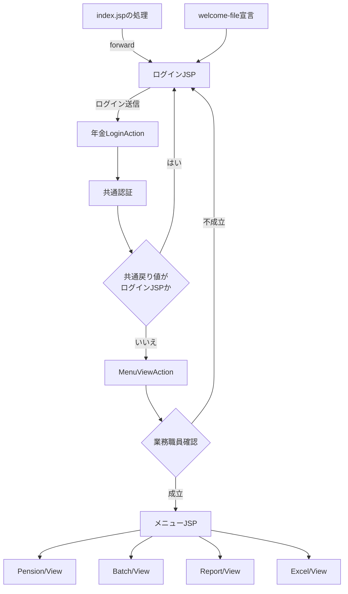
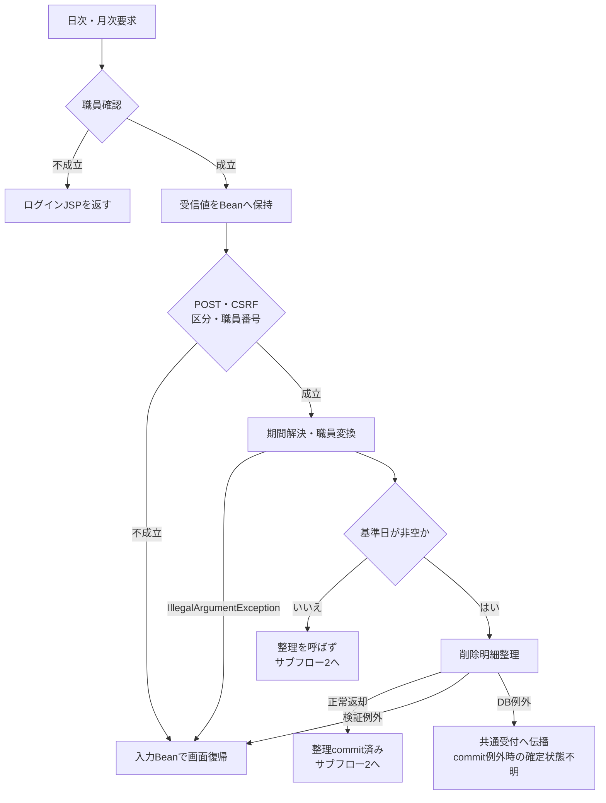
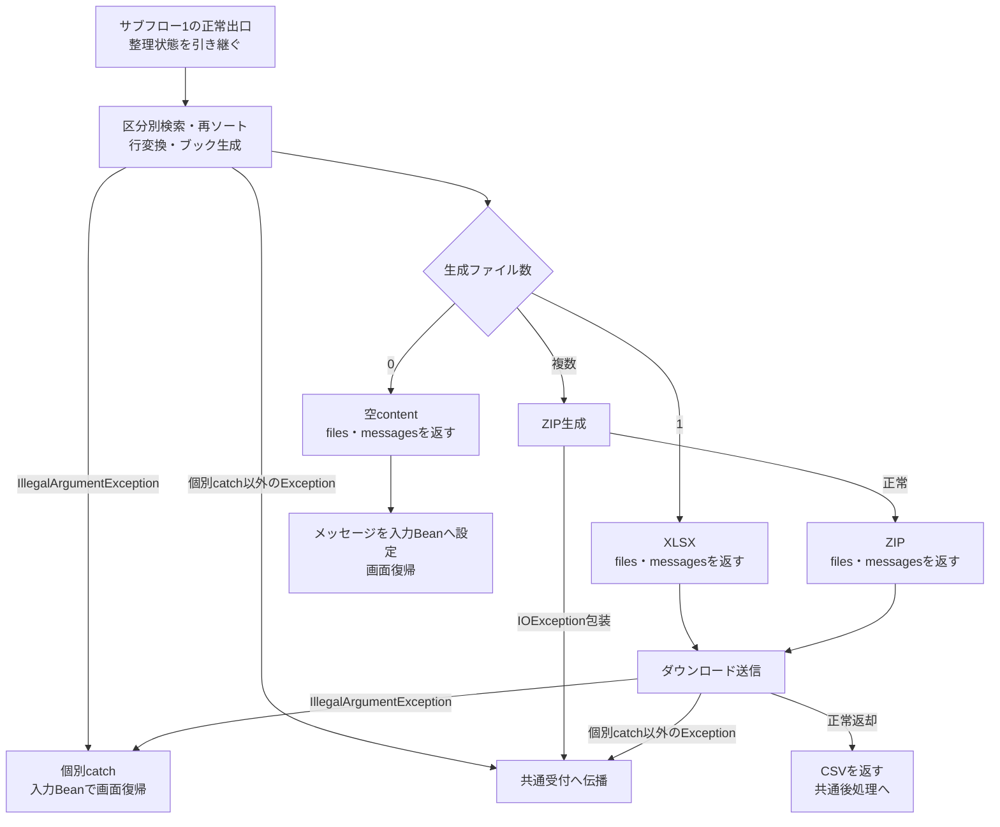

<!-- spec-meta: {"schema":"spec-md/1.0","documentId":"ANL-TRACEABILITY","version":"1.0.0","path":"analysis/identity-reachability-and-differences.md","sheets":[{"heading":"概要","kind":"GRID","sheet":"概要"},{"heading":"安定IDと文書対応","kind":"GRID","sheet":"安定IDと文書対応"},{"heading":"到達性","kind":"GRID","sheet":"到達性"},{"heading":"実装差分と確定境界","kind":"GRID","sheet":"実装差分と確定境界"},{"heading":"環境宣言と外部依存","kind":"GRID","sheet":"環境宣言と外部依存"},{"heading":"同run記録と配送計画","kind":"GRID","sheet":"同run記録と配送計画"},{"heading":"未解決事項","kind":"GRID","sheet":"未解決事項"},{"heading":"補足説明","kind":"GRID","sheet":"補足説明"}]} -->
# 安定ID・到達性・実装差分・未解決事項報告

文書ID：ANL-TRACEABILITY  
版：1.0.0  
文書種別：analysis-report  
正本パス：analysis/identity-reachability-and-differences.md  
対象：nenkin、およびnenkinの受付・認証・記録・PDF経路に関係するn2framework依存  
材料区分：source-only  
状態：原文照合に基づく本文。実行・表示・配備・顧客承認の確認結果は含まない。

## 概要

本報告は、入力に登録されたソースの安定IDを維持しながら、通常の画面操作から使われる処理、互換入口、反射によって指定できる入口、宣言だけを確認できるhelperを分ける。実装の差分は、どの層の値・状態・応答に影響するかを説明し、機能仕様と共通仕様の配置先へ対応付ける。

年金の通常導線は、共通認証後の職員名簿確認からメニューへ進み、予約管理、処理データ出力、登録内容印刷、店舗別Excel出力を選ぶ構成である。残存する職員番号入力JSPや宣言候補検索を、この通常導線と同じ稼働機能として追加しない。根拠：`nenkin/WEB-INF/src/nenkin/LoginAction.java:7–12`、`nenkin/WEB-INF/src/nenkin/MenuViewAction.java:10–16`、`nenkin/JSP/NENKIN/Menu.jsp:6–13`。

以下では、実行文から確認した現行動作を「観測実装」、コメントやREADMEの説明を「宣言・意図」、材料で決められない配備条件や業務方針を「未確定」として扱う。改善候補は現行仕様へ混ぜず、変更の採用・承認が必要な事項として管理する。

関連文書のID・パス・kindは提示された63文書の計画を保持する。関連先の本文は本ジョブの読取り材料に含まれないため、参照は計画上の対応である。同runの作成記録がある文書についても、本文や表示を今回確認したとは扱わない。

## 安定IDと文書対応

### IDを保持する基準

ソース登録の`common`・`screen`は入力資源の分類であり、納品文書の`basic-design`・`detailed-specification`・`api`等とは別の分類軸である。例えば、COM-115は保存Actionのsource identityとして残し、その画面イベントの説明はSCR-018-DETAILへ置く。SCR-013はソース登録では画面、計画文書では基本設計書として扱い、詳細仕様にはSCR-013-DETAILを用いる。

IDとalias、`recordedSourceHashMatches`は提示executionContextの登録情報である。COM-012～COM-100およびSCR-008～SCR-010は記録hash不一致として提示されているため、過去登録時の本文を現行実装の根拠にしない。COM-101～COM-152およびSCR-011～SCR-020の一致情報も、到達性・正しさ・実行成功を保証しない。本報告は必要な現カプセル原文と提示factsを用い、独自のhash照合結果は追加していない。

次の表の「配置先」は計画内の文書IDと責務上の節を示す。正確なcanonical pathとkindは「同run記録と配送計画」の全文書対応表に記載する。source pathはカプセル内の原ソースのPOSIX相対パスであり、`sources/`は読取り時の格納接頭辞である。

### 入口と共通依存の対応

| 安定ID | alias | 現source path | 配置先・責務 |
| --- | --- | --- | --- |
| ENTRY-NENKIN-INDEX | 入力にaliasなし | `nenkin/index.jsp` | DEP-NENKINの入口依存、COM-012の初期入口、SCR-013の概要、SCR-013-DETAILの初期入口 |
| COM-012 | C-18A16CEFEB | `n2framework/WEB-INF/src/common/ControlServlet.java` | COM-012の受付・反射・catch・応答境界 |
| COM-013 | C-0EB3DC5360 | `n2framework/WEB-INF/src/common/CounterShift.java` | COM-013の利用記録と独立トランザクション |
| COM-014 | C-30A40262AD | `n2framework/WEB-INF/src/common/FWLog.java` | COM-013の共通ログ依存 |
| COM-015 | C-FD0522FF92 | `n2framework/WEB-INF/src/common/LoginAction.java` | COM-015の認証・属性補完、SCR-013-DETAILのログイン呼出し |
| COM-016 | C-4F17AC4385 | `n2framework/WEB-INF/src/common/LoginInterfaceAction.java` | COM-012・COM-015の条件付き連携依存 |
| COM-017 | C-2B9EC7CABA | `n2framework/WEB-INF/src/common/LogoutAction.java` | COM-015のログアウト、SCR-017-DETAILの属性削除範囲 |
| COM-018 | C-60103F4292 | `n2framework/WEB-INF/src/common/OperatePermission.java` | COM-138の運用可否接続依存、DATA-DB-MANAGEMENTの対象業務条件 |
| COM-021 | C-6DBA7AB333 | `n2framework/WEB-INF/src/common/base/CommonBase.java` | COM-138の共通SQL基盤 |
| COM-022 | C-579EC61599 | `n2framework/WEB-INF/src/common/base/CommonBaseSelect.java` | COM-138の共通SELECT・結果変換 |
| COM-025 | C-B6B7A572E7 | `n2framework/WEB-INF/src/common/base/InsertCounterShiftBase.java` | COM-013の利用記録SQL、DATA-ACCESS-COUNTERの列用途 |
| COM-026 | C-5D8CB331F3 | `n2framework/WEB-INF/src/common/base/SearchLoginInfoBase.java` | COM-015の認証・職員補完検索 |
| COM-028 | C-6E56258BD3 | `n2framework/WEB-INF/src/common/base/SelectDBKanriDBBase.java` | DATA-DB-MANAGEMENTの条件付き検索依存 |
| COM-030 | C-301F0E612F | `n2framework/WEB-INF/src/common/base/SelectJigyosyoCodeHyo2Base.java` | COM-015の事業所名称補完、DATA-OFFICEの検索用途 |
| COM-034 | C-CC90F91258 | `n2framework/WEB-INF/src/common/bean/LoginInfoBean.java` | COM-015のLoginBean、SCR-013-DETAILの認証結果保持 |
| COM-035 | C-366F38F314 | `n2framework/WEB-INF/src/common/bean/OtherUserBean.java` | COM-015・COM-012の外部連携保持情報 |
| COM-038 | C-6670DCADAB | `n2framework/WEB-INF/src/common/pdf/FWSessionAgent.java` | COM-045のAgent・外部PDF資材依存 |
| COM-039 | C-D2C3BC8211 | `n2framework/WEB-INF/src/common/pdf/FWSessionTimer.java` | COM-045のPDFセッションタイマー |
| COM-042 | C-E63867A809 | `n2framework/WEB-INF/src/common/util/CommonConverter.java` | COM-015の共通認証変換依存 |
| COM-043 | C-8B910CA75A | `n2framework/WEB-INF/src/common/util/CommonUtil.java` | COM-138の共通接続・autoCommit設定 |
| COM-045 | C-2358AAF9C6 | `n2framework/WEB-INF/src/common/util/PDFUtil.java` | COM-045のGET/PDF処理・例外・callback境界 |

ENTRY-NENKIN-INDEXは本入力の入口識別子であり、追加の独立機能文書IDではない。`web.xml`も上記の入口依存節へ関連付けるが、index.jspとwelcome-fileは別の宣言として保持する。

### 年金Action・表示モデル・サービスの対応

| 安定ID | alias | 現source path | 配置先・責務 |
| --- | --- | --- | --- |
| COM-101 | C-8C18D950B4 | `nenkin/WEB-INF/src/nenkin/BatchDailyAction.java` | SCR-014-DETAILの日次入口 |
| COM-102 | C-E2022D4F3A | `nenkin/WEB-INF/src/nenkin/BatchMonthlyAction.java` | SCR-014-DETAILの月次入口 |
| COM-103 | C-F472201C86 | `nenkin/WEB-INF/src/nenkin/BatchRunAction.java` | SCR-014-DETAILの受信・検査・結果分岐 |
| COM-104 | C-4B0A6BC268 | `nenkin/WEB-INF/src/nenkin/BatchViewAction.java` | SCR-014-DETAILの初期日付・整理基準日設定 |
| COM-105 | C-5D243A5E2C | `nenkin/WEB-INF/src/nenkin/ExcelExportAction.java` | SCR-015-DETAILの店舗別出力入口 |
| COM-106 | C-88ECC80007 | `nenkin/WEB-INF/src/nenkin/ExcelViewAction.java` | SCR-015-DETAILの初期表示 |
| COM-107 | C-EF21EFD74E | `nenkin/WEB-INF/src/nenkin/H2JndiSetupListener.java` | COM-138のローカル初期化、OPS-NENKIN-DEPLOYの配備条件 |
| COM-108 | C-EBEE48F309 | `nenkin/WEB-INF/src/nenkin/LoginAction.java` | SCR-013-DETAILの共通認証とメニュー移譲 |
| COM-109 | C-57EFD4D6AE | `nenkin/WEB-INF/src/nenkin/LookupViewAction.java` | SCR-016-DETAILの検索・ページ切出し |
| COM-110 | C-6EF1468C88 | `nenkin/WEB-INF/src/nenkin/MenuViewAction.java` | SCR-017-DETAILの職員確認・表示モデル |
| COM-111 | C-24A376C102 | `nenkin/WEB-INF/src/nenkin/NenkinBaseAction.java` | COM-111のセッション・職員確認・変更受付、COM-148のAction側変換 |
| COM-112 | C-1577E40A42 | `nenkin/WEB-INF/src/nenkin/PensionDeleteAction.java` | SCR-018-DETAILの削除イベント |
| COM-113 | C-EEB55016D1 | `nenkin/WEB-INF/src/nenkin/PensionLoadAction.java` | SCR-018-DETAILの予約・顧客基本情報読込 |
| COM-114 | C-7F90000CF1 | `nenkin/WEB-INF/src/nenkin/PensionLookupAction.java` | API-NENKIN-PENSION-LOOKUPの受信・JSON・例外 |
| COM-115 | C-FFF58CA5CC | `nenkin/WEB-INF/src/nenkin/PensionSaveAction.java` | SCR-018-DETAILの保存イベント |
| COM-116 | C-3296090CEC | `nenkin/WEB-INF/src/nenkin/PensionViewAction.java` | SCR-018-DETAILの初期表示・Clear |
| COM-117 | C-A0568310FB | `nenkin/WEB-INF/src/nenkin/ReportPreviewAction.java` | SCR-019-DETAILの検索・プレビュー |
| COM-118 | C-EAA9759737 | `nenkin/WEB-INF/src/nenkin/ReportViewAction.java` | SCR-019-DETAILの初期表示 |
| COM-119 | C-95400D5C5B | `nenkin/WEB-INF/src/nenkin/StaffClearAction.java` | SCR-017-DETAILの互換入口。本書のStaff移譲説明 |
| COM-120 | C-062FCFA834 | `nenkin/WEB-INF/src/nenkin/StaffVerifyAction.java` | SCR-017-DETAILの互換入口。本書のStaff移譲説明 |
| COM-121 | C-344C1CC245 | `nenkin/WEB-INF/src/nenkin/StaffViewAction.java` | SCR-017-DETAILの互換入口。本書のStaff移譲説明 |
| COM-122 | C-3F3C6A9AD2 | `nenkin/WEB-INF/src/nenkin/bean/BatchViewBean.java` | SCR-014-DETAILの入力・再表示保持 |
| COM-123 | C-C7BE1E880F | `nenkin/WEB-INF/src/nenkin/bean/ExcelViewBean.java` | SCR-015-DETAILの店番・店名・メッセージ保持 |
| COM-124 | C-5060159512 | `nenkin/WEB-INF/src/nenkin/bean/LookupViewBean.java` | SCR-016-DETAILの候補・ページ・件数保持 |
| COM-125 | C-70194FEC69 | `nenkin/WEB-INF/src/nenkin/bean/MenuViewBean.java` | SCR-017-DETAILのログイン職員表示 |
| COM-126 | C-860B7392E8 | `nenkin/WEB-INF/src/nenkin/bean/PensionViewBean.java` | SCR-018-DETAILの予約・existing・元キー・表示状態 |
| COM-127 | C-794BDEEB03 | `nenkin/WEB-INF/src/nenkin/bean/ReportViewBean.java` | SCR-019-DETAILの条件・検索結果・preview |
| COM-128 | C-0E06AB4261 | `nenkin/WEB-INF/src/nenkin/bean/StaffViewBean.java` | 本書の互換Beanと残存JSP。SCR-017-DETAILの互換入口補足 |
| COM-129 | C-1B3C20CCEB | `nenkin/WEB-INF/src/nenkin/model/BranchLookupItem.java` | COM-146の店舗候補、SCR-016-DETAILの選択移送 |
| COM-130 | C-44DAFA1924 | `nenkin/WEB-INF/src/nenkin/model/CodeLookupItem.java` | COM-146のコード候補と表示名称 |
| COM-131 | C-077F76AD81 | `nenkin/WEB-INF/src/nenkin/model/CustomerLookupItem.java` | COM-146の顧客候補、SCR-016-DETAILの選択移送 |
| COM-132 | C-32D1B16983 | `nenkin/WEB-INF/src/nenkin/model/PensionAuditRecord.java` | SCR-014-DETAILの検索結果・一時auditId、COM-145の更新区分取得 |
| COM-133 | C-5FAFB9BE3A | `nenkin/WEB-INF/src/nenkin/model/PensionCandidate.java` | COM-145の宣言候補DTO。本書の呼出元未検出分類 |
| COM-134 | C-87EE2411B9 | `nenkin/WEB-INF/src/nenkin/model/PensionReservation.java` | SCR-018-DETAILの入力・保存・表示対応、COM-145の予約モデル |
| COM-135 | C-094C6D79B9 | `nenkin/WEB-INF/src/nenkin/model/StaffContext.java` | COM-111の業務職員状態 |
| COM-136 | C-D3AAD20C30 | `nenkin/WEB-INF/src/nenkin/model/StaffLookupItem.java` | COM-146の担当者候補、SCR-016-DETAILの選択移送 |
| COM-137 | C-C6BCF7C9BE | `nenkin/WEB-INF/src/nenkin/service/NenkinDataAccessException.java` | COM-145・COM-138のデータアクセス例外境界 |
| COM-138 | C-88E43B754D | `nenkin/WEB-INF/src/nenkin/service/NenkinDataSource.java` | COM-138のJNDI取得・キャッシュ・接続失敗 |
| COM-139 | C-83D67B576C | `nenkin/WEB-INF/src/nenkin/service/PensionBatchExportFileResult.java` | SCR-014-DETAILの区分別生成ファイル情報 |
| COM-140 | C-FD3D21EDE5 | `nenkin/WEB-INF/src/nenkin/service/PensionBatchExportRequest.java` | SCR-014-DETAILの要求DTO・整理基準日 |
| COM-141 | C-67808327F9 | `nenkin/WEB-INF/src/nenkin/service/PensionBatchExportResult.java` | SCR-014-DETAILのfiles・messages・content・結果分岐 |
| COM-142 | C-4817D3A597 | `nenkin/WEB-INF/src/nenkin/service/PensionBatchExportService.java` | SCR-014-DETAILの整理・検索・生成、COM-150のZIP |
| COM-143 | C-9EBA419096 | `nenkin/WEB-INF/src/nenkin/service/PensionExcelExportResult.java` | SCR-015-DETAILの店舗別出力結果 |
| COM-144 | C-B9D26151E9 | `nenkin/WEB-INF/src/nenkin/service/PensionExcelExportService.java` | SCR-015-DETAILの18列出力、COM-150のブック生成 |
| COM-145 | C-3F1B37955E | `nenkin/WEB-INF/src/nenkin/service/PensionRepository.java` | COM-145の検索・更新・削除・整理・宣言helper |
| COM-146 | C-38CAB09323 | `nenkin/WEB-INF/src/nenkin/service/ReferenceDataService.java` | COM-146の候補・名称・顧客参照 |
| COM-147 | C-688423EADF | `nenkin/WEB-INF/src/nenkin/util/AnsiTextUtil.java` | COM-148の備考文字変換・56バイト検査 |
| COM-148 | C-738D23BD96 | `nenkin/WEB-INF/src/nenkin/util/DateUtil.java` | COM-148の日付受付・保存・表示変換 |
| COM-149 | C-650122EE58 | `nenkin/WEB-INF/src/nenkin/util/HtmlUtil.java` | COM-148のHTML・JSON変換と不正日付表示 |
| COM-150 | C-35FB3CE569 | `nenkin/WEB-INF/src/nenkin/util/OpenXmlWorkbookWriter.java` | COM-150のOpen XML生成・レイアウト |
| COM-151 | C-D5BF758829 | `nenkin/assets/js/app.js` | COM-151の数字補助・共通helper。本書の接続判定 |
| COM-152 | C-D15361147D | `nenkin/assets/js/japanese-era-calendar.js` | COM-151のカレンダー、COM-148の日付受付差・hidden同期 |

`LookupSearchAction.java`、`PensionClearAction.java`、`AuditType.java`、`PensionBatchRunMode.java`、`FWTimerHandler.java`等にも関連処理があるが、提示登録にない安定IDを新設しない。該当する計画文書の継承・区分・タイマー依存としてsource pathを保持する。

### JSPの対応

| 安定ID | alias | 現source path | 配置先・責務 |
| --- | --- | --- | --- |
| SCR-008 | F-510026C41F | `n2framework/JSP/COMMON/Error.jsp` | 本書の対象資源区別。年金配下の同名JSPへ置換しない |
| SCR-009 | F-874AD56E66 | `n2framework/JSP/COMMON/SubMessage.jsp` | 本書の対象資源区別。年金配下の同名JSPへ置換しない |
| SCR-010 | F-B34F8140FE | `n2framework/JSP/Daiko.jsp` | 本書の対象外framework資源 |
| SCR-011 | F-1D1730D642 | `nenkin/JSP/COMMON/Error.jsp` | COM-012の共通エラー表示 |
| SCR-012 | F-0C8E58020A | `nenkin/JSP/COMMON/SubMessage.jsp` | COM-012の補助表示・利用記録名との区別 |
| SCR-013 | F-D230CB9349 | `nenkin/JSP/MENU/Login.jsp` | SCR-013・SCR-013-DETAILのログイン画面 |
| SCR-014 | F-91B2712423 | `nenkin/JSP/NENKIN/Batch.jsp` | SCR-014・SCR-014-DETAILの処理データ画面 |
| SCR-015 | F-267CD54304 | `nenkin/JSP/NENKIN/Excel.jsp` | SCR-015・SCR-015-DETAILの店舗別Excel画面 |
| SCR-016 | F-4DF1C85872 | `nenkin/JSP/NENKIN/Lookup.jsp` | SCR-016・SCR-016-DETAILの三モード参照画面 |
| SCR-017 | F-DC42D39CFC | `nenkin/JSP/NENKIN/Menu.jsp` | SCR-017・SCR-017-DETAILの通常メニュー |
| SCR-018 | F-A3FC733601 | `nenkin/JSP/NENKIN/Pension.jsp` | SCR-018・SCR-018-DETAILの予約管理画面 |
| SCR-019 | F-9D78151DC1 | `nenkin/JSP/NENKIN/Report.jsp` | SCR-019・SCR-019-DETAILのHTML帳票印刷 |
| SCR-020 | F-C52F2E5802 | `nenkin/JSP/NENKIN/Staff.jsp` | 本書の残存JSP・型境界。SCR-017-DETAILの互換入口補足 |

SCR-020のために独立した職員認証文書を追加せず、計画の63文書を維持する。

### その他の登録identity

次の登録も削除・再採番しない。配置先は本書ANL-TRACEABILITYの「到達性／対象外framework資源」である。共通補助資源の依存詳細や他業務の実装は本報告で認定しておらず、表中の名前から年金の公開API・CRUD・画面を創作しない。必要な条件付き共通依存はDEP-NENKINおよびCOM-012へ関連付ける。

| 安定ID | alias | 現source path |
| --- | --- | --- |
| COM-019 | C-280108632E | `n2framework/WEB-INF/src/common/ViewDaikoAction.java` |
| COM-020 | C-3BAB0A0A8E | `n2framework/WEB-INF/src/common/ViewMenuAction.java` |
| COM-023 | C-DF83D313AE | `n2framework/WEB-INF/src/common/base/CommonBaseSelectCode.java` |
| COM-024 | C-A64CFE6F35 | `n2framework/WEB-INF/src/common/base/CommonBaseSelectPDF.java` |
| COM-027 | C-3B6214D6A3 | `n2framework/WEB-INF/src/common/base/SelectCodeGyosyuBase.java` |
| COM-029 | C-7365E37B4F | `n2framework/WEB-INF/src/common/base/SelectDaikoSyokuinBase.java` |
| COM-031 | C-BC5E5278C2 | `n2framework/WEB-INF/src/common/base/SelectSaijitsuBase.java` |
| COM-032 | C-D2F79ABD8A | `n2framework/WEB-INF/src/common/base/SelectTenpoKanriDaichoBase.java` |
| COM-033 | C-2101982FD4 | `n2framework/WEB-INF/src/common/bean/DaikoBean.java` |
| COM-036 | C-7C5EA4CE56 | `n2framework/WEB-INF/src/common/bean/SubWindowBean.java` |
| COM-037 | C-FEE0BF4196 | `n2framework/WEB-INF/src/common/bean/TenpoListBean.java` |
| COM-040 | C-5A33760833 | `n2framework/WEB-INF/src/common/util/CSVUtil.java` |
| COM-041 | C-A6759C05F1 | `n2framework/WEB-INF/src/common/util/CodeConverter.java` |
| COM-044 | C-F06EBFDC2B | `n2framework/WEB-INF/src/common/util/DateArithmetic.java` |
| COM-046 | C-DC6D226C9D | `n2framework/WEB-INF/src/jhkcommon/Bye.java` |
| COM-047 | C-81E6CCA449 | `n2framework/WEB-INF/src/jhkcommon/CifApplicationException.java` |
| COM-048 | C-C72F157E6B | `n2framework/WEB-INF/src/jhkcommon/CifComon.java` |
| COM-049 | C-AF3B137982 | `n2framework/WEB-INF/src/jhkcommon/CifErrorCode.java` |
| COM-050 | C-75E10A4D12 | `n2framework/WEB-INF/src/jhkcommon/DumpChan.java` |
| COM-051 | C-1EC5563846 | `n2framework/WEB-INF/src/jhkcommon/HtmlDispatcher.java` |
| COM-052 | C-8097E07740 | `n2framework/WEB-INF/src/jhkcommon/InputDataRemaker.java` |
| COM-053 | C-83F665ED3F | `n2framework/WEB-INF/src/jhkcommon/LogOuter.java` |
| COM-054 | C-8BB392363D | `n2framework/WEB-INF/src/jhkcommon/OjiServlet.java` |
| COM-055 | C-67C2A7C246 | `n2framework/WEB-INF/src/jhkcommon/OjiServletPdf.java` |
| COM-056 | C-2876DEEBE4 | `n2framework/WEB-INF/src/jhkcommon/PdfFactory3.java` |
| COM-057 | C-C1116A63BE | `n2framework/WEB-INF/src/jhkcommon/RqsDbSearch.java` |
| COM-058 | C-6F2C494D45 | `n2framework/WEB-INF/src/jhkcommon/SessionAgent.java` |
| COM-059 | C-829688BA4D | `n2framework/WEB-INF/src/jhkcommon/SessionTimer.java` |
| COM-060 | C-656AF4FF4E | `n2framework/WEB-INF/src/jhkcommon/SubroutineCallFactory.java` |
| COM-061 | C-01394210CD | `n2framework/WEB-INF/src/jhkcommon/UserIdKit.java` |
| COM-062 | C-059A7D15B5 | `n2framework/WEB-INF/src/webon/WebonBase.java` |
| COM-063 | C-6D0931AEA4 | `n2framework/WEB-INF/src/webon/WebonException.java` |
| COM-064 | C-47CE9FAF24 | `n2framework/WEB-INF/src/webon/base/InsertPathMngStatBase.java` |
| COM-065 | C-4ABC22B1A6 | `n2framework/WEB-INF/src/webon/base/SelectDB2KamokuBase.java` |
| COM-066 | C-4925071E32 | `n2framework/WEB-INF/src/webon/base/SelectFunctionMasterBase.java` |
| COM-067 | C-CC186F49E9 | `n2framework/WEB-INF/src/webon/base/SelectOnlineOperationMastBase.java` |
| COM-068 | C-93B09E20DB | `n2framework/WEB-INF/src/webon/base/SelectOperationBranchMstBase.java` |
| COM-069 | C-218F502C6E | `n2framework/WEB-INF/src/webon/base/SelectPathMngMstBase.java` |
| COM-070 | C-D8CD28A941 | `n2framework/WEB-INF/src/webon/base/SelectPathMngStatBase.java` |
| COM-071 | C-8F07A6ADF0 | `n2framework/WEB-INF/src/webon/base/UpdatePathMngStatBase.java` |
| COM-072 | C-7F8344C8AB | `n2framework/WEB-INF/src/webon/operation/CommonOperation.java` |
| COM-073 | C-F0974C4565 | `n2framework/WEB-INF/src/webon/operation/FutuYokinKozaShokai.java` |
| COM-074 | C-C3F006656C | `n2framework/WEB-INF/src/webon/operation/FutuYokinKozaShokai09.java` |
| COM-075 | C-981314142C | `n2framework/WEB-INF/src/webon/operation/JifuriKeiyakuShokai.java` |
| COM-076 | C-D61850878F | `n2framework/WEB-INF/src/webon/operation/KokyakuKetsugoShokai.java` |
| COM-077 | C-110E754699 | `n2framework/WEB-INF/src/webon/operation/KokyakuSogoJohoShokai.java` |
| COM-078 | C-503F1CFF51 | `n2framework/WEB-INF/src/webon/operation/NayoseJohoShokai.java` |
| COM-079 | C-B12DBFD0E0 | `n2framework/WEB-INF/src/webon/operation/NayoseJohoShokaiCif.java` |
| COM-080 | C-938A0AC46C | `n2framework/WEB-INF/src/webon/operation/NikkiehyouFusaiKanjyou.java` |
| COM-081 | C-0EB93D704F | `n2framework/WEB-INF/src/webon/operation/NikkiehyouRiekiKanjyou.java` |
| COM-082 | C-7B9E424412 | `n2framework/WEB-INF/src/webon/operation/NikkiehyouShisanKanjyou.java` |
| COM-083 | C-7F6621546F | `n2framework/WEB-INF/src/webon/operation/NikkiehyouSonshituKanjyou.java` |
| COM-084 | C-8FC1D0E2E1 | `n2framework/WEB-INF/src/webon/operation/ShogashiHensaiYoteiHyoSakusei.java` |
| COM-085 | C-ED89276DFB | `n2framework/WEB-INF/src/webon/operation/ShogashiKobetsuMeisaiShokai.java` |
| COM-086 | C-98158E0CD4 | `n2framework/WEB-INF/src/webon/operation/SyokanjyouKaribaraiKin.java` |
| COM-087 | C-CA00B057D9 | `n2framework/WEB-INF/src/webon/operation/SyokanjyouKariukekin.java` |
| COM-088 | C-FCEE2C4764 | `n2framework/WEB-INF/src/webon/operation/SyushikinShokai.java` |
| COM-089 | C-785E4A2543 | `n2framework/WEB-INF/src/webon/operation/TegataKogitteTouroku.java` |
| COM-090 | C-1787DD35E8 | `n2framework/WEB-INF/src/webon/operation/TegataKogitteTourokuSyokai.java` |
| COM-091 | C-B287A159F5 | `n2framework/WEB-INF/src/webon/operation/TeikiYokinKozaSyokai.java` |
| COM-092 | C-C8703AC2EB | `n2framework/WEB-INF/src/webon/operation/TeikiYokinNyukinMeisaiShokai.java` |
| COM-093 | C-986F959710 | `n2framework/WEB-INF/src/webon/operation/TesuryoJohoSetteiHenko.java` |
| COM-094 | C-B643CFA7D1 | `n2framework/WEB-INF/src/webon/operation/TozaKanjoKozaShokai.java` |
| COM-095 | C-C56197881B | `n2framework/WEB-INF/src/webon/operation/TumitateTeikiYokinKozaShokai.java` |
| COM-096 | C-9627AF6C53 | `n2framework/WEB-INF/src/webon/operation/WariteSogoShokai.java` |
| COM-097 | C-31FC96090D | `n2framework/WEB-INF/src/webon/operation/YushiGenkyoShokai.java` |
| COM-098 | C-F0A75D87AA | `n2framework/WEB-INF/src/webon/util/CastUtil.java` |
| COM-099 | C-E835EFA5FA | `n2framework/WEB-INF/src/webon/util/ConvertUtil.java` |
| COM-100 | C-F56C177EF4 | `n2framework/WEB-INF/src/webon/util/ValidateUtil.java` |

COM-036のクラス名と、年金が使うセッション属性名`SubWindowBean`は区別する。年金Lookupの属性値はCOM-124のLookupViewBeanであり、同名のframeworkクラスを格納する説明へ置き換えない。根拠：`nenkin/WEB-INF/src/nenkin/NenkinBaseAction.java:41–42`、`nenkin/WEB-INF/src/nenkin/LookupViewAction.java:20–20`、`nenkin/JSP/NENKIN/Lookup.jsp:3–3`、`n2framework/WEB-INF/src/common/CommonConst.java:36–37`。

## 到達性

### 初期入口と通常メニュー

`nenkin/index.jsp`が処理されると、`JSP/MENU/Login.jsp`へforwardする。一方、`web.xml`の明示welcome-fileもログインJSPを指定しており、index.jspをwelcome-fileへ登録する宣言ではない。Action受付は別に`common.ControlServlet`を`/Action.do`へmappingしている。index.jspへの直アクセスが実配備で許可されるかは、この宣言だけでは決められない。根拠：`nenkin/index.jsp:1–2`、`nenkin/WEB-INF/web.xml:15–28`。

年金LoginActionは業務職員状態とCSRF属性を削除してから共通認証を呼ぶ。共通戻り値がログインJSPならそのまま返し、それ以外はMenuViewActionへ移譲する。移譲先は職員確認不成立ならログインJSP、成立ならMenuViewBeanを`ViewBean`へ設定してメニューJSPを返す。`STAFF_JSP`という定数名の戻り先もログインJSPである。根拠：`nenkin/WEB-INF/src/nenkin/LoginAction.java:7–12`、`nenkin/WEB-INF/src/nenkin/MenuViewAction.java:10–16`、`nenkin/WEB-INF/src/nenkin/NenkinBaseAction.java:24–27`。

メニューはPension/View、Batch/View、Report/View、Excel/Viewの四導線をPOSTする。ログアウトはcommon/Logoutと空のCOMMAND_IDを送信する。通常メニューにStaff画面への導線はない。根拠：`nenkin/JSP/NENKIN/Menu.jsp:6–13`。

図は正常返却と職員確認結果の接続を示す静的な依存図である。共通認証・職員照会中の例外は画面復帰枝へ合流させず、後述の共通受付境界で扱う。

### 互換Beanと残存職員番号入力JSP

COM-128のStaffViewBeanは`Serializable`を実装するfinalクラスで、`serialVersionUID=1L`、`String staffNo`と`String message`を持つ。両項目の初期値は空文字で、setterはNULLを空文字へ変換する。コメントは旧セッションのデシリアライズ互換用で、職員番号入力画面では使用しないと述べる。宣言だけでは過去セッションとの互換性を検証したことにはならない。根拠：`nenkin/WEB-INF/src/nenkin/bean/StaffViewBean.java:3–13`。

SCR-020のStaff.jspは実際にはセッション属性`ViewBean`をStaffViewBean型として参照し、staffNoを`STAFF_NO`入力、messageをエラー表示に使う。入力はmaxlength 8と数字補助属性を持ち、フォームはStaff/Verify、クリア操作はStaff/ClearをPOSTする。この残存参照はBeanコメントの「画面では使用しない」という説明と一致しない。根拠：`nenkin/JSP/NENKIN/Staff.jsp:1–14`。

ただし、StaffViewAction、StaffVerifyAction、StaffClearActionはいずれもMenuViewAction.performの結果をそのまま返す。`STAFF_NO`を使う独自認証も、StaffClearActionによる業務職員状態の削除もない。残存JSPの操作が送信されても、接続されたActionの動作はメニューへの移譲である。根拠：`nenkin/WEB-INF/src/nenkin/StaffViewAction.java:6–8`、`nenkin/WEB-INF/src/nenkin/StaffVerifyAction.java:6–8`、`nenkin/WEB-INF/src/nenkin/StaffClearAction.java:6–8`。

収録Java・JSP・JavaScriptの検索では、通常ログイン・メニューからStaff.jspへ遷移する記載を検出していない。これは検索範囲内の到達未検出であり、外部呼出しやJSP直アクセスの不存在を意味しない。READMEの再入力画面を使わない宣言は通常導線と整合するが、残存JSPの型参照がなくなるわけではない。根拠：`nenkin/README.md:33–35`、上記LoginAction・Menu.jsp・Staff.jsp。

### 宣言候補DTOと稼働候補の区別

COM-133のPensionCandidateは検索結果DTOであり、`int branchNo`・`int customerNo`と、`String kanaName`・`customerName`・`phoneNumber`・`birthDate`を持つ。Stringは空文字で初期化され、コンストラクタとsetterはNULLを空文字へ変換する。int項目にNULLを保持する契約はない。根拠：`nenkin/WEB-INF/src/nenkin/model/PensionCandidate.java:5–41`。

RepositoryのsearchCandidatesは年金1_LKを検索する。正規化カナが非空なら大文字化LIKE、数値化電話が非空なら電話をVARCHAR(40)へCASTしたLIKEを追加し、ふりがな・店番・顧客番号順にPensionCandidateを構築する。パラメータは存在するカナ、電話の順にsetStringで設定し、部分一致の特殊文字をescapeする。SQLページング・最大件数・取消設定はこの処理にない。SQLExceptionはデータアクセス例外として送出し、0件は空Listとして返す。根拠：`nenkin/WEB-INF/src/nenkin/service/PensionRepository.java:171–216,837–865,909–913`。

収録Java・JSP・JavaScriptではsearchCandidatesの宣言以外の呼出元を検出していない。予約画面の候補ボタンは`candidate`を`customer`へ変換してLookup/Viewを開き、顧客基本表から候補を取得する。親画面は選択値と照会キーを設定してPension/Loadへ進む。したがってPensionCandidateを公開APIや稼働候補画面のDTOとして説明せず、COM-145の宣言検索契約へ置く。根拠：`nenkin/JSP/NENKIN/Pension.jsp:62–65`、`nenkin/WEB-INF/src/nenkin/LookupViewAction.java:16–20`、`nenkin/WEB-INF/src/nenkin/service/ReferenceDataService.java:75–135`。

findLatestAuditTypeも呼出元未検出の宣言helperである。カナまたは数値電話が空ならNULL、本体があれば変更FLGのgetInt値0をNEW、それ以外をCHANGEDとする。本体不在時だけ削除明細を更新日・更新時間降順で最大1行照会し、存在すればDELETED、不在ならNULLを返す。本体側にはORDER BYとwasNull検査がないため、名称から「時刻順の最新履歴判定」と一般化しない。根拠：`nenkin/WEB-INF/src/nenkin/service/PensionRepository.java:416–455`。

全件一覧の実宣言名は`list()`であり、計画中の`listAll`は実名へ訂正する。`list()`は名称JOINを含む全件取得を店番・顧客番号・ふりがな順で行うが、収録範囲では呼出元を検出していない。根拠：`nenkin/WEB-INF/src/nenkin/service/PensionRepository.java:218–221`。

### 反射可能なJSON入口

共通受付はFUNCTION_IDを小文字化し、VIEW_IDとCOMMAND_IDを連結してActionクラス名を作り、反射によってperformを呼ぶ。この規則ではnenkin/Pension/LookupがCOM-114へ対応する。通常経路のLogin以外にはLoginBean検査と運用可否検査が先行するため、クラスの存在だけで呼出し成功を保証しない。根拠：`n2framework/WEB-INF/src/common/ControlServlet.java:309–345,396–403`。

PensionLookupActionへ到達した後は職員確認が最初に行われる。不成立ならログインJSPを返し、成立後の非POSTには405を送ってforward抑止値`CSV`を返す。POSTではフォームパラメータ`LOOKUP_MODE`が厳密に`key`ならカナ・電話照会、それ以外なら店番・顧客番号を正数Integerへ変換して照会する。どちらかが変換後NULLなら照会結果をNULLとし、`found=false`を返す。JSON本文を要求DTOへバインドする入口ではない。根拠：`nenkin/WEB-INF/src/nenkin/PensionLookupAction.java:12–23`、`nenkin/WEB-INF/src/nenkin/NenkinBaseAction.java:119–125`。

結果がある場合は、保存日付と表示日付を含むreservationをUTF-8のJSONとしてwrite・flushする。数値・boolean・NULLと文字列escapeを区別する一方、和暦表示変換には例外があり得る。DB取得、表示変換、送信の例外を`found=false`へ変える個別catchはない。`CSV`は応答済み制御値であり、JSONをCSVファイルに分類する値ではない。根拠：`nenkin/WEB-INF/src/nenkin/PensionLookupAction.java:21–28`、`nenkin/WEB-INF/src/nenkin/util/DateUtil.java:74–92,158–164`、`n2framework/WEB-INF/src/common/ControlServlet.java:375–383`。

smoke-testにはこの入口の呼出しとfound判定が記載され、使用するInvoke-FormのmethodはPOSTである。収録nenkinのJSP・JavaScriptでは通常呼出しを検出していない。assertionの存在は、試験実行結果、外部利用実績、公開承認の証拠ではない。根拠：`nenkin/tools/smoke-test.ps1:11–16,59–76`。

### GET・外部連携・JSP直接表示

共通GET受付はOPKとcharCommonUIDがともにNULLならPDF経路、いずれかが非NULLならprocessへ進む。空文字も非NULL側に入る。processには外部連携用の識別値・package・画面・OtherUserBeanを設定する枝があるため、通常GETがPensionLookupActionの405検査へ必ず到達するとは記載しない。これらは共通入口の条件付き依存であり、他アプリの業務を年金の独立機能へ増やす根拠ではない。根拠：`n2framework/WEB-INF/src/common/ControlServlet.java:54–96,115–248,285–298`。

Staff.jsp、Menu.jsp、Pension.jspは同じ`ViewBean`属性に別々のBean型を要求する。Lookup.jspは`SubWindowBean`属性にLookupViewBean型を要求する。JSP自身はrequireStaffを呼ばないため、Actionの検査をJSP直接表示の検査へ拡張できない。直接表示時や複数画面操作後の型整合、コンテナ等によるアクセス制限は未確定である。根拠：`nenkin/JSP/NENKIN/Staff.jsp:1–3`、`nenkin/JSP/NENKIN/Menu.jsp:1–3`、`nenkin/JSP/NENKIN/Pension.jsp:1–4`、`nenkin/JSP/NENKIN/Lookup.jsp:1–4`、`nenkin/WEB-INF/src/nenkin/NenkinBaseAction.java:37–47`。

### ブラウザーhelperと対象外framework資源

数字補助は`data-digits-only`を持つ実入力へ登録され、全角数字の変換、非数字除去、カーソル調整、値変更時のchange発火を行う。これに対し、`data-trim`・`data-uppercase`、汎用モーダル属性、`data-print`、公開nenkinApp APIの呼出しは収録JSPで検出していない。予約画面の参照・確認ダイアログはJSP固有処理、帳票印刷はReport.jspのwindow.printに接続する。根拠：`nenkin/assets/js/app.js:6–79,152–224`、`nenkin/JSP/NENKIN/Pension.jsp:59–68`、`nenkin/JSP/NENKIN/Report.jsp:61–61`。

カレンダーのhidden同期helperは`data-era-hidden-input`が指す実入力を取得できた場合だけ動作する。この属性も収録JSPでは未検出であり、実日付入力のnameから表示文字列が送られる構成と区別する。根拠：`nenkin/assets/js/japanese-era-calendar.js:289–341`、`nenkin/JSP/NENKIN/Pension.jsp:30–41`、`nenkin/JSP/NENKIN/Batch.jsp:69–81`。

n2frameworkの代行画面、jhkcommon、webonの業務資源は登録identityを残すが、年金の通常メニュー機能へ展開しない。収録・宣言・共通条件からの利用可能性と、年金イベントからの接続確認を区別する。未読の業務本文に対して、到達不能や外部利用不存在を認定するものでもない。

## 実装差分と確定境界

### キー加工・入力値・保存値

Actionの同一予約判定は、取得した二つのPensionReservationを比較する。いずれかがNULLなら不一致、カナはtrim後にNFKC変換してLocale.ROOTで大文字化し、電話はNFKC後のASCII数字だけで比較する。RepositoryのカナはNFKC後にtrimし、全角空白の置換と連続空白の縮約を行い、Locale.JAPANで大文字化する。加工順と内部空白の扱いが異なるが、通常の比較対象は受信raw値そのものではなくRepositoryが取得した現レコードと元レコードである。加工差だけから特定の画面入力の拒否を断定しない。根拠：`nenkin/WEB-INF/src/nenkin/NenkinBaseAction.java:102–116`、`nenkin/WEB-INF/src/nenkin/service/PensionRepository.java:837–840`、`nenkin/WEB-INF/src/nenkin/PensionSaveAction.java:24–37`、`nenkin/WEB-INF/src/nenkin/PensionDeleteAction.java:17–23`。

Repositoryの電話はchar単位のCharacter.isDigit・Character.digitでASCII数字へ変換し、BigDecimalとして検索・保存する。数値表現には先頭0が残らない。顧客電話検索は最後の一桁を残して先頭0を除き、表示では9桁または10桁で先頭0がない場合に0を補う。HTTP入力、Action比較文字列、DB数値、補完表示を別の値としてCOM-148とSCR-018-DETAILへ対応付ける。根拠：`nenkin/WEB-INF/src/nenkin/service/PensionRepository.java:807–815,843–865`、`nenkin/WEB-INF/src/nenkin/service/ReferenceDataService.java:329–355`。

店番・顧客番号・担当者コード・予定年齢のブラウザーmaxlengthは3・7・4・3である。ActionはStringをtrimし、Integer.parseInt後の正数だけを保持するため、欠落・空欄・変換不能・0以下はIntegerのNULLとなる。RepositoryのバインドはsetIntまたはTypes.INTEGERで、サイズ指定はない。顧客番号のDB宣言BIGINTとJava intの範囲、ブラウザー桁数は別の制約である。備考はWindows-31J変換可能かつ56バイト以内の検査を持ち、DBの400という容量で業務上限を置き換えない。根拠：`nenkin/JSP/NENKIN/Pension.jsp:22–24,37–42`、`nenkin/WEB-INF/src/nenkin/NenkinBaseAction.java:119–164`、`nenkin/WEB-INF/src/nenkin/util/AnsiTextUtil.java:13–46`、`nenkin/WEB-INF/src/nenkin/service/PensionRepository.java:798–804`、`nenkin/WEB-INF/resources/db/schema.sql:106–135`。

加工規則の統一は改善候補である。採用する正規化と既存値との互換方針は未確定であり、共通helperの宣言を使った一律正規化が実装済みとは説明しない。

### 保存・削除の枝別表示状態

Saveは職員確認、受信モデル生成、POST・CSRF、入力検査の順に進む。入力不正でもキー照会を行い、入力モデルと照会有無を再表示へ渡す。通過後は現キーとORIGINAL_KANA・ORIGINAL_PHONEによる元キーを照会し、取得結果に応じて確認要求、キー変更拒否、変更権限拒否、Repository.saveへ分岐する。根拠：`nenkin/WEB-INF/src/nenkin/PensionSaveAction.java:10–48`。

| 保存の条件・段階 | 再表示する予約内容 | existing | 結果の意味 |
| --- | --- | --- | --- |
| POST・CSRF不成立 | 受信変換後の入力モデル | false | 変更受付を拒否する |
| 入力検査不成立 | 検査途中の値を含む入力モデル | キー照会の有無 | 検査メッセージを表示する。照会失敗はこの正常再表示枝とは別 |
| 現レコードあり、元レコードと不一致 | 取得した現レコード | true | 既存内容を確認してから登録するよう要求する |
| 現レコードなし、元レコードあり | 取得した元レコード | true | キー変更を拒否し、元の内容へ戻す |
| 現レコードあり、制限職員 | 取得した現レコード | true | 変更を拒否する |
| saveが正常返却 | 新しい空モデル | false | 登録完了メッセージを設定する |

制限職員の判定は所属店75かつ役職コード3000未満であり、同店で役職の数値変換が失敗した場合も制限となる。新規・変更を同じ権限拒否条件へまとめない。根拠：`nenkin/WEB-INF/src/nenkin/NenkinBaseAction.java:96–99`、`nenkin/WEB-INF/src/nenkin/PensionSaveAction.java:39–46`。

Deleteは同じ職員確認・受信変換・POST・CSRFに続き、店番、キー、現レコードと元レコードの対応、権限を確認する。キー確認拒否では現レコードがあればその取得内容、なければ入力モデルを保持する。Repository内部で対象が消失した場合のfalseは、削除成功とは別の戻り値である。根拠：`nenkin/WEB-INF/src/nenkin/PensionDeleteAction.java:10–34`。

| 削除の条件・段階 | 再表示する予約内容 | existing | 結果の意味 |
| --- | --- | --- | --- |
| POST・CSRF不成立 | 入力モデル | false | 変更受付拒否 |
| 店番の変換後NULL | 入力モデル | true | 店番必須メッセージ |
| カナまたは電話が空 | 入力モデル | false | 削除対象未読込メッセージ |
| 現レコードなし | 入力モデル | false | 対象読込を要求する |
| 現レコードあり、元レコードと不一致 | 取得した現レコード | true | 対象読込を要求する |
| 制限職員 | 取得した現レコード | true | 削除権限拒否 |
| deleteがtrue | 新しい空モデル | false | 削除完了 |
| deleteがfalse | 入力モデル | true | 内部再読込時に対象がなかったことを表示する |

これらの枝は、理由・保持モデル・existingを一つの固定値へまとめない。SCR-018-DETAILの手順・フローでも、取得した現レコードや元レコードを共通の空モデルへ置き換えない。

### 内部存在再確認とトランザクション

Repository.saveはtryより前にコピー・正規化・入力検査を行い、接続取得、autoCommit=false、店名補完後に存在を再照会する。その結果でINSERTまたはUPDATEを選び、件数検査後にcommitしてNEWまたはCHANGEDを返す。Actionはこの返却区分を完了表示の分岐には使用しない。根拠：`nenkin/WEB-INF/src/nenkin/service/PensionRepository.java:280–309,513–532,623–683`、`nenkin/WEB-INF/src/nenkin/PensionSaveAction.java:46–48`。

deleteは同一接続で対象を再読込する。不在ならrollbackしてfalse、存在すれば取得内容の更新日を当日へ設定し、変更FLGがNULLの削除明細INSERTと本体DELETEを同一トランザクションで行い、1件検査後にcommitしてtrueを返す。根拠：`nenkin/WEB-INF/src/nenkin/service/PensionRepository.java:315–350,690–738`。

この再照会は存在状態の確認であり、Actionの権限・元キー確認・比較版をRepository内部で再判定するものではない。UPDATE・DELETEのWHEREはカナと電話だけである。synchronizedの排他範囲は同じRepositoryインスタンスを使うJVM内で、複数JVMや外部更新までの排他を示さない。収録DDLの予約キー索引は通常INDEXであり、PK・UNIQUE・FKは宣言されていない。根拠：`nenkin/WEB-INF/src/nenkin/service/PensionRepository.java:66–75,280–350,672–683`、`nenkin/WEB-INF/resources/db/schema.sql:106–171`、`nenkin/WEB-INF/resources/db/schema-raroa-sqlserver.sql:60–172`。

saveのtry前検証例外は、そのメソッド内のデータアクセス包装catchへ入らない。try内では既存NenkinDataAccessExceptionを再送し、それ以外のExceptionを包装する。deleteはtry内のExceptionを包装する。rollbackのSQLExceptionとcloseのExceptionは抑止されるため、commit例外後のDB確定状態を「必ず未更新」へ固定しない。根拠：`nenkin/WEB-INF/src/nenkin/service/PensionRepository.java:280–309,315–350,513–532,920–940`。

### 入力拒否後の再表示と初期値

日付検査は項目ごとに順次モデルを書き換えるため、途中で拒否すると、変換済み日付と未変換の不正値が同じモデルへ残る。Saveの拒否枝はさらにキー照会を行い、Pension.jspは表示開始時にコード候補をDBから取得する。HtmlUtilが不正日付をraw表示へ戻しても、候補取得例外やViewBean型不一致を吸収するわけではない。これらはAction実行後のforward先処理であり、拒否時にJSP名を返しただけでは表示成功が確定しない。根拠：`nenkin/WEB-INF/src/nenkin/NenkinBaseAction.java:167–188`、`nenkin/WEB-INF/src/nenkin/PensionSaveAction.java:17–21`、`nenkin/JSP/NENKIN/Pension.jsp:3–4`、`nenkin/WEB-INF/src/nenkin/util/HtmlUtil.java:22–29,74–78`、`n2framework/WEB-INF/src/common/ControlServlet.java:332–383`。

初期表示とClearが使うcreateEmpty(StaffContext)は、職員引数を使用せず新しいPensionReservationを返す。所属店・担当者を予約入力へ自動設定する動作は追加しない。ログイン職員番号・氏名の表示はpensionBeanが別に設定する。根拠：`nenkin/WEB-INF/src/nenkin/PensionViewAction.java:7–11`、`nenkin/WEB-INF/src/nenkin/PensionClearAction.java:6–7`、`nenkin/WEB-INF/src/nenkin/service/PensionRepository.java:78–84`、`nenkin/WEB-INF/src/nenkin/NenkinBaseAction.java:191–201`。

### ページ切出しと候補選択

参照検索は全件取得後、要求ページで20件を切り出し、最後に総ページ数を超えるページ番号を補正する。通常の範囲外ページでは、明細が空のまま表示ページだけが末尾へ変わり得る。0件の総ページ数は1、表示範囲は0～0である。ページと件数の計算はint演算であり、巨大値では桁あふれによる先頭付近への回り込みや、条件によってsubListの範囲例外があり得る。サービス失敗・切出し例外・forward後例外を0件へ統合しない。根拠：`nenkin/WEB-INF/src/nenkin/LookupViewAction.java:14–22`、`nenkin/WEB-INF/src/nenkin/bean/LookupViewBean.java:17–19,34–40`、`nenkin/JSP/NENKIN/Lookup.jsp:18–28`。

候補選択の親画面検査はoriginと`data.source`であり、event.sourceとiframeの同一性検査ではない。店舗選択は店番・店名だけを変更し、顧客番号・担当者コードを解除しない。職員選択は担当者コード・名称を採用し、送信された店番は採用しない。顧客選択は候補の担当者コードを直接採用せず、キー等を設定してLoadへ進む。根拠：`nenkin/JSP/NENKIN/Lookup.jsp:24–35`、`nenkin/JSP/NENKIN/Pension.jsp:63–68`。

ページ補正を切出し前へ移すこと、上位店舗変更時の関連値整理、送信元iframeの検査は改善候補である。必要な保持・解除規則や互換条件は未承認であり、現行仕様へ実装済みとして追加しない。

### ログアウトと日付受付の差

共通LogoutActionが削除するのはViewBeanとLoginBeanだけで、session.invalidateは行わない。業務職員状態、CSRF属性、SubWindowBean、OtherUserBeanは残る。次の年金LoginActionは業務職員状態とCSRFを削除するが、requireStaff単体は既存StaffContextを先に再利用する。通常の共通受付にはLoginBean検査が先行するため、属性残存だけから通常Actionの認証迂回成功を断定しない。根拠：`n2framework/WEB-INF/src/common/LogoutAction.java:26–33`、`nenkin/WEB-INF/src/nenkin/LoginAction.java:8–10`、`nenkin/WEB-INF/src/nenkin/NenkinBaseAction.java:50–78`、`n2framework/WEB-INF/src/common/ControlServlet.java:309–315`。

Javaの日付受付はNFKC後の正式元号名またはM/T/S/H/R、元年または1～3桁の元号年、区切り付き日付等を処理し、実在日と元号期間を確認する。ブラウザーは正式名・一文字元号名・英字、1～2桁の元号年、区切りなし和暦も認識し、主に全角数字と全角空白を変換する。ブラウザーのparseIsoDateは末尾一致を要求しない。受付形式は同一ではない。根拠：`nenkin/WEB-INF/src/nenkin/util/DateUtil.java:15–71,139–179`、`nenkin/assets/js/japanese-era-calendar.js:2–33,113–170`。

ただし、ブラウザーではblur・change等の表示正規化が実際に接続されるため、認識した原文字列がそのままサーバーへ送られるとは限らない。hidden同期helperの宣言を全日付のISO送信保証へ拡張せず、実入力の表示値、ブラウザー変換後の送信値、サーバー保存値を分ける。予定年齢はブラウザーが請求年と出生年の差を設定する値である。根拠：`nenkin/assets/js/japanese-era-calendar.js:308–341,374–397`、`nenkin/JSP/NENKIN/Pension.jsp:30–41,67–68`。

### 削除明細整理と処理データ出力

初期表示の削除基準日はCalendarで2か月前へ移した日付で、hiddenのDELETE_CUTOFF_DATEとして送られる。Actionは職員確認、受信値保持、POST・CSRF、区分選択、職員番号のASCII数字・8桁検査を行い、要求DTOへ移す。サービスは期間解決と職員変換後に整理基準日を処理する。画面が拒否するALLはサービス単体では全職員指定として許容される。根拠：`nenkin/WEB-INF/src/nenkin/BatchViewAction.java:15–24`、`nenkin/JSP/NENKIN/Batch.jsp:35–40`、`nenkin/WEB-INF/src/nenkin/BatchRunAction.java:13–19`、`nenkin/WEB-INF/src/nenkin/service/PensionBatchExportService.java:58–74,115–147`。

削除基準日が非空なら選択区分に関係なく、削除明細の`データ更新日 <= ?`をDATEでバインドしてDELETEしcommitする。その後に区分別検索、再ソート、行変換、XLSX生成を行う。後続失敗時に整理を戻す処理はない。初期値を正式な保持期間規程へ読み替えず、整理済みDBと出力結果を別の状態として説明する。根拠：`nenkin/WEB-INF/src/nenkin/service/PensionRepository.java:457–480`、`nenkin/WEB-INF/src/nenkin/service/PensionBatchExportService.java:68–112`。

処理の確定境界を次の二つのサブフローへ分ける。入口検査や期間・職員変換での拒否は整理前である。整理commitが例外となった場合は、確定状態を未整理へ固定できない。

二図目のすべての出口は、第一図から引き継いだ整理状態を保持する。整理を呼ばなかった枝と正常commitした枝を同一のDB状態へ合流させない。画面復帰後のJSP表示成功、送信途中の応答状態、共通後処理の成功も別の境界である。

全区分0件では空byte配列、files、messagesを返す。生成1件はXLSX、複数件はZIPで、いずれもfilesとmessagesを結果DTOに残す。ZIPはmessagesが非空のときだけ出力結果.txtを加える。途中例外では、正常返却時の結果DTOや部分生成ファイルが必ず取得できるとは扱わない。根拠：`nenkin/WEB-INF/src/nenkin/service/PensionBatchExportService.java:77–112,301–347`、`nenkin/WEB-INF/src/nenkin/service/PensionBatchExportResult.java:17–32`。

BatchRunActionのtryはサービスbuildとダウンロード送信を囲み、IllegalArgumentExceptionだけを入力保持・画面復帰へ変換する。整理後の行変換で同型例外が生じた場合もこの個別catchへ入る。それ以外のExceptionは共通受付へ伝播するため、個別catchが処理する例外を後段の一般分類へ重複させない。根拠：`nenkin/WEB-INF/src/nenkin/BatchRunAction.java:20–21`。

### 表示名称・履歴ID・共通応答

性別・裁定請求・受給有無は画面で名称を送信し、Repositoryが名称を逆引きしてコードを保存する。空名称はNULLコード、名称不在はSQLExceptionとなる。五年金チェックは1・2・4・8・16を合算し、0はNULL、それ以外は種類表の存在を確認する。表示名称の保存列がNOT NULLでも、LEFT JOIN不成立の結果はNULLになり得る。マスター管理入口と業務上限が未確認の名称について、DB容量を業務上限として補わない。根拠：`nenkin/JSP/NENKIN/Pension.jsp:27–40`、`nenkin/WEB-INF/src/nenkin/service/PensionRepository.java:573–621,704–778`、`nenkin/WEB-INF/resources/db/schema-raroa-sqlserver.sql:10–58`。

処理データの新規・変更は本体の変更FLG、削除は削除明細を取得元とする。検索時に付けるauditIdは全取得行への一時連番であり、保存履歴IDではない。検索JOINをFKや多重度の宣言へ読み替えない。根拠：`nenkin/WEB-INF/src/nenkin/service/PensionRepository.java:353–414,772–778`、`nenkin/WEB-INF/resources/db/schema.sql:137–166`。

共通受付の反射・performに対するcatchは、前段の識別値処理やログアウト前LoginBean参照、後段のLoginBean参照・利用記録準備・forwardを含まない。JSONやダウンロードを送信した後も共通後処理へ進む。Action例外のエラーJSP選択、JSP表示成功、最終HTTP応答を一つの成功状態へまとめない。根拠：`n2framework/WEB-INF/src/common/ControlServlet.java:206–210,309–383`、`nenkin/WEB-INF/src/nenkin/NenkinBaseAction.java:204–211`。

MESSAGE属性がある場合、利用記録のJSP名はSubMessage.jspへ変わるが、実forward先strUrlは変わらない。利用記録自身は別接続でcommitし、失敗時はrollback・ログ処理を行う。業務更新との一体トランザクションや記録の再送処理を追加しない。根拠：`n2framework/WEB-INF/src/common/ControlServlet.java:349–383`、`n2framework/WEB-INF/src/common/CounterShift.java:25–53`。

## 環境宣言と外部依存

### 移行・DB・権限の宣言

READMEはAccess解析結果を既存WEB版と同じ業務導線で独立したN2 Frameworkプロジェクトへ移行したと説明する。この記述は移行意図であり、Access原本・旧WEB版・参照Context等を今回比較した証拠ではない。画面・変換・出力の同等性は未検証である。根拠：`nenkin/README.md:3–12,51–57`。

本番方針は、RAROA_DBの年金業務7表、既存Oracleの職員・顧客参照、WebOTXではlocalDbを有効にしないこと、SQL Server DDLの配備前適用、コード・店舗データの移行である。これらは適用指示・方針であり、移行完了、DDL適用済み、権限付与済みとは扱わない。根拠：`nenkin/README.md:14–20`。

READMEの表・権限列挙に加え、共通ログインは共通ログイン情報、職員所属課係、役職名称、事業所名称を参照し、Action後の利用記録はＵカウンターシフトへINSERTする。年金業務7表のDMLと職員・顧客SELECTだけでは全共通依存の権限を網羅したとはいえない。根拠：`n2framework/WEB-INF/src/common/LoginAction.java:214–249,331–441`、`n2framework/WEB-INF/src/common/base/SearchLoginInfoBase.java:40–63,137–188`、`n2framework/WEB-INF/src/common/base/SelectJigyosyoCodeHyo2Base.java:39–61`、`n2framework/WEB-INF/src/common/CounterShift.java:29–37`。

OperatePermissionは対象package判定より前にOracle_SP2NM接続を取得する。nenkinは表照会対象外としてtrueを返すが、接続取得失敗ではfalseへ進む。ＵＤＢ管理ＤＢを年金の稼働制御表として説明せず、共通受付の接続依存として残す。根拠：`n2framework/WEB-INF/src/common/OperatePermission.java:26–84`。

### JNDI・DDL・ローカル初期化

年金の接続基盤は業務・職員・顧客それぞれについて、直接JNDI名、java:comp/env名の順にDataSourceを探す。三つのvolatileキャッシュを同期初期化し、DataSource取得後のgetConnectionは別の失敗境界を持つ。接続名の文字列から実DataSource製品や接続成功を確定しない。根拠：`nenkin/WEB-INF/src/nenkin/service/NenkinDataSource.java:12–93`。

localDb有効時のListenerによるH2互換初期化は、環境JNDIを使う本番方針と分ける。H2のschema.sql・data.sqlの読込み、四JNDI名への登録、展開配備条件、終了処理はCOM-138とOPS-NENKIN-DEPLOYへ対応する。認証設定値の実値は転記しない。根拠：`nenkin/WEB-INF/web.xml:11–13`、`nenkin/WEB-INF/src/nenkin/H2JndiSetupListener.java:23–130`。

SQL Server DDLはdbo付き業務7表を表不在時だけCREATEし、指定名の索引が不在の場合にCREATE INDEXする。既存表の列属性をALTERして収録定義へ一致させる処理はない。Repositoryは業務表を非修飾名で参照するため、本番のschema解決と適用済み物理属性は未確定としてIDX-DB-NENKINへ残す。根拠：`nenkin/WEB-INF/resources/db/schema-raroa-sqlserver.sql:1–172`、`nenkin/WEB-INF/src/nenkin/service/PensionRepository.java:24–31`。

### IDE・ビルド・起動停止

Eclipseはプロジェクト名nenkin、Java builder・nature、WEB-INF/src、WEB-INF/classes、JavaSE-1.8と個別ライブラリー参照を宣言する。build.ps1はruntime内の先頭JDK・Tomcatを選び、年金ソースをUTF-8、source 1.7、target 1.7、libワイルドカードでコンパイルする指定である。両設定は別の宣言であり、採用JDKやバイナリ互換性を確定しない。根拠：`nenkin/.project:2–9`、`nenkin/.classpath:2–8`、`nenkin/tools/build.ps1:8–54`。

FW.jarは既存framework classesから組み立てる記載で、framework解析ソースを再コンパイルする記載ではない。三ライブラリーのコピー、H2不在時の取得とhash照合も予定処理である。配布classesと解析ソースの一致、外部ライブラリー実体、build成功は未確認としてDEP-NENKIN-ENVへ対応付ける。根拠：`nenkin/tools/build.ps1:26–50`。

startはbuild、.runtime準備、Tomcat設定、Junctionを記述し、listenがない場合にlocalDb=trueで起動する。既定HTTPポートは8089、shutdownポートは8019で、待機判定はアプリrootのHTTP200である。この判定を認証・CRUD・DB接続の成功へ広げない。stopはポートlistenの有無を使い、対象プロセスとの同一性確認を行う処理ではない。Git除外は生成物と保持領域の宣言であり、不存在や配布禁止の根拠ではない。根拠：`nenkin/tools/start.ps1:9–74`、`nenkin/tools/stop.ps1:9–33`、`nenkin/.gitignore:1–5`。

### 共通PDFと外部資材

共通GETはPDFUtilへ接続するが、年金Reportの印刷はHTMLへのwindow.printである。Canon FM・iText、Form Manager配置・フォーム資材の依存を、年金の登録内容印刷のPDF生成として追加しない。根拠：`n2framework/WEB-INF/src/common/ControlServlet.java:54–79`、`n2framework/WEB-INF/src/common/util/PDFUtil.java:26–37`、`n2framework/WEB-INF/src/common/pdf/FWSessionAgent.java:76–80,193–197`、`nenkin/JSP/NENKIN/Report.jsp:61–61`。

PDFUtilが作るcallbackのパスは`/servlet/common.ControlServlet/callback.pdf`であるのに対し、収録web.xmlのServlet mappingは`/Action.do`である。追加mappingや外部資材の実配備は未確認で、生成URLを到達成功の根拠にしない。根拠：`n2framework/WEB-INF/src/common/util/PDFUtil.java:55–58,534–539`、`nenkin/WEB-INF/web.xml:21–24`。

PDFのAgent取得ではFMSystemExceptionを再throwし、FMPropertyExceptionは例外のstatusCodeを表示してsessionを無効化する。IllegalStateExceptionの取得catchはsessionを無効化し、AgentをNULLへ戻して再試行する。Agentロック後のsession再確認は取得catchとパラメータ解析tryの外にある。overlay側のcatchはFMPrintException、FMSystemException、FMPropertyExceptionの順で、前者・後者は各例外のstatusCodeを表示し、タイマーを再開してreturnする。根拠：`n2framework/WEB-INF/src/common/util/PDFUtil.java:98–237`。

returnHttpErrorResponseはコードをHTML本文へ表示する処理であり、そのコードをHTTP statusへ設定する処理ではない。再throwされた例外はGET側でログ後に終了するため、全PDF失敗を同じコード、同じsession状態、同じタイマー状態へまとめない。詳細の枝別契約はCOM-045へ対応付ける。根拠：`n2framework/WEB-INF/src/common/util/PDFUtil.java:698–714`、`n2framework/WEB-INF/src/common/ControlServlet.java:67–78`。

## 同run記録と配送計画

### 記録を使う範囲

提示された同run記録はrunId=`20261014-nenkin-high-01`に属し、`businessEvidenceAuthority=false`、`originalAppExecuted=false`、`newSourceReadPermissions=false`、`formalPercentage=null`、`published=false`である。外部pathにある記録現物を読んだ結果ではなく、提示入力として扱う。

recordStatusはその記録時点の文書作成状態である。RECORDEDを実装試験合格・原寸表示合格・顧客承認へ読み替えず、FAILEDをアプリ実行失敗へ読み替えない。今回の本文返却も過去記録の更新ではない。次表は63文書のID・canonical path・canonical kindと、提示された状態をそのまま対応付ける。

### 全文書のcanonical対応

| 文書ID | canonical path | canonical kind | 提示recordStatus |
| --- | --- | --- | --- |
| IDX-NENKIN | `index.md` | index | NOT_RUN |
| SCR-013 | `basic/login.md` | basic-design | FAILED |
| SCR-013-DETAIL | `detail/login.md` | detailed-specification | RECORDED |
| SCR-017 | `basic/menu.md` | basic-design | RECORDED |
| SCR-017-DETAIL | `detail/menu.md` | detailed-specification | RECORDED |
| SCR-018 | `basic/pension.md` | basic-design | FAILED |
| SCR-018-DETAIL | `detail/pension.md` | detailed-specification | IN_PROGRESS |
| SCR-016 | `basic/lookup.md` | basic-design | FAILED |
| SCR-016-DETAIL | `detail/lookup.md` | detailed-specification | RECORDED |
| SCR-019 | `basic/report.md` | basic-design | RECORDED |
| SCR-019-DETAIL | `detail/report.md` | detailed-specification | FAILED |
| SCR-015 | `basic/excel.md` | basic-design | IN_PROGRESS |
| SCR-015-DETAIL | `detail/excel.md` | detailed-specification | FAILED |
| SCR-014 | `basic/batch.md` | basic-design | FAILED |
| SCR-014-DETAIL | `detail/batch.md` | detailed-specification | RECORDED |
| API-NENKIN-PENSION-LOOKUP | `api/pension-lookup.md` | api | FAILED |
| COM-012 | `common/http-dispatch.md` | common | FAILED |
| COM-015 | `common/authentication.md` | common | IN_PROGRESS |
| COM-111 | `common/session-and-mutation.md` | common | FAILED |
| COM-013 | `common/access-log.md` | common | RECORDED |
| COM-138 | `common/database-connections.md` | common | FAILED |
| COM-145 | `common/pension-persistence.md` | common | IN_PROGRESS |
| COM-146 | `common/reference-data.md` | common | RECORDED |
| COM-148 | `common/value-normalization.md` | common | FAILED |
| COM-150 | `common/workbook-and-download.md` | common | FAILED |
| COM-151 | `common/browser-and-layout.md` | common | FAILED |
| COM-045 | `common/framework-pdf.md` | common | RECORDED |
| DEP-NENKIN | `architecture/dependencies.md` | dependency-design | FAILED |
| DEP-NENKIN-ENV | `architecture/development-environment.md` | development-environment | RECORDED |
| OPS-NENKIN-DEPLOY | `operations/deployment.md` | deployment-design | IN_PROGRESS |
| IDX-DB-NENKIN | `db/index.md` | database-index | IN_PROGRESS |
| DATA-PENSION-RESERVATION | `db/logical/pension-reservation.md` | logical-table-definition | FAILED |
| DB-PENSION-RESERVATION | `db/physical/pension-reservation.md` | physical-table-definition | RECORDED |
| DATA-PENSION-DELETED | `db/logical/pension-deleted.md` | logical-table-definition | IN_PROGRESS |
| DB-PENSION-DELETED | `db/physical/pension-deleted.md` | physical-table-definition | IN_PROGRESS |
| DATA-GENDER | `db/logical/gender.md` | logical-table-definition | IN_PROGRESS |
| DB-GENDER | `db/physical/gender.md` | physical-table-definition | IN_PROGRESS |
| DATA-CLAIM-STATUS | `db/logical/claim-status.md` | logical-table-definition | IN_PROGRESS |
| DB-CLAIM-STATUS | `db/physical/claim-status.md` | physical-table-definition | IN_PROGRESS |
| DATA-BENEFIT-STATUS | `db/logical/benefit-status.md` | logical-table-definition | NOT_RUN |
| DB-BENEFIT-STATUS | `db/physical/benefit-status.md` | physical-table-definition | NOT_RUN |
| DATA-BRANCH | `db/logical/branch.md` | logical-table-definition | NOT_RUN |
| DB-BRANCH | `db/physical/branch.md` | physical-table-definition | NOT_RUN |
| DATA-PENSION-TYPE | `db/logical/pension-type.md` | logical-table-definition | NOT_RUN |
| DB-PENSION-TYPE | `db/physical/pension-type.md` | physical-table-definition | NOT_RUN |
| DATA-WEB-LOGIN | `db/logical/web-login.md` | logical-table-definition | NOT_RUN |
| DB-WEB-LOGIN | `db/physical/web-login.md` | physical-table-definition | NOT_RUN |
| DATA-STAFF | `db/logical/staff.md` | logical-table-definition | NOT_RUN |
| DB-STAFF | `db/physical/staff.md` | physical-table-definition | NOT_RUN |
| DATA-STAFF-SECTION | `db/logical/staff-section.md` | logical-table-definition | NOT_RUN |
| DB-STAFF-SECTION | `db/physical/staff-section.md` | physical-table-definition | NOT_RUN |
| DATA-STAFF-ROLE | `db/logical/staff-role.md` | logical-table-definition | NOT_RUN |
| DB-STAFF-ROLE | `db/physical/staff-role.md` | physical-table-definition | NOT_RUN |
| DATA-OFFICE | `db/logical/office.md` | logical-table-definition | NOT_RUN |
| DB-OFFICE | `db/physical/office.md` | physical-table-definition | NOT_RUN |
| DATA-ACCESS-COUNTER | `db/logical/access-counter.md` | logical-table-definition | NOT_RUN |
| DB-ACCESS-COUNTER | `db/physical/access-counter.md` | physical-table-definition | NOT_RUN |
| DATA-DB-MANAGEMENT | `db/logical/db-management.md` | logical-table-definition | NOT_RUN |
| DB-DB-MANAGEMENT | `db/physical/db-management.md` | physical-table-definition | NOT_RUN |
| DATA-CUSTOMER | `db/logical/customer.md` | logical-table-definition | NOT_RUN |
| DB-CUSTOMER | `db/physical/customer.md` | physical-table-definition | NOT_RUN |
| ANL-COVERAGE | `analysis/coverage-and-limitations.md` | analysis-report | NOT_RUN |
| ANL-TRACEABILITY | `analysis/identity-reachability-and-differences.md` | analysis-report | NOT_RUN |

上表のNOT_RUNは記録時点の状態である。リンクを計画に載せたことや本応答にパスを記載したことを、リンク先ファイルの生成済み証拠にしない。本報告以外の本文・生成物の現物は未確認である。

### 四形式の予定位置

routing記録では通常仕様61文書をspecification-bundleへ配し、分析2文書はその四形式locations一覧に含めていない。canonical pathは文書identityで、配送用relativePathは形式ごとの予定位置である。

| 文書ID | Markdown予定位置 | HTML予定位置 | PDF予定位置 | Excel予定位置 |
| --- | --- | --- | --- | --- |
| IDX-NENKIN | `md/index.md` | `html/index/index.html` | `PDF/index.pdf` | `Excel/index.xlsx` |
| SCR-013 | `md/basic/login.md` | `html/basic/login/login.html` | `PDF/basic/login.pdf` | `Excel/basic/login.xlsx` |
| SCR-013-DETAIL | `md/detail/login.md` | `html/detail/login/login.html` | `PDF/detail/login.pdf` | `Excel/detail/login.xlsx` |
| IDX-DB-NENKIN | `md/db/index.md` | `html/db/index/index.html` | `PDF/db/index.pdf` | `Excel/db/index.xlsx` |

他の通常仕様についても提示routingは、Markdownに`md/`を付け、HTMLはcanonical pathの拡張子を除いたディレクトリの下に同じファイル名の`.html`を置き、PDF・Excelは相対ディレクトリを保持して拡張子を変える配置である。`PDF`と`Excel`の大文字表記も保持する。これは配送計画の対応であり、生成・公開・リンク有効性の確認結果ではない。

IDX-NENKINは通常仕様と分析報告を分ける全体索引、IDX-DB-NENKINは15表のDATA・DB文書を対応付けるDB索引として関連する。両者への分析差分・不足・実行状態の対応は本報告とANL-COVERAGEに置き、通常の機能仕様に評価状態や実行制限を混在させない。

## 未解決事項

| 管理ID | 未解決の内容・確認境界 | 計画上の関連先 |
| --- | --- | --- |
| U-01 | 本報告以外の本文・生成物現物は未確認。同runの状態値は提示入力として把握したが、リンク先本文・spec-meta・表・図・HTML・Excelとの整合は確認していない | IDX-NENKIN `index.md`、IDX-DB-NENKIN `db/index.md`、ANL-COVERAGE `analysis/coverage-and-limitations.md` |
| U-02 | index.jspおよびStaff.jsp等の直接アクセスに対する実配備の制限、コンテナ・filter・プロキシ設定が不明 | DEP-NENKIN `architecture/dependencies.md`、COM-012 `common/http-dispatch.md` |
| U-03 | JSON入口、Staff互換入口、共通外部連携、未接続helperの外部利用実績・公開承認が不明。呼出元未検出は静的検索範囲内の判断 | API-NENKIN-PENSION-LOOKUP `api/pension-lookup.md`、SCR-017-DETAIL `detail/menu.md`、COM-145 `common/pension-persistence.md` |
| U-04 | FW.jar・framework classesと解析ソースの一致、実採用JDK、外部ライブラリー、バイナリ互換性が未確認 | DEP-NENKIN-ENV `architecture/development-environment.md` |
| U-05 | 本番JNDI実体、DB製品・schema解決・SQL方言、DDL適用済み属性、追加共通表を含む権限、コード・店舗移行結果が未確認 | OPS-NENKIN-DEPLOY `operations/deployment.md`、COM-138 `common/database-connections.md`、IDX-DB-NENKIN `db/index.md` |
| U-06 | Access原本、旧WEB版、Context・解析資料・変換物が材料外。移行同等性と移行承認は未検証 | DEP-NENKIN `architecture/dependencies.md`、本報告の環境宣言節 |
| U-07 | Canon FM設定・フォーム・配置、callback追加mapping、外部例外クラスの実体、PDF実動作が未確認 | COM-045 `common/framework-pdf.md`、DEP-NENKIN `architecture/dependencies.md` |
| U-08 | 既存Excel原本、cover・normal・listの具体的な承認済みレイアウト、生成ブックの原寸表示が未確認 | ANL-COVERAGE `analysis/coverage-and-limitations.md`、COM-150 `common/workbook-and-download.md` |
| U-09 | キー加工、ページ補正順、関連候補値整理、ログアウト属性整理、日付受付統一の採用規則・互換条件・変更承認がない | COM-148 `common/value-normalization.md`、SCR-016-DETAIL `detail/lookup.md`、COM-111 `common/session-and-mutation.md` |
| U-10 | Action照会後の競合、複数JVM、DB排他、キー重複、commit失敗時の確定状態と再試行方針が未確認 | SCR-018-DETAIL `detail/pension.md`、COM-145 `common/pension-persistence.md` |
| U-11 | DELETE_CUTOFF_DATEの変更許容範囲、正式保持期間、整理後の出力失敗時の復旧・再実行方針が不明 | SCR-014-DETAIL `detail/batch.md`、DATA-PENSION-DELETED `db/logical/pension-deleted.md`、DB-PENSION-DELETED `db/physical/pension-deleted.md` |
| U-12 | 参照名称・職員・顧客マスターの管理保存入口、業務上限、Oracle本番列属性が未確認。DB容量で業務上限を補わない | COM-146 `common/reference-data.md`、IDX-DB-NENKIN `db/index.md`の各DATA・DB対応 |
| U-13 | REVIEW_NOT_VERIFIED、証拠整合検証失敗、recordStatusは提供入力の状態。過去原稿全文・レビュー現物・外部記録現物を確認しておらず、正式評価や承認へ更新できない | ANL-COVERAGE `analysis/coverage-and-limitations.md`、本報告の同run記録節 |
| U-14 | 重複HTTPパラメータの採用、コンテナ文字コード変換、JSP型不一致・forward失敗の最終HTTP応答、送信途中の確定状態が実環境未確認 | COM-012 `common/http-dispatch.md`、各機能詳細、API-NENKIN-PENSION-LOOKUP `api/pension-lookup.md` |

未解決事項は、必要な実装説明を別文書へ委ねるための代替ではない。本報告で把握できる到達性・加工・保持・catch・commitの境界は上記本文に示し、配備・運用・承認に必要な追加材料だけを未確定として残した。

## 補足説明

### 提供指摘の再検討

StaffViewBeanのコメントと残存JSP参照、Staff Actionの移譲、PensionCandidateの構築と呼出元未検出、候補のcustomer接続は、宣言と接続済み動作を分けて具体化した。キー加工差、ページ補正順、ログアウト後の属性残存、日付受付差、整理commit後の出力失敗も、該当層と結果の境界を本報告に保持した。

ただし、前の原稿全文は提供されていないため、その原稿へ修正が反映されたことや、関連する基本設計・詳細仕様の図が本報告と一致したことは確認していない。提供されたcovered・confirmed・approved等の評価を引き継がず、今回の原文照合と未解決事項を分ける。

計画の`listAll`は実宣言`list()`へ訂正した。提供factsの「今回はfact応答のみでMarkdown未生成」という記録は前段の材料状態であり、本応答ではcontentにMarkdown本文を生成したことと区別する。ファイル保存、過去completion記録の更新、四形式生成を行ったとは記載しない。

### coverageNotes

読取り対象は指定workspaceのmanifest.json、sources/、indexed/と提示入力に限定した。manifest原文でmode=source-only、trainingReferenceAuthorizedByUser=false、referenceSpecificationIncluded=false、referenceFiles空を確認した。files179件・omitted166件は提示解析素材の材料集計として保持する。manifestは権限・path・indexed対応を説明する材料で、業務・実装factの根拠には使っていない。

原文はrg --files、rg -nとindexedの原行番号で確認した。PowerShellはlogin=falseとし、Get-Content等の読取り失敗を読了に数えず、rg表示へ切り替えた。集約出力の切れは全範囲読了とは扱わず、必要なBean、Action、Repository、共通受付、日付、PDF、DDL、設定、スクリプトの範囲を分けて確認した。

呼出元未検出の判断は、searchCandidates・findLatestAuditType・listAll・list呼出し・Staff.jspについて収録Java・JSP・JavaScriptを検索した範囲、JSON入口と共通ブラウザー属性について収録nenkinのJSP・JavaScriptを検索した範囲に限定する。全収録ファイルの全行を同一深度で解析したとは認定しない。

親・兄弟ディレクトリ、他プロジェクト、spec-eval、評価期待値、参考設計、ユーザー設定、外部pathの記録現物は読んでいない。READMEや設定が指す外部ファイルも読取り対象へ追加していない。認証実値・秘密値は本文へ転記していない。

ファイル編集、入力プログラム・SQL・スクリプト実行、import、ビルド、コンパイル、テスト、DB接続、ネットワーク、プラグイン、外部サービス、委任、学習は行っていない。ソース中のassertionや成功文字列は予定された処理としてのみ扱う。

### 原稿構造と表示確認の境界

本稿は通常文書のspec-md/1.0を使用し、先頭のspec-metaを実HTMLコメント一つとして置いた。documentId・version・path・sheetsを有効なJSONで記載し、八つの章宣言と本文h2の順序を対応させた。表はGRID内に置き、表ごとの列数をそろえ、コードや条件に表区切りとなる裸の縦棒を置かない構成を確認した。

本書は機能イベントを定義する文書ではないため、基本・詳細仕様の十列項目一覧やイベント六h4、個別DB文書のTABLE九列へ変換しない。これらの契約を適用する対象文書は既存計画のまま維持する。

Mermaidは本文の条件・拒否枝・catch区分・保持状態を照合した記述であり、原寸描画は未実施である。図、各基本設計の非実行HTML、PDF、Excelの表示合格は記録していない。原寸表示と四形式成果物の確認はANL-COVERAGE `analysis/coverage-and-limitations.md`に対応する別工程として残す。
